1

[DRV8313](http://www.ti.com/product/drv8313?qgpn=drv8313)

SLVSBA5D -OCTOBER 2012-REVISED APRIL 2016

## DRV8313 2.5-A Triple 1/2-H Bridge Driver

## 1 Features

- 1 · Triple 1/2-H Bridge Driver IC
- -3-Phase brushless DC Motors
- -Solenoid and Brushed DC Motors
- High Current-Drive Capability: 2.5-A Peak
- Low MOSFET ON-Resistance
- Independent 1/2-H-Bridge Control
- Uncommitted Comparator Can Be Used for Current Limit or Other Functions
- Built-In 3.3-V 10-mA LDO Regulator
- 8-V to 60-V Operating Supply-Voltage Range
- Sleep Mode for Standby Operation
- Small Package and Footprint
- -28-Pin HTSSOP (PowerPAD™ Package)
- -36-Pin VQFN

## 2 Applications

- Camera Gimbals
- HVAC Motors
- Office Automation Machines
- Factory Automation and Robotics

## 3 Description

The DRV8313 provides three individually controllable half-H-bridge drivers. The device is intended to drive a three-phase brushless-DC motor, although it can also be used to drive solenoids or other loads. Each output driver channel consists of N-channel power MOSFETs configured in a 1/2-H-bridge configuration. Each 1/2-H-bridge driver has a dedicated ground terminal, which allows independent external current sensing.

An uncommitted comparator is integrated into the DRV8313, which allows for the construction of current-limit circuitry or other functions.

Internal protection functions are provided for undervoltage, charge pump faults, overcurrent, short circuits, and overtemperature. Fault conditions are indicated by the nFAULT pin.

## Device Information (1)

| PART NUMBER   | PACKAGE     | BODY SIZE (NOM)   |
|---------------|-------------|-------------------|
| DRV8313       | HTSSOP (28) | 9.70 mm × 4.40 mm |
| DRV8313       | VQFN (36)   | 6.00 mm × 6.00 mm |

- (1) For all available packages, see the orderable addendum at the end of the data sheet.

## Simplified Schematic

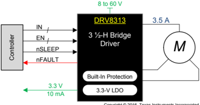

Copyright © 2016, Texas Instruments Incorporated

## Table of Contents

| 1                                                                                                                                                                                                                                                                                                                                                                                          | Features .................................................................. 1                                                                                                                                                                                                                                                                                                              | 8                                                                                                                                                                                                                                                                                                                                                                                          |                                                                                                                                                                                                                                                                                                                                                                                            | Application and Implementation ........................ 15                                                                                                                                                                                                                                                                                                                                 |
|--------------------------------------------------------------------------------------------------------------------------------------------------------------------------------------------------------------------------------------------------------------------------------------------------------------------------------------------------------------------------------------------|--------------------------------------------------------------------------------------------------------------------------------------------------------------------------------------------------------------------------------------------------------------------------------------------------------------------------------------------------------------------------------------------|--------------------------------------------------------------------------------------------------------------------------------------------------------------------------------------------------------------------------------------------------------------------------------------------------------------------------------------------------------------------------------------------|--------------------------------------------------------------------------------------------------------------------------------------------------------------------------------------------------------------------------------------------------------------------------------------------------------------------------------------------------------------------------------------------|--------------------------------------------------------------------------------------------------------------------------------------------------------------------------------------------------------------------------------------------------------------------------------------------------------------------------------------------------------------------------------------------|
| 2                                                                                                                                                                                                                                                                                                                                                                                          | Applications ........................................................... 1                                                                                                                                                                                                                                                                                                                 |                                                                                                                                                                                                                                                                                                                                                                                            | 8.1 Application Information............................................                                                                                                                                                                                                                                                                                                                    | 15                                                                                                                                                                                                                                                                                                                                                                                         |
| 3 Description .............................................................                                                                                                                                                                                                                                                                                                                | 1                                                                                                                                                                                                                                                                                                                                                                                          |                                                                                                                                                                                                                                                                                                                                                                                            | 8.2 Typical Applications ................................................                                                                                                                                                                                                                                                                                                                  | 15                                                                                                                                                                                                                                                                                                                                                                                         |
| 4 Revision History                                                                                                                                                                                                                                                                                                                                                                         | ..................................................... 2                                                                                                                                                                                                                                                                                                                                    | 9                                                                                                                                                                                                                                                                                                                                                                                          | Power Supply Recommendations ......................                                                                                                                                                                                                                                                                                                                                        | 22                                                                                                                                                                                                                                                                                                                                                                                         |
| 5 Pin                                                                                                                                                                                                                                                                                                                                                                                      | Configuration and Functions ......................... 3                                                                                                                                                                                                                                                                                                                                    |                                                                                                                                                                                                                                                                                                                                                                                            | 9.1 Bulk Capacitance ....................................................                                                                                                                                                                                                                                                                                                                  | 22                                                                                                                                                                                                                                                                                                                                                                                         |
| 6 Specifications                                                                                                                                                                                                                                                                                                                                                                           | ......................................................... 4                                                                                                                                                                                                                                                                                                                                | 10                                                                                                                                                                                                                                                                                                                                                                                         | Layout ...................................................................                                                                                                                                                                                                                                                                                                                 | 23                                                                                                                                                                                                                                                                                                                                                                                         |
| 6.1 Absolute Maximum Ratings ......................................                                                                                                                                                                                                                                                                                                                        | 4                                                                                                                                                                                                                                                                                                                                                                                          |                                                                                                                                                                                                                                                                                                                                                                                            | 10.1 Layout Guidelines .................................................                                                                                                                                                                                                                                                                                                                   | 23                                                                                                                                                                                                                                                                                                                                                                                         |
| 6.2 ESD Ratings ............................................................                                                                                                                                                                                                                                                                                                               | 4                                                                                                                                                                                                                                                                                                                                                                                          |                                                                                                                                                                                                                                                                                                                                                                                            | 10.2 Layout Example ....................................................                                                                                                                                                                                                                                                                                                                   | 23                                                                                                                                                                                                                                                                                                                                                                                         |
| 6.3 Recommended Operating Conditions.......................                                                                                                                                                                                                                                                                                                                                | 5                                                                                                                                                                                                                                                                                                                                                                                          |                                                                                                                                                                                                                                                                                                                                                                                            | 10.3 Thermal Considerations........................................                                                                                                                                                                                                                                                                                                                        | 25                                                                                                                                                                                                                                                                                                                                                                                         |
| 6.4 Thermal Information .................................................                                                                                                                                                                                                                                                                                                                  | 5                                                                                                                                                                                                                                                                                                                                                                                          |                                                                                                                                                                                                                                                                                                                                                                                            | 10.4 Power Dissipation .................................................                                                                                                                                                                                                                                                                                                                   | 25                                                                                                                                                                                                                                                                                                                                                                                         |
| 6.5 Electrical Characteristics...........................................                                                                                                                                                                                                                                                                                                                  | 6                                                                                                                                                                                                                                                                                                                                                                                          | 11                                                                                                                                                                                                                                                                                                                                                                                         | Device and Documentation Support .................                                                                                                                                                                                                                                                                                                                                         | 26                                                                                                                                                                                                                                                                                                                                                                                         |
| 6.6 Switching                                                                                                                                                                                                                                                                                                                                                                              | Characteristics.......................................... 7                                                                                                                                                                                                                                                                                                                                |                                                                                                                                                                                                                                                                                                                                                                                            | 11.1 Documentation Support ........................................                                                                                                                                                                                                                                                                                                                        | 26                                                                                                                                                                                                                                                                                                                                                                                         |
| 6.7 Typical Characteristics..............................................                                                                                                                                                                                                                                                                                                                  | 8                                                                                                                                                                                                                                                                                                                                                                                          |                                                                                                                                                                                                                                                                                                                                                                                            | 11.2 Community Resources..........................................                                                                                                                                                                                                                                                                                                                         | 26                                                                                                                                                                                                                                                                                                                                                                                         |
|                                                                                                                                                                                                                                                                                                                                                                                            | ............................................ 10                                                                                                                                                                                                                                                                                                                                            |                                                                                                                                                                                                                                                                                                                                                                                            | 11.3 Trademarks...........................................................                                                                                                                                                                                                                                                                                                                 | 26                                                                                                                                                                                                                                                                                                                                                                                         |
| 7                                                                                                                                                                                                                                                                                                                                                                                          | Detailed Description 7.1 Overview ................................................................. 10                                                                                                                                                                                                                                                                                     |                                                                                                                                                                                                                                                                                                                                                                                            | 11.4 Electrostatic Discharge Caution............................                                                                                                                                                                                                                                                                                                                           | 26                                                                                                                                                                                                                                                                                                                                                                                         |
| 7.2 Functional Block Diagram.......................................                                                                                                                                                                                                                                                                                                                        | 10                                                                                                                                                                                                                                                                                                                                                                                         |                                                                                                                                                                                                                                                                                                                                                                                            | 11.5 Glossary................................................................                                                                                                                                                                                                                                                                                                              | 26                                                                                                                                                                                                                                                                                                                                                                                         |
| 7.3                                                                                                                                                                                                                                                                                                                                                                                        | Feature Description................................................. 11                                                                                                                                                                                                                                                                                                                    | 12                                                                                                                                                                                                                                                                                                                                                                                         | Mechanical, Packaging, and Orderable                                                                                                                                                                                                                                                                                                                                                       |                                                                                                                                                                                                                                                                                                                                                                                            |
| 7.4 Device Functional Modes........................................ 14                                                                                                                                                                                                                                                                                                                     |                                                                                                                                                                                                                                                                                                                                                                                            |                                                                                                                                                                                                                                                                                                                                                                                            | Information ...........................................................                                                                                                                                                                                                                                                                                                                    | 26                                                                                                                                                                                                                                                                                                                                                                                         |
| 4 Revision History                                                                                                                                                                                                                                                                                                                                                                         | 4 Revision History                                                                                                                                                                                                                                                                                                                                                                         | 4 Revision History                                                                                                                                                                                                                                                                                                                                                                         | 4 Revision History                                                                                                                                                                                                                                                                                                                                                                         | 4 Revision History                                                                                                                                                                                                                                                                                                                                                                         |
| Changes from Revision C (November 2015) to Revision D                                                                                                                                                                                                                                                                                                                                      | Changes from Revision C (November 2015) to Revision D                                                                                                                                                                                                                                                                                                                                      | Changes from Revision C (November 2015) to Revision D                                                                                                                                                                                                                                                                                                                                      | Changes from Revision C (November 2015) to Revision D                                                                                                                                                                                                                                                                                                                                      | Page                                                                                                                                                                                                                                                                                                                                                                                       |
| • Changed pin 18 of the VQFN (RHH) package from GND to RSVD ...................................................................................... 4                                                                                                                                                                                                                                       | • Changed pin 18 of the VQFN (RHH) package from GND to RSVD ...................................................................................... 4                                                                                                                                                                                                                                       | • Changed pin 18 of the VQFN (RHH) package from GND to RSVD ...................................................................................... 4                                                                                                                                                                                                                                       | • Changed pin 18 of the VQFN (RHH) package from GND to RSVD ...................................................................................... 4                                                                                                                                                                                                                                       | • Changed pin 18 of the VQFN (RHH) package from GND to RSVD ...................................................................................... 4                                                                                                                                                                                                                                       |
| Changes from Revision B (January 2015) to Revision C                                                                                                                                                                                                                                                                                                                                       | Changes from Revision B (January 2015) to Revision C                                                                                                                                                                                                                                                                                                                                       | Changes from Revision B (January 2015) to Revision C                                                                                                                                                                                                                                                                                                                                       | Changes from Revision B (January 2015) to Revision C                                                                                                                                                                                                                                                                                                                                       | Page                                                                                                                                                                                                                                                                                                                                                                                       |
| • Added a new package to the Device Information table .........................................................................................................                                                                                                                                                                                                                            | • Added a new package to the Device Information table .........................................................................................................                                                                                                                                                                                                                            | • Added a new package to the Device Information table .........................................................................................................                                                                                                                                                                                                                            | • Added a new package to the Device Information table .........................................................................................................                                                                                                                                                                                                                            | 1                                                                                                                                                                                                                                                                                                                                                                                          |
| • Added a new VQFN package for the device .........................................................................................................................                                                                                                                                                                                                                        | • Added a new VQFN package for the device .........................................................................................................................                                                                                                                                                                                                                        | • Added a new VQFN package for the device .........................................................................................................................                                                                                                                                                                                                                        | • Added a new VQFN package for the device .........................................................................................................................                                                                                                                                                                                                                        | 3                                                                                                                                                                                                                                                                                                                                                                                          |
| • Corrected a numbering error on one of the ground pins in the Pin Functions table .............................................................                                                                                                                                                                                                                                           | • Corrected a numbering error on one of the ground pins in the Pin Functions table .............................................................                                                                                                                                                                                                                                           | • Corrected a numbering error on one of the ground pins in the Pin Functions table .............................................................                                                                                                                                                                                                                                           | • Corrected a numbering error on one of the ground pins in the Pin Functions table .............................................................                                                                                                                                                                                                                                           | 3                                                                                                                                                                                                                                                                                                                                                                                          |
| Changes from Revision A (November 2012) to Revision B                                                                                                                                                                                                                                                                                                                                      | Changes from Revision A (November 2012) to Revision B                                                                                                                                                                                                                                                                                                                                      | Changes from Revision A (November 2012) to Revision B                                                                                                                                                                                                                                                                                                                                      | Changes from Revision A (November 2012) to Revision B                                                                                                                                                                                                                                                                                                                                      | Page                                                                                                                                                                                                                                                                                                                                                                                       |
| • Added ESD Ratings table, Feature Description section, Device Functional Modes , Application and Implementation section, Power Supply Recommendations section, Layout section, Device and Documentation Support section, and Mechanical, Packaging, and Orderable Information section ................................................................................................. 4 | • Added ESD Ratings table, Feature Description section, Device Functional Modes , Application and Implementation section, Power Supply Recommendations section, Layout section, Device and Documentation Support section, and Mechanical, Packaging, and Orderable Information section ................................................................................................. 4 | • Added ESD Ratings table, Feature Description section, Device Functional Modes , Application and Implementation section, Power Supply Recommendations section, Layout section, Device and Documentation Support section, and Mechanical, Packaging, and Orderable Information section ................................................................................................. 4 | • Added ESD Ratings table, Feature Description section, Device Functional Modes , Application and Implementation section, Power Supply Recommendations section, Layout section, Device and Documentation Support section, and Mechanical, Packaging, and Orderable Information section ................................................................................................. 4 | • Added ESD Ratings table, Feature Description section, Device Functional Modes , Application and Implementation section, Power Supply Recommendations section, Layout section, Device and Documentation Support section, and Mechanical, Packaging, and Orderable Information section ................................................................................................. 4 |

## 5 Pin Configuration and Functions

PWP Package 28-Pin HTSSOP With PowerPAD Package Top View

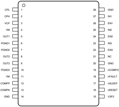

NC - No internal connection

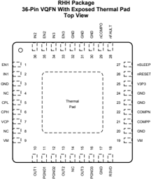

## Pin Functions

| PIN - NAME   | PIN - NO. - PWP   | PIN - NO. - RHH                | TYPE (1)   |                                                                                                                                          |
|--------------|-------------------|--------------------------------|------------|------------------------------------------------------------------------------------------------------------------------------------------|
| COMPN        | 13                | 22                             | I          | Comparator negative input. Uncommitted comparator input                                                                                  |
| COMPP        | 12                | 21                             | I          | Comparator positive input. Uncommitted comparator input                                                                                  |
| CPL          | 1                 | 5                              | PWR        | Charge pump. Connect a VM-rated, 0.01-µF ceramic capacitor between CPH and CPL.                                                          |
| CPH          | 2                 | 6                              | PWR        | Charge pump. Connect a VM-rated, 0.01-µF ceramic capacitor between CPH and CPL.                                                          |
| EN1          | 26                | 1                              | I          | Channel enable. Logic high enables the 1/2-H bridge channel; internal pulldown                                                           |
| EN2          | 24                | 35                             | I          | Channel enable. Logic high enables the 1/2-H bridge channel; internal pulldown                                                           |
| EN3          | 22                | 33                             | I          | Channel enable. Logic high enables the 1/2-H bridge channel; internal pulldown                                                           |
| GND          | 14, 20, 28        | 3, 17, 20, 23, 24, 30, 31, 32, | PWR        | Device ground. Connect to system ground                                                                                                  |
| IN1          | 27                | 2                              | I          | Channel input. Logic high pulls 1/2-H bridge high, logic low pulls 1/2-H bridge low; no effect when ENx is low; internal pulldown input. |
| IN2          | 25                | 36                             | I          | Channel input. Logic high pulls 1/2-H bridge high, logic low pulls 1/2-H bridge low; no effect when ENx is low; internal pulldown input. |
| IN3          | 23                | 34                             | I          | Channel input. Logic high pulls 1/2-H bridge high, logic low pulls 1/2-H bridge low; no effect when ENx is low; internal pulldown input. |
| NC           | 21                | 4, 8, 14                       | NC         | No internal connection. Recommended net given in block diagram (if any)                                                                  |
| nCOMPO       | 19                | 29                             | OD         | Comparator output. Uncommitted comparator output; open drain requires an external pullup.                                                |
| nFAULT       | 18                | 28                             | OD         | Fault indication pin. Pulled logic-low with fault condition; open-drain output requires an external pullup.                              |
| nRESET       | 16                | 26                             | I          | Reset input. Active-low reset input initializes internal logic, clears faults, and disables the outputs, internal pulldown               |

## Pin Functions (continued)

| PIN         | PIN         | PIN         | (1)   |                                                                                                                                             |
|-------------|-------------|-------------|-------|---------------------------------------------------------------------------------------------------------------------------------------------|
| NAME        | NO.         | NO.         | TYPE  | DESCRIPTION                                                                                                                                 |
| NAME        | PWP         | RHH         |       |                                                                                                                                             |
| nSLEEP      | 17          | 27          | I     | Sleep mode input. Logic high to enable device; logic low to enter low-power sleep mode; internal pulldown                                   |
| OUT1        | 5           | 10          | O     | Half-H bridge output, connect to the load                                                                                                   |
| OUT2        | 8           | 13          | O     | Half-H bridge output, connect to the load                                                                                                   |
| OUT3        | 9           | 15          | O     | Half-H bridge output, connect to the load                                                                                                   |
| PGND1       | 6           | 11          | PWR   | Low-side FET source. Connect to GND or to low-side current-sense resistors                                                                  |
| PGND2       | 7           | 12          | PWR   | Low-side FET source. Connect to GND or to low-side current-sense resistors                                                                  |
| PGND3       | 10          | 16          | PWR   | Low-side FET source. Connect to GND or to low-side current-sense resistors                                                                  |
| RSVD        | -           | 18          | -     | Reserved. Leave this pin disconnected.                                                                                                      |
| V3P3        | 15          | 25          | PWR   | Internal regulator. Internal supply voltage; bypass to GND with a 6.3-V, 0.47-µF ceramic capacitor; up to 10-mA external load               |
| VCP         | 3           | 7           | PWR   | Charge pump. Connect a 16-V, 0.1-µF ceramic capacitor to VM                                                                                 |
| VM          | 4, 11       | 9, 19       | PWR   | Power supply. Connect to motor supply voltage; bypass to GND with two 0.1-µF capacitors (for each pin) plus one bulk capacitor rated for VM |
| Thermal pad | Thermal pad | Thermal pad | PWR   | Must be connected to ground                                                                                                                 |

## 6 Specifications

## 6.1 Absolute Maximum Ratings

over operating free-air temperature range (unless otherwise noted) (1)(2)

|                                                                | MIN                | MAX                | UNIT   |
|----------------------------------------------------------------|--------------------|--------------------|--------|
| Power-supply voltage (VM)                                      | -0.3               | 65                 | V      |
| Power supply voltage ramp rate (VM)                            | 0                  | 2                  | V/µs   |
| Charge pump voltage (VCP, CPH)                                 | -0.3               | VM + 12            | V      |
| Charge pump negative switching pin (CPL)                       | -0.3               | VM                 | V      |
| Internal regulator current output (V3P3)                       | 0                  | 10                 | mA     |
| Internal regulator voltage (V3P3)                              | -0.3               | 3.8                | V      |
| Control pin voltage (nRESET, nSLEEP, nFAULT, nCOMPO, ENx, INx) | -0.5               | 7                  | V      |
| Comparator input-voltage (COMPP, COMPN)                        | -0.5               | 7                  | V      |
| Open drain output current (nFAULT, nCOMPO)                     | 0                  | 10                 | mA     |
| Continuous phase node pin voltage (OUTx)                       | -0.7               | VM + 0.7           | V      |
| Continuous 1/2-H-bridge source voltage (PGNDx)                 | -600               | 600                | mV     |
| Peak output current (OUTx)                                     | Internally limited | Internally limited | A      |
| Operating junction temperature T J                             | -40                | 150                | °C     |
| Storage temperature T stg                                      | -60                | 150                | °C     |

## 6.2 ESD Ratings

|         |                         |                                                                                                                        | VALUE       | UNIT   |
|---------|-------------------------|------------------------------------------------------------------------------------------------------------------------|-------------|--------|
| V (ESD) | Electrostatic discharge | Human body model (HBM), per ANSI/ESDA/JEDEC JS-001 (1) Charged device model (CDM), per JEDEC specification JESD22-C101 | ±3000 ±1500 | V      |

## [www.ti.com](http://www.ti.com/)

## 6.3 Recommended Operating Conditions

over operating free-air temperature range (unless otherwise noted)

|        |                                |   MIN | MAX    | UNIT   |
|--------|--------------------------------|-------|--------|--------|
| VM     | Motor power-supply voltage (1) |     8 | 60     | V      |
| V IN   | Digital pin voltage            |     0 | 5.5    | V      |
| f PWM  | Applied PWM signal on ENx, INx |     0 | 250    | kHz    |
| V GNDX | PGNDx pin voltage              |  -500 | 500    | mV     |
| I V3P3 | V3P3 load current              |     0 | 10 (2) | mA     |
| T A    | Operating ambient temperature  |   -40 | 125    | °C     |

## 6.4 Thermal Information

| THERMAL METRIC   | (1)                                          |   DRV8313 - PWP (HTSSOP) - 28 PINS |   DRV8313 - RHH (VQFN) - 36 PINS | UNIT   |
|------------------|----------------------------------------------|------------------------------------|----------------------------------|--------|
| R θ JA           | Junction-to-ambient thermal resistance       |                               31.6 |                             31.1 | °C/W   |
| R θ JC(top)      | Junction-to-case (top) thermal resistance    |                               15.9 |                             17.3 | °C/W   |
| R θ JB           | Junction-to-board thermal resistance         |                                5.6 |                              5.6 | °C/W   |
| ψ JT             | Junction-to-top characterization parameter   |                                0.2 |                              0.2 | °C/W   |
| ψ JB             | Junction-to-board characterization parameter |                                5.5 |                              5.6 | °C/W   |
| R θ JC(bot)      | Junction-to-case (bottom) thermal resistance |                                1.4 |                              1.3 | °C/W   |

## 6.5 Electrical Characteristics

TA = 25°C, over operating free-air temperature range (unless otherwise noted)

| PARAMETER                              | PARAMETER                              | TEST CONDITIONS                        | MIN                                    | TYP                                    | MAX                                    | UNIT                                   |
|----------------------------------------|----------------------------------------|----------------------------------------|----------------------------------------|----------------------------------------|----------------------------------------|----------------------------------------|
| POWER SUPPLIES                         | POWER SUPPLIES                         | POWER SUPPLIES                         | POWER SUPPLIES                         | POWER SUPPLIES                         | POWER SUPPLIES                         | POWER SUPPLIES                         |
| I VM                                   | VM operating supply current            | V M = 24 V, f PWM < 50 kHz             |                                        | 1                                      | 5                                      | mA                                     |
| I VMQ                                  | VM sleep-mode supply current           | V M = 24 V                             |                                        | 500                                    | 800                                    | µA                                     |
| INTERNAL REGULATOR (V3P3)              | INTERNAL REGULATOR (V3P3)              | INTERNAL REGULATOR (V3P3)              | INTERNAL REGULATOR (V3P3)              | INTERNAL REGULATOR (V3P3)              | INTERNAL REGULATOR (V3P3)              | INTERNAL REGULATOR (V3P3)              |
| V 3P3                                  | V3P3 voltage                           | $I_{OUT}$ = 0 to 10 mA                     | 3.1                                    | 3.3                                    | 3.52                                   | V                                      |
| LOGIC-LEVEL INPUTS (nSLEEP, ENx, INx)  | LOGIC-LEVEL INPUTS (nSLEEP, ENx, INx)  | LOGIC-LEVEL INPUTS (nSLEEP, ENx, INx)  | LOGIC-LEVEL INPUTS (nSLEEP, ENx, INx)  | LOGIC-LEVEL INPUTS (nSLEEP, ENx, INx)  | LOGIC-LEVEL INPUTS (nSLEEP, ENx, INx)  | LOGIC-LEVEL INPUTS (nSLEEP, ENx, INx)  |
| V IL                                   | Input low voltage                      |                                        |                                        | 0.6                                    | 0.7                                    | V                                      |
| V IH                                   | Input high voltage                     |                                        | 2.2                                    |                                        | 5.25                                   | V                                      |
| V HYS                                  | Input hysteresis                       |                                        | 50                                     |                                        | 600                                    | mV                                     |
| I IL                                   | Input low current                      | VIN = 0                                | -5                                     |                                        | 5                                      | µA                                     |
| I IH                                   | Input high current                     | VIN = 3.3 V                            |                                        |                                        | 100                                    | µA                                     |
| R PD                                   | Pulldown resistance                    |                                        |                                        | 100                                    |                                        | k Ω                                    |
| OPEN-DRAIN OUTPUTS (nFAULT and nCOMPO) | OPEN-DRAIN OUTPUTS (nFAULT and nCOMPO) | OPEN-DRAIN OUTPUTS (nFAULT and nCOMPO) | OPEN-DRAIN OUTPUTS (nFAULT and nCOMPO) | OPEN-DRAIN OUTPUTS (nFAULT and nCOMPO) | OPEN-DRAIN OUTPUTS (nFAULT and nCOMPO) | OPEN-DRAIN OUTPUTS (nFAULT and nCOMPO) |
| V OL                                   | Output low voltage                     | I O = 5 mA                             |                                        |                                        | 0.5                                    | V                                      |
| I OH                                   | Output high leakage current            | V O = 3.3 V                            |                                        |                                        | 1                                      | µA                                     |
| COMPARATOR (COMPP, COMPN, nCOMPO)      | COMPARATOR (COMPP, COMPN, nCOMPO)      | COMPARATOR (COMPP, COMPN, nCOMPO)      | COMPARATOR (COMPP, COMPN, nCOMPO)      | COMPARATOR (COMPP, COMPN, nCOMPO)      | COMPARATOR (COMPP, COMPN, nCOMPO)      | COMPARATOR (COMPP, COMPN, nCOMPO)      |
| V CM                                   | Common-mode input-voltage range        |                                        | 0                                      |                                        | 5                                      | V                                      |
| V IO                                   | Input offset voltage                   |                                        | -7                                     |                                        | 7                                      | mV                                     |
| I IB                                   | Input bias current                     |                                        | -300                                   |                                        | 300                                    | nA                                     |
| t R                                    | Response time                          | 100-mV step with 10-mV overdrive       |                                        |                                        | 2                                      | µs                                     |
| H-BRIDGE FETs                          | H-BRIDGE FETs                          | H-BRIDGE FETs                          | H-BRIDGE FETs                          | H-BRIDGE FETs                          | H-BRIDGE FETs                          | H-BRIDGE FETs                          |
| r DS(on)                               | High-side FET ON-resistance            | V M = 24 V, I O = 1 A, T J = 25°C      |                                        | 0.24                                   |                                        | Ω                                      |
| r DS(on)                               |                                        | V M = 24 V, I O = 1 A, T J = 85°C (1)  |                                        | 0.29                                   | 0.39                                   | Ω                                      |
| r DS(on)                               | Low-side FET ON-resistance             | V M = 24 V, I O = 1 A, T J = 25°C      |                                        | 0.24                                   |                                        | Ω                                      |
| r DS(on)                               |                                        | V M = 24 V, I O = 1 A, T J = 85°C (1)  |                                        | 0.29                                   | 0.39                                   | Ω                                      |
| I OFF Off-state leakage current        | I OFF Off-state leakage current        | I OFF Off-state leakage current        | -2                                     |                                        | 2                                      | µA                                     |
| PROTECTION CIRCUITS                    | PROTECTION CIRCUITS                    | PROTECTION CIRCUITS                    | PROTECTION CIRCUITS                    | PROTECTION CIRCUITS                    | PROTECTION CIRCUITS                    | PROTECTION CIRCUITS                    |
| V UVLO                                 | VM undervoltage lockout voltage        | V M rising                             |                                        | 6.3                                    | 8                                      | V                                      |
| I OCP                                  | Overcurrent protection trip level      |                                        | 3                                      | 5                                      |                                        | A                                      |
| t OCP                                  | Overcurrent protection deglitch time   |                                        |                                        | 5                                      |                                        | µs                                     |
| T TSD (1)                              | Thermal shutdown temperature           | Die temperature                        | 150                                    | 160                                    | 180                                    | °C                                     |
| T HYS (1)                              | Thermal shutdown hysteresis            | Die temperature                        |                                        | 35                                     |                                        | °C                                     |

## [www.ti.com](http://www.ti.com/)

## 6.6 Switching Characteristics

## TA = 25°C, VM = 24 V, RL = 20 Ω

| PARAMETER   | PARAMETER                               | TEST CONDITIONS   |   MIN |   TYP |   MAX | UNIT   |
|-------------|-----------------------------------------|-------------------|-------|-------|-------|--------|
| t 1         | Delay time, ENx high to OUTx high       | INx = 1           |   130 |       |   330 | ns     |
| t 2         | Delay time, ENx low to OUTx low         | INx = 1           |   275 |       |   475 | ns     |
| t 3         | Delay time, ENx high to OUTx low        | INx = 0           |   100 |       |   300 | ns     |
| t 4         | Delay time, ENx low to OUTx high        | INx = 0           |   200 |       |   400 | ns     |
| t 5         | Delay time, INx high to OUTx high       | ENx = 1           |   300 |       |   500 | ns     |
| t 6         | Delay time, INx low to OUTx low         | ENx = 1           |   275 |       |   475 | ns     |
| t r         | Output rise time, resistive load to GND |                   |    30 |       |   150 | ns     |
| t f         | Output fall time, resistive load to GND |                   |    30 |       |   150 | ns     |
| t DEAD (1)  | Output dead time                        |                   |    90 |    90 |    90 | ns     |

## (1) Specified by design and characterization data

INx = 1, Resistive Load to GND

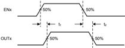

ENx = 1, Resistive Load to GND

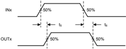

Figure 1. DRV8313 Switching Characteristics

INx = 0, Resistive Load to VM

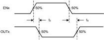

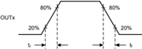

T0543-01

## 6.7 Typical Characteristics

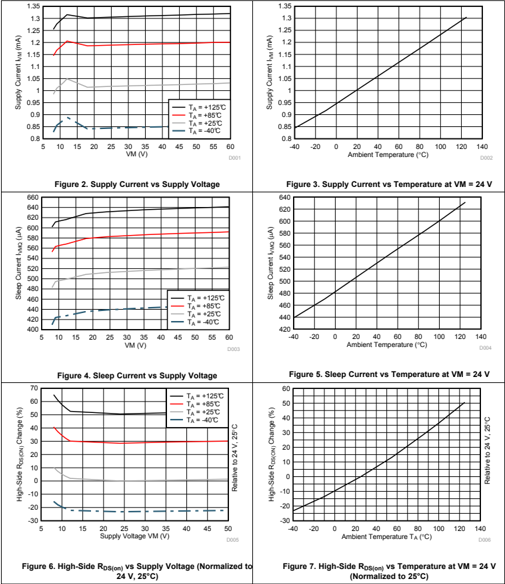

## [www.ti.com](http://www.ti.com/)

## Typical Characteristics (continued)

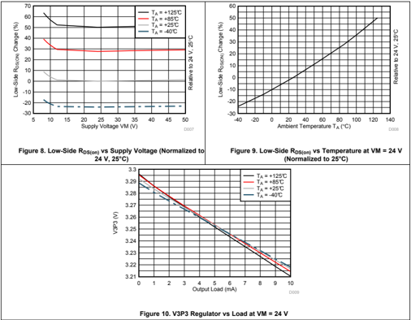

## 7 Detailed Description

## 7.1 Overview

The DRV8313 integrates three independent 2.5-A half-H bridges, protection circuits, sleep mode, fault reporting, and a comparator. The single power supply supports a wide 8-V to 60-V range, making it well-suited for motor drive applications.

## 7.2 Functional Block Diagram

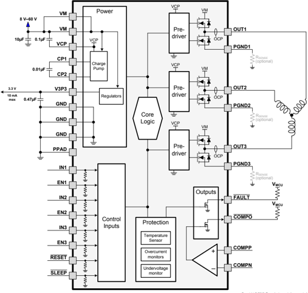

Copyright © 2016, Texas Instruments Incorporated

## 7.3 Feature Description

## 7.3.1 Output Stage

The DRV8313 contains three half-H-bridge drivers. The source terminals of the low-side FETs of all three half-Hbridges terminate at separate pins (PGND1, PGND2, and PGND3) to allow the use of a low-side current-sense resistor on each output, if desired. The user can also connect all three together to a single low-side sense resistor, or can connect them directly to ground if current sensing is unneeded.

If using a low-side sense resistor, ensure that the voltage on the PGND1, PGND2, or PGND3 pin does not exceed ±500 mV.

The device has two VM motor power-supply pins. Connect both VM pins together to the motor-supply voltage.

## 7.3.2 Bridge Control

The INx input pins directly control the state (high or low) of the OUTx outputs; the ENx input pins enable or disable the OUTx driver. Table 1 shows the logic:

Table 1. Logic States

| INx   |   ENx | OUTx   |
|-------|-------|--------|
| X     |     0 | Z      |
| 0     |     1 | L      |
| 1     |     1 | H      |

## 7.3.3 Charge Pump

Because the output stages use N-channel FETs, the device requires a gate-drive voltage higher than the VM power supply to enhance the high-side FETs fully. The DRV8313 integrates a charge-pump circuit that generates a voltage above the VM supply for this purpose.

The charge pump requires two external capacitors for operation. See the block diagram and pin descriptions for details on these capacitors (value, connection, and so forth).

The charge pump shuts down when nSLEEP is low.

Figure 11. DRV8313 Charge Pump

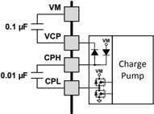

## 7.3.4 Comparator

The DRV8313 includes an uncommitted comparator, which can find use as a current-limit comparator or for other purposes.

Figure 12 shows connections to use the comparator to sense current for implementing a current limit. Current from all three low-side FETs is sensed using a single low-side sense resistor. The voltage across the sense resistor is compared with a reference, and when the sensed voltage exceeds the reference, a current-limit condition is signaled to the controller. The V3P3 internal voltage regulator can be used to set the reference voltage of the comparator.

Figure 12. Comparator As Current Monitor

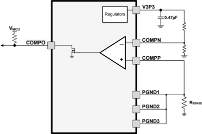

## 7.3.5 Protection Circuits

The DRV8313 has full protection against undervoltage, overcurrent, and overtemperature events.

## 7.3.5.1 Undervoltage Lockout (UVLO)

If at any time the voltage on the VM pin falls below the undervoltage threshold voltage (VUVLO), all FETs in the Hbridge will be disabled, the charge pump will be disabled, the internal logic is reset, and the nFAULT pin will be driven low. Operation will resume when VM rises above the UVLO threshold. The nFAULT pin will be released after operation has resumed.

## 7.3.5.2 Thermal Shutdown (TSD)

If the die temperature exceeds safe limits, all FETs in the H-bridge will be disabled and the nFAULT pin will be driven low. Once the die temperature has fallen to a safe level operation will automatically resume. The nFAULT pin will be released after operation has resumed.

## 7.3.5.3 Overcurrent Protection (OCP)

An analog current limit circuit on each FET limits the current through the FET by removing the gate drive. If this analog current limit persists for longer than tOCP, the device disables the channel experiencing the overcurrent and drives the nFAULT pin low. The driver remains off until either assertion of nRESET or the cycling of VM power.

Overcurrent conditions on both high- and low-side devices, that is, a short to ground, supply, or across the motor winding, all result in an overcurrent shutdown.

Table 2. Fault Condition Summary

| FAULT                  | CONDITION               | ERROR REPORT   | H-BRIDGE   | CHARGE PUMP   | V3P3      | RECOVERY                             |
|------------------------|-------------------------|----------------|------------|---------------|-----------|--------------------------------------|
| VM undervoltage (UVLO) | VM < V UVLO (max 8 V)   | nFAULT         | Disabled   | Disabled      | Operating | VM > V UVLO (max 8 V)                |
| Thermal Shutdown (TSD) | T J > T TSD (min 150°C) | nFAULT         | Disabled   | Operating     | Operating | T J < T TSD - T HYS (T HYS typ 35°C) |
| Overcurrent (OCP)      | $I_{OUT}$ > I OCP (min 3 A) | nFAULT         | Disabled   | Operating     | Operating | nRESET                               |

## 7.4 Device Functional Modes

The DRV8313 is active unless the nSLEEP pin is brought logic low. In sleep mode the charge pump is disabled, the output FETs are disabled Hi-Z, and the V3P3 regulator is disabled. The DRV313 is brought out of sleep mode automatically if nSLEEP is brought logic high.

## 7.4.1 nRESET and nSLEEP Operation

The nRESET pin, when driven low, resets any faults. It also disables the output drivers while it is active. The device ignores all inputs while nRESET is active. Note that there is an internal power-up-reset circuit, so that driving nRESET at power up is not required.

Driving nSLEEP low puts the device into a low-power sleep state. Entering this state disables the output drivers, stops the gate-drive charge pump, resets all internal logic (including faults), and stops all internal clocks. In this state, the device ignores all inputs until nSLEEP returns inactive-high. When returning from sleep mode, some time (approximately 1 ms) must pass before the motor driver becomes fully operational. The V3P3 regulator remains operational in sleep mode.

Table 3. Functional Modes Summary

| FAULT             | CONDITION                      | H-BRIDGE   | CHARGE PUMP   | V3P3      |
|-------------------|--------------------------------|------------|---------------|-----------|
| Operating         | 8 V < VM < 60 V nSLEEP pin = 1 | Operating  | Operating     | Operating |
| Sleep mode        | 8 V < VM < 60 V nSLEEP pin = 0 | Disabled   | Disabled      | Disabled  |
| Fault encountered | VM undervoltage (UVLO)         | Disabled   | Disabled      | Operating |
| Fault encountered | Overcurrent (OCP)              | Disabled   | Operating     | Operating |
| Fault encountered | Thermal shutdown (TSD)         | Disabled   | Operating     | Operating |

## 8 Application and Implementation

## NOTE

Information in the following applications sections is not part of the TI component specification, and TI does not warrant its accuracy or completeness. TI's customers are responsible for determining suitability of components for their purposes. Customers should validate and test their design implementation to confirm system functionality.

## 8.1 Application Information

The DRV8313 can be used to drive Brushless-DC motors, Brushed-DC motors, and solenoid loads. The following design procedure can be used to configure the DRV8313.

## 8.2 Typical Applications

## 8.2.1 Three-Phase Brushless-DC Motor Control

In this application, the DRV8313 is used to drive a Brushless-DC motor

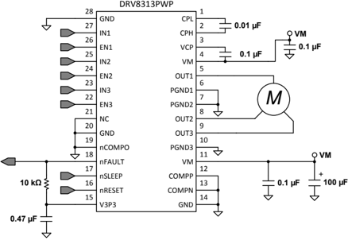

Copyright © 2016, Texas Instruments Incorporated

Figure 13. BLDC Driver Application Schematic

## Typical Applications (continued)

## 8.2.1.1 Design Requirements

Table 4 gives design input parameters for system design.

Table 4. Design Parameters

| DESIGN PARAMETER         | REFERENCE   | EXAMPLE VALUE   |
|--------------------------|-------------|-----------------|
| Typical supply voltage   | VM          | 18 V            |
| Maximum voltage          | VM MAX      | 36 V            |
| Target rms current       | I RMS       | 1.2 A           |
| Motor winding resistance | M R         | 0.5 Ω           |
| Motor winding inductance | M L         | 0.28 mH         |
| Motor poles              | M P         | 16 poles        |
| Motor rated RPM          | M RPM       | 4000 RPM        |
| PWM frequency            | f PWM       | 25 kHz          |

## 8.2.1.2 Detailed Design Procedure

## 8.2.1.2.1 Motor Voltage

Brushless-DC motors are typically rated for a certain voltage (for example 12 V and 24 V). Operating a motor at a higher voltage corresponds to a lower drive current to obtain the same motor power. A higher operating voltage also corresponds to a higher obtainable rpm. DRV8313 allows for the use of higher operaing voltage because of a maximum VM rating of 60 V.

Operating at lower voltages generally allows for more accurate control of phase currents. The DRV8313 functions down to a supply of 8 V.

## 8.2.1.2.2 Motor Commutation

The DRV8313 can drive both trapezoidal (120°) and sinusiodal (180°) commutation due to independent control of each of the three 1/2-H bridges.

Both synchronous and asynchronous rectification are supported. Synchronous rectification is achieved by applying a pulse-width-modulated (PWM) input signal to the INx pins while driving. The user can also implement asynchronous rectification by applying the PWM signal to the ENx inputs.

Table 5. Trapezoidal (120°) Commutation States

| State   | OUT1 (Phase U) - IN1   |   OUT1 (Phase U) - EN1 | OUT1 (Phase U) - OUT1   | OUT2 (Phase V) - IN2   |   OUT2 (Phase V) - EN2 | OUT2 (Phase V) - OUT2   | OUT3 (Phase W) - IN3   |   OUT3 (Phase W) - EN3 | OUT3 (Phase W) - OUT3   |
|---------|------------------------|------------------------|-------------------------|------------------------|------------------------|-------------------------|------------------------|------------------------|-------------------------|
| 1       | X                      |                      0 | Z                       | 1                      |                      1 | H                       | 0                      |                      1 | L                       |
| 2       | 1                      |                      1 | H                       | X                      |                      0 | Z                       | 0                      |                      1 | L                       |
| 3       | 1                      |                      1 | H                       | 0                      |                      1 | L                       | X                      |                      0 | Z                       |
| 4       | X                      |                      0 | Z                       | 0                      |                      1 | L                       | 1                      |                      1 | H                       |
| 5       | 0                      |                      1 | L                       | X                      |                      0 | Z                       | 1                      |                      1 | H                       |
| 6       | 0                      |                      1 | L                       | 1                      |                      1 | H                       | X                      |                      0 | Z                       |
| Brake   | 0                      |                      1 | L                       | 0                      |                      1 | L                       | 0                      |                      1 | L                       |
| Coast   | X                      |                      0 | Z                       | X                      |                      0 | Z                       | X                      |                      0 | Z                       |

## [www.ti.com](http://www.ti.com/)

## 8.2.1.3 Application Curve

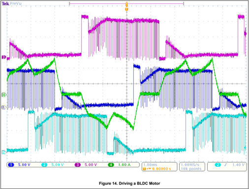

## 8.2.2 Three-Phase Brushless-DC Motor Control With Current Monitor

In this application, the DRV8313 is used to drive a brushless-DC motor and the uncommitted comparator is used to monitor the motor current

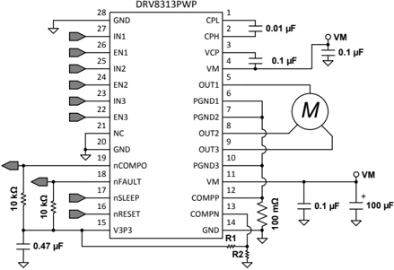

Copyright © 2016, Texas Instruments Incorporated

Figure 15. Uncommitted Comparator Used As a Current Monitor

## 8.2.2.1 Design Requirements

Table 6 gives design input parameters for system design.

Table 6. Design Parameters

| DESIGN PARAMETER   | REFERENCE   | EXAMPLE VALUE   |
|--------------------|-------------|-----------------|
| Trip current       | I TRIP      | 2.5 A           |

## 8.2.2.2 Detailed Design Procedure

## 8.2.2.2.1 Trip Current

The uncommitted comparator is configured such that the negative input COMPN is connected to the PGNDx pins. A sense resistor is placed from the PGNDx/COMPN pins to GND.

The voltage on the COMPP pin will set the current monitor trip threshold. In this case, the the nCOMPO pin will change state when COMPP and COMPN have the same potential.

$${I}_{TRIP}\left({A}\right)={\frac{COMPN\left(V\right)}{R_{SENSE}\left(\Omega\right)}}\qquad\qquad\qquad\qquad\qquad\qquad\quad\tag{1}$$

## [www.ti.com](http://www.ti.com/)

Example:

If the desired trip current is 2.5 A

Set $R_{SENSE}$ = 200 m

Ω

COMPN would have to be 0.5 V.

Create a resistor divider from V3P3 (3.3 V) to set COMPN ≈ 0.5 V.

Set R2 = 10 k Ω , set R1 = 56 k Ω

## 8.2.2.2.2 Sense Resistor

For optimal performance, the sense resistor must have the following characteristics:

- Surface-mount
- Low inductance
- Rated for high enough power
- Placed closely to the motor driver

The power dissipated by the sense resistor equals Irms 2 × R. For example, if the rms motor current is 1 A and a 200-m Ω sense resistor is used, the resistor will dissipate 1 A 2 × 0.2 Ω = 0.2 W. The power quickly increases with higher current levels.

Resistors typically have a rated power within some ambient temperature range, along with a derated power curve for high ambient temperatures. When a PCB is shared with other components generating heat, margin should be added. Measuring the actual sense-resistor temperature in a final system, along with the power MOSFETs, is always best because these are often the hottest components.

Because power resistors are larger and more expensive than standard resistors, using multiple standard resistors in parallel, between the sense node and ground is a common practice. This configuration distributes the current and heat dissipation.

## 8.2.3 Brushed-DC and Solenoid Load

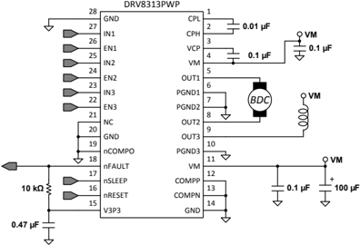

Copyright © 2016, Texas Instruments Incorporated

Figure 16. Brushed-DC and Solenoid Schematic

## 8.2.3.1 Design Requirements

Table 7 gives design input parameters for system design.

Table 7. Design Parameters

| DESIGN PARAMETER           | REFERENCE   | EXAMPLE VALUE   |
|----------------------------|-------------|-----------------|
| Brushed motor rms current  | I RMS, BDC  | 1.0 A           |
| Brushed motor peak current | I PEAK, BDC | 2.0 A           |
| Solenoid rms current       | I RMS, SOL  | 0.5 A           |
| Solenoid peak current      | I PEAK, SOL | 1.0 A           |

## 8.2.3.1.1 Detailed Design Procedure

Table 8. Brushed-DC Control

| Function                    | IN1   |   EN1 | IN2   |   EN2 | OUT1   | OUT2   |
|-----------------------------|-------|-------|-------|-------|--------|--------|
| Forward                     | 1     |     1 | 0     |     1 | H      | L      |
| Reverse                     | 0     |     1 | 1     |     1 | L      | H      |
| Brake (low-side slow decay) | 0     |     1 | 0     |     1 | L      | L      |
| High-side slow decay        | 1     |     1 | 1     |     1 | H      | H      |
| Coast                       | X     |     0 | X     |     0 | Z      | Z      |

Table 9. Solenoid Control (High-Side Load)

| Function    | IN3   |   EN3 | OUT3   |
|-------------|-------|-------|--------|
| Coast / Off | X     |     0 | Z      |
| On          | 0     |     1 | L      |
| Brake       | 1     |     1 | H      |

## [www.ti.com](http://www.ti.com/)

## 8.2.4 Three Solenoid Loads

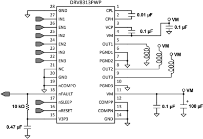

Copyright © 2016, Texas Instruments Incorporated

Figure 17. Three Independent Load Connections Schematic

## 8.2.4.1 Design Requirements

Table 10 gives design input parameters for system design.

Table 10. Design Parameters

| DESIGN PARAMETER      | REFERENCE   | EXAMPLE VALUE   |
|-----------------------|-------------|-----------------|
| Solenoid rms current  | I RMS, SOL  | 1.0 A           |
| Solenoid peak current | I PEAK, SOL | 1.5 A           |

## 8.2.4.1.1 Detailed Design Procedure

Table 11. Solenoid Control (high-side load)

| Function    | IN2   |   EN2 | OUT2   |
|-------------|-------|-------|--------|
| Coast / Off | X     |     0 | Z      |
| On          | 0     |     1 | L      |
| Brake       | 1     |     1 | H      |

Table 12. Solenoid Control (low-side load)

| Function    | IN1   |   EN1 | OUT1   |
|-------------|-------|-------|--------|
| Coast / Off | X     |     0 | Z      |
| On          | 1     |     1 | H      |
| Brake       | 0     |     1 | L      |

## 9 Power Supply Recommendations

## 9.1 Bulk Capacitance

Having an appropriate local bulk capacitance is an important factor in motor drive system design. It is generally beneficial to have more bulk capacitance, while the disadvantages are increased cost and physical size.

The amount of local capacitance needed depends on a variety of factors, including:

- The highest current required by the motor system
- The capacitance and current capability of the power supply
- The amount of parasitic inductance between the power supply and motor system
- The acceptable voltage ripple
- The type of motor used (brushed dc, brushless DC, stepper)
- The motor braking method

The inductance between the power supply and the motor drive system limits the rate current can change from the power supply. If the local bulk capacitance is too small, the system responds to excessive current demands or dumps from the motor with a change in voltage. When adequate bulk capacitance is used, the motor voltage remains stable and high current can be quickly supplied.

The data sheet generally provides a recommended value, but system-level testing is required to determine the appropriate sized bulk capacitor.

Figure 18. Example Setup of Motor Drive System With External Power Supply

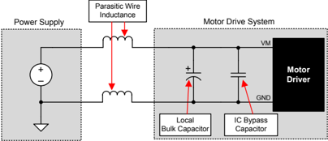

The voltage rating for bulk capacitors should be higher than the operating voltage, to provide margin for cases when the motor transfers energy to the supply.

## [www.ti.com](http://www.ti.com/)

## 10 Layout

## 10.1 Layout Guidelines

The bulk capacitor should be placed to minimize the distance of the high-current path through the motor driver device. The connecting metal trace widths should be as wide as possible, and numerous vias should be used when connecting PCB layers. These practices minimize inductance and allow the bulk capacitor to deliver high current.

Small-value capacitors should be ceramic, and placed closely to device pins.

The high-current device outputs should use wide metal traces.

The device thermal pad should be soldered to the PCB top-layer ground plane. Multiple vias should be used to connect to a large bottom-layer ground plane. The use of large metal planes and multiple vias helps dissipate the I 2 × r DS(on) heat that is generated in the device.

In Figure 19 and Figure 20, the uncommitted comparator is not used. Because this is the case, the COMPP, COMPN, and COMPO pins are tied to GND.

## 10.2 Layout Example

Figure 19. Recommended Layout Example For HTSSOP PWP Package

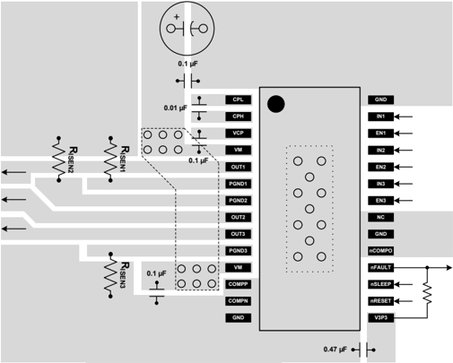

## Layout Example (continued)

Figure 20. Recommended Layout Example For QFN RHH Package

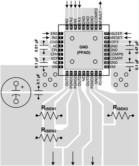

## 10.3 Thermal Considerations

The DRV8313 has thermal shutdown (TSD) as previously described. A die temperature in excess of 150°C (minimally) disables the device until the temperature drops to a safe level.

Any tendency of the device to enter thermal shutdown is an indication of excessive power dissipation, insufficient heatsinking, or too high an ambient temperature.

## 10.3.1 Heatsinking

The PowerPAD package uses an exposed pad to remove heat from the device. For proper operation, this pad must be thermally connected to copper on the PCB to dissipate heat. On a multi-layer PCB with a ground plane, add a number of vias to connect the thermal pad to the ground plane to accomplish this. On PCBs without internal planes, add copper area on either side of the PCB to dissipate heat. If the copper area is on the opposite side of the PCB from the device, use thermal vias to transfer the heat between the top and bottom layers.

For details about how to design the PCB, see PowerPAD Thermally Enhanced Package (SLMA002) and PowerPAD Made Easy (SLMA004), which are available at www.ti.com.

In general, providing more copper area allows the dissipation of more power.

## 10.4 Power Dissipation

The power dissipated in the output FET resistance, or rDS(on) dominates power dissipation in the DRV8313. A rough estimate of average power dissipation of each half-H-bridge when running a static load is:

$$P=r_{DS(on)}\!\times\!(I_{OUT})^{2}$$

## where

- P is the power dissipation of one H-bridge,
- r DS(on) is the resistance of each FET, and
- ·
- $I_{OUT}$ is equal to the average current drawn by the load. (2)

At start-up and fault conditions, this current is much higher than normal running current; remember to take these peak currents and their duration into consideration.

The total device dissipation is the power dissipated in each of the three half-H-bridges added together.

The maximum amount of power that the device can dissipate depends on ambient temperature and heatsinking.

Note that rDS(on) increases with temperature, so as the device heats, the power dissipation increases. Take this into consideration when sizing the heatsink.

## 11 Device and Documentation Support

## 11.1 Documentation Support

## 11.1.1 Related Documentation

For related documentation, see the following:

- Calculating Motor Driver Power Dissipation , SLVA504
- DRV8313EVM User's Guide , SLVU815
- PowerPAD™ Thermally Enhanced Package , SLMA002
- PowerPAD™ Made Easy , SLMA004
- Sensored 3-Phase BLDC Motor Control Using MSP430 , SLAA503
- Understanding Motor Driver Current Ratings , SLVA505

## 11.2 Community Resources

The following links connect to TI community resources. Linked contents are provided "AS IS" by the respective contributors. They do not constitute TI specifications and do not necessarily reflect TI's views; see TI's Terms of Use.

TI E2E™ Online Community TI's Engineer-to-Engineer (E2E) Community. Created to foster collaboration among engineers. At e2e.ti.com, you can ask questions, share knowledge, explore ideas and help solve problems with fellow engineers.

Design Support TI's Design Support Quickly find helpful E2E forums along with design support tools and contact information for technical support.

## 11.3 Trademarks

PowerPAD, E2E are trademarks of Texas Instruments.

All other trademarks are the property of their respective owners.

## 11.4 Electrostatic Discharge Caution

These devices have limited built-in ESD protection. The leads should be shorted together or the device placed in conductive foam during storage or handling to prevent electrostatic damage to the MOS gates.

## 11.5 Glossary

SLYZ022 TI Glossary .

This glossary lists and explains terms, acronyms, and definitions.

## 12 Mechanical, Packaging, and Orderable Information

The following pages include mechanical, packaging, and orderable information. This information is the mostcurrent data available for the designated device. This data is subject to change without notice and without revision of this document. For browser-based versions of this data sheet, see the left-hand navigation pane.

www.ti.com

## PACKAGING INFORMATION

| Orderable part number   | Status (1)   | Material type (2)   | Package &#124; Pins    | Package qty &#124; Carrier   | RoHS (3)   | Lead finish/ Ball material (4)   | MSL rating/ Peak reflow (5)   | Op temp (°C)   | Part marking (6)   |
|-------------------------|--------------|---------------------|------------------------|------------------------------|------------|----------------------------------|-------------------------------|----------------|--------------------|
| DRV8313PWP              | Active       | Production          | HTSSOP (PWP) &#124; 28 | 50 &#124; TUBE               | Yes        | NIPDAU                           | Level-3-260C-168 HR           | -40 to 125     | DRV8313            |
| DRV8313PWP.A            | Active       | Production          | HTSSOP (PWP) &#124; 28 | 50 &#124; TUBE               | Yes        | NIPDAU                           | Level-3-260C-168 HR           | -40 to 125     | DRV8313            |
| DRV8313PWP.B            | Active       | Production          | HTSSOP (PWP) &#124; 28 | 50 &#124; TUBE               | Yes        | NIPDAU                           | Level-3-260C-168 HR           | -40 to 125     | DRV8313            |
| DRV8313PWPR             | Active       | Production          | HTSSOP (PWP) &#124; 28 | 2000 &#124; LARGE T&R        | Yes        | NIPDAU                           | Level-3-260C-168 HR           | -40 to 125     | DRV8313            |
| DRV8313PWPR.A           | Active       | Production          | HTSSOP (PWP) &#124; 28 | 2000 &#124; LARGE T&R        | Yes        | NIPDAU                           | Level-3-260C-168 HR           | -40 to 125     | DRV8313            |
| DRV8313PWPR.B           | Active       | Production          | HTSSOP (PWP) &#124; 28 | 2000 &#124; LARGE T&R        | Yes        | NIPDAU                           | Level-3-260C-168 HR           | -40 to 125     | DRV8313            |
| DRV8313PWPRG4           | Active       | Production          | HTSSOP (PWP) &#124; 28 | 2000 &#124; LARGE T&R        | Yes        | NIPDAU                           | Level-3-260C-168 HR           | -40 to 125     | DRV8313            |
| DRV8313PWPRG4.A         | Active       | Production          | HTSSOP (PWP) &#124; 28 | 2000 &#124; LARGE T&R        | Yes        | NIPDAU                           | Level-3-260C-168 HR           | -40 to 125     | DRV8313            |
| DRV8313PWPRG4.B         | Active       | Production          | HTSSOP (PWP) &#124; 28 | 2000 &#124; LARGE T&R        | Yes        | NIPDAU                           | Level-3-260C-168 HR           | -40 to 125     | DRV8313            |
| DRV8313RHH              | Active       | Production          | VQFN (RHH) &#124; 36   | 60 &#124; TUBE               | Yes        | NIPDAU                           | Level-3-260C-168 HR           | -40 to 125     | DRV8313            |
| DRV8313RHH.A            | Active       | Production          | VQFN (RHH) &#124; 36   | 60 &#124; TUBE               | Yes        | NIPDAU                           | Level-3-260C-168 HR           | -40 to 125     | DRV8313            |
| DRV8313RHH.B            | Active       | Production          | VQFN (RHH) &#124; 36   | 60 &#124; TUBE               | Yes        | NIPDAU                           | Level-3-260C-168 HR           | -40 to 125     | DRV8313            |
| DRV8313RHHR             | Active       | Production          | VQFN (RHH) &#124; 36   | 2500 &#124; LARGE T&R        | Yes        | NIPDAU                           | Level-3-260C-168 HR           | -40 to 125     | DRV8313            |
| DRV8313RHHR.A           | Active       | Production          | VQFN (RHH) &#124; 36   | 2500 &#124; LARGE T&R        | Yes        | NIPDAU                           | Level-3-260C-168 HR           | -40 to 125     | DRV8313            |
| DRV8313RHHR.B           | Active       | Production          | VQFN (RHH) &#124; 36   | 2500 &#124; LARGE T&R        | Yes        | NIPDAU                           | Level-3-260C-168 HR           | -40 to 125     | DRV8313            |
| DRV8313RHHRG4           | Active       | Production          | VQFN (RHH) &#124; 36   | 2500 &#124; LARGE T&R        | Yes        | NIPDAU                           | Level-3-260C-168 HR           | -40 to 125     | DRV8313            |
| DRV8313RHHRG4.A         | Active       | Production          | VQFN (RHH) &#124; 36   | 2500 &#124; LARGE T&R        | Yes        | NIPDAU                           | Level-3-260C-168 HR           | -40 to 125     | DRV8313            |
| DRV8313RHHRG4.B         | Active       | Production          | VQFN (RHH) &#124; 36   | 2500 &#124; LARGE T&R        | Yes        | NIPDAU                           | Level-3-260C-168 HR           | -40 to 125     | DRV8313            |

www.ti.com

## PACKAGE OPTION ADDENDUM

10-Nov-2025

(5) MSL rating/Peak reflow: The moisture sensitivity level ratings and peak solder (reflow) temperatures. In the event that a part has multiple moisture sensitivity ratings, only the lowest level per JEDEC standards is shown. Refer to the shipping label for the actual reflow temperature that will be used to mount the part to the printed circuit board.

(6) Part marking: There may be an additional marking, which relates to the logo, the lot trace code information, or the environmental category of the part.

Multiple part markings will be inside parentheses. Only one part marking contained in parentheses and separated by a "~" will appear on a part. If a line is indented then it is a continuation of the previous line and the two combined represent the entire part marking for that device.

Important Information and Disclaimer: The information provided on this page represents TI's knowledge and belief as of the date that it is provided. TI bases its knowledge and belief on information provided by third parties, and makes no representation or warranty as to the accuracy of such information. Efforts are underway to better integrate information from third parties. TI has taken and continues to take reasonable steps to provide representative and accurate information but may not have conducted destructive testing or chemical analysis on incoming materials and chemicals. TI and TI suppliers consider certain information to be proprietary, and thus CAS numbers and other limited information may not be available for release.

In no event shall TI's liability arising out of such information exceed the total purchase price of the TI part(s) at issue in this document sold by TI to Customer on an annual basis.

www.ti.com

## PACKAGE MATERIALS INFORMATION

10-Aug-2026

## TAPE AND REEL INFORMATION

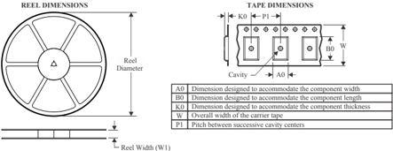

## QUADRANT ASSIGNMENTS FOR PIN 1 ORIENTATION IN TAPE

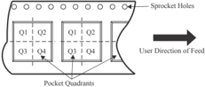

| Device        | Package Type   | Package Drawing   |   Pins |   SPQ |   Reel Diameter (mm) |   Reel Width W1 (mm) |   A0 (mm) |   B0 (mm) |   K0 (mm) |   P1 (mm) |   W (mm) | Pin1 Quadrant   |
|---------------|----------------|-------------------|--------|-------|----------------------|----------------------|-----------|-----------|-----------|-----------|----------|-----------------|
| DRV8313PWPR   | HTSSOP         | PWP               |     28 |  2000 |                330.0 |                 16.4 |       6.9 |      10.2 |       1.8 |      12.0 |     16.0 | Q1              |
| DRV8313PWPRG4 | HTSSOP         | PWP               |     28 |  2000 |                330.0 |                 16.4 |       6.9 |      10.2 |       1.8 |      12.0 |     16.0 | Q1              |
| DRV8313RHHR   | VQFN           | RHH               |     36 |  2500 |                330.0 |                 16.4 |       6.3 |       6.3 |       1.1 |      12.0 |     16.0 | Q2              |
| DRV8313RHHRG4 | VQFN           | RHH               |     36 |  2500 |                330.0 |                 16.4 |       6.3 |       6.3 |       1.1 |      12.0 |     16.0 | Q2              |

## *All dimensions are nominal

www.ti.com

## PACKAGE MATERIALS INFORMATION

10-Aug-2026

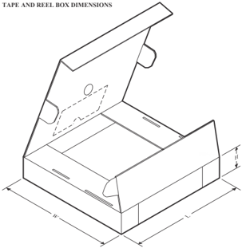

*All dimensions are nominal

| Device        | Package Type   | Package Drawing   |   Pins |   SPQ |   Length (mm) |   Width (mm) |   Height (mm) |
|---------------|----------------|-------------------|--------|-------|---------------|--------------|---------------|
| DRV8313PWPR   | HTSSOP         | PWP               |     28 |  2000 |         350.0 |        350.0 |          43.0 |
| DRV8313PWPRG4 | HTSSOP         | PWP               |     28 |  2000 |         350.0 |        350.0 |          43.0 |
| DRV8313RHHR   | VQFN           | RHH               |     36 |  2500 |         367.0 |        367.0 |          38.0 |
| DRV8313RHHRG4 | VQFN           | RHH               |     36 |  2500 |         367.0 |        367.0 |          38.0 |

www.ti.com

## PACKAGE MATERIALS INFORMATION

10-Aug-2026

## TUBE

B - Alignment groove width

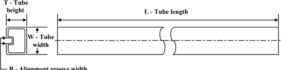

## *All dimensions are nominal

| Device       | Package Name   | Package Type   |   Pins |   SPQ |   L (mm) |   W (mm) |   T (µm) |   B (mm) |
|--------------|----------------|----------------|--------|-------|----------|----------|----------|----------|
| DRV8313PWP   | PWP            | HTSSOP         |     28 |    50 |      530 |     10.2 |     3600 |      3.5 |
| DRV8313PWP.A | PWP            | HTSSOP         |     28 |    50 |      530 |     10.2 |     3600 |      3.5 |
| DRV8313PWP.B | PWP            | HTSSOP         |     28 |    50 |      530 |     10.2 |     3600 |      3.5 |
| DRV8313RHH   | RHH            | VQFN           |     36 |    60 |    381.5 |     7.92 |     2286 |        0 |
| DRV8313RHH.A | RHH            | VQFN           |     36 |    60 |    381.5 |     7.92 |     2286 |        0 |
| DRV8313RHH.B | RHH            | VQFN           |     36 |    60 |    381.5 |     7.92 |     2286 |        0 |

4.4 x 9.7, 0.65 mm pitch

## GENERIC PACKAGE VIEW

SMALL OUTLINE PACKAGE

This image is a representation of the package family, actual package may vary. Refer to the product data sheet for package details.

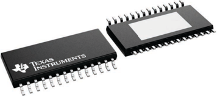

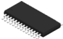

SCALE  2.0

## PACKAGE OUTLINE

## PowerPAD   TSSOP - 1.2 mm max height TM

SMALL OUTLINE PACKAGE

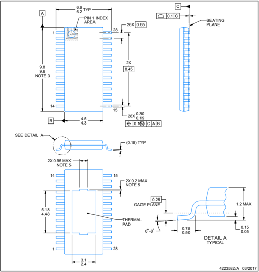

## NOTES:

PowerPAD is a trademark of Texas Instruments.

1. All linear dimensions are in millimeters. Any dimensions in parenthesis are for reference only. Dimensioning and tolerancing per ASME Y14.5M.
2. This drawing is subject to change without notice.
3. This dimension does not include mold flash, protrusions, or gate burrs. Mold flash, protrusions, or gate burrs shall not exceed 0.15 mm per side.
4. Reference JEDEC registration MO-153.
5. Features may differ or may not be present.

## PowerPAD   TSSOP - 1.2 mm max height TM

SMALL OUTLINE PACKAGE

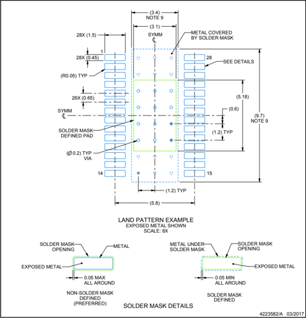

## NOTES: (continued)

6. Publication IPC-7351 may have alternate designs.
7. Solder mask tolerances between and around signal pads can vary based on board fabrication site.
8. This package is designed to be soldered to a thermal pad on the board. For more information, see Texas Instruments literature numbers SLMA002 (www.ti.com/lit/slma002) and SLMA004 (www.ti.com/lit/slma004).
9. Size of metal pad may vary due to creepage requirement.
10. Vias are optional depending on application, refer to device data sheet. It is recommended that vias under paste be filled, plugged or tented.

## PowerPAD   TSSOP - 1.2 mm max height TM

SMALL OUTLINE PACKAGE

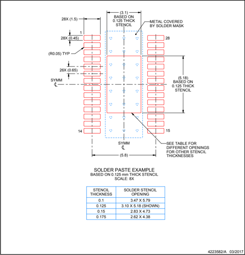

NOTES: (continued)

11. Laser cutting apertures with trapezoidal walls and rounded corners may offer better paste release. IPC-7525 may have alternate design recommendations.
12. Board assembly site may have different recommendations for stencil design.

|   STENCIL THICKNESS | SOLDER STENCIL OPENING   |
|---------------------|--------------------------|
|                 0.1 | 3.47 X 5.79              |
|               0.125 | 3.10 X 5.18 (SHOWN)      |
|                0.15 | 2.83 X 4.73              |
|               0.175 | 2.62 X 4.38              |

6 x 6, 0.5 mm pitch

## GENERIC PACKAGE VIEW

VQFN - 1 mm max height

PLASTIC QUAD FLATPACK - NO LEAD

This image is a representation of the package family, actual package may vary. Refer to the product data sheet for package details.

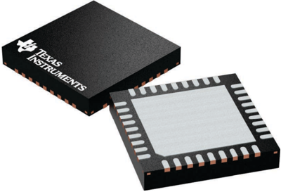

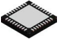

SCALE  2.30

## VQFN - 1 mm max height

PLASTIC QUAD FLATPACK - NO LEAD

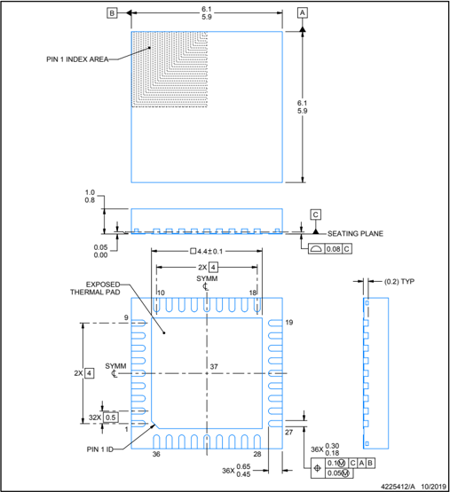

## NOTES:

1. All linear dimensions are in millimeters. Any dimensions in parenthesis are for reference only. Dimensioning and tolerancing per ASME Y14.5M.
2. This drawing is subject to change without notice.
3. The package thermal pad must be soldered to the printed circuit board for thermal and mechanical performance.

## EXAMPLE BOARD LAYOUT

## VQFN - 1 mm max height

PLASTIC QUAD FLATPACK - NO LEAD

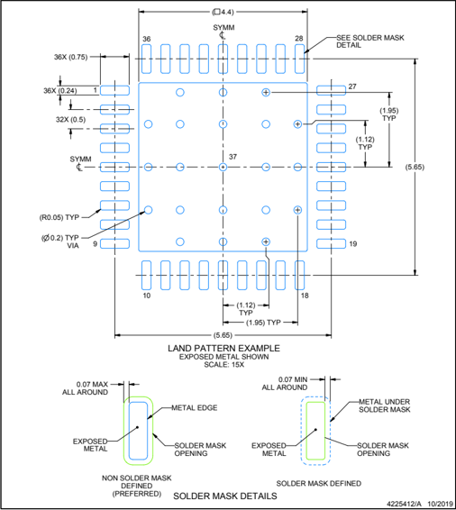

NOTES: (continued)

4. This package is designed to be soldered to a thermal pad on the board. For more information, see Texas Instruments literature number SLUA271 (www.ti.com/lit/slua271).
5. Vias are optional depending on application, refer to device data sheet. If any vias are implemented, refer to their locations shown on this view. It is recommended that vias under paste be filled, plugged or tented.

## VQFN - 1 mm max height

PLASTIC QUAD FLATPACK - NO LEAD

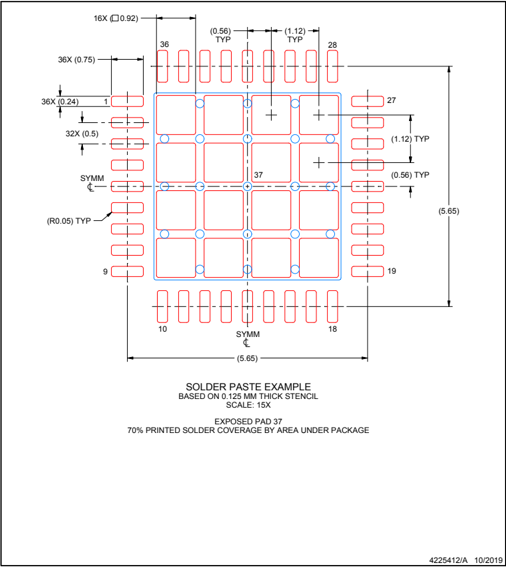

NOTES: (continued)

6. Laser cutting apertures with trapezoidal walls and rounded corners may offer better paste release. IPC-7525 may have alternate design recommendations.

## IMPORTANT NOTICE AND DISCLAIMER

TI PROVIDES TECHNICAL AND RELIABILITY DATA (INCLUDING DATASHEETS), DESIGN RESOURCES (INCLUDING REFERENCE DESIGNS), APPLICATION OR OTHER DESIGN ADVICE, WEB TOOLS, SAFETY INFORMATION, AND OTHER RESOURCES 'AS IS' AND WITH ALL FAULTS, AND DISCLAIMS ALL WARRANTIES, EXPRESS AND IMPLIED, INCLUDING WITHOUT LIMITATION ANY IMPLIED WARRANTIES OF MERCHANTABILITY, FITNESS FOR A PARTICULAR PURPOSE OR NON-INFRINGEMENT OF THIRD PARTY INTELLECTUAL PROPERTY RIGHTS.

These resources are intended for skilled developers designing with TI products. You are solely responsible for (1) selecting the appropriate TI products for your application, (2) designing, validating and testing your application, and (3) ensuring your application meets applicable standards, and any other safety, security, regulatory or other requirements.

These resources are subject to change without notice. TI grants you permission to use these resources only for development of an application that uses the TI products described in the resource. Other reproduction and display of these resources is prohibited. No license is granted to any other TI intellectual property right or to any third party intellectual property right. TI disclaims responsibility for, and you fully indemnify TI and its representatives against any claims, damages, costs, losses, and liabilities arising out of your use of these resources.

TI's products are provided subject to TI's Terms of Sale, TI's General Quality Guidelines, or other applicable terms available either on ti.com or provided in conjunction with such TI products. TI's provision of these resources does not expand or otherwise alter TI's applicable warranties or warranty disclaimers for TI products. Unless TI explicitly designates a product as custom or customer-specified, TI products are standard, catalog, general purpose devices.

TI objects to and rejects any additional or different terms you may propose.

IMPORTANT NOTICE

Copyright © 202 6 , Texas Instruments Incorporated Last updated 10/2025