## Introduction

Continual demand is placed on the semiconductor industry for increased microcontroller performance and complexity, as well as cost reduction. This requires the development of microcontrollers with both high-density design technology and higher clock

frequencies. These factors have intrinsically increased the noise emission and noise sensitivity of microcontroller devices. Application developers must therefore apply EMC "hardening' techniques in their firmware design, PCB layout, and at system level.

This application note explains the microcontroller EMC features and compliance standards to help application designers reach the optimum level of EMC performance.

## AN1709

## EMC design guide for STM8, STM32 and legacy MCUs

## 1 General information

This document applies to the Arm-based devices.

Arm is a registered trademark of Arm Limited (or its subsidiaries or affiliates) in the US and/or elsewhere. The Arm word and logo are trademarks of Arm Limited (or its subsidiaries) in the US and/or elsewhere. All rights reserved.

Note:

## 1.1 Reference documents

The table below contains the main reference documents.

Table 1. Reference documents

| Document reference   | Document title                                                                        |
|----------------------|---------------------------------------------------------------------------------------|
| AN901                | EMC guidelines for microcontroller-based applications                                 |
| AN1015               | Software techniques for improving microcontrollers EMC performance                    |
| AN3353               | IEC 61000-4-2 standard testing                                                        |
| AN3960               | Guidelines for ESD for touch sensing applications on STM32 MCUs                       |
| AN4850               | STM32 MCUs spread-spectrum clock generation principles, properties and implementation |
| AN5612               | ESD protection of STM32 MCUs and MPUs                                                 |

## 2 EMC definitions

## 2.1 EMC

Electromagnetic compatibility (EMC) is the capability of a system to work properly, undisturbed by the electromagnetic phenomena present in its normal environment, and not to create electrical disturbances that would interfere with other equipment.

## 2.2 EMS

The electromagnetic susceptibility (EMS) level of a device is the resistance to electrical disturbances and conducted electrical noise. Electrostatic discharge (ESD) and fast transient burst (FTB) tests determine the reliability level of a device operating in an undesirable electromagnetic environment.

## 2.3 EMI

The electromagnetic interference (EMI) is the level of conducted or radiated electrical noise sourced by the equipment. Conducted emission propagates along a cable or any interconnection line. Radiated emission propagates through free space.

## 3 EMC characterization of microcontrollers

## 3.1 Electromagnetic susceptibility (EMS)

Two different types of test are performed:

- Tests with device power-supplied (functional EMS tests and latch-up): the device behavior is monitored during the stress.
- One test with device not power supplied (absolute electrical sensitivity): the device functionality and integrity are checked on tester after stress.

## 3.1.1 Functional EMS test

Functional tests are performed to measure the robustness of microcontrollers running in an application. Based on a simple program (toggling two LEDs through I/O ports), the product is stressed by two different EMC events until a run-away condition (failure) occurs.

## Functional electrostatic discharge test (F\_ESD test)

This test is performed on any new microcontroller devices. Each pin is tested individually with a single positive or negative electrical discharge. This allows failures investigations inside the chip and further application recommendations to protect the concerned microcontroller sensitive pins against ESD.

High static voltage has both natural and man made origins. Some specific equipment can reproduce this phenomenon in order to test the device under real conditions. Equipment, test sequence, and standards are described below. The microcontroller F\_ESD qualification test uses the standards given in Table 2 as reference.

Table 2. ESD standards

| European standard   | International standard   | Description        |
|---------------------|--------------------------|--------------------|
| EN 61000-4-2        | EC 61000-4-2             | Conducted ESD test |

F\_ESD tests use a signal source and a power amplifier to generate a high-level field into the microcontroller. The insulator uses a conical tip. This tip is placed on the device or equipment under test (DUT or EUT) and an electrostatic discharge is applied (see Figure 1).

Figure 1. ESD test equipment

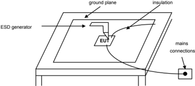

The equipment used to perform F\_ESD test is an NSG 435 generator (TESEQ) compliant with the IEC 61000-4-2 standard. The discharges are directly applied on each pin of the MCU.

Figure 2. Typical ESD current waveform in contact-mode discharge

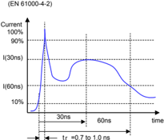

Figure 3. Simplified diagram of the ESD generator

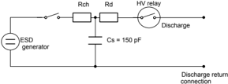

## 1. Rch= 50 MΩ, Rd = 330 Ω

## Fast transient burst (FTB)

More complex than functional ESD, this test submits the device to a large quantity of emitted disturbances in a short time. It is useful for detecting infrequent and unrecoverable (class B or C) microcontroller states. FTB disturbances (see Figure 4 ) are applied to the microcontroller power lines through a capacitive coupling network.

The microcontroller FTB test correlates with the standards given in Table 3.

Table 3. FTB standards

| European standard   | International standard   | Description          |
|---------------------|--------------------------|----------------------|
| N61000-4-4          | EC 61000-4-4             | Fast transient burst |

Figure 4. FTB waveform diagram

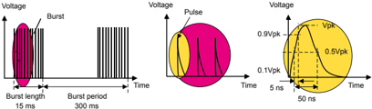

Repetition frequency: 5 kHz.

Bursts repeat for at least 1 minute.

Rising and duration time (±30%) are referred to a 50 Ω load

The spike frequency is 5 kHz. The generator produces bursts of spikes that last 15 ms every 300 ms (75 spikes). The fast transients are coupled to the device DUT with capacitors CC (see Figure 5).

Figure 5. Coupling network

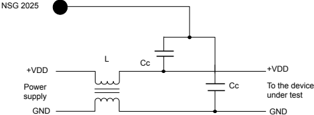

Measurements are performed on a ground plane. The generator is connected to ground plane by a short wire. The supply wires are 10 cm from the ground plane. The DUT is on the insulator 10 cm from the ground plane. The FTB voltage level is increased until the device failure.

Severity levels and class help application designers to determine which microcontrollers are suitable for their target application, based on the susceptibility level (severity level) and type of behavior (class) indicated in the datasheet.

## ST severity level and behavior class

The IEC 61000-4-2 and IEC 61000-4-4 standards do not refer specifically to semiconductor components such as microcontrollers. Usually electromagnetic stress is applied on other parts of the system such as, connectors, mains, supplies. The energy level of the F\_ESD and FTB test decreases before reaching the microcontroller, governed by the laws of physics. A large amount of statistical data collected by ST on the behavior of MCUs in various application environments has been used to develop a correlation chart between ST F\_ESD or FTB test voltage and IEC 61000-4-2/61000-4-4 severity levels (see Table 4).

Table 4. ST ESD severity levels

| Severity level   | ESD (IEC 61000-4-2) equipment standard (kV)   | FTB (IEC 61000-4-4) equipment standard (kV)   | ESD ST internal EMC test (kV)   | FTB ST internal EMC test (kV)   |
|------------------|-----------------------------------------------|-----------------------------------------------|---------------------------------|---------------------------------|
| 1                | 2                                             | 0.5                                           | ≤ 0.5                           | ≤ 0.5                           |
| 2                | 4                                             | 1                                             | ≤ 1                             | ≤ 1                             |
| 3                | 6                                             | 2                                             | ≤ 1.5                           | ≤ 1.5                           |
| 4                | 8                                             | 4                                             | ≤ 2                             | ≤ 2.5                           |
| 5 (1)            | >8                                            | >4                                            | NA                              | > 2.5                           |

1. The severity level 5 has been introduced on December 14 2015. Older products might indicate level 4 even if level 5 might be passed.

In addition to this severity level, MCU behavior under ESD stress can be grouped into different behavior classes (see table below) according to EN 50082-2 standard.

Table 5. ST behavior classes

| Class A             | Class B                                              | Class C                                                       | Class D                                  |
|---------------------|------------------------------------------------------|---------------------------------------------------------------|------------------------------------------|
| No failure detected | Failure detected but self-recovery after disturbance | Needs an external user action to recover normal functionality | Normal functionality cannot be recovered |

Any microcontroller under the 'acceptance limits' is rejected as a fail. The 'target level' is the level used by ST to define good EMS performance.

Class B can be caused by:

- a parasitic reset correctly managed by the firmware (preferable case)
- deprogramming of a peripheral register or memory recovered by the application
- a blocked status, recovered by a watchdog or other firmware implementation

## Class C can be caused by:

- deprogramming of a peripheral register or memory not recovered by the application
- a blocked application status requiring an external user action

The table below shows ST target and acceptance limits.

Table 6. F\_ESD/FTB target level and acceptance limit

| -     | Acceptance limit   | Target level   |
|-------|--------------------|----------------|
| F_ESD | 0.5kV              | >1kV           |
| FTB   | 0.5kV              | >1.5kV         |

Between 'acceptance limit' and 'target level', the device is relatively susceptible to noise. Special care during system design must be taken to avoid susceptibility issues.

The table below shows how F\_ESD/FTB test results are presented in ST datasheets.

Table 7. Example of F\_ESD / FTB test results

| Symbol   | Ratings                                                                                                                 | Conditions   | Severity/Criteria   |
|----------|-------------------------------------------------------------------------------------------------------------------------|--------------|---------------------|
| V F_ESD  | Voltage limits to be applied on any I/O pin to induce a functional disturbance                                          | T A =+25 °C  | 2/A, 3/B            |
| V FTB    | Fast transient voltage burst limits to be applied through 100 pF on VSS and VDD pins to induce a functional disturbance | T A =+25 °C  | 3/B                 |

## 3.1.2 Latch-up (LU)

## Static latch-up (LU) test

The latch-up is a phenomenon, which is defined as a high current consumption resulting from an overstress that triggers a parasitic thyristor structure and need a disconnection of the power supply to recover the initial state.

The overstress can be a voltage or current surge, an excessive rate of change of current or voltage, or any other abnormal condition that causes the parasitic thyristor structure to become self-sustaining.

The latch-up does not damage the device if the current through the low-impedance path is sufficiently limited in magnitude or duration.

## This test conforms to the EIA/JESD 78 IC latch-up standard

True LU is self-sustaining and once triggered, the high current condition remains until the power supply voltage is removed from the device. A temporary LU condition is considered to have been induced if the high current condition stops when only the trigger voltage is removed.

Two complementary static tests are required on 10 parts to assess the latch-up performance:

- Power supply overvoltage (applied to each power supply pin) simulates a user induced situation where a transient over-voltage is applied on the power supply.
- Current injection (applied to each input, output, and configurable I/O pin) simulates an application induced situation where the applied voltage to a pin is greater than the maximum rated conditions, such as severe overshoot above VDD or undershoot below ground on an input due to ringing

The table below shows how LU test result is presented in ST datasheets.

Table 8. Example of the LU test result on STM32L062K8

| Symbol   | Parameter             | Conditions                        | Class (1)   |
|----------|-----------------------|-----------------------------------|-------------|
| LU       | Static latch-up class | T A =+125°C conforming to JESD78A | II level A  |

## Dynamic latch-up (DLU) test

The product is evaluated for its LU susceptibility to ESD discharges when the microcontroller is 'running.'

Increasing electrostatic discharges are supplied to every pin of the component until a latch-up occurs. The result is the maximum tolerated voltage without latch-up.

DLU test methodology and characterization: Electrostatic discharges (one positive then one negative test) are applied to each pin of three samples when the microcontroller is running to assess the latch-up performance in dynamic mode. Power supplies are set to the typical values. The oscillator is connected as near as possible to the pins of the microcontroller and the component is put in reset mode.

LU/DLU test equipment is same as the one used for the functional EMS (see Figure 1).

## 3.1.3 Absolute electrical sensitivity

This test is performed to assess the components immunity against destruction caused by ESD. Any device that fails this electrical test program is classified as a failure.

Using automatic ESD tester, electrostatic discharges (a positive then a negative pulse separated by 1 second) are applied to the pins of each sample according to each pin combination. The sample size depends of the number of supply pins of the device (3parts*(n+1), where n = supply pins).

Two models are usually simulated: human body model (HBM) and the charge device model (CDM). All parts are re-tested on the production tester to verify the static and dynamic parameters still comply with the device datasheet (see Figure 6).

For both models, parts are not powered during the ESD stress. This test conforms to the JESD22-A114A/A115A standard. See Figure 6 and the following test sequences.

Figure 6. Absolute electrical sensitivity test models

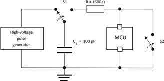

## Human body model test sequence

The HBM ESD pulse simulates the direct transfer of electrostatic charge, from the human body, to a test device. A 100 pF capacitor is discharged through a switching component and a 1.5 KΩ series resistor. This is currently the most requested industry model, for classifying device sensitivity to ESD.

- CL is loaded through S1 by the HV pulse generator.
- S1 switches position from generator to R.
- A discharge from CL through R (body resistance) to the microcontroller occurs.
- S2 must be closed 10 to 100 ms after the pulse delivery period to ensure the microcontroller is not left in charge state. S2 must be opened at least 10ms prior to the delivery of the next pulse.

## Charge device model (CDM)

Refer to the application note Electrostatic discharge sensitivity measurement (AN1181) for a detailed description of CDM.

Since 2018 the MCU are characterised for CDM ESD sensitivity following a standard JEDEC ANSI/ESDA/JEDEC JS-002-2014 which is replacing ANSI/ESD STM5.3.1 standard, see Table 10 for comparison of the device classification levels.

## Classification according to ANSI-ESD STM5.3.1

Table 9. CDM ESDS component classification levels

| Class   | Voltage range (V)   |
|---------|---------------------|
| C1      | < 125               |
| C2      | 125 to < 250        |
| C3      | 250 to < 500        |
| C4      | 500 to < 1000       |
| C5      | 1000 to < 1500      |
| C6      | 1500 to < 2000      |
| C7      | ≥ 2000              |

## Note:

Table 10. Classification according to ANSI/EDSA/JEDEC JS-002

| Classification level   | Classification test condition (V)   |
|------------------------|-------------------------------------|
| C0a                    | < 125                               |
| C0b                    | 125 to < 250                        |
| C1                     | 250 to < 500                        |
| C2a                    | 500 to < 750                        |
| C2b                    | 750 to < 1000                       |
| C3                     | ≥ 1000                              |

## 3.2 Electromagnetic interference (EMI)

## 3.2.1 EMI radiated test

This test correlates with the IEC 61967-2 standard. It gives a good evaluation of the contribution of the microcontroller to radiated noise in an application environment. It takes into account the MCU chip as well as the package, which has a major influence on the noise radiated by the device.

In general, the smaller the package belonging to a given package family, the lower the noise generated.

The below lists the package EMI contribution from the highest to the lowest:

- SOP
- QFP
- TQFP
- FBGA
- CSP

The test is performed in a transverse electromagnetic mode cell (TEMCELL or GTEM) which allows radiated noise measurement in two directions, rotating the test board by 90 °.

Since December 14, 2015, the upper limit of the emission measurement frequency range has been extended from 1 GHz to 2 GHz with different settings. The reasons and modalities of these changes are described in Section Appendix A, as well as the classification method to use for 100 kHz-1 GHz measurement data.

## Test description

The firmware running is based on a simple application, toggling two LEDs through the I/O ports.

The main directives of IEC61967 standard related to test hardware are the following (see Figure 8):

- 100 x 100 mm square board.
- At least 2-layer board (ideally 4-layer)
- 5 mm conductive edges on both sides connected to ground for contact with TEMCELL

The figure below shows a typical example of an MCU EMC test board schematics.

Figure 7. Example of test board schematics for STM32

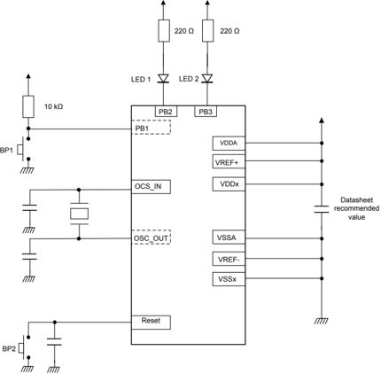

Figure 8. Test printed circuit board specification according IEC 61967-2 standard

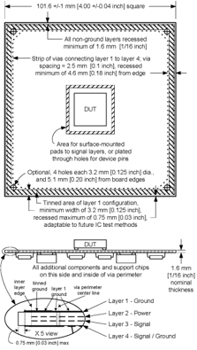

Additional signal layers may be added as necessary

## Spectrum analyzer settings

The IEC61967-1 standard describes the spectrum analyzer hardware and software settings. In spite of these directives, the resolution bandwidth must be chosen according to the measured signal type: narrowband or broadband.

The table below defines the resolution bandwidth (RBW) versus the emission measurement frequency range.

Table 11. Spectrum analyzer resolution bandwidth versus frequency range (broadband EMI)

| Frequency range (MHz)   | Resolution bandwidth (RBW)   | Detector   |
|-------------------------|------------------------------|------------|
| 0.1 - 1                 | 10 kHz                       | Peak       |
| 1 - 10                  | 10 kHz                       | Peak       |
| 10 - 100                | 10 kHz                       | Peak       |
| 100 - 1000              | 100 kHz                      | Peak       |
| 1000 - 2000             | 1 MHz                        | Peak       |

## 3.2.2 EMI level classification

The EMI classifications are based on IEC61967-2 international standard-Annex D-3 (see Figure 9).

The characterization level diagram described by this standard provides a synthesis and a classification of the EMI spectrum. It uses the patterns defined by a combination of one or two letters for horizontal lines and one number for diagonal line. From these patterns, four typical patterns have been selected for ST internal classification (see Figure 10) to estimate the EMI risk for each microcontroller. This selection considers the resolution bandwidth of used spectrum analyzer as well as resonances caused by the geometry of the test board and setup of the test bench.

When the overstepping of a particular limit is not significant, and the corresponding peak values of the interference lie approximately in the middle between two patterns, then half-levels might be used as well.

Note:

Figure 9. IEC61967-2 classification chart

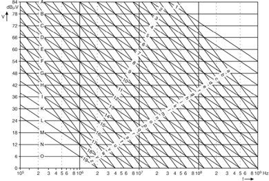

Figure 10. ST internal EMI level classification

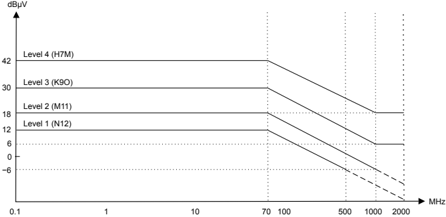

Compliance with level 2 and level 2.5 regardless of peaks above 1 GHz.

Compliance with level 1 and level 1.5 regardless of peaks above 500 MHz.

Based on ST experience, the potential risk associated to each EMI level has been defined:

- Above level 4: high risk due to EMI level
- In the range of levels 3-4: may require cost for EMI compliance
- In the range of levels 2-3: moderate EMI risk
- In the range of levels 1-2: minimal EMI risk
- Below level 1: very low EMI risk

The table below shows how EMI test results are presented in the datasheets.

Table 12. Example of EMI results on STM32

| Symbol   | Parameter   | Conditions                                                         | Monitored frequency band   |   Value | Unit   |
|----------|-------------|--------------------------------------------------------------------|----------------------------|---------|--------|
| S EMI    | Peak        | VDD = 3.6 V, TA = 25 °C, LQFP64 package compliant with IEC 61967-2 | 0.1 MHz to 30 MHz          |       7 | dBμV   |
| S EMI    | Peak        | VDD = 3.6 V, TA = 25 °C, LQFP64 package compliant with IEC 61967-2 | 30 MHz to 130 MHz          |      -1 | dBμV   |
| S EMI    | Peak        | VDD = 3.6 V, TA = 25 °C, LQFP64 package compliant with IEC 61967-2 | 130 MHz to 1 GHz           |       8 | dBμV   |
| S EMI    | Peak        | VDD = 3.6 V, TA = 25 °C, LQFP64 package compliant with IEC 61967-2 | 1 GHz to 2 GHz             |       7 | dBμV   |
| S EMI    | Level       | VDD = 3.6 V, TA = 25 °C, LQFP64 package compliant with IEC 61967-2 | 0.1 MHz to 2 GHz           |     2.5 | -      |

## 4 MCU design strategy and EMC specific feature

During the initial specification phase of a new product, EMC dedicated features are implemented after an identification of EMC constraints. It is the MCU target applications that impose these constraints. Refer to the specific product datasheet to know which of these features described in the figure below are embedded.

Figure 11.  Overview of specific features embedded in microcontrollers

Low-power oscillator Multi oscillator

I/O protection controlled slope

Watchdog (firmware management refer to AN1015)

BOR

Internal PLL

Internal voltage regulators

(For MCUs with low-power core)

Embedded features for EMC in ST microcontrollers

## 4.1 Susceptibility

## 4.1.1 Brownout reset (BOR)

The purpose of the BOR is to ensure that the microcontroller always works in its safe operating area (see Figure 13). In terms of EMS, the presence of the BOR makes the MCU more robust. It also ensures that if any outside disturbance affects the power supply, the application can recover safely.

When VDD is below the minimum working VDD, the behavior of the microcontroller is no longer guaranteed. There is not enough power to decode/execute the instructions and/or read the memory. When V DD  is below the BOR level, the microcontroller enters in reset state (internal reset high) in order to prevent unpredictable behavior.

There are several levels with hysteresis in order to avoid oscillating when the microcontroller restarts. When a BOR occurs, the hardware set a bit. This bit is used to recover an application.

The brownout reset function generates a static reset when the V DD  supply voltage is below a V IT-  reference value. This means that it secures the power-up as well as the power-down, keeping the microcontroller in reset (see Figure 12).

The VIT-  reference value for a voltage drop is lower than the V IT+  reference value for power-on to avoid a parasitic reset. This is the case when the MCU starts running and sinks current on the supply (hysteresis).

The BOR circuitry generates a reset when V DD  is below:

- VIT+  when V DD  is rising
- VIT-  when V DD  is falling
- The BOR function is illustrated in Figure 12 . The voltage threshold can be configured by option byte to be low, medium, or high.
- The MCU can only be in two modes if the minimum VDD value (guaranteed for the oscillator frequency) is above VIT-:
- under full software control
- in static safe reset
- In these conditions, a secure operation is always ensured for the application without the need for external hardware reset.

Note:

During a brownout reset, the NRST pin is held low, thus permitting the MCU to reset other devices.

The BOR allows the device to be used without any external reset circuitry.

The BOR is an optional function that can be selected by option byte. Refer to product specification.

Figure 12. Brownout reset versus reset

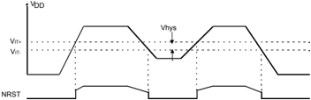

## 4.1.2 Programmable voltage detector (PVD)

This feature like the BOR improves EMS performance. It ensures that the microcontroller behaves safely when the power supply is disturbed by external noise.

The PVD has also different levels (around 200 mV above BOR levels), it enables an early warning before the reset caused by the BOR. When PVD threshold is crossed, an interrupt is generated, requesting for example some user action or preparing the application to shut down in the interrupt routine until the power supply returns to the correct level for the device (refer to the product datasheet).

## Example

If f CPU is between 8 MHZ and 16 MHZ the minimum working level is 3.5 V. The Voltage detector function (PVD) is based on an analog comparison between a VIT-  and V IT+  reference value and the V DD  main supply. The V ITreference value for falling voltage is lower than the V IT+  reference value for rising voltage in order to avoid parasitic detection (hysteresis).

The output of the PVD comparator is directly readable by the application software through a real time status bit (PVDO). This bit is read only.

The PVD voltage threshold value is relative to the selected BOR threshold configured by option byte (refer to the corresponding product datasheet).

If the PVD interrupt is enabled, an interrupt is generated when the voltage crosses the V IT+(PVD)  or V IT-(PVD) threshold (PVDO bit toggles).

In the case of a drop in voltage, the PVD interrupt acts as an early warning that allows the software to shut down safely before the BOR resets the microcontroller. (see Figure 13). The interrupt on the rising edge is used to inform the application that the VDD warning state is over.

If the voltage rise time t rv  is less than 256 or 4096 CPU cycles (depending on the reset delay of the microcontroller), no PVD interrupt is generated when VIT+(PVD) is reached.

## If t rv  is greater than 256 or 4096 cycles then:

- If the PVD interrupt is enabled before the V IT+(PVD)  threshold is reached, then two PVD interrupts are received, the first when the PVDE bit is set, and the second when the threshold is reached.
- If the PVD interrupt is enabled after the V IT+(PVD)  threshold is reached then only one PVD interrupt occurs.

Figure 13. Using the PVD to monitor VDD

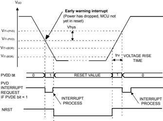

## 4.1.3 I/O features and properties

Integrated circuit datasheets provide the user with conservative limits and conditions to prevent damage. However, it is useful for the hardware system designer to know the internal failure mechanisms. Ultimately the risk of exposure to illegal voltages and conditions can be reduced.

It is not possible to classify and to predict all the possible damage resulting from violating maximum ratings and conditions. This is due to the large number of variables that come into play in defining the failures. This means that when an overvoltage condition is applied, the effects on the device can vary significantly. Consequently, it depends on lot-to-lot process variations, operating temperature, external interfacing of the microcontroller with other devices.

In the following sections, background technical information is given to help system designers to reduce the risk of damage to the microcontroller device.

## Electrostatic discharge and latch-up

CMOS integrated circuits are generally sensitive to exposure to high-voltage static electricity, which can induce permanent damage to the device. A typical failure is the breakdown of thin oxides, which causes high-leakage current and sometimes shorts.

The latch-up is another typical phenomenon occurring in integrated circuits: unwanted turning on of parasitic bipolar structures, or silicon-controlled rectifiers (SCR), may overheat and rapidly destroy the device. These unintentional structures are composed of P and N regions, which work as emitters, bases, and collectors of parasitic bipolar transistors: the bulk resistance of the silicon in the wells and substrate act as resistors on the SCR structure. The SCR may be turned on when voltages below VSS or above VDD, are applied. It may be turned off as well when the level of current is able to generate a voltage drop across the SCR parasitic resistor. To turn off the SCR, it is necessary to remove the power supply from the device. The microcontroller design implements layout and process solutions to decrease the effects of electrostatic discharges (ESD) and latch-up. It is not possible to test all devices, due to the destructive nature of the mechanism. To guarantee product reliability, destructive tests are carried out on groups of devices. This is performed according to internal quality assurance standards and recommendations (see Section 3.1.2: Latch-up (LU)).

## Protective interface

Microcontroller input/output circuitry has been designed to take ESD and latch-up problems into account. However, for applications and systems where microcontroller pins are exposed to illegal voltages and high-current injections, it is strongly recommended to implement hardware solutions. This reduces the risk of damage, in that case, low-pass filters, and clamp diodes are usually sufficient in preventing stress conditions.

The risk of out-of-range voltages and currents is greater for signals coming from outside the system. Noise effect or uncontrolled spikes may occur with higher probability than for the internal signals. It is worth to notice that in some cases, adoption of filters or other dedicated interface circuitries might affect the global microcontroller performance. This induces undesired timing delays, and impacts the global system speed.

Figure 14. Digital input/output - push-pull

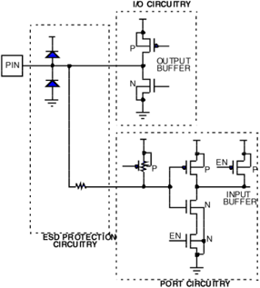

## Internal circuitry: digital I/O pin

Figure 14 shows a schematic representation of a microcontroller pin able to operate either as an input or as an output. The circuitry implements a standard input buffer and a push-pull configuration for the output buffer. It is possible to disable the output buffer when the input section is used. The MOS transistors of the buffer itself can still affect the behavior of the pin when exposed to illegal conditions. In fact, the P-channel transistor of the output buffer implements a direct diode to V DD  (P-diffusion of the drain connected to the pin and N-well connected to VDD). Meanwhile, the N-channel of the output buffer implements a diode to VSS. That is, P-substrate connected to VSS and N-diffusion of the drain connected to the pin. In parallel to these diodes, dedicated circuitry is implemented to protect the logic from ESD events. These are MOS, diodes, and input series resistor.

The most important characteristic of these extra devices is that they must not disturb normal operating modes. This applies while acting during exposure to over-limit conditions. This avoids permanent damage to the logic circuitry.

Some I/O pins can be programmed to work also as open-drain outputs. This is performed through simply writing in the corresponding register of the I/O port. This depends on the MCU used. The gate of the P-channel of the output buffer is disabled. It is important to highlight that physically the P-channel transistor is still present, so the diode to V DD  works. In some applications, it occurs that the voltage applied to the pin is higher than the V DD value. This supposes that the external line is kept high, while the microcontroller power supply is turned off. This condition injects current through the diode, risking permanent damages to the device.

## Internal circuitry: analog input pin

Figure 15 shows the internal circuitry used for the analog input. It is primarily a digital I/O with an added analog multiplexer for the selection of the input channel of the ADC (analog to digital converter).

The presence of the multiplexer P-channel and N-channel can affect the behavior of the pin when exposed to illegal voltage conditions. These transistors are controlled by a low noise logic, biased through AV DD  and AV SS including P-channel N-well. It is important to verify always the input voltage value. The input value is with respect to both analog power supply and digital power supply. This step avoids unintentional current injections, which (if not limited) may destroy the device.

Figure 15. Digital input/output - push-pull output - analog multiplexer input

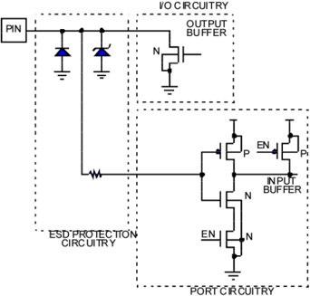

## 4.2 Emission

## 4.2.1 Internal PLL

Some microcontrollers have an embedded programmable PLL clock generator that allows the usage of standard 3 MHz to 25 MHz crystals. This allows a large range of internal frequencies (up to a few hundred MHz) to be obtained. By these means, the microcontroller can operate with cheaper, medium frequency crystals, while still providing a high frequency internal clock for maximum system performance. The high-clock frequency source is contained inside the chip and does not go through the PCB (printed circuit board) tracks and external components. This reduces the potential noise emission of the application.

The use of the PLL network also filters the CPU clock against external sporadic disturbances (glitches).

## 4.2.2 Clock sources

## Low-powered oscillator

The oscillator is a major source of noise. To reduce this noise emission, the current that drives the oscillator is limited. The main clock of some microcontrollers is generated by four different source types coming from the multioscillator block (MO). This allows the designer to select easily the best trade-off in terms of cost, performance, and noise emission. The clock sources are listed below from the most to the least noisy:

- An external source
- Crystal or ceramic resonator oscillators
- An internal high frequency RC oscillator

Each oscillator is optimized for a given frequency range in terms of consumption. It is selectable through the option byte. The associated hardware configurations are shown in Figure 16. Refer to the datasheet's electrical characteristics section for more details in each case.

## External clock source

In external clock mode, a clock signal (square, sinus, or triangle) with ~50% duty cycle has to drive the OSC\_IN or OSC32\_OUT pins while the OSC\_OUT respect to the OSC32\_OUT pin is tied:

- To ground
- Left unconnected
- Or used as standard GPIO

See product reference manual for recommended configuration.

## Crystal/ceramic oscillators

This family of oscillators produces a very accurate rate on the main clock of the microcontroller. The selection within a list of five oscillators with different frequency ranges is done with the option byte. This allows a reduction of consumption (refer to the microcontroller datasheet for more details on the frequency ranges). In this mode of the multioscillator, the resonator and the load capacitors have to be placed as close as possible to the oscillator pins in order to minimize output distortion and startup stabilization time. The loading capacitance values must be adjusted according to the selected oscillator.

These oscillators are not stopped during the RESET phase to avoid the delay needed for the oscillator startup.

## Internal RC oscillator

The internal RC oscillator is the most cost effective solution, with the drawback of lower frequency accuracy. Its frequency is in the low single digit MHz range. In this mode, the two oscillator pins are used as standard GPIO. They are left unconnected or tied to ground, see product documentation for more details. Process variations also bring some differences from lots to lots (20 to 60%). Some microcontrollers (refer to product specification) embed a process compensation. This feature is called 'trimmable internal RC'. A procedure during the test operation analyzes the process variation and calibrate the internal oscillator accordingly. This brings the internal RC accuracy to 1%. The user can also perform this procedure.

Figure 16. STM32 clock sources - hardware configuration

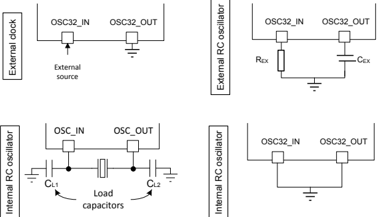

The multioscillator system is designed for flexibility and to allow the system designer to find the best compromise between emission, accuracy, and cost criteria.

## Internal voltage regulators (for MCUs with low-power core)

An internal voltage regulator is used to power some microcontrollers cores starting from the external power supply.

The voltage regulator reduces EMI due to the MCU core with two effects:

- Lower CPU supply voltage
- Isolate CPU supply from external MCU supplies For more information on how to use the oscillator, refer to the application note Oscillator design guide for

STM8S, STM8A and STM32 microcontrollers (AN2867).

## 4.2.3 Output I/O current limitation and edge timing control

Output buffers are embedded in microcontrollers. Their switching speed is controlled in order to avoid parasitic oscillations when they are switched. The MCU design makes a trade-off between noise and speed.

## 5 EMC guidelines for MCU based applications

The following guidelines result from the experience gained in a wide variety of applications.

## 5.1 Hardware

The major noise receptors and generators are the tracks and wiring on the printed circuit board (PCB), especially those near the MCU. The first actions to prevent noise problems thus concern the PCB layout and the design of the power supply.

In general, the smaller the number of components surrounding the MCU, the better the immunity versus noise. A ROMless solution, for instance, is typically more sensitive to and a bigger generator of noise than an embedded memory circuit.

## 5.1.1 Optimized PCB layout

Noise is basically received and transmitted through tracks and components which, once excited, act as antennas. Each loop and track includes parasitic inductance and capacitance. This radiate and absorb energy once submitted to a variation of current, voltage, or electromagnetic flux.

An MCU chip itself presents high immunity to and low generation of EMI since its dimensions are small versus the wave lengths of EMI signals (typically mm versus 10's of cm for EMI signals in the GHz range). Therefore, a single chip solution with small loops and short wires reduces noise problems.

The initial action at the PCB level is to reduce the number of possible antennas. The loops and wires connected to the MCU such as supply, oscillator and I/O must be considered with a special attention. The oscillator loop must be especially small since it operates at high frequency (see Figure 17).

A reduction of both the inductance and the capacitance of a track is generally difficult. The practical experience suggests that in most cases inductance is the first parameter to minimize.

Figure 17. PCB board-oscillator layout examples

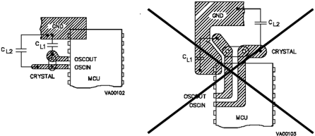

The reduction of inductance is obtained by making the lengths and surfaces of the track smaller. This is performed placing the track loops closer on the same PCB layer or on top of one another (Figure 17). The resulting loop area is small and the electromagnetic fields reduce one another.

The ratio in order of magnitude relating to the inductance value and the area defined by the wire loop is around 10 nH/cm2. Typical examples of low inductivity wires are coaxial, twisted pair cables or multiple layer PCBs with one ground and one supply layers. The current density in the track can also be smaller due to track enlargement or the paralleling of several small capacitances mounted in the current flow.

In critical cases, the distance between the MCU and the PCB must be minimized. This implies that the surfaces of the loops between an MCU and its environment must also be minimized. To achieve this, any socket between the MCU package and the PCB must be removed or either, a ceramic MCU package must be replaced with a plastic one using a surface mounting instead of dual in line packages.

Note:

Board vias are inductances. Try to avoid them. If required, use multivias.

Figure 18. Reduction of PCB tracks loop surfaces

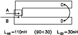

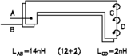

## High Inductance

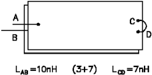

## Low Inductance

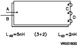

Note: This test is done with a double sided PCB. Insulator thickness is 1.5 mm: copper thickness is 0.13 mm. The overall board size is 65 x 200 mm.

## 5.1.2 Power supply filtering

The power supply is used by all parts of the circuit, therefore it must be considered with special attention. The supply loops must be decoupled to make sure that signal levels and power currents do not interfere. These loops can be separated using star wiring with one node designated as common for the circuit (Figure 19).

The decoupling capacitance must be placed very close to the MCU supply pins to minimize the resultant loop. It should be also large enough to absorb, without significant voltage increase, parasitic currents coming from the MCU via the input protection diodes. The decoupling of the board can be done with electrolytic capacitors (typically 10 µF to 100 µF) since the dielectric used in such capacitors provides a high volumic capacitance. However, these capacitors behave like inductances at high frequency (typically above10 MHz) while ceramic or plastic capacitors keep a capacitive behavior at higher frequency.

A ceramic capacitance of, for instance, 0.1 μF to 1 μF must be used as high-frequency supply decoupling for critical chips operating at high frequency.

Figure 19. Power-supply layout examples

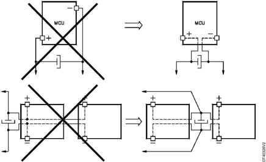

## 5.1.3 Ground connections

It is recommended to connect all VSS pins together by the shortest possible path to reduce the risk of creating voltage difference between the VSS pins above the absolute maximum ratings stated in the device datasheet, due to the current induced by external disturbance and to reduce the impedance of ground return path.

The best practice is to connect the VSS lines to the ground plane through the vias placed as close as possible to the device VSS pins. The ground plane must be solid without slots or holes, which may cause an increase of the ground plane impedance. The split of analog and digital ground is not recommended. While it may have a questionable impact on noise distribution from the digital-to-analog domain, it shows always worse EMC performance.

## 5.1.4 I/O configuration

A digital input configuration with the pin floating is a potential hazard to the circuit. It is recommended that I/O pins not used in the application be configured in output push-pull low state. This increases EMC robustness or configure as an analog input connected to ground to reduce power current consumption.

## 5.1.5 Shielding

Shielding helps to reduce noise sensitivity and emission. However, it depends on the material chosen as a shield. It must have a high permeability or a low resistivity, and its connection must be to a stable voltage source. This includes a decoupling capacitance via a low serial impedance (low inductance or low resistance) voltage source.

If the generator of major disturbances is near to the MCU board and identified as a strong dV/dt generator (that is, a transformer or klystron), the noise is carried mainly by the electrostatic field. The critical coupling between the noise generator and the control board is capacitive. A highly conductive shield that is, copper, creating a faraday cage around the control board may strongly increase the immunity.

If the strongest source of perturbations is a dI/dt generator (that is, a relay), it is a high source of electromagnetic fields. Therefore, the permeability of the shielding material namely alloy, is crucial to increase the immunity of the board. In addition, the number and size of the holes on the shield should be reduced as much as possible to increase its efficiency.

In critical cases, the implantation of a ground plane below the MCU, and the removal of sockets between the device and the PCB can reduce the MCU noise sensitivity. Indeed, both actions lead to a reduction of the apparent surface of loops between the MCU, its supply, its I/O and the PCB.

## 5.1.6 I/O bonding coupling

In some application cases, when the ESD strike occurs on a pin PA3 then, the adjacent pins PA2 and PA4 can be affected by a voltage spike transferred to the current.

Figure 20. UFQFPN48 package example: top view

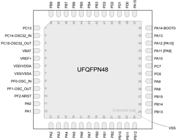

Due to the package technology, chip pads are connected to package pins with wire bonding and it creates a small capacitive/inductive coupling between adjacent pins.

Once the ESD strike occurs, the discharge energy does not go only through the single pin but also to the adjacent pins due to the coupling.

It could induce a transient state where the voltage variation between supplies or ground pins is higher than the absolute maximum ratings (refer to product datasheet). As a final result, the STM32 product peripherals operation may be altered.

It is important to verify that the application functionalities after the ESD strike occurs. If any issue occurs, we strongly recommend improving the ESD protection on the identified entry point pin PA3. This reduces the ESD coupled energy and ensures the good application operation.

## 5.1.7 High-speed signal tracks

Another source of EMC weaknesses with microcontroller-based applications may be due to high speed digital I/O and communication interfaces such as, xSPI, I²C, external memories interfaces, USB, or PWM from GPIO. When designing the PCB with high-speed signals, the following EMC consideration list must be considered:

- Coupling/crosstalk:
- -When a signal couple and interfere with another one and leads to an intrusive spike (can be sampled as data) and timing shift.
- Signal reflection:
- -The high-speed signals are susceptible to impedance mismatching which may alter the shape of the signal.
- Clock jitter:
- -An external interference, or noise can introduce a deviation of the clock edge, this leads to a narrower timing tolerance or communication failure.
- Potential antennas:
- -Routing close to the edge of the PCB or a gap in plane can act as an antenna.
- Certification fails:
- -Even if there is no functional issue, the product may fail the required certification and the PCB must be redesigned.

To avoid these issues, planning with EMC performances in mind must be done from the earliest stages of development.

- Stack-up:
- -One major consideration to improve EMI is to use four (or more) layers PCB with the external layers (top and bottom) being for signals and the internal for GND and power planes. The solid planes help with controlling the signal impedance on the top and bottom and together (GND and PWR planes) create stack-up capacitance that improves the performance at higher frequencies.
- -If there is a particularly noisy signal, it can be routed between two solid PWR/GND planes to reduce its emission but that require eight or more layer stack-up.
- -Avoid gaps in the solid planes, these gaps can behave as antennas.
- Routing tips and recommendations:
- -If a high-speed signal needs to go through a vias (not recommended for high-speed signals as they are seen as impedance mismatch), then the return path loop requires to keep at minimum loop area.
- -Never route over plane gap and in case that it is unavoidable use stitching caps.
- -Avoid routing in parallel for long distance to noisy signals to avoid coupling issues.
- -For very long tracks (&gt;30 cm) and very high-speed signals (&gt;50 MHz) a termination resistance can be added to reduce the signal reflection (resistance range between 30 Ω ~ 50 Ω).

## 5.2 Handling precautions for ESD protection

To determine the susceptibility of microcontroller devices to ESD damage, refer to the application note Electrostatic discharge sensitivity measurement (AN1181).

## 5.3 Firmware

This section is detailed in the application note Software techniques for improving microcontrollers EMC performance (AN1015) available on www.st.com..

## 5.4 EMC organizations resources

Table 13. EMC reference sources

| Name                                               | Web link       |
|----------------------------------------------------|----------------|
| FCC: Federal communication commission              | www.fcc.gov    |
| EIA: Electronic industries alliance                | www.eoa.org    |
| SAE: Society of automotive engineers               | www.sae.org    |
| IEC: The international electrotechnical commission | www.iec.ch     |
| IEC: The international electrotechnical commission | www.cenelec.eu |
| JEDEC: Joint electron device engineering council   | www.jedec.org  |

## 6 Conclusion

For any microcontroller application, EMC requirements must be considered at the very beginning of the development project. Standards, features and parameters given in microcontroller datasheets help the system designer to determine the most suitable component for a given application. Hardware and firmware precautions must be taken to optimize EMC and system stability.

## Appendix A  EMI classification before December 14, 2015

The section gives information that complements Section 3.2.1

Since December 14, 2015, the upper limit of the emission measurement frequency range has been extended from 1 GHz to 2 GHz, thus increasing the resolution bandwidth (RBW). This change is due to the evolution of microcontrollers, which embed higher frequency internal clocks, sometimes above 200 MHz, with higher PLL multiplication factors. This leads to higher frequency broadband harmonics emissions.

As a result, ST internal EMI level classification patterns were updated and adjusted to the new spectrum analyzer settings.

For data related to measurements performed before December 14 2015 in the 100 kHz- 1 GHz frequency range, refer to Figure 21 and Table 14.

Figure 21. ST internal EMI level classification before December 14, 2015

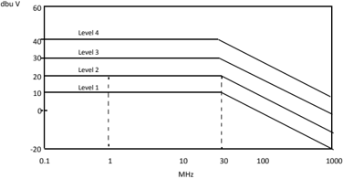

According to ST experience, the potential risk associated with each EMI level have been defined:

- Level higher than 4: high risk due to EMI level.
- Level 4: may require cost for EMI compliance.
- Level 3: moderate EMI risk.
- Level 2: minimal EMI risk.
- Level 1: very low EMI risk

Table 14. Spectrum analyzer resolution bandwidth versus frequency range (narrowband EMI)

| Frequency range (MHz)   | Resolution bandwidth   | Detector   |
|-------------------------|------------------------|------------|
| 0.1 - 1                 | 1 kHz                  | Peak       |
| 1 - 10                  | 1 kHz                  | Peak       |
| 10 - 100                | 1 kHz                  | Peak       |
| 100 - 1000              | 9 kHz                  | Peak       |

## Revision history

Table 15. Document revision history

| Date        |   Version | Changes                                                                                                                                                                                                                                                                                                                                                                                                                                                                                                                                                                                                                                                                                                                                                                                                                                                                                                                                                                                                                                                                                                                                                                    |
|-------------|-----------|----------------------------------------------------------------------------------------------------------------------------------------------------------------------------------------------------------------------------------------------------------------------------------------------------------------------------------------------------------------------------------------------------------------------------------------------------------------------------------------------------------------------------------------------------------------------------------------------------------------------------------------------------------------------------------------------------------------------------------------------------------------------------------------------------------------------------------------------------------------------------------------------------------------------------------------------------------------------------------------------------------------------------------------------------------------------------------------------------------------------------------------------------------------------------|
| Sep-2023    |         1 | Initial release.                                                                                                                                                                                                                                                                                                                                                                                                                                                                                                                                                                                                                                                                                                                                                                                                                                                                                                                                                                                                                                                                                                                                                           |
| 03-Feb-2016 |         2 | Changed IEC 1000 standard into IEC 61000. Changed NSG 435 provider in Section 3.1.1: Functional EMS test. Updated Table 3: ST ESD severity levels. Changed static latch-up example to STM32L062K8 in Modified Table 7. Removed Table Example of DLU test result on ST72F521 from Section 3.1.2: Latch-up (LU). Section 3.1.3: Absolute electrical sensitivity: • Added the fact that parts are not powered during the ESD stress. • Removed machine model. • Added Section : Charge device model (CDM). Updated Section 3.2: Electromagnetic interference (EMI). Section 4.1: Susceptibility: • Replaced low-voltage detector (LVD) by brownout reset (BOR). • Replaced RESET by NRST. • Removed Figure Maximum operating frequency vs supply voltage. • Replaced Auxiliary voltage detector (AVD) by Programmable voltage detector (PVD). • Removed Section Multiple VDD and VSS Updated Section 4.2.1: Internal PLL. Updated Section : Internal RC oscillator and Section Internal voltage regulators (for MCUs with low-power core). Added trays in Section 5.2: Handling precautions for ESD protection. Added Appendix A: EMI classification before December 14 2015. |
| 23-Apr-2018 |         3 | Updated Charge device model (CDM), replace title of Section 3.2.2: Global low-power approach by Section 4.2.2: Clock sources, External Clock source, Internal RC oscillator Added Table 8: CDM ESDS component classification levels, Table 9: CDM ESDS device classification levels,Section 5.1.3: Ground connections                                                                                                                                                                                                                                                                                                                                                                                                                                                                                                                                                                                                                                                                                                                                                                                                                                                      |
| 1-Jul-2022  |         4 | Added: • Section 5.1.6 • Section 5.1.4 • Section 5.1.7 • Updated Section 3.2.2                                                                                                                                                                                                                                                                                                                                                                                                                                                                                                                                                                                                                                                                                                                                                                                                                                                                                                                                                                                                                                                                                             |
| 26-May-2026 |         5 | Added: Section 1.1: Reference documents                                                                                                                                                                                                                                                                                                                                                                                                                                                                                                                                                                                                                                                                                                                                                                                                                                                                                                                                                                                                                                                                                                                                    |

## Contents

| 1     | General information . . . . . . . . . . . . . . . . . . . . . . . . . .                                                   | . . . . . . . .                                                                                                           | . .2   |
|-------|---------------------------------------------------------------------------------------------------------------------------|---------------------------------------------------------------------------------------------------------------------------|--------|
| 1.1   |                                                                                                                           | Reference documents. . . . . . . . . . . . . . . . . . . . . . . . . . . . . .                                            | . . 2  |
| 2 EMC | definitions. . . . . . . . . . . . . . . . . . . . . . . . . . . . . . . . . . . . . . . . . . .                          | definitions. . . . . . . . . . . . . . . . . . . . . . . . . . . . . . . . . . . . . . . . . . .                          | . .3   |
|       | 2.1 EMC . .                                                                                                               | . . . . . . . . . . . . . . . . . . . . . . . . . . . . . . . . . . . . . . . . . . . . . . . . . . . .                   | . . 3  |
| 2.2   | EMS . .                                                                                                                   | . . . . . . . . . . . . . . . . . . . . . . . . . . . . . . . . . . . . . . . . . . . . . . .                             | . . 3  |
| 2.3   | EMI . . .                                                                                                                 | . . . . . . . . . . . . . . . . . . . . . . . . . . . . . . . . . . . . . . . . . .                                       | . . 3  |
| 3     | EMC characterization of microcontrollers . . . . . . . . . . . . . . . . . . . .                                          | EMC characterization of microcontrollers . . . . . . . . . . . . . . . . . . . .                                          | . .4   |
| 3.1   | Electromagnetic susceptibility (EMS)                                                                                      | . . . . . . . . . . . . . . . . .                                                                                         | . . 4  |
|       |                                                                                                                           | . . .                                                                                                                     |        |
|       | 3.1.1                                                                                                                     | Functional EMS test . . . . . . . . . . . . . . . . . . . . . .                                                           | . . 4  |
|       | 3.1.2                                                                                                                     | Latch-up (LU) . . . . . . . . . . . . . . . . . . . . . . . . . . . . . .                                                 | . . 8  |
|       | 3.1.3                                                                                                                     | Absolute electrical sensitivity. . . . . . . . . . . . . . . . . . .                                                      | . . 8  |
| 3.2   | Electromagnetic                                                                                                           | interference (EMI). . . . . . . . . . . . . . . . . . .                                                                   | .10    |
|       | 3.2.1                                                                                                                     | EMI radiated test. . . . . . . . . . . . . . . . . . . . . . . . . . . .                                                  | . 10   |
|       | 3.2.2                                                                                                                     | EMI level classification . . . . . . . . . . . . . . . . . . . . . . .                                                    | .      |
|       |                                                                                                                           |                                                                                                                           | 13     |
| 4     | MCU design strategy and EMC specific feature. . . . . . . . .                                                             | MCU design strategy and EMC specific feature. . . . . . . . .                                                             | .16    |
| 4.1   |                                                                                                                           | Susceptibility . . . . . . . . . . . . . . . . . . . . . . . . . . . . . . . . . . . . .                                  | .16    |
|       | 4.1.1                                                                                                                     | Brownout reset (BOR). . . . . . . . . . . . . . . . . . . . . . . .                                                       | . 16   |
|       | 4.1.2                                                                                                                     | Programmable voltage detector (PVD) . . . . . . . . . . .                                                                 | . 17   |
|       | 4.1.3                                                                                                                     | I/O features and properties . . . . . . . . . . . . . . . . . . . .                                                       | . 18   |
|       | 4.2 Emission. . . . . . . . . . . . . . . . . . . . . . . . . . . . . . . . . . . . . . . . . . . . . . . . . . . . . . . | 4.2 Emission. . . . . . . . . . . . . . . . . . . . . . . . . . . . . . . . . . . . . . . . . . . . . . . . . . . . . . . | .20    |
|       | 4.2.1                                                                                                                     | Internal PLL . . . . . . . . . . . . . . . . . . . . . . . . . . . . . . .                                                | . 20   |
|       | 4.2.2                                                                                                                     | Clock sources . . . . . . . . . . . . . . . . . . . . . . . . . . . . . .                                                 | . 21   |
|       | 4.2.3                                                                                                                     | Output I/O current limitation and edge timing control.                                                                    | . 22   |
| 5     | EMC guidelines for MCU based applications . . . . . . . . . . . . . . . . .                                               | EMC guidelines for MCU based applications . . . . . . . . . . . . . . . . .                                               | .23    |
| 5.1   | Hardware . . . . . . . . . . . . . . . . . . . . . . . . . . . . . . . . . . . . . . . . . . . . . . .                    | Hardware . . . . . . . . . . . . . . . . . . . . . . . . . . . . . . . . . . . . . . . . . . . . . . .                    | .23    |
|       | 5.1.1                                                                                                                     | Optimized PCB layout. . . . . . . . . . . . . . . . . . . . . . . .                                                       | . 23   |
|       | 5.1.2                                                                                                                     | Power supply filtering . . . . . . . . . . . . . . . . . . . . . . . .                                                    | . 24   |
|       | 5.1.3                                                                                                                     | Ground connections . . . . . . . . . . . . . . . . . . . . . . . . .                                                      | . 25   |
|       | 5.1.4                                                                                                                     | I/O configuration . . . . . . . . . . . . . . . . . . . . . . . . . . . .                                                 | . 25   |
|       | 5.1.5                                                                                                                     | Shielding. . . . . . . . . . . . . . . . . . . . . . . . . . . . . . . . . .                                              | . 25   |
|       | 5.1.6                                                                                                                     | I/O bonding coupling . . . . . . . . . . . . . . . . . . . . . . . . .                                                    | . 26   |
|       | 5.1.7                                                                                                                     | High-speed signal tracks. . . . . . . . . . . . . . . . . . . . . .                                                       | . 26   |
| 5.2   | Handling precautions for ESD protection                                                                                   | . . . . . . . . . . . . . .                                                                                               | .27    |
| 5.3   | Firmware . . . . . . . . . .                                                                                              | . . . . . . . . . . . . . . . . . . . . . . . . . . . . . .                                                               | .27    |
| 5.4   | EMC organizations resources .                                                                                             | . . . . . . . . . . . . . . . . . . . . . .                                                                               | .28    |

| 6                                                                                                                                                            | Conclusion . . . . . . . . . . . . . . . . . . . . . . . . . . . . . . . . . . . . . . . . . . . . . . . . . . . . . . . . . . . . . . . . . . . . . . .29   |
|--------------------------------------------------------------------------------------------------------------------------------------------------------------|--------------------------------------------------------------------------------------------------------------------------------------------------------------|
| Appendix A EMI classification before December 14, 2015 .                                                                                                     | . . . . . . . . . . . . . . . . . . . . . . . . . . . .30                                                                                                    |
| Revision history . . . . . . . . . . . . . . . . . . . . . . . . . . . . . . . . . . . . . . . . . . . . . . . . . . . . . . . . . . . . . . . . . . . . . . | .31                                                                                                                                                          |
| List of tables . . . . . . . . . . . . . . . . . . . . . . . . . . . . . . .                                                                                 | . . . . . . . . . . . . . . . . . . . . . . . . . . . . . . . . . . . . . . . . . . .34                                                                      |
| List of figures. . . . . . . . . . . . . . . . . . . . . . . . . . . . . . . . . . . . . . . . . . . . . . . . . . . . . . . . . . . . . . . . . . .         | . . . . . . .35                                                                                                                                              |

## List of tables

| Table 1.   | Reference documents . . . . . . . . . . . . . . . . . . . . . . . . . . . . . . . . . . . . . . . . . .      | . . 2   |
|------------|--------------------------------------------------------------------------------------------------------------|---------|
| Table 2.   | ESD standards . . . . . . . . . . . . . . . . . . . . . . . . . . . . . . . . . . . . . . . . . . . . . . .  | . . 4   |
| Table 3.   | FTB standards. . . . . . . . . . . . . . . . . . . . . . . . . . . . . . . . . . . . . . . . . . . . . . . . | . . 5   |
| Table 4.   | ST ESD severity levels . . . . . . . . . . . . . . . . . . . . . . . . . . . . . . . . . . . . . . . . . .   | . . 7   |
| Table 5.   | ST behavior classes. . . . . . . . . . . . . . . . . . . . . . . . . . . . . . . . . . . . . . . . . . . .   | . . 7   |
| Table 6.   | F_ESD/FTB target level and acceptance limit . . . . . . . . . . . . . . . . . . . . . . . . . .              | . . 7   |
| Table 7.   | Example of F_ESD / FTB test results . . . . . . . . . . . . . . . . . . . . . . . . . . . . . . . .          | . . 7   |
| Table 8.   | Example of the LU test result on STM32L062K8 . . . . . . . . . . . . . . . . . . . . . . . .                 | . . 8   |
| Table 9.   | CDM ESDS component classification levels . . . . . . . . . . . . . . . . . . . . . . . . . . .               | . . 9   |
| Table 10.  | Classification according to ANSI/EDSA/JEDEC JS-002. . . . . . . . . . . . . . . . . . . .                    | . 10    |
| Table 11.  | Spectrum analyzer resolution bandwidth versus frequency range (broadband EMI)                                | . 12    |
| Table 12.  | Example of EMI results on STM32 . . . . . . . . . . . . . . . . . . . . . . . . . . . . . . . . . .          | . 15    |
| Table 13.  | EMC reference sources . . . . . . . . . . . . . . . . . . . . . . . . . . . . . . . . . . . . . . . . .      | . 28    |
| Table 14.  | Spectrum analyzer resolution bandwidth versus frequency range (narrowband EMI).                              | . 30    |
| Table 15.  | Document revision history . . . . . . . . . . . . . . . . . . . . . . . . . . . . . . . . . . . . . . . .    | . 31    |

## List of figures

| Figure 1.   | ESD test equipment . . . . . . . . . . . . . . . . . . . . . . . . . . . . . . . . . . .   | . . 4   |
|-------------|--------------------------------------------------------------------------------------------|---------|
| Figure 2.   | Typical ESD current waveform in contact-mode discharge . . . . . . . . .                   | . . 5   |
| Figure 3.   | Simplified diagram of the ESD generator . . . . . . . . . . . . . . . . . . . . .          | . . 5   |
| Figure 4.   | FTB waveform diagram . . . . . . . . . . . . . . . . . . . . . . . . . . . . . . . . .     | . . 6   |
| Figure 5.   | Coupling network . . . . . . . . . . . . . . . . . . . . . . . . . . . . . . . . . . . . . | . . 6   |
| Figure 6.   | Absolute electrical sensitivity test models. . . . . . . . . . . . . . . . . . . . .       | . . 9   |
| Figure 7.   | Example of test board schematics for STM32. . . . . . . . . . . . . . . . . .              | . 11    |
| Figure 8.   | Test printed circuit board specification according IEC 61967-2 standard.                   | . 12    |
| Figure 9.   | IEC61967-2 classification chart. . . . . . . . . . . . . . . . . . . . . . . . . . . .     | . 14    |
| Figure 10.  | ST internal EMI level classification . . . . . . . . . . . . . . . . . . . . . . . . .     | . 14    |
| Figure 11.  | Overview of specific features embedded in microcontrollers . . . . . . . .                 | . 16    |
| Figure 12.  | Brownout reset versus reset . . . . . . . . . . . . . . . . . . . . . . . . . . . . . .    | . 17    |
| Figure 13.  | Using the PVD to monitor V DD . . . . . . . . . . . . . . . . . . . . . . . . . . . .      | . 18    |
| Figure 14.  | Digital input/output - push-pull . . . . . . . . . . . . . . . . . . . . . . . . . . . .   | . 19    |
| Figure 15.  | Digital input/output - push-pull output - analog multiplexer input . . . . .               | . 20    |
| Figure 16.  | STM32 clock sources - hardware configuration . . . . . . . . . . . . . . . . .             | . 22    |
| Figure 17.  | PCB board-oscillator layout examples . . . . . . . . . . . . . . . . . . . . . . .         | . 23    |
| Figure 18.  | Reduction of PCB tracks loop surfaces . . . . . . . . . . . . . . . . . . . . . .          | . 24    |
| Figure 19.  | Power-supply layout examples . . . . . . . . . . . . . . . . . . . . . . . . . . . .       | . 25    |
| Figure 20.  | UFQFPN48 package example: top view. . . . . . . . . . . . . . . . . . . . . .              | . 26    |
| Figure 21.  | ST internal EMI level classification before December 14, 2015 . . . . . .                  | . 30    |

## IMPORTANT NOTICE - READ CAREFULLY

STMicroelectronics NV and its subsidiaries ('ST') reserve the right to make changes, corrections, enhancements, modifications, and improvements to ST products and/or to this document at any time without notice.

In the event of any conflict between the provisions of this document and the provisions of any contractual arrangement in force between the purchasers and ST, the provisions of such contractual arrangement shall prevail.

The purchasers should obtain the latest relevant information on ST products before placing orders. ST products are sold pursuant to ST's terms and conditions of sale in place at the time of order acknowledgment.

The purchasers are solely responsible for the choice, selection, and use of ST products and ST assumes no liability for application assistance or the design of the purchasers' products.

No license, express or implied, to any intellectual property right is granted by ST herein.

Resale of ST products with provisions different from the information set forth herein shall void any warranty granted by ST for such product.

If the purchasers identify an ST product that meets their functional and performance requirements but that is not designated for the purchasers' market segment, the purchasers shall contact ST for more information.

ST and the ST logo are trademarks of ST. For additional information about ST trademarks, refer to www.st.com/trademarks. All other product or service names are the property of their respective owners.

Information in this document supersedes and replaces information previously supplied in any prior versions of this document.

© 2026 STMicroelectronics - All rights reserved