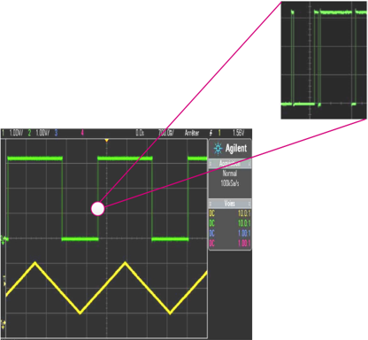
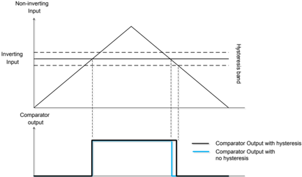
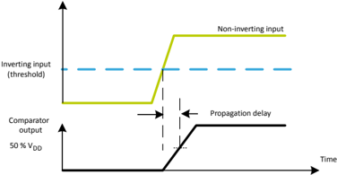
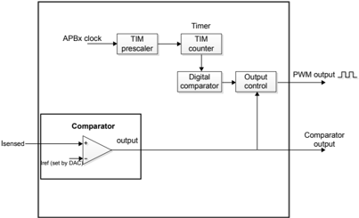
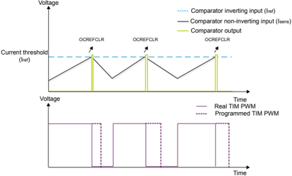
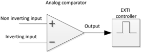
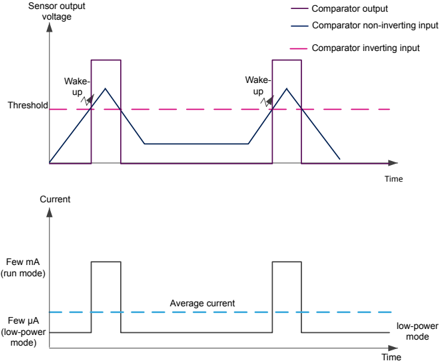
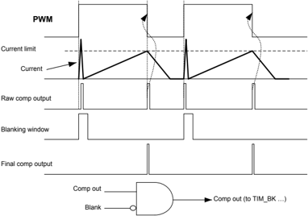
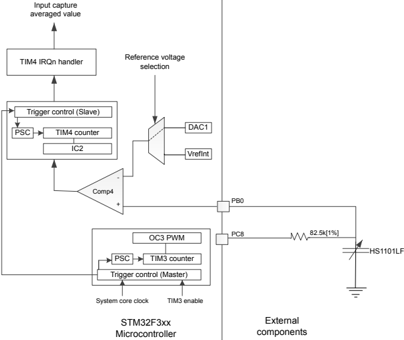

## Getting started with analog comparators for STM32F3 Series and STM32G4 Series devices

## Introduction

This application note describes the main features of the analog comparator embedded in the STM32F3 Series and STM32G4 Series devices. The application cases are:

- Cycle-by-cycle current control
- Frequency and pulse width measurement
- Analog voltage monitoring
- Preventing false over-current detections in motor control applications
- Humidity measurement

The five application cases demonstrate the usefulness of analog comparators and show how they are integrated with other peripherals, for example, the digital-to-analog-converter (DAC) and timers.

Note that this document is not intended to replace the analog comparator (COMP) section in the product reference manual.

All the values given in this document are for guidance only. Refer to the related datasheet for guaranteed and up-to-date values.

## 1 General information

This document applies to Arm ®  -based devices.

Note:

Arm is a registered trademark of Arm Limited (or its subsidiaries) in the US and/or elsewhere.

## 2 Overview of analog comparators

## 2.1 STM32F3 and STM32G4 comparator feature summary

Table 1. STM32F3 and STM32G4 comparator feature summary

| Feature                                        | STM32F303xB/C STM32F302xB/C STM32F358   | Other STM32F3xx (except STM32F37x)   | STM32F37x (1)   | STM32G4 Series   |
|------------------------------------------------|-----------------------------------------|--------------------------------------|-----------------|------------------|
| Configurable inverting and non inverting input | Yes                                     | Yes                                  | Yes             | Yes              |
| Programmable speed/consumption                 | Yes                                     | No                                   | Yes             | No               |
| Programmable hysteresis                        | Yes                                     | No                                   | Yes             | Yes              |
| Output blanking                                | Yes                                     | Yes                                  | No              | Yes              |
| Output redirection to I/Os and timer inputs    | Yes                                     | Yes                                  | Yes             | Yes              |
| Window mode                                    | Yes                                     | No                                   | Yes             | No               |

## 2.2 Hysteresis

A comparator compares the inverting input with the non-inverting input and even small voltage fluctuations cause bounce on the comparator output. This bounce is not acceptable in many applications. Figure 1. Effect of a noisy input on a comparator output shows the output bouncing when the input is noisy.

Caution:

Figure 1. Effect of a noisy input on a comparator output

This bounce on the comparator output can be prevented by adding hysteresis into comparators. The analog comparators in some STM32F3 Series devices have a configurable hysteresis value: no, low, medium and high hysteresis value.

For hysteresis feature availability, refer to Section 2.1 STM32F3 and STM32G4 comparator feature summary. For hysteresis values, refer to the product datasheets.

Figure 2. Waveform of a comparator output with and without an hysteresis

Comparator Output with

## 2.3 Propagation delay (response time)

Another important feature of the analog comparator is the propagation delay. This delay is defined as the time between the moment the input signal crosses the threshold and the moment the output state changes (usually when the output reaches 50% of V DD ). There is a trade off between the comparator propagation delay and the power consumption: the faster the comparator goes, the more it consumes power.

In some STM32F3 Series devices, the operation mode (speed/power consumption) is configurable making it useful for both low-power applications (such as voltage monitoring) and critical time applications (such as motor control). In other STM32F3 Series devices and in STM32G4 Series devices, the comparator is an ultra fast comparator where the operation mode (speed/power consumption) is not configurable. Refer to Section 2.1 STM32F3 and STM32G4 comparator feature summary.

For propagation delay data, refer to the product datasheets.

Figure 3. Propagation delay in analog comparators

## 3 Application examples

This section describes how the analog comparators embedded in the STM32F3 Series and STM32G4 Series devices are used in applicative examples such as humidity measurement, cycle-by-cycle motor control, voltage monitoring, and PWM control.

## 3.1 Cycle-by-cycle current control (peak current control)

The cycle-by-cycle current control (also called peak current control) is a technique broadly used for power conversion, typically for DC-DC converters, lighting or motor drives.

The current sensor output (for instance a shunt or a current transformer) is connected to the comparator noninverting (I SENSED ) input and compared against a current limit which is set on the inverting input (either a simple resistor divider or the embedded DAC if the set-point has to be adjusted dynamically). When the monitored current exceeds the current limit, the comparator output goes high and disables the PWM outputs for the remaining time in the PWM cycle. On the next cycle, if the comparator output is back to zero (i.e. the current is below the limit), the PWM output is enabled again.

As displayed in Figure 4, the STM32F3 Series and STM32G4 Series devices are designed for these kinds of applications, where the timer is used in PWM mode to control the motor. The analog comparator is used to monitor the motor current on-the-fly. The comparator output is internally redirected to the OCREFCLR signal which controls the PWM state. The embedded digital analog converter is internally connected to the inverting input of the comparator.

In Figure 4 both the real PWM (solid line) and the programmed PWM (dotted line) values (if there were no OCrefClr feedback) are displayed.

Figure 4. Block diagram of cycle-by-cycle current control

## 3.2 Frequency and pulse width measurement

In the STM32F3 Series and STM32G4 Series devices, the comparator output can be redirected to the input capture of the embedded timers. This feature allows a pulse width and/or frequency measurement. The input signal, whose signal width/frequency must be measured, is connected to the non-inverting input of the analog comparator. The threshold (reference) can be powered by:

- The internal reference voltage V REFINT  (1.22V) and sub-multiples (1/4 V REFINT , 1/2 V REFINT , 3/4 V REFINT )
- The embedded digital-to-analog converters
- An external pin

The comparator output is redirected internally to the input capture. In this mode, the timer counter is captured at each effective edge. When the input signal goes higher than the reference voltage, the comparator output is set to a high level generating a rising edge on the timer input capture, and the timer counter is captured in the internal register. When the input signal goes lower than the reference voltage, the comparator output is set to a low level generating a falling edge and the timer counter is captured a second time in the internal register. The time elapsed between the two consecutive captures represents the pulse width. Hence, the pulse width measurement is performed by a simple subtraction of the second and the first capture.

## 3.3 Analog voltage monitoring

The STM32F3 Series and STM32G4 Series devices embed a 12-bit analog-to-digital converter (ADC) which is very fast with a sampling rate in the order of several mega samples per second. However, with a typical consumption of 1 mA, it may not be suitable for battery-powered applications if it is left powered-on continuously. It is therefore useful to use an analog comparator in application cases where an analog voltage (sensor output) needs to be measured only when a predefined threshold is exceeded.

In the STM32F3 Series and STM32G4 Series devices, the analog comparators are designed to work even in lowpower modes (Sleep mode and Stop mode). They are still powered-on and so they are able to wake up the MCU from low-power modes. In fact, the comparator output is connected to the EXTI controller which also remains powered-on in lower-power modes.

Figure 5. Comparator output capability in low-power mode

Moreover, the comparator input is an ADC channel so PCB designer does not need to make an external connection between the comparator input and the ADC channel.

In an analog voltage monitoring application where the sensor output voltage is lower than the threshold, the MCU remains in Stop mode thereby saving power. As soon as the sensor output exceeds the threshold, the analog comparator wakes up the MCU, the ADC is powered on, and the analog input voltage is measured. When the sensor output is lower than the threshold, the MCU re-enters the low-power mode to save battery life.

Enabling the ADC only when required (analog voltage higher than a threshold) dramatically reduces the average power consumption, as compared to an application where the ADC is always enabled whatever the analog voltage.

When an external signal needs to be monitored within a certain voltage range or window, Window mode is used. In this mode, the non-inverting inputs of comparators COMP1 and COMP2 are connected together and the input signal must be connected to the non-inverting input of COMP1.

In some STM32F3 Series devices, the Window mode is available for COMP1/COMP2, COMP3/COMP4 and COMP5/COMP6.

## Note:

In the STM32G4 comparator, the Window mode is not supported. Refer to Section 2.1 STM32F3 and STM32G4 comparator feature summary.

Figure 6. Current consumption in an analog voltage monitoring application

## 3.4 Preventing false over-current detections in motor control applications

At PWM startup, a very high current flows through the current shunt during a short time and may be seen by the comparator as greater than the inverting input. In this case, the comparator output is set and may generate an unwanted emergency stop if the comparator is connected to the timer break input. This startup current is acceptable at the beginning of PWM periods and must not be managed by the comparator as a fault current (short-circuit, overload, ground fault, etc.)

The analog comparator output can be blanked using a timer output as a blanking source. The blanking source is selected/configured by software and is ANDed with the comparator output, resulting in a final comparator output which is not high during the peaks at the beginning of the PWM periods.

Figure 7. Comparator output blanking shows how the comparator output is ANDed with a timer output in order to blank the comparator output for a programmed duration. The same TIM as the one used for the PWM generation can also be used for comparator blanking.

Figure 7. Comparator output blanking

An example is provided within STM32CubeF3 and STM32CubeG4 MCU Packages.

The COMP\_OutputBlanking example aims at showing how the blanking feature is used.

This is the STM32F3 example description, COMP1 is configured as follows:

- The non-inverting input is connected to PA1
- The inverting input is connected to V REFINT  (1.22V)
- The output is available on PA0
- The output is redirected to TIM1 BKIN to generate a break event when the non-inverting input is at a higher voltage than the inverting input (V REFINT )
- TIM1 OC5 is used as a blanking source

## TIM1 is configured as follows:

- TIM1 period is APB2 clock / period = 72000000/50000 = 1440 Hz
- TIM1 CH2 (PA9) configured in PWM mode with a frequency equal to 1440 Hz and a duty cycle pulse/period = 100 * (37500/50000) = 75%
- TIM1 OC5 (internal channel: not available on GPIO) configured in PWM mode with a frequency equal to 1440 Hz and a high level equal to pulse/period = 2000/72000000 = 27.7 microseconds
- A break event is generated at a high polarity (when the non-inverting input is at a higher voltage than the inverting input)

## 3.5 Humidity measurement

The analog comparators can be connected internally to input capture of embedded timers. This feature makes it easy to measure the capacitance values using the charge/discharge method. This 'humidity measurement' application is based on the HS1100/HS1101 capacitive relative humidity sensor available in the STM32303CEVAL and STM32303E-EVAL evaluation boards.

This example is available in the STM32CubeF3 MCU Package.

The capacitance measurement is performed using the variation of RxC time constant. A square signal generated by TIM4 is passed through a charge resistance to charge/discharge the capacitive sensor. The voltage on the sensor (Uc) is derived from the equation below:

Uc = VDD x (1- (-t/(RxC) )

## Where:

- VDD is the MCU power supply
- R is the charge resistance
- C is the capacitance of the sensor.

Here is how the peripherals used are configured:

1. COMP4 is configured as follows:
- a. The inverting input is connected to DAC1
- b. The non inverting input is connected to the Humidity sensor
- c. The output is connected internally to TIM4 channel 2 (configured in input capture mode).
2. TIM4 is clocked at 72 MHz and TIM4 channel 2 is configured in input capture mode to measure the time constant.
3. TIM3 is clocked at 72 MHz channel 3 and configured in PWM mode with the duty cycle at 50%.
4. DAC1 is used to set the threshold (reference) and it is equal to 2.85V. It is internally connected to COMP4 inverting input.

Figure 8. Block diagram of the humidity measurement application shows the block diagram of the application and how the peripherals used are inter-connected.

Figure 8. Block diagram of the humidity measurement application

When non-inverting COMP4 crosses the DAC1 level, the formula to compute the capacitance value is:

TriggerTime = RES * Capacitance * ln(V DD /(V DD  - V REF ))

## where:

- TriggerTime is the time when the capture event occurred
- RES is the charge resistance. Its value is 82.5 K 1%
- Capacitance is the capacitance value of the humidity sensor
- VDD is the device power supply. It is equal to 3.3V
- VREF is the threshold generated by the DAC1

At V REF  = 2.086V (generated by DAC), ln(V DD /(V DD  - V REF )) is ~ 1.

Thus, the TriggerTime = RES * Capacitance, the Capacitance = TriggerTime/RES by the consequent Capacitance = (ICReadValue/SystemCoreClock)/RES

## where:

- ICReadValue is the captured TIM4 counter
- SystemCoreClock is the frequency at which the device (specifically TIM3 and TIM4) is running.

Once the capacitance has been computed, the humidity value is given by:

RH (%) = -3.4656*10 3  * X 3  + 1.0732*10 4  * X 2  - 1.0457*10 4 *X + 3.2459*10 3 where:

- X = Capacitance/Capacitance55RH
- Capacitance55RH is the capacitance at 55%.

## Revision history

Table 2. Document revision history

| Date        |   Revision | Changes                                                                                                                                                                                                                                                                                                                                                                                                                |
|-------------|------------|------------------------------------------------------------------------------------------------------------------------------------------------------------------------------------------------------------------------------------------------------------------------------------------------------------------------------------------------------------------------------------------------------------------------|
| 31-Jan-2013 |          1 | Initial release.                                                                                                                                                                                                                                                                                                                                                                                                       |
| 29-Jan-2015 |          2 | Extended the applicability to STM32F302xD/E and STM32F303xD/E. Updated: • Section Introduction • Section 2.2 Hysteresis, • Section 2.3 Propagation delay (response time), • Section 3.4 Preventing false over-current detections in motor control applications • Section 3.5 Humidity measurement                                                                                                                      |
| 05-Jan-2017 |          3 | Updated Figure 2. Waveform of a comparator output with and without an hysteresis with the positive edge of comparator output starting at the same level with or without hysteresis.                                                                                                                                                                                                                                    |
| 13-May-2019 |          4 | Updated the whole document added STM32G4 Series devices. Added Section 1 General information. Added Section 2.1 STM32F3 and STM32G4 comparator feature summary. Updated: • Section 2.2 Hysteresis. • Section 2.3 Propagation delay (response time). • Section 3.3 Analog voltage monitoring. • Section 3.4 Preventing false over-current detections in motor control applications. • Section 3.5 Humidity measurement. |

## Contents

| 1                                                                                                                                        | General information . . . . . . . . . . . . . . . . . . . . . . . . . . . . . . . . . . . . . . . . . . . . . . .                        | General information . . . . . . . . . . . . . . . . . . . . . . . . . . . . . . . . . . . . . . . . . . . . . . .                        | . . . .2   |
|------------------------------------------------------------------------------------------------------------------------------------------|------------------------------------------------------------------------------------------------------------------------------------------|------------------------------------------------------------------------------------------------------------------------------------------|------------|
| 2                                                                                                                                        | Overview of analog comparators. . . . . . . . . . . . . . . . . . . . . . . . . . . . . . . . .                                          | .                                                                                                                                        | . . . .3   |
|                                                                                                                                          | 2.1                                                                                                                                      | STM32F3 and STM32G4 comparator feature summary . . . . . . . . . . . . .                                                                 | . . . 3    |
|                                                                                                                                          | 2.2                                                                                                                                      | Hysteresis . . . . . . . . . . . . . . . . . . . . . . . . . . . . . . . . . . . . . . . . . . . . . . . . . . .                         | . . . 3    |
|                                                                                                                                          | 2.3                                                                                                                                      | Propagation delay (response time) . . . . . . . . . . . . . . . . . . . . . . . . . . . . . . .                                          | . . . 5    |
| 3                                                                                                                                        | Application examples. . . . . . . . . . . . . . . . . . . . . . . . . . . . . . . . . . . . . . . .                                      | . . . . .                                                                                                                                | . . . .6   |
|                                                                                                                                          | 3.1                                                                                                                                      | Cycle-by-cycle current control (peak current control) . . . . . . . . . . . . . . . .                                                    | . . . 6    |
|                                                                                                                                          | 3.2                                                                                                                                      | Frequency and pulse width measurement . . . . . . . . . . . . . . . . . . . . . . . . .                                                  | . . . 8    |
|                                                                                                                                          | 3.3                                                                                                                                      | Analog voltage monitoring . . . . . . . . . . . . . . . . . . . . . . . . . . . . . . . . . . . . . .                                    | . . . 8    |
|                                                                                                                                          | 3.4                                                                                                                                      | Preventing false over-current detections in motor control applications. .                                                                | . . . 9    |
|                                                                                                                                          | 3.5                                                                                                                                      | Humidity measurement. . . . . . . . . . . . . . . . . . . . . . . . . . . . . . . . . . . . . . . . .                                    | . . 11     |
| Revision history . . . . . . . . . . . . . . . . . . . . . . . . . . . . . . . . . . . . . . . . . . . . . . . . . . . . . . . . .       | Revision history . . . . . . . . . . . . . . . . . . . . . . . . . . . . . . . . . . . . . . . . . . . . . . . . . . . . . . . . .       | Revision history . . . . . . . . . . . . . . . . . . . . . . . . . . . . . . . . . . . . . . . . . . . . . . . . . . . . . . . . .       | . . .13    |
| Contents . . . . . . . . . . . . . . . . . . . . . . . . . . . . . . . . . . . . . . . . . . . . . . . . . . . . . . . . . . . . . . . . | Contents . . . . . . . . . . . . . . . . . . . . . . . . . . . . . . . . . . . . . . . . . . . . . . . . . . . . . . . . . . . . . . . . | Contents . . . . . . . . . . . . . . . . . . . . . . . . . . . . . . . . . . . . . . . . . . . . . . . . . . . . . . . . . . . . . . . . | . . .14    |
| List of tables . . . . . . . . . . . . . . . . . . . . . . . . . . . . . . . . . . . . . . . . . . . . . . . . . . . . . . . . . . .     | List of tables . . . . . . . . . . . . . . . . . . . . . . . . . . . . . . . . . . . . . . . . . . . . . . . . . . . . . . . . . . .     | List of tables . . . . . . . . . . . . . . . . . . . . . . . . . . . . . . . . . . . . . . . . . . . . . . . . . . . . . . . . . . .     | . . .15    |
| List of figures. . . . . . . . . . . . . . . . . . . . . . . . . . . . . . . . . . . . . . . . . . . . . . .                             | List of figures. . . . . . . . . . . . . . . . . . . . . . . . . . . . . . . . . . . . . . . . . . . . . . .                             | . . . . . . . . . . .                                                                                                                    | . . .16    |

## List of tables

| Table 1.   | STM32F3 and STM32G4 comparator feature summary . . . . . . . . . . . . . . . . . . . . . . . . . . . . . . . . . . . . . . . . . 3                     |
|------------|--------------------------------------------------------------------------------------------------------------------------------------------------------|
| Table 2.   | Document revision history . . . . . . . . . . . . . . . . . . . . . . . . . . . . . . . . . . . . . . . . . . . . . . . . . . . . . . . . . . . . . 13 |

## List of figures

| Figure 1.   | Effect of a noisy input on a comparator output . . . . . . . . . . . .       | . 4   |
|-------------|------------------------------------------------------------------------------|-------|
| Figure 2.   | Waveform of a comparator output with and without an hysteresis               | . 5   |
| Figure 3.   | Propagation delay in analog comparators. . . . . . . . . . . . . . . .       | . 5   |
| Figure 4.   | Block diagram of cycle-by-cycle current control. . . . . . . . . . . .       | . 7   |
| Figure 5.   | Comparator output capability in low-power mode . . . . . . . . . .           | . 8   |
| Figure 6.   | Current consumption in an analog voltage monitoring application              | . 9   |
| Figure 7.   | Comparator output blanking . . . . . . . . . . . . . . . . . . . . . . . . . | 10    |
| Figure 8.   | Block diagram of the humidity measurement application . . . . .              | 12    |

## IMPORTANT NOTICE - PLEASE READ CAREFULLY

STMicroelectronics NV and its subsidiaries ('ST') reserve the right to make changes, corrections, enhancements, modifications, and improvements to ST products and/or to this document at any time without notice. Purchasers should obtain the latest relevant information on ST products before placing orders. ST products are sold pursuant to ST's terms and conditions of sale in place at the time of order acknowledgement.

Purchasers are solely responsible for the choice, selection, and use of ST products and ST assumes no liability for application assistance or the design of Purchasers' products.

No license, express or implied, to any intellectual property right is granted by ST herein.

Resale of ST products with provisions different from the information set forth herein shall void any warranty granted by ST for such product.

ST and the ST logo are trademarks of ST. For additional information about ST trademarks, please refer to www.st.com/trademarks. All other product or service names are the property of their respective owners.

Information in this document supersedes and replaces information previously supplied in any prior versions of this document.

© 2019 STMicroelectronics - All rights reserved