## AN4899 Application note

## Guidelines for GPIO hardware settings and low-power consumption on STM32 MCUs

## Introduction

The STM32 microcontroller general-purpose input/output pin (GPIO) provides many ways to interface with external circuits within an application framework. This application note provides basic information about GPIO configurations as well as guidelines for hardware and software developers to optimize the power performance of their STM32 32-bit Arm ® Cortex ®  MCUs using the GPIO pin.

This application note must be used in conjunction with the related STM32 reference manual and datasheet available at www.st.com .

1

## Contents

|   1 | General information . . . . . . . . . . . . . . . . . . . . . . . . . . . . . . .                  | General information . . . . . . . . . . . . . . . . . . . . . . . . . . . . . . .                  | General information . . . . . . . . . . . . . . . . . . . . . . . . . . . . . . .                  | . 6    |
|-----|----------------------------------------------------------------------------------------------------|----------------------------------------------------------------------------------------------------|----------------------------------------------------------------------------------------------------|--------|
|   2 | Documentation conventions . . . . . . . . . . . . . . . . . . . . . . . . . . . .                  | Documentation conventions . . . . . . . . . . . . . . . . . . . . . . . . . . . .                  | Documentation conventions . . . . . . . . . . . . . . . . . . . . . . . . . . . .                  | . 7    |
|     | 2.1                                                                                                | Glossary . . . . . . . .                                                                           | . . . . . . . . . . . . . . . . . . . .                                                            | . . 7  |
|     | 2.2                                                                                                | Register abbreviations . . .                                                                       | . . . . . . . . . . . . . .                                                                        | . . 7  |
|   3 | GPIO main features . . . . . . . . . . . . . . . . . . . . . . . . . . . . . . . . .               | GPIO main features . . . . . . . . . . . . . . . . . . . . . . . . . . . . . . . . .               | GPIO main features . . . . . . . . . . . . . . . . . . . . . . . . . . . . . . . . .               | . 9    |
|   4 | GPIO functional description . . . . . . . . . . . . . . . . . . . . . . . . . . . .                | GPIO functional description . . . . . . . . . . . . . . . . . . . . . . . . . . . .                | GPIO functional description . . . . . . . . . . . . . . . . . . . . . . . . . . . .                | 10     |
|     | 4.1                                                                                                | GPIO abbreviations . . . .                                                                         | . . . . . . . . . . . . . . .                                                                      | . 10   |
|     | 4.2                                                                                                | GPIO equivalent schematics . . . . . . . .                                                         | . . . .                                                                                            | . .11  |
|     | 4.3                                                                                                | GPIO modes description . . . . . . . . .                                                           | . . . . . .                                                                                        | 12     |
|     |                                                                                                    | 4.3.1                                                                                              | Input mode configuration . . . . . . . . . . .                                                     | . 12   |
|     |                                                                                                    | 4.3.2                                                                                              | Output mode configuration . . . . . . . . .                                                        | . 13   |
|     |                                                                                                    | 4.3.3                                                                                              | Alternate functions . . . . . . . . . . . . . . . .                                                | . 14   |
|     |                                                                                                    | 4.3.4                                                                                              | Analog configuration . . . . . . . . . . . . . .                                                   | . 14   |
|   5 | GPIO electrical characteristics and definitions . . . . . .                                        | GPIO electrical characteristics and definitions . . . . . .                                        | GPIO electrical characteristics and definitions . . . . . .                                        | 15     |
|     | 5.1                                                                                                | GPIO general information . .                                                                       | . . . . . . . . . . . . .                                                                          | 15     |
|     |                                                                                                    | 5.1.1                                                                                              | Pad leakage current (Ilkg) . . . . . . . . . .                                                     | . 15   |
|     |                                                                                                    | 5.1.2                                                                                              | Injected current (IINJ) . . . . . . . . . . . . .                                                  | . 15   |
|     |                                                                                                    | 5.1.3                                                                                              | GPIO current consumption . . . . . . . . .                                                         | . 16   |
|     |                                                                                                    | 5.1.4                                                                                              | Voltage output and current drive . . . . .                                                         | . . 16 |
|     |                                                                                                    | 5.1.5                                                                                              | Pull-up calculation . . . . . . . . . . . . . . . .                                                | . 18   |
|     | 5.2 Three-volt tolerant and five-volt tolerant . . . . . . . . . . . . . . . . . . . . . . . . . . | 5.2 Three-volt tolerant and five-volt tolerant . . . . . . . . . . . . . . . . . . . . . . . . . . | 5.2 Three-volt tolerant and five-volt tolerant . . . . . . . . . . . . . . . . . . . . . . . . . . | 19     |
|     |                                                                                                    | 5.2.1                                                                                              | Three-volt tolerant GPIO (TT) . . . . . . .                                                        | . 19   |
|     |                                                                                                    | 5.2.2                                                                                              | Five-volt tolerant GPIO (FT) . . . . . . . .                                                       | . 19   |
|     | 5.3 Five-volt tolerant application examples . . . . . . . . . . . . . . . . . . . . . . . . . .    | 5.3 Five-volt tolerant application examples . . . . . . . . . . . . . . . . . . . . . . . . . .    | 5.3 Five-volt tolerant application examples . . . . . . . . . . . . . . . . . . . . . . . . . .    | 20     |
|     |                                                                                                    | 5.3.1                                                                                              | White LED drive . . . . . . . . . . . . . . . . . .                                                | . 20   |
|     |                                                                                                    | 5.3.2                                                                                              | Triac drive . . . . . . . . . . . . . . . . . . . . . .                                            | . 21   |
|     |                                                                                                    | 5.3.3                                                                                              | I 2 C application . . . . . . . . . . . . . . . . . . .                                            | . 21   |
|     |                                                                                                    | 5.3.4                                                                                              | UART application . . . . . . . . . . . . . . . . .                                                 | . 22   |
|     |                                                                                                    | 5.3.5                                                                                              | USB VBUS example . . . . . . . . . . . . . .                                                       | . 23   |
|     |                                                                                                    | 5.3.6                                                                                              | I/O usage for the five-volt ADC conversion                                                         | . 23   |

|   6 | GPIO hardware guideline .                              | . . . . . . . . . . . . . . . . . . .                                   | . 25   |
|-----|--------------------------------------------------------|-------------------------------------------------------------------------|--------|
|     | 6.1                                                    | Avoid floating unused pin . . . . . . . . . . . . . . . . . . . .       | . 25   |
|     | 6.2                                                    | Cross-voltage domains leakage . . . . . . . . . . . . . . .             | . 25   |
|     | 6.3                                                    | Voltage protection when no $V_{DD}$ is supplied . . . . .                    | . 26   |
|     | 6.4                                                    | Open-drain output with no load . . . . . . . . . . . . . . .            | . 27   |
|     | 6.5                                                    | Using the MCO clock output . . . . . . . . . . . . . . . . . .          | . 27   |
|     | 6.6                                                    | Debug pins have PU or PD by default . . . . . . . . . .                 | . 28   |
|     | 6.7                                                    | NRST pin cannot be used as enable . . . . . . . . . . .                 | . 28   |
|     | 6.8                                                    | VBAT GPIO has limited current strength . . . . . . . .                  | . 28   |
|     | 6.9                                                    | BOOT0 pin . . . . . . . . . . . . . . . . . . . . . . . . . . . . . . . | . 28   |
|   7 | GPIO software guidelines for power optimization .      | GPIO software guidelines for power optimization .                       | . 29   |
|     | 7.1                                                    | Configure unused GPIO input as analog input . . . .                     | . 29   |
|     | 7.2                                                    | Adapt GPIO speed . . . . . . . . . . . . . . . . . . . . . . . . .      | . 29   |
|     | 7.3                                                    | Disable GPIO register clock when not in use . . . . .                   | . 29   |
|     | 7.4                                                    | Configure GPIO when entering low-power modes .                          | . 29   |
|     | 7.5                                                    | Shutdown exit mode . . . . . . . . . . . . . . . . . . . . . . . .      | . 29   |
|   8 | GPIO selection guide and configuration . . . . . . . . | GPIO selection guide and configuration . . . . . . . .                  | . 30   |
|   9 | Revision history .                                     | . . . . . . . . . . . . . . . . . . . . . . . . . .                     | . 32   |

3

## List of tables

| Table 1.   | List of GPIO structures . . . . . . . . . . . . . . . . . . . . . . . . . . . . . . . . . . . . . . . . . . . . . . . . . . . . 10   |
|------------|--------------------------------------------------------------------------------------------------------------------------------------|
| Table 2.   | Document revision history . . . . . . . . . . . . . . . . . . . . . . . . . . . . . . . . . . . . . . . . . . . . . . . . . 32       |

## List of figures

| Figure 1.   | Three-volt compliant GPIO structure (TC) . . . . . . . . . . . .              | . 11   |
|-------------|-------------------------------------------------------------------------------|--------|
| Figure 2.   | Three-volt or five-volt tolerant GPIO structure (TT or FT).                   | . 12   |
| Figure 3.   | Output buffer and current flow . . . . . . . . . . . . . . . . . . . . .      | . 17   |
| Figure 4.   | Logical level compatibility . . . . . . . . . . . . . . . . . . . . . . . . . | . 17   |
| Figure 5.   | STM32 current flow according to output voltage level . . .                    | . 18   |
| Figure 6.   | Example of white LED drive connections . . . . . . . . . . . . .              | . 20   |
| Figure 7.   | Example of triac drive connections . . . . . . . . . . . . . . . . . .        | . 21   |
| Figure 8.   | Example of I 2 C connections . . . . . . . . . . . . . . . . . . . . . . .    | . 21   |
| Figure 9.   | Example of 5 V to 3.3 V power supply . . . . . . . . . . . . . . .            | . 22   |
| Figure 10.  | Example of UART connections. . . . . . . . . . . . . . . . . . . . .          | . 22   |
| Figure 11.  | Example of USB VBUS connections . . . . . . . . . . . . . . . .               | . 23   |
| Figure 12.  | Example of VBUS to $V_{DD}$ power supply . . . . . . . . . . . . .                 | . 23   |
| Figure 13.  | Example of five-volt ADC conversion . . . . . . . . . . . . . . . .           | . 24   |
| Figure 14.  | Workaround example for five-volt ADC conversion . . . . .                     | . 24   |
| Figure 15.  | Multi voltage leakage example . . . . . . . . . . . . . . . . . . . . .       | . 25   |
| Figure 16.  | Voltage protection when $V_{DD}$ is not supplied. . . . . . . . . .                | . 26   |
| Figure 17.  | Open-drain output with no load. . . . . . . . . . . . . . . . . . . . .       | . 27   |
| Figure 18.  | GPIO configuration flowchart (1 of 2) . . . . . . . . . . . . . . . .         | . 30   |
| Figure 19.  | GPIO configuration flowchart (2 of 2) . . . . . . . . . . . . . . . .         | . 31   |

5

## 1 General information

STM32 microcontrollers are based on the Arm ®  Cortex ®  processor.

Note: Arm and Cortex are registered trademarks of Arm Limited (or its subsidiaries or affiliates) in the US and/or elsewhere.

Note: The Arm word and logo are trademarks of Arm Limited (or its subsidiaries) in the US and/or elsewhere. All rights reserved.

## 2 Documentation conventions

## 2.1 Glossary

This section defines the main acronyms and abbreviations used in this document.

AMR :

absolute maximum rating

GPIO :

general-purpose input output

GP :

general-purpose

PP :

push-pull

PU :

pull-up

PD :

pull-down

OD :

open-drain

AF :

alternate function

VIH :

the minimum voltage level that is interpreted as a logical 1 by a digital input

VIL :

the maximum voltage level that is interpreted as a logical 0 by a digital input

VOH :

the guaranteed minimum voltage level that is provided by a digital output set to the logical 1 value

VOL :

the guaranteed maximum voltage level that is provided by a digital output set to the logical 0 value

$V_{DD}$ :

external power supply for the I/Os

VDDIO2 :

external power supply for the I/Os, independent from the $V_{DD}$  voltage

VDDA :

external power supply for analog

VSS :

ground

$I_{IH}$ :

input current when input is 1

I IL :

input current when input is 0

I OH :

output current when output is 1

$I_{OL}$ :

output current when output is 0

I lkg :

leakage current

I INJ :

injected current

## 2.2 Register abbreviations

The following abbreviations are used in register descriptions (x = A to H):

GPIOx\_MODER :

GPIO port mode register

GPIOx\_OTYPER :

GPIO output type register

GPIOx\_OSPEEDR :

GPIO output speed register

GPIOx\_PUPDR :

GPIO port pull-up / pull-down register

32

| GPIOx_IDR :   | GPIO port input data register            |
|---------------|------------------------------------------|
| GPIOx_ODR :   | GPIO port output data register           |
| GPIOx_BSRR :  | GPIO port bit set / reset register       |
| GPIOx_LCKR :  | GPIO port configuration lock register    |
| GPIOx_AFRL :  | GPIO alternate function low register     |
| GPIOx_AFRH :  | GPIO alternate function high register    |
| GPIOx_ASCR :  | GPIO port analog switch control register |

## 3 GPIO main features

STM32 GPIO exhibits the following features:

- Output states: push-pull, or open drain + pull-up / pull-down according to GPIOx\_MODER , GPIOx\_OTYPER, and GPIOx\_PUPDR registers settings
- Output data from output data register GPIOx\_ODR or peripheral (alternate function output)
- Speed selection for each I/O ( GPIOx\_OSPEEDR )
- Input states: floating, pull-up / pull-down, analog according to GPIOx\_MODER, GPIOx\_PUPDR and GPIOx\_ASCR registers settings
- Input data to input data register ( GPIOx\_IDR ) or peripheral (alternate function input)
- Bit set and reset register ( GPIOx\_ BSRR ) for bitwise write access to GPIOx\_ODR
- Locking mechanism ( GPIOx\_LCKR ) provided to freeze the I/O port configurations
- Analog function selection registers ( GPIOx\_MODER and GPIOx\_ASCR )
- Alternate function selection registers ( GPIOx\_MODER , GPIOx\_AFRL, and GPIOx\_AFRH )
- Fast toggle capable of changing every two clock cycles
- Highly flexible pin multiplexing allowing the use of I/O pins as GPIO or as one of several peripheral functions

32

## 4 GPIO functional description

STM32 GPIO can be used in a variety of configurations. Each GPIO pin can be individually configured by software in any of the following modes:

- Input floating
- Input pull-up
- Input-pull-down
- Analog
- Output open-drain with pull-up or pull-down capability
- Output push-pull with pull-up or pull-down capability
- Alternate function push-pull with pull-up or pull-down capability
- Alternate function open-drain with pull-up or pull-down capability

## 4.1 GPIO abbreviations

Several GPIO structures are available across the range of STM32 devices. Each structure is associated with a list of options.

Table 1 summarizes the GPIO definitions and abbreviations applicable to STM32 products

Table 1. List of GPIO structures

| Name          | Name                 | Abbreviation                                                         | Definition                                                           |
|---------------|----------------------|----------------------------------------------------------------------|----------------------------------------------------------------------|
|               |                      | S                                                                    | Supply pin                                                           |
| Pin Type      | Pin Type             | I                                                                    | Input only pin                                                       |
|               |                      | I/O                                                                  | Input / output pin                                                   |
|               |                      | FT (1)                                                               | Five-volt tolerant I/O pin                                           |
|               |                      | TT (1)                                                               | Three-volt tolerant I/O pin                                          |
| I/O structure | I/O structure        | TC                                                                   | Three-volt capable I/O pin (Standard 3.3 V I/O)                      |
|               |                      | B                                                                    | Dedicated boot pin                                                   |
|               |                      | RST                                                                  | Bidirectional reset pin with embedded weak pull-up resistor          |
| Pin functions | Alternate functions  | Functions selected through GPIOx_AFR registers                       | Functions selected through GPIOx_AFR registers                       |
|               | Additional functions | Functions directly selected and enabled through peripheral registers | Functions directly selected and enabled through peripheral registers |

As an example, the following description refers to a GPIO in a STM32 datasheet:

PB1 I/O FT means:

- -pin PB1 I/O: port B bit 1 input / output
- -FT: five-volt tolerant

Before starting a board design, it is important to refer to the datasheet of the STM32 product or to the STM32CubeMX tool to check for GPIO availability in coherence with the target application.

Refer to the section about software development tools at www.st.com/stm32.

## 4.2 GPIO equivalent schematics

STM32 products integrate three main GPIO basic structures:

- Three-volt compliant (abbreviated as TC). The equivalent GPIO diagram structure is given in Figure 1 .
- Three-volt tolerant (abbreviated as TT).
- Five-volt tolerant (abbreviated as FT) The equivalent GPIO diagram structure for TT or FT is given in Figure 2 .

In Figure 1 and Figure 2, the analog switch in the dotted square is optional. Its presence depends on the STM32 product considered. The analog switch is controlled by enabling analog peripheral on the given pin (not by setting the GPIO in the analog mode). Refer to the product datasheet for details.

In Figure 1 and Figure 2, the $V_{DD}$  supply may refer to $V_{DD}$  or V DDIO2  according to the STM32 product considered. Refer to the product datasheet for details.

Figure 1. Three-volt compliant GPIO structure (TC)

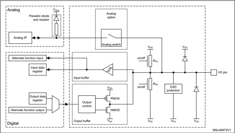

Note:

The parasitic diode in the analog domain is connected to V DDA  and cannot be used as a

protection diode.

The voltage level called $V_{DD}$\_FT  in some datasheets and reference manuals is inside the ESD protection block.

Note:

32

Figure 2. Three-volt or five-volt tolerant GPIO structure (TT or FT)

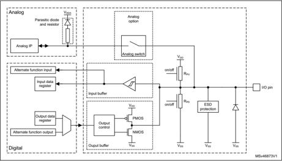

Note: The parasitic diode in the analog domain is connected to V DDA  and cannot be used as a

protection diode.

The voltage level called $V_{DD}$\_FT  in some datasheets and reference manuals is inside the ESD protection block.

When the analog option is selected (by enabling analog peripheral on the given pin), the FT I/O is not five-volt tolerant anymore since the pin is supplied with V DDA .

Caution: A TT or FT GPIO pin has no internal protection diode connected to supply ($V_{DD}$ ). There is no physical limitation against over-voltage. Therefore, for applications requiring a limited voltage threshold, it is recommended to connect an external diode to $V_{DD}$ .

## 4.3 GPIO modes description

This section describes the possible GPIO pin configurations available in STM32 devices.

## 4.3.1 Input mode configuration

When a STM32 device I/O pin is configured as input, one of three options must be selected:

- Input with internal pull-up. Pull-up resistors are used in STM32 devices to ensure a well-defined logical level in case of floating input signal. Depending on application requirements, an external pull-up can be used instead.
- Input with internal pull-down. Pull-down resistors are used in STM32 devices to ensure a well-defined logical level in case of floating input signal. Depending on application requirements, an external pull-down can be used instead.
- Floating input. Signal level follows the external signal. When no external signal is present, the Schmitt trigger randomly toggles between the logical levels induced by the external noise. This increases the overall consumption.

Programmed as input, an I/O port exhibits the following characteristics:

- The output buffer is disabled
- The Schmitt trigger input is activated
- The pull-up or pull-down resistors are activated depending on the value in the GPIOx\_PUPDR register
- The data present on the I/O pin is sampled into the input data register at each AHB clock cycle
- The I/O state is obtained by reading the GPIOx\_IDR input data register

## 4.3.2 Output mode configuration

When a STM32 device I/O pin is configured as output, one of two options must be selected:

- Push-pull output mode:

The push-pull output actually uses two transistors: one PMOS and one NMOS. Each transistor is ON to drive the output to the appropriate level:

- -The top transistor (PMOS) is ON when the output has to drive HIGH state
- -The bottom transistor (NMOS) is ON when the output has to drive a LOW state The control of the two transistors is done through the GPIO port output type register ( GPIOx\_OTYPER ).

Writing the related bit of the output register ( GPIOx\_ODR ) to 0 activates the NMOS transistor to force the I/O pin to ground.

Writing the related bit of the output register ( GPIOx\_ODR ) to 1 activates the PMOS transistor to force the I/O pin to $V_{DD}$ .

- Open-drain output mode:

Open-drain output mode does not use the PMOS transistor and a pull-up resistor is required.

When the output has to go high, the NMOS transistor must be turned off, pulling the line high only by the pull-up resistor. This pull-up resistor could be internal with a typical value of 40 kOhm and activated through GPIO port pull-up / pull-down register ( GPIOx\_PUPDR ).

- Note: It is important to note that it is not possible to activate pull-up and pull-down at the same time on the same I/O pin.

It is also possible to use an external pull-up or pull-down resistor instead of the internal resistor. In this case, the value must be adapted to be compliant with the GPIO output voltage and current characteristics.

Programmed as output, an I/O port exhibits the following characteristics:

- The output buffer can be configured in open-drain or push-pull mode
- The Schmitt trigger input is activated
- The  internal  pull-up  and  pull-down  resistors  are  activated  depending  on  the  value  in  the GPIOx\_PUPDR register.
- The written value into the output data register GPIOx\_ODR sets the I/O pin state
- The written data on GPIOx\_ODR can be read from GPIOx\_IDR register that is updated every AHB clock cycle

Open-drain output is often used to control devices which operate at a different voltage supply than the STM32. Open-drain mode is also used to drive one or several I 2 C devices when specific pull-up resistors are required.

32

## 4.3.3 Alternate functions

On some STM32 GPIO pins, the user has the possibility to select alternate functions inputs / outputs. Each pin is multiplexed with up to sixteen peripheral functions such as communication interfaces (SPI, UART, I 2 C, USB, CAN, LCD and others), timers, debug interface, and others.

The alternate function of the selected pin is configured through two registers:

- GPIOx\_AFRL (for pin 0 to 7)
- GPIOx\_AFRH (for pin 8 to 15)

To know which functions are multiplexed on each GPIO pin, refer to the device datasheet.

When the I/O port is programmed as alternate function mode:

- The output buffer can be configured in open-drain or push-pull mode
- The output buffer is driven by the signals coming from the peripheral (transmitter enable and data)
- The Schmitt trigger input is activated
- The pull-up and pull-down resistors activations depend on the value in the register GPIOx\_PUPDR

The data present on the I/O pin are sampled into the input data register at each AHB clock cycle.

A read access to the input data register provides the I/O state.

Alternate functions details are provided in the datasheet and the reference manual of the product.

## 4.3.4 Analog configuration

Few STM32 GPIO pins can be configured in analog mode which allows the use of ADC, DAC, OPAMP, and COMP internal peripherals. To use a GPIO pin in analog mode, the following register are considered:

- -GPIOx\_MODER to select the mode (Input, Output, Alternate, Analog)
- -GPIOx\_ASCR to select the required function ADC, DAC, OPAMP, or COMP

When the I/O port is programmed in an analog configuration:

- The output buffer is disabled
- The Schmitt trigger input is deactivated, providing zero consumption for every analog value of the I/O pin.The output of the Schmitt trigger is forced to a constant value (0).
- The pull-up and pull-down resistors are disabled by hardware

Read access to the input data register gets the value 0.

For details concerning ADC, DAC, OPAMP and COMP function and programming, refer to the datasheet and reference manual of the product.

The analog switch itself is not closed. The analog switch is closed only when analog peripheral is selected (or enabled) on the given pin.

## 5 GPIO electrical characteristics and definitions

This chapter defines and explains some of the electrical parameters in STM32 datasheets.

## 5.1 GPIO general information

The following sections detail some of the electrical parameters in the datasheets as a function of their use from an application point of view.

## AMR (absolute maximum ratings)

The absolute maximum ratings represent the values of voltages, current, temperatures, power dissipations, and others which must never be exceeded. Exceeding these values can lead to the deterioration or the destruction of the IC.

## Operating conditions

The operating conditions represent the range of guaranteed values within which the IC operates in proper conditions.

## 5.1.1 Pad leakage current (I lkg )

The pad leakage current is the current which is sourced from the input signal by the I/O pin when it is configured in input mode. The value of the leakage current depends on the I/O structure and on the voltage range of the V IN signal applied to the I/O pin.

Leakage currents are product dependent. Refer to the datasheets for their values.

## 5.1.2 Injected current (I INJ )

Injection current is the current that is being forced into a pin by an input voltage (V IN ) higher than the positive supply ($V_{DD}$  + ∆ V) or lower than ground (V SS ).

Injection current above the given specifications causes a current flow inside the device and affects its reliability. Even a very small current exceeding the specified limit is not allowed.

STM32 datasheets specify injected current and V IN .

Negative-injection current is the current induced when V IN  &lt; V SS . The maximum negative injected current is -5 mA and the minimum V IN  voltage level acceptable on the GPIO is -0.3 V for TT and FT GPIO.

Positive-injection current is the current induced when V IN  &gt; $V_{DD}$ . For STM32 devices, the maximum positive-injection current on TT and FT GPIO is defined as N/A or 0 mA.

- N/A means that, as long as the input voltage is within the AMR range, and due to the internal design of the GPIO, no current injection occurs. As a result, no corruption of the GPIO and STM32 device operation is observed in such a case.
- 0 mA means that current injection can damage the GPIO and induce STM32 malfunction.

Warning: positive current injection is prohibited for a TT or FT GPIO

defined as 0 mA

32

Note:

The maximum V IN  voltage is equal to $V_{DD}$  + 0.3 V for TT GPIO. For FT GPIO, the V IN maximum voltage is the minimum value among $V_{DD}$ , V DDA , V DDIO2 , V DDUSB , and V LCD ) augmented of 3.6 V with a maximum V IN  value limited to 5.5 V.

There is no injected current while -0.3 V &lt; V IN &lt; V INmax . The total injected current is limited, typically to 25 mA per device. Refer to the device datasheet for the value of the exact limitation. This restricts the number of pins on which current can be injected.

## 5.1.3 GPIO current consumption

There are two types of I/O pin current consumption in STM32 devices:

1. The static current consumption which is mainly due to pull-up resistors when I/O pin is used as input and held low or when I/O pin is used as output with external pull-down or external load.
2. The dynamic current consumption which is the current from the I/O supply voltage used by the I/O pin circuitry and capacitive load when the I/O pin switches.

The dynamic current consumption is given by Equation 1 .

## Equation 1 I SW = C L  x $V_{DD}$  x FSW

- -I SW is the current sunk by a switching I/O to charge / discharge the capacitive load
- -CL  is the total load capacitance seen by the I/O pin
- CL  is the sum of internal, external, PCB, and package capacitances
- -$V_{DD}$  is the I/O supply voltage
- -F SW  is the I/O switching frequency

Note: The GPIO speed has no impact on the dynamic current consumption.

## 5.1.4 Voltage output and current drive

All STM32 GPIOs are CMOS and TTL compliant and are able to source or sink current from external pin. Figure 3 shows the current flow according to the output level selected. I OH  is sourced current when GPIO output is in High state. $I_{OL}$  is sunk current when GPIO output is in Low state. The maximum output current which can be sunk or sourced by one GPIO or from the power supplies is limited to preserve the GPIO from as well as that the sum of the current sourced or sunk by all GPIO and cannot exceed the AMR values fixed inside the product datasheet. Following the current drive limitations, the number of GPIO which can drive current has to be limited consequently.

For more details, see the values of I $V_{DD}$ , I VSS , I IO  and ∑ I $V_{DD}$ , ∑ I VSS , and ∑ I IO  parameters allowed into the AMR current characteristics table available in the datasheet.

Figure 3. Output buffer and current flow

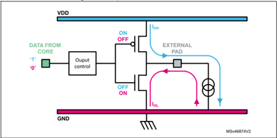

In case of communication exchange, STM32 output signals must be compatible with the VIL  / V IH of the receptor device and STM32 inputs must be compliant with the V OL  / V OH  of the transmitter device as shown in Figure 4 .

Figure 4. Logical level compatibility

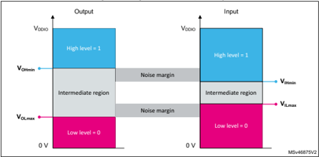

For the CMOS technology, the input threshold voltages are relative to $V_{DD}$  as follows:

$$V_{IHmin}\sim2\,/\,3\,V_{DD}\,and\,V_{ILmax}\sim1\,/\,3\,V_{DD}.$$

For the TTL technology, the levels are fixed and equal to $V_{IHmin}$ = 2V and $V_{ILmax}$  = 0.8 V.

The V OH  ,V OL , V IH , V IL levels and the values of output-driving currents are part of the general input/output characteristics given in the STM32 datasheet .

32

## 5.1.5 Pull-up calculation

Each STM32 GPIO offers the possibility to select internal pull-up and pull-down (typical value = 40 kOhm). Some STM32 applications may require to use an external pull-up resistor. This section presents output and input levels compatibility and the way to calculate the appropriate pull-up resistor when the STM32 GPIO open-drain output is connected to an external device.

Figure 5. STM32 current flow according to output voltage level

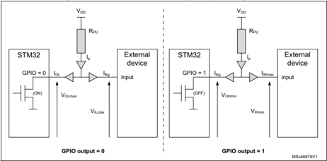

The schematics in Figure 5 shows the current flows (gray arrows) and the associated voltages needed to calculate the $R_{PU}$  pull-up resistor.

The value of $R_{PU}$  is maximum when GPIO output equals 1. This means that the NMOS transistor is OFF; the V OHmin  voltage is used for the calculation.

The value of $R_{PU}$  is minimum when GPIO output equals 0. This means that the NMOS transistor is ON; the $V_{OLmax}$  voltage is used for the calculation.

$$(\vee_{DDmax}-\vee_{OLmax})\,/\,(I_{OL}+I_{ISg}\,)<\,R_{PU}<(\vee_{DDmin}-\vee_{OHmin})\,/\,(I_{IH}+I_{ISg})$$

## Pull-up calculation for the I 2 C bus:

Pull-up calculation in case of I 2 C bus is different because the I 2 C mode must be taken into account. This calculation depends on the I 2 C mode (Standard Mode, Fast Mode, Fast mode Plus), on the $V_{DD}$  of the device, and on the bus capacitance.

A low pull-up resistor value prevents the dedicated STM32 GPIO I 2 C pins to generate a low level on the bus. The minimum value $R_{PUmin}$  is defined as a function of $V_{DD}$ , V OL , and $I_{OL}$ according to Equation 2 .

$$Equation\ 2~~~~~~~~~~~R_{PUmin}=(V_{DD}-V_{OLmax})\ /\ I_{OL}$$

The maximum pull-up resistance R PUmax  is limited by the total capacitance of the bus including the capacitance of the wire, connections and pins (C b ), and the maximum rise time (t rmax ) of the SDA and SCL signals. Refer to the datasheet and to the I 2 C bus specification for more details.

If the pull-up resistor is too high, the I 2 C line does not rise to a logical high before being pulled low. The maximum value R PUmax  is calculated according to Equation 3 .

## Equation 3 RPUmax  = t rmax  / (0.8473 x C b )

The rationale for Equation 3 is described in the following steps:

1. Voltage amplitude over time is RC time-constant dependent according to V(t) = $V_{DD}$  x (1 - e(-t / RC))
2. With V IH = 0.3 x $V_{DD}$ , the time t 1  at which V IH is reached satisfies to V(t 1 ) = 0.3 x $V_{DD}$  = $V_{DD}$  x (1 - e(-t 1  / $R_{PU}$ C b )) leading to t 1  = 0.3566749 x $R_{PU}$  x C b
3. With V OH  = 0.7 x $V_{DD}$ , the time t 2  at which V OH  is reached satisfies to V(t 2 ) = 0.7 x $V_{DD}$  = $V_{DD}$  x (1 - e(-t 2  / $R_{PU}$ C b )) leading to t 2  = 1.2039729 x $R_{PU}$  x C b
4. With t r = t 2  - t 1 , it comes t r = 0.8473 x $R_{PU}$  x C b

## 5.2 Three-volt tolerant and five-volt tolerant

Electrical characteristics defines GPIO as three-volt tolerant, five-volt tolerant, and also three-volt capable. Tolerance represents the voltage value which can be accepted by the GPIO. Capability represents the voltage value which can be output by the GPIO.

## 5.2.1 Three-volt tolerant GPIO (TT)

For some STM32, electrical specifications define GPIO as three-volt tolerant or three-volt compliant. From the user point of view, there is no difference between these two kinds of GPIO.

Input voltage on three-volt tolerant cannot exceed $V_{DD}$  + 0.3 V.

If some analog input function is enabled on the GPIO (I/O structure TT\_a with ADC input active, COMP input, OPAMP input), then the maximum operating voltage on pin cannot exceed min(V DDA , VREF+) + 0.3 V.

## 5.2.2 Five-volt tolerant GPIO (FT)

STM32 devices embed five-volt tolerant GPIOs. These GPIOs are actually tolerant to $V_{DD}$  + 3.6 V. It means that the I/O pins can accept such voltages without causing leakage current and damages on the GPIOs.

Regardless of the supply voltage, V IN  cannot exceed 5.5 V.

When $V_{DD}$  = 0 V, the input voltage on the GPIO cannot exceed 3.6 V.

In case of a multi-supplied and multiplexed GPIO ($V_{DD}$ , V DDUSB , V LCD , V DDA ), the GPIO is tolerant to 3.6 V augmented of the minimum supply voltage among $V_{DD}$ , V DDUSB , V LCD , and VDDA .

However, a GPIO is five-volt tolerant only in input mode. When the output mode is enabled, the GPIO is no more five-volt tolerant. For more details about I/O input voltage, refer to V IN parameters in the general operating conditions table of the datasheet.

32

A GPIO is five-volt tolerant only if there is no analog function enabled on pin (for I/O structure FT\_a, FT\_fa, TT\_a). If some analog input function is enabled on the GPIO (ADC input active, COMP input, OPAMP input), then the maximum operating voltage on pin cannot exceed min(V DDA , VREF+) + 0.3 V.

## 5.3 Five-volt tolerant application examples

The following figures give examples of applications only using five-volt tolerant GPIO.

## 5.3.1 White LED drive

A white LED needs a typical ~20 mA current under typical 3.5 V supply (4 V max.).

As STM32 devices maximum sink current is 25 mA, there is not enough margin to directly drive a LED. Two options, using an external MOSFET (or BJT) or driving by means of two GPIOs, are presented in Figure 6 .

Figure 6. Example of white LED drive connections

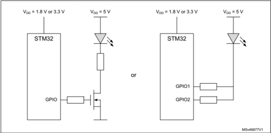

For the GPIO parallel drive option, open-drain mode must be used and internal pull-up must be disabled. Since the ground current is huge compared to the MCU consumption, the ground layout needs to be designed with care.

## 5.3.2 Triac drive

A triac drive example is shown in Figure 7 for the -5 V supply system.

Figure 7. Example of triac drive connections

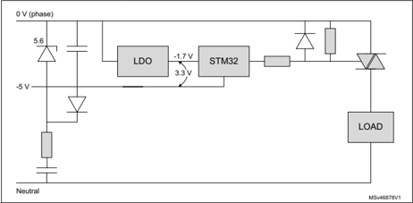

In this set up, the STM32 current flow depends on the output voltage level. The STM32 GPIO must be set up in open-drain mode. If the I/O drive current is not sufficient, coupled GPIOs can be used in parallel.

## 5.3.3 I 2 C application

The STM32 device supplied by 1.8 V or 3.3 V can directly communicate with a 5 V I 2 C bus as illustrated in Figure 8 .

Figure 8. Example of I 2 C connections

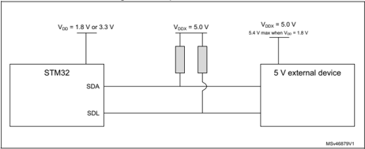

If it occurs that $V_{DD}$  = 0 V while V DDX  = 5 V (even transient), it is recommended to place a Zenner diode (for instance 3.3 V) between $V_{DD}$ and VDDX.

32

In the example shown in Figure 9 , $V_{DD}$  is the output of the LDO supplied by V DDX .

Figure 9. Example of 5 V to 3.3 V power supply

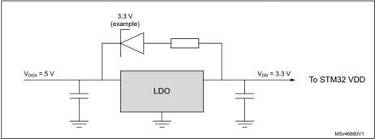

## 5.3.4 UART application

If the UART transceiver to communicate with is supplied with TTL-compatible 5 V, the STM32 device can directly communicate as shown in Figure 10 .

Figure 10. Example of UART connections

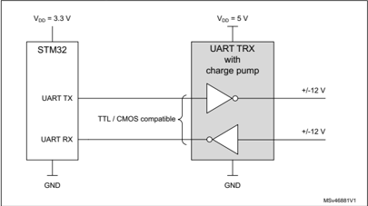

If the 5 V UART interface input is TTL compatible, V OL  &lt; 0.8 V and V OH  &gt; 2.0 V. This implies that a 3.3 V CMOS output can drive without any problem. An STM32 FT pad can accept 0 V to 5 V CMOS level input when $V_{DD}$  = 3.3 V.

## 5.3.5 USB VBUS example

The VBUS pad of STM32 devices is five-volt tolerant, However, it needs to comply with the $V_{DD}$  maximum rating. If STM32 is supplied from an independent supply, it is not allowed to connect VBUS as long as STM32 is not supplied. Another solution is to place a Zenner diode (ex. 3.3 V) between VBUS and $V_{DD}$  as illustrated in Figure 11 .

Figure 11. Example of USB VBUS connections

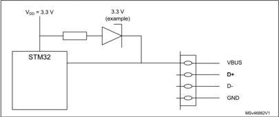

If the STM32 supply is provided by an LDO supplied by VBUS, it is recommended to use a Zenner diode (ex. 3.3 V) as illustrated in Figure 12 .

Figure 12. Example of V BUS  to $V_{DD}$  power supply

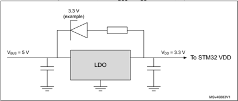

## 5.3.6 I/O usage for the five-volt ADC conversion

STM32 devices have FT pads which are connected to ADC input. When ADC is not connected (analog switch in I/O is not closed), the I/O can accept $V_{DD}$  + 3.6 V. In this situation, 5 V applied to FT pad can be granted.

However, once the I/O input is connected to the ADC, and during the sampling phase, the parasitic diode to V DDA  and/or VREF+ is forward biased as shown in Figure 13 .

32

Figure 13. Example of five-volt ADC conversion

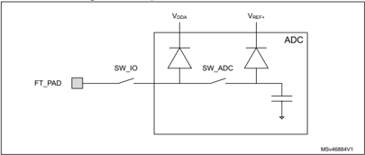

It is recommended to clamp the input voltage with an external clamp (for instance a series of resistors and the Schottky diode to VREF+).

The parasitic diodes are not characterized for reliability. STMicroelectronics does not guarantee the level of current which those diodes can accept.

## Work around proposal

If there is an unused FT pad available on the STM32 device, connect it to the ADC input pad with parallel configuration as illustrated in Figure 14 .

Figure 14. Workaround example for five-volt ADC conversion

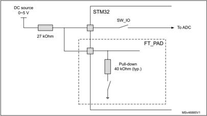

1. The ADC makes the conversion with the other FT\_PAD pull-down enabled.
2. If first ADC conversion result is less than 2 V (which indicates that the DC source is inside the ADC input range), the ADC re-does the conversion with pull-down disabled.

The above method avoids the parasitic diode forward bias.

## 6 GPIO hardware guideline

This chapter sums up some of the most important rules to check when developing applications with STM32 GPIO.

## 6.1 Avoid floating unused pin

Do not leave unused pin floating. Connect it either to ground or to supply on the PCB, or use PU / PD. Noise on non-connected input pin is a source of extra consumption by making the input buffer switch randomly.

If the application is sensitive to ESD, prefer a connection to ground or define the pin as PP output and drive it to low.

## 6.2 Cross-voltage domains leakage

In applications with multiple different voltages (for instance 3.3 V and 1.8 V, or 5 V and 3.3 V), check that all the GPIOs with PU are not exposed to an input voltage that exceeds $V_{DD}$ . This is particularly valid when optional external circuitry is connected (debugger probe and systems or others).

Figure 15. Multi voltage leakage example

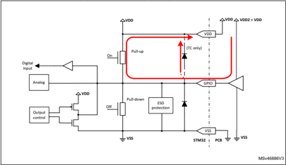

The example provided in Figure 15 shows the leakage current induced by the internal pullup resistor when the STM32 and the driving buffer are not supplied with the same $V_{DD}$ source. The red arrow marks the leakage current path.

32

## 6.3 Voltage protection when no $V_{DD}$  is supplied

Voltage protection (for example five-volt tolerance for inputs) is guaranteed only if the STM32 is supplied.

Five-volt tolerance is only possible if $V_{DD}$  is higher than the minimum required for operating.

If $V_{DD}$  is not present, for example grounded, the maximum voltage must not exceed 3.6 V (the exact limit value is provided in the STM32 datasheet).

Warning: If the external voltage exceeds the maximum voltage value, the STM32 device can be damaged.

Figure 16. Voltage protection when $V_{DD}$  is not supplied

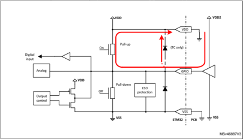

The example provided in Figure 16 shows the leakage current induced when no $V_{DD}$  is supplied. The red arrow marks the leakage current path.

## 6.4 Open-drain output with no load

When the GPIO is configured as an open drain output with no external pull-up load or internal pull-up, it must be forced to low drive so that the input signal on the pin is defined. This avoids a floating input. This configuration is shown in Figure 17 .

Figure 17. Open-drain output with no load

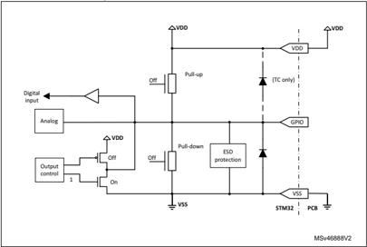

## 6.5 Using the MCO clock output

Clock signals can be a major factor of high current consumption. Specific attention must be paid to all input and output clocks related to the MCU or to other components on the board. Designers must consider that clocking other components on the board with the MCU clock through an output pin (such as the MCO (a) ) increases the current consumption due to the I/O switching frequency.

For this reason, it is up to the hardware designer to choose either routing a PCB wire from the MCO (a)  pin to other clock input components or to use an external oscillator depending on the full set of clock requirements on the board (number of clock inputs and clock frequencies).

a. MCO: microcontroller clock ouput alternate function

32

## 6.6 Debug pins have PU or PD by default

Some pins are by default programmed as inputs with PU or PD (see STM32 datasheet for the related GPIO). If these pins are used for other purposes, it must be avoided to force a 0 while PU or a 1 while PD, as this causes extra consumption.

## 6.7 NRST pin cannot be used as enable

The NRST pin cannot be used as an enable pin in order to achieve the lowest power consumption. Permanently grounding it maintains the device in the startup phase. It is preferred to release the NRST pin and enter one of the low-power mode (either Standby or Shutdown) if possible.

Note: The NRST pin already integrates a weak PU (about 40 kOhm).

## 6.8 VBAT GPIO has limited current strength

The VBAT GPIO pin allows to supply the STM32 backup domain from an external voltage source (battery or capacitor). When an STM32 microcontroller is in V BAT  mode, most of the GPIOs are shut down. Only the GPIOs which are  part of the backup domain are powered through the V BAT  voltage when $V_{DD}$  is not present. Backup GPIOs are supplied through an integrated switch that has limited drive strength (it cannot exceed 3 mA). These I/Os must not be used to drive high current and their speed is limited, even when $V_{DD}$  is valid.

Overdriving this capability could lead to unspecified level that could create extra power consumption in the system.

## 6.9 BOOT0 pin

Applying $V_{DD}$  voltage permanently to BOOT0 generates extra consumption.

## 7 GPIO software guidelines for power optimization

## 7.1 Configure unused GPIO input as analog input

GPIO always have an input channel, which can be either digital or analog.

If it is not necessary to read the GPIO data, prefer the configuration as analog input. This saves the consumption of the input Schmitt trigger.

## 7.2 Adapt GPIO speed

The rise time, fall time and maximum frequency are configurable using the GPIOx\_OSPEEDR configuration register. Such adjustment has an impact on the EMI (electromagnetic interferences) and SSO ( simultaneous switching output) due to higher switching current peak. A compromise has to be done between GPIO performance versus noise. The rise time and fall time of each GPIO signal must be adapted to the minimal value compatible with the associated signal frequency and board capacitive load.

In order to help users to control the signal integrity in their applications, the IBIS model of the selected STM32 GPIO pin is available and can be downloaded from STMicroelectronics web site at www.st.com .

## 7.3 Disable GPIO register clock when not in use

If a GPIO bank does not need to be used for a long period, disable its clock by using the HAL\_RCC\_GPIOx\_CLK\_DISABLE() function.

## 7.4 Configure GPIO when entering low-power modes

When entering low-power mode, all pin signals must be tied either to $V_{DD}$  or to ground.

If the GPIO is connected to an external receiver (external component input), the GPIO signal value must be forced using either a PP or a PU/PD.

When the GPIO is connected to a driver (external component output or bus), the driver must provide a valid level (either $V_{DD}$  or ground). If the driver level is undefined, the signal on the GPIO must be forced by using PU/PD.

For practical reasons, it may be easier to use input PU/PD in low-power mode when the GPIO is an input (analog or digital) in Run mode; and output PP when the GPIO is an output in Run mode. This avoids to manage the changes when entering or exiting Stop modes.

## 7.5 Shutdown exit mode

Note: This section applies only to the microcontrollers in the STM32L4 Series, STM32L4+ Series, STM32L5 Series, and STM32U5 Series.

When exiting from Shutdown mode, the GPIOs are reconfigured to their default values at Power On Reset. This can create extra system consumption before they can be reprogrammed to their correct value. If this is an issue for the application, the Standby mode must be used instead of the Shutdown mode.

32

## 8 GPIO selection guide and configuration

The flowchart presented in Figure 18 and Figure 19 provides users with a quick help to select the GPIO mode and configuration adapted to their application.

Figure 18. GPIO configuration flowchart (1 of 2)

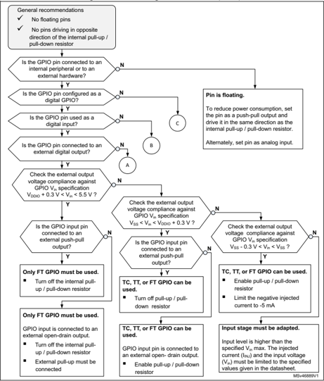

Figure 19. GPIO configuration flowchart (2 of 2)

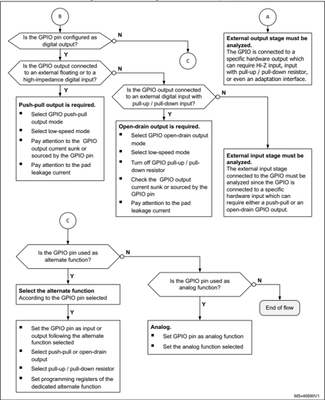

32

## 9 Revision history

Table 2. Document revision history

| Date        |   Revision | Changes                                                                                                                                                                                                                                                                                                                                          |
|-------------|------------|--------------------------------------------------------------------------------------------------------------------------------------------------------------------------------------------------------------------------------------------------------------------------------------------------------------------------------------------------|
| 21-Sep-2017 |          1 | Initial release.                                                                                                                                                                                                                                                                                                                                 |
| 12-Aug-2021 |          2 | Updated the document title. Added a note to Section 5.2.1: Three-volt tolerant GPIO (TT) and Section 5.2.2: Five-volt tolerant GPIO (FT) about the maximum operating voltage when an analog input function is enabled. Added remarks about the analog switch in Section 4.2: GPIO equivalent schematics and Section 4.3.4: Analog configuration. |
| 29-Mar-2022 |          3 | Updated the document title. Updated the applicability of Section 7.5: Shutdown exit mode.                                                                                                                                                                                                                                                        |
| 21-May-2026 |          4 | Updated: - Document title. - Figure 15: Multi voltage leakage example - Figure 16: Voltage protection when $V_{DD}$ is not supplied - Figure 17: Open-drain output with no load                                                                                                                                                                       |

## IMPORTANT NOTICE - PLEASE READ CAREFULLY

STMicroelectronics NV and its subsidiaries ('ST') reserve the right to make changes, corrections, enhancements, modifications, and improvements to ST products and/or to this document at any time without notice.

In the event of any conflict between the provisions of this document and the provisions of any contractual arrangement in force between the purchasers and ST, the provisions of such contractual arrangement shall prevail.

The purchasers should obtain the latest relevant information on ST products before placing orders. ST products are sold pursuant to ST's terms and conditions of sale in place at the time of order acknowledgment.

The purchasers are solely responsible for the choice, selection, and use of ST products and ST assumes no liability for application assistance or the design of the purchasers' products.

No license, express or implied, to any intellectual property right is granted by ST herein.

Resale of ST products with provisions different from the information set forth herein shall void any warranty granted by ST for such product.

If the purchasers identify an ST product that meets their functional and performance requirements but that is not designated for the purchasers' market segment, the purchasers shall contact ST for more information.

ST and the ST logo are trademarks of ST. For additional information about ST trademarks, refer to www.st.com/trademarks. All other product or service names are the property of their respective owners.

Information in this document supersedes and replaces information previously supplied in any prior versions of this document.

© 2026 STMicroelectronics - All rights reserved
