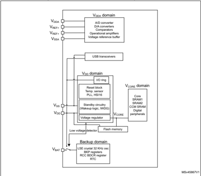
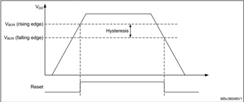
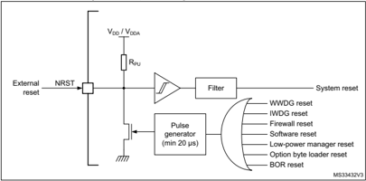
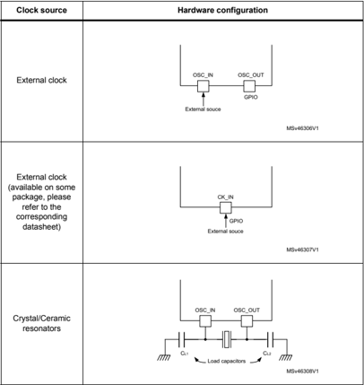
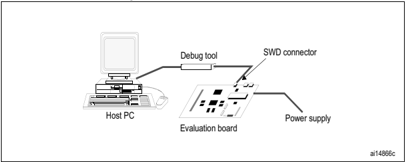
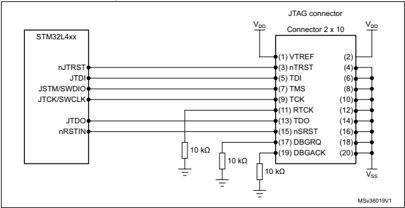
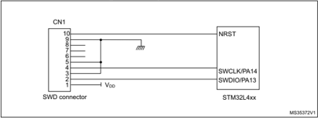
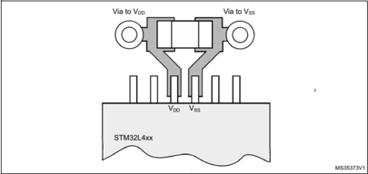
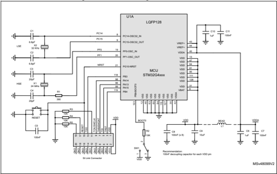

## Introduction

This application note provides system designers with hardware implementation overview of the development board features such as power supply, clock management, reset control, boot mode setting and debug management.

It shows how to use STM32G4 Series microcontrollers, and describes the minimum hardware resources required to develop an application using these products.

Detailed reference design schematics are also contained in this document with descriptions of the main components, interfaces and modes.

## AN5093 Application note

## Getting started with STM32G4 Series hardware development boards

1

## Contents

|   1 | General information . . . . . . . . . . . . . . . . . . . . .                                                | General information . . . . . . . . . . . . . . . . . . . . .                                                | . . . . . . . . . . . . . . . . . .                                                                                                                                         | . . 6   |
|-----|--------------------------------------------------------------------------------------------------------------|--------------------------------------------------------------------------------------------------------------|-----------------------------------------------------------------------------------------------------------------------------------------------------------------------------|---------|
|   2 | Power supplies . . . . . . . . . . . . . . . . . . . . . . . . . . . . . . . . . . . . . . . . .             | Power supplies . . . . . . . . . . . . . . . . . . . . . . . . . . . . . . . . . . . . . . . . .             | . .                                                                                                                                                                         | . . 6   |
|     | 2.1                                                                                                          | Power supplies schemes . . . . .                                                                             | . . . . . . . . . . . . . . . . . . . . . . . . . . . . . . .                                                                                                               | . . 6   |
|     |                                                                                                              | 2.1.1                                                                                                        | Independent analog peripherals supply . . . . . . . . . . . . . . . . . . . . . . . .                                                                                       | . . 7   |
|     |                                                                                                              | 2.1.2                                                                                                        | USB transceivers supply . . . . . . . . . . . . . . . . . . . . . . . . . . . . . . . . . . .                                                                               | . . 8   |
|     |                                                                                                              | 2.1.3                                                                                                        | Battery Backup domain . . . . . . . . . . . . . . . . . . . . . . . . . . . . . . . . . . . .                                                                               | . . 8   |
|     |                                                                                                              | 2.1.4                                                                                                        | Voltage regulator . . . . . . . . . . . . . . . . . . . . . . . . . . . . . . . . . . . . . . . . .                                                                         | . . 9   |
|     |                                                                                                              | 2.1.5                                                                                                        | Dynamic voltage scaling management . . . . . . . . . . . . . . . . . . . . . . . .                                                                                          | . 10    |
|     | 2.2                                                                                                          | Reset and power supply supervisor . .                                                                        | . . . . . . . . . . . . . . . . . . . . . . . . . .                                                                                                                         | . .11   |
|     |                                                                                                              | 2.2.1                                                                                                        | Power-on reset (POR) / power-down reset (PDR) / Brown-Out reset (BOR) . . . . . . . . . . . . . . . . . . . . . . . . . . . . . . . . . . . . . . . . . . . . . . . . . . . | 11      |
|     |                                                                                                              | 2.2.2                                                                                                        | Power reset . . . . . . . . . . . . . . . . . . . . . . . . . . . . . . . . . . . . . . . . . . . . .                                                                       | . 12    |
|     |                                                                                                              | 2.2.3                                                                                                        | System reset . . . . . . . . . . . . . . . . . . . . . . . . . . . . . . . . . . . . . . . . . . . .                                                                        | . 12    |
|     |                                                                                                              | 2.2.4                                                                                                        | Backup domain reset . . . . . . . . . . . . . . . . . . . . . . . . . . . . . . . . . . . . . .                                                                             | . 14    |
|   3 | Package . . . . . . . . . . . . . . . . . . . . . . . . . . . . . . . . . . . . . . . . . . . . . . . .      | Package . . . . . . . . . . . . . . . . . . . . . . . . . . . . . . . . . . . . . . . . . . . . . . . .      | .                                                                                                                                                                           | . 15    |
|     | 3.1                                                                                                          | Pinout compatibility . . . . . . . .                                                                         | . . . . . . . . . . . . . . . . . . . . . . . . . . . . . . . .                                                                                                             | . 17    |
|   4 | Clocks . . . . . . . . . . . . . . . . . . . . . . . . . . . . . . . . . . . . . . . . . . . . . . . . . . . | Clocks . . . . . . . . . . . . . . . . . . . . . . . . . . . . . . . . . . . . . . . . . . . . . . . . . . . | Clocks . . . . . . . . . . . . . . . . . . . . . . . . . . . . . . . . . . . . . . . . . . . . . . . . . . .                                                                | . 18    |
|     | 4.1                                                                                                          | HSE clock . . . . . . . . . . . . . . . . . . . . . . . . . . . . . . . . . . . . . . . . . .                | . . . . . .                                                                                                                                                                 | . 18    |
|     |                                                                                                              | 4.1.1                                                                                                        | External crystal/ceramic resonator (HSE crystal) . . . . . . . . . . . . . . . .                                                                                            | . 20    |
|     |                                                                                                              | 4.1.2                                                                                                        | External source (HSE bypass) . . . . . . . . . . . . . . . . . . . . . . . . . . . . . . .                                                                                  | . 20    |
|     | 4.2                                                                                                          | HSI clock . . . . . . . . . . . .                                                                            | . . . . . . . . . . . . . . . . . . . . . . . . . . . . . . . . . . . .                                                                                                     | . 20    |
|     | 4.3                                                                                                          | LSE clock . . . . . . . . .                                                                                  | . . . . . . . . . . . . . . . . . . . . . . . . . . . . . . . . . . . . . . .                                                                                               | . 20    |
|     |                                                                                                              | 4.3.1                                                                                                        | External source (LSE bypass) . . . . . . . . . . . . . . . . . . . . . . . . . . . . . . .                                                                                  | . 21    |
|   5 | Boot configuration . . . . . . . . . . . . . . . . . . . . . . . .                                           | Boot configuration . . . . . . . . . . . . . . . . . . . . . . . .                                           | . . . . . . . . . . . . . . . .                                                                                                                                             | . 22    |
|   6 | Debug management . . . . . . . . . . . . . . . . . . . . . . . . . . . . . . . . .                           | Debug management . . . . . . . . . . . . . . . . . . . . . . . . . . . . . . . . .                           | . . . . . .                                                                                                                                                                 | . 23    |
|     | 6.1                                                                                                          | Introduction . . . . . .                                                                                     | . . . . . . . . . . . . . . . . . . . . . . . . . . . . . . . . . . . . . . . .                                                                                             | . 23    |
|     | 6.2                                                                                                          | SWJ debug port (JTAG and serial wire) . . . . . . . . . .                                                    | . . . . . . . . . . . . . . .                                                                                                                                               | . 23    |
|     | 6.3                                                                                                          | Pinout and debug port pins . .                                                                               | . . . . . . . . . . . . . . . . . . . . . . . . . . . . . . . .                                                                                                             | . 24    |
|     |                                                                                                              | 6.3.1 SWJ debug port pins                                                                                    | . . . . . . . . . . . . . . . . . . . . . . . . . . . . . . . . . . . . . .                                                                                                 | . 24    |

|    |                                                                    | 6.3.2                                                                   | Flexible SWJ-DP pin assignment . . . . . . . . . . . . . . . . . . . .                  | . 24   |
|----|--------------------------------------------------------------------|-------------------------------------------------------------------------|-----------------------------------------------------------------------------------------|--------|
|    |                                                                    | 6.3.3                                                                   | Internal pull-up and pull-down resistors on JTAG pins . . . .                           | . 25   |
|    |                                                                    | 6.3.4                                                                   | SWJ debug port connection with standard JTAG connector                                  | . 26   |
|    | 6.4                                                                | Serial wire debug (SWD) pin assignment . . . . . . . .                  | . . . . . . . . .                                                                       | 26     |
|    |                                                                    | 6.4.1                                                                   | SWD pin assignment . . . . . . . . . . . . . . . . . . . . . . . . . . . . .            | . 26   |
|    |                                                                    | 6.4.2                                                                   | Internal pull-up and pull-down on SWD pins . . . . . . . . . . .                        | . 27   |
|    |                                                                    | 6.4.3                                                                   | SWD port connection with standard SWD connector . . . .                                 | . 27   |
|  7 | Recommendations . . . . . . . . .                                  | Recommendations . . . . . . . . .                                       | . . . . . . . . . . . . . . . . . . . . . . . . .                                       | 28     |
|    | 7.1                                                                | Printed circuit board . . . .                                           | . . . . . . . . . . . . . . . . . . . . . . . . . . . . .                               | 28     |
|    | 7.2                                                                | Component position . . . . . . . . .                                    | . . . . . . . . . . . . . . . . . . . . . . . .                                         | 28     |
|    | 7.3                                                                | Ground and power supply (V SS , V DD , V SSA , V DDA, V REF ) . . . . . | Ground and power supply (V SS , V DD , V SSA , V DDA, V REF ) . . . . .                 | 28     |
|    | 7.4                                                                | Decoupling . . . . . . . . . . . . . . . . . . . . . . . . . . . . .    | . . . . . . . . . . .                                                                   | 28     |
|    | 7.5                                                                | Other signals . . . . . .                                               | . . . . . . . . . . . . . . . . . . . . . . . . . . . . . . . .                         | 29     |
|    | 7.6                                                                | Unused I/Os and features . . . . . .                                    | . . . . . . . . . . . . . . . . . . . . . .                                             | 29     |
|  8 | Reference design . . . . . . . . . . . . . . . . . . . . . . . . . | Reference design . . . . . . . . . . . . . . . . . . . . . . . . .      | . . . . . . . . . .                                                                     | 30     |
|    | 8.1                                                                | Description . . . .                                                     | . . . . . . . . . . . . . . . . . . . . . . . . . . . . . . . . . . . .                 | 30     |
|    |                                                                    | 8.1.1                                                                   | Clock . . . . . . . . . . . . . . . . . . . . . . . . . . . . . . . . . . . . . . . . . | . 30   |
|    |                                                                    | 8.1.2                                                                   | Reset . . . . . . . . . . . . . . . . . . . . . . . . . . . . . . . . . . . . . . . . . | . 30   |
|    |                                                                    | 8.1.3                                                                   | Boot mode . . . . . . . . . . . . . . . . . . . . . . . . . . . . . . . . . . . . .     | . 30   |
|    |                                                                    | 8.1.4                                                                   | SWD interface . . . . . . . . . . . . . . . . . . . . . . . . . . . . . . . . . .       | . 30   |
|    |                                                                    | 8.1.5                                                                   | Power supply . . . . . . . . . . . . . . . . . . . . . . . . . . . . . . . . . . .      | . 30   |
|    | 8.2                                                                | Component references . . . . . . . . . . . . . . . . . .                | . . . . . . . . . . . . .                                                               | 31     |

3

## List of tables

| Table 1.   | Package summary for STM32G4 Series                    | . 15   |
|------------|-------------------------------------------------------|--------|
| Table 2.   | Package summary per line . . . . . . . . . .          | . 15   |
| Table 3.   | Pinout summary . . . . . . . . . . . . . . . . . .    | . 17   |
| Table 4.   | HSE/ LSE clock sources. . . . . . . . . . . .         | . 19   |
| Table 5.   | Boot modes. . . . . . . . . . . . . . . . . . . . . . | . 22   |
| Table 6.   | Debug port pin assignment. . . . . . . . . .          | . 24   |
| Table 7.   | SWJ I/O pin availability . . . . . . . . . . . . .    | . 24   |
| Table 8.   | SWD port pins. . . . . . . . . . . . . . . . . . . .  | . 26   |
| Table 9.   | Mandatory components . . . . . . . . . . . .          | . 31   |
| Table 10.  | Optional components . . . . . . . . . . . . . .       | . 31   |
| Table 11.  | Reference connection for all packages.                | . 32   |
| Table 12.  | Document revision history . . . . . . . . . .         | . 34   |

## List of figures

| Figure 1.   | STM32G4 Series power supply overview.             | . . 7   |
|-------------|---------------------------------------------------|---------|
| Figure 2.   | Brown-out reset waveform . . . . . . . . . . .    | . 12    |
| Figure 3.   | Simplified diagram of the reset circuit. . .      | . 13    |
| Figure 4.   | Host-to-board connection . . . . . . . . . . . .  | . 23    |
| Figure 5.   | JTAG connector implementation . . . . . .         | . 26    |
| Figure 6.   | SWD port connection . . . . . . . . . . . . . . . | . 27    |
| Figure 7.   | Typical layout for V DD /V SS pair . . . . . . .  | . 29    |
| Figure 8.   | Reference design STM32G4 Series . . . .           | . 32    |

5

## 1 General information

This document applies to STM32G4 Series Arm ®  cores (a) -based devices.

## 2 Power supplies

## 2.1 Power supplies schemes

The STM32G4 Series devices require a 1.71 V to 3.6 V operating supply voltage (V DD ). Analog peripherals are supplied through independent power domain V DDA .

- VDD  = 1.71 V to 3.6 V

VDD  is the external power supply for the I/Os, the internal regulator and the system analog such as reset, power management and internal clocks. It is provided externally through VDD pins.

- VDDA  = 1.62 V (ADC/COMP) / 1.71 V (DAC 1MSPS/DAC 15MSPS/2 V(OPAMP)/ 2.4 V (VREFBUF)

VDDA  is the external analog power supply for A/D converters, D/A converters, voltage reference buffer, operational amplifiers and comparators. The V DDA  voltage level is independent from the V DD  voltage. V DDA  should be preferably connected to V DD  when these peripherals are not used.

- VBAT  = 1.55 V to 3.6 V

VBAT  is the power supply for RTC, external clock 32 kHz oscillator and backup registers (through power switch) when V DD  is not present. VBAT is internally bonded to VDD for small packages without dedicated pin.

- VREF-, VREF+

VREF+  is the input reference voltage for ADCs and DACs. It is also the output of the internal voltage reference buffer when enabled.

When V DDA  &lt; 2 V, V REF+  must be equal to V DDA .

When V DDA ≥ 2 V, V REF+  must be between 2 V and V DDA .

VREF+  can be grounded when ADC and DAC are not active.

The internal voltage reference buffer supports three output voltages, which are configured with VRS bit in the VREFBUF\_CSR register:

- -VREF+  around 2.048 V. This requires V DDA  equal to or higher than 2.4 V.
- -VREF+  around 2.5 V. This requires V DDA  equal to or higher than 2.8 V.
- -VREF+  around 2.9 V. This requires V DDA  equal to or higher than 3.15 V.

a. Arm is a registered trademark of Arm Limited (or its subsidiaries) in the US and/or elsewhere.

- -VREF+ pin is not available on 32-pin packages. In this case, it is bonded to V DDA and the internal voltage reference buffer (VREFBUF) is not available and must be kept disabled.

VREF-  is internally double bonded with V SSA .

An embedded linear voltage regulator is used to supply the internal digital power V CORE . VCORE  is the power supply for digital peripherals SRAM1, SRAM2 and CCM SRAM. The Flash is supplied by V CORE  and V DD .

Figure 1. STM32G4 Series power supply overview

## 2.1.1 Independent analog peripherals supply

To improve ADC and DAC conversion accuracy and to extend the supply flexibility, the analog peripherals have an independent power supply which can be separately filtered and shielded from noise on the PCB.

- The analog peripherals voltage supply input is available on a separate V DDA  pin.
- An isolated supply ground connection is provided on V SSA  pin.

The V DDA  supply voltage can be different from V DD . The presence of V DDA  must be checked before enabling any of the analog peripherals supplied by V DDA  (A/D converter, D/A converter, comparators, operational amplifiers, voltage reference buffer).

33

The V DDA  supply can be monitored by the Peripheral Voltage Monitoring, and compared with thresholds.

When a single supply is used, V DDA  can be externally connected to V DD  through the external filtering circuit in order to ensure a noise-free V DDA  reference voltage.

## ADC and DAC reference voltage

To ensure a better accuracy on low-voltage inputs and outputs, the user can connect to VREF+  a separate reference voltage lower than V DDA . V REF+ is the highest voltage, represented by the full scale value, for an analog input (ADC) or output (DAC) signal.

VREF+  can be provided either by an external reference of by an internal buffered voltage reference (VREFBUF).

The internal voltage reference is enabled by setting the ENVR bit in the VREFBUF control and status register (VREFBUF\_CSR). The voltage reference is set to 2.048 V, 2.5 V or 2.9 V according the VRS[1:0] bits setting. The internal voltage reference can also provide the voltage to external components through V REF+  pin. Refer to the device datasheet for further information.

## 2.1.2 USB transceivers supply

The USB transceivers are supplied from V DD  power supply pin. V DD  range for USB usage is from 3.0 V to 3.6 V.

## 2.1.3 Battery Backup domain

To retain the content of the Backup registers and supply the RTC function when V DD  is turned off, the VBAT   pin can be connected to an optional backup voltage supplied by a battery or by another source.

The VBAT pin powers the RTC unit, the LSE oscillator and the PC13 to PC15 I/Os, allowing the RTC to operate even when the main power supply is turned off. The switch to the V BAT supply is controlled by the power-down reset embedded in the Reset block.

## Warning:

During t RSTTEMPO (temporization at V DD  startup) or after a PDR has been detected, the power switch between V BAT  and V DD remains connected to V BAT .

During the startup phase, if V DD  is established in less than t RSTTEMPO  (refer to the datasheet for the value of t RSTTEMPO ) and V DD  &gt; V BAT  + 0.6 V, a current may be injected into V BAT through an internal diode connected between V DD  and the power switch (V BAT ).

If the power supply/battery connected to the VBAT pin cannot support this current injection, it is strongly recommended to connect an external low-drop diode between this power supply and the VBAT pin.

If no external battery is used in the application, it is recommended to connect V BAT externally to V DD  with a 100 nF external ceramic decoupling capacitor.

When the Backup domain is supplied by V DD  (analog switch connected to V DD ), the following pins are available:

- PC13, PC14 and PC15, which can be used as GPIO pins
- PC13, PC14 and PC15, which can be configured by RTC or LSE
- PA0/RTC\_TAMP2 and PE6/RTC\_TAMP3 when they are configured by the RTC as tamper pins

Note: Due to the fact that the analog switch can transfer only a limited amount of current (3 mA), the use of GPIO PC13 to PC15 in output mode is restricted: the speed has to be limited to 2 MHz with a maximum load of 30 pF and these I/Os must not be used as a current source (e.g. to drive a LED).

When the Backup domain is supplied by V BAT  (analog switch connected to V BAT  because VDD  is not present), the following functions are available:

- PC13, PC14 and PC15 can be controlled only by RTC or LSE (refer to reference manual section: RTC functional description)
- PA0/RTC\_TAMP2 and PE6/RTC\_TAMP3 when they are configured by the RTC as tamper pins

## Backup domain access

After a system reset, the Backup domain (RTC registers and backup registers) is protected against possible unwanted write accesses. To enable access to the Backup domain, proceed as follows:

1. Enable the power interface clock by setting the PWREN bits in the APB1 peripheral clock enable register 1 (RCC\_APB1ENR1).
2. Set the DBP bit in the Power control register 1 (PWR\_CR1) to enable access to the Backup domain
3. Select the RTC clock source in the Backup domain control register (RCC\_BDCR).
4. Enable the RTC clock by setting the RTCEN [15] bit in the Backup domain control register (RCC\_BDCR).

## VBAT battery charging

When VDD is present, It is possible to charge the external battery on VBAT through an internal resistance.

The VBAT charging is done either through a 5 kOhm resistor or through a 1.5 kOhm resistor depending on the VBRS bit value in the PWR\_CR4 register.

The battery charging is enabled by setting VBE bit in the PWR\_CR4 register. It is automatically disabled in VBAT mode.

## 2.1.4 Voltage regulator

Two embedded linear voltage regulators supply all the digital circuitries, except for the Standby circuitry and the Backup domain. The main regulator output voltage (V CORE ) can be programmed by software to two different power ranges (Range 1 and Range 2) in order to optimize the consumption depending on the system's maximum operating frequency (refer to reference manual Section: Clock source frequency versus voltage scaling and to Section: Read access latency.

33

The voltage regulators are always enabled after a reset. Depending on the application modes, the V CORE  supply is provided either by the main regulator (MR) or by the low-power regulator (LPR).

- In Run, Sleep and Stop 0 modes, both regulators are enabled and the main regulator (MR) supplies full power to the V CORE  domain (core, memories and digital peripherals).
- In low-power run and low-power sleep modes, the main regulator is off and the lowpower regulator (LPR) supplies low power to the V CORE  domain, preserving the contents of the registers, SRAM1, SRAM2 and CCM SRAM.
- In Stop 1 modes, the main regulator is off and the low-power regulator (LPR) supplies low power to the V CORE  domain, preserving the contents of the registers, SRAM2 and CCM SRAM.
- In Standby mode with SRAM2 content preserved (RRS bit is set in the PWR\_CR3 register), the main regulator (MR) is off and the low-power regulator (LPR) provides the supply to SRAM2 only. The core, digital peripherals (except Standby circuitry and Backup domain) SRAM1 and CCM SRAM are powered off.
- In Standby mode, both regulators are powered off. The contents of the registers, SRAM1, SRAM2 and CCM SRAM is lost except for the Standby circuitry and the Backup domain.
- In Shutdown mode, both regulators are powered off. When exiting from Shutdown mode, a power-on reset is generated. Consequently, the contents of the registers, SRAM1, SRAM2 and CCM SRAM is lost, except for the Backup domain.

## 2.1.5 Dynamic voltage scaling management

The dynamic voltage scaling is a power management technique which consists in increasing or decreasing the voltage used for the digital peripherals (V CORE ), according to the application performance and power consumption needs.

Dynamic voltage scaling to increase V CORE  is known as overvolting. It is used to improve the device performance.

Dynamic voltage scaling to decrease V CORE  is known as undervolting. It is performed to save power, particularly in laptop and other mobile devices where the energy comes from a battery and is thus limited.

- Range 1: High-performance range.

The main regulator operates in two mode following the R1MODE bit in the PWR\_CR5 register:

- -Main regulator Range 1 boost mode: the main regulator provides a typical output voltage at 1.28V. It is used when the system clock frequency is greater than 150MHz.
- -Main regulator Range 1 normal mode: the main regulator provides a typical output at 1.2V. It is used when the system clock frequency is up to 150MHz.
- Range 2: Low-power range.

The main regulator provides a typical output voltage at 1.0 V. The system clock frequency can be up to 26 MHz.The Flash access time for a read access is increased as compared to Range 1; write and erase operations are not possible.

Voltage scaling is selected through the VOS bit in the PWR\_CR1 power control register.

The sequence to go from Range 1 to Range 2 is:

1. The system clock must be divided by 2 using the AHB prescaler before switching to a lower system frequency for at least 1 us and then reconfigure the AHB prescaler.
2. Reduce the system frequency to a value lower than 26 MHz
3. Adjust number of wait states according new frequency target in Range 2 (LATENCY bits in the FLASH\_ACR register.
4. Program the VOS[1:0] bits to 10 in the PWR\_CR1 register.

The sequence to go from Range 2 to Range 1 is:

1. Program the VOS[1:0] bits to 01 in the PWR\_CR1 register.
2. Wait until the VOSF flag is cleared in the Power status register 2 PWR\_SR2.
3. Adjust number of wait states according new frequency target in Range 1 (LATENCY bits in the Flash access control register FLASH\_ACR register.
4. Increase the system frequency by following procedure:
- If the system frequency is 26 MHz &lt; SYSCLK &lt;= 150 MHz, select the Range 1 mode and just configure and switch to PLL for a new system frequency, the R1MODE bit must be set in the PWR\_CR5 register for Range1 normal mode selection.
6. -The system clock must be divided by 2 using the AHB prescaler before switching to a higher system frequency.
7. -Set the R1MODE bit in the PWR\_CR5 register.
8. -Configure and switch to PLL for a new system frequency.
9. -Wait for at least 1 us and then reconfigure the AHB prescaler to get the needed HCLK clock frequency.
- If the system frequency is SYSCLK &gt; 150 MHz, select the Range 1 boost mode:
11. -The system clock must be divided by 2 using the AHB prescaler before switching to a higher system frequency.
12. -Clear the R1MODE bit in the PWR\_CR5 register.
13. -Configure and switch to PLL for a new system frequency.
14. -Wait for at least 1 us and then reconfigure the AHB prescaler to get the needed HCLK clock frequency.

## 2.2 Reset and power supply supervisor

## 2.2.1 Power-on reset (POR) / power-down reset (PDR) / Brown-Out reset (BOR)

The device has an integrated power-on reset (POR) / power-down reset (PDR), coupled with a Brown-Out reset (BOR) circuitry. The BOR is active in all power modes except Shutdown mode, and cannot be disabled.

Five BOR thresholds can be selected through option bytes.

During power-on, the BOR keeps the device under reset until the supply voltage V DD reaches the specified V BORx  threshold. When V DD  drops below the selected threshold, a device reset is generated. When V DD  is above the V BORx  upper limit, the device reset is released and the system can start.

33

For more details on the Brown-Out reset thresholds, refer to the electrical characteristics section in the datasheet.

Figure 2. Brown-out reset waveform

## 2.2.2 Power reset

A power reset is generated when one of the following events occurs:

1. a Brown-Out reset (BOR).
2. when exiting from Standby or Shutdown mode.

A Brown-Out reset, including power-on or power-down reset (POR/PDR), sets all registers to their reset values except the Backup domain.

When exiting Standby or Shutdown mode, all registers in the V CORE  domain are set to their reset value. Registers outside the V CORE  domain (RTC, WKUP, IWDG, and Standby/Shutdown modes control) are not impacted.

## 2.2.3 System reset

A system reset sets all registers to their reset values except the reset flags in the clock control/status register (RCC\_CSR) and the registers in the Backup domain.

A system reset is generated when one of the following events occurs:

- A low level on the NRST pin (external reset)
- Window watchdog event (WWDG reset)
- Independent watchdog event (IWDG reset)
- A firewall event (FIREWALL reset)
- A software reset (SW reset)
- Low-power management reset
- Option byte loader reset
- A Brown-out reset

The reset source can be identified by checking the reset flags in the Control/Status register, RCC\_CSR.

These sources act on the NRST pin and it is always kept low during the delay phase. The RESET service routine vector is fixed at address 0x0000\_0004 in the memory map.

The system reset signal provided to the device is output on the NRST pin. The pulse generator guarantees a minimum reset pulse duration of 20 µs for each internal reset source. In case of an external reset, the reset pulse is generated while the NRST pin is asserted low.

In case on an internal reset, the internal pull-up R PU  is deactivated in order to save the power consumption through the pull-up resistor.

## NRST pin (external reset)

Through specific option bits, the NRST pin is configurable for operating as:

- Reset input/output (default at device delivery)

Any valid reset signal on the pin is propagated to device internal logic and all internal reset sources are externally driven through a pulse generator to this pin. The GPIO functionality (PG10) is not available. The pulse generator guarantees a minimum reset pulse duration of 20 μ s for each internal reset source to be output on the NRST pin. An internal reset holder option can be used, if enabled in the option bytes, to ensure that the pin is pulled low until its voltage meets VIL threshold. This function guarantee the detection of internal reset sources by external components when the line faces a significant capacitive load. In case on an internal reset, the internal pull-up RPU is deactivated in order to save the power consumption through the pull-up resistor.

- Reset input

In this mode, any valid reset signal on the NRST pin is propagated to device internal logic, but resets generated internally by the device are not visible on the pin. In this configuration, GPIO functionality (PG10) is not available.

- GPIO

In this mode, the pin can be used as PG10 standard GPIO. The reset function of the pin is not available. Reset is only possible from device internal reset sources and it is not propagated to the pin.

Figure 3. Simplified diagram of the reset circuit

33

## Software reset

The SYSRESETREQ bit in Cortex ® -M4 Application Interrupt and Reset Control Register must be set to force a software reset on the device (as described in STM32F3, STM32F4 and STM32L4 Series Cortex ® -M4 programming manual (PM0214)).

## Low-power mode security reset

To prevent that critical applications mistakenly enter a low-power mode, two low-power mode security resets are available. If enabled in option bytes, the resets are generated in the following conditions:

1. Entering Standby mode: this type of reset is enabled by resetting nRST\_STDBY bit in User option Bytes. In this case, whenever a Standby mode entry sequence is successfully executed, the device is reset instead of entering Standby mode.
2. Entering Stop mode: this type of reset is enabled by resetting nRST\_STOP bit in User option bytes. In this case, whenever a Stop mode entry sequence is successfully executed, the device is reset instead of entering Stop mode.
3. Entering Shutdown mode: this type of reset is enabled by resetting nRST\_SHDW bit in User option bytes. In this case, whenever a Shutdown mode entry sequence is successfully executed, the device is reset instead of entering Shutdown mode.

For further information on the User Option Bytes, refer to reference manual section: Option bytes description .

## Option byte loader reset

The option byte loader reset is generated when the OBL\_LAUNCH bit (bit 27) is set in the FLASH\_CR register. This bit is used to launch the option byte loading by software.

Charging/discharging the pull-down capacitor through the internal resistor adds to the device power consumption. The recommended value of 100 nF for the capacitor can be reduced to 10 nF to limit power consumption.

## 2.2.4 Backup domain reset

The Backup domain has two specific resets.

A Backup domain reset is generated when one of the following events occurs:

1. Software reset, triggered by setting the BDRST bit in the Backup domain control register (RCC\_BDCR).
2. VDD  or V BAT  power on, if both supplies have previously been powered off.

A Backup domain reset only affects the LSE oscillator, the RTC, the Backup registers and the RCC Backup domain control register.

## 3 Package

Package should be selected by taking into account the constraints that are strongly dependent upon the application.

The list below summarizes the most frequent ones:

- Amount of interfaces required. Some interfaces might not be available on some packages. Some interfaces combinations might not be possible on some packages.
- PCB technology constrains. Small pitch and high ball density could require more PCB layers and higher class PCB.
- Package height.
- PCB available area .
- Noise emission or signal integrity of high speed interfaces. Smaller packages usually provide better signal integrity. This is further enhanced as

Small pitch and high ball density requires multilayer PCBs which allow better supply/ground distribution.

- Compatibility with other devices.
1. Body size, excluding pins for LQFP.
2. Maximum value.

Table 1. Package summary for STM32G4 Series

| Packag e type   | QFPN32   | LQFP32   | QFPN48   | LQFP48   | WLCSP49   | LQFP64   | UFBGA64   | LQFP80   | WLCSP81     | TFBGA100   | LQFP100   | LQFP128   |
|-----------------|----------|----------|----------|----------|-----------|----------|-----------|----------|-------------|------------|-----------|-----------|
| Size (mm) (1)   | 5x5      | 7x7      | 7x7      | 7x7      | 3.89x3.74 | 10x10    | 5x5       | 12x12    | 3.693x3.815 | 8x8        | 14x14     | 14x14     |
| Pitch (mm)      | 0.5      | 0.5      | 0.5      | 0.5      | 0.4       | 0.5      | 0.5       | 0.5      | 0.4         | 0.8        | 0.5       | 0.5       |
| Height (mm) (2) | 0.6      | 1.6      | 0.6      | 1.6      | 0.59      | 1.6      | 0.6       | 1.6      | 0.59        | 1.1        | 1.6       | 1.6       |

Table 2. Package summary per line

| Package type   | STM32G474   | STM32G431   |
|----------------|-------------|-------------|
| QFPN32/LQFP32  | NA          | YES         |
| LQFP48         | YES         | YES         |
| WLCSP49        | NA          | YES         |
| LQFP64         | YES         | YES         |
| UFBGA64        | NA          | YES         |
| WLCSP81        | YES         | NA          |

33

Table 2. Package summary per line (continued)

| Package type   | STM32G474   | STM32G431   |
|----------------|-------------|-------------|
| LQFP80         | YES         | YES         |
| LQFP100        | YES         | YES         |
| TFBGA100       | YES         | NA          |
| LQFP128        | YES         | NA          |

## 3.1 Pinout compatibility

Table 3 below allows to select the right package depending on required signals.

Table 3. Pinout summary

|                     | Packages and pin number   | Packages and pin number   | Packages and pin number   | Packages and pin number   | Packages and pin number   | Packages and pin number   | Packages and pin number   | Packages and pin number   | Packages and pin number   | Packages and pin number   | Packages and pin number   | Packages and pin number   |
|---------------------|---------------------------|---------------------------|---------------------------|---------------------------|---------------------------|---------------------------|---------------------------|---------------------------|---------------------------|---------------------------|---------------------------|---------------------------|
| Pin name            | QFPN                      | QFPN                      |                           |                           | LQFP                      |                           |                           |                           | UFBGA                     | TFBGA                     | WLCSP                     | WLCSP                     |
|                     | 32                        | 48                        | 32                        | 48                        | 64                        | 80                        | 100                       | 128                       | 64                        | 100                       | 49                        | 81                        |
| Specific pins       | Specific pins             | Specific pins             | Specific pins             | Specific pins             | Specific pins             | Specific pins             | Specific pins             | Specific pins             | Specific pins             | Specific pins             | Specific pins             | Specific pins             |
| PC14/OSC32_IN       | -                         | x                         | -                         | x                         | x                         | x                         | x                         | x                         | x                         | x                         | x                         | x                         |
| PC15/OSC32_OUT      | -                         | x                         | -                         | x                         | x                         | x                         | x                         | x                         | x                         | x                         | x                         | x                         |
| PF0/OSC_IN          | x                         | x                         | x                         | x                         | x                         | x                         | x                         | x                         | x                         | x                         | x                         | x                         |
| PF1/OSC_OUT         | x                         | x                         | x                         | x                         | x                         | x                         | x                         | x                         | x                         | x                         | x                         | x                         |
| System related pins | System related pins       | System related pins       | System related pins       | System related pins       | System related pins       | System related pins       | System related pins       | System related pins       | System related pins       | System related pins       | System related pins       | System related pins       |
| PB8/BOOT0           | x                         | x                         | x                         | x                         | x                         | x                         | x                         | x                         | x                         | x                         | x                         | x                         |
| PG10/NRST           | x                         | x                         | x                         | x                         | x                         | x                         | x                         | x                         | x                         | x                         | x                         | x                         |
| Supply pins         | Supply pins               | Supply pins               | Supply pins               | Supply pins               | Supply pins               | Supply pins               | Supply pins               | Supply pins               | Supply pins               | Supply pins               | Supply pins               | Supply pins               |
| VBAT                | -                         | x                         | -                         | x                         | x                         | x                         | x                         | x                         | x                         | x                         | x                         | x                         |
| V REF+              | -                         | x                         | -                         | x                         | x                         | x                         | x                         | x (1)                     | x                         | x                         | x                         | x                         |
| V DDA               | x                         | x                         | x                         | x                         | x                         | x                         | x                         | x                         | x                         | x                         | x                         | x                         |
| V SSA               | x                         | x (2)                     | x                         | x                         | x                         | x                         | x                         | x                         | x                         | x                         | x                         | x                         |
| Number of V DD      | 2                         | (1)                       | 2                         | 3                         | 4                         | 5                         | 5                         | 7                         | 3                         | 5                         | 2                         | 5                         |
| Number of V SS      | 2                         | (1)                       | 2                         | 3                         | 4                         | 5                         | 5                         | 7                         | 3                         | 5                         | 2                         | 5                         |

33

## 4 Clocks

Three different clock sources can be used to drive the system clock (SYSCLK):

- HSI16 (high speed internal) 16 MHz RC oscillator clock
- HSE oscillator clock, from 4 to 48 MHz
- PLL clock

The HSI is used as system clock source after startup from Reset.

The devices have the following additional clock sources:

- 32 KHz low speed internal RC (LSI RC) which drives the independent watchdog and optionally the RTC used for Auto-wakeup from Stop and Standby modes.
- 32.768 KHz low speed external crystal (LSE crystal) which optionally drives the realtime clock (RTCCLK)
- RC 48 MHz internal clock sources (HSI48) to potentially drive the USB FS, the SDMMC and the RNG.

Each clock source can be switched on or off independently when it is not used, to optimize power consumption

Several prescaler can be used to configure the AHB frequency, the AHB1, the APB1 and APB2 domains. The maximum frequency of the AHB, the APB1 and the APB2 domains is 170 MHz.

## 4.1 HSE clock

The high speed external clock signal (HSE) can be generated from two possible clock sources:

- HSE external crystal/ceramic resonator
- HSE user external clock

The resonator and the load capacitors have to be placed as close as possible to the oscillator pins in order to minimize output distortion and startup stabilization time. The loading capacitance values must be adjusted according to the selected oscillator.

Table 4. HSE/ LSE clock sources

- The value of R EXT  depends on the crystal characteristics. A typical value is in the range of 5 to 6 R S  (resonator series resistance).To fine tune the REXT value, refer to AN2867(Oscillator design guide for ST microcontrollers)
- Load capacitance, C L , has the following formula: C L = C L1 x C L2 / (C L1  + C L2 ) + C stray where: C stray  is the pin capacitance and board or trace PCB-related capacitance. Typically, it is between 2 pF and 7 pF. Please refer to Section 7.4: Decoupling to minimize its value.

33

## 4.1.1 External crystal/ceramic resonator (HSE crystal)

The 4- to 48-MHz external oscillator has the advantage of producing a very accurate rate on the main clock.

The associated hardware configuration is shown in Figure 4 . Refer to the electrical characteristics section of the datasheet for more details.

The HSERDY flag in the Clock control register (RCC\_CR) indicates if the HSE oscillator is stable or not. At startup, the clock is not released until this bit is set by hardware. An interrupt can be generated if enabled in the Clock interrupt enable register (RCC\_CIER).

The HSE Crystal can be switched on and off using the HSEON bit in the C lock control register (RCC\_CR) .

## 4.1.2 External source (HSE bypass)

In this mode, an external clock source must be provided. It can have a frequency of up to 48 MHz. The user selects this mode by setting the HSEBYP and HSEON bits in the Clock control register (RCC\_CR). The external clock signal (square, sinus or triangle) with ~40-60 % duty cycle depending on the frequency (refer to the datasheet) has to drive the following pin (see Figure 4 ).

- On devices where OSC\_IN and OSC\_OUT pins are available: OSC\_IN pin must be driven while the OSC\_OUT pin can be used as a GPIO.
- Otherwise, the CK\_IN pin must be driven.

Note: For details on pin availability, refers to the pinout section in the corresponding device datasheet.

To minimize the consumption, it is recommended to use the square signal.

## 4.2 HSI clock

The HSI16 clock signal is generated from an internal 16 MHz RC Oscillator. The HSI16 RC oscillator has the advantage of providing a clock source at low cost (no external components). It also has a faster startup time than the HSE crystal oscillator however, even with calibration the frequency is less accurate than an external crystal oscillator or ceramic resonator.

The HSI16 clock can be selected as system clock after wakeup from Stop modes (Stop 0 or Stop 1), and can also be used as a backup source (Auxiliary clock) if the HSI crystal oscillator fails. Refer to reference manual section: Clock security system (CSS).

## 4.3 LSE clock

The LSE crystal is a 32.768 kHz Low Speed External crystal or ceramic resonator. It has the advantage of providing a low-power but highly accurate clock source to the real-time clock peripheral (RTC) for clock/calendar or other timing functions.

The LSE crystal is switched on and off using the LSEON bit in Backup domain control register (RCC\_BDCR). The crystal oscillator driving strength can be changed at runtime using the LSEDRV[1:0] bits in the Backup domain control register (RCC\_BDCR) to obtain the best compromise between robustness and short start-up time on one side and lowpower-consumption on the other side. The LSE drive can be decreased to the lower drive capability (LSEDRV=00) when the LSE is ON. However, once LSEDRV is selected, the drive capability can not be increased if LSEON=1.

The LSERDY flag in the AHB1 peripheral clocks enable in Sleep and Stop modes register (RCC\_AHB1SMENR) indicates whether the LSE crystal is stable or not. At startup, the LSE crystal output clock signal is not released until this bit is set by hardware. An interrupt can be generated if enabled in the Clock interrupt enable register (RCC\_CIER).

## 4.3.1 External source (LSE bypass)

In this mode, an external clock source must be provided. It can have a frequency of up to 1 MHz. The user selects this mode by setting the LSEBYP and LSEON bits in the AHB1 peripheral clocks enable in Sleep and Stop modes register (RCC\_AHB1SMENR). The external clock signal (square, sinus or triangle) with ~50 % duty cycle has to drive the OSC32\_IN pin while the OSC32\_OUT pin can be used as GPIO. See Figure 4 .

33

## 5 Boot configuration

In STM32G4 Series devices, three different boot modes can be selected through the BOOT0 pin or the nBOOT0 bit into the FLASH\_OPTR register (if the nSWBOOT0 bit is cleared into the FLASH\_OPTR register), and nBOOT1 bit in FLASH\_OPTR register, as shown in the following table.

Table 5. Boot modes

|   UBE | nBOOT1 FLASH_OPTR[23]   | nBOOT0 FLASH_OPTR[27]   | BOOT0 pin PB8   | nSWBOOT0 FLASH_OPTR[26]   | Boot Memory Space Alias                    |
|-------|-------------------------|-------------------------|-----------------|---------------------------|--------------------------------------------|
|     1 | X                       | X                       | X               | X                         | Main Flash memory                          |
|     0 | X                       | X                       | 0               | 1                         | Main Flash memory is selected as boot area |
|     0 | X                       | 1                       | X               | 0                         | Main Flash memory is selected as boot area |
|     0 | 0                       | X                       | 1               | 1                         | Embedded SRAM1 is selected as boot area    |
|     0 | 0                       | 0                       | X               | 0                         | Embedded SRAM1 is selected as boot area    |
|     0 | 1                       | X                       | 1               | 1                         | System memory is selected as boot area     |
|     0 | 1                       | 0                       | X               | 0                         | System memory is selected as boot area     |

## 6 Debug management

## 6.1 Introduction

In the SWJ-DP, the two JTAG pins of the SW-DP are multiplexed with some of the five JTAG pins of the JTAG-DP.

The host/target interface is the hardware equipment that connects the host to the application board. This interface is made of three components: a hardware debug tool, a SW connector and a cable connecting the host to the debug tool.

Figure 4 shows the connection of the host to a development board.

Figure 4. Host-to-board connection

The Nucleo demonstration board embeds the debug tools (ST-LINK) so it can be directly connected to the PC through an USB cable. The ST-LINK requires by default to have an enumeration with a host that is able to supply 100 mA to power the STM32G4 Series MCU, hence user shall use jumper JP1 on the Nucleo board which can be set in case maximum current consumption on U5V does not exceed 100 mA.

## 6.2 SWJ debug port (JTAG and serial wire)

The STM32G4 Series core integrates the serial wire / JTAG debug port (SWJ-DP). It is an Arm ®  standard CoreSight™ debug port that combines a JTAG-DP (5-pin) interface and a SW-DP (2-pin) interface.

- The JTAG debug port (JTAG-DP) provides a 5-pin standard JTAG interface to the AHPAP port
- The serial wire debug port (SW-DP) provides a 2-pin (clock + data) interface to the AHP-AP port

33

## 6.3 Pinout and debug port pins

The STM32G4 Series MCU is offered in various packages with different numbers of available pins. As a result, some functionality related to the pin availability may differ from one package to another.

## 6.3.1 SWJ debug port pins

Five pins are used as outputs for the SWJ-DP as alternate functions of general-purpose I/Os (GPIOs). These pins, shown in Table 6 , are available on all packages.

Table 6. Debug port pin assignment

| SWJ-DP pin name   | JTAG debug port - Type   | JTAG debug port - Description   | SW debug port - Type   | SW debug port - Debug assignment   | Pin assignment   |
|-------------------|--------------------------|---------------------------------|------------------------|------------------------------------|------------------|
| JTMS/SWDIO        | I                        | JTAG test mode selection        | I/O                    | Serial wire data input/output      | PA13             |
| JTCK/SWCLK        | I                        | JTAG test clock                 | I                      | Serial wire clock                  | PA14             |
| JTDI              | I                        | JTAG test data input            | -                      | -                                  | PA15             |
| JTDO/TRACESWO     | O                        | JTAG test data output           | -                      | TRACESWO if async trace is enabled | PB3              |
| JNTRST            | I                        | JTAG test nReset                | -                      | -                                  | PB4              |

## 6.3.2 Flexible SWJ-DP pin assignment

After reset (SYSRESETn or PORESETn), all five pins used for the SWJ-DP are assigned as dedicated pins which are immediately usable by the debugger host (note that the trace outputs are not assigned except if explicitly programmed by the debugger host).

However, the STM32G4 Series MCU implements a register to disable all or part of the SWJ-DP port, and so releases the associated pins for general-purpose I/O usage. This register is mapped on an APB bridge connected to the Cortex ® -M4 system bus. It is programmed by the user software program and not by the debugger host.

Table 7 shows the different possibilities for releasing some pins. For more details, see the related STM32G4 Series advanced Arm ® -based 32-bit MCUs (RM0440) reference manual.

Table 7. SWJ I/O pin availability

| Available debug ports                         | SWJ I/O pin assigned - PA13 / JTMS/ SWDIO   | SWJ I/O pin assigned - PA14 / JTCK/ SWCLK   | SWJ I/O pin assigned - PA15 / JTDI   | SWJ I/O pin assigned - PB3 / JTDO   | SWJ I/O pin assigned - PB4/ JNTRST   |
|-----------------------------------------------|---------------------------------------------|---------------------------------------------|--------------------------------------|-------------------------------------|--------------------------------------|
| Full SWJ (JTAG-DP + SW-DP) - reset state      | X                                           | X                                           | X                                    | X                                   | X                                    |
| Full SWJ (JTAG-DP + SW-DP) but without JNTRST | X                                           | X                                           | X                                    | X                                   |                                      |
| JTAG-DP disabled and SW-DP enabled            | X                                           | X                                           |                                      |                                     |                                      |
| JTAG-DP disabled and SW-DP disabled           | Released                                    | Released                                    | Released                             | Released                            | Released                             |

## 6.3.3 Internal pull-up and pull-down resistors on JTAG pins

The JTAG input pins must not be floating since they are directly connected to flip-flops which control the debug mode features. Special care must be taken with the SWCLK/TCK pin that is directly connected to the clock of some of these flip-flops.

To avoid any uncontrolled I/O levels, the STM32G4 Series embeds internal pull-up and pulldown resistors on the JTAG input pins:

- JNTRST: internal pull-up
- JTDI: internal pull-up
- JTMS/SWDIO: internal pull-up
- TCK/SWCLK: internal pull-down

Once a JTAG I/O is released by the user software, the GPIO controller takes control again. The reset states of the GPIO control registers put the I/Os in the following equivalent states:

- JNTRST: input pull-up
- JTDI: input pull-up
- JTMS/SWDIO: input pull-up
- JTCK/SWCLK: input pull-down
- JTDO: input floating

The software can then use these I/Os as standard GPIOs.

Note: The JTAG IEEE standard recommends to add pull-up resistors on TDI, TMS and nTRST but, there is no special recommendation for TCK. However, for the STM32G4 Series, an integrated pull-down resistor is used for JTCK.

Having embedded pull-up and pull-down resistors removes the need to add external resistors.

The NJTRST (PB4) pin has also UCPD\_CC2 functionality which implements internal UCPD pull-down resistor (5.1 K Ω ), controlled by voltage on UCPD\_DBCC2 pin (PA10). To disable the pull-down on NJTRST pin the UCPD\_DBCC2 pin must be held at low level voltage (after device startup this pull-down on PB4 can be disabled by setting UCPD1\_DBDIS bit in the PWR\_CR3 register).

33

## 6.3.4 SWJ debug port connection with standard JTAG connector

Figure 5 shows the connection between the STM32G4 Series MCU and a standard JTAG connector.

Figure 5. JTAG connector implementation

## 6.4 Serial wire debug (SWD) pin assignment

The same SWD pin assignment is available on all STM32G4 Series packages.

Table 8. SWD port pins

| SWD pin name   | SWD port - Type   | SWD port - Debug assignment   | Pin assignment   |
|----------------|-------------------|-------------------------------|------------------|
| SWDIO          | I/O               | Serial wire data input/output | PA13             |
| SWCLK          | I                 | Serial wire clock             | PA14             |

## 6.4.1 SWD pin assignment

After reset (SYSRESETn or PORESETn), the pins used for the SWD are assigned as dedicated pins which are immediately usable by the debugger host.

However, the MCU offers the possibility to disable the SWD, therefore releasing the associated pins for general-purpose I/O (GPIO) usage. For more details on how to disable SWD port, refer to the I/O pin alternate function multiplexer and mapping section of the related STM32L4xx reference manual.

## 6.4.2 Internal pull-up and pull-down on SWD pins

Once the SWD I/O is released by the user software, the GPIO controller takes control of these pins. The reset states of the GPIO control registers put the I/Os in the equivalent states:

- SWDIO: alternate function pull-up
- SWCLK: alternate function pull-down

Having embedded pull-up and pull-down resistors removes the need to add external resistors.

## 6.4.3 SWD port connection with standard SWD connector

Figure 6 shows the connection between the STM32G4 Series MCU and a standard SWD connector.

Figure 6. SWD port connection

33

## 7 Recommendations

## 7.1 Printed circuit board

For technical reasons, it is best to use a multilayer printed circuit board (PCB) with a separate layer dedicated to ground (V SS ) and another dedicated to the V DD  supply. This provides good decoupling and a good shielding effect. For many applications, economical reasons prohibit the use of this type of board. In this case, the major requirement is to ensure a good structure for ground and for the power supply.

## 7.2 Component position

A preliminary layout of the PCB must make separate circuits:

- High-current circuits
- Low-voltage circuits
- Digital component circuits
- Circuits separated according to their EMI contribution. This reduces cross-coupling on the PCB that introduces noise.

## 7.3 Ground and power supply (V SS , V DD ,   V SSA , V DDA,  V REF )

Every block (noisy, low-level sensitive, digital, etc.) should be grounded individually, and all ground returns should be to a single point. Loops must be avoided or have a minimum area. In order to improve analog performance, the user must use separate supply sources for V DD and V DDA , and place the decoupling capacitors as close as possible to the device.

The power  supplies should be implemented close to the ground line to minimize the area of the supplies loop. This is due to the fact that the supply loop acts as an antenna, and acts as the main transmitter and receiver of EMI. All component-free PCB areas must be filled with additional grounding to create a kind of shielding (especially when using single-layer PCBs).

## 7.4 Decoupling

All power supply and ground pins must be properly connected to the power supplies. These connections, including pads, tracks and vias should have as low an impedance as possible. This is typically achieved with thick track widths and, preferably, the use of dedicated power supply planes in multilayer PCBs.

In addition, each power supply pair should be decoupled with filtering ceramic capacitors (100 nF) and a Tantalum or ceramic capacitor of about 10 µF connected in parallel on the STM32G4 Series device. Some package use a common V SS  for several V DD  instead of a pair of power supply (one V SS  for each V DD ), in that case the capacitors must be between each V DD  and the common V SS .These capacitors need to be placed as close as possible to, or below, the appropriate pins on the underside of the PCB. Typical values are 10 nF to 100 nF, but exact values depend on the application needs. Figure 7 shows the typical layout of such a V DD /V SS  pair.

The analog power supply (V DDA /V SSA ) should be decoupled with filtering ceramic capacitor 100 nF and a Tantalum or ceramic capacitor of about 1 µF. Reference voltage pin (V REF )

should be decoupled (regarding to V SSA  pin) with filtering 100 nF ceramic capacitor and a Tantalum or ceramic capacitor of about 1 µF. These capacitor need to be placed as close as possible to, or below, the appropriate pins on the underside of the PCB. Figure 7 shows the typical layout of analog supply pins and reference pins.

Figure 7. Typical layout for V DD /V SS pair

## 7.5 Other signals

When designing an application, the EMC performance can be improved by closely studying the following:

- Signals for which a temporary disturbance affects the running process permanently (which is the case for interrupts and handshaking strobe signals but, not the case for LED commands).
- For these signals, a surrounding ground trace, shorter lengths, and the absence of noisy and sensitive traces nearby (crosstalk effect) improve EMC performance. For digital signals, the best possible electrical margin must be reached for the two logical states and slow Schmitt triggers are recommended to eliminate parasitic states.
- Noisy signals (example, clock)
- Sensitive signals (example, high impedance)

## 7.6 Unused I/Os and features

All microcontrollers are designed for a variety of applications and often a particular application does not use 100% of the MCU resources.

To increase EMC performance and avoid extra power consumption, the unused features of the device should be disabled and disconnected from the clock tree. The unused clock source should be disabled and the unused I/Os should not be left floating. The unused I/O pins should be configured as analog input by software; they should also be connected to a fixed logic level 0 or 1 by an external or internal pull-up or pull-down or configured as output mode using software.

33

## 8 Reference design

## 8.1 Description

The reference design shown in Figure 8 , is based on the STM32G4 Series LQFP128.

This reference design can be tailored to any STM32G4 Series device with a different package, using the pin correspondence given in Table 11: Reference connection for all packages .

## 8.1.1 Clock

Two clock sources are used for the microcontroller:

- LSE: X2- 32.768 kHz crystal for the embedded RTC
- HSE: X1- 24 MHz crystal for the STM32G4 Series microcontroller

Refer to Section 4: Clocks .

## 8.1.2 Reset

The reset signal in Figure 8 is active low. The reset sources include:

- Reset button (B1)
- Debugging tools via the connector CN1

Refer to Section 2.2: Reset and power supply supervisor .

## 8.1.3 Boot mode

The boot option is configured by setting switches SW1 (Boot 0). Refer to Section 5: Boot configuration .

Note: When waking up from Standby mode, the Boot pin is sampled. In this situation, the user needs to pay attention to its value.

## 8.1.4 SWD interface

The shows the connection between the STM32G4 Series MCU and a standard SWD connector. Refer to Section 6: Debug management .

Note: It is recommended to connect the reset pins so as to be able to reset the application from the tools.

## 8.1.5 Power supply

Refer to Section 1: General information .

## 8.2 Component references

Table 9. Mandatory components

| Reference   | Component name   | Value           |   Quantity | Comments                                                       |
|-------------|------------------|-----------------|------------|----------------------------------------------------------------|
| U1A         | Microcontroller  | STM32G4 LQFP128 |          1 | 128-pin package                                                |
| C8          | Capacitor        | 100 nF          |          1 | Ceramic capacitors (decoupling capacitors)                     |
| C9          | Capacitor        | 4.7 µF          |          1 | Tantalum / chemical / ceramic capacitor (decoupling capacitor) |
| C6          | Capacitor        | 1 µF            |          3 | Ceramic capacitor (decoupling capacitor)                       |

Table 10. Optional components

| Reference   | Component name   | Value      |   Quantity | Comments                                                                                                                          |
|-------------|------------------|------------|------------|-----------------------------------------------------------------------------------------------------------------------------------|
| R1          | Resistor         | 390 Ω      |          1 | Used for HSE: the value depends on the crystal characteristics, refer to application note AN2687                                  |
| R3, R4, r5  | Resistor         | 10 k Ω     |          3 | Used for ST Link interface                                                                                                        |
| C5          | Capacitor        | 100 nF     |          1 | Ceramic capacitor                                                                                                                 |
| C7          | Capacitor        | 10 nF      |          1 | Ceramic capacitor                                                                                                                 |
| C1, C2      | Capacitor        | 6.8 pF     |          2 | Used for LSE: the value depends on the crystal characteristics. Fits for MC-306 32.768K-E3, which has a load capacitance of 6 pF. |
| C3, C4      | Capacitor        | 20 pF      |          2 | Used for HSE: the value depends on the crystal characteristics, refer to application note AN2687                                  |
| X1          | Quartz           | 24 MHz     |          1 | Used for HSE                                                                                                                      |
| X2          | Quartz           | 32.764 kHz |          1 | Used for LSE                                                                                                                      |
| SW1         | Switch           | -          |          1 | Used to select the right boot mode                                                                                                |
| B1          | Push-button      | -          |          1 | -                                                                                                                                 |
| L1          | Ferrite bead     | -          |          1 | For EMC reduction on V DDA supply, can be replaced by a direct connection between V DD and V DDA                                  |

33

Figure 8. Reference design STM32G4 Series

Table 11. Reference connection for all packages

|                     | Pin Number per Package   | Pin Number per Package   | Pin Number per Package   | Pin Number per Package   | Pin Number per Package   | Pin Number per Package   | Pin Number per Package   | Pin Number per Package   | Pin Number per Package   | Pin Number per Package   | Pin Number per Package   | Pin Number per Package   |
|---------------------|--------------------------|--------------------------|--------------------------|--------------------------|--------------------------|--------------------------|--------------------------|--------------------------|--------------------------|--------------------------|--------------------------|--------------------------|
| Pin Name            | UFQFPN                   | UFQFPN                   |                          |                          | LQFP                     |                          |                          |                          | UFBGA                    | TFBGA                    | WLCSP                    | WLCSP                    |
|                     | 32                       | 48                       | 32                       | 48                       | 64                       | 80                       | 100                      | 128                      | 64                       | 100                      | 49                       | 81                       |
| Specific pins       | Specific pins            | Specific pins            | Specific pins            | Specific pins            | Specific pins            | Specific pins            | Specific pins            | Specific pins            | Specific pins            | Specific pins            | Specific pins            | Specific pins            |
| PC14/OSC32_IN       | -                        | 3                        | -                        | 3                        | 3                        | 3                        | 8                        | 8                        | C1                       | C1                       | C7                       | C9                       |
| PC15/OSC32_OUT      | -                        | 4                        | -                        | 4                        | 4                        | 4                        | 9                        | 9                        | D1                       | D1                       | D7                       | D9                       |
| PF0/OSC_IN          | 2                        | 5                        | 2                        | 5                        | 5                        | 5                        | 12                       | 19                       | E1                       | E1                       | E7                       | E9                       |
| PF1/OSC_OUT         | 3                        | 6                        | 3                        | 6                        | 6                        | 6                        | 13                       | 20                       | F1                       | E2                       | E6                       | F9                       |
| System related pins | System related pins      | System related pins      | System related pins      | System related pins      | System related pins      | System related pins      | System related pins      | System related pins      | System related pins      | System related pins      | System related pins      | System related pins      |
| BOOT0/PB8           | 31                       | 46                       | 31                       | 45                       | 61                       | 77                       | 95                       | 123                      | B3                       | A3                       | B5                       | B7                       |
| NRST/PG10           | 4                        | 7                        | 4                        | 7                        | 7                        | 7                        | 14                       | 21                       | D2                       | F3                       | C6                       | D8                       |
| PA13 (JTMS- SWDIO)  | 23                       | 36                       | 23                       | 37                       | 49                       | 63                       | 74                       | 96                       | C7                       | D8                       | B2                       | B2                       |
| PA14 (JTCK- SWCLK)  | 24                       | 37                       | 24                       | 38                       | 50                       | 64                       | 75                       | 98                       | C6                       | B10                      | B3                       | C3                       |
| Supply pins         | Supply pins              | Supply pins              | Supply pins              | Supply pins              | Supply pins              | Supply pins              | Supply pins              | Supply pins              | Supply pins              | Supply pins              | Supply pins              | Supply pins              |
| VBAT                | -                        | 1                        | -                        | 1                        | 1                        | 1                        | 6                        | 6                        | C2                       | D3                       | B7                       | B9                       |

Table 11. Reference connection for all packages (continued)

|          | Pin Number per Package   | Pin Number per Package   | Pin Number per Package   | Pin Number per Package   | Pin Number per Package   | Pin Number per Package   | Pin Number per Package   | Pin Number per Package            | Pin Number per Package   | Pin Number per Package   | Pin Number per Package   | Pin Number per Package   |
|----------|--------------------------|--------------------------|--------------------------|--------------------------|--------------------------|--------------------------|--------------------------|-----------------------------------|--------------------------|--------------------------|--------------------------|--------------------------|
| Pin Name | UFQFPN                   | UFQFPN                   |                          |                          | LQFP                     |                          |                          |                                   | UFBGA                    | TFBGA                    | WLCSP                    | WLCSP                    |
|          | 32                       | 48                       | 32                       | 48                       | 64                       | 80                       | 100                      | 128                               | 64                       | 100                      | 49                       | 81                       |
| VSSA     | 14                       | -                        | 14                       | 19                       | 27                       | 27                       | 35                       | 42                                | G4                       | K4                       | G4                       | H6                       |
| VREF+    | -                        | 20                       | -                        | 20                       | 28                       | 28                       | 36                       | 43, 44                            | G5                       | K5                       | F3                       | J6                       |
| VDDA     | 15                       | 21                       | 15                       | 21                       | 29                       | 29                       | 37                       | 45                                | H5                       | J5                       | G3                       | J5                       |
| VDD      | 1, 17                    | 23, 35, 48               | 1, 17                    | 26, 36, 48               | 16, 32, 48, 64           | 16, 41, 51, 62, 80       | 24, 49, 66, 83, 100      | 13, 31, 47, 64, 81, 95, 111, 128  | H8, A8, A1               | D5, D7, F5, F7           | 32, A7                   | A1, A9, E1, J1, J9       |
| VSS      | 16, 32                   | Expose d pad3            | 16, 32                   | 23, 35, 47               | 15, 31, 47, 63           | 15, 40, 50, 61, 79       | 23, 48, 65, 82, 99       | 30, 46, 63, 80, 94, 110, 112, 127 | B2, B7, G7               | D2, D6, E5, E6, E7, F6   | A6, G2                   | A8, B1, F1, H9, J2       |

33

## 9 Revision history

Table 12. Document revision history

| Date        |   Revision | Changes                                                                                                                                                       |
|-------------|------------|---------------------------------------------------------------------------------------------------------------------------------------------------------------|
| 01-Apr-2019 |          1 | Initial release                                                                                                                                               |
| 03-Oct-2019 |          2 | Updated: - Section 2.1: Power supplies schemes , Section 2.2.2: Power reset - Table 1: Package summary for STM32G4 Series , Table 2: Package summary per line |

## IMPORTANT NOTICE - PLEASE READ CAREFULLY

STMicroelectronics NV and its subsidiaries ('ST') reserve the right to make changes, corrections, enhancements, modifications, and improvements to ST products and/or to this document at any time without notice. Purchasers should obtain the latest relevant information on ST products before placing orders. ST products are sold pursuant to ST's terms and conditions of sale in place at the time of order acknowledgement.

Purchasers are solely responsible for the choice, selection, and use of ST products and ST assumes no liability for application assistance or the design of Purchasers' products.

No license, express or implied, to any intellectual property right is granted by ST herein.

Resale of ST products with provisions different from the information set forth herein shall void any warranty granted by ST for such product.

ST and the ST logo are trademarks of ST. For additional information about ST trademarks, please refer to www.st.com/trademarks . All other product or service names are the property of their respective owners.

Information in this document supersedes and replaces information previously supplied in any prior versions of this document.

© 2019 STMicroelectronics - All rights reserved
