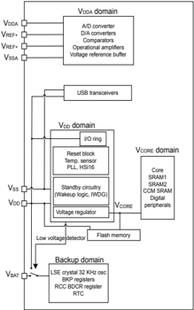
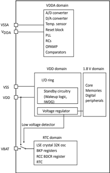
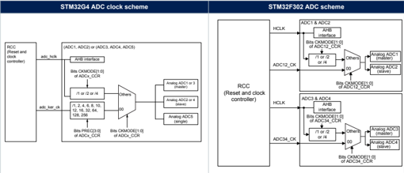
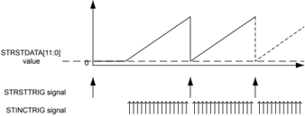
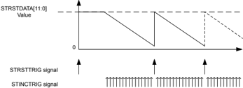
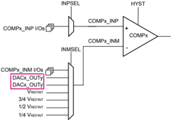
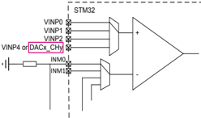
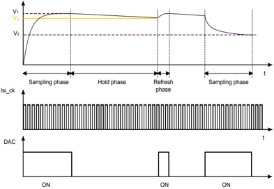
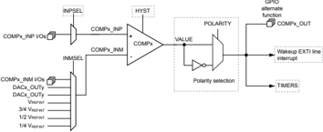

## Application note

## Guideline for using analog features of STM32G4 Series versus STM32F3 Series devices

## Introduction

This application note describes the analog features embedded in the STM32F3 Series and STM32G4 Series devices, analyzing the main analog differences and showing the main enhancements made on the STM32G4 Series versus the STM32F3 Series devices.

The STM32G4 Series is suitable for all applications requiring an advanced and rich analog peripheral set. In continuity with the STM32F3 Series, the STM32G4 Series maintains leadership in the analog-peripheral field.

## Related documents

- STM32F3xx and STM32G4xx datasheets
- STM32G4 Series advanced Arm ® -based 32-bit MCUs (RM0440)
- STM32F303x6/8/B/C/D/E, STM32F328x8, STM32F358xC, STM32F398xE advanced Arm ® -based MCUs (RM0316)

## 1

## General information

This document applies to Arm ® -based devices.

Note: Arm is a registered trademark of Arm Limited (or its subsidiaries) in the US and/or elsewhere.

## 2 STM32G4 and STM32F3 Series power supply overview

Figure 1 and Figure 2 summarize the power schemes in the STM32G4 Series and the STM32F3 Series:

Figure 1. STM32G4 Series power supply overview

Figure 2. STM32F3 Series power supply overview

Table 1. STM32G4 Series versus STM32F3 Series voltage description

| -      | STM32G4 Series                                                                                                                                                                                                                                                                                                          | STM32F3 Series                                                                                                                                                                                                                                                                                                                              |
|--------|-------------------------------------------------------------------------------------------------------------------------------------------------------------------------------------------------------------------------------------------------------------------------------------------------------------------------|---------------------------------------------------------------------------------------------------------------------------------------------------------------------------------------------------------------------------------------------------------------------------------------------------------------------------------------------|
| V DD   | Supplies the I/Os, the internal regulator and the system analog such as reset, power management and internal clocks. The internal regulator provides the V CORE (1) supplying the digital peripherals and memories                                                                                                      | Supplies the I/Os and internal regulator (2) . The internal regulator provides the V DD18 supplying the core, SRAM and Flash memories.                                                                                                                                                                                                      |
| V DDA  | Supplies the analog peripherals only: ADC, DAC, comparators, operational amplifiers and VREFBUF. During power up and power down, the following power sequence is required: - When V DD is below 1 V, then V DDA supply must remain below V DD + 300 mV - When V DD is above 1 V, all power supplies became independent. | Supplies the ADC, DAC, comparators, operational amplifiers, internal clocks, and reset block. When V DDA is different from V DD , V DDA must always be higher or equal to V DD . To maintain a safe potential difference between V DDA and V DD during power-up/power-down, an external Schottky diode can be used between V DD and V DDA . |
| V BAT  | Backup power supply for RTC, LSE oscillator and backup registers when V DD is not present.                                                                                                                                                                                                                              | Backup power supply for RTC, LSE oscillator and backup registers when V DD is not present.                                                                                                                                                                                                                                                  |
| V REF+ | It is the input reference voltage for ADCs and DACs. It is also the output of the internal voltage reference buffer when enabled. When V DDA < 2 V, V REF+ must be equal to V DDA . When V DDA ≥ 2 V, V REF+ must be between 2 V and VDDA. V REF+ can be grounded when ADC and DAC are not active.                      | It is the input reference voltage for ADCs and DACs.                                                                                                                                                                                                                                                                                        |

1. The main regulator output voltage (V CORE ) is programmed by software to two different power ranges (Range 1 and Range 2) in order to optimize the consumption depending on the system maximum operating frequency: - Range 1 normal mode: 1.2 V, system clock up to 150 MHz. - Range 1 boost mode: 1.28 V, system clock up to 170 MHz. - Range 2: 1 V, system clock up to 26 MHz
2. The internal regulator is disabled in the STM32F3x8xx devices. V DD  directly supplies the regulator output which directly drives the V DD18  domain.

## 2.1 Voltage supervision/monitoring

The main voltage supervision and monitoring differences between STM32F3 Series and STM32G4 Series are shown in Table 2.

Table 2. Voltage supervision and monitoring

| -                                   | STM32G4 Series   | STM32F3 Series (1)   |
|-------------------------------------|------------------|----------------------|
| Power on reset (POR)                | X                | X                    |
| Power down reset (PDR)              | X                | X                    |
| Brown-out reset (BOR)               | X                | -                    |
| Programmable voltage detector (PVD) | X                | X                    |
| Peripheral voltage monitoring (PVM) | X (2 thresholds) | -                    |

## 2.2 Low-power modes

By default, the microcontroller is in Run mode after a system or a power reset. Several low-power modes are available to save power when the CPU does not need to be kept running, for example when waiting for an external event.

It is up to the user to select the mode that gives the best compromise between low-power consumption, short startup time and available wakeup sources. The main low-power mode features are shown in Table 3.

Table 3. STM32G4 Series versus STM32F3 Series low-power mode summary

| Mode name          | STM32F3 Series   | STM32G4 Series   |
|--------------------|------------------|------------------|
| Sleep              | X                | X                |
| Low-power run      | -                | X                |
| Low-power sleep    | -                | X                |
| Stop 0 (1)         | X                | X                |
| Stop 1 (2)         | -                | X                |
| Standby with SRAM2 | -                | X                |
| Standby            | X                | X                |
| Shutdown           | -                | X                |

## 3 I/O configurations

Once configuring the GPIO in analog mode the pull up/downs are disabled by hardware in the case of STM32F3 Series as shown in Table 4.

Table 4. STM32F3 Series port bit configuration table

|   MODER(i)[1:0] | OTYPER(i)   | OSPEEDR(i)[1:0]   | OSPEEDR(i)[1:0]   |   PUPDR(i)[1:0] |   PUPDR(i)[1:0] | I/O configuration (1)     | I/O configuration (1)     |
|-----------------|-------------|-------------------|-------------------|-----------------|-----------------|---------------------------|---------------------------|
|              01 | 0           |                   |                   |               0 |               0 | GP output                 | PP                        |
|              01 | 0           |                   |                   |               0 |               1 | GP output                 | PP + PU                   |
|              01 | 0           |                   |                   |               1 |               0 | GP output                 | PP + PD                   |
|              01 | 0           |                   |                   |               1 |               1 | Reserved                  | Reserved                  |
|              01 | 1           | SPEED[1:0]        | SPEED[1:0]        |               0 |               0 | GP output                 | OD                        |
|              01 | 1           |                   |                   |               0 |               1 | GP output                 | OD + PU                   |
|              01 | 1           |                   |                   |               1 |               0 | GP output                 | OD + PD                   |
|              01 | 1           |                   |                   |               1 |               1 | Reserved (GP output OD)   | Reserved (GP output OD)   |
|              10 | 0           |                   |                   |               0 |               0 | AF                        | PP                        |
|              10 | 0           |                   |                   |               0 |               1 | AF                        | PP + PU                   |
|              10 | 0           |                   |                   |               1 |               0 | AF                        | PP + PD                   |
|              10 | 0           |                   |                   |               1 |               1 | Reserved                  | Reserved                  |
|              10 | 1           | SPEED[1:0]        | SPEED[1:0]        |               0 |               0 | AF                        | OD                        |
|              10 | 1           |                   |                   |               0 |               1 | AF                        | OD + PU                   |
|              10 | 1           |                   |                   |               1 |               0 | AF                        | OD + PD                   |
|              10 | 1           |                   |                   |               1 |               1 | Reserved                  | Reserved                  |
|              00 | X           | X                 | X                 |               0 |               0 | Input                     | Floating                  |
|              00 | X           | X                 | X                 |               0 |               1 | Input                     | PU                        |
|              00 | X           | X                 | X                 |               1 |               0 | Input                     | PD                        |
|              00 | X           | X                 | X                 |               1 |               1 | Reserved (input floating) | Reserved (input floating) |
|                 | X           | X                 | X                 |               0 |               0 | Input/output              | Analog                    |
|              11 | X           | X                 | X                 |               0 |               1 |                           |                           |
|                 | X           | X                 | X                 |               1 |               0 | Reserved                  | Reserved                  |
|                 | X           | X                 | X                 |               1 |               1 |                           |                           |

The IO pull-down configuration is enhanced in STM32G4 Series by allowing to enable/disable the pull down when the GPIO is configured in analog mode, this way the combination PUPD=10 (highlighted in bold in the two tables) is no more reserved. The pull up remains disabled by hardware.

This feature is added for safety reason: it offers the possibility to detect an external analog channel disconnection.

Table 5. STM32G4 Series port bit configuration table

|   MODER(i)[1:0] | OTYPER(i)   | OSPEEDR(i)[1:0]   | OSPEEDR(i)[1:0]   |   PUPDR(i)[1:0] |   PUPDR(i)[1:0] | I/O configuration (1)     | I/O configuration (1)     |
|-----------------|-------------|-------------------|-------------------|-----------------|-----------------|---------------------------|---------------------------|
|              01 | 0           |                   |                   |               0 |               0 | GP output                 | PP                        |
|              01 | 0           |                   |                   |               0 |               1 | GP output                 | PP + PU                   |
|              01 | 0           |                   |                   |               1 |               0 | GP output                 | PP + PD                   |
|              01 | 0           |                   |                   |               1 |               1 | Reserved                  | Reserved                  |
|              01 | 1           | SPEED[1:0]        | SPEED[1:0]        |               0 |               0 | GP output                 | OD                        |
|              01 | 1           |                   |                   |               0 |               1 | GP output                 | OD + PU                   |
|              01 | 1           |                   |                   |               1 |               0 | GP output                 | OD + PD                   |
|              01 | 1           |                   |                   |               1 |               1 | Reserved (GP output OD)   | Reserved (GP output OD)   |
|                 | 0           |                   |                   |               0 |               0 | AF                        | PP                        |
|                 | 0           |                   |                   |               0 |               1 | AF                        | PP + PU                   |
|                 | 0           |                   |                   |               1 |               0 | AF                        | PP + PD                   |
|              10 | 0           |                   |                   |               1 |               1 | Reserved                  | Reserved                  |
|                 | 1           | SPEED[1:0]        | SPEED[1:0]        |               0 |               0 | AF                        | OD                        |
|                 | 1           |                   |                   |               0 |               1 | AF                        | OD + PU                   |
|                 | 1           |                   |                   |               1 |               0 | AF                        | OD + PD                   |
|                 | 1           |                   |                   |               1 |               1 | Reserved                  | Reserved                  |
|              00 | X           | X                 | X                 |               0 |               0 | Input                     | Floating                  |
|              00 | X           | X                 | X                 |               0 |               1 | Input                     | PU                        |
|              00 | X           | X                 | X                 |               1 |               0 | Input                     | PD                        |
|              00 | X           | X                 | X                 |               1 |               1 | Reserved (input floating) | Reserved (input floating) |
|              11 | X           | X                 | X                 |               0 |               0 | Input/output              | Analog                    |
|              11 | X           | X                 | X                 |               0 |               1 | Reserved                  | Reserved                  |
|              11 | X           | X                 | X                 |               1 |               0 | Input/output              | Analog, PD                |
|              11 | X           | X                 | X                 |               1 |               1 | Reserved                  | Reserved                  |

## 4 STM32F3 Series and STM32G4 Series analog peripheral overview

Table 6 is an overview of the STM32F3 versus STM32G4 analog peripherals.

Table 6. STM32G4 Series versus STM32F3 Series analog peripheral overview

| -                              | STM32F3 Series (STM32F303xx)   | STM32G4 Series                                      |
|--------------------------------|--------------------------------|-----------------------------------------------------|
| ADCs Number of channels        | 4 Up to 40 channels            | 5 Up to 42 channels                                 |
| DAC channels:                  | 3                              | 7                                                   |
| • External channels:           | 3                              | 3                                                   |
| • Internal channels:           | -                              | 4                                                   |
| Operational amplifiers (OPAMP) | 4                              | 6                                                   |
| Comparators (COMP)             | 7                              | 7                                                   |
| VREFBUF                        | -                              | Yes (3 voltages are supported: 2.048V, 2.5V, 2.95V) |

## 5 STM32F3 Series versus STM32G4 Series analog peripheral difference details

## 5.1 Analog to digital converter (ADC)

Table 7 provides a summary of STM32F3 and STM32G4 ADC features.

Table 7. STM32G4 versus STM32F3 ADC features

| Feature                       | STM32F3 Series                                                                                        | STM32G4 Series                                                                                        |
|-------------------------------|-------------------------------------------------------------------------------------------------------|-------------------------------------------------------------------------------------------------------|
| Number of ADCs                | 4                                                                                                     | 5                                                                                                     |
| Input channel                 | Up to 40 external channels (GPIOs), single/ differential                                              | Up to 42 external channels (GPIOs), single/differential                                               |
| Technology                    | 12-bit successive approximation                                                                       | 12-bit successive approximation                                                                       |
| V DDA supply                  | 1.8 V                                                                                                 | 1.62 V                                                                                                |
| Sampling rate                 | 5.1 Msamples/s (when fadc-clk = 72 MHz)                                                               | 4 Msamples/s (when fadc-clk = 60 MHz)                                                                 |
| Dual mode                     | ADC1/ADC2 can be used in dual mode ADC3/ADC4 can be used in dual mode                                 | ADC1/ADC2 can be used in dual mode ADC3/ADC4 can be used in dual mode ADC5 does not support dual mode |
| Functional mode               | Single, continuous, scan, discontinuous, or injected                                                  | Single, continuous, scan, discontinuous, or injected                                                  |
| Triggers                      | Software or external trigger (from timers and IOs) With more external triggers on the STM32G4 Series. | Software or external trigger (from timers and IOs) With more external triggers on the STM32G4 Series. |
| External triggers             | Software + 16 (from timers and IOs)                                                                   | Software + 32 (from timers and IOs)                                                                   |
| Hardware oversampling         | -                                                                                                     | Yes                                                                                                   |
| IO voltage booster            | -                                                                                                     | Yes                                                                                                   |
| Gain compensation             | -                                                                                                     | Yes                                                                                                   |
| Offset compensation           | Yes                                                                                                   | Yes+ saturation control                                                                               |
| Bulb sampling                 | -                                                                                                     | Yes                                                                                                   |
| Sampling time control trigger | -                                                                                                     | Yes                                                                                                   |
| Analog watchdog               | Yes (without filter)                                                                                  | Yes (with filter)                                                                                     |
| Interleaved Mode SMPPLUS      | -                                                                                                     | Yes                                                                                                   |
| Data processing               | Interrupt generation, DMA requests                                                                    | Interrupt generation, DMA requests                                                                    |
| Low-power modes               | Auto delay, power consumption depending on the speed                                                  | Deep power-down, auto delay, power consumption depending on the speed                                 |

## 5.1.1 ADC clock sources

The ADCs have a selectable clock source. When the system needs to run synchronously, the AHB clock source is the best selection. If a slow CPU speed is required the dedicated ADC clock is selected, but the ADC needs a higher sampling rate.

The clock architecture is described below:

Table 8. ADC clock scheme comparison

In the STM32F3 Series devices, the ADC clock is derived from the PLL output. It can reach 72 MHz and is divided by the following prescalers values programmed inside the RCC: 1, 2, 4, 6, 8,10,12,16, 32, 64, 128 or 256. It is asynchronous to the AHB clock.

In the STM32G4 Series devices, the ADC clock is derived from the system clock, or from the PLLP output clock. It can reach 170 MHz and is divided by the following prescalers values: 1, 2, 4, 6, 8, 10, 12, 16, 32, 64, 128 or 256 by configuring the ADCx\_CCR register. It is asynchronous to the AHB clock.

Alternatively, in both STM32F3 Series and STM32G4 Series, the ADC clock is derived from the AHB clock of the ADC bus interface, divided by a programmable factor (1, 2 or 4). This programmable factor is configured using the CKMODE bit fields in the ADCx\_CCR register.

## 5.1.2 ADC external channels mapping

Table 9 shows the mapping differences of ADC channels on the STM32F3 Series and STM32G4 Series devices.

Table 9. STM32G4 versus STM32F3 ADC channel mapping

| I/O         | STM32F3 Series (STM32F303xx)   | STM32G4 Series      |
|-------------|--------------------------------|---------------------|
| PF0-OSC_IN  | -                              | ADC_IN10            |
| PF1-OSC_OUT | -                              | ADC2_IN10           |
| PC0         | ADC12_IN6                      | ADC12_IN6           |
| PC1         | ADC12_IN7                      | ADC12_IN7           |
| PC2         | ADC12_IN8                      | ADC12_IN8           |
| PC3         | ADC12_IN9                      | ADC12_IN9           |
| PA0         | ADC1_IN1                       | ADC12_IN1           |
| PA1         | ADC1_IN2                       | ADC12_IN2           |
| PA2         | ADC1_IN3                       | ADC1_IN3            |
| PA3         | ADC1_IN4                       | ADC1_IN4            |
| PA4         | ADC2_IN1                       | ADC2_IN17           |
| PA5         | ADC2_IN2                       | ADC2_IN13           |
| PA6         | ADC2_IN3                       | ADC2_IN3            |
| PA7         | ADC2_IN4                       | ADC2_IN4            |
| PC4         | ADC2_IN5                       | ADC2_IN5            |
| PC5         | ADC2_IN11                      | ADC2_IN11           |
| PB0         | ADC3_IN12                      | ADC3_IN12/ADC1_IN15 |
| PB1         | ADC3_IN1                       | ADC3_IN1/ADC1_IN12  |
| PB2         | ADC2_IN12                      | ADC2_IN12           |
| PE7         | ADC3_IN13                      | ADC3_IN4            |
| PE8         | ADC34_IN6                      | ADC345_IN6          |
| PE9         | ADC3_IN2                       | ADC3_IN2            |
| PE10        | ADC3_IN14                      | ADC345_IN14         |
| PE11        | ADC3_IN15                      | ADC345_IN15         |
| PE12        | ADC3_IN16                      | ADC345_IN16         |
| PE13        | ADC3_IN3                       | ADC3_IN3            |
| PE14        | ADC4_IN1                       | ADC4_IN1            |
| PE15        | ADC4_IN2                       | ADC4_IN2            |
| PB11        | -                              | ADC12_IN14          |
| PB12        | ADC4_IN3                       | ADC4_IN3/ADC1_IN11  |
| PB13        | ADC3_IN5                       | ADC3_IN5            |
| PB14        | ADC4_IN4                       | ADC4_IN4/ADC1_IN5   |
| PB15        | ADC4_IN5                       | ADC4_IN5/ADC2_IN15  |
| PD8         | ADC4_IN12                      | ADC4_IN12/ADC5_IN12 |
| PD9         | ADC4_IN13                      | ADC4_IN13/ADC5_IN13 |

| I/O   | STM32F3 Series (STM32F303xx)   | STM32G4 Series   |
|-------|--------------------------------|------------------|
| PD10  | ADC34_IN7                      | ADC345_IN7       |
| PD11  | ADC34_IN8                      | ADC345_IN8       |
| PD12  | ADC34_IN9                      | ADC345_IN9       |
| PD13  | ADC34_IN10                     | ADC345_IN10      |
| PD14  | ADC34_IN11                     | ADC345_IN11      |
| PA9   | -                              | ADC5_IN2         |
| PF2   | ADC12_IN10                     | -                |
| PF4   | ADC1_IN5                       | -                |

## 5.1.3 ADC internal channels mapping

Table 10 is an overview of STM3G4 Series ADC internal channels.

Table 10. STM32G4 Series ADC internal channel connections

| -                          | ADC1       | ADC2                   | ADC3       | ADC4       | ADC5                 |
|----------------------------|------------|------------------------|------------|------------|----------------------|
| Temperature sensor         | IN16       | -                      | -          | -          | IN4                  |
| V BAT /3                   | IN17       | -                      | IN17       | -          | IN17                 |
| V REFINT                   | IN18       | -                      | IN18       | IN18       | IN18                 |
| OPAMPx internal output (1) | IN13 (x=1) | IN16 (x=2), IN18 (x=3) | IN13 (x=3) | IN17 (x=6) | IN3 (x=5), IN5 (x=4) |

Table 11 is an overview of STM32F3 Series ADC internal channels.

Table 11. STM32F3 Series internal channel connections

| -                               | ADC1   | ADC2   | ADC3   | ADC4   |
|---------------------------------|--------|--------|--------|--------|
| Temperature sensor              | IN16   | -      | -      | -      |
| V BAT /2                        | IN17   | -      | -      | -      |
| V REFINT                        | IN18   | IN18   | IN18   | IN18   |
| OPAMPx reference voltage output | IN15   | IN17   | IN17   | IN17   |

## 5.1.4 ADC external triggers

In the STM32G4 ADC, there are up 32 external trigger sources for the regular and injected conversions compared to only 16 external trigger sources in the STM32F3 ADC. For the list of external triggers, refer to the ADC section in the RM0440 and RM0316 reference manuals.

## 5.1.5 Channel-wise programmable sampling time

Each channel is sampled with a different sampling time, which is programmable using the SMP[2:0] bits in the ADC\_SMPR1 register.

Table 12. ADC clock cycles

|   SMP[2:0] |   STM32G4 Series |   STM32F3 Series |
|------------|------------------|------------------|
|        000 |              2.5 |              1.5 |
|        001 |              6.5 |              2.5 |
|        010 |             12.5 |              4.5 |
|        011 |             24.5 |              7.5 |
|        100 |             47.5 |             19.5 |
|        101 |             92.5 |             61.5 |
|        110 |            247.5 |            181.5 |
|        111 |            640.5 |            601.5 |

The total conversion time is calculated as follows:

Tconv = sampling time + 12.5 ADC clock cycles

## 5.1.6 What are the new features of the STM32G4 ADC

The STM32G4 ADC offers new features comparing to the STM32F3 ADC:

- The hardware oversampling to extend the number of bits presented in the final conversion value.
- The analog watchdog has new filtering feature.
- A new flexible sampling time control.
- A new gain and offset compensation.
- For power-sensitive applications, the STM32G4 ADC offers some low-power features.

## The features are detailed as shown below:

## · Gain/offset compensation :

The STM32G4 ADC has the gain compensation feature to improve the stability of the ADC gain by compensating the reference voltage shift during operation.

When the GCOMP bit is set in the ADC\_CFGR2 register, the gain compensation is activated on all the converted data. After each conversion, data is calculated using the following formula:

$$\begin{array}{rl}&{set~in~the~ADC\_CFGR2~register,~the~gain~compensation~is}\\&{sh~conversion,~data~is~calculated~using~the~following~formult.}\\&{\qquad\qquad DATA=DATA(adc\ result)\times\frac{GCOMPCOEFF[13:0]}{4096}}\\&{\qquad\qquad\qquad}\\&{\qquad\qquad\qquad\qquad\qquad\qquad\qquad\qquad\qquad\qquad\qquad\qquad}\\{\Pi_{sing~ere~nerg~exper,~the~freegulty~trum~is}\end{array}$$

The STM32G4 ADC has also an offset compensation feature with the possibility to enable the saturation control to prevent overflow. The data is calculated using the following formula:

- -If OFFSETPOS = 0:

- If OFFSETPOS = 1:

DATA = DATA(adc result) OFFSETy 11:0

The saturation control (if bit SATEN=1) prevents data overflow from range 0x000 - 0xFFF (result is always unsigned data).

DATA = DATA(adc result) + OFFSETy 11:0

## · New flexible sampling control time :

The STM32G4 ADC contains a new sampling mode called Bulb mode which is useful with high impedance sources and a sampling time control trigger mode.

## Bulb mode :

- -Bulb mode is available only in discontinuous mode.
- -The sampling starts right after the conversion, so no idle time takes place in between, which is considered a Quasi-continuous mode.
- -Compared to the STM32F3 Series, the STM32G4 Series gets less latency time from trigger to real sampling point (sampling time is short also for higher impedance sources).

Figure 3. Bulb mode trimming diagram

## Normal (discontinuous) mode

ADC state

Trigger

idle

sample

conversion

idle

conversion

sample

idle

ADC state

Trigger

BULB (continuous) mode

idle

sample

conversion

conversion

sample

sample

Sampling time programmed in SMP bits

## Sampling time control trigger mode:

- -The sampling time programmed though SMPx bits is not applicable.
- -The sampling time is fully controlled by trigger signal
- -The rising edge starts sampling, the falling edge stops sampling (and the conversion starts)
- -Compared to the STM32F3 Series, the STM32G4 Series gets zero latency time (from trigger falling edge)

## · Hardware oversampling :

Another feature specific to the STM32G4 Series compared to the STM32F3 Series, which is an oversampling unit that performs data pre-processing to offload the CPU. It is able to handle multiple conversions and average them into a single data with increased data width, up to 16 bits.

The result is as the following form:

$$\begin{array}{l}{\mathfrak{a}\,\mathfrak{simgle\,data\,\,with\,\,increased\,\,data\,\,with}}\\{\qquad\qquad\qquad\qquad\qquad}\\{\displaystyle\frac{1}{M}\times\sum_{n=0}^{n=N-1}{Conversion(tn)}}\end{array}$$

The oversampling ratio is adjustable from 2x to 256x.

It contains a programmable data shift up to 8 bits. It provides a result with the following form, where N and M are adjusted:

$${\begin{array}{rl}&{{ta~shift~up~to~8~bits.~lt~provides~a~result~with~the}}\\&{}\\&{\qquad{Result}={\frac{1}{M}}\times\sum_{n\;=\;0}^{n\;=\;N-1}Conversion(tn)}\end{array}}$$

## · STM32G4 Series low-power features :

The STM32G4 ADCs support a Deep power-down mode. When the ADC is not used, a power switch to further reduce the leakage current can disconnect it.

The power consumption in function of the sampling frequency. For low sampling rates, the current consumption is reduced almost proportionally.

The low-power features are as below:

- -Deep power-down mode:
- The internal supply for ADC is disabled by power switch for a leakage current reduction.
- -Auto-delayed conversion:

The ADC automatically waits until last data is read.

## · Interleaved mode SMPPLUS :

The STM32G4 Series supports a new sampling mode in Dual interleaved mode. The ADC\_SMPR1.SMPPLUS bit is enabled in dual interleaved mode to have equally spaced conversion between master and slave.

For 2.5-cycle sampling time, the total conversion time is 15 cycles. So 1 cycle is added to the sampling time to have a total 16-cycle conversion thus making possible to interleave every 8 cycles.

## · I/O analog switches voltage booster :

The I/O analog switche resistance increases when the V DDA  voltage is too low. This requires to have the sampling time adapted accordingly (refer to the datasheets for detailed electrical characteristics). This resistance can be minimized at low V DDA  by enabling an internal voltage booster with the BOOSTEN bit in the SYSCFG\_CFGR1 register.

## · Analog watchdog new features in the STM32G4 ADC :

- -The analog watchdog threshold can be modified on the fly when conversion is ongoing.
- -The comparison happens after gain and offset compensation
- -A filter is available on the analog watchdog 1:
- The interrupt or signal generation is done only after programmable consecutive threshold detections as programmed through ADCx\_TR1.AWDFILT bits fields.
- The DMA request is generated only when data is inside the valid range.

## 5.2 Digital-to-analog converter (DAC)

## 5.2.1 STM32F3 and STM32G4 DAC main features

Table 13 is an overview of the STM32F3 versus STM32G4 DAC features.

Table 13. STM32G4 versus STM32F3 DAC overview

| STM32G4 Series                                            | STM32G4 Series                                            | STM32F3 Series                                            |
|-----------------------------------------------------------|-----------------------------------------------------------|-----------------------------------------------------------|
| Up to 4 DACs: DAC1, DAC2, DAC3, DAC4 (1)                  | Up to 4 DACs: DAC1, DAC2, DAC3, DAC4 (1)                  | Up to 2 DACs: DAC1, DAC2 (1)                              |
| Up to 7 channels                                          | Up to 7 channels                                          | Up to 3 channels                                          |
| 3 External channels                                       | 4 Internal channels                                       | 3 External channels                                       |
| DAC1_OUT1                                                 | DAC3_OUT1                                                 | DAC1_OUT1                                                 |
| DAC1_OUT2                                                 | DAC3_OUT2                                                 | DAC2_OUT2                                                 |
| DAC2_OUT1                                                 | DAC4_OUT1                                                 | DAC2_OUT1                                                 |
| -                                                         | DAC4_OUT2                                                 | -                                                         |
| Noise-wave / triangular-wave/sawtooth wave                | Noise-wave / triangular-wave/sawtooth wave                | Noise-wave / triangular-wave                              |
| Double data DMA capability to reduce the bus activity     | Double data DMA capability to reduce the bus activity     | DMA capability for each channel                           |
| Buffer offset calibration                                 | Buffer offset calibration                                 | -                                                         |
| Dual DAC channel mode                                     | Dual DAC channel mode                                     | Dual DAC channel mode                                     |
| V REF+ as reference voltage                               | V REF+ as reference voltage                               | V REF+ as reference voltage                               |
| Sample and hold option                                    | Sample and hold option                                    | -                                                         |
| Complex triggering system (software, timers, HRTIM, EXTI) | Complex triggering system (software, timers, HRTIM, EXTI) | Complex triggering system (software, timers, HRTIM, EXTI) |
| Unsigned or signed data input format                      | Unsigned or signed data input format                      | -                                                         |

## 5.2.2 STM32G4 versus STM32F3 DAC implementation

Table 14 shows the implementation enhancement while changing from STM32F3 DAC to STM32G4 DAC.

Table 14. STM32G4 versus STM32F3 DAC implementation

| DAC features          | DAC1 - STM32F3 Series             | DAC1 - STM32G4 Series             | DAC2 - STM32F3 Series   | DAC2 - STM32G4 Series   | DAC3 - STM32F3 Series   | DAC3 - STM32G4 Series   | DAC4 - STM32F3 Series   | DAC4 - STM32G4 Series   |
|-----------------------|-----------------------------------|-----------------------------------|-------------------------|-------------------------|-------------------------|-------------------------|-------------------------|-------------------------|
| Dual channel          | X                                 | X                                 | -                       | -                       | -                       | X                       | -                       | X                       |
| Output buffer         | X                                 | X                                 | -                       | X                       | -                       | -                       | -                       | -                       |
| I/O connection        | DAC1_OUT1 on PA4 DAC1_OUT2 on PA5 | DAC1_OUT1 on PA4 DAC1_OUT2 on PA5 | DAC2_OUT1 on PA6        | DAC2_OUT1 on PA6        | No connection to a GPIO | No connection to a GPIO | No connection to a GPIO | No connection to a GPIO |
| Maximum sampling rate | 1 MSPS                            | 1 MSPS                            | 1 MSPS                  | 1 MSPS                  | 15 MSPS                 | 15 MSPS                 | 15 MSPS                 | 15 MSPS                 |

## 5.2.3 DAC conversion triggers

If the TENx control bit is set, the conversion is triggered by an external event (timer counter, external interrupt line). The TSELx control bits determine which event, among 16 possible events for the STM32G4 Series, and 8 possible events for the STM32F3 Series, triggers a conversion.

For the list of external triggers, refer to the DAC section in the RM0440 and RM0316 reference manuals.

Table 15. DAC2 conversion triggers

| DAC2 - Source        | DAC2 - Type                         | DAC2 - TSEL[2:0] (STM32F3 Series)   |   DAC2 - TSELx[3:0] STRSTTRIGSELx[3:0] ( STM32G4 Series) |
|----------------------|-------------------------------------|-------------------------------------|----------------------------------------------------------|
| SWTRIG               | Software control bit                | 111                                 |                                                     0000 |
| TIM8_TRGO            | Internal signal from on-chip        | -                                   |                                                     0001 |
| TIM7_TRGO            | Internal signal from on-chip        | 010                                 |                                                     0010 |
| TIM15_TRGO           | timers                              | 011                                 |                                                     0011 |
| TIM2_TRGO            | Internal signal from on-chip        | 100                                 |                                                     0100 |
| TIM4_TRGO            | Internal signal from on-chip        | -                                   |                                                     0101 |
| EXTI9                | External pin                        | 110                                 |                                                     0110 |
| TIM6_TRGO            | Internal signal from on-chip timers | 000                                 |                                                     0111 |
| TIM3_TRGO            | Internal signal from on-chip timers | 001                                 |                                                     1000 |
| hrtim_dac_reset_trg1 | Internal signal from on-chip timers | -                                   |                                                     1001 |
| hrtim_dac_reset_trg2 | Internal signal from on-chip timers | -                                   |                                                     1010 |
| hrtim_dac_reset_trg3 | Internal signal from on-chip timers | -                                   |                                                     1011 |
| hrtim_dac_reset_trg4 | Internal signal from on-chip timers | -                                   |                                                     1100 |
| hrtim_dac_reset_trg5 | Internal signal from on-chip timers | -                                   |                                                     1101 |
| hrtim_dac_reset_trg6 | Internal signal from on-chip timers | -                                   |                                                     1110 |
| hrtim_dac_trg1       | Internal signal from on-chip timers | -                                   |                                                     1111 |

## 5.2.4 DAC autonomous waveform generation

Table 16. DAC autonomous waveform generation

| Waveform generation   | STM32G4 Series   | STM32F3 Series   |
|-----------------------|------------------|------------------|
| Triangle              | X                | X                |
| Noise                 | X                | X                |
| Sawtooth              | X                | -                |

Both STM32G4 and STM32F3 DACs are able to generate waveform based on the configuration of the amplitude and the base, and they can generate a variable-amplitude noise.

The STM32G4 DAC has the capability to generate a sawtooth waveform with a:

- configurable increment/decrement value, amplitude, and base.
- complex triggering system (for increment/decrement and for generation reset).

The DAC can generate a sawtooth waveform. Specific register settings for the initial value, increment value and direction control are required:

- The DAC sawtooth wave generation is selected by setting WAVEx[1:0] to 11 in the DAC\_CR register .
- The sawtooth counter initial value (reset value) is configured through the STRSTDATAx[11:0] bits in the DAC\_STRx register.
- The increment value is defined by the STINCDATAx [15:0] bits in the DAC\_STRx register.
- The sawtooth direction is defined by the STDIRx bit in the DAC\_STRx register.

The sawtooth counter starts from the STRSTDATAx[11:0] value (bits 12 to 15 are set to 0000), each increment trigger then increments (or decrements) the STINCDATAx[15:0] value.

The DAC output is used from 12 MSB of this counter value. When the counter reaches 0x0000 or 0xFFFF, the value is saturated. The sawtooth reset trigger signal initializes the counter value to the STRSTDATAx [11:0] (bits 12 to 15 are set to 0000) value.

The increment trigger and reset trigger must be selected through the STINCTRIGSELx [3:0] and the STRSTTRIGSELx[3:0] bits.

Figure 4. DAC sawtooth wave generation (STDIRx=1)

Figure 5. DAC sawtooth wave generation (STDIRx=0)

## 5.2.5 DAC internal connection to other peripherals

In both STM32F3 Series and STM32G4 Series, the DAC output can be used as a reference voltage for the comparator, highligthed in pink in Figure 6.

Figure 6. DAC output reference voltage for comparator

In the STM32G4 Series devices, when the DAC output is connected internally to the comparator, the corresponding I/O can be used for another purpose.

In all STM32F3 Series devices (except the STM32F303x6/8 and STM32F334xx devices), when the DAC output is enabled, the corresponding I/O cannot be used for another purpose even if it is connected internally to the comparator.

In the STM32F303x6/8 and STM32F334xx devices, when the DAC output is connected internally to the comparator, the corresponding I/O can be used for another purpose.

In the STM32G4 Series devices only, the internal DAC (DAC3/DAC4) outputs can be redirected to the OPAMP non-inverting input, highlighted in pink in Figure 7.

Figure 7. DAC output connected to OPAMP VINP input (only STM32G4 Series devices)

## Note:

## 5.2.6 Other STM32G4 DAC new features

## · DAC sample and hold mode:

It is a new functionality in the STM32G4 DAC comparing to the STM32F3 DAC. In the sample and hold mode, the DAC core converts data on a triggered conversion, then holds the converted voltage on a capacitor. However, when not converting, the DAC core and buffer are completely turned off between samples and the DAC output is tri-stated, therefore reducing the overall power consumption.

The main goal of the sample and hold feature is to maintain the DAC output voltage when the MCU is on low-power mode such as Stop mode.

When this configuration takes place, the DAC can generate on its output the converted voltage with all its related analog and digital circuitries turned off.

Figure 8. DAC sample and hold mode phase diagram

As shown above, the DAC conversion during the 'sample and hold 'mode has three phases:

- -Sampling phase: the 'sample and hold 'element is charged with the desired voltage.
- -Holding phase: the DAC output is tri-stated (High-Z) to maintain the 'sample and hold 'element's stored electrical charge.
- -Refresh phase: due to leakage coming from several sources, a refresh phase is essential to maintain the output voltage at the desired value (+/-LSB).

## · Double data DMA mode:

The Double data DMA mode is enabled once the DMADOUBLEx bit = 1. This feature allows the transfer of two consecutive DAC samples in one DMA transfer. To do so, the DMA request is generated on each second DAC trigger.

The implementation of this feature is done by:

- -Two data hold registers ( DAC\_DHRx, DAC\_DHRBx) and two output data registers ( DAC\_DORx, DAC\_DORBx)
- -The DMA transfer fills the DAC\_DHRx, DAC\_DHRBx registers
- -The trigger switches between the DAC\_DORx, DAC\_DORBx registers
- -Buffer offset calibration: the buffer offset calibration is ensured for each buffered channel.

## 5.3 Operational amplifier (OPAMP)

## 5.3.1 STM32G4 versus STM32F3 OPAMP features summary

Table 17 shows STM32G4 versus STM32F3 OPAMP features.

Table 17. STM32F3 versus STM32G4 OPAMP features

| STM32G4 Series                                                                                                                                                                                                                                                                     | STM32F3 Series                                                                                                                                                                                                |
|------------------------------------------------------------------------------------------------------------------------------------------------------------------------------------------------------------------------------------------------------------------------------------|---------------------------------------------------------------------------------------------------------------------------------------------------------------------------------------------------------------|
| Up to 6 x operational amplifiers                                                                                                                                                                                                                                                   | Up to 4 operational amplifiers                                                                                                                                                                                |
| 13 MHz bandwidth                                                                                                                                                                                                                                                                   | 8.2 MHz bandwidth                                                                                                                                                                                             |
| Rail-to-rail input and output voltage range                                                                                                                                                                                                                                        | Rail-to-rail input and output voltage range                                                                                                                                                                   |
| Internal output to ADC (no external pin occupation)                                                                                                                                                                                                                                | Output pin is reserved when internal connection to ADC                                                                                                                                                        |
| 6 operating modes: • Standalone mode (external gain setting mode) • Follower mode • PGA (non-inverting) • PGA (non-inverting) with external filtering • PGA (non-inverting/inverting) with external bias • PGA (non-inverting/inverting) with external bias and external filtering | 4 operating modes: • Standalone mode (external gain setting) • Follower mode • PGA mode internal gain setting (2/4/8/16) • PGA mode internal gain setting (2/4/8/16) with inverting input used for filtering. |
| PGA gains: • Positive: 2, 4, 8, 16, 32, 64 • Negative: -1, -3, -7, -15, -31, -63                                                                                                                                                                                                   | PGA gains: • Positive: 2, 4, 8, 16 • No negative gain                                                                                                                                                         |

Note:

For further OPAMP characteristics refer to the STM32G4xx and STM32F3xx datasheets

## 5.3.2 OPAMP signal routing

The connections of the 6 operational amplifiers (OPAMPx, x = 1...6) in the case of STM32G4 Series and 4 operational amplifiers (OPAMPx, x = 1...4) in the case of STM32F3 Series are described in Table 18:

Table 18. OPAMP possible connections

| Signal      | STM32G4 pin   | STM32F3 pin   |
|-------------|---------------|---------------|
| OPAMP1_VINM | PA3           | PA3           |
| OPAMP1_VINM | PC5           | PC5           |
| OPAMP1_VINP | PA1           | PA1           |
| OPAMP1_VINP | PA3 PA7       | PA7           |
| OPAMP1_VOUT | PA2           | PA2           |
| OPAMP2_VINM | PA5           | PA5           |
| OPAMP2_VINM | PC5           | PC5           |
| OPAMP2_VINP | PA7           |               |
| OPAMP2_VINP | PB14          | PA7           |
| OPAMP2_VINP | PB0 PD14      | PB14          |
| OPAMP2_VOUT | PA6           | PA6           |
| OPAMP3_VINM | PB2           | PB2           |
|             | PB10          | PB10          |
| OPAMP3_VINP | PB0           | PB0           |
| OPAMP3_VINP | PB13 PA1      | PB13          |
| OPAMP3_VOUT | PB1           | PB1           |
| OPAMP4_VINM | PB10          | PB10          |
| OPAMP4_VINM | PD8           | PD8           |
| OPAMP4_VINP | PB13          | PB13          |
| OPAMP4_VINP | PD11 PB11     | PD11          |
| OPAMP4_VOUT | PB12          | PB12          |
| OPAMP4_VOUT | PB15          | -             |
| OPAMP5_VINM |               |               |
| OPAMP5_VINP | PA3 PB14 PD12 | -             |
| OPAMP5_VOUT | PA8           |               |
| OPAMP5_VOUT | PC3           |               |
|             |               | -             |
| OPAMP6_VINM | PA1 PB1       | -             |
| OPAMP6_VINP | PB12 PD9      | -             |
|             | PB13          |               |

## 5.3.3 OPAMP speed modes

The STM32G4 Series embeds 2 speed modes , the normal mode ~6.5 V/us and the high-speed mode ~45 V/us , compared to only one mode in the STM32F3 Series which is the normal one ~20 V/us.

For the STM32G4 Series the speed must be increased to 13 MHz bandwidth compared to 8.2 MHz in the STM32F3 Series.

## 5.3.4 Timer controlled multiplexer

The selection of the OPAMP inverting and non-inverting inputs can be done automatically. In this case, the switch from one input to another is done automatically. In the STM32F3 Series:

- The timer controlled multiplexer mode is available only when the OPAMP is used in the standalone mode.
- The automatic switch is triggered by TIM1 output signal (TIM1\_CC6).

## In the STM32G4 Series:

- The timer controlled multiplexer mode is available in all OPAMP modes (standalone, PGA…).
- The automatic switch is triggered by timer output signals (TIM1\_CC6, TIM8\_CC6 and TIM20\_CC6).

## 5.4 Comparators

Both STM32G4 Series and STM32F3 Series embed up to 7 comparators.

Table 19 describes the main features and differences when migrating from STM32F3 Series to STM32G4 Series.

Table 19. STM32G4 versus STM32F3 comparator features

| STM32G4 Series (1)                                                     | STM32F3 Series (1)                                            |
|------------------------------------------------------------------------|---------------------------------------------------------------|
| Programmable hysteresis: 8 levels                                      | Programmable hysteresis: 4 levels                             |
| ~16.7 ns propagation delay                                             | ~25 ns propagation delay                                      |
| 7 comparators                                                          | 7 comparators (2)                                             |
| Programmable hysteresis                                                | Programmable hysteresis (3)                                   |
| -                                                                      | Comparator pairs can be combined into a window comparator (3) |
| Per-channel interrupt generation with wakeup from Sleep and Stop modes | Multiple choices for output redirection                       |

2. The hysteresis feature is not available in all STM32F3 Series devices.
3. The window mode feature is not available in all STM32F3 Series devices.

## 5.4.1 Pins and internal signals

Figure 9 highlights the pins and internal signals of the STM32F3/STM32G4 comparator block diagram.

Figure 9. STM32F3/STM32G4 comparator block diagram

Table 20 and Table 21 show the enhancement done in the comparator input assignment.

Table 20. STM32G4 comparator input assignment

| COMP1                                | COMP2                                | COMP3                                | COMP4                                | COMP5                                | COMP6                                | COMP7                                |
|--------------------------------------|--------------------------------------|--------------------------------------|--------------------------------------|--------------------------------------|--------------------------------------|--------------------------------------|
| COMPx non-inverting input assignment | COMPx non-inverting input assignment | COMPx non-inverting input assignment | COMPx non-inverting input assignment | COMPx non-inverting input assignment | COMPx non-inverting input assignment | COMPx non-inverting input assignment |
| COMP1_INP                            | COMP2_INP                            | COMP3_INP                            | COMP4_INP                            | COMP5_INP                            | COMP6_INP                            | COMP7_INP                            |
| PA1                                  | PA7                                  | PA0                                  | PB0                                  | PB13                                 | PB11                                 | PB14                                 |
| PB1                                  | PA3                                  | PC1                                  | PE7                                  | PD12                                 | PD11                                 | PD14                                 |
| COMPx inverting input assignment     | COMPx inverting input assignment     | COMPx inverting input assignment     | COMPx inverting input assignment     | COMPx inverting input assignment     | COMPx inverting input assignment     | COMPx inverting input assignment     |
| COMP1_INM                            | COMP2_INM                            | COMP3_INM                            | COMP4_INM                            | COMP5_INM                            | COMP6_INM                            | COMP7_INM                            |
| ¼ V REFINT                           | ¼ V REFINT                           | ¼ V REFINT                           | ¼ V REFINT                           | ¼ V REFINT                           | ¼ V REFINT                           | ¼ V REFINT                           |
| ½ V REFINT                           | ½ V REFINT                           | ½ V REFINT                           | ½ V REFINT                           | ½ V REFINT                           | ½ V REFINT                           | ½ V REFINT                           |
| ¾ V REFINT                           | ¾ V REFINT                           | ¾ V REFINT                           | ¾ V REFINT                           | ¾ V REFINT                           | ¾ V REFINT                           | ¾ V REFINT                           |
| V REFINT                             | V REFINT                             | V REFINT                             | V REFINT                             | V REFINT                             | V REFINT                             | V REFINT                             |
| DAC3_CH1                             | DAC3_CH2                             | DAC3_CH1                             | DAC3_CH2                             | DAC4_CH1                             | DAC4_CH2                             | DAC4_CH1                             |
| DAC1_CH1                             | DAC1_CH2                             | DAC1_CH1                             | DAC1_CH1                             | DAC1_CH2                             | DAC2_CH1                             | DAC2_CH1                             |
| PA4                                  | PA5                                  | PF1                                  | PE8                                  | PB10                                 | PD10                                 | PD15                                 |
| PA0                                  | PA2                                  | PC0                                  | PB2                                  | PD13                                 | PB15                                 | PB12                                 |

Note:

Table 21. STM32F3 comparator input assignment

| COMP1                                | COMP2                                | COMP3                                | COMP4                                | COMP5                                | COMP6                                | COMP7                                |
|--------------------------------------|--------------------------------------|--------------------------------------|--------------------------------------|--------------------------------------|--------------------------------------|--------------------------------------|
| COMPx non-inverting input assignment | COMPx non-inverting input assignment | COMPx non-inverting input assignment | COMPx non-inverting input assignment | COMPx non-inverting input assignment | COMPx non-inverting input assignment | COMPx non-inverting input assignment |
| COMP1_INP                            | COMP2_INP                            | COMP3_INP                            | COMP4_INP                            | COMP5_INP                            | COMP6_INP                            | COMP7_INP                            |
| PA1                                  | PA3                                  | PB14                                 | PB0                                  | PB13                                 | PB11                                 | PC1                                  |
| -                                    | PA7                                  | PD14                                 | PE7                                  | PD12                                 | PD11                                 | PA0                                  |
| COMPx inverting input assignment     | COMPx inverting input assignment     | COMPx inverting input assignment     | COMPx inverting input assignment     | COMPx inverting input assignment     | COMPx inverting input assignment     | COMPx inverting input assignment     |
| COMP1_INM                            | COMP2_INM                            | COMP3_INM                            | COMP4_INM                            | COMP5_INM                            | COMP6_INM                            | COMP7_INM                            |
| DAC1_CH1                             | DAC1_CH1                             | DAC1_CH1                             | DAC1_CH1                             | DAC1_CH1                             | DAC1_CH1                             | DAC1_CH1                             |
| DAC1_CH2                             | DAC1_CH2                             | DAC1_CH2                             | DAC1_CH2                             | DAC1_CH2                             | DAC1_CH2                             | DAC1_CH2                             |
| DAC2_CH1                             | DAC2_CH1                             | DAC2_CH1                             | DAC2_CH1                             | DAC2_CH1                             | DAC2_CH1                             | DAC2_CH1                             |
| PA0                                  | PA2                                  | PB12                                 | PB2                                  | PB10                                 | PB15                                 | -                                    |
| -                                    | -                                    | PD15                                 | PE8                                  | PD13                                 | PD10                                 | PC0                                  |

## 5.5 STM32G4 VREFBUF

The STM32G4 Series devices embed a voltage reference buffer which can be used as voltage reference for ADCs, DACs and also as voltage reference for external components through the V REF+  pin.

The internal voltage reference buffer supports three voltages, which are configured with VRS bits in the VREFBUF\_CSR register:

- VRS = 000: around 2.5 V.
- VRS = 001: around 2.048 V.
- VRS = 010: around 2.95 V.

The minimum VDDA voltage depends on VRS setting, refer to the product datasheet.

The internal voltage reference can be configured in four different modes depending on ENVR and HIZ bit configurations. These modes are provided in the table below:

Table 22. STM32G4 VREFBUF modes

|   ENVR |   HIZ | VREF buffer configuration                                                                                                                                    |
|--------|-------|--------------------------------------------------------------------------------------------------------------------------------------------------------------|
|      0 |     0 | VREFBUF buffer OFF: • V REF+ pin pulled-down to VSSA                                                                                                         |
|      0 |     1 | External voltage reference mode (default value): • VREFBUF buffer OFF • V REF+ pin input mode                                                                |
|      1 |     0 | Internal voltage reference mode: • VREFBUF buffer ON • V REF+ pin connected to VREFBUF buffer output                                                         |
|      1 |     1 | Hold mode: • VREFBUF buffer OFF • V REF+ pin floating. The voltage is held with the external capacitor • VRR detection disabled and VRR bit keeps last state |

Note:

Even when VREF+ is provided by the internal VREFBUF, it is still needed to connect decoupling capacitors externally to the V REF+  pin.

## 6 Conclusion

This application note describes the main analog peripheral enhancements made while migrating from STM32F3 Series to STM32G4 Series devices. It shows useful details for several use cases and user applications.

## Revision history

Table 23. Document revision history

| Date        |   Revision | Changes          |
|-------------|------------|------------------|
| 23-May-2019 |          1 | Initial release. |

## Contents

|   1 | General information . . . . . . . . . . . . . . . . . . . . . . . . . . . . . . . . . . . . . . . . . . . . . . . . . . . . . . . .   | General information . . . . . . . . . . . . . . . . . . . . . . . . . . . . . . . . . . . . . . . . . . . . . . . . . . . . . . . .   | . .2   |
|-----|---------------------------------------------------------------------------------------------------------------------------------------|---------------------------------------------------------------------------------------------------------------------------------------|--------|
|   2 | STM32G4 and STM32F3 power supply overview. . . . . . . . . . . . . . . . .                                                            | STM32G4 and STM32F3 power supply overview. . . . . . . . . . . . . . . . .                                                            | . .3   |
|     | 2.1                                                                                                                                   | Voltage supervision/monitoring . . . . . . . . . . . . . . . . . . . . . . . . . .                                                    | . . 5  |
|     | 2.2                                                                                                                                   | Low-power modes. . . . . . . . . . . . . . . . . . . . . . . . . . . . . . . . . . . . .                                              | . . 5  |
|   3 | I/O configurations . . . . . . . . . .                                                                                                | . . . . . . . . . . . . . . . . . . . . . . . . . . . . . .                                                                           | . .6   |
|   4 | STM32F3 Series and STM32G4 Series analog peripheral overview. . . . . . . . .                                                         | STM32F3 Series and STM32G4 Series analog peripheral overview. . . . . . . . .                                                         | . .8   |
|   5 | STM32F3 Series versus STM32G4 Series analog peripheral difference details .                                                           | STM32F3 Series versus STM32G4 Series analog peripheral difference details .                                                           | . .9   |
|     | 5.1                                                                                                                                   | Analog to digital converter (ADC) . . . . . . . . . . . . . . . . . . . . . . . .                                                     | . . 9  |
|     | 5.1.1                                                                                                                                 | ADC clock sources . . . . . . . . . . . . . . . . . . . . . . . . . . . . . .                                                         | . 10   |
|     | 5.1.2                                                                                                                                 | ADC external channels mapping. . . . . . . . . . . . . . . . . . . .                                                                  | . 11   |
|     | 5.1.3                                                                                                                                 | ADC internal channels mapping . . . . . . . . . . . . . . . . . . . .                                                                 | . 12   |
|     | 5.1.4                                                                                                                                 | ADC external triggers . . . . . . . . . . . . . . . . . . . . . . . . . . . .                                                         | . 12   |
|     | 5.1.5                                                                                                                                 | Channel-wise programmable sampling time . . . . . . . . . . .                                                                         | . 13   |
|     | 5.1.6                                                                                                                                 | What are the new features of the STM32G4 ADC. . . . . . .                                                                             | . 14   |
| 5.2 | Digital-to-analog converter (DAC). . . . . . . .                                                                                      | . . . . . . . . . . . . . . . .                                                                                                       | .16    |
|     | 5.2.1                                                                                                                                 | STM32F3 and STM32G4 DAC main features . . . . . . . . . .                                                                             | . 16   |
|     | 5.2.2                                                                                                                                 | STM32G4 versus STM32F3 DAC implementation . . . . . .                                                                                 | . 16   |
|     | 5.2.3                                                                                                                                 | DAC conversion triggers . . . . . . . . . . . . . . . . . . . . . . . . . .                                                           | . 17   |
|     | 5.2.4                                                                                                                                 | DAC autonomous waveform generation . . . . . . . . . . . . . .                                                                        | . 17   |
|     | 5.2.5                                                                                                                                 | DAC internal connection to other peripherals . . . . . . . . . .                                                                      | . 19   |
|     | 5.2.6                                                                                                                                 | Other STM32G4 DAC new features . . . . . . . . . . . . . . . . .                                                                      | . 20   |
| 5.3 | Operational amplifier. . . . . .                                                                                                      | . . . . . . . . . . . . . . . . . . . . . . . . . . . . .                                                                             | .21    |
|     | 5.3.1                                                                                                                                 | STM32G4 versus STM32F3 OPAMP features summary. .                                                                                      | . 21   |
|     | 5.3.2                                                                                                                                 | OPAMP signals routing . . . . . . . . . . . . . . . . . . . . . . . . . . .                                                           | . 22   |
|     | 5.3.3                                                                                                                                 | OPAMP speed modes. . . . . . . . . . . . . . . . . . . . . . . . . . . .                                                              | . 22   |
|     | 5.3.4                                                                                                                                 | Timer controlled multiplexer . . . . . . . . . . . . . . . . . . . . . . .                                                            | . 23   |
| 5.4 | Comparators . . . . . . . . . . . . . . . .                                                                                           | . . . . . . . . . . . . . . . . . . . . . . . . .                                                                                     | .23    |
|     | 5.4.1                                                                                                                                 | Pins and internal signals . . . . . . . . . . . . . . . . . . . . . . . . . .                                                         | . 24   |
| 5.5 | STM32G4 VREFBUF . . . . . . . .                                                                                                       | . . . . . . . . . . . . . . . . . . . . . . . . . .                                                                                   | .25    |
|   6 | Conclusion . . . . . . . . . . . . . . . . . . . . . . . . . . . . . . . . . . . . . . . . . . . . . . . . . . . . . . . .            | Conclusion . . . . . . . . . . . . . . . . . . . . . . . . . . . . . . . . . . . . . . . . . . . . . . . . . . . . . . . .            | .26    |

| Revision history . . . . . . . . . . . . . . . . . . . . . . . . . . . . . . . . . . . . . . . . . . . . . . . . . . . . . . . . . . . . . . . . . . . . . .       |   .27 |
|--------------------------------------------------------------------------------------------------------------------------------------------------------------------|-------|
| Contents . . . . . . . . . . . . . . . . . . . . . . . . . . . . . . . . . . . . . . . . . . . . . . . . . . . . . . . . . . . . . . . . . . . . . . . . . . . . . |   .28 |
| List of tables . . . . . . . . . . . . . . . . . . . . . . . . . . . . . . . . . . . . . . . . . . . . . . . . . . . . . . . . . . . . . . . . . . . . . . . . .   |   .30 |
| List of figures. . . . . . . . . . . . . . . . . . . . . . . . . . . . . . . . . . . . . . . . . . . . . . . . . . . . . . . . . . . . . . . . . . . . . . . . .   |   .31 |

## List of tables

| Table 1.   | STM32G4 Series versus STM32F3 Series voltage description. . . . . .                       | . 4   |
|------------|-------------------------------------------------------------------------------------------|-------|
| Table 2.   | Voltage supervision and monitoring . . . . . . . . . . . . . . . . . . . . . . . .        | . 5   |
| Table 3.   | STM32G4 Series versus STM32F3 Series low-power mode summary                               | . 5   |
| Table 4.   | STM32F3 Series port bit configuration table . . . . . . . . . . . . . . . . . .           | . 6   |
| Table 5.   | STM32G4 Series port bit configuration table . . . . . . . . . . . . . . . . . .           | . 7   |
| Table 6.   | STM32G4 Series versus STM32F3 Series analog peripheral overview                           | . 8   |
| Table 7.   | STM32G4 versus STM32F3 ADC features . . . . . . . . . . . . . . . . . . .                 | . 9   |
| Table 8.   | ADC clock scheme comparison . . . . . . . . . . . . . . . . . . . . . . . . . . .         | 10    |
| Table 9.   | STM32G4 versus STM32F3 ADC channel mapping . . . . . . . . . . . . .                      | 11    |
| Table 10.  | STM32G4 Series ADC internal channel connections . . . . . . . . . . . .                   | 12    |
| Table 11.  | STM32F3 Series internal channel connections. . . . . . . . . . . . . . . . .              | 12    |
| Table 12.  | ADC clock cycles. . . . . . . . . . . . . . . . . . . . . . . . . . . . . . . . . . . . . | 13    |
| Table 13.  | STM32G4 versus STM32F3 DAC overview. . . . . . . . . . . . . . . . . . .                  | 16    |
| Table 14.  | STM32G4 versus STM32F3 DAC implementation . . . . . . . . . . . . . .                     | 16    |
| Table 15.  | DAC2 conversion triggers . . . . . . . . . . . . . . . . . . . . . . . . . . . . . . .    | 17    |
| Table 16.  | DAC autonomous waveform generation . . . . . . . . . . . . . . . . . . . . .              | 17    |
| Table 17.  | STM32F3 versus STM32G4 OPAMP features . . . . . . . . . . . . . . . . .                   | 21    |
| Table 18.  | OPAMP possible connections . . . . . . . . . . . . . . . . . . . . . . . . . . . .        | 22    |
| Table 19.  | STM32G4 versus STM32F3 comparator features. . . . . . . . . . . . . . .                   | 23    |
| Table 20.  | STM32G4 comparator input assignment . . . . . . . . . . . . . . . . . . . . .             | 24    |
| Table 21.  | STM32F3 comparator input assignment . . . . . . . . . . . . . . . . . . . . .             | 25    |
| Table 22.  | STM32G4 VREFBUF modes. . . . . . . . . . . . . . . . . . . . . . . . . . . . .            | 25    |
| Table 23.  | Document revision history . . . . . . . . . . . . . . . . . . . . . . . . . . . . . . .   | 27    |

## List of figures

| Figure 1.   | STM32G4 Series power supply overview . . . . . . . . . . . . . . . . . . . . . . . . . . .       | . 3   |
|-------------|--------------------------------------------------------------------------------------------------|-------|
| Figure 2.   | STM32F3 Series power supply overview . . . . . . . . . . . . . . . . . . . . . . . . . . .       | . 4   |
| Figure 3.   | Bulb mode trimming diagram . . . . . . . . . . . . . . . . . . . . . . . . . . . . . . . . . . . | 14    |
| Figure 4.   | DAC sawtooth wave generation (STDIRx=1) . . . . . . . . . . . . . . . . . . . . . . . .          | 18    |
| Figure 5.   | DAC sawtooth wave generation (STDIRx=0) . . . . . . . . . . . . . . . . . . . . . . . .          | 18    |
| Figure 6.   | DAC output reference voltage for comparator . . . . . . . . . . . . . . . . . . . . . . . .      | 19    |
| Figure 7.   | DAC output connected to OPAMP VINP input (only STM32G4 Series devices) .                         | 19    |
| Figure 8.   | DAC sample and hold mode phase diagram. . . . . . . . . . . . . . . . . . . . . . . . .          | 20    |
| Figure 9.   | STM32F3/STM32G4 comparator block diagram . . . . . . . . . . . . . . . . . . . . . .             | 24    |

## IMPORTANT NOTICE - PLEASE READ CAREFULLY

STMicroelectronics NV and its subsidiaries ('ST') reserve the right to make changes, corrections, enhancements, modifications, and improvements to ST products and/or to this document at any time without notice. Purchasers should obtain the latest relevant information on ST products before placing orders. ST products are sold pursuant to ST's terms and conditions of sale in place at the time of order acknowledgement.

Purchasers are solely responsible for the choice, selection, and use of ST products and ST assumes no liability for application assistance or the design of Purchasers' products.

No license, express or implied, to any intellectual property right is granted by ST herein.

Resale of ST products with provisions different from the information set forth herein shall void any warranty granted by ST for such product.

ST and the ST logo are trademarks of ST. For additional information about ST trademarks, please refer to www.st.com/trademarks. All other product or service names are the property of their respective owners.

Information in this document supersedes and replaces information previously supplied in any prior versions of this document.

© 2019 STMicroelectronics - All rights reserved