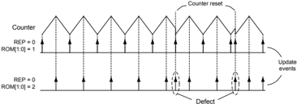
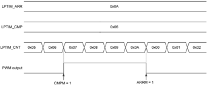

## Applicability

This document applies to the part numbers of STM32G471xx/473xx/474xx/483xx/484xx devices and the device variants as stated in this page.

It gives a summary and a description of the device errata, with respect to the device datasheet and reference manual RM0440.

Deviation of the real device behavior from the intended device behavior is considered to be a device limitation. Deviation of the description in the reference manual or the datasheet from the intended device behavior is considered to be a documentation erratum. The term 'errata' applies both to limitations and documentation errata.

Table 1. Device summary

| Reference   | Part numbers                                                                                                                                                                                                                             |
|-------------|------------------------------------------------------------------------------------------------------------------------------------------------------------------------------------------------------------------------------------------|
| STM32G471xx | STM32G471CC, STM32G471CE, STM32G471ME, STM32G471QC, STM32G471QE, STM32G471RB, STM32G471RC, STM32G471RE, STM32G471VC, STM32G471VE                                                                                                         |
| STM32G473xx | STM32G473CB, STM32G473CC, STM32G473CE, STM32G473MB, STM32G473MC, STM32G473ME, STM32G473PB, STM32G473PC, STM32G473PE, STM32G473QB, STM32G473QC, STM32G473QE, STM32G473RB, STM32G473RC, STM32G473RE, STM32G473VB, STM32G473VC, STM32G473VE |
| STM32G474xx | STM32G474CB, STM32G474CC, STM32G474CE, STM32G474MB, STM32G474MC, STM32G474ME, STM32G474PB, STM32G474PC, STM32G474PE, STM32G474QB, STM32G474QC, STM32G474QE, STM32G474RB, STM32G474RC, STM32G474RE, STM32G474VB, STM32G474VC, STM32G474VE |
| STM32G483xx | STM32G483CE, STM32G483ME, STM32G483PE, STM32G483QE, STM32G483RE, STM32G483VE                                                                                                                                                             |
| STM32G484xx | STM32G484CE, STM32G484ME, STM32G484PE, STM32G484QE, STM32G484RE, STM32G484VE                                                                                                                                                             |

Table 2. Device variants

| Reference                           | Silicon revision codes - Device marking (1)   | Silicon revision codes - REV_ID (2)   |
|-------------------------------------|-----------------------------------------------|---------------------------------------|
| STM32G471xx/473xx/474xx/483xx/484xx | Z                                             | 0x2001                                |
| STM32G471xx/473xx/474xx/483xx/484xx | Y                                             | 0x2002                                |
| STM32G471xx/473xx/474xx/483xx/484xx | X                                             | 0x2003                                |

2. REV\_ID[15:0] bitfield of DBGMCU\_IDCODE register.

## STM32G471xx/473xx/474xx/483xx/484xx

Errata sheet

## STM32G471xx/473xx/474xx/483xx/484xx device errata


## 1 Summary of device errata

The following table gives a quick reference to the STM32G471xx/473xx/474xx/483xx/484xx device limitations and their status:

A = limitation present, workaround available

N = limitation present, no workaround available

P = limitation present, partial workaround available

'-' = limitation absent

Applicability of a workaround may depend on specific conditions of target application. Adoption of a workaround may cause restrictions to target application. Workaround for a limitation is deemed partial if it only reduces the rate of occurrence and/or consequences of the limitation, or if it is fully effective for only a subset of instances on the device or in only a subset of operating modes, of the function concerned.

Table 3. Summary of device limitations

| Function   | Section   | Limitation                                                                                                              | Status - Rev. Z   | Status - Rev. Y   | Status - Rev. X   |
|------------|-----------|-------------------------------------------------------------------------------------------------------------------------|-------------------|-------------------|-------------------|
| Core       | 2.1.1     | Interrupted loads to SP can cause erroneous behavior                                                                    | A                 | A                 | A                 |
| Core       | 2.1.2     | VDIV or VSQRT instructions might not complete correctly when very short ISRs are used                                   | A                 | A                 | A                 |
| Core       | 2.1.3     | Store immediate overlapping exception return operation might vector to incorrect interrupt                              | A                 | A                 | A                 |
| System     | 2.2.1     | Full JTAG configuration without NJTRST pin cannot be used                                                               | A                 | A                 | A                 |
| System     | 2.2.2     | Data cache might be corrupted during flash memory read-while-write operation                                            | A                 | A                 | A                 |
| System     | 2.2.3     | FLASH_ECCR corrupted upon reset or power - down occurring during flash memory program or erase operation                | A                 | A                 | A                 |
| System     | 2.2.4     | Unstable LSI when it clocks RTC or CSS on LSE                                                                           | P                 | P                 | P                 |
| System     | 2.2.5     | MCU cannot enter in Standby mode when HSE bypass used                                                                   | A                 | A                 | A                 |
| System     | 2.2.6     | Corrupted content of the backup domain due to a missed power-on reset after this domain supply voltage drop             | A                 | A                 | A                 |
| System     | 2.2.7     | SRAM write error                                                                                                        | A                 | A                 | A                 |
| System     | 2.2.8     | Wrong instruction fetches from flash memory upon wakeup from Sleep or Stop mode when debug in low-power mode is enabled | A                 | A                 | A                 |
| System     | 2.2.9     | LSE crystal oscillator may be disturbed by transitions on PC13                                                          | N                 | N                 | N                 |
| System     | 2.2.10    | Device cannot enter Standby mode when HSE bypass used as system clock                                                   | A                 | A                 | A                 |
| DMA        | 2.3.1     | DMA disable failure and error flag omission upon simultaneous transfer error and global flag clear                      | A                 | A                 | A                 |
| DMAMUX     | 2.4.1     | SOFx not asserted when writing into DMAMUX_CFR register                                                                 | N                 | N                 | N                 |
| DMAMUX     | 2.4.2     | OFx not asserted for trigger event coinciding with last DMAMUX request                                                  | N                 | N                 | N                 |
| DMAMUX     | 2.4.3     | OFx not asserted when writing into DMAMUX_RGCFR register                                                                | N                 | N                 | N                 |
| DMAMUX     | 2.4.4     | Wrong input DMA request routed upon specific DMAMUX_CxCR register write coinciding with synchronization event           | A                 | A                 | A                 |
| FMC        | 2.5.1     | Dummy read cycles inserted when reading synchronous memories                                                            | N                 | N                 | N                 |
| FMC        | 2.5.2     | Wrong data read from a busy NAND memory                                                                                 | A                 | A                 | A                 |
| FMC        | 2.5.3     | Data corruption upon a specific FIFO write sequence to synchronous PSRAM                                                | A                 | A                 | A                 |


## STM32G471xx/473xx/474xx/483xx/484xx

| Function     | Section   | Limitation                                                                                                                                      | Status - Rev. Z   | Status - Rev. Y   | Status - Rev. X   |
|--------------|-----------|-------------------------------------------------------------------------------------------------------------------------------------------------|-------------------|-------------------|-------------------|
| QUADSPI      | 2.6.1     | QUADSPI cannot be used in indirect read mode when only data phase is activated                                                                  | P                 | P                 | P                 |
| QUADSPI      | 2.6.2     | QUADSPI hangs when QUADSPI_CCR is cleared                                                                                                       | P                 | P                 | P                 |
| QUADSPI      | 2.6.3     | QUADSPI internal timing criticality                                                                                                             | A                 | A                 | A                 |
| QUADSPI      | 2.6.4     | Memory-mapped read of last memory byte fails                                                                                                    | P                 | P                 | P                 |
| ADC          | 2.7.1     | New context conversion initiated without waiting for trigger when writing new context in ADC_JSQR with JQDIS = 0 and JQM = 0                    | A                 | A                 | A                 |
| ADC          | 2.7.2     | Two consecutive context conversions fail when writing new context in ADC_JSQR just after previous context completion with JQDIS = 0 and JQM = 0 | A                 | A                 | A                 |
| ADC          | 2.7.3     | Unexpected regular conversion when two consecutive injected conversions are performed in Dual interleaved mode                                  | A                 | A                 | A                 |
| ADC          | 2.7.4     | ADC_AWDy_OUT reset by non-guarded channels                                                                                                      | A                 | A                 | A                 |
| ADC          | 2.7.5     | Injected data stored in the wrong ADC_JDRx registers                                                                                            | A                 | A                 | A                 |
| ADC          | 2.7.6     | ADC slave data may be shifted in Dual regular simultaneous mode                                                                                 | A                 | A                 | A                 |
| ADC          | 2.7.7     | End of 10/8/6-bit ADC conversion disturbing other ADCs                                                                                          | A                 | -                 | -                 |
| ADC          | 2.7.8     | ADC input channel switching disturbs ongoing conversions                                                                                        | P                 | -                 | -                 |
| ADC          | 2.7.9     | Wrong ADC result if conversion done late after calibration or previous conversion                                                               | A                 | A                 | A                 |
| ADC          | 2.7.10    | ADC channel 0 converted instead of the required ADC channel                                                                                     | -                 | A                 | -                 |
| ADC          | 2.7.11    | An ADC instance may impact the accuracy of another ADC instance at specific conditions                                                          | A                 | A                 | A                 |
| VREFBUF      | 2.8.1     | VREF+ output voltage disturbed by some GPIOs toggling                                                                                           | P                 | P                 | P                 |
| COMP         | 2.9.1     | Comparator previously not fully tested in production                                                                                            | N                 | N                 | -                 |
| OPAMP        | 2.10.1    | OPAMP disturbed by fast-edge toggle on GPIO pin corresponding to VINM0                                                                          | P                 | P                 | P                 |
| HRTIM        | 2.11.1    | Spurious register update event in up-down counting mode                                                                                         | P                 | P                 | P                 |
|              | 2.11.2    | Counter restarting from the crest after a burst idle period                                                                                     | A                 | A                 | A                 |
|              | 2.11.3    | Incorrect output level in PWM mode with greater-than comparison                                                                                 | A                 | A                 | A                 |
| TIM          | 2.12.1    | One-pulse mode trigger not detected in master-slave reset + trigger configuration                                                               | P                 | P                 | P                 |
| TIM          | 2.12.2    | Consecutive compare event missed in specific conditions                                                                                         | N                 | N                 | N                 |
| TIM          | 2.12.3    | Compare event missed in center-aligned mode 1 and 2 with dithering enabled                                                                      | N                 | N                 | N                 |
|              | 2.12.4    | Output compare clear not working with external counter reset                                                                                    | P                 | P                 | P                 |
|              | 2.12.5    | Bidirectional break mode not working with short pulses                                                                                          | N                 | N                 | N                 |
| LPTIM        | 2.13.1    | Device may remain stuck in LPTIM interrupt when entering Stop mode                                                                              | A                 | A                 | A                 |
|              | 2.13.2    | Device may remain stuck in LPTIM interrupt when clearing event flag                                                                             | P                 | P                 | P                 |
|              | 2.13.3    | LPTIM events and PWM output are delayed by one kernel clock cycle                                                                               | P                 | P                 | P                 |
|              | 2.14.1    | Calendar initialization may fail in case of consecutive INIT mode entry                                                                         | A                 | A                 | A                 |
| RTC and TAMP | 2.14.2    | Alarm flag may be repeatedly set when the core is stopped in debug                                                                              | N                 | N                 | N                 |
| RTC and TAMP | 2.14.3    | A tamper event fails to trigger timestamp or timestamp overflow events during a few cycles after clearing TSF                                   | N                 | N                 | N                 |


## STM32G471xx/473xx/474xx/483xx/484xx

Summary of device errata

| Function     | Section   | Limitation                                                                                       | Status - Rev. Z   | Status - Rev. Y   | Status - Rev. X   |
|--------------|-----------|--------------------------------------------------------------------------------------------------|-------------------|-------------------|-------------------|
| RTC and TAMP | 2.14.4    | REFCKON write protection associated to INIT KEY instead of CAL KEY                               | A                 | A                 | A                 |
| RTC and TAMP | 2.14.5    | Tamper flag not set on LSE failure detection                                                     | N                 | N                 | N                 |
| I2C          | 2.15.1    | Wrong data sampling when data setup time (t SU;DAT ) is shorter than one I2C kernel clock period | P                 | P                 | P                 |
| I2C          | 2.15.2    | Spurious bus error detection in master mode                                                      | A                 | A                 | A                 |
| I2C          | 2.15.3    | Spurious master transfer upon own slave address match                                            | P                 | P                 | P                 |
| I2C          | 2.15.4    | OVR flag not set in underrun condition                                                           | N                 | N                 | N                 |
| I2C          | 2.15.5    | Transmission stalled after first byte transfer                                                   | A                 | A                 | A                 |
| I2C          | 2.15.6    | SDA held low upon SMBus timeout expiry in slave mode                                             | A                 | A                 | A                 |
| USART        | 2.16.1    | Anticipated end-of-transmission signaling in SPI slave mode                                      | A                 | A                 | A                 |
| USART        | 2.16.2    | Data corruption due to noisy receive line                                                        | A                 | A                 | A                 |
| USART        | 2.16.3    | Received data may be corrupted upon clearing the ABREN bit                                       | A                 | A                 | A                 |
| USART        | 2.16.4    | Noise error flag set while ONEBIT is set                                                         | N                 | N                 | N                 |
| LPUART       | 2.17.1    | Possible LPUART transmitter issue when using low BRR[15:0] value                                 | P                 | P                 | P                 |
| SPI          | 2.18.1    | BSY bit may stay high when SPI is disabled                                                       | A                 | A                 | A                 |
| SPI          | 2.18.2    | BSY bit may stay high at the end of data transfer in slave mode                                  | A                 | A                 | A                 |
| FDCAN        | 2.19.1    | Desynchronization under specific condition with edge filtering enabled                           | A                 | A                 | A                 |
| FDCAN        | 2.19.2    | Tx FIFO messages inverted under specific buffer usage and priority setting                       | A                 | A                 | A                 |
| USB          | 2.20.1    | ESOF interrupt timing desynchronized after resume signaling                                      | A                 | A                 | A                 |
| USB          | 2.20.2    | Incorrect CRC16 in the memory buffer                                                             | N                 | N                 | N                 |
| UCPD         | 2.21.1    | TXHRST upon write data underflow corrupting the CRC of the next packet                           | A                 | A                 | A                 |
| UCPD         | 2.21.2    | Ordered set with multiple errors in a single K-code is reported as invalid                       | N                 | N                 | N                 |


## 2 Description of device errata

The following sections describe the errata of the applicable devices with Arm ®  core and provide workarounds if available. They are grouped by device functions.

Note:

Arm is a registered trademark of Arm Limited (or its subsidiaries) in the US and/or elsewhere.

## 2.1 Core

Reference manual and errata notice for the Arm ®  Cortex ® -M4 core revision r0p1 is available from http:// infocenter.arm.com.

## 2.1.1 Interrupted loads to SP can cause erroneous behavior

This limitation is registered under Arm ID number 752770 and classified into 'Category B'. Its impact to the device is minor.

## Description

If an interrupt occurs during the data-phase of a single word load to the stack-pointer (SP/R13), erroneous behavior can occur. In all cases, returning from the interrupt will result in the load instruction being executed an additional time. For all instructions performing an update to the base register, the base register will be erroneously updated on each execution, resulting in the stack-pointer being loaded from an incorrect memory location.

The affected instructions that can result in the load transaction being repeated are:

- LDR SP, [Rn],#imm
- LDR SP, [Rn,#imm]!
- LDR SP, [Rn,#imm]
- LDR SP, [Rn]
- LDR SP, [Rn,Rm]

The affected instructions that can result in the stack-pointer being loaded from an incorrect memory address are:

- LDR SP,[Rn],#imm
- LDR SP,[Rn,#imm]!

As compilers do not generate these particular instructions, the limitation is only likely to occur with hand-written assembly code.

## Workaround

Both issues may be worked around by replacing the direct load to the stack-pointer, with an intermediate load to a general-purpose register followed by a move to the stack-pointer.

## 2.1.2 VDIV or VSQRT instructions might not complete correctly when very short ISRs are used

This limitation is registered under Arm ID number 776924 and classified into 'Category B'. Its impact to the device is limited.

## Description

The VDIV and VSQRT instructions take 14 cycles to execute. When an interrupt is taken a VDIV or VSQRT instruction is not terminated, and completes its execution while the interrupt stacking occurs. If lazy context save of floating point state is enabled then the automatic stacking of the floating point context does not occur until a floating point instruction is executed inside the interrupt service routine.

Lazy context save is enabled by default. When it is enabled, the minimum time for the first instruction in the interrupt service routine to start executing is 12 cycles. In certain timing conditions, and if there is only one or two instructions inside the interrupt service routine, then the VDIV or VSQRT instruction might not write its result to the register bank or to the FPSCR.


The failure occurs when the following condition is met:

1. The floating point unit is enabled
2. Lazy context saving is not disabled
3. A VDIV or VSQRT is executed
4. The destination register for the VDIV or VSQRT is one of s0 - s15
5. An interrupt occurs and is taken
6. The interrupt service routine being executed does not contain a floating point instruction
7. Within 14 cycles after the VDIV or VSQRT is executed, an interrupt return is executed

A minimum of 12 of these 14 cycles are utilized for the context state stacking, which leaves 2 cycles for instructions inside the interrupt service routine, or 2 wait states applied to the entire stacking sequence (which means that it is not a constant wait state for every access).

In general, this means that if the memory system inserts wait states for stack transactions (that is, external memory is used for stack data), then this erratum cannot be observed.

The effect of this erratum is that the VDIV or VQSRT instruction does not complete correctly and the register bank and FPSCR are not updated, which means that these registers hold incorrect, out of date, data.

## Workaround

A workaround is only required if the floating point unit is enabled. A workaround is not required if the stack is in external memory.

There are two possible workarounds:

- Disable lazy context save of floating point state by clearing LSPEN to 0 (bit 30 of the FPCCR at address 0xE000EF34).
- Ensure that every interrupt service routine contains more than 2 instructions in addition to the exception return instruction.

## 2.1.3 Store immediate overlapping exception return operation might vector to incorrect interrupt

This limitation is registered under Arm ID number 838869 and classified into 'Category B (rare)'. Its impact to the device is minor.

## Description

The core includes a write buffer that permits execution to continue while a store is waiting on the bus. Under specific timing conditions, during an exception return while this buffer is still in use by a store instruction, a late change in selection of the next interrupt to be taken might result in there being a mismatch between the interrupt acknowledged by the interrupt controller and the vector fetched by the processor.

The failure occurs when the following condition is met:

1. The handler for interrupt A is being executed.
2. Interrupt B, of the same or lower priority than interrupt A, is pending.
3. A store with immediate offset instruction is executed to a bufferable location.
4. -STR/STRH/STRB &lt;Rt&gt;, [&lt;Rn&gt;,#imm]
5. -STR/STRH/STRB &lt;Rt&gt;, [&lt;Rn&gt;,#imm]!
6. -STR/STRH/STRB &lt;Rt&gt;, [&lt;Rn&gt;],#imm
4. Any number of additional data-processing instructions can be executed.
5. A BX instruction is executed that causes an exception return.
6. The store data has wait states applied to it such that the data is accepted at least two cycles after the BX is executed.
10. -Minimally, this is two cycles if the store and the BX instruction have no additional instructions between them.
11. -The number of wait states required to observe this erratum needs to be increased by the number of cycles between the store and the interrupt service routine exit instruction.
7. Before the bus accepts the buffered store data, another interrupt C is asserted which has the same or lower priority as A, but a greater priority than B.


## Example:

The processor should execute interrupt handler C, and on completion of handler C should execute the handler for B. If the conditions above are met, then this erratum results in the processor erroneously clearing the pending state of interrupt C, and then executing the handler for B twice. The first time the handler for B is executed it will be at interrupt C's priority level. If interrupt C is pended by a level-based interrupt which is cleared by C's handler then interrupt C will be pended again once the handler for B has completed and the handler for C will be executed.

As the STM32 interrupt C is level based, it eventually becomes pending again and is subsequently handled.

## Workaround

For software not using the memory protection unit, this erratum can be worked around by setting DISDEFWBUF in the Auxiliary Control Register.

In all other cases, the erratum can be avoided by ensuring a DSB occurs between the store and the BX instruction. For exception handlers written in C, this can be achieved by inserting the appropriate set of intrinsics or inline assembly just before the end of the interrupt function, for example:

## ARMCC:

```
... __schedule_barrier(); __asm{DSB}; __schedule_barrier(); }
```

## GCC:

```
__asm volatile ("dsb 0xf":::"memory");
```

```
... }
```

## 2.2 System

## 2.2.1 Full JTAG configuration without NJTRST pin cannot be used

## Description

When using the JTAG debug port in Debug mode, the connection with the debugger is lost if the NJTRST pin (PB4) is used as a GPIO or for an alternate function other than NJTRST. Only the 4-wire JTAG port configuration is impacted.

## Workaround

Use the SWD debug port instead of the full 4-wire JTAG port.

## 2.2.2 Data cache might be corrupted during flash memory read-while-write operation

## Description

When a write to the internal flash memory is done, the data cache is normally updated to reflect the data value update. During this data cache update, a read to the other flash memory bank may occur; this read can corrupt the data cache content and subsequent read operations at the same address (cache hits) will be corrupted.

This limitation only occurs in dual bank mode, when reading (data access or code execution) from one bank while writing to the other bank with data cache enabled.

## Workaround

When the application is performing data accesses in both flash memory banks, the data cache must be disabled by resetting the DCEN bit before any write to the flash memory. Before enabling the data cache again, it must be reset by setting and then resetting the DCRST bit.

Description of device errata


## Code example:

```
/* Disable data cache  */ __HAL_FLASH_DATA_CACHE_DISABLE(); /* Set PG bit */ SET_BIT(FLASH->CR, FLASH_CR_PG); /* Program the Flash word */ WriteFlash(Address, Data); /* Reset data cache */ __HAL_FLASH_DATA_CACHE_RESET(); /* Enable data cache */ __HAL_FLASH_DATA_CACHE_ENABLE();
```

## 2.2.3 FLASH\_ECCR corrupted upon reset or power -down occurring during flash memory program or erase operation

## Description

Reset or power-down occurring during a flash memory location program or erase operation, followed by a read of the same memory location, may lead to a corruption of the FLASH\_ECCR register content.

## Workaround

Under such condition, erase the page(s) corresponding to the flash memory location.

## 2.2.4 Unstable LSI when it clocks RTC or CSS on LSE

## Description

The LSI clock can become unstable (duty cycle different from 50 %) and its maximum frequency can become significantly higher than 32 kHz, when:

- LSI clocks the RTC, or it clocks the clock security system (CSS) on LSE (which holds when the LSECSSON bit set), and
- the V DD  power domain is reset while the backup domain is not reset, which happens:
- -upon exiting Shutdown mode
- -if V BAT is separate from V DD  and V DD  goes off then on
- -if V BAT is tied to V DD  (internally in the package for products not featuring the VBAT pin, or externally) and a short (&lt; 1 ms) V DD  drop under V DD (min) occurs

## Workaround

Apply one of the following measures:

- Clock the RTC with LSE or HSE/32, without using the CSS on LSE
- If LSI clocks the RTC or when the LSECSSON bit is set, reset the backup domain upon each V DD  power up (when the BORRSTF flag is set). If V BAT  is separate from V DD , also restore the RTC configuration, backup registers and anti-tampering configuration.

## 2.2.5 MCU cannot enter in Standby mode when HSE bypass used

## Description

When the system clock is using HSE in bypass mode, the MCU cannot enter into Standby mode.

## Workaround

While using HSE clock in bypass mode, switch the system clock to HSI clock before entering into Standby mode.


## 2.2.6 Corrupted content of the backup domain due to a missed power-on reset after this domain supply voltage drop

## Description

The backup domain reset may be missed upon a power-on following a power-off, if its supply voltage drops during the power-off phase hitting a window, which is few mV wide before it starts to rise again. In this critical window, the flip-flops are no longer able to safely retain the information and the backup domain reset has not yet been triggered. This window is located in the range between 100 mV and 700 mV, with the exact position depending mainly on the device and on the temperature.

This missed reset results in unpredictable values of the backup domain registers. This may cause a spurious behavior (such as driving the LSCO output pin on PA2 or influencing backup functions).

## Workaround

Apply one of the following measures:

- In the application, let the V DD  and V BAT  supply voltages fall to a level below 100 mV for more than 200 ms before a new power -on.

When the application is using shutdown mode, user needs to discriminate between the power -on reset or an exit from a shutdown mode.

- If the above workaround cannot be applied, and the boot follows a power -on reset, erase the backup domain by software.

For this purpose, at least one backup register must have been previously programmed with a BKP\_REG\_VAL value with 16 bits set and 16 bits cleared.

Robustness of this workaround can be significantly improved by using a CRC rather than registers. The registers are subject to backup domain reset.

The workaround consists of calculating the CRC of the backup registers: RCC\_BDCR and RTC registers, excluding bits modified by HW.

The CRC result can be stored in the backup register instead of a fixed value. This value needs to be updated for each modification of values covered by CRC, such as by using CRC peripheral.

At the very beginning of the boot code, insert the following software sequence:

1. Check the BORRSTF flag of the RCC\_CSR register. If set, the reset is caused by a power on, or is exiting from shutdown mode.
2. If BORRSTF flag is true, and the shutdown mode is used in the application, check that the backup register value is different from BKP\_REG\_VAL. When tamper detection is enabled,check that no tamper flag is set. If both conditions are met then the reset is caused by a power-on.
3. If the reset is caused by a power-on, apply the following sequence:
- a. Enable the PWR clock in the RCC, by setting the PWREN bit.
- b. Enable the backup domain access in the PWR, by setting the DBP bit.
- c. Reset the backup domain, by:
- i. Writing 0x0001 0000 in the RCC\_BDCR register, which sets the BDRST bit and clears other register bits that might not be reset.
- ii. reading the RCC\_BDCR register, to make the reset time long enough
- iii. writing 0x0000 0000 in the RCC\_BDCR register, to clear the BDRST bit
- d. Clear the BORRSTF flag by setting the RMVF bit of the RCC\_CSR register.

## 2.2.7 SRAM write error

## Description

In rare cases, system reset occurring in a critical instant may upset the SRAM state machine. The first SRAM read or write access after the system reset then restores the normal operation of the SRAM for any subsequent accesses. However, if it is a write access, it fails to write data.

## Workaround

Upon system reset, make a dummy read access to each 32-Kbyte SRAM instance used by the application, through one of the following methods:

1. Place a dummy variable initialization, which allows the compiler to create the assembly code.


Note:

## 2. Use this initialization assembly code:

```
MOV32 R0, #0x20000000 //SRAM address LDR R1, [R0, #+0] //read access MOV32 R0, #0x20008000 //next SRAM instance LDR R1, [R0, #+0] //dummy read, no consequence on R1 value MOV32 R0, #0x20010000 LDR R1, [R0, #+0] MOV32 R0, #0x20014000 //the SRAM2 cut LDR R1, [R0, #+0] MOV32 R0, #0x10000000 // CCM SRAM LDR R1, [R0, #+0]
```

Follow the first method for SRAM instances with the parity check enabled. Follow the first or the second method for SRAM instances with the parity check disabled.

## 2.2.8 Wrong instruction fetches from flash memory upon wakeup from Sleep or Stop mode when debug in low-power mode is enabled

## Description

When debug in low-power mode is enabled, wrong instructions can be fetched from flash memory and executed after waking up from Sleep or Stop mode, causing an unpredictable behavior of the device or a CPU exception.

This issue occurs when the device exits Sleep or Stop mode in the following conditions:

- At least one of DBG\_SLEEP or DBG\_STOP bit of DBGMCU\_CR register is set.
- Interrupts with wakeup capability are disabled at Sleep or Stop entry.
- The flash memory interface gating is enabled by clearing FLASHSMEN bit of RCC\_AHB1SMENR (only for Sleep mode).

The issue affects only debug mode and has no effect on real applications.

## Workaround

Apply one of the following measures:

- Add an ISB just after WFI (or WFE) instruction.
- Disable the flash memory interface gating, by setting FLASHSMEN bit (valid only for Sleep mode).

## 2.2.9 LSE crystal oscillator may be disturbed by transitions on PC13

## Description

On LQFP and UFQFPN packages, the LSE crystal oscillator clock frequency can be incorrect when PC13 is toggling in input or output (for example when used for RTC\_OUT1).

The external clock input (LSE bypass) is not impacted by this limitation.

The WLCSP and UFBGA packages are not impacted by this limitation.

## Workaround

None.

Avoid toggling PC13 when LSE is used on LQFP and UFQFPN packages.

## 2.2.10 Device cannot enter Standby mode when HSE bypass used as system clock

## Description

The device using HSE clock in bypass mode as system clock cannot enter Standby mode.

## Workaround

Select HSI as system clock before entering Standby mode.


## 2.3 DMA

## 2.3.1 DMA disable failure and error flag omission upon simultaneous transfer error and global flag clear

## Description

Upon a data transfer error in a DMA channel x, both the specific TEIFx and the global GIFx flags are raised and the channel x is normally automatically disabled. However, if in the same clock cycle the software clears the GIFx flag (by setting the CGIFx bit of the DMA\_IFCR register), the automatic channel disable fails and the TEIFx flag is not raised.

This issue does not occur with ST's HAL software that does not use and clear the GIFx flag when the channel is active.

## Workaround

Do not clear GIFx flags when the channel is active. Instead, use HTIFx, TCIFx, and TEIFx specific event flags and their corresponding clear bits.

## 2.4 DMAMUX

## 2.4.1 SOFx not asserted when writing into DMAMUX\_CFR register

## Description

The SOFx flag of the DMAMUX\_CSR status register is not asserted if overrun from another DMAMUX channel occurs when the software writes into the DMAMUX\_CFR register.

This can happen when multiple DMA channels operate in synchronization mode, and when overrun can occur from more than one channel. As the SOFx flag clear requires a write into the DMAMUX\_CFR register (to set the corresponding CSOFx bit), overrun occurring from another DMAMUX channel operating during that write operation fails to raise its corresponding SOFx flag.

## Workaround

None. Avoid the use of synchronization mode for concurrent DMAMUX channels, if at least two of them potentially generate synchronization overrun.

## 2.4.2 OFx not asserted for trigger event coinciding with last DMAMUX request

## Description

In the DMAMUX request generator, a trigger event detected in a critical instant of the last-generated DMAMUX request being served by the DMA controller does not assert the corresponding trigger overrun flag OFx. The critical instant is the clock cycle at the very end of the trigger overrun condition.

Additionally, upon the following trigger event, one single DMA request is issued by the DMAMUX request generator, regardless of the programmed number of DMA requests to generate.

The failure only occurs if the number of requests to generate is set to more than two (GNBREQ[4:0] &gt; 00001).

## Workaround

Make the trigger period longer than the duration required for serving the programmed number of DMA requests, so as to avoid the trigger overrun condition from occurring on the very last DMA data transfer.


## 2.4.3 OFx not asserted when writing into DMAMUX\_RGCFR register

## Description

The OFx flag of the DMAMUX\_RGSR status register is not asserted if an overrun from another DMAMUX request generator channel occurs when the software writes into the DMAMUX\_RGCFR register. This can happen when multiple DMA channels operate with the DMAMUX request generator, and when an overrun can occur from more than one request generator channel. As the OFx flag clear requires a write into the DMAMUX\_RGCFR register (to set the corresponding COFx bit), an overrun occurring in another DMAMUX channel operating with another request generator channel during that write operation fails to raise the corresponding OFx flag.

## Workaround

None. Avoid the use of request generator mode for concurrent DMAMUX channels, if at least two channels are potentially generating a request generator overrun.

## 2.4.4 Wrong input DMA request routed upon specific DMAMUX\_CxCR register write coinciding with synchronization event

## Description

If a write access into the DMAMUX\_CxCR register having the SE bit at zero and SPOL[1:0] bitfield at a value other than 00:

- sets the SE bit (enables synchronization),
- modifies the values of the DMAREQ\_ID[5:0] and SYNC\_ID[4:0] bitfields, and
- does not modify the SPOL[1:0] bitfield,

and if a synchronization event occurs on the previously selected synchronization input exactly two AHB clock cycles before this DMAMUX\_CxCR write, then the input DMA request selected by the DMAREQ\_ID[5:0] value before that write is routed.

## Workaround

Ensure that the SPOL[1:0] bitfield is at 00 whenever the SE bit is 0. When enabling synchronization by setting the SE bit, always set the SPOL[1:0] bitfield to a value other than 00 with the same write operation into the DMAMUX\_CxCR register.

## 2.5 FMC

## 2.5.1 Dummy read cycles inserted when reading synchronous memories

## Description

When performing a burst read access from a synchronous memory, two dummy read accesses are performed at the end of the burst cycle whatever the type of burst access.

The extra data values read are not used by the FMC and there is no functional failure.

## Workaround

None.

## 2.5.2 Wrong data read from a busy NAND memory

## Description

When a read command is issued to the NAND memory, the R/B signal gets activated upon the de-assertion of the chip select. If a read transaction is pending, the NAND controller might not detect the R/B signal (connected to NWAIT) previously asserted and sample a wrong data. This problem occurs only when the MEMSET timing is configured to 0x00 or when ATTHOLD timing is configured to 0x00 or 0x01.


## Workaround

Either configure MEMSET timing to a value greater than 0x00 or ATTHOLD timing to a value greater than 0x01.

## 2.5.3 Data corruption upon a specific FIFO write sequence to synchronous PSRAM

## Description

The following specific succession of events may cause the FMC, with the write FIFO buffer enabled, to send corrupted data to a synchronous PSRAM:

1. The application software sends a data write burst to the FMC that places the data onto consecutive write FIFO buffer locations.
2. A write FIFO buffer address roll-over occurs (upon the write burst in point 1 or upon some subsequent writes to the FMC).
3. The application software writes a data byte to the FMC. The data byte reaches the same write FIFO buffer location as the first byte of the data write burst under point 1.
4. The application software writes data of any size to the FMC while the FMC is sending the data byte from point 3 to a synchronous PSRAM.

Under these circumstances, the data byte from point 3 (being sent out to PSRAM in point 4) is corrupted, or, alternatively, the data byte immediately following that data byte is corrupted.

## Workaround

Use the FMC peripheral in Asynchronous write mode or disable the write FIFO buffer.

## 2.6 QUADSPI

## 2.6.1 QUADSPI cannot be used in indirect read mode when only data phase is activated

## Description

When the QUADSPI peripheral is configured in indirect read with only the data phase activated (in single, dual, or quad I/O mode), the QUADSPI peripheral hangs and the BUSY flag of the QUADSPI\_SR register remains high. An abort must be performed to reset the BUSY flag and exit the hanging state.

## Workaround

Insert a dummy phase with at least two dummy cycles.

## 2.6.2 QUADSPI hangs when QUADSPI\_CCR is cleared

## Description

Writing 0x0000 0000 to the QUADSPI\_CCR register causes the QUADSPI peripheral to hang while the BUSY flag of the QUADSPI\_SR register remains set. Even an abort does not allow exiting this status.

## Workaround

Clear then set the EN bit of the QUADSPI\_CR register.

## 2.6.3 QUADSPI internal timing criticality

## Description

The timing of some internal signals of the QUADSPI peripheral is critical. At certain conditions, this can lead to a general failure of the peripheral. As these conditions cannot be exactly determined, it is recommended to systematically apply the workaround as described.


## Workaround

The code below have to be executed upon reset and upon switching from memory-mapped to any other mode:

```
// Save QSPI_CR and QSPI_CCR values if necessary QSPI->QSPI_CR = 0; // ensure that prescaling factor is not at maximum, and  disable the perip heral while(QSPI->QSPI_SR & 0x20){}; // wait for BUSY flag to fall if not already low QSPI->QSPI_CR = 0xFF000001; // set maximum prescaling factor, and  enable the peripheral QSPI->QSPI_CCR = 0x20000000; // activate the free-running clock QSPI->QSPI_CCR = 0x20000000; // repeat the previous instruction to prevent a back-to-back dis able // The following command must complete less than 127 kernel clocks after the first write to t he QSPI_CCR register QSPI->QSPI_CR = 0; // disable QSPI while(QSPI->QSPI_SR & 0x20){}; // wait for busy to fall // Restore CR and CCR values if necessary
```

For the worakround to be effective, it is important to complete the disable instruction less than 127 kernel clock pulses after the first write to the QSPI\_CCR register.

## 2.6.4 Memory-mapped read of last memory byte fails

## Description

Regardless of the number of I/O lines used (1, 2 or 4), a memory-mapped read of the last byte of the memory region defined through the FSIZE[4:0] bitfield of the QUADSPI\_DCR register always yields 0x00, whatever the memory byte content is. A repeated attempt to read that last byte causes the AXI bus to stall.

## Workaround

Apply one of the following measures:

- Avoid reading the last byte of the memory region defined through FSIZE, for example by taking margin in FSIZE bitfield setting.
- If the last byte is read, ignore its value and abort the ongoing process so as to prevent the AXI bus from stalling.
- For reading the last byte of the memory region defined through FSIZE, use indirect read.

## 2.7 ADC

## 2.7.1 New context conversion initiated without waiting for trigger when writing new context in ADC\_JSQR with JQDIS = 0 and JQM = 0

## Description

Once an injected conversion sequence is complete, the queue is consumed and the context changes according to the new ADC\_JSQR parameters stored in the queue. This new context is applied for the next injected sequence of conversions.

However, the programming of the new context in ADC\_JSQR (change of injected trigger selection and/or trigger polarity) may launch the execution of this context without waiting for the trigger if:

- the queue of context is enabled (JQDIS cleared to 0 in ADC\_CFGR), and
- the queue is never empty (JQM cleared to 0 in ADC\_CFGR), and
- the injected conversion sequence is complete and no conversion from previous context is ongoing


## Workaround

Apply one of the following measures:

- Ignore the first conversion.
- Use a queue of context with JQM = 1.
- Use a queue of context with JQM = 0, only change the conversion sequence but never the trigger selection and the polarity.

## 2.7.2 Two consecutive context conversions fail when writing new context in ADC\_JSQR just after previous context completion with JQDIS = 0 and JQM = 0

## Description

When an injected conversion sequence is complete and the queue is consumed, writing a new context in ADC\_JSQR just after the completion of the previous context and with a length longer that the previous context, may cause both contexts to fail. The two contexts are considered as one single context. As an example, if the first context contains element 1 and the second context elements 2 and 3, the first context is consumed followed by elements 2 and 3 and element 1 is not executed.

This issue may happen if:

- the queue of context is enabled (JQDIS cleared to 0 in ADC\_CFGR), and
- the queue is never empty (JQM cleared to 0 in ADC\_CFGR), and
- the length of the new context is longer than the previous one

## Workaround

If possible, synchronize the writing of the new context with the reception of the new trigger.

## 2.7.3 Unexpected regular conversion when two consecutive injected conversions are performed in Dual interleaved mode

## Description

In Dual ADC mode, an unexpected regular conversion may start at the end of the second injected conversion without a regular trigger being received, if the second injected conversion starts exactly at the same time than the end of the first injected conversion. This issue may happen in the following conditions:

- two consecutive injected conversions performed in Interleaved simultaneous mode (DUAL[4:0] of ADC\_CCR = 0b00011), or
- two consecutive injected conversions from master or slave ADC performed in Interleaved mode (DUAL[4:0]of ADC\_CCR = 0b00111)

## Workaround

- In Interleaved simultaneous injected mode: make sure the time between two injected conversion triggers is longer than the injected conversion time.
- In Interleaved only mode: perform injected conversions from one single ADC (master or slave), making sure the time between two injected triggers is longer than the injected conversion time.

## 2.7.4 ADC\_AWDy\_OUT reset by non-guarded channels

## Description

ADC\_AWDy\_OUT is set when a guarded conversion of a regular or injected channel is outside the programmed thresholds. It is reset after the end of the next guarded conversion that is inside the programmed thresholds. However, the ADC\_AWDy\_OUT signal is also reset at the end of conversion of non-guarded channels, both regular and injected.


## Workaround

When ADC\_AWDy\_OUT is enabled, it is recommended to use only the ADC channels that are guarded by a watchdog.

If ADC\_AWDy\_OUT is used with ADC channels that are not guarded by a watchdog, take only ADC\_AWDy\_OUT rising edge into account.

## 2.7.5 Injected data stored in the wrong ADC\_JDRx registers

## Description

When the AHB clock frequency is higher than the ADC clock frequency after the prescaler is applied (ratio &gt; 10), if a JADSTP command is issued to stop the injected conversion (JADSTP bit set to 1 in ADC\_CR register) at the end of an injected conversion, exactly when the data are available, then the injected data are stored in ADC\_JDR1 register instead of ADC\_JDR2/3/4 registers.

## Workaround

Before setting JADSTP bit, check that the JEOS flag is set in ADC\_ISR register (end of injected channel sequence).

## 2.7.6 ADC slave data may be shifted in Dual regular simultaneous mode

## Description

In Dual regular simultaneous mode, ADC slave data may be shifted when all the following conditions are met:

- A read operation is performed by one DMA channel,
- OVRMOD = 0 in ADC\_CFGR register (Overrrun mode enabled).

## Workaround

Apply one of the following measures:

- Set OVRMOD = 1 in ADC\_CFGR. This disables ADC\_DR register FIFO.
- Use two DMA channels to read data: one for slave and one for master.

## 2.7.7 End of 10/8/6-bit ADC conversion disturbing other ADCs

## Description

The end-of-conversion event of an ADC instance set to 10-, 8-, or 6-bit resolution disturbs the reference voltage, causing a conversion error to any other ADC instances with conversion in progress.

## Workaround

Either set the ADCs to 12-bit resolution, or, with concurrent operation of multiple ADCs, avoid the end of conversion of one ADC to occur during the conversion phase of another ADC. For example, set them all to the same resolution and the same sampling duration, and start their sampling phase at the same time.

## 2.7.8 ADC input channel switching disturbs ongoing conversions

## Description

A switch of the ADC input multiplexer to a different input channel disturbs all ADC instances with conversion in progress, thus negatively impacting their DNL. As the device operates the multiplexer during the ADC conversion, either to select the following input of a scan sequence or to open all multiplexer inputs (idle mode), this disturbance source may affect all operating modes except continuous and except bulb sampling.

The DNL impact depends on the input channel and it increases with increasing number of concurrently converting ADCs, the worst case (a few LSBs) being when all the ADCs on the device operate synchronously.


Note:

## Workaround

When using a single ADC input channel, activate bulb sampling. This prevents the opening of all multiplexer inputs during the conversion cycle.

In scan conversion mode, set the input scan sequence such that two successive conversions are performed on each input. Keep the result of the first and discard the second, as only the second is affected by the input channel switch disturbance.

## 2.7.9 Wrong ADC result if conversion done late after calibration or previous conversion

## Description

The result of an ADC conversion done more than 1 ms later than the previous ADC conversion or ADC calibration might be incorrect.

## Workaround

Perform two consecutive ADC conversions in single, scan or continuous mode. Reject the result of the first conversion and only keep the result of the second.

## 2.7.10 ADC channel 0 converted instead of the required ADC channel

## Description

The following ADC conversions unduly convert the ADC internal channel 0 instead of the required channel, and as a consequence, they return zero as conversion result:

1. an injected conversion triggered while regular conversion is on-going
2. the master ADC first injected conversion and the slave ADC first regular conversion (after resume) when dual simultaneous or interleaved dual ADC is used
3. the first regular/injected conversion after a regular or injected software STOP (setting ADSTP or JADSTP bit respectively)
4. the first regular or injected conversion following the DMA end of transfer, after the completion of a regular sequence read by the DMA in one-shot mode

## Workaround

Apply one of the following measures:

- Depending on the case, insert a dummy conversion:
- -at the beginning of the injected sequence (not applicable in injected discontinuous mode, JDISCEN = 1) in the case 1
- -after the ADC slave resumes regular conversions in dual simultaneous or interleaved dual ADC mode (not applicable in injected discontinuous mode, JDISCEN = 1) in the case 2
- -after stopping the ADC by software in the case 3
- -after DMA end-of-transfer in the case 4
- Avoid collisions between injected and regular conversions by using triggered regular conversions or by launching regular conversion at the end of injected sequence in the cases 1 and 2.
- After a regular or injected software STOP, disable the ADC with ADDIS = 1 and enable it again with ADEN = 1. This introduces a hardware dummy conversion (the cases 3 and 4).

## 2.7.11 An ADC instance may impact the accuracy of another ADC instance at specific conditions

## Description

An ADC instance may impact the accuracy of another ADC instance if their respective conversions are concurrent. That is, when they occur, partly or entirely, at the same time.

The term ADC conversion comprises the sampling phase and the successive approximation phase.


The instances ADC1 and ADC2 operating with asynchronous clock do not mutually impact one another. The instances ADC3, ADC4, and ADC5 operating with asynchronous clock do not mutually impact each other, either. Furthermore, the instances ADC1 and ADC2 operating in a dual mode other than alternate trigger mode only do not impact one another whatever the clock source. The same holds for the instances ADC3 and ADC4 operating in a dual mode other than alternate trigger mode only .

For the other combinations of ADC instances running concurrent conversions, one instance may impact the accuracy of another instance when:

- they use different clock sources, and/or
- the clock prescaler division ratio is equal to or greater than two.

Note:

The settings for the prescaler division ratio equal to or greater than two are:

- synchronous clock: CKMODE[1:0] = 10 (division by 2) or CKMODE[1:0] = 11 (division by 4)

- asynchronous clock: CKMODE[1:0] = 00 and PRESC[3:0] ≠ 0000 (division by 2 and more)

The settings for the prescaler division ratio equal to one (no division) are:

- synchronous clock: CKMODE[1:0] = 01

- asynchronous clock: CKMODE[1:0] = 00 and PRESC[3:0] = 0000

## Workaround

## Apply one of the following measures:

1. Ensure that conversions by different ADC instances do not occur concurrently. This can be achieved through trigger sequencing by the application software.
2. Use the same clock source for all ADC instances running concurrent conversions and set the clock prescaler division ratio to one (no division).
3. With synchronous clock and the clock prescaler division ratio equal to or greater than two, use the same clock configuration for the concurrently converting ADC instances. Furthermore, trigger them with the same timer using the same clock prescaler division ratio (or its integer multiple) as the ADC prescaler.

Note:

The timer can use different outputs (such as timN\_trgo, timN\_oc1) for different ADC instances, to trigger regular and injected conversions.

## 2.8 VREFBUF

## 2.8.1 VREF+ output voltage disturbed by some GPIOs toggling

## Description

PB10, PB11, PB13, PB14, PD14 (on all revisions except Rev. X) and PB10, PB13 (on Rev. X) GPIOs toggling disturbs the voltage generated by the voltage reference buffer (VREFBUF).

## Workaround

Avoid toggling these GPIOs while using VREFBUF to output reference voltage on VREF+ pin. Set them steadily low, either by configuring them as push-pull outputs with low level, or by configuring them as inputs or open-drain outputs and connecting them to ground.

## 2.9 COMP

## 2.9.1 Comparator previously not fully tested in production

## Description

The comparator is not fully tested. As a consequence, the V offset  parameter may be out of specification. The following specification substitutes the one in the datasheet for these parts:

| Symbol   | Parameter               | Conditions                                       |   Min | Typ    |   Max | Unit   |
|----------|-------------------------|--------------------------------------------------|-------|--------|-------|--------|
| V offset | Comparator offset error | Full V DDA voltage range, full temperature range |   -20 | -15/+2 |     3 | mV     |


## Workaround

None.

## 2.10 OPAMP

## 2.10.1 OPAMP disturbed by fast-edge toggle on GPIO pin corresponding to VINM0

## Description

In non-inverting PGA OPAMP mode, fast-edge toggle on the GPIO pin corresponding to VINM0 OPAMP input disturbs the operational amplifier inverting input. The disturbance on the OPAMP output is then multiplied depending on the gain set.

Note:

The disturbance is not observed in the OPAMP external gain and follower modes.

Note:

The VINM0 input corresponds to the GPIO pin PA3 for OPAMP1, PA5 for OPAMP2, PB2 for OPAMP3, PB10 for OPAMP4, PB15 for OPAMP5, and PA1 for OPAMP6.

## Workaround

Apply one of the following measures:

- Prevent fast-edge toggle on VINM0, by using the corresponding GPIO as slow-edge analog signal input, as a static output, or by grounding it.
- If the OPAMP output is sampled by an ADC, synchronize that sampling with the fast-edge VINM0 signal such as to move the ADC sampling away from the VINM0 signal edges.

## 2.11 HRTIM

## 2.11.1 Spurious register update event in up-down counting mode

## Description

In up-down counting mode, the value 2 in the roll-over mode bitfield ROM[1:0] sets the corresponding roll-over event to occur when the counter rolls over the crest, which then induces timer register update, based on other settings. However, with ROM[1:0] at 2, the register update is also unduly triggered upon the counter reset, as illustrated:



The defect impacts the timer x operation with the following settings:

- TxREPU = 1, for the update when the timer x repetition counter reaches zero (in this case, the spurious roll-over event at the counter reset propagates to register update event while not decrementing the repetition counter)
- TxRSTU = 1, for the update upon timer x reset
- RSYNCU = 1, for the update re-synchronized with the counter roll-over event

As a consequence, an update event can occur in an undesired instant such as during register write, and an update-related event may be generated while not expected (an output set/reset upon update).


## Workaround

Apply one of the following measures:

1. Temporarily disable the update event (using the MUDIS and TxUDIS bits of the HRTIM\_CR1 register) when the counter reset is expected.
2. Do not set the TxREPU, TxRSTU, and/or RSYNCU bits while setting the ROM[1:0] bitfield to 2, if the counter reset can occur. Instead, use register update by software, through the MSWU and TxSWU bits of the HRTIM\_CR2 register.

## 2.11.2 Counter restarting from the crest after a burst idle period

## Description

In burst mode with the TxBM bit is set, the timer x counter is maintained in reset state during the burst idle period. Then upon exiting reset, it normally starts up-counting from zero.

However, in up-down counting mode (the UDM bit of the HRTIM\_TIMxCR2 register set), and if the burst idle period starts at the crest or during the down-counting phase, then upon exiting reset, the counter unduly starts down-counting from the crest.

## Workaround

Configure the burst mode trigger such that the burst idle period starts in the counter up-counting phase.

## 2.11.3 Incorrect output level in PWM mode with greater-than comparison

## Description

When the PWM mode with greater-than comparison is enabled (with the GTCMP1 or GTCMP3 bits of the HRTIM\_TIMxCR2 register), a write access to the HRTIM\_TIMxCMP1 or HRTIM\_TIMxCMP3 registers immediately triggers the register update (transferring preload to active registers) and sets the output level high or low according to a new comparison result.

Howewer, the output level set by the PWM may be incorrect if, at the same time:

- the compare register is updated exactly two clock cycles before the counter matches the current compare value (curr\_val),
- the new compare value (new\_val) is in the range curr\_val &lt; new\_val &lt; curr\_val + var when up-counting, or in the range curr\_val - var &lt; new\_val &lt; curr\_val when down-counting,
- the value of the clock prescaler CKPSC[2:0] bitfield of the HRTIM\_MCR register is lower than six.

Note:

The var value depends on the CKPSC[2:0] bifield setting as follows:

CKPSC[2:0] = 0:   var = 0x40

CKPSC[2:0] = 1:   var = 0x20

CKPSC[2:0] = 2:   var = 0x10

CKPSC[2:0] = 3:   var = 0x08

CKPSC[2:0] = 4:   var = 0x04

CKPSC[2:0] = 5:   var = 0x02

## Workaround

Apply one of the following measures:

1. Execute the following sequence, to update the compare value, evaluate if the defect occurred, and correct the output level as appropriate:
- a. Clear the compare flag CMP1 or CMP3 in the HRTIM\_TIMxISR register.
- b. Write the new compare value in the HRTIM\_TIMxCMP1 or HRTIM\_TIMxCMP3 registers.
- c. Read the HRTIM\_TIMxISR status register.
- d. Read again the HRTIM\_TIMxISR status register and check the CMP1 or CMP3 compare flags.
- e. Repeat the sequence if CMP1 or CMP3 is set.


2. Ensure that the compare value is never updated exactly two cycles before a compare event. Typically, this is guaranteed if the interrupt service routine (ISR) updating the compare value is always completed before the compare event, or always happens after the compare event. This method is applicable only if the compare value is changed within a limited range, and is hardly applicable if the duty cycle can take any value between 0 and 100%.
3. Update the compare register such that the new value replacing the current value is outside:
- a. the curr\_val &lt; new\_val &lt; curr\_val + var range, if the update occurs in the up-counting phase
- b. the curr\_val - var &lt; new\_val &lt; prev\_val range, if the update occurs in down-counting phase
- c. the curr\_val - var &lt; new\_val &lt; curr\_val + var range, if the update occurs in either up- or down-counting phase
4. Set the CKPSC[2:0] bitfield to a value above five.

## 2.12 TIM

## 2.12.1 One-pulse mode trigger not detected in master-slave reset + trigger configuration

## Description

The failure occurs when several timers configured in one-pulse mode are cascaded, and the master timer is configured in combined reset + trigger mode with the MSM bit set:

OPM = 1 in TIMx\_CR1, SMS[3:0] = 1000 and MSM = 1 in TIMx\_SMCR.

The MSM delays the reaction of the master timer to the trigger event, so as to have the slave timers cycleaccurately synchronized.

If the trigger arrives when the counter value is equal to the period value set in the TIMx\_ARR register, the onepulse mode of the master timer does not work and no pulse is generated on the output.

## Workaround

None. However, unless a cycle-level synchronization is mandatory, it is advised to keep the MSM bit reset, in which case the problem is not present. The MSM = 0 configuration also allows decreasing the timer latency to external trigger events.

## 2.12.2 Consecutive compare event missed in specific conditions

## Description

Every match of the counter (CNT) value with the compare register (CCR) value is expected to trigger a compare event. However, if such matches occur in two consecutive counter clock cycles (as consequence of the CCR value change between the two cycles), the second compare event is missed for the following CCR value changes:

- in edge-aligned mode, from ARR to 0:
- -first compare event: CNT = CCR = ARR
- -second (missed) compare event: CNT = CCR = 0
- in center-aligned mode while up-counting, from ARR-1 to ARR (possibly a new ARR value if the period is also changed) at the crest (that is, when TIMx\_RCR = 0):
- -first compare event: CNT = CCR = (ARR-1)
- -second (missed) compare event: CNT = CCR = ARR
- in center-aligned mode while down-counting, from 1 to 0 at the valley (that is, when TIMx\_RCR = 0):
- -first compare event: CNT = CCR = 1
- -second (missed) compare event: CNT = CCR = 0

This typically corresponds to an abrupt change of compare value aiming at creating a timer clock single-cyclewide pulse in toggle mode.

## As a consequence:

- In toggle mode, the output only toggles once per counter period (squared waveform), whereas it is expected to toggle twice within two consecutive counter cycles (and so exhibit a short pulse per counter period).


- In center mode, the compare interrupt flag does note rise and the interrupt is not generated.

Note:

The timer output operates as expected in modes other than the toggle mode.

## Workaround

None.

## 2.12.3 Compare event missed in center-aligned mode 1 and 2 with dithering enabled

## Description

With dithering enabled, the compare event is not generated and the output in toggle mode is incorrect in:

- center-aligned mode 1, with the CCR value between ARR-16 and ARR
- center-aligned mode 2, with the CCR value lower than 16

These CCR values correspond to a waveform with extreme duty cycles: close to 0%, with the pulse width being one timer clock cycle, or close to 100%, with the pulse width being the PWM period minus one timer clock cycle. The timer output operates as expected if configured in other than toggle mode. The center-aligned mode 3 is exempt of this failure.

## Workaround

None.

## 2.12.4 Output compare clear not working with external counter reset

## Description

The output compare clear event (ocref\_clr) is not correctly generated when the timer is configured in the following slave modes: Reset mode, Combined reset + trigger mode, and Combined gated + reset mode.

The PWM output remains inactive during one extra PWM cycle if the following sequence occurs:

1. The output is cleared by the ocref\_clr event.
2. The timer reset occurs before the programmed compare event.

## Workaround

Apply one of the following measures:

- Use BKIN (or BKIN2 if available) input for clearing the output, selecting the Automatic output enable mode (AOE = 1).
- Mask the timer reset during the PWM ON time to prevent it from occurring before the compare event (for example with a spare timer compare channel open-drain output connected with the reset signal, pulling the timer reset line down).

## 2.12.5 Bidirectional break mode not working with short pulses

## Description

The TIM\_BKIN and TIM\_BKIN2 I/Os can be configured in bidirectional mode using the BKBID and BK2BID bits in the TIMx\_BDTR register, to be forced to 0 when a break/break2 event occurs. The bidirectional break/break2 mode is not functional when the pulse width on break/break2 input is lower than two tim\_ker\_clk periods.

This limitation is also valid when software break events are generated (the break event is correctly generated internally but not reflected on break inputs).

## Workaround

None.

For applications that can afford some latency in bidirectional break mode, the break interrupt can eventually be enabled, for the CPU to verify the break input state and force it to zero when a break/break2 event occurred.

Note:


## 2.13 LPTIM

## 2.13.1 Device may remain stuck in LPTIM interrupt when entering Stop mode

## Description

This limitation occurs when disabling the low-power timer (LPTIM).

When the user application clears the ENABLE bit in the LPTIM\_CR register within a small time window around one LPTIM interrupt occurrence, then the LPTIM interrupt signal used to wake up the device from Stop mode may be frozen in active state. Consequently, when trying to enter Stop mode, this limitation prevents the device from entering low-power mode and the firmware remains stuck in the LPTIM interrupt routine.

This limitation applies to all Stop modes and to all instances of the LPTIM. Note that the occurrence of this issue is very low.

## Workaround

In order to disable a low power timer (LPTIMx) peripheral, do not clear its ENABLE bit in its respective LPTIM\_CR register. Instead, reset the whole LPTIMx peripheral via the RCC controller by setting and resetting its respective LPTIMxRST bit in the relevant RCC register.

## 2.13.2 Device may remain stuck in LPTIM interrupt when clearing event flag

## Description

This limitation occurs when the LPTIM is configured in interrupt mode (at least one interrupt is enabled) and the software clears any flag in LPTIM\_ISR register by writing its corresponding bit in LPTIM\_ICR register. If the interrupt status flag corresponding to a disabled interrupt is cleared simultaneously with a new event detection, the set and clear commands might reach the APB domain at the same time, leading to an asynchronous interrupt signal permanently stuck high.

This issue can occur either during an interrupt subroutine execution (where the flag clearing is usually done), or outside an interrupt subroutine.

Consequently, the firmware remains stuck in the LPTIM interrupt routine, and the device cannot enter Stop mode.

## Workaround

To avoid this issue, it is strongly advised to follow the recommendations listed below:

- Clear the flag only when its corresponding interrupt is enabled in the interrupt enable register.
- If for specific reasons, it is required to clear some flags that have corresponding interrupt lines disabled in the interrupt enable register, it is recommended to clear them during the current subroutine prior to those which have corresponding interrupt line enabled in the interrupt enable register.
- Flags must not be cleared outside the interrupt subroutine.

Note: The standard clear sequence implemented in the HAL\_LPTIM\_IRQHandler in the STM32Cube is considered as the proper clear sequence.

## 2.13.3 LPTIM events and PWM output are delayed by one kernel clock cycle

## Description

The compare match event (CMPM), auto reload match event (ARRM), PWM output level and interrupts are updated with a delay of one kernel clock cycle.

Consequently, it is not possible to generate PWM with a duty cycle of 0% or 100%.

The following waveform gives the example of PWM output mode and the effect of the delay:


Note:

## Workaround

Set the compare value to the desired value minus 1. For instance in order to generate a compare match when LPTM\_CNT = 0x08, set the compare value to 0x07.

## 2.14 RTC and TAMP

## 2.14.1 Calendar initialization may fail in case of consecutive INIT mode entry

## Description

If the INIT bit of the RTC\_ICSR register is set between one and two RTCCLK cycles after being cleared, the INITF flag is set immediately instead of waiting for synchronization delay (which should be between one and two RTCCLK cycles), and the initialization of registers may fail. Depending on the INIT bit clearing and setting instants versus the RTCCLK edges, it can happen that, after being immediately set, the INITF flag is cleared during one RTCCLK period then set again. As writes to calendar registers are ignored when INITF is low, a write occurring during this critical period might result in the corruption of one or more calendar registers.

## Workaround

After existing the initialization mode, clear the BYPSHAD bit (if set) then wait for RSF to rise, before entering the initialization mode again.

It is recommended to write all registers in a single initialization session to avoid accumulating synchronization delays.

## 2.14.2 Alarm flag may be repeatedly set when the core is stopped in debug

## Description

When the core is stopped in debug mode, the clock is supplied to subsecond RTC alarm downcounter even when the device is configured to stop the RTC in debug.

As a consequence, when the subsecond counter is used for alarm condition (the MASKSS[3:0] bitfield of the RTC\_ALRMASSR and/or RTC\_ALRMBSSR register set to a non-zero value) and the alarm condition is met just before entering a breakpoint or printf, the ALRAF and/or ALRBF flag of the RTC\_SR register is repeatedly set by hardware during the breakpoint or printf, which makes any attempt to clear the flag(s) ineffective.

## Workaround

None.

Figure 1. Example of PWM output mode



LPTIM\_ARR

0x0A

0x05

0x06

0x07

0x08

0x09

0x0A

0x00

0x01

0x02

LPTIM\_CMP

0x06

ARRM = 1

CMPM = 1

LPTIM\_CNT

PWM output


## 2.14.3 A tamper event fails to trigger timestamp or timestamp overflow events during a few cycles after clearing TSF

## Description

With the timestamp on tamper event enabled (TAMPTS bit of the RTC\_CR register set), a tamper event is ignored if it occurs:

- within four APB clock cycles after setting the CTSF bit of the RTC\_SCR register to clear the TSF flag, while the TSF flag is not yet effectively cleared (it fails to set the TSOVF flag)
- within two ck\_apre cycles after setting the CTSF bit of the RTC\_SCR register to clear the TSF flag, when the TSF flag is effectively cleared (it fails to set the TSF flag and timestamp the calendar registers)

## Workaround

None.

## 2.14.4 REFCKON write protection associated to INIT KEY instead of CAL KEY

## Description

The write protection of the REFCKON bit is unlocked if the key sequence is written in RTC\_WPR with the privilege and security rights set by the INITPRIV and INITSEC bits, instead of being set by the CALPRIV and CALSEC bits.

## Workaround

Unlock the INIT KEY before writing REFCKON.

## 2.14.5 Tamper flag not set on LSE failure detection

## Description

With the timestamp on tamper event enabled (the TAMPTS bit of the RTC\_CR register set), the LSE failure detection (LSE clock stopped) event connected to the internal tamper 3 fails to raise the ITAMP3F and ITAMP3MF flags, although it duly erases or blocks (depending on the internal tamper 3 configuration) the backup registers and other device secrets, and the RTC and TAMP peripherals resume normally upon the LSE restart.

Note: As expected in this particular case, the TSF and TSMF flags remain low as long as LSE is stopped as they require running RTCCLK clock to operate.

## Workaround

None.

## 2.15 I2C

## 2.15.1 Wrong data sampling when data setup time (tSU;DAT) is shorter than one I2C kernel clock period

## Description

The I 2 C-bus specification and user manual specify a minimum data setup time (t SU;DAT ) as:

- 250 ns in Standard mode
- 100 ns in Fast mode
- 50 ns in Fast mode Plus

The device does not correctly sample the I 2 C-bus SDA line when t SU;DAT  is smaller than one I2C kernel clock (I 2 C-bus peripheral clock) period: the previous SDA value is sampled instead of the current one. This can result in a wrong receipt of slave address, data byte, or acknowledge bit.


## Workaround

Increase the I2C kernel clock frequency to get I2C kernel clock period within the transmitter minimum data setup time. Alternatively, increase transmitter's minimum data setup time. If the transmitter setup time minimum value corresponds to the minimum value provided in the I 2 C-bus standard, the minimum I2CCLK frequencies are as follows:

- In Standard mode, if the transmitter minimum setup time is 250 ns, the I2CCLK frequency must be at least 4 MHz.
- In Fast mode, if the transmitter minimum setup time is 100 ns, the I2CCLK frequency must be at least 10 MHz.
- In Fast-mode Plus, if the transmitter minimum setup time is 50 ns, the I2CCLK frequency must be at least 20 MHz.

## 2.15.2 Spurious bus error detection in master mode

## Description

In master mode, a bus error can be detected spuriously, with the consequence of setting the BERR flag of the I2C\_SR register and generating bus error interrupt if such interrupt is enabled. Detection of bus error has no effect on the I 2 C-bus transfer in master mode and any such transfer continues normally.

## Workaround

If a bus error interrupt is generated in master mode, the BERR flag must be cleared by software. No other action is required and the ongoing transfer can be handled normally.

## 2.15.3 Spurious master transfer upon own slave address match

## Description

When the device is configured to operate at the same time as master and slave (in a multi- master I 2 C-bus application), a spurious master transfer may occur under the following condition:

- Another master on the bus is in process of sending the slave address of the device (the bus is busy).
- The device initiates a master transfer by bit set before the slave address match event (the ADDR flag set in the I2C\_ISR register) occurs.
- After the ADDR flag is set:
- -the device does not write I2C\_CR2 before clearing the ADDR flag, or
- -the device writes I2C\_CR2 earlier than three I2C kernel clock cycles before clearing the ADDR flag

In these circumstances, even though the START bit is automatically cleared by the circuitry handling the ADDR flag, the device spuriously proceeds to the master transfer as soon as the bus becomes free. The transfer configuration depends on the content of the I2C\_CR2 register when the master transfer starts. Moreover, if the I2C\_CR2 is written less than three kernel clocks before the ADDR flag is cleared, the I2C peripheral may fall into an unpredictable state.

## Workaround

Upon the address match event (ADDR flag set), apply the following sequence.

Normal mode (SBC = 0):

1. Set the ADDRCF bit.
2. Before Stop condition occurs on the bus, write I2C\_CR2 with the START bit low. Slave byte control mode (SBC = 1):
1. Write I2C\_CR2 with the slave transfer configuration and the START bit low.
2. Wait for longer than three I2C kernel clock cycles.
3. Set the ADDRCF bit.
4. Before Stop condition occurs on the bus, write I2C\_CR2 again with its current value.

The time for the software application to write the I2C\_CR2 register before the Stop condition is limited, as the clock stretching (if enabled), is aborted when clearing the ADDR flag.


Polling the BUSY flag before requesting the master transfer is not a reliable workaround as the bus may become busy between the BUSY flag check and the write into the I2C\_CR2 register with the START bit set.

## 2.15.4 OVR flag not set in underrun condition

## Description

In slave transmission with clock stretching disabled (NOSTRETCH = 1 in the I2C\_CR1 register), an underrun condition occurs if the current byte transmission is completed on the I 2 C bus, and the next data is not yet written in the TXDATA[7:0] bitfield. In this condition, the device is expected to set the OVR flag of the I2C\_ISR register and send 0xFF on the bus.

However, if the I2C\_TXDR is written within the interval between two I2C kernel clock cycles before and three APB clock cycles after the start of the next data transmission, the OVR flag is not set, although the transmitted value is 0xFF.

## Workaround

None.

## 2.15.5 Transmission stalled after first byte transfer

## Description

When the first byte to transmit is not prepared in the TXDATA register, two bytes are required successively, through TXIS status flag setting or through a DMA request. If the first of the two bytes is written in the I2C\_TXDR register in less than two I2C kernel clock cycles after the TXIS/DMA request, and the ratio between APB clock and I2C kernel clock frequencies is between 1.5 and 3, the second byte written in the I2C\_TXDR is not internally detected. This causes a state in which the I2C peripheral is stalled in master mode or in slave mode, with clock stretching enabled (NOSTRETCH = 0). This state can only be released by disabling the peripheral (PE = 0) or by resetting it.

## Workaround

Apply one of the following measures:

- Write the first data in I2C\_TXDR before the transmission starts.
- Set the APB clock frequency so that its ratio with respect to the I2C kernel clock frequency is lower than 1.5 or higher than 3.

## 2.15.6 SDA held low upon SMBus timeout expiry in slave mode

## Description

For the slave mode, the SMBus specification defines t TIMEOUT  (detect clock low timeout) and t LOW:SEXT (cumulative clock low extend time) timeouts. When one of them expires while the I2C peripheral in slave mode drives SDA low to acknowledge either its address or a data transmitted by the master, the device is expected to report such an expiry and release the SDA line.

However, although the device duly reports the timeout expiry, it fails to release SDA. This stalls the I 2 C bus and prevents the master from generating RESTART or STOP condition.

## Workaround

When a timeout is reported in slave mode (TIMEOUT bit of the I2C\_ISR register is set), apply this sequence:

1. Wait until the frame is expected to end.
2. Read the STOPF bit of the I2C\_ISR register. If it is low, reset the I2C kernel by clearing the PE bit of the I2C\_CR1 register.
3. Wait for at least three APB clock cycles before enabling again the I2C peripheral.


## 2.16 USART

## 2.16.1 Anticipated end-of-transmission signaling in SPI slave mode

## Description

In SPI slave mode, at low USART baud rate with respect to the USART kernel and APB clock frequencies, the transmission complete flag TC of the USARTx\_ISR register may unduly be set before the last bit is shifted on the transmit line.

This leads to data corruption if, based on this anticipated end-of-transmission signaling, the application disables the peripheral before the last bit is transmitted.

## Workaround

Upon the TC flag rise, wait until the clock line remains idle for more than the half of the communication clock cycle. Then only consider the transmission as ended.

## 2.16.2 Data corruption due to noisy receive line

## Description

In all modes, except synchronous slave mode, the received data may be corrupted if a glitch to zero shorter than the half-bit occurs on the receive line within the second half of the stop bit.

## Workaround

Apply one of the following measures:

- Either use a noiseless receive line, or
- add a filter to remove the glitches if the receive line is noisy.

## 2.16.3 Received data may be corrupted upon clearing the ABREN bit

## Description

The USART receiver may miss data or receive corrupted data when the auto baud rate feature is disabled by software (ABREN bit cleared in the USART\_CR2 register) after an auto baud rate detection, while a reception is ongoing.

## Workaround

Do not clear the ABREN bit.

## 2.16.4 Noise error flag set while ONEBIT is set

## Description

When the ONEBIT bit is set in the USART\_CR3 register (one sample bit method is used), the noise error (NE) flag must remain cleared. Instead, this flag is set upon noise detection on the START bit.

## Workaround

None.

Note:

Having noise on the START bit is contradictory with the fact that the one sample bit method is used in a noise free environment.


## 2.17 LPUART

## 2.17.1 Possible LPUART transmitter issue when using low BRR[15:0] value

## Description

The LPUART transmitter bit length sequence is not reset between consecutive bytes, which could result in a jitter that cannot be handled by the receiver device. As a result, depending on the receiver device bit sampling sequence, a desynchronization between the LPUART transmitter and the receiver device may occur resulting in data corruption on the receiver side.

This happens when the ratio between the LPUART kernel clock and the baud rate programmed in the LPUART\_BRR register (BRR[15:0]) is not an integer, and is in the three to four range. A typical example is when the 32.768 kHz clock is used as kernel clock and the baud rate is equal to 9600 baud, resulting in a ratio of 3.41.

## Workaround

Apply one of the following measures:

- On the transmitter side, increase the ratio between the LPUART kernel clock and the baud rate. To do so:
- -Increase the LPUART kernel clock frequency, or
- -Decrease the baud rate.
- On the receiver side, generate the baud rate by using a higher frequency and applying oversampling techniques if supported.

## 2.18 SPI

## 2.18.1 BSY bit may stay high when SPI is disabled

## Description

The BSY flag may remain high upon disabling the SPI while operating in:

- master transmit mode and the TXE flag is low (data register full).
- master receive-only mode (simplex receive or half-duplex bidirectional receive phase) and an SCK strobing edge has not occurred since the transition of the RXNE flag from low to high.
- slave mode and NSS signal is removed during the communication.

## Workaround

When the SPI operates in:

- master transmit mode, disable the SPI when TXE = 1 and BSY = 0.
- master receive-only mode, ignore the BSY flag.
- slave mode, do not remove the NSS signal during the communication.

## 2.18.2 BSY bit may stay high at the end of data transfer in slave mode

## Description

BSY flag may sporadically remain high at the end of a data transfer in slave mode. This occurs upon coincidence of internal CPU clock and external SCK clock provided by master.

In such an event, if the software only relies on BSY flag to detect the end of SPI slave data transaction (for example to enter low-power mode or to change data line direction in half-duplex bidirectional mode), the detection fails.

As a conclusion, the BSY flag is unreliable for detecting the end of data transactions.

## Workaround

Depending on SPI operating mode, use the following means for detecting the end of transaction:

- When NSS hardware management is applied and NSS signal is provided by master, use NSS flag.
- In SPI receiving mode, use the corresponding RXNE event flag.


Note:

## STM32G471xx/473xx/474xx/483xx/484xx

Description of device errata

- In SPI transmit-only mode, use the BSY flag in conjunction with a timeout expiry event. Set the timeout such as to exceed the expected duration of the last data frame and start it upon TXE event that occurs with the second bit of the last data frame. The end of the transaction corresponds to either the BSY flag becoming low or the timeout expiry, whichever happens first.

Prefer one of the first two measures to the third as they are simpler and less constraining. Alternatively, apply the following sequence to ensure reliable operation of the BSY flag in SPI transmit mode:

1. Write last data to data register.
2. Poll the TXE flag until it becomes high, which occurs with the second bit of the data frame transfer.
3. Disable SPI by clearing the SPE bit mandatorily before the end of the frame transfer.
4. Poll the BSY bit until it becomes low, which signals the end of transfer.

Note: The alternative method can only be used with relatively fast CPU speeds versus relatively slow SPI clocks or/and long last data frames. The faster is the software execution, the shorter can be the duration of the last data frame.

## 2.19 FDCAN

## 2.19.1 Desynchronization under specific condition with edge filtering enabled

## Description

FDCAN may desynchronize and incorrectly receive the first bit of the frame if:

- the edge filtering is enabled (the EFBI bit of the FDCAN\_CCCR register is set), and
- the end of the integration phase coincides with a falling edge detected on the FDCAN\_Rx input pin
- If this occurs, the CRC detects that the first bit of the received frame is incorrect, flags the received frame as faulty

and responds with an error frame.

This issue does not affect the reception of standard frames.

## Workaround

Disable edge filtering or wait for frame retransmission.

## 2.19.2 Tx FIFO messages inverted under specific buffer usage and priority setting

## Description

Two consecutive messages from the Tx FIFO may be inverted in the transmit sequence if:

- FDCAN uses both a dedicated Tx buffer and a Tx FIFO (the TFQM bit of the FDCAN\_TXBC register is cleared), and
- the messages contained in the Tx buffer have a higher internal CAN priority than the messages in the Tx FIFO.


## Workaround

## Apply one of the following measures:

- Ensure that only one Tx FIFO element is pending for transmission at any time:

The Tx FIFO elements may be filled at any time with messages to be transmitted, but their transmission requests are handled separately. Each time a Tx FIFO transmission has completed and the Tx FIFO gets empty (TFE bit of FDACN\_IR set to 1) the next Tx FIFO element is requested.

- Use only a Tx FIFO:
- Send both messages from a Tx FIFO, including the message with the higher priority. This message has to wait until the preceding messages in the Tx FIFO have been sent.
- Use two dedicated Tx buffers (for example, use Tx buffer 4 and 5 instead of the Tx FIFO). The following pseudo-code replaces the function in charge of filling the Tx FIFO:

```
Write message to Tx Buffer 4 Transmit Loop: Request Tx Buffer 4 - write AR4 bit in FDCAN_TXBAR Write message to Tx Buffer 5 Wait until transmission of Tx Buffer 4 complete (IR bit in FDCAN_IR), read TO4 bit in FDCAN_TXBTO Request Tx Buffer 5 - write AR5 bit of FDCAN_TXBAR Write message to Tx Buffer 4 Wait until transmission of Tx Buffer 5 complete (IR bit in FDCAN_IR), read TO5 bit in FDCAN_TXBTO
```

## 2.20 USB

## 2.20.1 ESOF interrupt timing desynchronized after resume signaling

## Description

Upon signaling resume, the device is expected to allow full 3 ms of time to the host or hub for sending the initial SOF (start of frame) packet, without triggering SUSP interrupt. However, the device only allows two full milliseconds and unduly triggers SUSP interrupt if it receives the initial packet within the third millisecond.

## Workaround

When the device initiates resume (remote wakeup), mask the SUSP interrupt by setting the SUSPM bit for 3 ms, then unmask it by clearing SUSPM.

## 2.20.2 Incorrect CRC16 in the memory buffer

## Description

Memory buffer locations are written starting from the address contained in the ADDRn\_RX for a number of bytes corresponding to the received data packet length, CRC16 inclusive (that is, data payload length plus two bytes), or up to the last allocated memory location defined by BL\_SIZE and NUM\_BLOCK, whichever comes first. In the former case, the CRC16 checksum is written wrongly, with its least significant byte going to both memory buffer byte locations expected to receive the least and the most significant bytes of the checksum.

Although the checksum written in the memory buffer is wrong, the underlying CRC checking mechanism in the USB peripheral is fully functional.

## Workaround

Ignore the CRC16 data in the memory buffer.


## 2.21 UCPD

## 2.21.1 TXHRST upon write data underflow corrupting the CRC of the next packet

## Description

TXHRST command issued at the instant of detecting write data underflow during a packet transmission can cause a corrupt CRC of the following packet.

## Workaround

Use DMA (TXDMAEN) rather than software writing to UCPD\_TXDR. Normally, this prevents write data underflow. Should a corrupt CRC event still occur, the DMA transfer method retransmits the packet until the CRC is correct and the packet acknowledged by the receiver.

## 2.21.2 Ordered set with multiple errors in a single K-code is reported as invalid

## Description

The Power Delivery standard allows considering a received ordered set as valid even if it contains errors, provided that they only affect a single K-code of the ordered set.

In the reference manual, the RXSOP3OF4 flag is specified to signal errors affecting a single K-code, the RXERR flag to signal errors in multiple K-codes.

However, the behaviour does not conform with the reference manual. The RXSOP3OF4 flag is only raised in the single K-code or multiple K-codes. As a consequence, ordered sets with multiple errors in a single K-code are

case of a single error. The RXERR flag is raised in the case of multiple errors, regardless of whether they affect a reported by the device as invalid although the Power Delivery standard allows considering them as valid. Despite this non-conformity versus its reference manual, the device remains compliant with the Power Delivery standard.

## Workaround

None.


## Important security notice

The STMicroelectronics group of companies (ST) places a high value on product security, which is why the ST product(s) identified in this documentation may be certified by various security certification bodies and/or may implement our own security measures as set forth herein. However, no level of security certification and/or built-in security measures can guarantee that ST products are resistant to all forms of attacks. As such, it is the responsibility of each of ST's customers to determine if the level of security provided in an ST product meets the customer needs both in relation to the ST product alone, as well as when combined with other components and/or software for the customer end product or application. In particular, take note that:

- ST products may have been certified by one or more security certification bodies, such as Platform Security Architecture (www.psacertified.org) and/or Security Evaluation standard for IoT Platforms (www.trustcb.com). For details concerning whether the ST product(s) referenced herein have received security certification along with the level and current status of such certification, either visit the relevant certification standards website or go to the relevant product page on www.st.com for the most up to date information. As the status and/or level of security certification for an ST product can change from time to time, customers should re-check security certification status/level as needed. If an ST product is not shown to be certified under a particular security standard, customers should not assume it is certified.
- Certification bodies have the right to evaluate, grant and revoke security certification in relation to ST products. These certification bodies are therefore independently responsible for granting or revoking security certification for an ST product, and ST does not take any responsibility for mistakes, evaluations, assessments, testing, or other activity carried out by the certification body with respect to any ST product.
- Industry-based cryptographic algorithms (such as AES, DES, or MD5) and other open standard technologies which may be used in conjunction with an ST product are based on standards which were not developed by ST. ST does not take responsibility for any flaws in such cryptographic algorithms or open technologies or for any methods which have been or may be developed to bypass, decrypt or crack such algorithms or technologies.
- While robust security testing may be done, no level of certification can absolutely guarantee protections against all attacks, including, for example, against advanced attacks which have not been tested for, against new or unidentified forms of attack, or against any form of attack when using an ST product outside of its specification or intended use, or in conjunction with other components or software which are used by customer to create their end product or application. ST is not responsible for resistance against such attacks. As such, regardless of the incorporated security features and/or any information or support that may be provided by ST, each customer is solely responsible for determining if the level of attacks tested for meets their needs, both in relation to the ST product alone and when incorporated into a customer end product or application.
- All security features of ST products (inclusive of any hardware, software, documentation, and the like), including but not limited to any enhanced security features added by ST, are provided on an "AS IS" BASIS. AS SUCH, TO THE EXTENT PERMITTED BY APPLICABLE LAW, ST DISCLAIMS ALL WARRANTIES, EXPRESS OR IMPLIED, INCLUDING BUT NOT LIMITED TO THE IMPLIED WARRANTIES OF MERCHANTABILITY OR FITNESS FOR A PARTICULAR PURPOSE, unless the applicable written and signed contract terms specifically provide otherwise.

## STM32G471xx/473xx/474xx/483xx/484xx

Description of device errata


## Revision history

Table 4. Document revision history

| Date        |   Version | Changes                                                                                                                                                                                                                                                                                                                                                                                                                                                                                                                                                                                                                                                                                                                                                                                                                                                                                                                                                                                                                                          |
|-------------|-----------|--------------------------------------------------------------------------------------------------------------------------------------------------------------------------------------------------------------------------------------------------------------------------------------------------------------------------------------------------------------------------------------------------------------------------------------------------------------------------------------------------------------------------------------------------------------------------------------------------------------------------------------------------------------------------------------------------------------------------------------------------------------------------------------------------------------------------------------------------------------------------------------------------------------------------------------------------------------------------------------------------------------------------------------------------|
| 19-Apr-2019 |         1 | Initial release.                                                                                                                                                                                                                                                                                                                                                                                                                                                                                                                                                                                                                                                                                                                                                                                                                                                                                                                                                                                                                                 |
| 17-Dec-2019 |         2 | Added errata: • FLASH_ECCR corrupted upon reset or power - down occurring during flash memory program or erase operation • OVR flag not set in underrun condition • Transmission stalled after first byte transfer Added silicon revision Y. Removed erratum First double - word of Flash memory corrupted upon reset or power-down while programming .                                                                                                                                                                                                                                                                                                                                                                                                                                                                                                                                                                                                                                                                                          |
| 22-Jun-2020 |         3 | Added errata: • ADC channel 0 converted instead of the required ADC channel • Section 2.12.2: Consecutive compare event missed in specific conditions • Compare event missed in center-aligned mode 1 and 2 with dithering enabled • Output compare clear not working with external counter reset • A tamper event fails to trigger timestamp or timestamp overflow events during a few cycles after clearing TSF • REFCKON write protection associated to INIT KEY instead of CAL KEY • Tamper flag not set on LSE failure detection • Anticipated end-of-transmission signaling in SPI slave mode • Data corruption due to noisy receive line • ESOF interrupt timing desynchronized after resume signaling • Incorrect CRC16 in the memory buffer • Desynchronization under specific condition with edge filtering enabled • Tx FIFO messages inverted under specific buffer usage and priority                                                                                                                                               |
| 28-Jul-2020 |         4 | Added errata: • VREF+ output voltage disturbed by some GPIOs toggling • Comparator previously not fully tested in production                                                                                                                                                                                                                                                                                                                                                                                                                                                                                                                                                                                                                                                                                                                                                                                                                                                                                                                     |
| 24-Aug-2020 |         5 | Updated erratum VREF+ output voltage disturbed by some GPIOs toggling.                                                                                                                                                                                                                                                                                                                                                                                                                                                                                                                                                                                                                                                                                                                                                                                                                                                                                                                                                                           |
| 10-Nov-2020 |         6 | Added errata: • Data corruption upon a specific FIFO write sequence to synchronous PSRAM • New context conversion initiated without waiting for trigger when writing new context in ADC_JSQR with JQDIS = 0 and JQM = 0 • Two consecutive context conversions fail when writing new context in ADC_JSQR just after previous context completion with JQDIS = 0 and JQM = 0 • Unexpected regular conversion when two consecutive injected conversions are performed in Dual interleaved mode • ADC_AWDy_OUT reset by non-guarded channels • Spurious register update event in up-down counting mode • Counter restarting from the crest after a burst idle period • Incorrect output level in PWM mode with greater-than comparison • LPTIM events and PWM output are delayed by one kernel clock cycle Updated: • tables to include device revision X • erratum DMA disable failure and error flag omission upon simultaneous transfer error and global flag clear • erratum Section 2.8.1: VREF+ output voltage disturbed by some GPIOs toggling |


| Date        |   Version | Changes                                                                                                                                                                                                                                                                                                                                                                                                                                                                                                                                                                                                                                                                                                                                   |
|-------------|-----------|-------------------------------------------------------------------------------------------------------------------------------------------------------------------------------------------------------------------------------------------------------------------------------------------------------------------------------------------------------------------------------------------------------------------------------------------------------------------------------------------------------------------------------------------------------------------------------------------------------------------------------------------------------------------------------------------------------------------------------------------|
| 16-Apr-2021 |         7 | Added erratum OPAMP disturbed by fast-edge toggle on GPIO pin corresponding to VINM0.                                                                                                                                                                                                                                                                                                                                                                                                                                                                                                                                                                                                                                                     |
| 06-Mar-2023 |         8 | Added errata: • MCU cannot enter in Standby mode when HSE bypass used • Corrupted content of the backup domain due to a missed power-on reset after this domain supply voltage drop • SRAM write error • Wrong instruction fetches from flash memory upon wakeup from Sleep or Stop mode when debug in low-power mode is enabled • An ADC instance may impact the accuracy of another ADC instance at specific conditions Added Section Important security notice. Modified errata: • Full JTAG configuration without NJTRST pin cannot be used • Device may remain stuck in LPTIM interrupt when clearing event flag ADC errata re-ordered.                                                                                              |
| 24-Jun-2024 |         9 | Added errata: • LSE crystal oscillator may be disturbed by transitions on PC13 • Device cannot enter Standby mode when HSE bypass used as system clock • Bidirectional break mode not working with short pulses • SDA held low upon SMBus timeout expiry in slave mode • Received data may be corrupted upon clearing the ABREN bit • Noise error flag set while ONEBIT is set • Possible LPUART transmitter issue when using low BRR[15:0] value • TXHRST upon write data underflow corrupting the CRC of the next packet • Ordered set with multiple errors in a single K-code is reported as invalid Modified errata: • Device may remain stuck in LPTIM interrupt when entering Stop mode • Data corruption due to noisy receive line |


## Contents

|     | Summary of device errata. . . . . . . . . . . . . . . . . . . . . . . . . . . . . . . . . . . . . . . . . . . . . . . . . . . . . . . .      | Summary of device errata. . . . . . . . . . . . . . . . . . . . . . . . . . . . . . . . . . . . . . . . . . . . . . . . . . . . . . . .                                                                           | . .2   |
|-----|----------------------------------------------------------------------------------------------------------------------------------------------|-------------------------------------------------------------------------------------------------------------------------------------------------------------------------------------------------------------------|--------|
|     | Description of device errata. . . . . . . . . . . . . . . . . . . . . . . . . . . .                                                          | . . . . . . . . . . . . . . . . . . . . . . . . . .                                                                                                                                                               | . .5   |
| 2.1 | Core                                                                                                                                         | . . . . . . . . . . . . . . . . . . . . . . . . . . . . . . . . . . . . . . . . . . . . . . . . . . . . . . . . . . . . . . . . . . . . . .                                                                       | . . 5  |
|     | 2.1.1                                                                                                                                        | Interrupted loads to SP can cause erroneous behavior. . . . . . . . . . . . . . . . . . . . . . . . . .                                                                                                           | . . 5  |
|     | 2.1.2                                                                                                                                        | VDIV or VSQRT instructions might not complete correctly when very short ISRs are used.                                                                                                                            | 5      |
|     | 2.1.3                                                                                                                                        | Store immediate overlapping exception return operation might vector to incorrect interrupt                                                                                                                        | 6      |
| 2.2 | System . . . . . . . . . . . . . . . . . . . . . . . . . . . . . . . . . . . . . . . . . . . . . . . . . . . . . . . . . . . . . . . . . . . | . .                                                                                                                                                                                                               | . . 7  |
|     | 2.2.1                                                                                                                                        | Full JTAG configuration without NJTRST pin cannot be used . . . . . . . . . . . . . . . . . . . . .                                                                                                               | . . 7  |
|     | 2.2.2                                                                                                                                        | Data cache might be corrupted during flash memory read-while-write operation. . . . . . .                                                                                                                         | . . 7  |
|     | 2.2.3                                                                                                                                        | FLASH_ECCR corrupted upon reset or power - down occurring during flash memory program or erase operation. . . . . . . . . . . . . . . . . . . . . . . . . . . . . . . . . . . . . . . . . . . . . . .             | . . 8  |
|     | 2.2.4                                                                                                                                        | Unstable LSI when it clocks RTC or CSS on LSE . . . . . . . . . . . . . . . . . . . . . . . . . . . . . .                                                                                                         | . . 8  |
|     | 2.2.5                                                                                                                                        | MCU cannot enter in Standby mode when HSE bypass used. . . . . . . . . . . . . . . . . . . . .                                                                                                                    | . . 8  |
|     | 2.2.6                                                                                                                                        | Corrupted content of the backup domain due to a missed power-on reset after this domain supply voltage drop . . . . . . . . . . . . . . . . . . . . . . . . . . . . . . . . . . . . . . . . . . . . . .           | . . 9  |
|     | 2.2.7                                                                                                                                        | SRAM write error . . . . . . . . . . . . . . . . . . . . . . . . . . . . . . . . . . . . . . . . . . . . . . . . . . . . . .                                                                                      | . . 9  |
|     | 2.2.8                                                                                                                                        | Wrong instruction fetches from flash memory upon wakeup from Sleep or Stop mode when debug in low-power mode is enabled. . . . . . . . . . . . . . . . . . . . . . . . . . . . . . . . . . .                      | . 10   |
|     | 2.2.9                                                                                                                                        | LSE crystal oscillator may be disturbed by transitions on PC13 . . . . . . . . . . . . . . . . . . .                                                                                                              | . 10   |
|     | 2.2.10                                                                                                                                       | Device cannot enter Standby mode when HSE bypass used as system clock . . . . . . . .                                                                                                                             | . 10   |
| 2.3 | DMA . . . . . . . . . . . . . . . . . . . . . . . . . . . . . . . . . . . . . . . . . . . . . . . . . . . . . . . . . . . . . . . . . . . .  | . . .                                                                                                                                                                                                             | . 11   |
|     | 2.3.1                                                                                                                                        | DMA disable failure and error flag omission upon simultaneous transfer error and global flag clear. . . . . . . . . . . . . . . . . . . . . . . . . . . . . . . . . . . . . . . . . . . . . . . . . . . . . . . . | . 11   |
| 2.4 | DMAMUX. . . . . . . . . . . . . . . . . . . . . . . . . . . . . . . . . . . . . . . . . . . . . . . . . . . . . . . . . . . .                | . . . . . . .                                                                                                                                                                                                     | . 11   |
|     | 2.4.1                                                                                                                                        | SOFx not asserted when writing into DMAMUX_CFR register . . . . . . . . . . . . . . . . . . . .                                                                                                                   | . 11   |
|     | 2.4.2                                                                                                                                        | OFx not asserted for trigger event coinciding with last DMAMUX request. . . . . . . . . . . .                                                                                                                     | . 11   |
|     | 2.4.3                                                                                                                                        | OFx not asserted when writing into DMAMUX_RGCFR register . . . . . . . . . . . . . . . . . . .                                                                                                                    | . 12   |
|     | 2.4.4                                                                                                                                        | Wrong input DMA request routed upon specific DMAMUX_CxCR register write coinciding with synchronization event . . . . . . . . . . . . . . . . . . . . . . . . . . . . . . . . . . . . . . . .                     | 12     |
| 2.5 | FMC . . . . . . . . . . . . . . . . . . . . . . . . . . . . . . . . . . . . . . . . . . . . . . . . . . . . . . . . . . . . . . . . . . .    | . . . .                                                                                                                                                                                                           | .12    |
|     | 2.5.1                                                                                                                                        | Dummy read cycles inserted when reading synchronous memories . . . . . . . . . . . . . . . .                                                                                                                      | . 12   |
|     | 2.5.2                                                                                                                                        | Wrong data read from a busy NAND memory. . . . . . . . . . . . . . . . . . . . . . . . . . . . . . . . .                                                                                                          | . 12   |
|     | 2.5.3                                                                                                                                        | Data corruption upon a specific FIFO write sequence to synchronous PSRAM. . . . . . . .                                                                                                                           | . 13   |
| 2.6 | QUADSPI. . . . . . . . . . . . . . . . . . . . . . . . . . . . . . . . . . . . . . . . . . . . . . . . . . . . . . . . . . . .               | . . . . . . .                                                                                                                                                                                                     | .13    |
|     | 2.6.1                                                                                                                                        | QUADSPI cannot be used in indirect read mode when only data phase is activated. . . .                                                                                                                             | . 13   |
|     | 2.6.2                                                                                                                                        | QUADSPI hangs when QUADSPI_CCR is cleared . . . . . . . . . . . . . . . . . . . . . . . . . . . . .                                                                                                               | . 13   |
|     | 2.6.3                                                                                                                                        | QUADSPI internal timing criticality . . . . . . . . . . . . . . . . . . . . . . . . . . . . . . . . . . . . . . . . .                                                                                             | . 13   |


## STM32G471xx/473xx/474xx/483xx/484xx

|      | 2.6.4                                                                                                                                  | Memory-mapped read of last memory byte fails . . . . . . . . . . . . . . . . . . . . . . . . . . . . .                                                                                                     | . 14   |
|------|----------------------------------------------------------------------------------------------------------------------------------------|------------------------------------------------------------------------------------------------------------------------------------------------------------------------------------------------------------|--------|
|  2.7 | ADC . . .                                                                                                                              | . . . . . . . . . . . . . . . . . . . . . . . . . . . . . . . . . . . . . . . . . . . . . . . . . . . . . . . . . . . . . . . . . .                                                                        | .14    |
|      | 2.7.1                                                                                                                                  | New context conversion initiated without waiting for trigger when writing new context in ADC_JSQR with JQDIS = 0 and JQM = 0. . . . . . . . . . . . . . . . . . . . . . . . . . . . . . . .                | . 14   |
|      | 2.7.2                                                                                                                                  | Two consecutive context conversions fail when writing new context in ADC_JSQR just after previous context completion with JQDIS = 0 and JQM = 0 . . . . . . . . . . . . . .                                | . 15   |
|      | 2.7.3                                                                                                                                  | Unexpected regular conversion when two consecutive injected conversions are performed in Dual interleaved mode . . . . . . . . . . . . . . . . . . . . . . . . . . . . . . . . . . . . . .                 | . 15   |
|      | 2.7.4                                                                                                                                  | ADC_AWDy_OUT reset by non-guarded channels . . . . . . . . . . . . . . . . . . . . . . . . . . .                                                                                                           | . 15   |
|      | 2.7.5                                                                                                                                  | Injected data stored in the wrong ADC_JDRx registers. . . . . . . . . . . . . . . . . . . . . . . .                                                                                                        | . 16   |
|      | 2.7.6                                                                                                                                  | ADC slave data may be shifted in Dual regular simultaneous mode . . . . . . . . . . . . . .                                                                                                                | . 16   |
|      | 2.7.7                                                                                                                                  | End of 10/8/6-bit ADC conversion disturbing other ADCs . . . . . . . . . . . . . . . . . . . . . .                                                                                                         | . 16   |
|      | 2.7.8                                                                                                                                  | ADC input channel switching disturbs ongoing conversions . . . . . . . . . . . . . . . . . . . .                                                                                                           | . 16   |
|      | 2.7.9                                                                                                                                  | Wrong ADC result if conversion done late after calibration or previous conversion . . .                                                                                                                    | . 17   |
|      | 2.7.10                                                                                                                                 | ADC channel 0 converted instead of the required ADC channel . . . . . . . . . . . . . . . . .                                                                                                              | . 17   |
|      | 2.7.11                                                                                                                                 | An ADC instance may impact the accuracy of another ADC instance at specific conditions . . . . . . . . . . . . . . . . . . . . . . . . . . . . . . . . . . . . . . . . . . . . . . . . . . . . . . . . . . | . 17   |
|  2.8 | VREFBUF . . . . . . . . . . . . . . . . . . . . . . . . .                                                                              | . . . . . . . . . . . . . . . . . . . . . . . . . . . . . . . . . . . . . . .                                                                                                                              | .18    |
|      | 2.8.1                                                                                                                                  | VREF+ output voltage disturbed by some GPIOs toggling . . . . . . . . . . . . . . . . . . . . .                                                                                                            | . 18   |
|  2.9 | COMP. .                                                                                                                                | . . . . . . . . . . . . . . . . . . . . . . . . . . . . . . . . . . . . . . . . . . . . . . . . . . . . . . . . . . . . . . . . . .                                                                        | .18    |
|      | 2.9.1                                                                                                                                  | Comparator previously not fully tested in production . . . . . . . . . . . . . . . . . . . . . . . . . .                                                                                                   | . 18   |
| 2.10 | OPAMP. . . . . . . . . . . . . . . . . . . . . . . . . . . . . . . . . . . . . . . . . . . . . . . . . . . . . . . . . . . . . . . . . | . .                                                                                                                                                                                                        | .19    |
|      | 2.10.1                                                                                                                                 | OPAMP disturbed by fast-edge toggle on GPIO pin corresponding to VINM0. . . . . . .                                                                                                                        | . 19   |
| 2.11 | HRTIM .                                                                                                                                | . . . . . . . . . . . . . . . . . . . . . . . . . . . . . . . . . . . . . . . . . . . . . . . . . . . . . . . . . . . . . . . . . .                                                                        | .19    |
|      | 2.11.1                                                                                                                                 | Spurious register update event in up-down counting mode. . . . . . . . . . . . . . . . . . . . .                                                                                                           | . 19   |
|      | 2.11.2                                                                                                                                 | Counter restarting from the crest after a burst idle period . . . . . . . . . . . . . . . . . . . . . .                                                                                                    | . 20   |
|      | 2.11.3                                                                                                                                 | Incorrect output level in PWM mode with greater-than comparison. . . . . . . . . . . . . . .                                                                                                               | . 20   |
| 2.12 | TIM . . . .                                                                                                                            | . . . . . . . . . . . . . . . . . . . . . . . . . . . . . . . . . . . . . . . . . . . . . . . . . . . . . . . . . . . . . . . . . .                                                                        | .21    |
|      | 2.12.1                                                                                                                                 | One-pulse mode trigger not detected in master-slave reset + trigger configuration . . .                                                                                                                    | . 21   |
|      | 2.12.2                                                                                                                                 | Consecutive compare event missed in specific conditions . . . . . . . . . . . . . . . . . . . . .                                                                                                          | . 21   |
|      | 2.12.3                                                                                                                                 | Compare event missed in center-aligned mode 1 and 2 with dithering enabled . . . . .                                                                                                                       | . 22   |
|      | 2.12.4                                                                                                                                 | Output compare clear not working with external counter reset . . . . . . . . . . . . . . . . . .                                                                                                           | . 22   |
|      | 2.12.5                                                                                                                                 | Bidirectional break mode not working with short pulses . . . . . . . . . . . . . . . . . . . . . . .                                                                                                       | . 22   |
| 2.13 | LPTIM. .                                                                                                                               | . . . . . . . . . . . . . . . . . . . . . . . . . . . . . . . . . . . . . . . . . . . . . . . . . . . . . . . . . . . . . . . . . .                                                                        | .23    |
|      | 2.13.1                                                                                                                                 | Device may remain stuck in LPTIM interrupt when entering Stop mode . . . . . . . . . . .                                                                                                                   | . 23   |
|      | 2.13.2                                                                                                                                 | Device may remain stuck in LPTIM interrupt when clearing event flag . . . . . . . . . . . .                                                                                                                | . 23   |
|      | 2.13.3                                                                                                                                 | LPTIM events and PWM output are delayed by one kernel clock cycle. . . . . . . . . . . .                                                                                                                   | . 23   |
| 2.14 | RTC and TAMP . . . . . . . . . . . . . . . . . . . . .                                                                                 | . . . . . . . . . . . . . . . . . . . . . . . . . . . . . . . . . . . . . . .                                                                                                                              | .24    |
|      | 2.14.1 entry.                                                                                                                          | Calendar initialization may fail in case of consecutive INIT mode . . . . . . . . . . .                                                                                                                    | . 24   |


## STM32G471xx/473xx/474xx/483xx/484xx

Contents

|                                                                                                                                        | 2.14.2                                                                                                                                 | Alarm flag may be repeatedly set when the core is stopped in debug . . . . . . . . . . .                                                                                                                      | . 24   |
|----------------------------------------------------------------------------------------------------------------------------------------|----------------------------------------------------------------------------------------------------------------------------------------|---------------------------------------------------------------------------------------------------------------------------------------------------------------------------------------------------------------|--------|
|                                                                                                                                        | 2.14.3                                                                                                                                 | A tamper event fails to trigger timestamp or timestamp overflow events during a few cycles after clearing TSF. . . . . . . . . . . . . . . . . . . . . . . . . . . . . . . . . . . . . . . . . . . . .        | . 25   |
|                                                                                                                                        | 2.14.4                                                                                                                                 | REFCKON write protection associated to INIT KEY instead of CAL KEY . . . . . . . .                                                                                                                            | . 25   |
|                                                                                                                                        | 2.14.5                                                                                                                                 | Tamper flag not set on LSE failure detection . . . . . . . . . . . . . . . . . . . . . . . . . . . . . .                                                                                                      | . 25   |
| 2.15                                                                                                                                   | I2C . . .                                                                                                                              | . . . . . . . . . . . . . . . . . . . . . . . . . . . . . . . . . . . . . . . . . . . . . . . . . . . . . . . . . . . . . . . . .                                                                             | .25    |
|                                                                                                                                        | 2.15.1                                                                                                                                 | Wrong data sampling when data setup time (t SU;DAT ) is shorter than one I2C kernel clock period. . . . . . . . . . . . . . . . . . . . . . . . . . . . . . . . . . . . . . . . . . . . . . . . . . . . . . . | . 25   |
|                                                                                                                                        | 2.15.2                                                                                                                                 | Spurious bus error detection in master mode . . . . . . . . . . . . . . . . . . . . . . . . . . . . .                                                                                                         | . 26   |
|                                                                                                                                        | 2.15.3                                                                                                                                 | Spurious master transfer upon own slave address match . . . . . . . . . . . . . . . . . . . .                                                                                                                 | . 26   |
|                                                                                                                                        | 2.15.4                                                                                                                                 | OVR flag not set in underrun condition . . . . . . . . . . . . . . . . . . . . . . . . . . . . . . . . . .                                                                                                    | . 27   |
|                                                                                                                                        | 2.15.5                                                                                                                                 | Transmission stalled after first byte transfer . . . . . . . . . . . . . . . . . . . . . . . . . . . . . .                                                                                                    | . 27   |
|                                                                                                                                        | 2.15.6                                                                                                                                 | SDA held low upon SMBus timeout expiry in slave mode . . . . . . . . . . . . . . . . . . . .                                                                                                                  | . 27   |
| 2.16                                                                                                                                   | USART                                                                                                                                  | . . . . . . . . . . . . . . . . . . . . . . . . . . . . . . . . . . . . . . . . . . . . . . . . . . . . . . . . . . . . . . . . .                                                                             | .28    |
|                                                                                                                                        | 2.16.1                                                                                                                                 | Anticipated end-of-transmission signaling in SPI slave mode . . . . . . . . . . . . . . . . .                                                                                                                 | . 28   |
|                                                                                                                                        | 2.16.2                                                                                                                                 | Data corruption due to noisy receive line. . . . . . . . . . . . . . . . . . . . . . . . . . . . . . . . .                                                                                                    | . 28   |
|                                                                                                                                        | 2.16.3                                                                                                                                 | Received data may be corrupted upon clearing the ABREN bit. . . . . . . . . . . . . . . .                                                                                                                     | . 28   |
|                                                                                                                                        | 2.16.4                                                                                                                                 | Noise error flag set while ONEBIT is set . . . . . . . . . . . . . . . . . . . . . . . . . . . . . . . . .                                                                                                    | . 28   |
| 2.17                                                                                                                                   | LPUART.                                                                                                                                | . . . . . . . . . . . . . . . . . . . . . . . . . . . . . . . . . . . . . . . . . . . . . . . . . . . . . . . . . . . . . . .                                                                                 | .29    |
|                                                                                                                                        | 2.17.1                                                                                                                                 | Possible LPUART transmitter issue when using low BRR[15:0] value. . . . . . . . . . .                                                                                                                         | . 29   |
| 2.18                                                                                                                                   | SPI . . .                                                                                                                              | . . . . . . . . . . . . . . . . . . . . . . . . . . . . . . . . . . . . . . . . . . . . . . . . . . . . . . . . . . . . . . . . .                                                                             | .29    |
|                                                                                                                                        | 2.18.1                                                                                                                                 | BSY bit may stay high when SPI is disabled . . . . . . . . . . . . . . . . . . . . . . . . . . . . . .                                                                                                        | . 29   |
|                                                                                                                                        | 2.18.2                                                                                                                                 | BSY bit may stay high at the end of data transfer in slave mode. . . . . . . . . . . . . . .                                                                                                                  | . 29   |
| 2.19                                                                                                                                   | FDCAN.                                                                                                                                 | . . . . . . . . . . . . . . . . . . . . . . . . . . . . . . . . . . . . . . . . . . . . . . . . . . . . . . . . . . . . . . . .                                                                               | .30    |
|                                                                                                                                        | 2.19.1                                                                                                                                 | Desynchronization under specific condition with edge filtering enabled. . . . . . . . . .                                                                                                                     | . 30   |
|                                                                                                                                        | 2.19.2                                                                                                                                 | Tx FIFO messages inverted under specific buffer usage and priority setting. . . . . .                                                                                                                         | . 30   |
| 2.20                                                                                                                                   | USB. . .                                                                                                                               | . . . . . . . . . . . . . . . . . . . . . . . . . . . . . . . . . . . . . . . . . . . . . . . . . . . . . . . . . . . . . . . . .                                                                             | .31    |
|                                                                                                                                        | 2.20.1                                                                                                                                 | ESOF interrupt timing desynchronized after resume signaling . . . . . . . . . . . . . . . .                                                                                                                   | . 31   |
|                                                                                                                                        | 2.20.2                                                                                                                                 | Incorrect CRC16 in the memory buffer . . . . . . . . . . . . . . . . . . . . . . . . . . . . . . . . . .                                                                                                      | . 31   |
| 2.21                                                                                                                                   | UCPD .                                                                                                                                 | . . . . . . . . . . . . . . . . . . . . . . . . . . . . . . . . . . . . . . . . . . . . . . . . . . . . . . . . . . . . . . . . .                                                                             | .32    |
|                                                                                                                                        | 2.21.1                                                                                                                                 | TXHRST upon write data underflow corrupting the CRC of the next packet . . . . . .                                                                                                                            | . 32   |
|                                                                                                                                        | 2.21.2                                                                                                                                 | Ordered set with multiple errors in a single K-code is reported as invalid . . . . . . . .                                                                                                                    | . 32   |
| Important security notice . . . . . . . . . . . . . . . . . . . . . . . . . . . . . . . . . . . . . . . . . . . . . . . . . . .        | Important security notice . . . . . . . . . . . . . . . . . . . . . . . . . . . . . . . . . . . . . . . . . . . . . . . . . . .        | . . . . . .                                                                                                                                                                                                   | .33    |
| Revision history . . . . . . . . . . . . . . . . . . . . . . . . . . . . . . . . . . . . . . . . . . . . . . . . . . . . . . . . . . . | Revision history . . . . . . . . . . . . . . . . . . . . . . . . . . . . . . . . . . . . . . . . . . . . . . . . . . . . . . . . . . . | . . . . . . .                                                                                                                                                                                                 | .34    |


## IMPORTANT NOTICE - READ CAREFULLY

STMicroelectronics NV and its subsidiaries ('ST') reserve the right to make changes, corrections, enhancements, modifications, and improvements to ST products and/or to this document at any time without notice. Purchasers should obtain the latest relevant information on ST products before placing orders. ST products are sold pursuant to ST's terms and conditions of sale in place at the time of order acknowledgment.

Purchasers are solely responsible for the choice, selection, and use of ST products and ST assumes no liability for application assistance or the design of purchasers' products.

No license, express or implied, to any intellectual property right is granted by ST herein.

Resale of ST products with provisions different from the information set forth herein shall void any warranty granted by ST for such product.

ST and the ST logo are trademarks of ST. For additional information about ST trademarks, refer to www.st.com/trademarks. All other product or service names are the property of their respective owners.

Information in this document supersedes and replaces information previously supplied in any prior versions of this document.

© 2024 STMicroelectronics - All rights reserved