## STM32G4 series

Enabling advanced mixed-signed applications

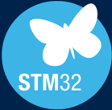

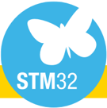

## The STM32 portfolio

## Five product categories

Short- and long-range connectivity

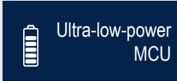

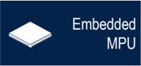

32- and 64-bit microprocessors

32-bit general-purpose microcontrollers: from 75 to 3,224 CoreMark score

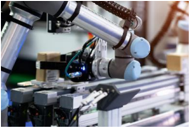

## Ideal for applications requiring advanced analog peripherals

Control applications (motor control…)

Industrial equipment

Instrumentation and measurement

## Digital power

- Digital SMPS (switch mode power supply)
- PFC (power factor correction)

## STM32G4 series

## STM32G4 series for mixed-signal applications

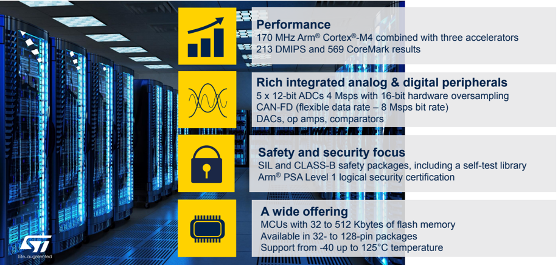

## Measurement and control

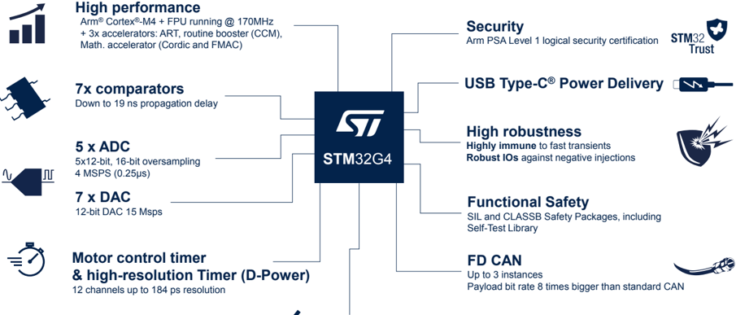

## Reducing PCB size and BOM cost

Filters

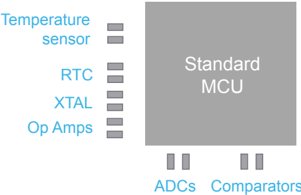

Project cost $$$

Smaller package Fewer additional components All analog peripherals included

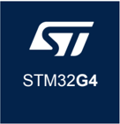

Project cost $

## STM32 F3

## STM32 G4

## STM32G4 builds on the STM32F3 MCU series

## Increased robustness, safety, and security

- EMC (EMI, EMS) → continuous improvement
- Dual Bank flash memory with ECC (Live firmware upgrade)
- Hardware encryption AES
- Securable memory area

## Gain in performance

- 170 MHz even from internal oscill. ( 213 DMIPS )
1. ART Accelerator (~dynamic cache)
2. CCM-SRAM routine booster (~static cache)
3. Mathematical accelerator (Trigo, Filtering)
- Better dynamic power consumption (160µA/Mhz) = ~2.7 times lower than F3 series

## Extended peripheral set and architecture

- 1% RC accuracy [-5°..90°C], 2% full range
- ADC with hardware oversampling = 16-bit res.
- Renewed op-amp, DAC, Comparator
- New HR timer features (digital part)
- MC timer improvements (encoder mode…)
- USB Type-C® with Power Delivery incl. PHY
- CAN FD (flexible data-rate)
- Ta: 85° up to 125°C (limited conditions)

## STM32F3 portfolio extension

- D-Power portfolio (STM32F334) extension
- NEW 80-pin and 128-pin packages (LQFP)

## 170 MHz CPU performance (Arm ®  Cortex ® -M4) with three accelerators

| Number of Wait States   |   0 |   1 |   2 |   3 |   4 |
|-------------------------|-----|-----|-----|-----|-----|
| CPU Clock (MHz)         |  34 |  68 | 102 | 136 | 170 |

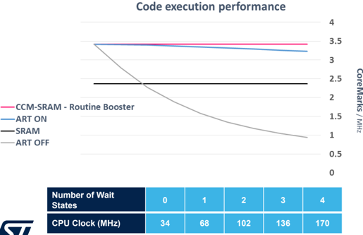

## Greater performance

Arm ®  Cortex ® -M4 with FPU

Up to 170 MHz CPU frequency

Up to 213 DMIPS and 569 CoreMark ® results

3 different hardware accelerators :

- ART Accelerator (~dynamic cache) → full code acceleration (average)
- Routine booster CCM-SRAM (~static cache) → determinism preserved
- Mathematical (Cordic + FMAC)

## Function acceleration and CPU offload

## 1. Cordic (Trigo)

- Very helpful for field oriented motor control method (FOC)

## Mathematical accelerators

- Vector rotation (polar to rectangular): Sin, Cos
- Vector translation (rectangular to polar): Atan2, modulus
- Sinh, Cosh, Exp
- Atan, Atanh
- Square root

·

Ln

## 2. Filter math accelerator (FMAC)

- Can be used to create
- 3p3z compensator ( → digital power)
- Sigma Delta modulator
- Noise shaper

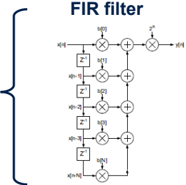

X

## IIR filter

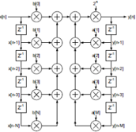

## Rich, advanced analog peripherals

## Mixed-signal SoC for a wide variety of applications

| ADC (up to 5)                | Values                                      |
|------------------------------|---------------------------------------------|
| Topology                     | SAR 12-bit + hardware oversampling → 16-bit |
| Sampling rate                | Up to 4 Msps                                |
| Input                        | Single-ended and differential               |
| Offset and Gain compensation | Auto calibration to reduce gain and offset  |

| DAC (up to 7)   | Values                                           |
|-----------------|--------------------------------------------------|
| Sampling rate   | 15 Msps (internal) 1 Msps (from buffered output) |
| Settling time   | 16 ns                                            |

| Op-Amp (up to 6)    | Values                                                  |
|---------------------|---------------------------------------------------------|
| GBW                 | 13 MHz                                                  |
| Slew rate           | 45 V/µs                                                 |
| Offset              | 3 mV over full T° range 1.5 mV @ 25°C                   |
| PGA Gain (accuracy) | 2, 4, 8, 16, -1, -3, -7, -15 (1%) 32, 64, -31, -63 (2%) |

| Comparator (up to 7)   | Values                                   |
|------------------------|------------------------------------------|
| Power supply           | 1.62 .. 3.6 V                            |
| Propagation delay      | 16.7 ns                                  |
| Offset                 | -6 .. +2 mV                              |
| Hysteresis             | 8 steps: 0, 9, 18, 27, 36, 45, 54, 63 mV |

-

## Arm ®  Cortex ® -M4 core @ 170 MHz

- FPU
- Enhance dynamics
- No scaling overhead
- No saturation
-  DSP (fast MAC)
-  SIMD
- Parallel processing
- Low interrupt latency

## ST's product architecture

- ART Accelerator
- Wait state removal
- CCM-SRAM accelerator
- Real time execution
- Math accelerator
- Cordic (Trigo)
- FMAC (filtering)

## 5x 12-bit 4 Msps ADC

- SAR (no pipeline delay)
- Low latency (250 ns)
- Low aperture time (20 ns) for snapshot measurements
- Simultaneous sampling on multiple ADCs
- Hardware oversampling

## Shaped for control

Easy use of the analog and digital resources thanks to high peripheral interconnect and flexible bus matrix

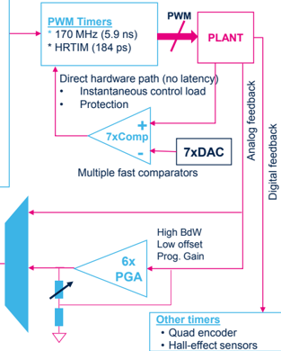

- Fast CPU 170 MHz
- Advanced Motor Control timers
- Mathematical accelerator (Cordic)
- Fast comparators
- 4 Msps ADC-12bit + hardware oversampling
- Op-Amp with built-in gain (PGA)
- 1% RC accuracy (UART communication w/o external Xtal)
- DAC-12bit
- Fast CPU 170 MHz
- High temperature 125°C
- Mathematical accelerator (Cordic)
- CAN FD support
- Advanced timers
- SPI, USART, I²C
- Real-time clock with backup registers
- AES &amp; security
- Dual bank flash for live upgrade

## Key features for targeted applications

Motor Control

Home appliances, e-bikes, air conditioning

Industrial devices

Industrial equipment

- Low-thickness, small form-factor
- Low consumption in run mode ~ 160 µA/MHz
- Embedded analog
- USB Type-C ®  Power Delivery 3.0
- SAI (Serial Audio Interface)
- Fast CPU 170 MHz
- 12ch high-resolution timer (184 ps)
- Mathematical accelerator (Filtering)
- 4 Msps ADC-12bit + hardware oversampling
- Fast comparators (17 ns)
- Dual bank flash for live upgrade
- Embedded analog
- AES &amp; security
- FMAC (for type II / III compensator)

High-end consumer

Rechargeable devices, drones, toys

Digital power

Servers, telecom, EV charging stations

## Simplifying digital power conversion

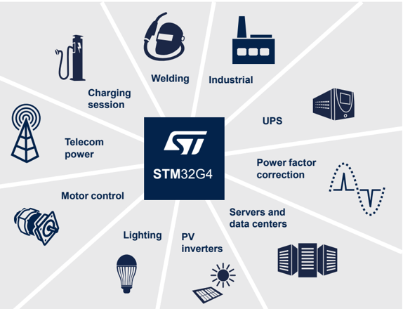

Enhance your digital power solutions using the STM32G4 high-resolution timer (HRTIM)

## HRTimer - High resolution and much more

## High resolution PWM

- 12 channels with 184 ps resolution on frequency and duty cycle
- 184 ps is equivalent to a 5.4GHz timer clock

## Flexible PWM generation

- 7 x independent time base to create various shape of PWM
- 6 x complementary pair PWM outputs
- Up to 32 set/reset transitions per PWM period thanks to the built-in crossbar
- Controller/target configuration for multi phase converter

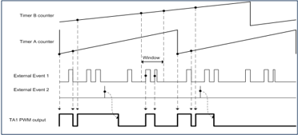

## Multiple Event handlers

- 6 x digital and analog fault input
- 10 x events cycle to cycle current control or PWM restart (constant Ton/Toff)
- Blanking, windowing, and digital filter

## 12 independent channels

- Any topology supported from 1x 12 PWM (triple interleaved LLC (server application) up to 12 x 1 PWM (multiple independent buck converters (lighting))

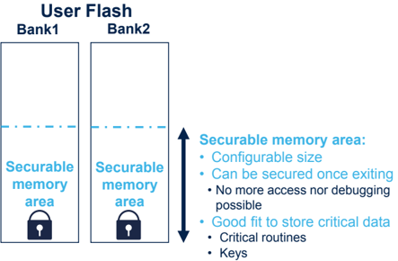

## Integrated security features

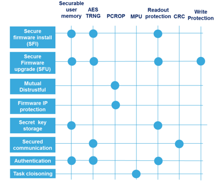

Wake-up time

268 µs

30 µs

9.5 µs

11 cycles

## Dynamic efficiency modes

Tamper: few I/Os, RTC

VBAT *                                    6 nA / 720 nA

SHUTDOWN*                  43 nA / 565 nA

STANDBY*                          130 nA / 885 nA

STOP 1 (full SRAM retention)

80 µA

SLEEP

37 µA / MHz

RUN (Range1) at 150 MHz from Flash              163 µA / MHz

RUN (Range1 boost) at 170 MHz from Flash              173 µA / MHz

Wake-up sources: reset pin, few I/Os, RTC

Wake-up sources: + BOR, IWDG

Wake-up sources:+ all I/Os, PVD, COMPs, LPUART, LPTIM, I²C, UART, USB

Wake-up sources: any interrupt or event

Conditions: 25°C, V

DD  = 3 V

Note: * without RTC / with RTC

## Extensive peripheral set

| Unit parameters - Core, frequency                   | STM32G4x1 Access line - Arm ® Cortex ® -M4, 170 MHz   | STM32G474 Hi-Resolution line - Arm ® Cortex ® -M4, 170 MHz   | STM32G473 Performance line - Arm ® Cortex ® -M4, 170 MHz   |
|-----------------------------------------------------|-------------------------------------------------------|--------------------------------------------------------------|------------------------------------------------------------|
| Flash (max)                                         | Up to 512 Kbytes single bank                          | 512 Kbytes (2x256 KB dual bank)                              | 512 Kbytes (2x256 KB dual bank)                            |
| RAM (up to)                                         | Up to 96 Kbytes                                       | 96                                                           |                                                            |
| CCM -SRAM (code-SRAM)                               | Up to 16 Kbytes                                       | 32                                                           |                                                            |
| 12-bit ADC SAR                                      | Up to 3x 12-bit 4 MSPS                                |                                                              |                                                            |
| Comparator                                          | 4                                                     |                                                              |                                                            |
| Op Amp with 4 built-in gain values with 1% accuracy | Up to 4                                               |                                                              |                                                            |
| 12-bit DAC                                          | 4                                                     |                                                              |                                                            |
| Motor Control timer                                 | Up to 3x (170 MHz)                                    | 3x                                                           | MHz)                                                       |
| CAN-FD                                              | Up to 2x                                              | 3x                                                           | 3x                                                         |
| 12 channel hi-resolution timer                      | -                                                     | 1x                                                           | -                                                          |
| Power supply                                        | 1.72 to 3.6 V                                         | 1.72 to 3.6 V                                                | 1.72 to 3.6 V                                              |

## Performance and access lines

## STM32G4 products lines

## High resolution line

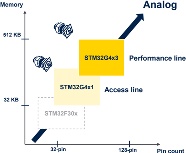

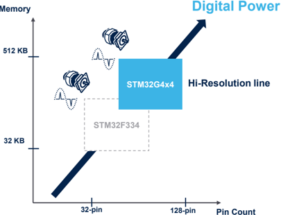

Arm® Cortex®-M4 Up to 170 MHz 213 DMIPS

Floating Point Unit

Memory Protection Unit

Embedded Trace Macrocell

16-channel DMA + MUX

Up to 2x 256-Kbyte Flash memory / ÉCC Dual Bank

## STM32G474/3 block diagram

## High-resolution and high-performance lines (128 to 512 Kbytes)

## Connectivity

4x SPI, 4x I²C, 6x UxART

1x USB 2.0 FS, 1x USB-C PD3.0 (+PHY)

3x CAN-FD

2x I²S half duplex, SAI

## External interface

FSMC 8-/16-bit (TFT-LCD, SRAM, NOR, NAND)

Quad-SPI

## Accelerators

ART Accelerator™

32-Kbyte CCM-SRAM

96-Kbyte SRAM

Math Accelerators

Cordic (Trigo) FMAC (Filter)

## Timers

5x 16-bit timers

2x 16-bit basic timers

3x 16-bit advanced motor control timers

2x 32-bit timers

1x 16-bit LP timer

1x HR timer (D-Power) 12-channel w/ 184ps (A. delay line)

## Analog

5x 12-bit ADC w/ HW overspl

7x Comparators

7x DAC (3x buff + 4x non-buff)

6x op-amps (PGA)

1x temperature sensor

Internal voltage reference for motor control for digital power

## Advanced Accelerator

## Advanced Analog

## Advanced timer

## Access lines (32 to 512 Kbytes)

## Connectivity

Timers

3x SPI, 3x I²C, 5x UxART

1x USB 2.0 FS, 1x USB-C PD3.0 (+PHY)

2x CAN-FD

Arm® Cortex®-M4 Up to 170 MHz

2x I²S half duplex, SAI

Floating Point Unit

Memory Protection Unit

External interface

Quad-SPI

Accelerators

ART Accelerator™

16-Kbyte CCM-SRAM

Math Accelerators

Cordic (Trigo) FMAC (Filter)

Embedded Trace Macrocell

16-channel DMA + MUX

Up to 512-Kbyte Flash memory / ECC Single Bank

96-Kbyte SRAM

5x 16-bit timers

2x 16-bit basic timers

3x 16-bit advanced motor control timers

1x 32-bit timers

1x 16-bit LP timer

Analog

3x 12-bit ADC

4x Comparators

4x DAC (2x buff + 2x non-buff)

4x op-amps (PGA)

1x temperature sensor

Internal voltage reference

## STM32G491 block diagram

for motor control

## Advanced Accelerator

## Advanced Analog

## Advanced timer

## Flash memory / RAM size (bytes)

512 K / 128 K

STM32G474CE

STM32G474RE

## STM32G4 portfolio

STM32G474ME

STM32G474VE

STM32G474PE

STM32G474QE

STM32G473CE

STM32G473RE

STM32G473ME

STM32G473VE

STM32G473PE

STM32G473QE

STM32G491KE

STM32G491CE

STM32G491RE

STM32G491ME

STM32G491VE

STM32G474CC

STM32G474RC

STM32G474MC

STM32G474VC

STM32G474PC

STM32G474QC

STM32G473CC

STM32G473RC

STM32G473MC

STM32G473VC

STM32G473PC

STM32G473QC

STM32G491KC

STM32G491CC

STM32G491RC

STM32G491MC

STM32G491VC

STM32G474CB

STM32G474RB

STM32G474MB

STM32G474VB

STM32G474PB

STM32G474QB

STM32G473CB

STM32G473RB

STM32G473MB

STM32G473VB

STM32G473PB

STM32G473QB

256 K / 128 K

128 K / 128 K

128 K/ 32 K

STM32G431KB

STM32G431CB

STM32G431RB

STM32G431MB

STM32G431VB

64 K / 32 K

STM32G431K8

STM32G431C8

STM32G431R8

STM32G431M8

STM32G431V8

32 K / 32 K

STM32G431K6

STM32G431C6

STM32G431R6

STM32G431M6

STM32G431V6

Pin count

32-pin LQFP/UFQFPN

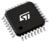

48-pin LQFP/UFQFPN 49-pin WLĆSP (0.4 mm pitch)

64-pin LQFP/ÚFBGA (0.5 mm pitch) WLCSP (0.4 mm pitch)

80-pin 100-pin LQFP LQFP/TFBGA (14x14 &amp; 12x12) (0.8 mm pitch) 81-pin WLĆSP (0.4 mm pitch)

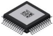

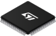

121-pin UFBGA (0.5 mm pitch)

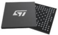

128-pin LQFP

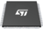

## STM32G4 hardware solutions

## Accelerate evaluation, prototyping, and design

$15

64-pin

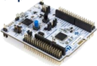

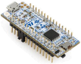

32-pin*

## STM32 Nucleo

## Flexible prototyping

- [NUCLEO-G431RB](https://www.st.com/en/evaluation-tools/nucleo-g431rb.html)
- [NUCLEO-G474RE](https://www.st.com/en/evaluation-tools/nucleo-g474re.html)
- [NUCLEO-G431KB*](https://www.st.com/en/evaluation-tools/nucleo-g431kb.html)
- [NUCLEO-G491RE](https://www.st.com/en/evaluation-tools/nucleo-g491re.html)

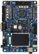

## Evaluation boards

Full feature STM32G4 evaluation

- [STM32G474E-EVAL1](https://www.st.com/en/evaluation-tools/stm32g474e-eval1.html)

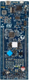

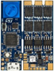

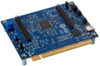

## Discovery kits

Key feature prototyping

- [B-G474E-DPOW1 **](https://www.st.com/en/evaluation-tools/b-g474e-dpow1.html)
- [B-G431B-ESC1](https://www.st.com/en/evaluation-tools/b-g431b-esc1.html)
- [B-G473E-ZEST1S](https://www.st.com/en/evaluation-tools/b-g473e-zest1s.html)

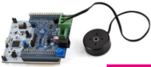

$70

## Motor control pack

Feature for motor control and analog

- [P-NUCLEO-IHM03](https://www.st.com/en/evaluation-tools/p-nucleo-ihm03.html)

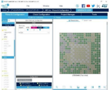

## STM32G4 software tools to accelerate your development

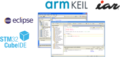

## STM32CubeMX

## IDEs compile and debug

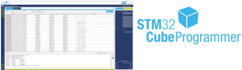

## STM32 programming tool

Graphical tool for easy configuration

- Configure and generate code
- Peripherals and middleware configuration

Simple, powerful solutions

- Partners IDE (Arm® Keil®)
- IDE based on Eclipse
- RTOS aware debug

## STM32CubeProgrammer

- Flash and/or system memory
- GUI or command-line interface

## Motor control ecosystem for the STM32 family

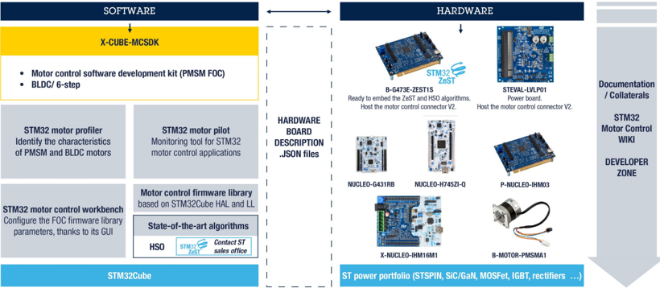

## STM32 ecosystem for digital power

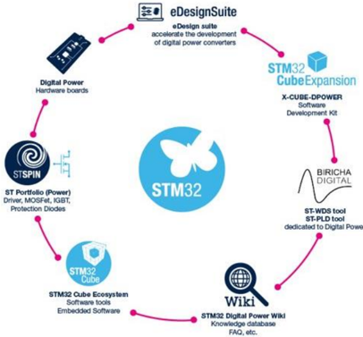

- Full ecosystem (hardware boards, firmware examples, software tools, documentation and training)
- Dedicated HRTIM Cookbook - AN4539: How to operate the hi-resolution timer in different topologies
- Digital power training (PSU and PFC) - based on the STM32G4 series in collaboration with Biricha

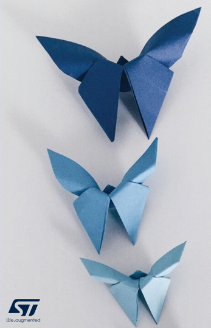

## Releasing your creativity

[@STM32](http://www.facebook.com/stm32)

[@ST\_World](http://www.twitter.com/ST_World)

[community.st.com](https://community.st.com/)

[STM32G4 webpage](http://www.st.com/stm32g4)

[STM32G4 online training](https://www.youtube.com/playlist?list=PLnMKNibPkDnEuk2N1P42xbZWITuAkgZvr)

[wiki.st.com/stm32mcu](https://wiki.st.com/stm32mcu)

[github.com/stm32-hotspot](https://github.com/topics/stm32G4)

[STM32G4 blog articles](https://blog.st.com/?s=stm32g4)

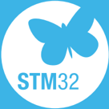

## Our technology starts with You

[Find out more at www.st.com/STM32G4](http://www.st.com/STM32G4)

