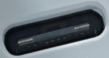

Fast &amp; effective USB Type-C ® PD deployment with certified STM32 solutions.

No coding required.

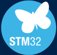

- 1 Introduction to USB Type-C ®  technology
- 2 Solutions using STM32 UCPD controller
- Development ecosystem 3
- USB Type-C ®  solution for   Linux-based STM32 MPUs 4

## Agenda

## Introduction to USB Type-C ®  Power Delivery technology

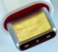

## The industry is moving to USB Type-C® for charging embedded devices

Using a single USB Type-C® charging solution for small and medium devices to reduce charging options and e-waste

Universal USB Type-C® charging brings more convenience and a better experience compared to previous USB generation

E-waste and C02 emission reduction thanks to single USB Type-C® charging solution deployed in the EU

A wide range of products subject to a common charger as part of the radio equipment directive proposal

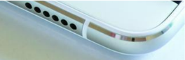

For more information on the European Parliament amendments

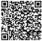

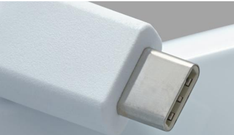

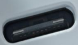

## More versatile

- Reversible, robust connector, thinner than previous micro-C connector
- More interoperability : sink, source or dual role, while being host or device

## More power

- 15 W at 5 V with Type-C only
- Up to 100 W with USB Power Delivery (USB PD) 3.1 protocol
- Extend power range up to 240 W @ 48 V with USB PD 3.1
- Universal fast charging capability with programming power supply (PPS)

## More protocols and speeds

- Separate channels for USB 2.0 (LS/FS/HS) and USB 3.x (SuperSpeed)
- Proprietary protocols supported (DP, HDMI, Ethernet, Thunderbolt…)

## More protection

- Device/source authentication via USB PD (Vendor define messages)
- Firmware update or secure firmware install (SFI)

## Enabling many use cases

- Power swap capability (from sink to source or vice versa)
- USB data swap capability (from device to host or vice versa as for OTG)

## Why choose USB Type-C ® for embedded devices

5

## USB Implementers Forum extends power range up to 240 W

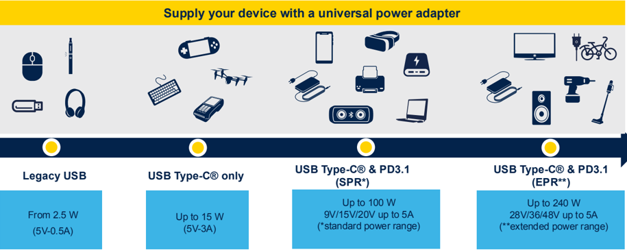

## More interoperability and use cases

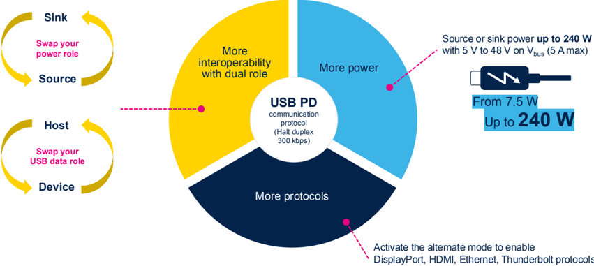

7

## Solutions using STM32 UCPD controller

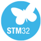

## Saving time, cost, and reducing complexity with STM32

## STM32 with USB Type-C® connector simplifies your design, eliminating the need for an external PD controller

## Fast prototyping without coding

- Ready-to-use hardware and firmware examples
- Code generation for all USB Type-C® roles on STM32
- Easy debug with STM32CubeMonUCPD software tool

## Optimize bill of material and safety

- CC logic, PD transceiver PHY, USB2 device/host interface
- Companion Type-C Port Protection devices (TCPP0x)

## STM32 supports the latest USB Type-C® and PD3.1 standards

- SPR and EPR(*) power range up to 240 W, PPS ready. Sink, source, dualrole power and data roles
- UCPD peripheral is USB-IF certified &amp; supports connector management and USB PD r3.1 protocol (SPR, EPR*, PPS etc.)

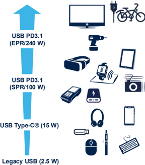

## A wide range of STM32 MCUs with UCPD

Mainstream microcontrollers STM32G0

Ultra-low power microcontrollers

- [STM32L5](https://www.st.com/en/microcontrollers-microprocessors/stm32l5-series.html)
- [STM32U5](https://www.st.com/en/microcontrollers-microprocessors/stm32u5-series.html)

Mixed-signal microcontrollers STM32G4

## High-performance microcontrollers

- [STM32H5](http://www.st.com/stm32h5)
- [STM32H7R/S](https://www.st.com/en/microcontrollers-microprocessors/stm32h7r7-7s7.html)
- STM32N6 (coming soon)

## Microprocessors

- [STM32MP2](https://www.st.com/content/st_com/en/campaigns/microprocessor-stm32mp2.html)

More than 730 STM32 MCUs feature a certified USB Type-C® &amp; PD 3.1 controller

## Example in STM32G0x1 access line

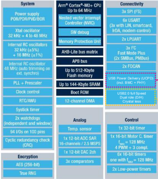

x 2

## UCPD peripheral

- Dual port USBP3.1 certified solution (TID 227)
- CC logic control and voltage monitoring
- Support sink, source &amp; dual role modes (DRP/DRD)
- Built-in Rp/Rd and dead battery resistors
- Digital BMC / CRC encoding/decoding
- USB PD transceiver PHY
- Support programming power supply (PPS)
- Enable Fast role swap signaling (FRS)

## USB2.0 dual role data interface

- USB2.0 data interface (FS, HS)
- Crystal-less
- Dual-Role mode supported (Device/Host)

## UCPD highlights

11

## Use the STM32-FINDER app to quickly find STM32 MCUs with USB interfaces

Our smartphone application STM32-FINDER allows you to identify STM32 with a UCPD controller

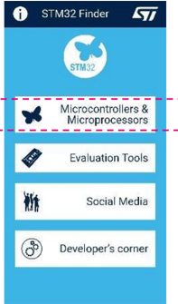

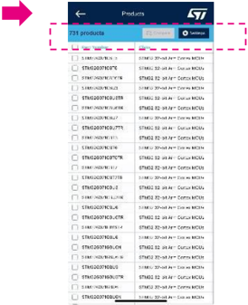

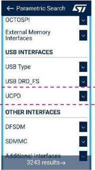

12

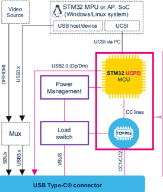

- UCPD stands for USB Type-C® and power delivery controller
- UCSI stands USB Type-C® connector system interface

## Architecture &amp; solutions overview

## References design

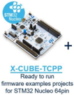

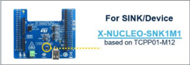

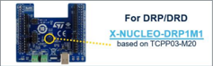

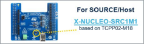

## STM32 USB PD3.1 controller

- Application tasks
- UCSI driver (optional)
- Policy manager
- USB PD stack
- UCPD peripheral

+

## TCPP0x port protection

- Dead battery
- ESD/OVP protection
- N-gate driver
- OCP*
- Bus discharge*

*when required

13

## Safely connect with high-voltage Port Protection TCPP

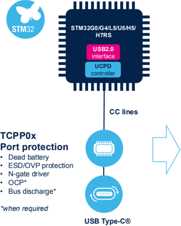

|    |                                                   | SINK TCPP01-M12   | SOURCE TCPP02-M18   | DRP TCPP03-M20   |
|----|---------------------------------------------------|-------------------|---------------------|------------------|
| CC | ESD +8 kV, OVP                                    |                   |                     |                  |
| CC | Dead batteries                                    |                   |                     |                  |
| CC | V conn switch, Over current protection, discharge |                   |                     |                  |
|    | Gate driver                                       | Sink              | Source              | Sink / Source    |
|    | Over Voltage protection                           |                   |                     |                  |
|    | Over current protection, current sense            |                   |                     | Bidirectional    |
|    | Discharge                                         |                   |                     |                  |
|    | Low pin count package                             | QFN-12L (3x3)     | QFN-18L (3.5x3.5)   | QFN-20L (4x4)    |

14

- VBUS monitoring and protection (OVP)
- Drive VBUS with integrated gate driver

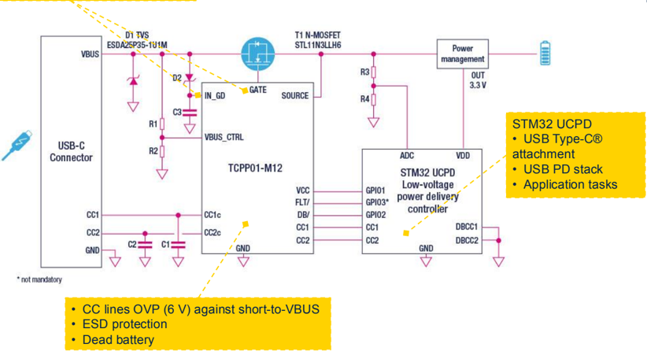

## Typical implementation for sink with TCPP01-M12

- VBUS monitoring, OVP/OCP protections
- Integrated gate driver
- Integrated discharge for VBUS and VCONN

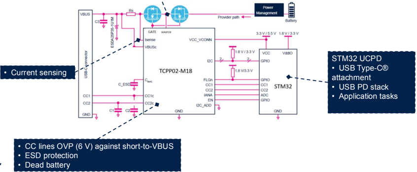

## Typical implementation for source with TCPP02-M18

16

## Typical implementation for dual role with TCPP03-M20

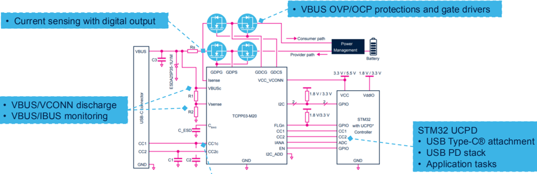

- CC lines OVP (6 V) against short-to-VBUS
- 24 V ESD protection on CC lines
- VCONN OCP (100 mW) and OVP(6 V)
- Dead battery

17

## Enable dual-role devices

- Dual role devices can act as source or sink (dual role power) while being host or device (dual role data) for USB data communication purposes.
- DRD allows developers to extend interoperability of their device by supporting advanced use-cases.
- Swapping between power and data roles is performed independently by using USB PD swap commands.

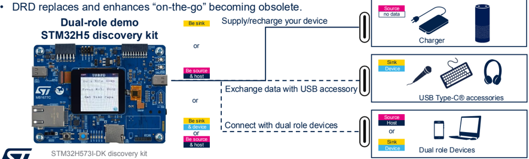

## Dual-role device showcase with STM32H7S78-DK

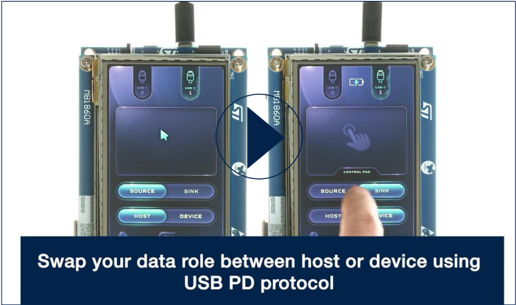

19

## Development ecosystem

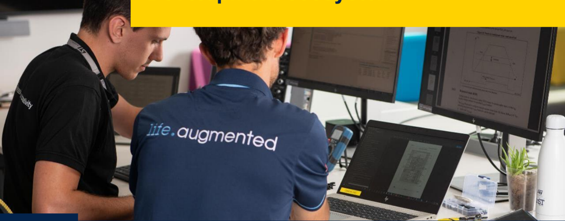

## Quickly evaluate our solutions with STM32 Nucleo USB Type-C ®  expansion boards

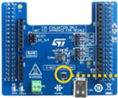

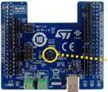

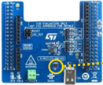

## For sink/device

## For DRP/DRD

## For source/host

し

口

b

+

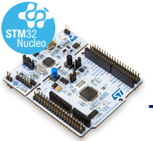

## [X-CUBE-TCPP](https://www.st.com/en/embedded-software/x-cube-tcpp.html)

Ready to run firmware examples projects for STM32G0/G4 Nucleo-64 pin

21

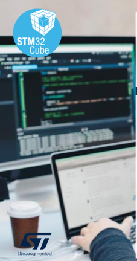

## A no-code solution for your development

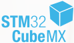

## Video tutorials. How to use XCUBE-TCPP software to build:

- [a USB-PD sink application](https://www.youtube.com/watch?v=cbdFHmMOMwk)
- [a USB-PD source application](https://www.youtube.com/watch?v=tA5v4JjV-T8)
- [a USB-PD dual-role application](https://www.youtube.com/watch?v=mJ4VX_2B6wE)

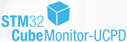

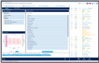

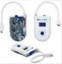

## Master USB Type-C®/PD on STM32 without coding

- Selection and configuration of STM32 UCPD peripheral
- Generation of certified USB Type-C® application codes for sink, source, and dual role using STM32CubeMX and X-CUBE-TCPP software pack

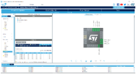

## Debug your application with our monitoring tools.

STM32CubeMonUCPD , a free software monitoring tool for USB Type-C® applications

- Support of USB Type-C® 1.2 and USB PD r3.1
- Port configuration pane  for PD  setting,  VDM,  SOP,  source,  and  sink capabilities
- Port  communication  pane  for  VBUS  and  IBUS  monitoring,  distant  port capabilities, message selector, and real-time traces

## STM32G071B-DISCO is a USB Type-C ® and PD sniffer

- Discover, display USB Type-C® power and feature capabilities of any host.
- Sniff USB PD data packets and display Vbus voltage, Ibus current
- Inject USB PD3.1 packet

22

## Reuse our application source codes in your project

## Shorten development time with STM32CubeMCU packages

- USB PD middleware library
- Billboard USB drivers, FreeRTOS , AzureRTOS ThreadX
- HAL, low-layer APIs CMSIS
- Application examples running on ST boards

## Download links

- [STM32CubeG0](https://www.st.com/en/embedded-software/stm32cubeg0.html)
- [STM32CubeG4](https://www.st.com/en/embedded-software/stm32cubeg4.html)
- [STM32CubeL5](https://www.st.com/en/embedded-software/stm32cubeL5.html)
- [STM32CubeU5](https://www.st.com/en/embedded-software/stm32cubeu5.html)
- [STM32CubeH5](https://www.st.com/en/embedded-software/stm32cubeh5.html)
- [STM32CubeH7RS](https://www.st.com/en/embedded-software/stm32cubeh7rs.html)

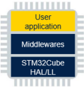

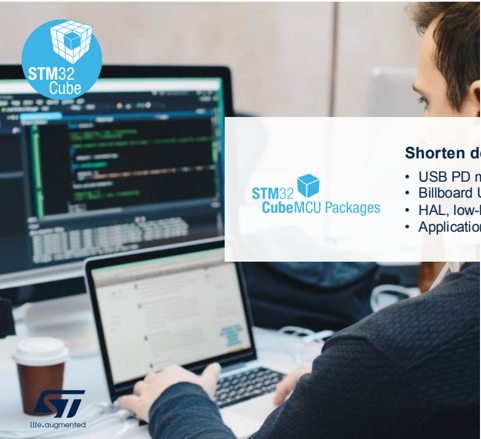

23

## Visit our Wiki page on USB Type-C ®

## Find all the information required for beginners and advanced users

by

[https://wiki.st.com/stm32mcu/wiki/USB\_Power\_Delivery\_overview](https://wiki.st.com/stm32mcu/wiki/USB_Power_Delivery_overview)

## Hardware tools &amp; reference designs

| SOLUTIONS                                                   | STM32G0                                         | STM32G4                    | STM32L5                    | STM32U5                                  | STM32H5                              | STM32H7RS                                    | STM32MP13                   |
|-------------------------------------------------------------|-------------------------------------------------|----------------------------|----------------------------|------------------------------------------|--------------------------------------|----------------------------------------------|-----------------------------|
| STEVAL-USBPD27S (27 W / PPS ready) STEVAL-2STPD01 (2x 60 W) |                                                 |                            |                            |                                          |                                      |                                              | AC/DC USB PD power adapter  |
| STM32G071B- DISCO (USB Type-C® Sniffer/Analyzer)            | B-G474E-DPOW1 1 port DRP                        | STM32L562E-DK 1 port SNK   | B-U585I-IOT02A 1 port DRP  | STM32H573I-DK 1 port DRP/DRD 1 port sink | STM32H7S78-DK 1 port DRP 1 port sink | STM32MP135F-DK 1 port DRP/DRD UCSI-certified | USB Type-C ® discovery kits |
| STM32G0C1E-EV 1 port 45 W DRP 1 port Sink                   | STM32G474E-EVAL featuring 1 port DRP            | STM32L552E-EVAL 1 port SNK | STM32U575I-EV 1 port DRP   |                                          |                                      |                                              | Evaluation boards           |
| X-NUCLEO-SNK1M1 X-NUCLEO-DRP1M1 X-NUCLEO-SRC1M1             | X-NUCLEO-SNK1M1 X-NUCLEO-DRP1M1 X-NUCLEO-SRC1M1 | NUCLEO-L552ZE-Q 1 port SNK | NUCLEO-U575ZI-Q 1 port SNK | NUCLEO-H563ZI 1 port sink                | NUCLEO-H7S3L8 1 port DRP             |                                              | Nucleo board Nucleo shield  |

## 2x60 W PD3.1 dual port power adapter

## Based on STM32G0 and STPD01PUR programmable buck converters

## Key features

- Two USB Power Delivery source ports
- Output power up to 120 W-rated (60 W per port), managed through a power sharing algorithm
- Up to four output PDOs for each port (5 V@3 A, 9 V@3 A, 15 V@3 A, 20 V@3 A)
- Compliant with USB Type-C® 2.1 and PD 3.1 specifications

## Key products

- STM32G071RBT6 MCU embedding two USB PD interfaces.
- Two STPD01PUR DC-DC converters dynamically set by I²C, suitable to implement power sharing in USB PD applications
- Two on-board TCPP02-M18 protections for USB Type-C® and PD source applications
- OVP, UVP, OC, short-circuit, and OTP protections

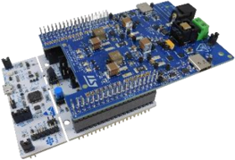

Board:

STEVAL-2STPD01

## USB Type-C ®  solutions for   Linux-based STM32 MPUs

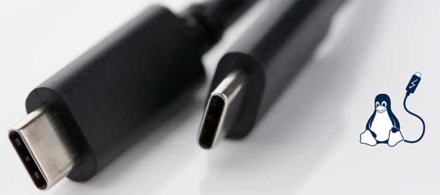

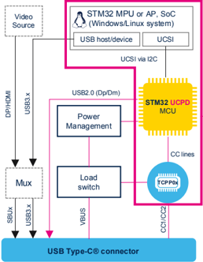

- UCPD stands for USB Type-C® and power D elivery controller
- UCSI stands USB Type-C® connector S ystem interface

## Architecture &amp; solutions overview

## STM32 MPU or AP, SoC

- OS policy manager
- Application manager
- UCSI drivers

+

## STM32 USB PD controller

- Application tasks
- UCSI driver (optional)
- Policy Manager
- USB PD stack
- UCPD peripheral

+

## TCPP0x port protection

- Dead battery
- ESD/OVP protection
- N-gate driver
- OCP*
- Bus discharge* *when required

## Reference design

STM32MP135F-DK with X-CUBE-UCSI Cube expansion firmware

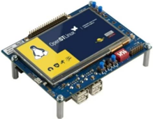

28

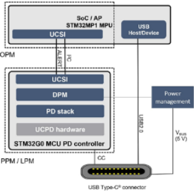

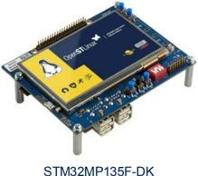

## Turnkey UCSI-certified solution

## [X-CUBE-UCSI](https://www.st.com/en/embedded-software/x-cube-ucsi.html?widgetSearchBar=X-CUBE-UCSI&widgetSearchAction=1&_charset_=UTF-8&filter-search=products)

- Allows users to implement USB Type-C® ports in OS-based system
- Compliant with the USB Type-C® connector system interface. (UCSI) specification enabling OS (Linux, Windows, Android) to supervise the USB Type-C® ports.

## Reference design

- USB-certified (TID 8088) STM32MP135F-DK discovery board features an STM32MP135 as the main application processor, connected to an STM32G071 MCU as the UCSI PD controller.
- The X-CUBE-UCSI STM32Cube expansion software to build a USB PD dual-role power (DRP) project.

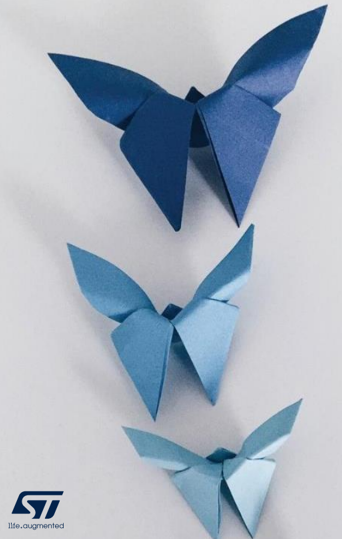

## Releasing your creativity

[/STM32](http://www.facebook.com/stm32)

[@ST\_World](http://www.twitter.com/ST_World)

[USB PD Community](https://community.st.com/s/topic/0TO0X0000003bIOWAY/usb-pd)

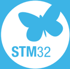

[STM32 solutions for USB Type-C® PD](https://www.st.com/content/st_com/en/ecosystems/stm32-usb-c.html?ecmp=tt21056_gl_link_may2021)

[wiki.st.com/USBPD](https://wiki.st.com/stm32mcu/wiki/Category:USB_Power_Delivery)

[X-CUBE-TCPP on github.com](https://github.com/STMicroelectronics/x-cube-tcpp)

[STM32 USB Type-C® &amp; PD solutions](https://www.youtube.com/watch?v=iRrpeZJCXkI)

[TCPP product page](https://www.st.com/content/st_com/en/products/protection-devices/esd-protection/usb-port-protection/tcpp01-m12.html)

## Our technology starts with You

[Find out more at www.st.com/stm32-usb-c](http://www.st.com/stm32-usb-c)

