## STM32G474xB STM32G474xC STM32G474xE

Arm ®  Cortex ® -M4 32-bit MCU+FPU, 170 MHz / 213 DMIPS, 128 KB SRAM, rich analog, math acc, 184 ps 12 chan Hi-res timer

Datasheet -production data

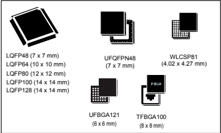

- Clock management
- -4 to 48 MHz crystal oscillator
- -32 kHz oscillator with calibration
- -Internal 16 MHz RC with PLL option (± 1%)
- -Internal 32 kHz RC oscillator (± 5%)
- Up to 107 fast I/Os
- -All mappable on external interrupt vectors
- -Several I/Os with 5 V tolerant capability
- Interconnect matrix
- 16-channel DMA controller
- 5 x 12-bit ADCs 0.25 µs, up to 42 channels. Resolution up to 16-bit with hardware oversampling, 0 to 3.6 V conversion range
- 7 x 12-bit DAC channels
- -3 x buffered external channels 1 MSPS
- -4 x unbuffered internal channels 15 MSPS
- 7 x ultra-fast rail-to-rail analog comparators
- 6 x operational amplifiers that can be used in PGA mode, all terminals accessible
- Internal voltage reference buffer (VREFBUF) supporting three output voltages (2.048 V, 2.5 V, 2.9 V)
- 17 timers:
- -HRTIM (Hi-Resolution and complex waveform builder): 6 x16-bit counters, 184 ps resolution, 12 PWM

## Features

## Includes ST state-of-the-art patented technology

- Core: Arm ®  32-bit Cortex ® -M4 CPU with FPU, Adaptive real-time accelerator (ART Accelerator) allowing 0-wait-state execution from Flash memory, frequency up to 170 MHz with 213 DMIPS, MPU, DSP instructions
- Operating conditions:
- -VDD , V DDA voltage range: 1.71 V to 3.6 V
- Mathematical hardware accelerators
- -CORDIC for trigonometric functions acceleration
- -FMAC: filter mathematical accelerator
- Memories
- -512 Kbytes of Flash memory with ECC support, two banks read-while-write, proprietary code readout protection (PCROP), securable memory area, 1 Kbyte OTP
- -96 Kbytes of SRAM, with hardware parity check implemented on the first 32 Kbytes
- -Routine booster: 32 Kbytes of SRAM on instruction and data bus, with hardware parity check (CCM SRAM)
- -External memory interface for static memories FSMC supporting SRAM, PSRAM, NOR and NAND memories
- -Quad-SPI memory interface
- Reset and supply management
- -Power-on/power-down reset (POR/PDR/BOR)
- -Programmable voltage detector (PVD)
- -Low-power modes: sleep, stop, standby and shutdown
- -VBAT  supply for RTC and backup registers

- -2 x 32-bit timer and 2 x 16-bit timers with up to four IC/OC/PWM or pulse counter and quadrature (incremental) encoder input
- -3 x 16-bit 8-channel advanced motor control timers, with up to 8 x PWM channels, dead time generation and emergency stop
- -1 x 16-bit timer with 2 x IC/OCs, one OCN/PWM, dead time generation and emergency stop
- -2 x 16-bit timers with IC/OC/OCN/PWM, dead time generation and emergency stop
- -2 x watchdog timers (independent, window)
- -1 x SysTick timer: 24-bit downcounter
- -2 x 16-bit basic timers
- -1 x low-power timer
- Calendar RTC with alarm, periodic wakeup from stop/standby
- Communication interfaces
- -3 x FDCAN controller supporting flexible data rate
- -4 x I 2 C Fast mode plus (1 Mbit/s) with 20 mA current sink, SMBus/PMBus, wakeup from stop
- -5 x USART/UARTs (ISO 7816 interface, LIN, IrDA, modem control)
- -1 x  LPUART
- -4 x  SPIs, 4 to 16 programmable bit frames, 2 x with multiplexed half duplex I 2 S interface
- -1 x SAI (serial audio interface)
- -USB 2.0 full-speed interface with LPM and BCD support
- -IRTIM (infrared interface)
- -USB Type-C™ /USB power delivery controller (UCPD)
- True random number generator (RNG)
- CRC calculation unit, 96-bit unique ID
- Development support: serial wire debug (SWD), JTAG, Embedded Trace Macrocell™

Table 1. Device summary

| Reference   | Part number                                                                  |
|-------------|------------------------------------------------------------------------------|
| STM32G474xB | STM32G474CB, STM32G474MB, STM32G474RB, STM32G474VB, STM32G474QB, STM32G474PB |
| STM32G474xC | STM32G474CC, STM32G474MC, STM32G474RC, STM32G474VC, STM32G474QC, STM32G474PC |
| STM32G474xE | STM32G474CE, STM32G474ME, STM32G474RE, STM32G474VE, STM32G474QE, STM32G474PE |


## Contents

|    1 | Introduction . . . . . . . . . . . . . . . . . . . . . . . . . . . . . . .                    | Introduction . . . . . . . . . . . . . . . . . . . . . . . . . . . . . . .                                | . 13          |
|------|-----------------------------------------------------------------------------------------------|-----------------------------------------------------------------------------------------------------------|---------------|
|    2 | Description . . . . . . . . . . . . . . . . . . . . . . . . . . . . . . . . . . . . . . . . . | Description . . . . . . . . . . . . . . . . . . . . . . . . . . . . . . . . . . . . . . . . .             | . 14          |
|    3 | Functional overview . . . . . . . . . . . . . . . . . . . . . . . . . . .                     | Functional overview . . . . . . . . . . . . . . . . . . . . . . . . . . .                                 | . 18          |
|  3.1 | Arm ® Cortex ® -M4 core with FPU . . . . . . .                                                | . . . . . .                                                                                               | . 18          |
|  3.2 | Adaptive real-time memory accelerator (ART accelerator) . . . .                               | Adaptive real-time memory accelerator (ART accelerator) . . . .                                           | . 18          |
|  3.3 | Memory protection unit . . . . .                                                              | . . . . . . . . . . . . . . . .                                                                           | . 18          |
|  3.4 | Embedded Flash memory . . . . . . . . . . . . . . . . . . . . . . . .                         | Embedded Flash memory . . . . . . . . . . . . . . . . . . . . . . . .                                     | . 19          |
|  3.5 | Embedded SRAM . . . . . . . . . . . . . . . . . . . . . . . . . . . . .                       | Embedded SRAM . . . . . . . . . . . . . . . . . . . . . . . . . . . . .                                   | . 20          |
|  3.6 | Multi-AHB bus matrix . . . . . . . . . . . . . . . . . . . . . . . . . . . .                  | Multi-AHB bus matrix . . . . . . . . . . . . . . . . . . . . . . . . . . . .                              | . 21          |
|  3.7 | Boot modes . . . . . . . . . . . . . . . . . . . . . . . . . . . . .                          | Boot modes . . . . . . . . . . . . . . . . . . . . . . . . . . . . .                                      | . 21          |
|  3.8 | CORDIC . . . . . . . . . . . . . . . . . . . . . . . . . . . . . . . . . . . . . . . . . .    | CORDIC . . . . . . . . . . . . . . . . . . . . . . . . . . . . . . . . . . . . . . . . . .                | . 22          |
|  3.9 | Filter mathematical accelerator (FMAC) . . . . . . . . . . . . . . . . .                      | Filter mathematical accelerator (FMAC) . . . . . . . . . . . . . . . . .                                  | . 22          |
| 3.10 | Cyclic redundancy check calculation unit (CRC) . . . . . . . . . .                            | Cyclic redundancy check calculation unit (CRC) . . . . . . . . . .                                        | . 23          |
| 3.11 | Power supply management . . . . . . . . . . . . . . .                                         | Power supply management . . . . . . . . . . . . . . .                                                     | . 23          |
|      | . . . . . . 3.11.1                                                                            | . . . . . . . . . . . . . . .                                                                             | . . 23        |
|      | 3.11.2                                                                                        | Power supply schemes .                                                                                    | .             |
|      |                                                                                               | Power supply supervisor . . . . . . . . . . . . . . .                                                     | . 24          |
|      | 3.11.3 3.11.4 Low-power                                                                       | Voltage regulator . . . . . . . . . . . . . . . . . . . . . modes . . . . . . . . . . . . . . . . . . . . | . . 24 . . 25 |
|      | 3.11.5                                                                                        | Reset mode . . . . . . . . . . . . . . . . . . . . . . . . .                                              | . . 25        |
|      | 3.11.6                                                                                        | VBAT operation . . . . . . . . . . . . . . . . . . . . . .                                                | . . 26        |
| 3.12 | Interconnect matrix . . . . . . . . . . . . . . . . . . . . . . . . . .                       | Interconnect matrix . . . . . . . . . . . . . . . . . . . . . . . . . .                                   | . 27          |
| 3.13 | Clocks and startup . . . . . . . . .                                                          | . . . . . . . . . . . . . . .                                                                             | . 29          |
| 3.14 | General-purpose inputs/outputs (GPIOs) . . . . . . . . . . .                                  | General-purpose inputs/outputs (GPIOs) . . . . . . . . . . .                                              | . 30          |
| 3.15 | Direct memory access controller (DMA) . . . .                                                 | . . . .                                                                                                   | . 30          |
| 3.16 | DMA request router (DMAMUX) . . . . .                                                         | . . . . . . . . .                                                                                         | . 31          |
| 3.17 | Interrupts and events .                                                                       | . . . . . . . . . . . . . . . . . . . . .                                                                 | . 31          |
|      | 3.17.1                                                                                        | Nested vectored interrupt controller (NVIC) .                                                             | . . 31        |
|      | 3.17.2                                                                                        | Extended interrupt/event controller (EXTI) .                                                              | . . 31        |
| 3.18 | Analog-to-digital converter (ADC) .                                                           | . . . . . . . . . . .                                                                                     | . 32          |
|      | 3.18.1                                                                                        | Temperature sensor . . . . . . . . . . . . . . . . . . .                                                  | . . 32        |


7

|      | 3.18.2                                                          | Internal voltage reference (VREFINT) . . . . . . . . . . . . . . . . . . . . . . .                                                                                   | . 33      |
|------|-----------------------------------------------------------------|----------------------------------------------------------------------------------------------------------------------------------------------------------------------|-----------|
|      | 3.18.3                                                          | VBAT battery voltage monitoring . . . . . . . . . . . . . . . . . . . . . . . . . . .                                                                                | . 33      |
|      | 3.18.4                                                          | Operational amplifier internal output (OPAMPxINT): . . . . . . . . . . . .                                                                                           | . 33      |
| 3.19 | Digital to analog converter (DAC) . . . . . . . .               | . . . . . . . . . . . . . . . . . . . . .                                                                                                                            | 33        |
| 3.20 | Voltage reference buffer (VREFBUF) . . . . . . .                | . . . . . . . . . . . . . . . . . . .                                                                                                                                | 34        |
| 3.21 | Comparators (COMP) . . . . . . .                                | . . . . . . . . . . . . . . . . . . . . . . . . . . . . . .                                                                                                          | 35        |
| 3.22 | Operational amplifier (OPAMP) . . . . .                         | . . . . . . . . . . . . . . . . . . . . . . . . .                                                                                                                    | 35        |
| 3.23 | Random number generator (RNG) . . . . . . . . .                 | . . . . . . . . . . . . . . . . . . .                                                                                                                                | 35        |
| 3.24 | Timers and watchdogs . . . . .                                  | . . . . . . . . . . . . . . . . . . . . . . . . . . . . . . . .                                                                                                      | 35        |
|      | 3.24.1                                                          | High-resolution timer (HRTIM) . . . . . . . . . . . . . . . . . . . . . . . . . . . . .                                                                              | . 36      |
|      | 3.24.2                                                          | Advanced motor control timer (TIM1, TIM8, TIM20) . . . . . . . . . . . .                                                                                             | . 36      |
|      | 3.24.3                                                          | General-purpose timers (TIM2, TIM3, TIM4, TIM5, TIM15, TIM16, TIM17) . . . . . . . . . . . . . . . . . . . . . . . . . . . . . . . . . . . . . . . . . . . . . . .   | . 37      |
|      | 3.24.4                                                          | Basic timers (TIM6 and TIM7) . . . . . . . . . . . . . . . . . . . . . . . . . . . . .                                                                               | . 37      |
|      | 3.24.5                                                          | Low-power timer (LPTIM1) . . . . . . . . . . . . . . . . . . . . . . . . . . . . . . .                                                                               | . 38      |
|      | 3.24.6                                                          | Independent watchdog (IWDG) . . . . . . . . . . . . . . . . . . . . . . . . . . . .                                                                                  | . 38      |
|      | 3.24.7                                                          | System window watchdog (WWDG) . . . . . . . . . . . . . . . . . . . . . . . .                                                                                        | . 38      |
|      | 3.24.8                                                          | SysTick timer . . . . . . . . . . . . . . . . . . . . . . . . . . . . . . . . . . . . . . . . . .                                                                    | . 38      |
| 3.25 | Real-time clock (RTC) and backup registers . . . . . . . . .    | . . . . . . . . . . .                                                                                                                                                | 39        |
| 3.26 | Tamper and backup registers (TAMP) . .                          | . . . . . . . . . . . . . . . . . . . . . . .                                                                                                                        | 39        |
| 3.27 | Infrared transmitter . . . .                                    | . . . . . . . . . . . . . . . . . . . . . . . . . . . . . . . . . . . .                                                                                              | 40        |
| 3.28 | Inter-integrated circuit interface (I 2 C) . .                  | . . . . . . . . . . . . . . . . . . . . . . . .                                                                                                                      | 41        |
| 3.29 | Universal synchronous/asynchronous receiver transmitter (USART) | .                                                                                                                                                                    | 42        |
| 3.30 | Low-power universal asynchronous receiver transmitter (LPUART)  | . .                                                                                                                                                                  | 43        |
| 3.31 | Serial peripheral interface (SPI) . .                           | . . . . . . . . . . . . . . . . . . . . . . . . . . . .                                                                                                              | 43        |
| 3.32 | Serial audio interfaces (SAI) . .                               | . . . . . . . . . . . . . . . . . . . . . . . . . . . . . . .                                                                                                        | 44        |
| 3.33 | Controller area network (FDCAN1, FDCAN2, FDCAN3) . .            | . . . . . . . . .                                                                                                                                                    | 45        |
| 3.34 | Universal serial bus (USB) .                                    | . . . . . . . . . . . . . . . . . . . . . . . . . . . . . . . . .                                                                                                    | 45        |
| 3.35 | USB Type-C™ / USB Power Delivery controller (UCPD) . . .        | . . . . . . . .                                                                                                                                                      | 45        |
| 3.36 | Clock recovery system (CRS) . .                                 | . . . . . . . . . . . . . . . . . . . . . . . . . . . . .                                                                                                            | 46        |
| 3.37 | Flexible static memory controller (FSMC) . . .                  | . . . . . . . . . . . . . . . . . . .                                                                                                                                | 46        |
| 3.38 | Quad-SPI memory interface (QUADSPI) . . . . . . . . . .         | . . . . . . . . . . . . .                                                                                                                                            | 47        |
| 3.39 | Development support . . .                                       | . . . . . . . . . . . . . . . . . . . . . . . . . . . . . . . . . . .                                                                                                | 48        |
|      | 3.39.1 3.39.2                                                   | Serial wire JTAG debug port (SWJ-DP) . . . . . . . . . . . . . . . . . . . . . . Embedded trace macrocell™ . . . . . . . . . . . . . . . . . . . . . . . . . . . . . | . 48 . 48 |


|   4 | Pinouts and pin description . . . . . . . . . . . . . . . . . . . . . . . . . . . . . . . .   | Pinouts and pin description . . . . . . . . . . . . . . . . . . . . . . . . . . . . . . . .   | Pinouts and pin description . . . . . . . . . . . . . . . . . . . . . . . . . . . . . . . .                                               | . 49   |
|-----|-----------------------------------------------------------------------------------------------|-----------------------------------------------------------------------------------------------|-------------------------------------------------------------------------------------------------------------------------------------------|--------|
|     | 4.1                                                                                           | UFQFPN48 pinout description . . . . . . . . . . . . . . . . . . . . . . .                     | . .                                                                                                                                       | . . 49 |
|     | 4.2                                                                                           | LQFP48 pinout description . . . . . . . . . . . . . . . . . . . . . . . . . . . .             | LQFP48 pinout description . . . . . . . . . . . . . . . . . . . . . . . . . . . .                                                         | . . 50 |
|     | 4.3                                                                                           | LQFP64 pinout description . . . . . . . . . . .                                               | . . . . . . . . . . . . . . . . .                                                                                                         | . . 50 |
|     | 4.4                                                                                           | LQFP80 pinout description . . . . . . . . . . . . . . . . . . . . . . .                       | . . . . .                                                                                                                                 | . . 51 |
|     | 4.5                                                                                           | LQFP100 pinout description . . . . . . . . . . . . . . . . . . . . .                          | . . . . . .                                                                                                                               | . . 52 |
|     | 4.6                                                                                           | LQFP128 pinout description . . . . . . . . . . . . . . . . . . . . . . . . . .                | .                                                                                                                                         | . . 53 |
|     | 4.7                                                                                           | WLCSP81 pinout description . . . . . . . . . . . . . . .                                      | . . . . . . . . . . .                                                                                                                     | . . 54 |
|     | 4.8                                                                                           | TFBGA100 pinout description . . . . . . . . . . . . . . . . . .                               | . . . . . . .                                                                                                                             | . . 54 |
|     | 4.9                                                                                           | UFBGA121 pinout description . . . . . . .                                                     | . . . . . . . . . . . . . . . . . .                                                                                                       | . . 55 |
|     | 4.10                                                                                          | Pin definition . . . . . . . . . . . . . . . . . . . . . . . . . . .                          | . . . . . . . . . . . .                                                                                                                   | . . 56 |
|     | 4.11                                                                                          | Alternate functions . . . . . . . . . . .                                                     | . . . . . . . . . . . . . . . . . . . . . . .                                                                                             | . . 73 |
|   5 | Electrical characteristics . . . . . . . . . . . . . . . . . . . . . . . . . . .              | Electrical characteristics . . . . . . . . . . . . . . . . . . . . . . . . . . .              | . .                                                                                                                                       | . 80   |
|     | 5.1                                                                                           | Parameter conditions . . . . . . . . . . . . . . . . . . . .                                  | . . . . . . . . . . . .                                                                                                                   | . . 80 |
|     |                                                                                               | 5.1.1                                                                                         | Minimum and maximum values . . . . . . . . . . . . . . . . . . . . .                                                                      | . . 80 |
|     |                                                                                               | 5.1.2                                                                                         | Typical values . . . . . . . . . . . . . . . . . . . . . . . . . . . . . . . . . .                                                        | . . 80 |
|     |                                                                                               | 5.1.3                                                                                         | Typical curves . . . . . . . . . . . . . . . . . . . . . . . . . . . . . . . . . .                                                        | . . 80 |
|     |                                                                                               | 5.1.4                                                                                         | Loading capacitor . . . . . . . . . . . . . . . . . . . . . . . . . . . . . . .                                                           | . . 80 |
|     |                                                                                               | 5.1.5                                                                                         | Pin input voltage . . . . . . . . . . . . . . . . . . . . . . . . . . . . . . . .                                                         | . . 80 |
|     |                                                                                               | 5.1.6                                                                                         | Power supply scheme . . . . . . . . . . . . . . . . . . . . . . . . . . . .                                                               | . . 81 |
|     |                                                                                               | 5.1.7                                                                                         | Current consumption measurement . . . . . . . . . . . . . . . . .                                                                         | . . 82 |
|     | 5.2                                                                                           | Absolute maximum ratings . . . . . . . . . . . . . . .                                        | . . . . . . . . . . . . .                                                                                                                 | . . 82 |
|     | 5.3                                                                                           | Operating conditions . . . . . .                                                              | . . . . . . . . . . . . . . . . . . . . . . . . . .                                                                                       | . . 84 |
|     |                                                                                               | 5.3.1                                                                                         | General operating conditions . . . . . . . . . . . . . . . . . . . . . . .                                                                | . . 84 |
|     |                                                                                               | 5.3.2                                                                                         | Operating conditions at power-up / power-down . . . . . . . .                                                                             | . . 85 |
|     |                                                                                               | 5.3.3                                                                                         | Embedded reset and power control block characteristics .                                                                                  | . . 85 |
|     |                                                                                               | 5.3.4                                                                                         | Embedded voltage reference . . . . . . . . . . . . . . . . . . . . . . .                                                                  | . . 87 |
|     |                                                                                               | 5.3.5                                                                                         | Supply current characteristics . . . . . . . . . . . . . . . . . . . . . .                                                                | . . 88 |
|     |                                                                                               | 5.3.6                                                                                         | Wakeup time from low-power modes and voltage scaling transition times . . . . . . . . . . . . . . . . . . . . . . . . . . . . . . . . . . | . 114  |
|     |                                                                                               | 5.3.7                                                                                         | External clock source characteristics . . . . . . . . . . . . . . . . .                                                                   | . 115  |
|     |                                                                                               | 5.3.8                                                                                         | Internal clock source characteristics . . . . . . . . . . . . . . . . . . . . . . . . .                                                   | . 120  |
|     |                                                                                               | 5.3.9                                                                                         | PLL characteristics . . . . . . . . . . . . . . . . . . . . . . .                                                                         | . 123  |
|     |                                                                                               | 5.3.10                                                                                        | Flash memory characteristics . . . . . . . . . . . . . . . . . . . . . .                                                                  | . 124  |
|     |                                                                                               | 5.3.11                                                                                        | EMC characteristics . . . . . . . . . . . . . . . . . . . . . . . . . . . . . .                                                           | . 125  |
|     |                                                                                               |                                                                                               | DS12288 Rev 6                                                                                                                             | 5/236  |

7

|    |                                                                                       | 5.3.12                                                                                | Electrical sensitivity characteristics . . . . . . . . . . . . . . . . . . . . . . . .       | . 126   |
|----|---------------------------------------------------------------------------------------|---------------------------------------------------------------------------------------|----------------------------------------------------------------------------------------------|---------|
|    |                                                                                       | 5.3.13                                                                                | I/O current injection characteristics . . . . . . . . . . . . . . . . . . . . . . . .        | . 127   |
|    |                                                                                       | 5.3.14                                                                                | I/O port characteristics . . . . . . . . . . . . . . . . . . . . . . . . . . . . . . . . . . | . 128   |
|    |                                                                                       | 5.3.15                                                                                | NRST pin characteristics . . . . . . . . . . . . . . . . . . . . . . . . . . . . . . . .     | . 133   |
|    |                                                                                       | 5.3.16                                                                                | High-resolution timer (HRTIM) . . . . . . . . . . . . . . . . . . . . . . . . . . . .        | . 134   |
|    |                                                                                       | 5.3.17                                                                                | Extended interrupt and event controller input (EXTI) characteristics                         | . 136   |
|    |                                                                                       | 5.3.18                                                                                | Analog switches booster . . . . . . . . . . . . . . . . . . . . . . . . . . . . . . . .      | . 137   |
|    |                                                                                       | 5.3.19                                                                                | Analog-to-digital converter characteristics . . . . . . . . . . . . . . . . . . .            | . 138   |
|    |                                                                                       | 5.3.20                                                                                | Digital-to-Analog converter characteristics . . . . . . . . . . . . . . . . . .              | . 153   |
|    |                                                                                       | 5.3.21                                                                                | Voltage reference buffer characteristics . . . . . . . . . . . . . . . . . . . .             | . 160   |
|    |                                                                                       | 5.3.22                                                                                | Comparator characteristics . . . . . . . . . . . . . . . . . . . . . . . . . . . . . .       | . 163   |
|    |                                                                                       | 5.3.23                                                                                | Operational amplifiers characteristics . . . . . . . . . . . . . . . . . . . . . .           | . 164   |
|    |                                                                                       | 5.3.24                                                                                | Temperature sensor characteristics . . . . . . . . . . . . . . . . . . . . . . . .           | . 168   |
|    |                                                                                       | 5.3.25                                                                                | V BAT monitoring characteristics . . . . . . . . . . . . . . . . . . . . . . . . . . .       | . 168   |
|    |                                                                                       | 5.3.26                                                                                | Timer characteristics . . . . . . . . . . . . . . . . . . . . . . . . . . . . . . . . . . .  | . 169   |
|    |                                                                                       | 5.3.27                                                                                | Communication interfaces characteristics . . . . . . . . . . . . . . . . . . .               | . 170   |
|    |                                                                                       | 5.3.28                                                                                | FSMC characteristics . . . . . . . . . . . . . . . . . . . . . . . . . . . . . . . . . . .   | . 180   |
|    |                                                                                       | 5.3.29                                                                                | QUADSPI characteristics . . . . . . . . . . . . . . . . . . . . . . . . . . . . . . . .      | . 197   |
|    |                                                                                       | 5.3.30                                                                                | UCPD characteristics . . . . . . . . . . . . . . . . . . . . . . . . . . . . . . . . . . .   | . 199   |
|  6 | Package information . . . . . . . . . . . . . . . . . . . . . . . . . . . . . . . . . | Package information . . . . . . . . . . . . . . . . . . . . . . . . . . . . . . . . . | . . . .                                                                                      | . 200   |
|    | 6.1                                                                                   | WLCSP81 package information . . . . . . . . . . . . . . . .                           | . . . . . . . . . . . . .                                                                    | . 200   |
|    | 6.2                                                                                   | UFQFPN48 package information . . . . . . . . . . . . . . . . . . . .                  | . . . . . . . .                                                                              | . 203   |
|    | 6.3                                                                                   | LQFP48 package information . . . . . .                                                | . . . . . . . . . . . . . . . . . . . . . . . . .                                            | . 206   |
|    | 6.4                                                                                   | LQFP64 package information . . . . . .                                                | . . . . . . . . . . . . . . . . . . . . . . . . .                                            | . 210   |
|    | 6.5                                                                                   | LQFP80 package information . .                                                        | . . . . . . . . . . . . . . . . . . . . . . . . . . . .                                      | . 213   |
|    | 6.6                                                                                   | TFBGA100 package information . . . . . . . .                                          | . . . . . . . . . . . . . . . . . . . .                                                      | . 216   |
|    | 6.7                                                                                   | LQFP100 package information . . .                                                     | . . . . . . . . . . . . . . . . . . . . . . . . . . .                                        | . 219   |
|    | 6.8                                                                                   | LQFP128 package information . . . . . . . . . . . . .                                 | . . . . . . . . . . . . . . . . .                                                            | . 222   |
|    | 6.9                                                                                   | UFBGA121 package information . . . . . . . . . .                                      | . . . . . . . . . . . . . . . . . .                                                          | . 225   |
|    | 6.10                                                                                  | Thermal characteristics . . . .                                                       | . . . . . . . . . . . . . . . . . . . . . . . . . . . . . . .                                | . 228   |
|    |                                                                                       | 6.10.1                                                                                | Reference document . . . . . . . . . . . . . . . . . . . . . . . . . . . . . . . . . . .     | . 229   |
|    |                                                                                       | 6.10.2                                                                                | Selecting the product temperature range . . . . . . . . . . . . . . . . . . .                | . 230   |


|   STM32G474xB STM32G474xC STM32G474xE | STM32G474xB STM32G474xC STM32G474xE   | Contents      |
|---------------------------------------|---------------------------------------|---------------|
|                                     8 | Revision history                      | . . . . . 233 |


7

## List of tables

| Table 1.            | Device summary. . . . . . . . . . . . . . . . . . . . . . . . . . . . . . . . . . . . . . . . . . . . . . . . . . . . .                                                                                                        | . . 2   |
|---------------------|--------------------------------------------------------------------------------------------------------------------------------------------------------------------------------------------------------------------------------|---------|
| Table 2.            | STM32G474xB/xC/xE features and peripheral counts . . . . . . . . . . . . . . . . . . . . . . . . .                                                                                                                             | . 15    |
| Table 3.            | STM32G474xB/xC/xE peripherals interconnect matrix. . . . . . . . . . . . . . . . . . . . . . .                                                                                                                                 | . 27    |
| Table 4.            | DMA implementation . . . . . . . . . . . . . . . . . . . . . . . . . . . . . . . . . . . . . . . . . . . . . . . . .                                                                                                           | . 30    |
| Table 5.            | Temperature sensor calibration values. . . . . . . . . . . . . . . . . . . . . . . . . . . . . . . . . . . .                                                                                                                   | . 33    |
| Table 6.            | Internal voltage reference calibration values . . . . . . . . . . . . . . . . . . . . . . . . . . . . . . .                                                                                                                    | . 33 .  |
| Table 7.            | Timer feature comparison. . . . . . . . . . . . . . . . . . . . . . . . . . . . . . . . . . . . . . . . . . . . . .                                                                                                            | 35      |
| Table 8.            | I2C implementation. . . . . . . . . . . . . . . . . . . . . . . . . . . . . . . . . . . . . . . . . . . . . . . . . . .                                                                                                        | . 41 .  |
| Table 9.            | USART/UART/LPUART features . . . . . . . . . . . . . . . . . . . . . . . . . . . . . . . . . . . . . . . .                                                                                                                     | 42      |
| Table 10.           | SAI features implementation. . . . . . . . . . . . . . . . . . . . . . . . . . . . . . . . . . . . . . . . . . . .                                                                                                             | . 44    |
| Table 11.           | Legend/abbreviations used in the pinout table . . . . . . . . . . . . . . . . . . . . . . . . . . . . . .                                                                                                                      | . 56    |
| Table 12.           | STM32G474xB/xC/xE pin definition . . . . . . . . . . . . . . . . . . . . . . . . . . . . . . . . . . . . . .                                                                                                                   | . 57    |
| Table 13.           | Alternate function . . . . . . . . . . . . . . . . . . . . . . . . . . . . . . . . . . . . . . . . . . . . . . . . . . . .                                                                                                     | . 73    |
| Table 14.           | Voltage characteristics . . . . . . . . . . . . . . . . . . . . . . . . . . . . . . . . . . . . . . . . . . . . . . . .                                                                                                        | . 82    |
| Table 15.           | Current characteristics . . . . . . . . . . . . . . . . . . . . . . . . . . . . . . . . . . . . . . . . . . . . . . . .                                                                                                        | . 83 .  |
| Table 16.           | Thermal characteristics. . . . . . . . . . . . . . . . . . . . . . . . . . . . . . . . . . . . . . . . . . . . . . . .                                                                                                         | 83      |
| Table 17.           | General operating conditions . . . . . . . . . . . . . . . . . . . . . . . . . . . . . . . . . . . . . . . . . . .                                                                                                             | . 84    |
| Table 18.           | Operating conditions at power-up / power-down . . . . . . . . . . . . . . . . . . . . . . . . . . . .                                                                                                                          | . 85    |
| Table 19.           | Embedded reset and power control block characteristics. . . . . . . . . . . . . . . . . . . . . .                                                                                                                              | . 85    |
| Table 20.           | Embedded internal voltage reference. . . . . . . . . . . . . . . . . . . . . . . . . . . . . . . . . . . . .                                                                                                                   | . 87    |
| Table 21.           | Current consumption in Run and Low-power run modes, code with data processing running from Flash in single Bank, ART enable (Cache ON Prefetch OFF)                                                                            | . . 89  |
| Table 22.           | Current consumption in Run and Low-power run modes, code with data processing running from Flash in dual bank, ART enable (Cache ON Prefetch OFF)                                                                              | . 91    |
| Table 23.           | Current consumption in Run and Low-power run modes, code with data processing running from SRAM1 . . . . . . . . . . . . . . . . . . . . . . . . . . . .                                                                       | . 93    |
| Table 24.           | Typical current consumption in Run and Low-power run modes, with different codes running from Flash, ART enable (Cache ON Prefetch OFF) . . . . . . . . . . . . . . . . . . .                                                  | . 95    |
| Table 25.           | Typical current consumption in Run and Low-power run modes, with different codes running from SRAM1 . . . . . . . . . . . . . . . . . . . . . . . . . . . . . . . . . . . . . . . . . . . . . . . . .                          | . 97    |
| Table 26.           | Typical current consumption in Run and Low-power run modes, with different codes running from SRAM2 . . . . . . . . . . . . . . . . . . . . . . . . . . . . . . . . . . . . . . . . . . . . . . . . .                          | . 98    |
| Table 27.           | Typical current consumption in Run and Low-power run modes, with different codes running from CCMSRAM . . . . . . . . . . . . . . . . . . . . . . . . . . . . . . . . . . . . . . . . . . . . . .                              | . 99    |
| Table 28.           | Current consumption in Sleep and Low-power sleep mode Flash ON. . . . . . . . . . . .                                                                                                                                          | 100     |
| Table 29.           | Current consumption in low-power sleep modes, Flash in power-down. . . . . . . . . . .                                                                                                                                         | 101     |
| Table 30.           | Current consumption in Stop 1 mode . . . . . . . . . . . . . . . . . . . . . . . . . . . . . . . . . . . . .                                                                                                                   | 102     |
| Table 31.           | Current consumption in Stop 0 mode . . . . . . . . . . . . . . . . . . . . . . . . . . . . . . . . . . . . .                                                                                                                   | 103     |
| Table 32.           | Current consumption in Standby mode . . . . . . . . . . . . . . . . . . . . . . . . . . . . . . . . . . .                                                                                                                      | 103     |
| Table 33.           | Current consumption in Shutdown mode . . . . . . . . . . . . . . . . . . . . . . . . . . . . . . . . . .                                                                                                                       | 105     |
| Table 34.           | Current consumption in VBAT mode . . . . . . . . . . . . . . . . . . . . . . . . . . . . . . . . . . . . .                                                                                                                     | 107     |
| Table 35.           | Peripheral current consumption . . . . . . . . . . . . . . . . . . . . . . . . . . . . . . . . . . . . . . . . .                                                                                                               | 109     |
| Table 36.           | Low-power mode wakeup timings . . . . . . . . . . . . . . . . . . . . . . . . . . . . . . . . . . . . . . .                                                                                                                    | 114     |
| Table 37.           | Regulator modes transition times . . . . . . . . . . . . . . . . . . . . . . . . . . . . . . . . . . . . . . . .                                                                                                               | 115     |
| Table 38.           | Wakeup time using USART/LPUART. . . . . . . . . . . . . . . . . . . . . . . . . . . . . . . . . . . . .                                                                                                                        | 115     |
| Table 39.           | High-speed external user clock characteristics. . . . . . . . . . . . . . . . . . . . . . . . . . . . . .                                                                                                                      | 115     |
| Table 40. Table 41. | Low-speed external user clock characteristics . . . . . . . . . . . . . . . . . . . . . . . . . . . . . . HSE oscillator characteristics . . . . . . . . . . . . . . . . . . . . . . . . . . . . . . . . . . . . . . . . . . . | 116 117 |


| Table 42.           | LSE oscillator characteristics (f LSE = 32.768 kHz) . . . . . . . . . . . . . . . . . . . . .                                                                                  | . 119       |
|---------------------|--------------------------------------------------------------------------------------------------------------------------------------------------------------------------------|-------------|
| Table 43.           | HSI16 oscillator characteristics. . . . . . . . . . . . . . . . . . . . . .                                                                                                    | . 120       |
| Table 44.           | HSI48 oscillator characteristics. . . . . . . . . . . . . . . . . . . . . . . . . . . . .                                                                                      | . 121       |
| Table 45.           | LSI oscillator characteristics . . . . . . . . . . . . . . . . . . . . . . . . . . . . . . .                                                                                   | . 122       |
| Table 46.           | PLL characteristics . . . . . . . . . . . . . . . . . . . . . . . . . . . . . . . . . . . . . .                                                                                | . 123       |
| Table 47.           | Flash memory characteristics . . . . . . . . . . . . . . . . . . . . . . . . . . . . . .                                                                                       | . 124       |
| Table 48.           | Flash memory endurance and data retention . . . . . . . . . . . . . . . . . .                                                                                                  | . 124       |
| Table 49.           | EMS characteristics . . . . . . . . . . . . . . . . . . . . . . . . . . . . . . . . . . . . .                                                                                  | . 125       |
| Table 50.           | EMI characteristics . . . . . . . . . . . . . . . . . . . . . . . . . . . . . . . . . . . . . .                                                                                | . 126       |
| Table 51.           | ESD absolute maximum ratings . . . . . . . . . . . . . . . . . . . . . . . . . . . .                                                                                           | . 126       |
| Table 52.           | Electrical sensitivities . . . . . . . . . . . . . . . . . . . . . . . . . . . . . . . . . . . .                                                                               | . 127       |
| Table 53.           | I/O current injection susceptibility . . . . . . . . . . . . . . . . . . . . . . . . . . .                                                                                     | . 127       |
| Table 54.           | I/O static characteristics . . . . . . . . . . . . . . . . . . . . . . . . . . . . . . . . . .                                                                                 | . 128       |
| Table 55.           | Output voltage characteristics . . . . . . . . . . . . . . . . . . . . . . . . . . . . .                                                                                       | . 130       |
| Table 56.           | I/O (except FT_c) AC characteristics . . . . . . . . . . . . . . . . . . . . . . . .                                                                                           | . 131       |
| Table 57.           | I/O FT_c AC characteristics . . . . . . . . . . . . . . . . . . . . . . . . . . . . . . .                                                                                      | . 132       |
| Table 58.           | NRST pin characteristics . . . . . . . . . . . . . . . . . . . . . . . . . . . . . . . . .                                                                                     | . 133       |
| Table 59.           | HRTIM characteristics . . . . . . . . . . . . . . . . . . . . . . . . . . . . . . . . . . .                                                                                    | . 134       |
| Table 60.           | HRTIM output response to fault protection . . . . . . . . . . . . . . . . . . . .                                                                                              | . 135       |
|                     | (Low-Latency mode). . . . . . . . . . . . . . . . . . . . . . . . . . . . . . . . . . . . .                                                                                    | . 135       |
| Table 62.           | HRTIM output response to external events 1 to 10 (Synchronous mode . . . . . . . . . . . . . . . . . . . . . . .                                                               | . 136       |
| Table 63.           | HRTIM synchronization input / output.                                                                                                                                          | . 136       |
| Table 64.           | EXTI input characteristics . . . . . . . . . . . . . . . . . . . . . . . . . . . . . . . . .                                                                                   | . 136       |
| Table 65. Table 66. | Analog switches booster characteristics. . . . . . . . . . . . . . . . . . . . . . ADC characteristics . . . . . . . . . . . . . . . . . . . . . . . . . . . . . . . . . . . . | . 137 . 138 |
| Table 67.           | Maximum ADC RAIN . . . . . . . . . . . . . . . . . . . . . . . . . . . . . . . . . . . .                                                                                       | . 141       |
| Table 68.           | ADC accuracy - limited test conditions 1 . . . . . . . . . . . . . . . . . . . . .                                                                                             | . 143       |
| Table 69.           | ADC accuracy - limited test conditions 2 . . . . . . . . . . . . . . . . . . . . .                                                                                             | . 145       |
| Table 70.           | ADC accuracy - limited test conditions 3 . . . . . . . . . . . . . . . . . . . . .                                                                                             | . 147       |
| Table 71.           | ADC accuracy (Multiple ADCs operation) - limited test conditions 1                                                                                                             | . 149       |
| Table 72.           | ADC accuracy (Multiple ADCs operation) - limited test conditions 2                                                                                                             | . 150       |
| Table 73.           | ADC accuracy (Multiple ADCs operation) - limited test conditions 3                                                                                                             | . 151       |
| Table 74.           | DAC 1MSPS characteristics . . . . . . . . . . . . . . . . . . . . . . . . . . . . . . .                                                                                        | . 153       |
| Table 75.           | DAC 1MSPS accuracy . . . . . . . . . . . . . . . . . . . . . . . . . . . . . . . . . . .                                                                                       | . 156       |
| Table 76.           | DAC 15MSPS characteristics . . . . . . . . . . . . . . . . . . . . . . . . . . . . . .                                                                                         | . 157       |
| Table 77.           | DAC 15MSPS accuracy . . . . . . . . . . . . . . . . . . . . . . . . . . . . . . . . . .                                                                                        | . 159       |
| Table 78.           | VREFBUF characteristics . . . . . . . . . . . . . . . . . . . . . . . . . . . . . . . . .                                                                                      | . 160       |
| Table 79.           | COMP characteristics . . . . . . . . . . . . . . . . . . . . . . . . . . . . . . . . . . . .                                                                                   | . 163       |
| Table 80.           | OPAMP characteristics . . . . . . . . . . . . . . . . . . . . . . . . . . . . . . . . . .                                                                                      | . 164       |
| Table 81.           | TS characteristics . . . . . . . . . . . . . . . . . . . . . . . . . . . . . . . . . . . . . . .                                                                               | . 168       |
| Table 82.           | V BAT monitoring characteristics . . . . . . . . . . . . . . . . . . . . . . . . . . . .                                                                                       | . 168       |
| Table 83.           | V BAT charging characteristics . . . . . . . . . . . . . . . . . . . . . . . . . . . . . .                                                                                     | . 168       |
| Table 84.           | TIMx characteristics . . . . . . . . . . . . . . . . . . . . . . . . . . . . . . . . . . . . .                                                                                 | . 169       |
| Table 85.           | IWDG min/max timeout period at 32 kHz (LSI). . . . . . . . . . . . . .                                                                                                         | . 170       |
| Table 86.           | . . . WWDG min/max timeout value at 170 MHz (PCLK). . . . . . . . . . . . .                                                                                                    | . 170       |
| Table 87.           | Minimum I2CCLK frequency in all I2C modes . . . . . . . . . . . . . . . . .                                                                                                    | . 171       |
| Table 88.           | I2C analog filter characteristics. . . . . . . . . . . . . . . . . . . . . . . . . . . . .                                                                                     | . 171       |
| Table 89.           | SPI characteristics . . . . . . . . . . . . . . . . . . . . . . . . . . . . . . . . . . . . . .                                                                                | . 172       |
| Table 90.           | I2S characteristics . . . . . . . . . . . . . . . . . . . . . . . . . . . . . . . . . . . . . .                                                                                | . 175       |
| Table 91.           | SAI characteristics . . . . . . . . . . . . . . . . . . . . . . . . . . . . . . . . . . . . . .                                                                                | . 177       |
| Table 92.           | USB electrical characteristics . . . . . . . . . . . . . . . . . . . . . . . . . . . . . .                                                                                     | . 179       |


10

| Table 93.   | USART electrical characteristics . . . . . . . . . . . . . . . . . . . . . . . . . . . . . . . .         | . 179   |
|-------------|----------------------------------------------------------------------------------------------------------|---------|
| Table 94.   | Asynchronous non-multiplexed SRAM/PSRAM/NOR read timings . . . . . .                                     | . 182   |
| Table 95.   | Asynchronous non-multiplexed SRAM/PSRAM/NOR read-NWAIT timings                                           | . 182   |
| Table 96.   | Asynchronous non-multiplexed SRAM/PSRAM/NOR write timings . . . . . .                                    | . 183   |
| Table 97.   | Asynchronous non-multiplexed SRAM/PSRAM/NOR write-NWAIT timings.                                         | . 184   |
| Table 98.   | Asynchronous multiplexed PSRAM/NOR read timings. . . . . . . . . . . . . . . .                           | . 185   |
| Table 99.   | Asynchronous multiplexed PSRAM/NOR read-NWAIT timings . . . . . . . . .                                  | . 185   |
| Table 100.  | Asynchronous multiplexed PSRAM/NOR write timings . . . . . . . . . . . . . . .                           | . 187   |
| Table 101.  | Asynchronous multiplexed PSRAM/NOR write-NWAIT timings . . . . . . . . .                                 | . 187   |
| Table 102.  | Synchronous multiplexed NOR/PSRAM read timings . . . . . . . . . . . . . . . .                           | . 189   |
| Table 103.  | Synchronous multiplexed PSRAM write timings. . . . . . . . . . . . . . . . . . . . .                     | . 191   |
| Table 104.  | Synchronous non-multiplexed NOR/PSRAM read timings . . . . . . . . . . . . .                             | . 192   |
| Table 105.  | Synchronous non-multiplexed PSRAM write timings . . . . . . . . . . . . . . . . .                        | . 194   |
| Table 106.  | Switching characteristics for NAND Flash read cycles . . . . . . . . . . . . . . . .                     | . 196   |
| Table 107.  | Switching characteristics for NAND Flash write cycles. . . . . . . . . . . . . . . .                     | . 196   |
| Table 108.  | Quad SPI characteristics in SDR mode . . . . . . . . . . . . . . . . . . . . . . . . . .                 | . 197   |
| Table 109.  | . QUADSPI characteristics in DDR mode. . . . . . . . . . . . . . . . . . . . . . . . . . .               | . 197   |
| Table 110.  | UCPD characteristics . . . . . . . . . . . . . . . . . . . . . . . . . . . . . . . . . . . . . . . . .   | . 199   |
| Table 111.  | WLCSP81 - Mechanical data . . . . . . . . . . . . . . . . . . . . . . . . . . . . . . . . . . .          | . 201   |
| Table 112.  | WLCSP81 - Recommended PCB design rules. . . . . . . . . . . . . . . . . . . . . .                        | . 202   |
| Table 113.  | UFQFPN48 - Mechanical data . . . . . . . . . . . . . . . . . . . . . . . . . . . . . . . . . .           | . 204   |
| Table 114.  | LQFP48 - Mechanical data . . . . . . . . . . . . . . . . . . . . . . . . . . . . . . . . . . . . .       | . 207   |
| Table 115.  | LQFP64 - Mechanical data . . . . . . . . . . . . . . . . . . . . . . . . . . . . . . . . . . . . .       | . 210   |
| Table 116.  | LQFP80 - Mechanical data . . . . . . . . . . . . . . . . . . . . . . . . . . . . . . . . . . . . .       | . 213   |
| Table 117.  | TFBGA100 - Mechanical data . . . . . . . . . . . . . . . . . . . . . . . . . . . . . . . . . .           | . 217   |
| Table 118.  | TFBGA100 - Recommended PCB design rules . . . . . . . . . . . . . . . . . . . . .                        | . 217   |
| Table 119.  | LQPF100 - Mechanical data . . . . . . . . . . . . . . . . . . . . . . . . . . . . . . . . . . . .        | . 219   |
| Table 120.  | LQFP128 - Mechanical data . . . . . . . . . . . . . . . . . . . . . . . . . . . . . . . . . . . .        | . 222   |
| Table 121.  | UFBGA121 - Mechanical data . . . . . . . . . . . . . . . . . . . . . . . . . . . . . . . . . .           | . 226   |
| Table 122.  | UFBGA121 - Recommended PCB design rules . . . . . . . . . . . . . . . . . . . . .                        | . 227   |
| Table 123.  | Package thermal characteristics. . . . . . . . . . . . . . . . . . . . . . . . . . . . . . . . .         | . 228   |
| Table 124.  | Ordering information . . . . . . . . . . . . . . . . . . . . . . . . . . . . . . . . . . . . . . . . . . | . 232   |
| Table 125.  | Document revision history . . . . . . . . . . . . . . . . . . . . . . . . . . . . . . . . . . . . .      | . 233   |


## List of figures

| Figure 1.   | STM32G474xB/xC/xE block diagram . . . . . . . . . . . . . . . . . . . . . . .                                                                                                                              | . . 17   |
|-------------|------------------------------------------------------------------------------------------------------------------------------------------------------------------------------------------------------------|----------|
| Figure 2.   | Multi-AHB bus matrix . . . . . . . . . . . . . . . . . . . . . . . . . . . . . . . . . . .                                                                                                                 | . . 21   |
| Figure 3.   | Voltage reference buffer . . . . . . . . . . . . . . . . . . . . . . . . . . . . . . . . .                                                                                                                 | . . 34   |
| Figure 4.   | Infrared transmitter . . . . . . . . . . . . . . . . . . . . . . . . . . . . . . . . . . . . .                                                                                                             | . . 40   |
| Figure 5.   | STM32G474xB/xC/xE UFQFPN48 pinout . . . . . . . . . . . . . . . . . . .                                                                                                                                    | . . 49   |
| Figure 6.   | STM32G474xB/xC/xE LQFP48 pinout . . . . . . . . . . . . . . . . . . . . . .                                                                                                                                | . . 50   |
| Figure 7.   | STM32G474xB/xC/xE LQFP64 pinout . . . . . . . . . . . . . . . . . . . . . .                                                                                                                                | . . 50   |
| Figure 8.   | STM32G474xB/xC/xE LQFP80 pinout . . . . . . . . . . . . . . . . . . . . . .                                                                                                                                | . . 51   |
| Figure 9.   | STM32G474xB/xC/xE LQFP100 pinout . . . . . . . . . . . . . . . . . . . . .                                                                                                                                 | . . 52   |
| Figure 10.  | STM32G474xB/xC/xE LQFP128 pinout . . . . . . . . . . . . . . . . . . . . .                                                                                                                                 | . . 53   |
| Figure 11.  | STM32G474xB/xC/xE WLCSP81 pinout . . . . . . . . . . . . . . . . . . . .                                                                                                                                   | . . 54   |
| Figure 12.  | STM32G474xB/xC/xE TFBGA100 pinout. . . . . . . . . . . . . . . . . . . .                                                                                                                                   | . . 54   |
| Figure 13.  | STM32G474xB/xC/xE UFBGA121 pinout . . . . . . . . . . . . . . . . . . .                                                                                                                                    | . . 55   |
| Figure 14.  | Pin loading conditions. . . . . . . . . . . . . . . . . . . . . . . . . . . . . . . . . . .                                                                                                                | . . 80   |
| Figure 15.  | Pin input voltage . . . . . . . . . . . . . . . . . . . . . . . . . . . . . . . . . . . . . . .                                                                                                            | . . 80   |
| Figure 16.  | Power supply scheme. . . . . . . . . . . . . . . . . . . . . . . . . . . . . . . . . . .                                                                                                                   | . . 81   |
| Figure 17.  | Current consumption measurement . . . . . . . . . . . . . . . . . . . . . . . .                                                                                                                            | . . 82   |
| Figure 18.  | VREFINT versus temperature . . . . . . . . . . . . . . . . . . . . . . . . . . . .                                                                                                                         | . . 88   |
| Figure 19.  | High-speed external clock source AC timing diagram . . . . . . . . . .                                                                                                                                     | . 116    |
| Figure 20.  | Low-speed external clock source AC timing diagram. . . . . . . . . . .                                                                                                                                     | . 116    |
| Figure 21.  | Typical application with an 8 MHz crystal . . . . . . . . . . . . . . . . . . . .                                                                                                                          | . 118    |
| Figure 22.  | Typical application with a 32.768 kHz crystal . . . . . . . . . . . . . . . . .                                                                                                                            | . 119    |
| Figure 23.  | HSI16 frequency versus temperature . . . . . . . . . . . . . . . . . . . . . . .                                                                                                                           | . 121    |
| Figure 24.  | HSI48 frequency versus temperature . . . . . . . . . . . . . . . . . . . . . . .                                                                                                                           | . 122    |
| Figure 25.  | I/O input characteristics . . . . . . . . . . . . . . . . . . . . . . . . . . . . . . . . .                                                                                                                | . 129    |
| Figure 26.  | I/O AC characteristics definition (1) . . . . . . . . . . . . . . . . . . . . . . . . .                                                                                                                    | . 133    |
| Figure 27.  | Recommended NRST pin protection . . . . . . . . . . . . . . . . . . . . . . .                                                                                                                              | . 134    |
| Figure 28.  | ADC accuracy characteristics. .                                                                                                                                                                            | . 152    |
| Figure 29.  | . . . . . . . . . . . . . . . . . . . . . . . . . . . Typical connection diagram when using the ADC with FT/TT pins featuring analog switch function . . . . . . . . . . . . . . . . . . . . . . . . . . . | . 152    |
| Figure 30.  | 12-bit buffered / non-buffered DAC. . . . . . . . . . . . . . . . . . . . . . . . .                                                                                                                        | . 155    |
| Figure 31.  | VREFOUT_TEMP in case VRS = 00 . . . . . . . . . . . . . . . . . . . . . . .                                                                                                                                | . 161    |
| Figure 32.  | VREFOUT_TEMP in case VRS = 01 . . . . . . . . . . . . . . . . . . . . . . .                                                                                                                                | . 162    |
| Figure 33.  | VREFOUT_TEMP in case VRS = 10 . . . . . . . . . . . . . . . . . . . . . . .                                                                                                                                | . 162    |
| Figure 34.  | OPAMP noise density @ 25°C . . . . . . . . . . . . . . . . . . . . . . . . . . . .                                                                                                                         | . 167    |
| Figure 35.  | SPI timing diagram - slave mode and CPHA = 0 . . . . . . . . . . . . . .                                                                                                                                   | . 173    |
| Figure 36.  | SPI timing diagram - slave mode and CPHA = 1 . . . . . . . . . . . . . .                                                                                                                                   | . 174    |
| Figure 37.  | SPI timing diagram - master mode . . . . . . . . . . . . . . . . . . . . . . . . .                                                                                                                         | . 174    |
| Figure 38.  | SAI master timing waveforms. . . . . . . . . . . . . . . . . . . . . . . . . . . . .                                                                                                                       | . 178    |
| Figure 39.  | SAI slave timing waveforms . . . . . . . . . . . . . . . . . . . . . . . . . . . . . .                                                                                                                     | . 178    |
| Figure 40.  | Asynchronous non-multiplexed SRAM/PSRAM/NOR read waveforms                                                                                                                                                 | . 181    |
| Figure 41.  | Asynchronous non-multiplexed SRAM/PSRAM/NOR write waveforms                                                                                                                                                | . 183    |
| Figure 42.  | Asynchronous multiplexed PSRAM/NOR read waveforms. . . . . . .                                                                                                                                             | . 184    |
| Figure 43.  | Asynchronous multiplexed PSRAM/NOR write waveforms . . . . . .                                                                                                                                             | . 186    |
| Figure 44.  | Synchronous multiplexed NOR/PSRAM read timings . . . . . . . . . .                                                                                                                                         | . 188    |
| Figure 45.  | Synchronous multiplexed PSRAM write timings. . . . . . . . . . . . . . .                                                                                                                                   | . 190    |
| Figure 46.  | Synchronous non-multiplexed NOR/PSRAM read timings . . . . . . .                                                                                                                                           | . 192    |
| Figure 47.  | Synchronous non-multiplexed PSRAM write timings . . . . . . . . . . .                                                                                                                                      | . 193    |


12

| Figure 48.   | NAND controller waveforms for read access . . . . . . . . . . . . . .                  | . 195   |
|--------------|----------------------------------------------------------------------------------------|---------|
| Figure 49.   | NAND controller waveforms for write access . . . . . . . . . . . . . .                 | . 195   |
| Figure 50.   | NAND controller waveforms for common memory read access                                | . 195   |
| Figure 51.   | NAND controller waveforms for common memory write access.                              | . 196   |
| Figure 52.   | Quad SPI timing diagram - SDR mode. . . . . . . . . . . . . . . . . . .                | . 198   |
| Figure 53.   | Quad SPI timing diagram - DDR mode. . . . . . . . . . . . . . . . . . .                | . 199   |
| Figure 54.   | WLCSP81 - Outline . . . . . . . . . . . . . . . . . . . . . . . . . . . . . . . . .    | . 200   |
| Figure 55.   | WLCSP81 - Recommended footprint . . . . . . . . . . . . . . . . . . . .                | . 201   |
| Figure 56.   | UFQFPN48 - Outline . . . . . . . . . . . . . . . . . . . . . . . . . . . . . . . .     | . 203   |
| Figure 57.   | UFQFPN48 - Recommended footprint . . . . . . . . . . . . . . . . . . .                 | . 204   |
| Figure 58.   | UFQFPN48 top view example . . . . . . . . . . . . . . . . . . . . . . . . .            | . 205   |
| Figure 59.   | LQFP48 - Outline . . . . . . . . . . . . . . . . . . . . . . . . . . . . . . . . . . . | . 206   |
| Figure 60.   | LQFP48 - Recommended footprint. . . . . . . . . . . . . . . . . . . . . .              | . 208   |
| Figure 61.   | LQFP48 top view example . . . . . . . . . . . . . . . . . . . . . . . . . . . .        | . 209   |
| Figure 62.   | LQFP64 - Outline . . . . . . . . . . . . . . . . . . . . . . . . . . . . . . . . . . . | . 210   |
| Figure 63.   | LQFP64 - Recommended footprint. . . . . . . . . . . . . . . . . . . . . .              | . 211   |
| Figure 64.   | LQFP64 top view example . . . . . . . . . . . . . . . . . . . . . . . . . . .          | . 212   |
| Figure 65.   | LQFP80 - Outline . . . . . . . . . . . . . . . . . . . . . . . . . . . . . . . . . . . | . 213   |
| Figure 66.   | LQFP80 - Recommended footprint. . . . . . . . . . . . . . . . . . . . . .              | . 214   |
| Figure 67.   | LQFP80 top view example . . . . . . . . . . . . . . . . . . . . . . . . . . . .        | . 215   |
| Figure 68.   | TFBGA100 - Outline . . . . . . . . . . . . . . . . . . . . . . . . . . . . . . . . .   | . 216   |
| Figure 69.   | TFBGA100 - recommended footprint . . . . . . . . . . . . . . . . . . . .               | . 217   |
| Figure 70.   | TFBGA100 - Top view example . . . . . . . . . . . . . . . . . . . . . . . .            | . 218   |
| Figure 71.   | LQFP100 - Outline . . . . . . . . . . . . . . . . . . . . . . . . . . . . . . . . . .  | . 219   |
| Figure 72.   | LQFP100 - Recommended footprint. . . . . . . . . . . . . . . . . . . . .               | . 220   |
| Figure 73.   | LQFP100 top view example . . . . . . . . . . . . . . . . . . . . . . . . . . .         | . 221   |
| Figure 74.   | LQFP128 - Outline . . . . . . . . . . . . . . . . . . . . . . . . . . . . . . . . . .  | . 222   |
| Figure 75.   | LQFP128 - Recommended footprint. . . . . . . . . . . . . . . . . . . . .               | . 223   |
| Figure 76.   | LQFP128 top view example . . . . . . . . . . . . . . . . . . . . . . . . . . .         | . 224   |
| Figure 77.   | UFBGA121 - Outline. . . . . . . . . . . . . . . . . . . . . . . . . . . . . . . . .    | . 225   |
| Figure 78.   | UFBGA121 - Recommended footprint . . . . . . . . . . . . . . . . . . .                 | . 227   |


## 1 Introduction

This datasheet provides the ordering information and mechanical device characteristics of the STM32G474xB/xC/xE microcontrollers.

This document should be read in conjunction with the reference manual RM0440 'STM32G4 Series advanced Arm ®  32-bit MCUs'. The reference manual is available from the STMicroelectronics website www.st.com .

For information on the Arm ®(a) Cortex ® -M4 core, refer to the Cortex ® -M4 technical reference manual, available from the www.arm.com website.


48

## 2 Description

The STM32G474xB/xC/xE devices are based on the high-performance Arm ®  Cortex ® -M4 32-bit RISC core. They operate at a frequency of up to 170 MHz.

The Cortex-M4 core features a single-precision floating-point unit (FPU), which supports all the Arm single-precision data-processing instructions and all the data types. It also implements a full set of DSP (digital signal processing) instructions and a memory protection unit (MPU) which enhances the application's security.

These devices embed high-speed memories (up to 512 Kbytes of Flash memory, and 128 Kbytes of SRAM), a flexible external memory controller (FSMC) for static memories (for devices with packages of 100 pins and more), a Quad-SPI Flash memory interface, and an extensive range of enhanced I/Os and peripherals connected to two APB buses, two AHB buses and a 32-bit multi-AHB bus matrix.

The devices also embed several protection mechanisms for embedded Flash memory and SRAM: readout protection, write protection, securable memory area and proprietary code readout protection.

The devices embed peripherals allowing mathematical/arithmetic function acceleration (CORDIC for trigonometric functions and FMAC unit for filter functions).

They offer five fast 12-bit ADCs (4 Msps), seven comparators, six operational amplifiers, seven DAC channels (3 external and 4 internal), an internal voltage reference buffer, a lowpower RTC, two general-purpose 32-bit timers, three 16-bit PWM timers dedicated to motor control, seven general-purpose 16-bit timers, and one 16-bit low-power timer, and high resolution timer with 184 ps resolution.

They also feature standard and advanced communication interfaces such as:

- Four I2Cs
- Four SPIs multiplexed with two half duplex I2Ss
- Three USARTs, two UARTs and one low-power UART.
- Three FDCANs
- One SAI
- USB device
- UCPD

The devices operate in the -40 to +85 °C (+105 °C junction) and -40 to +125 °C (+130 °C junction) temperature ranges from a 1.71 to 3.6 V power supply. A comprehensive set of power-saving modes allows the design of low-power applications.

Some independent power supplies are supported including an analog independent supply input for ADC, DAC, OPAMPs and comparators. A V BAT  input allows backup of the RTC and the registers.

The STM32G474xB/xC/xE family offers 9 packages from 48-pin to 128-pin.


Table 2. STM32G474xB/xC/xE features and peripheral counts

| Peripheral - Flash memory                             | Peripheral - Flash memory                             | STM32G474Cx - 128 KB   | STM32G474Cx - 256 KB   | STM32G474Cx - 512 KB   | STM32G474Rx - 128 KB   | STM32G474Rx - 256 KB   | STM32G474Mx - 128 KB 256 KB   | STM32G474Vx - 512 KB   | STM32G474Vx - 128 KB 256 KB   | STM32G474Vx - 512 KB   | STM32G474Px - 128 KB   | STM32G474Px - 256 KB   | STM32G474Px - 512 KB   | STM32G474Qx - 128 KB   | STM32G474Qx - 256 KB   | STM32G474Qx - 512 KB   |                       |                       |
|-------------------------------------------------------|-------------------------------------------------------|------------------------|------------------------|------------------------|------------------------|------------------------|-------------------------------|------------------------|-------------------------------|------------------------|------------------------|------------------------|------------------------|------------------------|------------------------|------------------------|-----------------------|-----------------------|
| SRAM                                                  | SRAM                                                  |                        |                        |                        |                        |                        | 128 (80                       | + 16+ 32) KB           | + 16+ 32) KB                  | + 16+ 32) KB           | + 16+ 32) KB           | + 16+ 32) KB           | + 16+ 32) KB           | + 16+ 32) KB           | + 16+ 32) KB           | + 16+ 32) KB           |                       |                       |
| External memory controller for static memories (FSMC) | External memory controller for static memories (FSMC) | No                     | No                     | No                     | No                     | No                     | No                            | Yes (1)                | Yes (1)                       | Yes (1)                | Yes (2)                | Yes (2)                | Yes (2)                | Yes                    | Yes                    | Yes                    |                       |                       |
| QUADSPI                                               | QUADSPI                                               |                        |                        |                        |                        |                        | 1                             | 1                      | 1                             | 1                      | 1                      | 1                      | 1                      | 1                      | 1                      | 1                      | 1                     |                       |
| Timers                                                | Advanced motor control                                | (16-bit)               | (16-bit)               | (16-bit)               | (16-bit)               | (16-bit)               | (16-bit)                      | (16-bit)               | (16-bit)                      | (16-bit)               | (16-bit)               | (16-bit)               | (16-bit)               | (16-bit)               | (16-bit)               | (16-bit)               | (16-bit)              | (16-bit)              |
| Timers                                                | HRTIM                                                 | 1                      | 1                      | 1                      | 1                      | 1                      | 1                             | 1                      | 1                             | 1                      | 1                      | 1                      | 1                      | 1                      | 1                      | 1                      | 1                     | 1                     |
| Timers                                                | General purpose                                       | 5 (16-bit) 2 (32-bit)  | 5 (16-bit) 2 (32-bit)  | 5 (16-bit) 2 (32-bit)  | 5 (16-bit) 2 (32-bit)  | 5 (16-bit) 2 (32-bit)  | 5 (16-bit) 2 (32-bit)         | 5 (16-bit) 2 (32-bit)  | 5 (16-bit) 2 (32-bit)         | 5 (16-bit) 2 (32-bit)  | 5 (16-bit) 2 (32-bit)  | 5 (16-bit) 2 (32-bit)  | 5 (16-bit) 2 (32-bit)  | 5 (16-bit) 2 (32-bit)  | 5 (16-bit) 2 (32-bit)  | 5 (16-bit) 2 (32-bit)  | 5 (16-bit) 2 (32-bit) | 5 (16-bit) 2 (32-bit) |
| Timers                                                | Basic                                                 | 2 (16-bit)             | 2 (16-bit)             | 2 (16-bit)             | 2 (16-bit)             | 2 (16-bit)             | 2 (16-bit)                    | 2 (16-bit)             | 2 (16-bit)                    | 2 (16-bit)             | 2 (16-bit)             | 2 (16-bit)             | 2 (16-bit)             | 2 (16-bit)             | 2 (16-bit)             | 2 (16-bit)             | 2 (16-bit)            | 2 (16-bit)            |
| Timers                                                | Low power                                             | 1 (16-bit)             | 1 (16-bit)             | 1 (16-bit)             | 1 (16-bit)             | 1 (16-bit)             | 1 (16-bit)                    | 1 (16-bit)             | 1 (16-bit)                    | 1 (16-bit)             | 1 (16-bit)             | 1 (16-bit)             | 1 (16-bit)             | 1 (16-bit)             | 1 (16-bit)             | 1 (16-bit)             | 1 (16-bit)            | 1 (16-bit)            |
| Timers                                                | SysTick timer                                         | 1                      | 1                      | 1                      | 1                      | 1                      | 1                             | 1                      | 1                             | 1                      | 1                      | 1                      | 1                      | 1                      | 1                      | 1                      | 1                     | 1                     |
| Timers                                                | Watchdog timers (independent, window)                 | 2                      | 2                      | 2                      | 2                      | 2                      | 2                             | 2                      | 2                             | 2                      | 2                      | 2                      | 2                      | 2                      | 2                      | 2                      | 2                     | 2                     |
| Comm. interfaces                                      | SPI(I2S) (3)                                          | 3 (2) 4 (2)            | 3 (2) 4 (2)            | 3 (2) 4 (2)            | 3 (2) 4 (2)            | 3 (2) 4 (2)            | 3 (2) 4 (2)                   | 3 (2) 4 (2)            | 3 (2) 4 (2)                   | 3 (2) 4 (2)            | 3 (2) 4 (2)            | 3 (2) 4 (2)            | 3 (2) 4 (2)            | 3 (2) 4 (2)            | 3 (2) 4 (2)            | 3 (2) 4 (2)            | 3 (2) 4 (2)           | 3 (2) 4 (2)           |
| Comm. interfaces                                      | I 2 C                                                 | 4                      | 4                      | 4                      | 4                      | 4                      | 4                             | 4                      | 4                             | 4                      | 4                      | 4                      | 4                      | 4                      | 4                      | 4                      | 4                     | 4                     |
| Comm. interfaces                                      | USART                                                 | 3                      | 3                      | 3                      | 3                      | 3                      | 3                             | 3                      | 3                             | 3                      | 3                      | 3                      | 3                      | 3                      | 3                      | 3                      | 3                     | 3                     |
| Comm. interfaces                                      | UART                                                  | 2                      | 2                      | 2                      | 2                      | 2                      | 2                             | 2                      | 2                             | 2                      | 2                      | 2                      | 2                      | 2                      | 2                      | 2                      | 2                     | 2                     |
| Comm. interfaces                                      | LPUART                                                | 1                      | 1                      | 1                      | 1                      | 1                      | 1                             | 1                      | 1                             | 1                      | 1                      | 1                      | 1                      | 1                      | 1                      | 1                      | 1                     | 1                     |
| Comm. interfaces                                      | FDCANs                                                | 3                      | 3                      | 3                      | 3                      | 3                      | 3                             | 3                      | 3                             | 3                      | 3                      | 3                      | 3                      | 3                      | 3                      | 3                      | 3                     | 3                     |
| Comm. interfaces                                      | USB device                                            | Yes                    | Yes                    | Yes                    | Yes                    | Yes                    | Yes                           | Yes                    | Yes                           | Yes                    | Yes                    | Yes                    | Yes                    | Yes                    | Yes                    | Yes                    | Yes                   | Yes                   |
| Comm. interfaces                                      | UCPD                                                  | Yes                    | Yes                    | Yes                    | Yes                    | Yes                    | Yes                           | Yes                    | Yes                           | Yes                    | Yes                    | Yes                    | Yes                    | Yes                    | Yes                    | Yes                    | Yes                   | Yes                   |
| Comm. interfaces                                      | SAI                                                   | Yes                    | Yes                    | Yes                    | Yes                    | Yes                    | Yes                           | Yes                    | Yes                           | Yes                    | Yes                    | Yes                    | Yes                    | Yes                    | Yes                    | Yes                    | Yes                   | Yes                   |
| RTC                                                   |                                                       | Yes                    | Yes                    | Yes                    | Yes                    | Yes                    | Yes                           | Yes                    | Yes                           | Yes                    | Yes                    | Yes                    | Yes                    | Yes                    | Yes                    | Yes                    | Yes                   | Yes                   |
| Tamper pins                                           | Tamper pins                                           |                        |                        |                        |                        |                        |                               |                        |                               |                        |                        |                        |                        |                        |                        |                        |                       |                       |
|                                                       |                                                       | 3                      | 3                      | 3                      | 3                      | 3                      | 3                             | 3                      | 3                             | 3                      | 3                      | 3                      | 3                      | 3                      | 3                      | 3                      | 3                     | 3                     |
| Random number generator                               | Random number generator                               | Yes                    | Yes                    | Yes                    | Yes                    | Yes                    | Yes                           | Yes                    | Yes                           | Yes                    | Yes                    | Yes                    | Yes                    | Yes                    | Yes                    | Yes                    | Yes                   | Yes                   |
| CORDIC                                                | CORDIC                                                | Yes                    | Yes                    | Yes                    | Yes                    | Yes                    | Yes                           | Yes                    | Yes                           | Yes                    | Yes                    | Yes                    | Yes                    | Yes                    | Yes                    | Yes                    | Yes                   | Yes                   |
| FMAC                                                  | FMAC                                                  | Yes                    | Yes                    | Yes                    | Yes                    | Yes                    | Yes                           | Yes                    | Yes                           | Yes                    | Yes                    | Yes                    | Yes                    | Yes                    | Yes                    | Yes                    | Yes                   | Yes                   |


48

Table 2. STM32G474xB/xC/xE features and peripheral counts (continued)

| Peripheral                          | STM32G474Cx                                                | STM32G474Rx                                                | STM32G474Mx                                                | STM32G474Vx                                                | STM32G474Px                                                | STM32G474Qx                                                |
|-------------------------------------|------------------------------------------------------------|------------------------------------------------------------|------------------------------------------------------------|------------------------------------------------------------|------------------------------------------------------------|------------------------------------------------------------|
| GPIOs Wakeup pins                   | 38 in LQFP48 42 in UFQFPN48 3                              | 52 4                                                       | 67 in WLCSP81 66 in LQFP80 4                               | 86 5                                                       | 102 5                                                      | 107 5                                                      |
| 12-bit ADCs Number of channels      | 5                                                          | 5                                                          | 5                                                          | 5                                                          | 5                                                          | 5                                                          |
|                                     | 20 in LQFP48 21 in UFQFPN48                                | 26                                                         | 42 in WLCSP81 41 in LQFP80                                 | 42                                                         | 42                                                         | 42                                                         |
| 12-bit DAC Number of channels       | 4 (3 external + 4 internal)                                | 4 (3 external + 4 internal)                                | 7                                                          | 4 (3 external + 4 internal)                                | 4 (3 external + 4 internal)                                | 4 (3 external + 4 internal)                                |
| Internal voltage reference buffer   | Yes                                                        | Yes                                                        | Yes                                                        | Yes                                                        | Yes                                                        | Yes                                                        |
| PWM channels (all)                  | 33                                                         | 41                                                         | 42                                                         | 48                                                         | 48                                                         | 48                                                         |
| PWM channels (except complementary) | 28                                                         | 30                                                         | 32                                                         | 33                                                         | 33                                                         | 33                                                         |
| Analog comparator                   | 7                                                          | 7                                                          | 7                                                          | 7                                                          | 7                                                          | 7                                                          |
| Operational amplifiers              | 6                                                          | 6                                                          | 6                                                          | 6                                                          | 6                                                          | 6                                                          |
| Max. CPU frequency                  | 170 MHz                                                    | 170 MHz                                                    | 170 MHz                                                    | 170 MHz                                                    | 170 MHz                                                    | 170 MHz                                                    |
| Operating voltage                   | 1.71 V to 3.6 V                                            | 1.71 V to 3.6 V                                            | 1.71 V to 3.6 V                                            | 1.71 V to 3.6 V                                            | 1.71 V to 3.6 V                                            | 1.71 V to 3.6 V                                            |
| Operating temperature               | Ambient operating temperature: -40 to 85 °C /-40 to 125 °C | Ambient operating temperature: -40 to 85 °C /-40 to 125 °C | Ambient operating temperature: -40 to 85 °C /-40 to 125 °C | Ambient operating temperature: -40 to 85 °C /-40 to 125 °C | Ambient operating temperature: -40 to 85 °C /-40 to 125 °C | Ambient operating temperature: -40 to 85 °C /-40 to 125 °C |
| Packages                            | LQFP48/ UFQFPN48                                           | LQFP64                                                     | WLCSP81 LQFP80                                             | LQFP100/ TFBGA100                                          | UFBGA121                                                   | LQFP128                                                    |


Figure 1. STM32G474xB/xC/xE block diagram

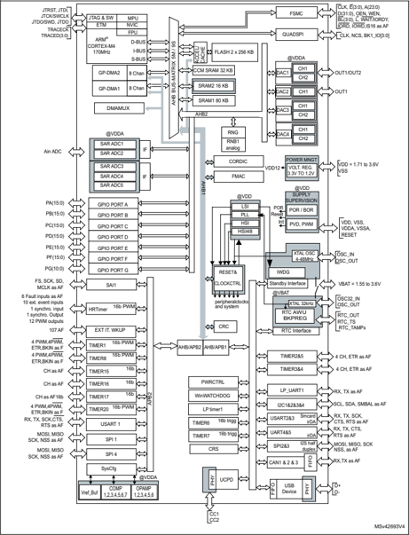

1. AF: alternate function on I/O pins.


48

## 3 Functional overview

## 3.1 Arm ®  Cortex ® -M4 core with FPU

The Arm ®  Cortex ® -M4 with FPU processor is the latest generation of Arm processors for embedded systems. It was developed to provide a low-cost platform that meets the needs of the MCU implementation, with a reduced pin count and with low-power consumption, while delivering outstanding computational performance and an advanced response to interrupts.

The Arm ®  Cortex ® -M4 with FPU 32-bit RISC processor features an exceptional codeefficiency, delivering the expected high-performance from an Arm core in a memory size usually associated with 8-bit and 16-bit devices.

The processor supports a set of DSP instructions which allows an efficient signal processing and a complex algorithm execution. Its single precision FPU speeds up the software development by using metalanguage development tools to avoid saturation.

With its embedded Arm core, the STM32G474xB/xC/xE family is compatible with all Arm tools and software.

Figure 1 shows the general block diagram of the STM32G474xB/xC/xE devices.

## 3.2 Adaptive real-time memory accelerator (ART accelerator)

The ART accelerator is a memory accelerator that is optimized for the STM32 industrystandard Arm ®  Cortex ® -M4 processors. It balances the inherent performance advantage of the Arm ®  Cortex ® -M4 over Flash memory technologies, which normally requires the processor to wait for the Flash memory at higher frequencies.

## 3.3 Memory protection unit

The memory protection unit (MPU) is used to manage the CPU accesses to the memory and to prevent one task to accidentally corrupt the memory or the resources used by any other active task. This memory area is organized into up to 8 protected areas, which can be divided in up into 8 subareas each. The protection area sizes range between 32 bytes and the whole 4 gigabytes of addressable memory.

The MPU is especially helpful for applications where some critical or certified code has to be protected against the misbehavior of other tasks. It is usually managed by an RTOS (realtime operating system). If a program accesses a memory location that is prohibited by the MPU, the RTOS can detect it and take action. In an RTOS environment, the kernel can dynamically update the MPU area setting based on the process to be executed.

The MPU is optional and can be bypassed for applications that do not need it.


## 3.4 Embedded Flash memory

The STM32G474xB/xC/xE devices feature up to 512 Kbytes of embedded Flash memory which is available for storing programs and data.

The Flash interface features:

- -Single or dual bank operating modes
- -Read-while-write (RWW) in dual bank mode

This feature allows to perform a read operation from one bank while an erase or program operation is performed to the other bank. The dual bank boot is also supported.

Flexible protections can be configured thanks to the option bytes:

- Readout protection (RDP) to protect the whole memory. Three levels of protection are available:
- -Level 0: no readout protection
- -Level 1: memory readout protection; the Flash memory cannot be read from or written to if either the debug features are connected or the boot in RAM or bootloader are selected
- -Level 2: chip readout protection; the debug features (Cortex-M4 JTAG and serial wire), the boot in RAM and the bootloader selection are disabled (JTAG fuse). This selection is irreversible.
- Write protection (WRP): the protected area is protected against erasing and programming.
- Proprietary code readout protection (PCROP): a part of the Flash memory can be protected against read and write from third parties. The protected area is execute-only and it can only be reached by the STM32 CPU as an instruction code, while all other accesses (DMA, debug and CPU data read, write and erase) are strictly prohibited. An additional option bit (PCROP\_RDP) allows to select if the PCROP area is erased or not when the RDP protection is changed from Level 1 to Level 0.
- Securable memory area: a part of Flash memory can be configured by option bytes to be securable. After reset this securable memory area is not secured and it behaves like the remainder of main Flash memory (execute, read, write access). When secured, any access to this securable memory area generates corresponding read/write error. Purpose of the Securable memory area is to protect sensitive code and data (secure keys storage) which can be executed only once at boot, and never again unless a new reset occurs.

The Flash memory embeds the error correction code (ECC) feature supporting:

- Single error detection and correction
- Double error detection
- The address of the ECC fail can be read in the ECC register
- 1 Kbyte (128 double word) OTP (one-time programmable) for user data. The OTP area is available in Bank 1 only. The OTP data cannot be erased and can be written only once.


48

## 3.5 Embedded SRAM

STM32G474xB/xC/xE devices feature 128 Kbytes of embedded SRAM. This SRAM is split into three blocks:

- 80 Kbytes mapped at address 0x2000 0000 (SRAM1). The CM4 can access the SRAM1 through the System Bus (or through the I-Code/D-Code buses when boot from SRAM1 is selected or when physical remap is selected by SYSCFG\_MEMRMP register). The first 32 Kbytes of SRAM1 support hardware parity check.
- 16 Kbytes mapped at address 0x2001 4000 (SRAM2). The CM4 can access the SRAM2 through the System bus. SRAM2 can be  retained in standby modes.
- 32 Kbytes mapped at address 0x1000 0000 (CCM SRAM). It is accessed by the CPU through I-Code/D-Code bus for maximum performance. It is also aliased at 0x2001 8000 address to be accessed by all masters (CPU, DMA1, DMA2) through SBUS contiguously to SRAM1 and SRAM2. The CCM SRAM supports hardware parity check and can be write-protected with 1-Kbyte granularity.
- The memory can be accessed in read/write at max CPU clock speed with 0 wait states.


## 3.6 Multi-AHB bus matrix

The 32-bit multi-AHB bus matrix interconnects all the masters (CPU, DMAs) and the slaves (Flash memory, RAM, FSMC, QUADSPI, AHB and APB peripherals). It also ensures a seamless and efficient operation even when several high-speed peripherals work simultaneously.

Figure 2. Multi-AHB bus matrix

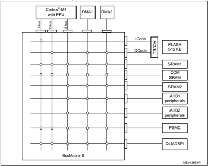

## 3.7 Boot modes

At startup, a BOOT0 pin (or nBOOT0 option bit) and an nBOOT1 option bit are used to select one of three boot options:

- Boot from user Flash
- Boot from system memory
- Boot from embedded SRAM

The BOOT0 value may come from the PB8-BOOT0 pin or from an nBOOT0 option bit depending on the value of a user nBOOT\_SEL option bit to free the GPIO pad if needed.

The boot loader is located in the system memory. It is used to reprogram the Flash memory by using USART, I2C, SPI, and USB through the DFU (device firmware upgrade).


48

## 3.8 CORDIC

The CORDIC provides hardware acceleration of certain mathematical functions, notably trigonometric, commonly used in motor control, metering, signal processing and many other applications.

It speeds up the calculation of these functions compared to a software implementation, allowing a lower operating frequency, or freeing up processor cycles in order to perform other tasks.

## Cordic features

- 24-bit CORDIC rotation engine
- Circular and Hyperbolic modes
- Rotation and Vectoring modes
- Functions: Sine, Cosine, Sinh, Cosh, Atan, Atan2, Atanh, Modulus, Square root, Natural logarithm
- Programmable precision up to 20-bit
- Fast convergence: 4 bits per clock cycle
- Supports 16-bit and 32-bit fixed point input and output formats
- Low latency AHB slave interface
- Results can be read as soon as ready without polling or interrupt
- DMA read and write channels

## 3.9 Filter mathematical accelerator (FMAC)

The filter mathematical accelerator unit performs arithmetic operations on vectors. It comprises a multiplier/accumulator (MAC) unit, together with address generation logic, which allows it to index vector elements held in local memory.

The unit includes support for circular buffers on input and output, which allows digital filters to be implemented. Both finite and infinite impulse response filters can be realized.

The unit allows frequent or lengthy filtering operations to be offloaded from the CPU, freeing up the processor for other tasks. In many cases it can accelerate such calculations compared to a software implementation, resulting in a speed-up of time critical tasks.


## FMAC features

- 16 x 16-bit multiplier
- 24+2-bit accumulator with addition and subtraction
- 16-bit input and output data
- 256 x 16-bit local memory
- Up to three areas can be defined in memory for data buffers (two input, one output), defined by programmable base address pointers and associated size registers
- Input and output sample buffers can be circular
- Buffer 'watermark' feature reduces overhead in interrupt mode
- Filter functions: FIR, IIR (direct form 1)
- AHB slave interface
- DMA read and write data channels

## 3.10 Cyclic redundancy check calculation unit (CRC)

The CRC (cyclic redundancy check) calculation unit is used to get a CRC code using a configurable generator with polynomial value and size.

Among other applications, the CRC-based techniques are used to verify data transmission or storage integrity. In the scope of the EN/IEC 60335-1 standard, they offer a mean to verify the Flash memory integrity.

The CRC calculation unit helps to compute a signature of the software during runtime, which can be ulteriorly compared with a reference signature generated at link-time and which can be stored at a given memory location.

## 3.11 Power supply management

## 3.11.1 Power supply schemes

The STM32G474xB/xC/xE devices require a 1.71 V to 3.6 V V DD  operating voltage supply. Several independent supplies, can be provided for specific peripherals:

- VDD  = 1.71 V to 3.6 V

VDD  is the external power supply for the I/Os, the internal regulator and the system analog such as reset, power management and internal clocks. It is provided externally through the VDD pins.

- VDDA  = 1.62 V  to 3.6 V (see Section 5: Electrical characteristics for the minimum V DDA
- voltage required for ADC, DAC, COMP, OPAMP, VREFBUF operation). VDDA  is the external analog power supply for A/D converters, D/A converters, voltage reference buffer, operational amplifiers and comparators. The V DDA  voltage level is independent from the V DD  voltage and should preferably be connected to V DD  when these peripherals are not used.
- VBAT  = 1.55 V to 3.6 V

VBAT  is the power supply for RTC, external clock 32 kHz oscillator and backup registers (through power switch) when V DD  is not present.

48

- VREF-, VREF+

VREF+  is the input reference voltage for ADCs and DACs. It is also the output of the internal voltage reference buffer when enabled.

When V DDA  &lt; 2 V V REF+  must be equal to V DDA .

When V DDA ≥ 2 V V REF+  must be between 2 V and V DDA .

The internal voltage reference buffer supports three output voltages, which are configured with VRS bits in the VREFBUF\_CSR register:

- -VREF+  = 2.048 V
- -VREF+  = 2.5 V
- -VREF+  = 2.9 V

VREF-  is double bonded with V SSA .

## 3.11.2 Power supply supervisor

The device has an integrated ultra-low-power brown-out reset (BOR) active in all modes (except for Shutdown mode). The BOR ensures proper operation of the device after poweron and during power down. The device remains in reset mode when the monitored supply voltage V DD  is below a specified threshold, without the need for an external reset circuit.

The lowest BOR level is 1.71 V at power on, and other higher thresholds can be selected through option bytes.The device features an embedded programmable voltage detector (PVD) that monitors the V DD  power supply and compares it to the VPVD threshold. An interrupt can be generated when V DD  drops below the VPVD threshold and/or when V DD  is higher than the VPVD threshold. The interrupt service routine can then generate a warning message and/or put the MCU into a safe state. The PVD is enabled by software.

In addition, the device embeds a peripheral voltage monitor which compares the independent supply voltages V DDA , with a fixed threshold in order to ensure that the peripheral is in its functional supply range.

## 3.11.3 Voltage regulator

Two embedded linear voltage regulators, main regulator (MR) and low-power regulator (LPR), supply most of digital circuitry in the device. The MR is used in Run and Sleep modes. The LPR is used in Low-power run, Low-power sleep and Stop modes. In Standby and Shutdown modes, both regulators are powered down and their outputs set in highimpedance state, such as to bring their current consumption close to zero.

The device supports dynamic voltage scaling to optimize its power consumption in Run mode. the voltage from the main regulator that supplies the logic (VCORE) can be adjusted according to the system's maximum operating frequency.

The main regulator (MR) operates in the following ranges:

- Range 1 boost mode with the CPU running at up to 170 MHz.
- Range 1 normal mode with CPU running at up to 150 MHz.
- Range 2 with a maximum CPU frequency of 26 MHz.


## 3.11.4 Low-power modes

By default, the microcontroller is in Run mode after system or power Reset. It is up to the user to select one of the low-power modes described below:

- Sleep mode : In Sleep mode, only the CPU is stopped. All peripherals continue to operate and can wake up the CPU when an interrupt/event occurs.
- Low-power run mode: This mode is achieved with VCORE supplied by the low-power regulator to minimize the regulator's operating current. The code can be executed from SRAM or from Flash, and the CPU frequency is limited to 2 MHz. The peripherals with independent clock can be clocked by HSI16.
- Low-power sleep mode: This mode is entered from the low-power run mode. Only the CPU clock is stopped. When wakeup is triggered by an event or an interrupt, the system reverts to the Low power run mode.
- Stop mode: In Stop mode, the device achieves the lowest power consumption while retaining the SRAM and register contents. All clocks in the VCORE domain are stopped. The PLL, as well as the HSI16 RC oscillator and the HSE crystal oscillator are disabled. The LSE or LSI keep running. The RTC can remain active (Stop mode with RTC, Stop mode without RTC). Some peripherals with wakeup capability can enable the HSI16 RC during Stop mode, so as to get clock for processing the wakeup event.
- Standby mode: The Standby mode is used to achieve the lowest power consumption with brown-out reset, BOR. The internal regulator is switched off to power down the VCORE domain. The PLL, as well as the HSI16 RC oscillator and the HSE crystal oscillator are also powered down. The RTC can remain active (Standby mode with RTC, Standby mode without RTC). The BOR always remains active in Standby mode. For each I/O, the software can determine whether a pull-up, a pull-down or no resistor shall be applied to that I/O during Standby mode. Upon entering Standby mode, SRAM and register contents are lost except for registers in the RTC domain and standby circuitry. The device exits Standby mode upon external reset event (NRST pin), IWDG reset event, wakeup event (WKUP pin, configurable rising or falling edge) or RTC event (alarm, periodic wakeup, timestamp, tamper), or when a failure is detected on LSE (CSS on LSE).
- Shutdown mode: The Shutdown mode allows to achieve the lowest power consumption. The internal regulator is switched off to power down the VCORE domain. The PLL, as well as the HSI16 and LSI RC-oscillators and HSE crystal oscillator are also powered down. The RTC can remain active (Shutdown mode with RTC, Shutdown mode without RTC). The BOR is not available in Shutdown mode. No power voltage monitoring is possible in this mode. Therefore, switching to RTC domain is not supported. SRAM and register contents are lost except for registers in the RTC domain. The device exits Shutdown mode upon external reset event (NRST pin), IWDG reset event, wakeup event (WKUP pin, configurable rising or falling edge) or RTC event (alarm, periodic wakeup, timestamp, tamper).

## 3.11.5 Reset mode

In order to improve the consumption under reset, the I/Os state under and after reset is 'analog state' (the I/O schmitt trigger is disabled). In addition, the internal reset pull-up is deactivated when the reset source is internal.


48

## 3.11.6 VBAT  operation

The V BAT  pin allows to power the device V BAT  domain from an external battery, an external supercapacitor, or from V DD  when there is no external battery and when an external supercapacitor is present. The V BAT  pin supplies the RTC with LSE and the backup registers. Three anti-tamper detection pins are available in V BAT  mode.

The V BAT  operation is automatically activated when V DD  is not present. An internal V BAT battery charging circuit is embedded and can be activated when V DD  is present.

Note: When the microcontroller is supplied from VBAT , neither external interrupts nor RTC alarm/events exit the microcontroller from the VBAT operation.


## 3.12 Interconnect matrix

Several peripherals have direct connections between them. This allows autonomous communication between peripherals, saving CPU resources thus power supply consumption. In addition, these hardware connections allow fast and predictable latency.

Depending on peripherals, these interconnections can operate in Run, Sleep and Stop modes.

Table 3. STM32G474xB/xC/xE peripherals interconnect matrix

| Interconnect source                                       | Interconnect destination     | Interconnect action                                                | Run   | Sleep   | Low-power run   | Low-power sleep   | Stop   |
|-----------------------------------------------------------|------------------------------|--------------------------------------------------------------------|-------|---------|-----------------|-------------------|--------|
| TIMx                                                      | TIMx                         | Timers synchronization or chaining                                 | Y     | Y       | Y               | Y                 | -      |
| TIMx                                                      | ADCx DACx                    | Conversion triggers                                                | Y     | Y       | Y               | Y                 | -      |
| TIMx                                                      | DMA                          | Memory to memory transfer trigger                                  | Y     | Y       | Y               | Y                 | -      |
| TIMx                                                      | COMPx                        | Comparator output blanking                                         | Y     | Y       | Y               | Y                 | -      |
| TIM16/TIM17                                               | IRTIM                        | Infrared interface output generation                               | Y     | Y       | Y               | Y                 | -      |
| COMPx                                                     | TIM1, 8, 20 TIM2, 3, 4, 5    | Timer input channel, trigger, break from analog signals comparison | Y     | Y       | Y               | Y                 | -      |
| COMPx                                                     | LPTIMER1                     | Low-power timer triggered by analog signals comparison             | Y     | Y       | Y               | Y                 | Y      |
| COMPx                                                     | HRTIM                        | COMPx Output is an input event or a fault input for HRTIM          | Y     | Y       | Y               | Y                 | -      |
| ADCx                                                      | TIM1, 8, 20                  | Timer triggered by analog watchdog                                 | Y     | Y       | Y               | Y                 | -      |
| ADCx                                                      | HRTIM                        | HRTIM external event source can be ADCx analog watchdog            | Y     | Y       | Y               | Y                 | -      |
| RTC                                                       | TIM16                        | Timer input channel from RTC events                                | Y     | Y       | Y               | Y                 | -      |
| RTC                                                       | LPTIMER1                     | Low-power timer triggered by RTC alarms or tampers                 | Y     | Y       | Y               | Y                 | Y      |
| All clocks sources (internal and external)                | TIM5, TIM15, 16, 17          | Clock source used as input channel for RC measurement and trimming | Y     | Y       | Y               | Y                 | -      |
| USB                                                       | TIM2                         | Timer triggered by USB SOF                                         | Y     | Y       | -               | -                 | -      |
| CSS RAM (parity error) Flash memory (ECC error) COMPx PVD | TIM1,8, 20 TIM15,16,17 HRTIM | Timer break HRTIM SYSFLT                                           | Y     | Y       | Y               | Y                 | -      |


48

Table 3. STM32G474xB/xC/xE peripherals interconnect matrix (continued)

| Interconnect source   | Interconnect destination    | Interconnect action                           | Run   | Sleep   | Low-power run   | Low-power sleep   | Stop   |
|-----------------------|-----------------------------|-----------------------------------------------|-------|---------|-----------------|-------------------|--------|
| CPU (hard fault)      | TIM1,8,20 TIM15/16/17 HRTIM | Timer break HRTIM SYSFLT                      | Y     | Y       | Y               | Y                 | -      |
| GPIO                  | TIMx                        | External trigger                              | Y     | Y       | Y               | Y                 | -      |
| GPIO                  | LPTIMER1                    | External trigger                              | Y     | Y       | Y               | Y                 | Y      |
| GPIO                  | HRTIM                       | External fault/event/Synchro inputs for HRTIM | Y     | Y       | Y               | Y                 | -      |
| GPIO                  | ADCx DACx                   | Conversion external trigger                   | Y     | Y       | Y               | Y                 | -      |
| HRTIM                 | DACx/ADCx                   | Conversion trigger                            | Y     | Y       | Y               | Y                 | -      |
| HRTIM                 | GPIO                        | Synchro output for HRTIM                      | Y     | Y       | Y               | Y                 | -      |


## 3.13 Clocks and startup

The clock controller distributes the clocks coming from different oscillators to the core and the peripherals. It also manages clock gating for low-power modes and ensures clock robustness. It features:

- Clock prescaler: to get the best trade-off between speed and current consumption, the clock frequency to the CPU and peripherals can be adjusted by a programmable prescaler
- Safe clock switching: clock sources can be changed safely on the fly in run mode through a configuration register.
- Clock management: to reduce power consumption, the clock controller can stop the clock to the core, individual peripherals or memory.
- System clock source: three different sources can deliver SYSCLK system clock:
- -4 - 48 MHz high-speed oscillator with external crystal or ceramic resonator (HSE). It can supply clock to system PLL. The HSE can also be configured in bypass mode for an external clock.
- -16 MHz high-speed internal RC oscillator (HSI16), trimmable by software. It can supply clock to system PLL.
- -System PLL with maximum output frequency of 170 MHz. It can be fed with HSE or HSI16 clocks.
- RC48 with clock recovery system (HSI48): internal HSIRC48 MHz clock source can be used to drive the USB or the RNG peripherals.
- Auxiliary clock source: two ultra-low-power clock sources for the real-time clock (RTC):
- -32.768 kHz low-speed oscillator with external crystal (LSE), supporting four drive capability modes. The LSE can also be configured in bypass mode for using an external clock.
- -32 kHz low-speed internal RC oscillator (LSI) with ±5% accuracy, also used to clock an independent watchdog.
- Peripheral clock sources: several peripherals (I2S, USART, I2C, LPTimer, ADC, SAI, RNG) have their own clock independent of the system clock.
- Clock security system (CSS): in the event of HSE clock failure, the system clock is automatically switched to HSI16 and, if enabled, a software interrupt is generated. LSE clock failure can also be detected and generate an interrupt.
- Clock-out capability:
- -MCO: microcontroller clock output: it outputs one of the internal clocks for external use by the application
- -LSCO: low speed clock output: it outputs LSI or LSE in all low-power modes.

Several prescalers allow to configure the AHB frequency, the High-speed APB (APB2) and the low speed APB (APB1) domains. The maximum frequency of the AHB and the APB domains is 170 MHz.


48

## 3.14 General-purpose inputs/outputs (GPIOs)

Each of the GPIO pins can be configured by software as output (push-pull or open-drain), as input (with or without pull-up or pull-down) or as peripheral alternate function. Most of the GPIO pins are shared with digital or analog alternate functions. Fast I/O toggling can be achieved thanks to their mapping on the AHB2 bus.

The I/Os alternate function configuration can be locked if needed following a specific sequence in order to avoid spurious writing to the I/Os registers.

## 3.15 Direct memory access controller (DMA)

The device embeds 2 DMAs. Refer to Table 4: DMA implementation for the features implementation.

Direct memory access (DMA) is used in order to provide a high-speed data transfer between peripherals and memory as well as from memory to memory. Data can be quickly moved by DMA without any CPU actions. This keeps the CPU resources free for other operations.

The two DMA controllers have 16 channels in total, each one dedicated to manage memory access requests from one or more peripherals. Each controller has an arbiter for handling the priority between DMA requests.

## The DMA supports:

- 16 independently configurable channels (requests)
- -Each channel is connected to a dedicated hardware DMA request, a software trigger is also supported on each channel. This configuration is done by software.
- Priorities between requests from channels of one DMA are both software programmable (4 levels: very high, high, medium, low) or hardware programmable in case of equality (request 1 has priority over request 2, etc.)
- Independent source and destination transfer size (byte, half word, word), emulating packing and unpacking. Source/destination addresses must be aligned on the data size.
- Support for circular buffer management
- 3 event flags (DMA half transfer, DMA transfer complete and DMA transfer error) logically ORed together in a single interrupt request for each channel
- Memory-to-memory transfer
- Peripheral-to-memory, memory-to-peripheral, and peripheral-to-peripheral transfers
- Access to Flash, SRAM, APB and AHB peripherals as source and destination
- Programmable number of data to be transferred: up to 65536.

Table 4. DMA implementation

| DMA features               |   DMA1 |   DMA2 |
|----------------------------|--------|--------|
| Number of regular channels |      8 |      8 |


## 3.16 DMA request router (DMAMUX)

When a peripheral indicates a request for DMA transfer by setting its DMA request line, the DMA request is pending until it is served and the corresponding DMA request line is reset. The DMA request router allows to route the DMA control lines between the peripherals and the DMA controllers of the product.

An embedded multi-channel DMA request generator can be considered as one of such peripherals. The routing function is ensured by a multi-channel DMA request line multiplexer. Each channel selects a unique set of DMA control lines, unconditionally or synchronously with events on synchronization inputs.

For simplicity, the functional description is limited to DMA request lines. The other DMA control lines are not shown in figures or described in the text. The DMA request generator produces DMA requests following events on DMA request trigger inputs.

## 3.17 Interrupts and events

## 3.17.1 Nested vectored interrupt controller (NVIC)

The STM32G474xB/xC/xE devices embed a nested vectored interrupt controller which is able to manage 16 priority levels, and to handle up to 102 maskable interrupt channels plus the 16 interrupt lines of the Cortex ® -M4.

The NVIC benefits are the following:

- Closely coupled NVIC gives low latency interrupt processing
- Interrupt entry vector table address passed directly to the core
- Allows early processing of interrupts
- Processing of late arriving higher priority interrupts
- Support for tail chaining
- Processor state automatically saved
- Interrupt entry restored on interrupt exit with no instruction overhead

The NVIC hardware block provides flexible interrupt management features with minimal interrupt latency.

## 3.17.2 Extended interrupt/event controller (EXTI)

The extended interrupt/event controller consists of 44 edge detector lines used to generate interrupt/event requests and to wake-up the system from the Stop mode. Each external line can be independently configured to select the trigger event (rising edge, falling edge, both) and can be masked independently.

A pending register maintains the status of the interrupt requests. The internal lines are connected to peripherals with wakeup from Stop mode capability. The EXTI can detect an external line with a pulse width shorter than the internal clock period. Up to 107 GPIOs can be connected to the 16 external interrupt lines.


48

## 3.18 Analog-to-digital converter (ADC)

The device embeds five successive approximation analog-to-digital converters with the following features:

- 12-bit native resolution, with built-in calibration
- 4 Msps maximum conversion rate with full resolution
- -Down to 41.67 ns sampling time
- -Increased conversion rate for lower resolution (up to 6.66 Msps for 6-bit resolution)
- One external reference pin is available on all packages, allowing the input voltage range to be independent from the power supply
- Single-ended and differential mode inputs
- Low-power design
- -Capable of low-current operation at low conversion rate (consumption decreases linearly with speed)
- -Dual clock domain architecture: ADC speed independent from CPU frequency
- Highly versatile digital interface
- -Single-shot or continuous/discontinuous sequencer-based scan mode: 2 groups of analog signals conversions can be programmed to differentiate background and high-priority real-time conversions
- -Each ADC support multiple trigger inputs for synchronization with on-chip timers and external signals
- -Results stored into a data register or in RAM with DMA controller support
- -Data pre-processing: left/right alignment and per channel offset compensation
- -Built-in oversampling unit for enhanced SNR
- -Channel-wise programmable sampling time
- -Analog watchdog for automatic voltage monitoring, generating interrupts and trigger for selected timers
- -Hardware assistant to prepare the context of the injected channels to allow fast context switching
- -Flexible sample time control
- -Hardware gain and offset compensation

## 3.18.1 Temperature sensor

The temperature sensor (TS) generates a voltage V TS  that varies linearly with temperature. The temperature sensor is internally connected to the ADCs input channels which is used to convert the sensor output voltage into a digital value.

The sensor provides good linearity but it has to be calibrated to obtain good overall accuracy of the temperature measurement. As the offset of the temperature sensor varies from chip to chip due to process variation, the uncalibrated internal temperature sensor is suitable for applications that detect temperature changes only.

To improve the accuracy of the temperature sensor measurement, each device is individually factory-calibrated by ST. The temperature sensor factory calibration data are stored by ST in the system memory area, accessible in read-only mode.


Table 5. Temperature sensor calibration values

| Calibration value name   | Description                                                                                    | Memory address            |
|--------------------------|------------------------------------------------------------------------------------------------|---------------------------|
| TS_CAL1                  | TS ADC raw data acquired at a temperature of 30 °C (± 5 °C), V DDA = V REF+ = 3.0 V (± 10 mV)  | 0x1FFF 75A8 - 0x1FFF 75A9 |
| TS_CAL2                  | TS ADC raw data acquired at a temperature of 130 °C (± 5 °C), V DDA = V REF+ = 3.0 V (± 10 mV) | 0x1FFF 75CA - 0x1FFF 75CB |

## 3.18.2 Internal voltage reference (V REFINT )

The internal voltage reference (VREFINT) provides a stable (bandgap) voltage output for the ADC and the comparators. The VREFINT is internally connected to the ADCx\_IN18, x = 1,3,4,5 input channel. The precise voltage of VREFINT is individually measured for each part by ST during production test and stored in the system memory area. It is accessible in read-only mode.

Table 6. Internal voltage reference calibration values

| Calibration value name   | Description                                                                            | Memory address            |
|--------------------------|----------------------------------------------------------------------------------------|---------------------------|
| VREFINT                  | Raw data acquired at a temperature of 30 °C (± 5 °C), V DDA = V REF+ = 3.0 V (± 10 mV) | 0x1FFF 75AA - 0x1FFF 75AB |

## 3.18.3 VBAT battery voltage monitoring

This embedded hardware enables the application to measure the V BAT  battery voltage using the internal ADC1\_IN17 channel. As the V BAT  voltage may be higher than the V DDA , and thus outside the ADC input range, the VBAT pin is internally connected to a bridge divider by 3. As a consequence, the converted digital value is one third of the V BAT  voltage.

## 3.18.4 Operational amplifier internal output (OPAMPxINT):

The OPAMPx (x = 1...6) output OPAMPxINT can be sampled using an ADCx (x = 1...5) internal input channel. In this case, the I/O on which the OPAMPx output is mapped can be used as GPIO.

## 3.19 Digital to analog converter (DAC)

Seven 12 bit DAC channels (3 external buffered and 4 internal unbuffered) can be used to convert digital signals into analog voltage signal outputs. The chosen design structure is composed of integrated resistor strings and an amplifier in inverting configuration.


48

This digital interface supports the following features:

- Up to two DAC output channels
- 8-bit or 12-bit output mode
- Buffer offset calibration (factory and user trimming)
- Left or right data alignment in 12-bit mode
- Synchronized update capability
- Noise-wave generation
- Triangular-wave generation
- Saw tooth wave generation
- Dual DAC channel independent or simultaneous conversions
- DMA capability for each channel
- External triggers for conversion
- Sample and hold low-power mode, with internal or external capacitor
- Up to 1 Msps for external output and 15 Msps for internal output

The DAC channels are triggered through the timer update outputs that are also connected to different DMA channels.

## 3.20 Voltage reference buffer (V REFBUF )

The STM32G474xB/xC/xE devices embed a voltage reference buffer which can be used as voltage reference for ADC, DACs and also as voltage reference for external components through the VREF+ pin.

The internal voltage reference buffer supports three voltages:

- 2.048 V
- 2.5 V
- 2.9 V

An external voltage reference can be provided through the VREF+ pin when the internal voltage reference buffer is off.

The VREF+ pin is double-bonded with V DDA  on some packages. In these packages the internal voltage reference buffer is not available.

Figure 3. Voltage reference buffer

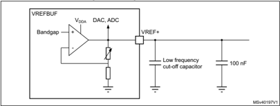


## 3.21 Comparators (COMP)

The STM32G474xB/xC/xE devices embed seven rail-to-rail comparators with programmable reference voltage (internal or external), hysteresis.

The reference voltage can be one of the following:

- External I/O
- DAC output channels
- Internal reference voltage or submultiple (1/4, 1/2, 3/4).

All comparators can wake up from Stop mode, generate interrupts and breaks for the timers.

## 3.22 Operational amplifier (OPAMP)

The STM32G474xB/xC/xE devices embed six operational amplifiers with external or internal follower routing and PGA capability.

The operational amplifier features:

- 13 MHz bandwidth
- Rail-to-rail input/output
- PGA with a non-inverting gain ranging of 2, 4, 8, 16, 32 or 64 or inverting gain ranging of -1, -3, -7, -15, -31 or -63

## 3.23 Random number generator (RNG)

All devices embed an RNG that delivers 32-bit random numbers generated by an integrated analog circuit.

## 3.24 Timers and watchdogs

The STM32G474xB/xC/xE devices include One High Resolution time, three advanced motor control timers, up to nine general-purpose timers, two basic timers, one low-power timer, two watchdog timers and a SysTick timer. The table below compares the features of the advanced motor control, general purpose and basic timers.

Table 7. Timer feature comparison

| Timer type             | Timer             | Counter resolution   | Counter type      | Prescaler factor                      | DMA request generation   |   Capture/ compare channels | Complementary outputs   |
|------------------------|-------------------|----------------------|-------------------|---------------------------------------|--------------------------|-----------------------------|-------------------------|
| High resolution timer  | HRTIM             | 16-bit               | Up                | /1 /2 /4 (x2 x4 x8 x16 x32, with DLL) | Yes                      |                          12 | Yes                     |
| Advanced motor control | TIM1, TIM8, TIM20 | 16-bit               | Up, down, Up/down | Any integer between 1 and 65536       | Yes                      |                           4 | 4                       |
| General- purpose       | TIM2, TIM5        | 32-bit               | Up, down, Up/down | Any integer between 1 and 65536       | Yes                      |                           4 | No                      |


48

Table 7. Timer feature comparison (continued)

| Timer type       | Timer        | Counter resolution   | Counter type      | Prescaler factor                | DMA request generation   |   Capture/ compare channels | Complementary outputs   |
|------------------|--------------|----------------------|-------------------|---------------------------------|--------------------------|-----------------------------|-------------------------|
| General- purpose | TIM3, TIM4   | 16-bit               | Up, down, Up/down | Any integer between 1 and 65536 | Yes                      |                           4 | No                      |
| General- purpose | TIM15        | 16-bit               | Up                | Any integer between 1 and 65536 | Yes                      |                           2 | 1                       |
| General- purpose | TIM16, TIM17 | 16-bit               | Up                | Any integer between 1 and 65536 | Yes                      |                           1 | 1                       |
| Basic            | TIM6, TIM7   | 16-bit               | Up                | Any integer between 1 and 65536 | Yes                      |                           0 | No                      |

## 3.24.1 High-resolution timer (HRTIM)

The high-resolution timer (HRTIM) allows generating digital signals with high-accuracy timings, such as PWM or phase-shifted pulses.

It consists of 7 timers, 1 master and 6 slaves, totaling 12 high-resolution outputs, which can be coupled by pairs for deadtime insertion. It also features 6 fault inputs for protection purposes and 10 inputs to handle external events such as current limitation, zero voltage or zero current switching.

HRTIM timer is made of a digital kernel clocked at 170 MHz followed by delay lines. Delay lines with closed loop control guarantee a 184 ps resolution whatever the voltage, temperature or chip-to-chip manufacturing process deviation. The high-resolution is available on the 12 outputs in all operating modes: variable duty cycle, variable frequency, and constant ON time.

The slave timers can be combined to control multiswitch complex converters or operate independently to manage multiple independent converters.

The waveforms are defined by a combination of user-defined timings and external events such as analog or digital feedbacks signals.

HRTIM timer includes options for blanking and filtering out spurious events or faults. It also offers specific modes and features to offload the CPU: DMA requests, burst mode controller, push-pull and resonant mode.

It supports many topologies including LLC, Full bridge phase shifted, buck or boost converters, either in voltage or current mode, as well as lighting application (fluorescent or LED). It can also be used as a general purpose timer, for instance to achieve high-resolution PWM-emulated DAC.

In debug mode, the HRTIM counters can be frozen and the PWM outputs enter safe state.

## 3.24.2 Advanced motor control timer (TIM1, TIM8, TIM20)

The advanced motor control timers can each be seen as a four-phase PWM multiplexed on 8 channels. They have complementary PWM outputs with programmable inserted dead-times. They can also be seen as complete general-purpose timers.


The 4 independent channels can be used for:

- Input capture
- Output compare
- PWM generation (edge or center-aligned modes) with full modulation capability (0-100%)
- One-pulse mode output

In debug mode, the advanced motor control timer counter can be frozen and the PWM outputs disabled in order to turn off any power switches driven by these outputs.

Many features are shared with the general-purpose TIMx timers (described in Section 3.24.3 ) using the same architecture, so the advanced motor control timers can work together with the TIMx timers via the Timer Link feature for synchronization or event chaining.

## 3.24.3 General-purpose timers (TIM2, TIM3, TIM4, TIM5, TIM15, TIM16, TIM17)

There are up to seven synchronizable general-purpose timers embedded in the STM32G474xB/xC/xE devices (see Table 7 for differences). Each general-purpose timer can be used to generate PWM outputs, or act as a simple time base.

- TIM2, TIM3, TIM4 and TIM5

They are full-featured general-purpose timers:

- -TIM2 and TIM5 have a 32-bit auto-reload up/downcounter and 32-bit prescaler
- -TIM3 and TIM4 have 16-bit auto-reload up/downcounter and 16-bit prescaler.

These timers feature 4 independent channels for input capture/output compare, PWM or one-pulse mode output. They can work together, or with the other general-purpose timers via the Timer Link feature for synchronization or event chaining.

The counters can be frozen in debug mode.

All have independent DMA request generation and support quadrature encoders.

- TIM15, 16 and 17

They are general-purpose timers with mid-range features:

They have 16-bit auto-reload upcounters and 16-bit prescalers.

- -TIM15 has 2 channels and 1 complementary channel
- -TIM16 and TIM17 have 1 channel and 1 complementary channel

All channels can be used for input capture/output compare, PWM or one-pulse mode output.

The timers can work together via the Timer Link feature for synchronization or event chaining. The timers have independent DMA request generation.

The counters can be frozen in debug mode.

## 3.24.4 Basic timers (TIM6 and TIM7)

The basic timers are mainly used for DAC trigger generation. They can also be used as generic 16-bit timebases.


48

## 3.24.5 Low-power timer (LPTIM1)

The devices embed a low-power timer. This timer has an independent clock and are running in Stop mode if it is clocked by LSE, LSI or an external clock. It is able to wakeup the system from Stop mode.

LPTIM1 is active in Stop mode.

This low-power timer supports the following features:

- 16-bit up counter with 16-bit autoreload register
- 16-bit compare register
- Configurable output: pulse, PWM
- Continuous/ one shot mode
- Selectable software/hardware input trigger
- Selectable clock source
- -Internal clock sources: LSE, LSI, HSI16 or APB clock
- -External clock source over LPTIM input (working even with no internal clock source running, used by pulse counter application).
- Programmable digital glitch filter
- Encoder mode

## 3.24.6 Independent watchdog (IWDG)

The independent watchdog is based on a 12-bit downcounter and an 8-bit prescaler. It is clocked from an independent 32 kHz internal RC (LSI) and as it operates independently from the main clock, it can operate in Stop and Standby modes. It can be used either as a watchdog to reset the device when a problem occurs, or as a free running timer for application timeout management. It is hardware or software configurable through the option bytes. The counter can be frozen in debug mode.

## 3.24.7 System window watchdog (WWDG)

The window watchdog is based on a 7-bit downcounter that can be set as free running. It can be used as a watchdog to reset the device when a problem occurs. It is clocked from the main clock. It has an early warning interrupt capability and the counter can be frozen in debug mode.

## 3.24.8 SysTick timer

This timer is dedicated to real-time operating systems, but could also be used as a standard down counter. It features:

- A 24-bit down counter
- Autoreload capability
- Maskable system interrupt generation when the counter reaches 0.
- Programmable clock source


## 3.25 Real-time clock (RTC) and backup registers

The RTC supports the following features:

- Calendar with subsecond, seconds, minutes, hours (12 or 24 format), week day, date, month, year, in BCD (binary-coded decimal) format.
- Automatic correction for 28, 29 (leap year), 30, and 31 days of the month.
- Two programmable alarms.
- On-the-fly correction from 1 to 32767 RTC clock pulses. This can be used to synchronize it with a master clock.
- Reference clock detection: a more precise second source clock (50 or 60 Hz) can be used to enhance the calendar precision.
- Digital calibration circuit with 0.95 ppm resolution, to compensate for quartz crystal inaccuracy.
- Timestamp feature which can be used to save the calendar content. This function can be triggered by an event on the timestamp pin, or by a tamper event, or by a switch to VBAT  mode.
- 17-bit auto-reload wakeup timer (WUT) for periodic events with programmable resolution and period.

The RTC is supplied through a switch that takes power either from the V DD  supply when present or from the VBAT pin.

The RTC clock sources can be:

- A 32.768 kHz external crystal (LSE)
- An external resonator or oscillator (LSE)
- The internal low power RC oscillator (LSI, with typical frequency of 32 kHz)
- The high-speed external clock (HSE) divided by 32.

The RTC is functional in V BAT  mode and in all low-power modes when it is clocked by the LSE. When clocked by the LSI, the RTC is not functional in V BAT  mode, but is functional in all low-power modes except Shutdown mode.

All RTC events (Alarm, WakeUp Timer, Timestamp) can generate an interrupt and wakeup the device from the low-power modes.

## 3.26 Tamper and backup registers (TAMP)

- 32 32-bit backup registers, retained in all low-power modes and also in V BAT  mode. They can be used to store sensitive data as their content is protected by an tamper detection circuit. They are not reset by a system or power reset, or when the device wakes up from Standby or Shutdown mode.
- Up to three tamper pins for external tamper detection events. The external tamper pins can be configured for edge detection, edge and level, level detection with filtering.
- Five internal tampers events.
- Any tamper detection can generate a RTC timestamp event.
- Any tamper detection erases the backup registers.
- Any tamper detection can generate an interrupt and wake-up the device from all lowpower modes.


48

## 3.27 Infrared transmitter

The STM32G474xB/xC/xE devices provide an infrared transmitter solution. The solution is based on internal connections between TIM16 and TIM17 as shown in the figure below.

TIM17 is used to provide the carrier frequency and TIM16 provides the main signal to be sent. The infrared output signal is available on PB9 or PA13.

To generate the infrared remote control signals, TIM16 channel 1 and TIM17 channel 1 must be properly configured to generate correct waveforms. All standard IR pulse modulation modes can be obtained by programming the two timers output compare channels.

Figure 4. Infrared transmitter

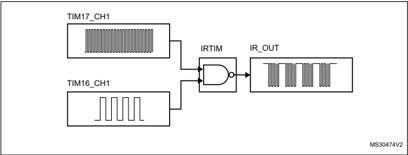


## 3.28 Inter-integrated circuit interface (I 2 C)

The device embeds four I2Cs. Refer to Table 8: I2C implementation for the features implementation.

The I 2 C bus interface handles communications between the microcontroller and the serial I 2 C bus. It controls all I 2 C bus-specific sequencing, protocol, arbitration and timing.

## The I2C peripheral supports:

- I 2 C-bus specification and user manual rev. 5 compatibility:
- -Slave and master modes, multimaster capability
- -Standard-mode (Sm), with a bitrate up to 100 kbit/s
- -Fast-mode (Fm), with a bitrate up to 400 kbit/s
- -Fast-mode Plus (Fm+), with a bitrate up to 1 Mbit/s and 20 mA output drive I/Os
- -7-bit and 10-bit addressing mode, multiple 7-bit slave addresses
- -Programmable setup and hold times
- -Optional clock stretching
- System management bus (SMBus) specification rev 2.0 compatibility:
- -Hardware PEC (packet error checking) generation and verification with ACK control
- -Address resolution protocol (ARP) support
- -SMBus alert
- Power system management protocol (PMBus TM ) specification rev 1.1 compatibility
- Independent clock: a choice of independent clock sources allowing the I2C communication speed to be independent from the PCLK reprogramming.
- Wakeup from Stop mode on address match
- Programmable analog and digital noise filters
- 1-byte buffer with DMA capability

Table 8. I2C implementation

| I2C features (1)                                            | I2C1   | I2C2   | I2C3   | I2C4   |
|-------------------------------------------------------------|--------|--------|--------|--------|
| Standard-mode (up to 100 kbit/s)                            | X      | X      | X      | X      |
| Fast-mode (up to 400 kbit/s)                                | X      | X      | X      | X      |
| Fast-mode Plus with 20mA output drive I/Os (up to 1 Mbit/s) | X      | X      | X      | X      |
| Programmable analog and digital noise filters               | X      | X      | X      | X      |
| SMBus/PMBus hardware support                                | X      | X      | X      | X      |
| Independent clock                                           | X      | X      | X      | X      |
| Wakeup from Stop mode on address match                      | X      | X      | X      | X      |


48

## 3.29 Universal synchronous/asynchronous receiver transmitter (USART)

The STM32G474xB/xC/xE devices have three embedded universal synchronous receiver transmitters (USART1, USART2 and USART3) and two universal asynchronous receiver transmitters (UART4, USART5).

These interfaces provide asynchronous communication, IrDA SIR ENDEC support, multiprocessor communication mode, single-wire half-duplex communication mode and have LIN master/slave capability. They provide hardware management of the CTS and RTS signals, and RS485 driver enable.

The USART1, USART2 and USART3 also provide a Smartcard mode (ISO 7816 compliant) and an SPI-like communication capability.

The USART comes with a Transmit FIFO (TXFIFO) and a Receive FIFO (RXFIFO). FIFO mode is enabled by software and is disabled by default.

All USART have a clock domain independent from the CPU clock, allowing the U(S)ARTx (x=1,2,3,4,5) to wake up the MCU from Stop mode. The wakeup from Stop mode can be done on:

- Start bit detection
- Any received data frame
- A specific programmed data frame
- Some specific TXFIFO/RXFIFO status interrupts when FIFO mode is enabled

All USART interfaces can be served by the DMA controller.

Table 9. USART/UART/LPUART features

| USART modes/features (1)              | USART1          | USART2          | USART3          | UART4           | UART5           | LPUART1         |
|---------------------------------------|-----------------|-----------------|-----------------|-----------------|-----------------|-----------------|
| Hardware flow control for modem       | X               | X               | X               | X               | X               | X               |
| Continuous communication using DMA    | X               | X               | X               | X               | X               | X               |
| Multiprocessor communication          | X               | X               | X               | X               | X               | X               |
| Synchronous mode                      | X               | X               | X               | -               | -               | -               |
| Smartcard mode                        | X               | X               | X               | -               | -               | -               |
| Single-wire half-duplex communication | X               | X               | X               | X               | X               | X               |
| IrDA SIR ENDEC block                  | X               | X               | X               | X               | X               | -               |
| LIN mode                              | X               | X               | X               | X               | X               | -               |
| Dual clock domain                     | X               | X               | X               | X               | X               | X               |
| Wakeup from Stop mode                 | X               | X               | X               | X               | X               | X               |
| Receiver timeout interrupt            | X               | X               | X               | X               | X               | -               |
| Modbus communication                  | X               | X               | X               | X               | X               | -               |
| Auto baud rate detection              | X (4 modes)     | X (4 modes)     | X (4 modes)     | X (4 modes)     | X (4 modes)     | -               |
| Driver Enable                         | X               | X               | X               | X               | X               | X               |
| LPUART/USART data length              | 7, 8 and 9 bits | 7, 8 and 9 bits | 7, 8 and 9 bits | 7, 8 and 9 bits | 7, 8 and 9 bits | 7, 8 and 9 bits |


Table 9. USART/UART/LPUART features (continued)

| USART modes/features (1)   | USART1   | USART2   | USART3   | UART4   | UART5   | LPUART1   |
|----------------------------|----------|----------|----------|---------|---------|-----------|
| Tx/Rx FIFO                 | X        | X        | X        | X       | X       | X         |
| Tx/Rx FIFO size            | 8        | 8        | 8        | 8       | 8       | 8         |

## 3.30 Low-power universal asynchronous receiver transmitter (LPUART)

The STM32G474xB/xC/xE devices embed one Low-Power UART. The LPUART supports asynchronous serial communication with minimum power consumption. It supports halfduplex single-wire communication and modem operations (CTS/RTS). It allows multiprocessor communication.

The LPUART comes with a Transmit FIFO (TXFIFO) and a Receive FIFO (RXFIFO). FIFO mode is enabled by software and is disabled by default. It has a clock domain independent from the CPU clock, and can wakeup the system from Stop mode. The wake up from Stop mode can be done on:

- Start bit detection
- Any received data frame
- A specific programmed data frame
- Some specific TXFIFO/RXFIFO status interrupts when FIFO mode is enabled

Only a 32.768 kHz clock (LSE) is needed to allow LPUART communication up to 9600 baud. Therefore, even in Stop mode, the LPUART can wait for an incoming frame while having an extremely low energy consumption. Higher speed clock can be used to reach higher baudrates.

The LPUART interface can be served by the DMA controller.

## 3.31 Serial peripheral interface (SPI)

Four SPI interfaces allow communication up to 75 Mbits/s in master and up to 41 Mbits/s in slave, half-duplex, full-duplex and simplex modes. The 3-bit prescaler gives 8 master mode frequencies and the frame size is configurable from 4 bits to 16 bits. The SPI interfaces support NSS pulse mode, TI mode and hardware CRC calculation.

Two standard I 2 S interfaces (multiplexed with SPI2 and SPI3) supporting four different audio standards can operate as master or slave at half-duplex communication modes. They can be configured to transfer 16 and 24 or 32 bits with 16-bit or 32-bit data resolution and synchronized by a specific signal. Audio sampling frequency from 8 kHz up to 192 kHz can be set by 8-bit programmable linear prescaler. When operating in master mode it can output a clock for an external audio component at 256 times the sampling frequency.

All SPI interfaces can be served by the DMA controller.

48

## 3.32 Serial audio interfaces (SAI)

The device embeds 1 SAI. The SAI bus interface handles communications between the microcontroller and the serial audio protocol.

## SAI peripheral supports:

- Two independent audio sub-blocks which can be transmitters or receivers with their respective FIFO.
- 8-word integrated FIFOs for each audio sub-block.
- Synchronous or asynchronous mode between the audio sub-blocks.
- Master or slave configuration independent for both audio sub-blocks.
- Clock generator for each audio block to target independent audio frequency sampling when both audio sub-blocks are configured in master mode.
- Data size configurable: 8-, 10-, 16-, 20-, 24-, 32-bit.
- Peripheral with large configurability and flexibility allowing to target as example the following audio protocol: I2S, LSB or MSB-justified, PCM/DSP, TDM, AC'97 and SPDIF out.
- Up to 16 slots available with configurable size and with the possibility to select which ones are active in the audio frame.
- Number of bits by frame may be configurable.
- Frame synchronization active level configurable (offset, bit length, level).
- First active bit position in the slot is configurable.
- LSB first or MSB first for data transfer.
- Mute mode.
- Stereo/Mono audio frame capability.
- Communication clock strobing edge configurable (SCK).
- Error flags with associated interrupts if enabled respectively.
- -Overrun and underrun detection.
- -Anticipated frame synchronization signal detection in slave mode.
- -Late frame synchronization signal detection in slave mode.
- -Codec not ready for the AC'97 mode in reception.
- Interruption sources when enabled:
- -Errors.
- -FIFO requests.
- DMA interface with 2 dedicated channels to handle access to the dedicated integrated FIFO of each SAI audio sub-block.

Table 10. SAI features implementation

| SAI features                                   | Support (1)   |
|------------------------------------------------|---------------|
| I2S, LSB or MSB-justified, PCM/DSP, TDM, AC'97 | X             |
| Mute mode                                      | X             |
| Stereo/Mono audio frame capability             | X             |
| 16 slots                                       | X             |


Table 10. SAI features implementation (continued)

| SAI features                                           | Support (1)   |
|--------------------------------------------------------|---------------|
| Data size configurable: 8-, 10-, 16-, 20-, 24-, 32-bit | X             |
| FIFO size                                              | X (8 word)    |
| SPDIF                                                  | X             |

## 3.33 Controller area network (FDCAN1, FDCAN2, FDCAN3)

The controller area network (CAN) subsystem consists of three CAN modules and a shared message RAM memory.

The three CAN modules (FDCAN1, FDCAN2 and FDCAN3) are compliant with ISO 11898-1 (CAN protocol specification version 2.0 part A, B) and CAN FD protocol specification version 1.0.

A 3-Kbyte message RAM memory implements filters, receive FIFOs, receive buffers, transmit event FIFOs, transmit buffers. This message RAM is shared between the three FDCAN modules.

## 3.34 Universal serial bus (USB)

The STM32G474xB/xC/xE devices embed a full-speed USB device peripheral compliant with the USB specification version 2.0. The internal USB PHY supports USB FS signaling, embedded DP pull-up and also battery charging detection according to Battery Charging Specification Revision 1.2. The USB interface implements a full-speed (12 Mbit/s) function interface with added support for USB 2.0 Link Power Management. It has softwareconfigurable endpoint setting with packet memory up-to 1 Kbyte and suspend/resume support. It requires a precise 48 MHz clock which can be generated from the internal main PLL (the clock source must use a HSE crystal oscillator) or by the internal 48 MHz oscillator in automatic trimming mode. The synchronization for this oscillator can be taken from the USB data stream itself (SOF signalization) which allows crystal less operation.

## 3.35 USB Type-C™ / USB Power Delivery controller (UCPD)

The device embeds one controller (UCPD) compliant with USB Type-C Rev. 1.2 and USB Power Delivery Rev. 3.0 specifications.

The controller uses specific I/Os supporting the USB Type-C and USB Power Delivery requirements, featuring:

- USB Type-C pull-up (Rp, all values) and pull-down (Rd) resistors
- 'Dead battery' support
- USB Power Delivery message transmission and reception
- FRS (fast role swap) support

48

The digital controller handles notably:

- USB Type-C level detection with de-bounce, generating interrupts
- FRS detection, generating an interrupt
- Byte-level interface for USB Power Delivery payload, generating interrupts (DMA compatible)
- USB Power Delivery timing dividers (including a clock pre-scaler)
- CRC generation/checking
- 4b5b encode/decode
- Ordered sets (with a programmable ordered set mask at receive)
- Frequency recovery in receiver during preamble

The interface offers low-power operation compatible with Stop mode, maintaining the capacity to detect incoming USB Power Delivery messages and FRS signaling.

## 3.36 Clock recovery system (CRS)

The devices embed a special block which allows automatic trimming of the internal 48 MHz oscillator to guarantee its optimal accuracy over the whole device operational range. This automatic trimming is based on the external synchronization signal, which could be either derived from USB SOF signalization, from LSE oscillator, from an external signal on CRS\_SYNC pin or generated by user software. For faster lock-in during startup it is also possible to combine automatic trimming with manual trimming action.

## 3.37 Flexible static memory controller (FSMC)

The Flexible static memory controller (FSMC) includes two memory controllers:

- The NOR/PSRAM memory controller
- The NAND/memory controller

This memory controller is also named Flexible memory controller (FMC).

The main features of the FMC controller are the following:

- Interface with static-memory mapped devices including:
- -Static random access memory (SRAM)
- -NOR Flash memory/OneNAND Flash memory
- -PSRAM (4 memory banks)
- -NAND Flash memory with ECC hardware to check up to 8 Kbytes of data
- -Ferroelectric RAM (FRAM)
- 8-,16- bit data bus width
- Independent Chip Select control for each memory bank
- Independent configuration for each memory bank
- Write FIFO
- The Maximum FMC\_CLK frequency for synchronous accesses is HCLK/2.


## LCD parallel interface

The FMC can be configured to interface seamlessly with most graphic LCD controllers. It supports the Intel 8080 and Motorola 6800 modes, and is flexible enough to adapt to specific LCD interfaces. This LCD parallel interface capability makes it easy to build cost effective graphic applications using LCD modules with embedded controllers or high performance solutions using external controllers with dedicated acceleration.

## 3.38 Quad-SPI memory interface (QUADSPI)

The Quad-SPI is a specialized communication interface targeting single, dual or quad SPI Flash memories. It can operate in any of the three following modes:

- Indirect mode: all the operations are performed using the QUADSPI registers
- Status polling mode: the external Flash status register is periodically read and an interrupt can be generated in case of flag setting
- Memory-mapped mode: the external Flash is memory mapped and is seen by the system as if it were an internal memory.

Both throughput and capacity can be increased two-fold using dual-flash mode, where two quad SPI Flash memories are accessed simultaneously.

The Quad-SPI interface supports:

- Indirect mode: all the operations are performed using the QUADSPI registers
- Status polling mode: the external Flash status register is periodically read and an interrupt can be generated in case of flag setting
- Memory-mapped mode: the external Flash is memory mapped and is seen by the system as if it were an internal memory
- Three functional modes: indirect, status-polling, and memory-mapped
- SDR and DDR support
- Fully programmable opcode for both indirect and memory mapped mode
- Fully programmable frame format for both indirect and memory mapped mode
- -Each of the 5 following phases can be configured independently (enable, length, single/dual/quad communication)
- -Instruction phase
- -Address phase
- -Alternate bytes phase
- -Dummy cycles phase
- -Data phase
- Integrated FIFO for reception and transmission
- 8, 16, and 32-bit data accesses are allowed
- DMA channel for indirect mode operations
- Programmable masking for external Flash flag management
- Timeout management
- Interrupt generation on FIFO threshold, timeout, status match, operation complete, and access error

48

## 3.39 Development support

## 3.39.1 Serial wire JTAG debug port (SWJ-DP)

The Arm SWJ-DP interface is embedded, and is a combined JTAG and serial wire debug port that enables either a serial wire debug or a JTAG probe to be connected to the target.

Debug is performed using 2 pins only instead of 5 required by the JTAG (JTAG pins could be re-use as GPIO with alternate function): the JTAG TMS and TCK pins are shared with SWDIO and SWCLK, respectively, and a specific sequence on the TMS pin is used to switch between JTAG-DP and SW-DP.

## 3.39.2 Embedded trace macrocell™

The Arm embedded trace macrocell provides a greater visibility of the instruction and data flow inside the CPU core by streaming compressed data at a very high rate from the STM32G474xB/xC/xE devices through a small number of ETM pins to an external hardware trace port analyzer (TPA) device. Real-time instruction and data flow activity be recorded and then formatted for display on the host computer that runs the debugger software. TPA hardware is commercially available from common development tool vendors.

The Embedded trace macrocell operates with third party debugger software tools.


## 4 Pinouts and pin description

## 4.1 UFQFPN48 pinout description

Figure 5. STM32G474xB/xC/xE UFQFPN48 pinout

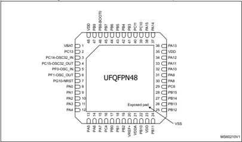

1. The above figure shows the package top view.
2. VSS pads are connected to the exposed pad.


79

## 4.2 LQFP48 pinout description

Figure 6. STM32G474xB/xC/xE LQFP48 pinout

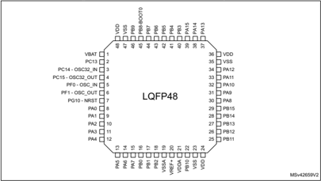

## 4.3 LQFP64 pinout description

Figure 7. STM32G474xB/xC/xE LQFP64 pinout

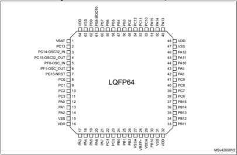


## 4.4 LQFP80 pinout description

Figure 8. STM32G474xB/xC/xE LQFP80 pinout

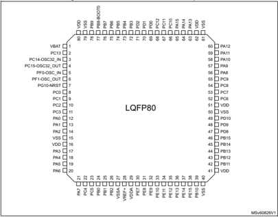


79

## 4.5 LQFP100 pinout description

Figure 9. STM32G474xB/xC/xE LQFP100 pinout

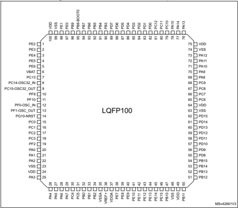


## 4.6 LQFP128 pinout description

Figure 10. STM32G474xB/xC/xE LQFP128 pinout

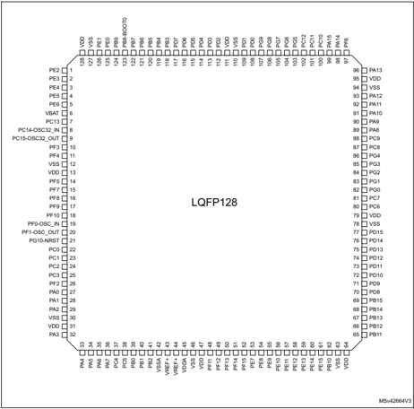


79

## 4.7 WLCSP81 pinout description

Figure 11. STM32G474xB/xC/xE WLCSP81 pinout

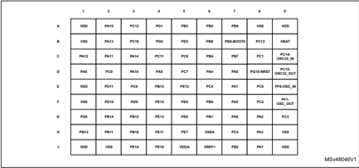

## 4.8 TFBGA100 pinout description

Figure 12. STM32G474xB/xC/xE TFBGA100 pinout

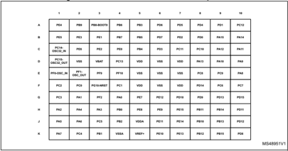


## 4.9 UFBGA121 pinout description

Figure 13. STM32G474xB/xC/xE UFBGA121 pinout

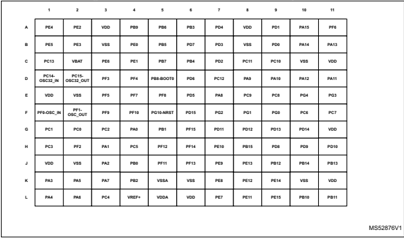

1. The above figure shows the package top view.


79

## 4.10 Pin definition

Table 11. Legend/abbreviations used in the pinout table

| Name          | Abbreviation                                                                                                                          | Definition                                                                                                                            |
|---------------|---------------------------------------------------------------------------------------------------------------------------------------|---------------------------------------------------------------------------------------------------------------------------------------|
| Pin name      | Unless otherwise specified in brackets below the pin name, the pin function during and after reset is the same as the actual pin name | Unless otherwise specified in brackets below the pin name, the pin function during and after reset is the same as the actual pin name |
| Pin type      | S                                                                                                                                     | Supply pin                                                                                                                            |
| Pin type      | I                                                                                                                                     | Input only pin                                                                                                                        |
| Pin type      | I/O                                                                                                                                   | Input / output pin                                                                                                                    |
| I/O structure | FT                                                                                                                                    | 5 V tolerant I/O                                                                                                                      |
| I/O structure | TT                                                                                                                                    | 3.6 V tolerant I/O                                                                                                                    |
| I/O structure | B                                                                                                                                     | Dedicated BOOT0 pin                                                                                                                   |
| I/O structure | NRST                                                                                                                                  | Bidirectional reset pin with embedded weak pull-up resistor                                                                           |
| I/O structure | Option for TT or FT I/Os                                                                                                              | Option for TT or FT I/Os                                                                                                              |
| I/O structure | _a (1)                                                                                                                                | I/O, with Analog switch function supplied by V DDA                                                                                    |
| I/O structure | _c                                                                                                                                    | I/O, USB Type-C PD capable                                                                                                            |
| I/O structure | _d                                                                                                                                    | I/O, USB Type-C PD Dead Battery function                                                                                              |
| I/O structure | _f (2)                                                                                                                                | I/O, Fm+ capable                                                                                                                      |
| I/O structure | _u (3)                                                                                                                                | I/O, with USB function                                                                                                                |
| Notes         | Unless otherwise specified by a note, all I/Os are set as floating inputs during and after reset                                      | Unless otherwise specified by a note, all I/Os are set as floating inputs during and after reset                                      |
| Pin functions | Alternate functions                                                                                                                   | Functions selected through GPIOx_AFR registers                                                                                        |
| Pin functions | Additional functions                                                                                                                  | Functions directly selected/enabled through peripheral registers                                                                      |

1. The related I/O structures in Table 12 are: FT\_a, FT\_fa, TT\_a.
2. The related I/O structures in Table 12 are: FT\_f, FT\_fa.
3. The related I/O structures in Table 12 are FT\_u.


Table 12. STM32G474xB/xC/xE pin definition

| WLCSP81   | UFQFPN48   | LQFP48   | Pin LQFP64   | LQFP80   | Number TFBGA100   | LPQF100   | UFBGA121   |   LPQF128 | after - Pin name (function reset) (1)   | Pin type   | I/O structure   | Notes   | Alternate functions                                                               | Additional functions               |
|-----------|------------|----------|--------------|----------|-------------------|-----------|------------|-----------|-----------------------------------------|------------|-----------------|---------|-----------------------------------------------------------------------------------|------------------------------------|
| -         | -          | -        | -            | -        | C3                | 1         | A2         |         1 | PE2                                     | I/O        | FT              | -       | TRACECK, TIM3_CH1, SAI1_CK1, SPI4_SCK, TIM20_CH1, FMC_A23, SAI1_MCLK_A, EVENTOUT  | -                                  |
| -         | -          | -        | -            | -        | B2                | 2         | B2         |         2 | PE3                                     | I/O        | FT              | -       | TRACED0, TIM3_CH2, SPI4_NSS, TIM20_CH2, FMC_A19, SAI1_SD_B, EVENTOUT              | -                                  |
| -         | -          | -        | -            | -        | A1                | 3         | A1         |         3 | PE4                                     | I/O        | FT              | -       | TRACED1, TIM3_CH3, SAI1_D2, SPI4_NSS, TIM20_CH1N, FMC_A20, SAI1_FS_A, EVENTOUT    | -                                  |
| -         | -          | -        | -            | -        | B1                | 4         | B1         |         4 | PE5                                     | I/O        | FT              | -       | TRACED2, TIM3_CH4, SAI1_CK2, SPI4_MISO, TIM20_CH2N, FMC_A21, SAI1_SCK_A, EVENTOUT | -                                  |
| -         | -          | -        | -            | -        | C2                | 5         | C3         |         5 | PE6                                     | I/O        | FT              | -       | TRACED3, SAI1_D1, SPI4_MOSI, TIM20_CH3N, FMC_A22, SAI1_SD_A, EVENTOUT             | WKUP3, RTC_TAMP3                   |
| B9        | 1          | 1        | 1            | 1        | D3                | 6         | C2         |         6 | VBAT                                    | S          | -               | -       | -                                                                                 | -                                  |
| B8        | 2          | 2        | 2            | 2        | D4                | 7         | C1         |         7 | PC13                                    | I/O        | FT              | (2) (3) | TIM1_BKIN, TIM1_CH1N, TIM8_CH4N, EVENTOUT                                         | WKUP2, RTC_TAMP1, RTC_TS, RTC_OUT1 |
| C9        | 3          | 3        | 3            | 3        | C1                | 8         | D1         |         8 | PC14- OSC32_IN                          | I/O        | FT              | (2) (3) | EVENTOUT                                                                          | OSC32_IN                           |
| D9        | 4          | 4        | 4            | 4        | D1                | 9         | D2         |         9 | PC15- OSC32_OUT                         | I/O        | FT              | (2) (3) | EVENTOUT                                                                          | OSC32_OUT                          |
| -         | -          | -        | -            | -        | -                 | -         | D3         |        10 | PF3                                     | I/O        | FT_f            | -       | TIM20_CH4, I2C3_SCL, FMC_A3, EVENTOUT                                             | -                                  |


79

Table 12. STM32G474xB/xC/xE pin definition (continued)

| Pin - WLCSP81   | Pin - UFQFPN48   | Pin - LQFP48   | Pin - LQFP64   | Pin - LQFP80   | Pin - Number TFBGA100   | Pin - LPQF100   | Pin - UFBGA121   |   Pin - LPQF128 | after - Pin name (function reset) (1)   | Pin type   | I/O structure   | Notes   | Alternate functions                                                                       | Additional - functions        |
|-----------------|------------------|----------------|----------------|----------------|-------------------------|-----------------|------------------|-----------------|-----------------------------------------|------------|-----------------|---------|-------------------------------------------------------------------------------------------|-------------------------------|
| -               | -                | -              | -              | -              | -                       | -               | D4               |              11 | PF4                                     | I/O        | FT_f            | -       | COMP1_OUT, TIM20_CH1N, I2C3_SDA, FMC_A4, EVENTOUT                                         | -                             |
| F1              | -                | -              | -              | -              | D2                      | -               | E2               |              12 | VSS                                     | S          | -               | -       | -                                                                                         | -                             |
| A9              | -                | -              | -              | -              | D5                      | -               | E1               |              13 | VDD                                     | S          | -               | -       | -                                                                                         | -                             |
| -               | -                | -              | -              | -              | -                       | -               | E3               |              14 | PF5                                     | I/O        | FT              | -       | TIM20_CH2N, FMC_A5, EVENTOUT                                                              | -                             |
| -               | -                | -              | -              | -              | -                       | -               | E4               |              15 | PF7                                     | I/O        | FT              | -       | TIM20_BKIN, TIM5_CH2, QUADSPI1_BK1_IO2, FMC_A1, SAI1_MCLK_B, EVENTOUT                     | -                             |
| -               | -                | -              | -              | -              | -                       | -               | E5               |              16 | PF8                                     | I/O        | FT              | -       | TIM20_BKIN2, TIM5_CH3, QUADSPI1_BK1_IO0, FMC_A24, SAI1_SCK_B, EVENTOUT                    | -                             |
| -               | -                | -              | -              | -              | E3                      | 10              | F3               |              17 | PF9                                     | I/O        | FT              | -       | TIM20_BKIN, TIM15_CH1, SPI2_SCK, TIM5_CH4, QUADSPI1_BK1_IO1, FMC_A25, SAI1_FS_B, EVENTOUT | -                             |
| -               | -                | -              | -              | -              | E4                      | 11              | F4               |              18 | PF10                                    | I/O        | FT              | -       | TIM20_BKIN2, TIM15_CH2, SPI2_SCK, QUADSPI1_CLK, FMC_A0, SAI1_D3, EVENTOUT                 | -                             |
| E9              | 5                | 5              | 5              | 5              | E1                      | 12              | F1               |              19 | PF0-OSC_IN                              | I/O        | FT_fa           | -       | I2C2_SDA, SPI2_NSS/I2S2_WS, TIM1_CH3N, EVENTOUT                                           | ADC1_IN10, OSC_IN             |
| F9              | 6                | 6              | 6              | 6              | E2                      | 13              | F2               |              20 | PF1- OSC_OUT                            | I/O        | FT_a            | -       | SPI2_SCK/I2S2_CK, EVENTOUT                                                                | ADC2_IN10, COMP3_INM, OSC_OUT |
| D8              | 7                | 7              | 7              | 7              | F3                      | 14              | F5               |              21 | PG10-NRST                               | I/O        | NRST (4)        | -       | MCO, EVENTOUT                                                                             | NRST                          |


Table 12. STM32G474xB/xC/xE pin definition (continued)

|         |          |        |            |        |                 |         |          |         | name after   | type   |               |       |                                                                                                           |                                                             |
|---------|----------|--------|------------|--------|-----------------|---------|----------|---------|--------------|--------|---------------|-------|-----------------------------------------------------------------------------------------------------------|-------------------------------------------------------------|
| WLCSP81 | UFQFPN48 | LQFP48 | Pin LQFP64 | LQFP80 | Number TFBGA100 | LPQF100 | UFBGA121 | LPQF128 | name after   | type   | I/O structure | Notes | Alternate functions                                                                                       | Additional functions                                        |
| E8      | -        | -      | 8          | 8      | F2              | 15      | G2       | 22      | PC0          | I/O    | FT_a          | -     | LPTIM1_IN1, TIM1_CH1, LPUART1_RX, EVENTOUT                                                                | ADC12_IN6, COMP3_INM                                        |
| C8      | -        | -      | 9          | 9      | F4              | 16      | G1       | 23      | PC1          | I/O    | TT_a          | -     | LPTIM1_OUT, TIM1_CH2, LPUART1_TX, QUADSPI1_BK2_IO0, SAI1_SD_A, EVENTOUT                                   | ADC12_IN7, COMP3_INP                                        |
| F8      | -        | -      | 10         | 10     | F1              | 17      | G3       | 24      | PC2          | I/O    | FT_a          | -     | LPTIM1_IN2, TIM1_CH3, COMP3_OUT, TIM20_CH2, QUADSPI1_BK2_IO1, EVENTOUT                                    | ADC12_IN8                                                   |
| G9      | -        | -      | 11         | 11     | G1              | 18      | H1       | 25      | PC3          | I/O    | TT_a          | -     | LPTIM1_ETR, TIM1_CH4, SAI1_D1, TIM1_BKIN2, QUADSPI1_BK2_IO2, SAI1_SD_A, EVENTOUT                          | ADC12_IN9, OPAMP5_VINP                                      |
| -       | -        | -      | -          | -      | G3              | 19      | H2       | 26      | PF2          | I/O    | FT            | -     | TIM20_CH3, I2C2_SMBA, FMC_A2, EVENTOUT                                                                    | -                                                           |
| D7      | 8        | 8      | 12         | 12     | G4              | 20      | G4       | 27      | PA0          | I/O    | TT_a          | -     | TIM2_CH1, TIM5_CH1, USART2_CTS, COMP1_OUT, TIM8_BKIN, TIM8_ETR, TIM2_ETR, EVENTOUT                        | ADC12_IN1, COMP1_INM, COMP3_INP, RTC_TAMP2,WK UP1           |
| E7      | 9        | 9      | 13         | 13     | G2              | 21      | H3       | 28      | PA1          | I/O    | TT_a          | -     | RTC_REFIN, TIM2_CH2, TIM5_CH2, USART2_RTS_DE, TIM15_CH1N, EVENTOUT                                        | ADC12_IN2, COMP1_INP, OPAMP1_VINP, OPAMP3_VINP, OPAMP6_VINM |
| G8      | 10       | 10     | 14         | 14     | H1              | 22      | J3       | 29      | PA2          | I/O    | FT_a          | -     | TIM2_CH3, TIM5_CH3, USART2_TX, COMP2_OUT, TIM15_CH1, QUADSPI1_BK1_NCS , LPUART1_TX, UCPD1_FRSTX, EVENTOUT | ADC1_IN3, COMP2_INM, OPAMP1_VOUT, WKUP4/LSCO                |


79

Table 12. STM32G474xB/xC/xE pin definition (continued)

| Pin Number - WLCSP81   | Pin Number - UFQFPN48   | Pin Number - LQFP48   |   Pin Number - LQFP64 |   Pin Number - LQFP80 | Pin Number - TFBGA100   |   Pin Number - LPQF100 | Pin Number - UFBGA121   |   Pin Number - LPQF128 | after - Pin name (function reset) (1)   | Pin type   | I/O structure   | Notes   | Alternate functions                                                                                      | Additional functions                                        |
|------------------------|-------------------------|-----------------------|-----------------------|-----------------------|-------------------------|------------------------|-------------------------|------------------------|-----------------------------------------|------------|-----------------|---------|----------------------------------------------------------------------------------------------------------|-------------------------------------------------------------|
| H9                     | -                       | -                     |                    15 |                    15 | D6                      |                     23 | J2                      |                     30 | VSS                                     | S          | -               | -       | -                                                                                                        | -                                                           |
| J9                     | -                       | -                     |                    16 |                    16 | D7                      |                     24 | J1                      |                     31 | VDD                                     | S          | -               | -       | -                                                                                                        | -                                                           |
| H8                     | 11                      | 11                    |                    17 |                    17 | H3                      |                     25 | K1                      |                     32 | PA3                                     | I/O        | TT_a            | -       | TIM2_CH4, TIM5_CH4, SAI1_CK1, USART2_RX, TIM15_CH2, QUADSPI1_CLK, LPUART1_RX, SAI1_MCLK_A, EVENTOUT      | ADC1_IN4, COMP2_INP, OPAMP1_VINM/ OPAMP 1_VINP, OPAMP5_VINM |
| D6                     | 12                      | 12                    |                    18 |                    18 | H2                      |                     26 | L1                      |                     33 | PA4                                     | I/O        | TT_a            | -       | TIM3_CH2, SPI1_NSS, SPI3_NSS/I2S3_WS, USART2_CK, SAI1_FS_B, EVENTOUT                                     | ADC2_IN17, DAC1_OUT1, COMP1_INM                             |
| F7                     | 13                      | 13                    |                    19 |                    19 | J1                      |                     27 | K2                      |                     34 | PA5                                     | I/O        | TT_a            | -       | TIM2_CH1, TIM2_ETR, SPI1_SCK, UCPD1_FRSTX, EVENTOUT                                                      | ADC2_IN13, DAC1_OUT2, COMP2_INM, OPAMP2_VINM                |
| G7                     | 14                      | 14                    |                    20 |                    20 | J2                      |                     28 | L2                      |                     35 | PA6                                     | I/O        | TT_a            | -       | TIM16_CH1, TIM3_CH1, TIM8_BKIN, SPI1_MISO, TIM1_BKIN, COMP1_OUT, QUADSPI1_BK1_IO3, LPUART1_CTS, EVENTOUT | ADC2_IN3, DAC2_OUT1, OPAMP2_VOUT                            |
| J8                     | 15                      | 15                    |                    21 |                    21 | K1                      |                     29 | K3                      |                     36 | PA7                                     | I/O        | TT_a            | -       | TIM17_CH1, TIM3_CH2, TIM8_CH1N, SPI1_MOSI, TIM1_CH1N, COMP2_OUT, QUADSPI1_BK1_IO2, UCPD1_FRSTX, EVENTOUT | ADC2_IN4, COMP2_INP, OPAMP1_VINP, OPAMP2_VINP               |
| E6                     | 16                      | -                     |                    22 |                    22 | K2                      |                     30 | L3                      |                     37 | PC4                                     | I/O        | FT_fa           | -       | TIM1_ETR, I2C2_SCL, USART1_TX, QUADSPI1_BK2_IO3, EVENTOUT                                                | ADC2_IN5                                                    |


Table 12. STM32G474xB/xC/xE pin definition (continued)

| WLCSP81   | UFQFPN48   | LQFP48   | Pin LQFP64   | LQFP80   | Number TFBGA100   | LPQF100   | UFBGA121   |   LPQF128 | after - Pin name (function reset) (1)   | Pin type   | I/O structure   | Notes   | Alternate functions                                                                                 | Additional functions                                      |
|-----------|------------|----------|--------------|----------|-------------------|-----------|------------|-----------|-----------------------------------------|------------|-----------------|---------|-----------------------------------------------------------------------------------------------------|-----------------------------------------------------------|
| H7        | -          | -        | 23           | 23       | J3                | 31        | H4         |        38 | PC5                                     | I/O        | TT_a            | -       | TIM15_BKIN, SAI1_D3, TIM1_CH4N, USART1_RX, HRTIM1_EEV10, EVENTOUT                                   | ADC2_IN11, OPAMP1_VINM, OPAMP2_VINM, WKUP5                |
| F6        | 17         | 16       | 24           | 24       | H4                | 32        | J4         |        39 | PB0                                     | I/O        | TT_a            | -       | TIM3_CH3, TIM8_CH2N, TIM1_CH2N, QUADSPI1_BK1_IO1, HRTIM1_FLT5, UCPD1_FRSTX, EVENTOUT                | ADC3_IN12/ ADC1_IN15, COMP4_INP, OPAMP2_VINP, OPAMP3_VINP |
| G6        | 18         | 17       | 25           | 25       | K3                | 33        | G5         |        40 | PB1                                     | I/O        | TT_a            | -       | TIM3_CH4, TIM8_CH3N, TIM1_CH3N, COMP4_OUT, QUADSPI1_BK1_IO0, LPUART1_RTS_DE,H RTIM1_SCOUT, EVENTOUT | ADC3_IN1/ ADC1_IN12, COMP1_INP, OPAMP3_VOUT, OPAMP6_VINM  |
| J7        | 19         | 18       | 26           | 26       | J4                | 34        | K4         |        41 | PB2                                     | I/O        | TT_a            | -       | RTC_OUT2, LPTIM1_OUT, TIM5_CH1, TIM20_CH1, I2C3_SMBA, QUADSPI1_BK2_IO1, HRTIM1_SCIN, EVENTOUT       | ADC2_IN12, COMP4_INM, OPAMP3_VINM                         |
| H6        | -          | 19       | 27           | 27       | K4                | 35        | K5         |        42 | VSSA                                    | S          | -               | -       | -                                                                                                   | -                                                         |
| J6        | 20         | 20       | 28           | 28       | K5                | 36        | L4         |        43 | VREF+                                   | S          | -               | -       | -                                                                                                   | VREFBUF_OUT                                               |
| -         | -          | -        | -            | -        | -                 | -         | -          |        44 | VREF+                                   | S          | -               | -       | -                                                                                                   | VREFBUF_OUT                                               |
| J5        | 21         | 21       | 29           | 29       | J5                | 37        | L5         |        45 | VDDA                                    | S          | -               | -       | -                                                                                                   | -                                                         |
| H9        | -          | -        | -            | -        | E5                | -         | K6         |        46 | VSS                                     | S          | -               | -       | -                                                                                                   | -                                                         |
| J1        | -          | -        | -            | -        | F5                | -         | L6         |        47 | VDD                                     | S          | -               | -       | -                                                                                                   | -                                                         |
| -         | -          | -        | -            | -        | -                 | -         | J5         |        48 | PF11                                    | I/O        | FT              | -       | TIM20_ETR, FMC_NE4, EVENTOUT                                                                        | -                                                         |
| -         | -          | -        | -            | -        | -                 | -         | H5         |        49 | PF12                                    | I/O        | FT              | -       | TIM20_CH1, FMC_A6, EVENTOUT                                                                         | -                                                         |
| -         | -          | -        | -            | -        | -                 | -         | J6         |        50 | PF13                                    | I/O        | FT              | -       | TIM20_CH2, I2C4_SMBA, FMC_A7, EVENTOUT                                                              | -                                                         |


79

Table 12. STM32G474xB/xC/xE pin definition (continued)

| Pin - WLCSP81   | Pin - UFQFPN48   | Pin - LQFP48   | Pin - LQFP64   | Pin - LQFP80   | Pin - Number TFBGA100   | Pin - LPQF100   | Pin - UFBGA121   |   Pin - LPQF128 | after - Pin name (function reset) (1)   | Pin type   | I/O structure   | Notes   | Alternate functions                                                  | Additional functions   |
|-----------------|------------------|----------------|----------------|----------------|-------------------------|-----------------|------------------|-----------------|-----------------------------------------|------------|-----------------|---------|----------------------------------------------------------------------|------------------------|
| -               | -                | -              | -              | -              | -                       | -               | H6               |              51 | PF14                                    | I/O        | FT_f            | -       | TIM20_CH3, I2C4_SCL, FMC_A8, EVENTOUT                                | -                      |
| -               | -                | -              | -              | -              | -                       | -               | G6               |              52 | PF15                                    | I/O        | FT_f            | -       | TIM20_CH4, I2C4_SDA, FMC_A9, EVENTOUT                                | -                      |
| H5              | -                | -              | -              | 30             | G5                      | 38              | L7               |              53 | PE7                                     | I/O        | TT_a            | -       | TIM1_ETR, FMC_D4, SAI1_SD_B, EVENTOUT                                | ADC3_IN4, COMP4_INP    |
| G5              | -                | -              | -              | 31             | H5                      | 39              | K7               |              54 | PE8                                     | I/O        | FT_a            | -       | TIM5_CH3, TIM1_CH1N, FMC_D5, SAI1_SCK_B, EVENTOUT                    | ADC345_IN6, COMP4_INM  |
| F5              | -                | -              | -              | 32             | H6                      | 40              | J7               |              55 | PE9                                     | I/O        | FT_a            | -       | TIM5_CH4, TIM1_CH1, FMC_D6, SAI1_FS_B, EVENTOUT                      | ADC3_IN2               |
| J4              | -                | -              | -              | 33             | K6                      | 41              | H7               |              56 | PE10                                    | I/O        | FT_a            | -       | TIM1_CH2N, QUADSPI1_CLK, FMC_D7, SAI1_MCLK_B, EVENTOUT               | ADC345_IN14            |
| H4              | -                | -              | -              | 34             | J6                      | 42              | L8               |              57 | PE11                                    | I/O        | FT_a            | -       | TIM1_CH2, SPI4_NSS, QUADSPI1_BK1_NCS , FMC_D8, EVENTOUT              | ADC345_IN15            |
| E5              | -                | -              | -              | 35             | G6                      | 43              | K8               |              58 | PE12                                    | I/O        | FT_a            | -       | TIM1_CH3N, SPI4_SCK, QUADSPI1_BK1_IO0, FMC_D9, EVENTOUT              | ADC345_IN16            |
| G4              | -                | -              | -              | 36             | K7                      | 44              | J8               |              59 | PE13                                    | I/O        | FT_a            | -       | TIM1_CH3, SPI4_MISO, QUADSPI1_BK1_IO1, FMC_D10, EVENTOUT             | ADC3_IN3               |
| J3              | -                | -              | -              | 37             | J7                      | 45              | K9               |              60 | PE14                                    | I/O        | FT_a            | -       | TIM1_CH4, SPI4_MOSI, TIM1_BKIN2, QUADSPI1_BK1_IO2, FMC_D11, EVENTOUT | ADC4_IN1               |


Table 12. STM32G474xB/xC/xE pin definition (continued)

| Pin Number - WLCSP81   | Pin Number - UFQFPN48   | Pin Number - LQFP48   | Pin Number - LQFP64   |   Pin Number - LQFP80 | Pin Number - TFBGA100   |   Pin Number - LPQF100 | Pin Number - UFBGA121   |   Pin Number - LPQF128 | after - Pin name (function reset) (1)   | Pin type   | I/O structure   | Notes   | Alternate functions                                                                                           | Additional functions                                       |
|------------------------|-------------------------|-----------------------|-----------------------|-----------------------|-------------------------|------------------------|-------------------------|------------------------|-----------------------------------------|------------|-----------------|---------|---------------------------------------------------------------------------------------------------------------|------------------------------------------------------------|
| F4                     | -                       | -                     | -                     |                    38 | H7                      |                     46 | L9                      |                     61 | PE15                                    | I/O        | FT_a            | -       | TIM1_BKIN, TIM1_CH4N, USART3_RX, QUADSPI1_BK1_IO3, FMC_D12, EVENTOUT                                          | ADC4_IN2                                                   |
| H3                     | 22                      | 22                    | 30                    |                    39 | J8                      |                     47 | L10                     |                     62 | PB10                                    | I/O        | TT_a            | -       | TIM2_CH3, USART3_TX, LPUART1_RX, QUADSPI1_CLK, TIM1_BKIN, HRTIM1_FLT3, SAI1_SCK_A, EVENTOUT                   | COMP5_INM, OPAMP3_VINM, OPAMP4_VINM                        |
| J2                     | -                       | 23                    | 31                    |                    40 | E6                      |                     48 | K10                     |                     63 | VSS                                     | S          | -               | -       | -                                                                                                             | -                                                          |
| J1                     | 23                      | 24                    | 32                    |                    41 | F7                      |                     49 | K11                     |                     64 | VDD                                     | S          | -               | -       | -                                                                                                             | -                                                          |
| H2                     | 24                      | 25                    | 33                    |                    42 | H8                      |                     50 | L11                     |                     65 | PB11                                    | I/O        | TT_a            | -       | TIM2_CH4, USART3_RX, LPUART1_TX, QUADSPI1_BK1_NCS , HRTIM1_FLT4, EVENTOUT                                     | ADC12_IN14, COMP6_INP, OPAMP4_VINP, OPAMP6_VOUT            |
| G3                     | 25                      | 26                    | 34                    |                    43 | K8                      |                     51 | J9                      |                     66 | PB12                                    | I/O        | TT_a            | -       | TIM5_ETR, I2C2_SMBA, SPI2_NSS/I2S2_WS, TIM1_BKIN, USART3_CK, LPUART1_RTS_DE, FDCAN2_RX, HRTIM1_CHC1, EVENTOUT | ADC4_IN3/ ADC1_IN11, COMP7_INM, OPAMP4_VOUT, OPAMP6_VINP   |
| H1                     | 26                      | 27                    | 35                    |                    44 | J9                      |                     52 | J11                     |                     67 | PB13                                    | I/O        | TT_a            | -       | SPI2_SCK/I2S2_CK, TIM1_CH1N, USART3_CTS, LPUART1_CTS, FDCAN2_TX, HRTIM1_CHC2, EVENTOUT                        | ADC3_IN5, COMP5_INP, OPAMP3_VINP, OPAMP4_VINP, OPAMP6_VINP |
| G2                     | 27                      | 28                    | 36                    |                    45 | H9                      |                     53 | J10                     |                     68 | PB14                                    | I/O        | TT_a            | -       | TIM15_CH1, SPI2_MISO, TIM1_CH2N, USART3_RTS_DE, COMP4_OUT, HRTIM1_CHD1, EVENTOUT                              | ADC4_IN4/ ADC1_IN5, COMP7_INP, OPAMP2_VINP, OPAMP5_VINP    |


79

Table 12. STM32G474xB/xC/xE pin definition (continued)

| Pin Number - WLCSP81   | Pin Number - UFQFPN48   | Pin Number - LQFP48   | Pin Number - LQFP64   | Pin Number - LQFP80   | Pin Number - TFBGA100   |   Pin Number - LPQF100 | Pin Number - UFBGA121   |   Pin Number - LPQF128 | Pin Number - Pin name (function after reset) (1)   | Pin Number - Pin type   | Pin Number - I/O structure   | Pin Number - Notes   | Pin Number - Alternate functions                                                                 | Additional functions                        |
|------------------------|-------------------------|-----------------------|-----------------------|-----------------------|-------------------------|------------------------|-------------------------|------------------------|----------------------------------------------------|-------------------------|------------------------------|----------------------|--------------------------------------------------------------------------------------------------|---------------------------------------------|
| E4                     | 28                      | 29                    | 37                    | 46                    | K9                      |                     54 | H8                      |                     69 | PB15                                               | I/O                     | TT_a                         | -                    | RTC_REFIN, TIM15_CH2, TIM15_CH1N, COMP3_OUT, TIM1_CH3N, SPI2_MOSI/I2S2_SD, HRTIM1_CHD2, EVENTOUT | ADC4_IN5/ ADC2_IN15, COMP6_INM, OPAMP5_VINM |
| G1                     | -                       | -                     | -                     | 47                    | K10                     |                     55 | H9                      |                     70 | PD8                                                | I/O                     | TT_a                         | -                    | USART3_TX, FMC_D13, EVENTOUT                                                                     | ADC4_IN12/ ADC5_IN12, OPAMP4_VINM           |
| F3                     | -                       | -                     | -                     | 48                    | G8                      |                     56 | H10                     |                     71 | PD9                                                | I/O                     | TT_a                         | -                    | USART3_RX, FMC_D14, EVENTOUT                                                                     | ADC4_IN13/ ADC5_IN13, OPAMP6_VINP           |
| F2                     | -                       | -                     | -                     | 49                    | G7                      |                     57 | H11                     |                     72 | PD10                                               | I/O                     | FT_a                         | -                    | USART3_CK, FMC_D15, EVENTOUT                                                                     | ADC345_IN7, COMP6_INM                       |
| E2                     | -                       | -                     | -                     | -                     | H10                     |                     58 | G7                      |                     73 | PD11                                               | I/O                     | TT_a                         | -                    | TIM5_ETR, I2C4_SMBA, USART3_CTS, FMC_A16, EVENTOUT                                               | ADC345_IN8, COMP6_INP, OPAMP4_VINP          |
| -                      | -                       | -                     | -                     | -                     | J10                     |                     59 | G8                      |                     74 | PD12                                               | I/O                     | TT_a                         | -                    | TIM4_CH1, USART3_RTS_DE, FMC_A17, EVENTOUT                                                       | ADC345_IN9, COMP5_INP, OPAMP5_VINP          |
| -                      | -                       | -                     | -                     | -                     | G9                      |                     60 | G9                      |                     75 | PD13                                               | I/O                     | FT_a                         | -                    | TIM4_CH2, FMC_A18, EVENTOUT                                                                      | ADC345_IN10, COMP5_INM                      |
| -                      | -                       | -                     | -                     | -                     | F8                      |                     61 | G10                     |                     76 | PD14                                               | I/O                     | TT_a                         | -                    | TIM4_CH3, FMC_D0, EVENTOUT                                                                       | ADC345_IN11, COMP7_INP, OPAMP2_VINP         |
| -                      | -                       | -                     | -                     | -                     | G10                     |                     62 | F6                      |                     77 | PD15                                               | I/O                     | FT_a                         | -                    | TIM4_CH4, SPI2_NSS, FMC_D1, EVENTOUT                                                             | COMP7_INM                                   |
| B1                     | -                       | -                     | -                     | 50                    | E7                      |                     63 | -                       |                     78 | VSS                                                | S                       | -                            | -                    | -                                                                                                | -                                           |
| E1                     | -                       | -                     | -                     | 51                    | -                       |                     64 | G11                     |                     79 | VDD                                                | S                       | -                            | -                    | -                                                                                                | -                                           |
| E3                     | 29                      | -                     | 38                    | 52                    | F9                      |                     65 | F10                     |                     80 | PC6                                                | I/O                     | FT_f                         | -                    | TIM3_CH1, HRTIM1_EEV10, TIM8_CH1, I2S2_MCK, COMP6_OUT, I2C4_SCL, HRTIM1_CHF1, EVENTOUT           | -                                           |


Table 12. STM32G474xB/xC/xE pin definition (continued)

| WLCSP81   | UFQFPN48   | LQFP48   | Pin LQFP64   | LQFP80   | Number TFBGA100   | LPQF100   | UFBGA121   |   LPQF128 | after - Pin name (function reset) (1)   | Pin type   | I/O structure   | Notes   | Alternate functions                                                                   | Additional functions   |
|-----------|------------|----------|--------------|----------|-------------------|-----------|------------|-----------|-----------------------------------------|------------|-----------------|---------|---------------------------------------------------------------------------------------|------------------------|
| D5        | -          | -        | 39           | 53       | F10               | 66        | F11        |        81 | PC7                                     | I/O        | FT_f            | -       | TIM3_CH2, HRTIM1_FLT5, TIM8_CH2, I2S3_MCK, COMP5_OUT, I2C4_SDA, HRTIM1_CHF2, EVENTOUT | -                      |
| -         | -          | -        | -            | -        | -                 | -         | F9         |        82 | PG0                                     | I/O        | FT              | -       | TIM20_CH1N, FMC_A10, EVENTOUT                                                         | -                      |
| -         | -          | -        | -            | -        | -                 | -         | F8         |        83 | PG1                                     | I/O        | FT              | -       | TIM20_CH2N, FMC_A11, EVENTOUT                                                         | -                      |
| -         | -          | -        | -            | -        | -                 | -         | F7         |        84 | PG2                                     | I/O        | FT              | -       | TIM20_CH3N, SPI1_SCK, FMC_A12, EVENTOUT                                               | -                      |
| -         | -          | -        | -            | -        | -                 | -         | E11        |        85 | PG3                                     | I/O        | FT_f            | -       | TIM20_BKIN, I2C4_SCL, SPI1_MISO, TIM20_CH4N, FMC_A13, EVENTOUT                        | -                      |
| -         | -          | -        | -            | -        | -                 | -         | E10        |        86 | PG4                                     | I/O        | FT_f            | -       | TIM20_BKIN2, I2C4_SDA, SPI1_MOSI, FMC_A14, EVENTOUT                                   | -                      |
| C5        | -          | -        | 40           | 54       | E8                | 67        | E9         |        87 | PC8                                     | I/O        | FT_f            | -       | TIM3_CH3, HRTIM1_CHE1, TIM8_CH3, TIM20_CH3, COMP7_OUT, I2C3_SCL, EVENTOUT             | -                      |
| D2        | -          | -        | 41           | 55       | E9                | 68        | E8         |        88 | PC9                                     | I/O        | FT_f            | -       | TIM3_CH4, HRTIM1_CHE2, TIM8_CH4, I2SCKIN, TIM8_BKIN2, I2C3_SDA, EVENTOUT              | -                      |


79

Table 12. STM32G474xB/xC/xE pin definition (continued)

| WLCSP81   |   UFQFPN48 |   LQFP48 |   Pin LQFP64 |   LQFP80 | Number TFBGA100   |   LPQF100 | UFBGA121   |   LPQF128 | after - Pin name (function reset) (1)   | Pin type   | I/O structure   | Notes   | Alternate functions                                                                                                                            | Additional functions   |
|-----------|------------|----------|--------------|----------|-------------------|-----------|------------|-----------|-----------------------------------------|------------|-----------------|---------|------------------------------------------------------------------------------------------------------------------------------------------------|------------------------|
| D1        |         30 |       30 |           42 |       56 | E10               |        69 | E7         |        89 | PA8                                     | I/O        | FT_a            | -       | MCO, I2C3_SCL, I2C2_SDA, I2S2_MCK, TIM1_CH1, USART1_CK, COMP7_OUT, TIM4_ETR, FDCAN3_RX, SAI1_CK2, HRTIM1_CHA1, SAI1_SCK_A, EVENTOUT            | ADC5_IN1, OPAMP5_VOUT  |
| D4        |         31 |       31 |           43 |       57 | D10               |        70 | D8         |        90 | PA9                                     | I/O        | FT_fda          | -       | I2C3_SMBA, I2C2_SCL, I2S3_MCK, TIM1_CH2, USART1_TX, OMP5_OUT, TIM15_BKIN, TIM2_CH3, HRTIM1_CHA2, SAI1_FS_A, EVENTOUT                           | ADC5_IN2, UCPD1_DBCC1  |
| D3        |         32 |       32 |           44 |       58 | D9                |        71 | D9         |        91 | PA10                                    | I/O        | FT_fda          | -       | TIM17_BKIN, USB_CRS_SYNC, I2C2_SMBA, SPI2_MISO, TIM1_CH3, USART1_RX, COMP6_OUT, TIM2_CH4, TIM8_BKIN, SAI1_D1, HRTIM1_CHB1, SAI1_SD_A, EVENTOUT | UCPD1_DBCC2, PVD_IN    |
| C2        |         33 |       33 |           45 |       59 | C10               |        72 | D11        |        92 | PA11                                    | I/O        | FT_u            | -       | SPI2_MOSI/I2S2_SD, TIM1_CH1N, USART1_CTS, COMP1_OUT, FDCAN1_RX, TIM4_CH1, TIM1_CH4, TIM1_BKIN2, HRTIM1_CHB2, EVENTOUT                          | USB_DM                 |


Table 12. STM32G474xB/xC/xE pin definition (continued)

| WLCSP81   | UFQFPN48   | LQFP48   | Pin LQFP64   | LQFP80   | Number TFBGA100   | LPQF100   | UFBGA121   |   LPQF128 | after - Pin name (function reset) (1)   | Pin type   | I/O structure   | Notes   | Alternate functions                                                                                                                            | Additional functions   |
|-----------|------------|----------|--------------|----------|-------------------|-----------|------------|-----------|-----------------------------------------|------------|-----------------|---------|------------------------------------------------------------------------------------------------------------------------------------------------|------------------------|
| C1        | 34         | 34       | 46           | 60       | C9                | 73        | D10        |        93 | PA12                                    | I/O        | FT_u            | -       | TIM16_CH1, I2SCKIN, TIM1_CH2N, USART1_RTS_DE, COMP2_OUT, FDCAN1_TX, TIM4_CH2, TIM1_ETR, HRTIM1_FLT1, EVENTOUT                                  | USB_DP                 |
| A8        | -          | 35       | 47           | 61       | F6                | 74        | C10        |        94 | VSS                                     | S          | -               | -       | -                                                                                                                                              | -                      |
| A1        | 35         | 36       | 48           | 62       | -                 | 75        | C11        |        95 | VDD                                     | S          | -               | -       | -                                                                                                                                              | -                      |
| B2        | 36         | 37       | 49           | 63       | D8                | 76        | B11        |        96 | PA13                                    | I/O        | FT_f            | (5)     | SWDIO-JTMS, TIM16_CH1N, I2C4_SCL, I2C1_SCL, IR_OUT, USART3_CTS, TIM4_CH3, SAI1_SD_B, EVENTOUT                                                  | -                      |
| -         | -          | -        | -            | -        | -                 | -         | A11        |        97 | PF6                                     | I/O        | FT_f            | -       | TIM5_ETR, TIM4_CH4, SAI1_SD_B, I2C2_SCL, TIM5_CH1, USART3_RTS, QUADSPI1_BK1_IO3, EVENTOUT                                                      | -                      |
| C3        | 37         | 38       | 50           | 64       | B10               | 77        | B10        |        98 | PA14                                    | I/O        | FT_f            | (5)     | SWCLK-JTCK, LPTIM1_OUT, I2C4_SMBA, I2C1_SDA, TIM8_CH2, TIM1_BKIN, USART2_TX, SAI1_FS_B, EVENTOUT                                               | -                      |
| A2        | 38         | 39       | 51           | 65       | B9                | 78        | A10        |        99 | PA15                                    | I/O        | FT_f            | (5)     | JTDI, TIM2_CH1, TIM8_CH1, I2C1_SCL, SPI1_NSS, SPI3_NSS/I2S3_WS, USART2_RX, UART4_RTS_DE, TIM1_BKIN, FDCAN3_TX, HRTIM1_FLT2, TIM2_ETR, EVENTOUT | -                      |


79

Table 12. STM32G474xB/xC/xE pin definition (continued)

| WLCSP81   | UFQFPN48   | LQFP48   | Pin LQFP64   | LQFP80   | Number TFBGA100   | LPQF100   | UFBGA121   |   LPQF128 | after - Pin name (function reset) (1)   | Pin type   | I/O structure   | Notes   | Alternate functions                                                                             | Additional functions   |
|-----------|------------|----------|--------------|----------|-------------------|-----------|------------|-----------|-----------------------------------------|------------|-----------------|---------|-------------------------------------------------------------------------------------------------|------------------------|
| B3        | 39         | -        | 52           | 66       | C8                | 79        | C9         |       100 | PC10                                    | I/O        | FT              | -       | TIM8_CH1N, UART4_TX, SPI3_SCK/I2S3_CK, USART3_TX, HRTIM1_FLT6, EVENTOUT                         | -                      |
| C4        | 40         | -        | 53           | 67       | C7                | 80        | C8         |       101 | PC11                                    | I/O        | FT_f            | -       | HRTIM1_EEV2, TIM8_CH2N, UART4_RX, SPI3_MISO, USART3_RX, I2C3_SDA, EVENTOUT                      | -                      |
| A3        | -          | -        | 54           | 68       | A10               | 81        | D7         |       102 | PC12                                    | I/O        | FT              | -       | TIM5_CH2, HRTIM1_EEV1, TIM8_CH3N, UART5_TX, SPI3_MOSI/I2S3_SD, USART3_CK, UCPD1_FRSTX, EVENTOUT | -                      |
| -         | -          | -        | -            | -        | -                 | -         | -          |       103 | PG5                                     | I/O        | FT              | -       | TIM20_ETR, SPI1_NSS, LPUART1_CTS, FMC_A15, EVENTOUT                                             | -                      |
| -         | -          | -        | -            | -        | -                 | -         | -          |       104 | PG6                                     | I/O        | FT              | -       | TIM20_BKIN, I2C3_SMBA, LPUART1_RTS_DE, FMC_INT, EVENTOUT                                        | -                      |
| -         | -          | -        | -            | -        | -                 | -         | -          |       105 | PG7                                     | I/O        | FT_f            | -       | SAI1_CK1, I2C3_SCL, LPUART1_TX, FMC_INT, SAI1_MCLK_A, EVENTOUT                                  | -                      |
| -         | -          | -        | -            | -        | -                 | -         | -          |       106 | PG8                                     | I/O        | FT_f            | -       | I2C3_SDA, LPUART1_RX, FMC_NE3, EVENTOUT                                                         | -                      |
| -         | -          | -        | -            | -        | -                 | -         | -          |       107 | PG9                                     | I/O        | FT              | -       | SPI3_SCK, USART1_TX, FMC_NCE/FMC_NE2, TIM15_CH1N, EVENTOUT                                      | -                      |
| B4        | -          | -        | -            | 69       | B8                | 82        | B9         |       108 | PD0                                     | I/O        | FT              | -       | TIM8_CH4N, FDCAN1_RX, FMC_D2, EVENTOUT                                                          | -                      |


Table 12. STM32G474xB/xC/xE pin definition (continued)

| Pin - WLCSP81   | Pin - UFQFPN48   | Pin - LQFP48   | Pin - LQFP64   | Pin - LQFP80   | Pin - Number TFBGA100   | Pin - LPQF100   | Pin - UFBGA121   |   Pin - LPQF128 | after - Pin name (function reset) (1)   | Pin type   | I/O structure   | Notes   | Alternate functions                                                            | Additional functions   |
|-----------------|------------------|----------------|----------------|----------------|-------------------------|-----------------|------------------|-----------------|-----------------------------------------|------------|-----------------|---------|--------------------------------------------------------------------------------|------------------------|
| A4              | -                | -              | -              | 70             | A9                      | 83              | A9               |             109 | PD1                                     | I/O        | FT              | -       | TIM8_CH4, TIM8_BKIN2, FDCAN1_TX, FMC_D3, EVENTOUT                              | -                      |
| -               | -                | -              | -              | -              | -                       | -               | B8               |             110 | VSS                                     | S          | -               | -       | -                                                                              | -                      |
| A1              | -                | -              | -              | -              | -                       | -               | A8               |             111 | VDD                                     | S          | -               | -       | -                                                                              | -                      |
| B5              | -                | -              | 55             | 71             | B7                      | 84              | C7               |             112 | PD2                                     | I/O        | FT              | -       | TIM3_ETR, TIM8_BKIN, UART5_RX, EVENTOUT                                        | -                      |
| -               | -                | -              | -              | -              | C6                      | 85              | B7               |             113 | PD3                                     | I/O        | FT              | -       | TIM2_CH1/ TIM2_ETR, USART2_CTS, QUADSPI1_BK2_NCS , FMC_CLK, EVENTOUT           | -                      |
| -               | -                | -              | -              | -              | A8                      | 86              | A7               |             114 | PD4                                     | I/O        | FT              | -       | TIM2_CH2, USART2_RTS_DE, QUADSPI1_BK2_IO0, FMC_NOE, EVENTOUT                   | -                      |
| -               | -                | -              | -              | -              | A7                      | 87              | E6               |             115 | PD5                                     | I/O        | FT              | -       | USART2_TX, QUADSPI1_BK2_IO1, FMC_NWE, EVENTOUT                                 | -                      |
| -               | -                | -              | -              | -              | A6                      | 88              | D6               |             116 | PD6                                     | I/O        | FT              | -       | TIM2_CH4, SAI1_D1, USART2_RX, QUADSPI1_BK2_IO2, FMC_NWAIT, SAI1_SD_A, EVENTOUT | -                      |
| -               | -                | -              | -              | -              | B6                      | 89              | B6               |             117 | PD7                                     | I/O        | FT              | -       | TIM2_CH3, USART2_CK, QUADSPI1_BK2_IO3, FMC_NCE/FMC_NE1, EVENTOUT               | -                      |


79

Table 12. STM32G474xB/xC/xE pin definition (continued)

| WLCSP81   |   UFQFPN48 |   LQFP48 |   Pin LQFP64 |   LQFP80 | Number TFBGA100   |   LPQF100 | UFBGA121   |   LPQF128 | after - Pin name (function reset) (1)   | Pin type   | I/O structure   | Notes   | Alternate functions                                                                                                                                                          | Additional - functions   |
|-----------|------------|----------|--------------|----------|-------------------|-----------|------------|-----------|-----------------------------------------|------------|-----------------|---------|------------------------------------------------------------------------------------------------------------------------------------------------------------------------------|--------------------------|
| A5        |         41 |       40 |           56 |       72 | A5                |        90 | A6         |       118 | PB3                                     | I/O        | FT              | (5)     | JTDO-TRACESWO, TIM2_CH2, TIM4_ETR, UCPD1_CRS_SYNC, TIM8_CH1N, SPI1_SCK, SPI3_SCK/I2S3_CK, USART2_TX, TIM3_ETR, FDCAN3_RX, HRTIM1_SCOUT, HRTIM1_EEV9, SAI1_SCK_B, EVENTOUT    | -                        |
| C6        |         42 |       41 |           57 |       73 | C5                |        91 | C6         |       119 | PB4                                     | I/O        | FT_c            | (5) (6) | JTRST, TIM16_CH1, TIM3_CH1, TIM8_CH2N, SPI1_MISO, SPI3_MISO, USART2_RX, UART5_RTS_DE, TIM17_BKIN, FDCAN3_TX, HRTIM1_EEV7, SAI1_MCLK_B, EVENTOUT                              | UCPD1_CC2                |
| A6        |         43 |       42 |           58 |       74 | B5                |        92 | B5         |       120 | PB5                                     | I/O        | FT_f            | -       | TIM16_BKIN, TIM3_CH2, TIM8_CH3N, I2C1_SMBA, SPI1_MOSI, SPI3_MOSI/I2S3_SD, USART2_CK, I2C3_SDA, FDCAN2_RX, TIM17_CH1, LPTIM1_IN1, SAI1_SD_B, HRTIM1_EEV6, UART5_CTS, EVENTOUT | -                        |


Table 12. STM32G474xB/xC/xE pin definition (continued)

| WLCSP81   |   UFQFPN48 |   LQFP48 |   Pin LQFP64 |   LQFP80 | Number TFBGA100   |   LPQF100 | UFBGA121   |   LPQF128 | after - Pin name (function reset) (1)   | Pin type   | I/O structure   | Notes   | Alternate functions                                                                                                                              | Additional functions   |
|-----------|------------|----------|--------------|----------|-------------------|-----------|------------|-----------|-----------------------------------------|------------|-----------------|---------|--------------------------------------------------------------------------------------------------------------------------------------------------|------------------------|
| B6        |         44 |       43 |           59 |       75 | A4                |        93 | A5         |       121 | PB6                                     | I/O        | FT_c            | (6)     | TIM16_CH1N, TIM4_CH1, TIM8_CH1, TIM8_ETR, USART1_TX, COMP4_OUT, FDCAN2_TX, TIM8_BKIN2, LPTIM1_ETR, HRTIM1_SCIN, HRTIM1_EEV4, SAI1_FS_B, EVENTOUT | UCPD1_CC1              |
| C7        |         45 |       44 |           60 |       76 | B4                |        94 | C5         |       122 | PB7                                     | I/O        | FT_f            | -       | TIM17_CH1N, TIM4_CH2, I2C4_SDA, I2C1_SDA, TIM8_BKIN, USART1_RX, COMP3_OUT, TIM3_CH4, LPTIM1_IN2, FMC_NL, HRTIM1_EEV3, UART4_CTS, EVENTOUT        | -                      |
| B7        |         46 |       45 |           61 |       77 | A3                |        95 | D5         |       123 | PB8-BOOT0                               | I/O        | FT_f            | (7)     | TIM16_CH1, TIM4_CH3, SAI1_CK1, I2C1_SCL, USART3_RX, COMP1_OUT, FDCAN1_RX, TIM8_CH2, TIM1_BKIN, HRTIM1_EEV8, SAI1_MCLK_A, EVENTOUT                | -                      |
| A7        |         47 |       46 |           62 |       78 | A2                |        96 | A4         |       124 | PB9                                     | I/O        | FT_f            | -       | TIM17_CH1, TIM4_CH4, SAI1_D2, I2C1_SDA, IR_OUT, USART3_TX, COMP2_OUT, FDCAN1_TX, TIM8_CH3, TIM1_CH3N, HRTIM1_EEV5, SAI1_FS_A, EVENTOUT           | -                      |


79

Table 12. STM32G474xB/xC/xE pin definition (continued)

| Pin Number   | Pin Number   | Pin Number   | Pin Number   | Pin Number   | Pin Number   | Pin Number   | Pin Number   | Pin Number   | Pin name (function after reset) (1)   | type   |               |       |                                                                           |                      |
|--------------|--------------|--------------|--------------|--------------|--------------|--------------|--------------|--------------|---------------------------------------|--------|---------------|-------|---------------------------------------------------------------------------|----------------------|
| WLCSP81      | UFQFPN48     | LQFP48       | LQFP64       | LQFP80       | TFBGA100     | LPQF100      | UFBGA121     | LPQF128      | Pin name (function after reset) (1)   | type   | I/O structure | Notes | Alternate functions                                                       | Additional functions |
| -            | -            | -            | -            | -            | C4           | 97           | B4           | 125          | PE0                                   | I/O    | FT            | -     | TIM4_ETR, TIM20_CH4N, TIM16_CH1, TIM20_ETR, USART1_TX, FMC_NBL0, EVENTOUT | -                    |
| -            | -            | -            | -            | -            | B3           | 98           | C4           | 126          | PE1                                   | I/O    | FT            | -     | TIM17_CH1, TIM20_CH4, USART1_RX, FMC_NBL1, EVENTOUT                       | -                    |
| -            | -            | 47           | 63           | 79           | -            | 99           | B3           | 127          | VSS                                   | S      | -             | -     | -                                                                         | -                    |
| A9           | 48           | 48           | 64           | 80           | -            | 100          | A3           | 128          | VDD                                   | S      | -             | -     | -                                                                         | -                    |

1. Function availability depends on the chosen device.
2. PC13, PC14 and PC15 are supplied through the power switch. Since the switch only sinks a limited amount of current (3 mA), the use of GPIOs PC13 to PC15 in output mode is limited:
- These GPIOs must not be used as current sources (e.g. to drive an LED).
- The speed should not exceed 2 MHz with a maximum load of 30 pF
3. After a backup domain power-up, PC13, PC14 and PC15 operate as GPIOs. Their function then depends on the content of the RTC registers which are not reset by the system reset. For details on how to manage these GPIOs, refer to the Backup domain and RTC register descriptions in the reference manual RM0440 "STM32G4 Series advanced Arm ® -based 32-bit MCUs'.
4. PG10-NRST pin is FT tolerant if it is configured as PG10 GPIO by option bytes except for the startup time until option bytes are loaded.
5. After reset, these pins are configured as JTAG/SW debug alternate functions, and the internal pull-up on PA15, PA13, PB4 pins and the internal pull-down on PA14 pin are activated.
6. After reset, a pull-down resistor (Rd = 5.1k Ω from UCPD peripheral) can be activated on PB6, PB4 (UCPD1\_CC1, UCPD1\_CC2). The pull-down on PB6 (UCPD1\_CC1) is activated by high level on PA9 (UCPD1\_DBCC1). The pull-down on PB4 (UCPD1\_CC2) is activated by high level on PA10 (UCPD1\_DBCC2). This pull-down control (dead battery support on UCPD peripheral) can be disabled by setting bit UCPD1\_DBDIS=1 in the PWR\_CR3 register. PB4, PB6 have UCPD\_CC functionality  which implements an internal pull-down resistor (5.1k Ω ) which is controlled by the voltage on the UCPD\_DBCC pin (PA10, PA9). A high level on the UCPD\_DBCC pin activates the pull-down on the UCPD\_CC pin. The pull-down effect on the CC lines can be removed by using the bit UCPD1\_DBDIS =1 (USB Type-C and power delivery dead battery disable) in the PWR\_CR3 register.
7. It is recommended to set PB8 in another mode than analog mode after startup to limit consumption if the pin is left unconnected.


## 4.11 Alternate functions

Table 13. Alternate function

| AF0 - Port   | AF1 - I2C4/ SYS_AF LPTIM1/ TIM2/5/ 15/16/17   | AF2 - I2C1/3/ TIM1/2/3/4/5/8/ 20/15/ COMP1   | AF3 - QUADSPI1/ I2C3/4/SAI1/US B/HRTIM1/ TIM8/20/15/ COMP3   | AF4 - I2C1/2/3/ 4/TIM1/8/ 16/17   | AF5 - QUADSPI1 /SPI1/2/3/4/ I2S2/3/I2C4/ UART4/5/ TIM8/ Infrared   | AF6 - QUADSPI1/ SPI2/3/I2S2 /3/TIM1/5/8/ 20/Infrared   | AF7 - USART1/2/3 /FDCAN/CO MP7/5/6   | AF8 - I2C3/4/UAR T4/5/LPUA RT1/COMP 1/2/7/4/5/6/ 3   | AF9 - FDCAN/T IM1/8/15/ FDCAN1/ 2   | AF10 - QUADSPI1/ TIM2/3/4/8/1 7   | AF11 - LPTIM1/ TIM1/8/F DCAN1/3   | AF12 - FMC/LPUART1 /SAI1/HRTIM1/ TIM1   | AF13 - SAI1SAI1/HR TIM1/OPAMP 2   | AF14 - UART4/5/ SAI1/TIM 2/15/ UCPD1   | AF15 - EVENT   |
|--------------|-----------------------------------------------|----------------------------------------------|--------------------------------------------------------------|-----------------------------------|--------------------------------------------------------------------|--------------------------------------------------------|--------------------------------------|------------------------------------------------------|-------------------------------------|-----------------------------------|-----------------------------------|-----------------------------------------|-----------------------------------|----------------------------------------|----------------|
| PA0 -        | TIM2_CH1                                      | TIM5_CH1                                     | -                                                            | -                                 | -                                                                  | -                                                      | USART2_ CTS                          | COMP1 _OUT                                           | TIM8_ BKIN                          | TIM8_ETR                          | -                                 | -                                       | -                                 | TIM2_ ETR                              | EVENT OUT      |
| PA1          | RTC_ REFIN TIM2_CH2                           | TIM5_CH2                                     | -                                                            | -                                 | -                                                                  | -                                                      | USART2_ RTS_DE                       | -                                                    | TIM15_ CH1N                         | -                                 | -                                 | -                                       | -                                 | -                                      | EVENT OUT      |
| PA2          | - TIM2_CH3                                    | TIM5_CH3                                     | -                                                            | -                                 | -                                                                  | -                                                      | USART2_ TX                           | COMP2 _OUT                                           | TIM15_ CH1                          | QUADSPI1_ BK1_NCS                 | -                                 | LPUART1_TX                              | -                                 | UCPD1_ FRSTX                           | EVENT OUT      |
| PA3          | - TIM2_CH4                                    | TIM5_CH4                                     | SAI1_CK1                                                     | -                                 | -                                                                  | -                                                      | USART2_ RX                           | -                                                    | TIM15_ CH2                          | QUADSPI1_ CLK                     | -                                 | LPUART1_RX                              | SAI1_MCLK_ A                      | -                                      | EVENT OUT      |
| PA4 -        | -                                             | TIM3_CH2                                     | -                                                            | -                                 | SPI1_NSS                                                           | SPI3_NSS/ I2S3_WS                                      | USART2_ CK                           | -                                                    | -                                   | -                                 | -                                 | -                                       | SAI1_FS_B                         | -                                      | EVENT OUT      |
| PA5          | - TIM2_CH1                                    | TIM2_ETR                                     | -                                                            | -                                 | SPI1_SCK                                                           | -                                                      | -                                    | -                                                    | -                                   | -                                 | -                                 | -                                       | -                                 | UCPD1_ FRSTX                           | EVENT OUT      |
| PA6 -        | TIM16_CH1                                     | TIM3_CH1                                     | -                                                            | TIM8_ BKIN                        | SPI1_MISO                                                          | TIM1_BKIN                                              | -                                    | COMP1 _OUT                                           | -                                   | QUADSPI1_ BK1_IO3                 | -                                 | LPUART1_ CTS                            | -                                 | -                                      | EVENT OUT      |
| PA7 -        | TIM17_CH1                                     | TIM3_CH2                                     | -                                                            | TIM8_ CH1N                        | SPI1_MOSI                                                          | TIM1_ CH1N                                             | -                                    | COMP2_ OUT                                           | -                                   | QUADSPI1_ BK1_IO2                 | -                                 | -                                       | -                                 | UCPD1_ FRSTX                           | EVENT OUT      |
| PA8          | MCO -                                         | I2C3_SCL                                     | -                                                            | I2C2_ SDA                         | I2S2_MCK                                                           | TIM1_CH1                                               | USART1_ CK                           | COMP7 _OUT                                           | -                                   | TIM4_ETR                          | FDCAN3 _RX                        | SAI1_CK2                                | HRTIM1_ CHA1                      | SAI1_SC K_A                            | EVENT OUT      |
| PA9          | - -                                           | I2C3_SMBA                                    | -                                                            | I2C2_ SCL                         | I2S3_MCK                                                           | TIM1_CH2                                               | USART1_ TX                           | COMP5 _OUT                                           | TIM15_ BKIN                         | TIM2_CH3                          | -                                 | -                                       | HRTIM1_ CHA2                      | SAI1_FS _A                             | EVENT OUT      |
| PA10 -       | TIM17_BKIN                                    | -                                            | USB_ CRS_SYNC                                                | I2C2_ SMBA                        | SPI2_MISO                                                          | TIM1_CH3                                               | USART1_ RX                           | COMP6 _OUT                                           | -                                   | TIM2_CH4                          | TIM8_ BKIN                        | SAI1_D1                                 | HRTIM1_ CHB1                      | SAI1_SD _A                             | EVENT OUT      |
| PA11         | - -                                           | -                                            | -                                                            | -                                 | SPI2_MOSI/ I2S2_SD                                                 | TIM1_ CH1N                                             | USART1_ CTS                          | COMP1 _OUT                                           | FDCAN1 _RX                          | TIM4_CH1                          | TIM1_ CH4                         | TIM1_BKIN2                              | HRTIM1_ CHB2                      | -                                      | EVENT OUT      |
| PA12 -       | TIM16_CH1                                     | -                                            | -                                                            | -                                 | I2SCKIN                                                            | TIM1_ CH2N                                             | USART1_ RTS_DE                       | COMP2 _OUT                                           | FDCAN1 _TX                          | TIM4_CH2                          | TIM1_ ETR                         | -                                       | HRTIM1_ FLT1                      | -                                      | EVENT OUT      |
| PA13         | SWDIO- JTMS TIM16_CH1N                        | -                                            | I2C4_SCL                                                     | I2C1_ SCL                         | IR_OUT                                                             | -                                                      | USART3_ CTS                          | -                                                    | -                                   | TIM4_CH3                          | -                                 | -                                       | SAI1_SD_B                         | -                                      | EVENT OUT      |
| PA14         | SWCLK- JTCK LPTIM1_OUT                        | -                                            | I2C4_SMBA                                                    | I2C1_ SDA                         | TIM8_CH2                                                           | TIM1_ BKIN                                             | USART2_ TX                           | -                                                    | -                                   | -                                 | -                                 | -                                       | SAI1_FS_B                         | -                                      | EVENT OUT      |
| PA15 JTDI    | TIM2_CH1                                      | TIM8_CH1                                     | -                                                            | I2C1_ SCL                         | SPI1_NSS                                                           | SPI3_NSS/ I2S3_WS                                      | USART2_ RX                           | UART4 _RTS_DE                                        | TIM1_ BKIN                          | -                                 | FDCAN3 _ TX                       | -                                       | HRTIM1_ FLT2                      | TIM2_ ETR                              | EVENT OUT      |


Table 13. Alternate function (continued)

| Port SYS_AF   | AF1 - LPTIM1/ TIM2/5/ 15/16/17   | AF2 - I2C1/3/ TIM1/2/3/4/5/8/ 20/15/ COMP1   | AF3 - QUADSPI1/ I2C3/4/SAI1/US B/HRTIM1/ TIM8/20/15/ COMP3   | AF4 - I2C1/2/3/ 4/TIM1/8/ 16/17   | AF5 - QUADSPI1 /SPI1/2/3/4/ I2S2/3/I2C4/ UART4/5/ TIM8/ Infrared   | AF6 - QUADSPI1/ SPI2/3/I2S2 /3/TIM1/5/8/ 20/Infrared   | AF7 - USART1/2/3 /FDCAN/CO MP7/5/6   | AF8 - I2C3/4/UAR T4/5/LPUA RT1/COMP 1/2/7/4/5/6/ 3   | AF9 - FDCAN/T IM1/8/15/ FDCAN1/ 2   | AF10 - QUADSPI1/ TIM2/3/4/8/1 7   | AF11 - LPTIM1/ TIM1/8/F DCAN1/3   | AF12 - FMC/LPUART1 /SAI1/HRTIM1/ TIM1   | AF13 - SAI1SAI1/HR TIM1/OPAMP 2   | AF14 - UART4/5/ SAI1/TIM 2/15/ UCPD1   | AF15 - EVENT   |
|---------------|----------------------------------|----------------------------------------------|--------------------------------------------------------------|-----------------------------------|--------------------------------------------------------------------|--------------------------------------------------------|--------------------------------------|------------------------------------------------------|-------------------------------------|-----------------------------------|-----------------------------------|-----------------------------------------|-----------------------------------|----------------------------------------|----------------|
| PB0           | -                                | TIM3_CH3                                     | -                                                            | TIM8_ CH2N                        | -                                                                  | TIM1_ CH2N                                             | -                                    | -                                                    | -                                   | QUADSPI1_ BK1_IO1                 | -                                 | -                                       | HRTIM1_ FLT5                      | UCPD1_ FRSTX                           | EVENT OUT      |
| PB1           | -                                | TIM3_CH4                                     | -                                                            | TIM8_ CH3N                        | -                                                                  | TIM1_ CH3N                                             | -                                    | COMP4_ OUT                                           | -                                   | QUADSPI1_ BK1_IO0                 | -                                 | LPUART1_ RTS_DE                         | HRTIM1_ SCOUT                     | -                                      | EVENT OUT      |
| PB2           | LPTIM1_OUT                       | TIM5_CH1                                     | TIM20_CH1                                                    | I2C3_ SMBA                        | -                                                                  | -                                                      | -                                    | -                                                    | -                                   | QUADSPI1_ BK2_IO1                 | -                                 | -                                       | HRTIM1_ SCIN                      | -                                      | EVENT OUT      |
| PB3           | TRACESWO TIM2_CH2                | TIM4_ETR                                     | USB_CRS_ SYNC                                                | TIM8_ CH1N                        | SPI1_SCK                                                           | SPI3_SCK/ I2S3_CK                                      | USART2_ TX                           | -                                                    | -                                   | TIM3_ETR                          | FDCAN3 _RX                        | HRTIM1_ SCOUT                           | HRTIM1_ EEV9                      | SAI1_ SCK_B                            | EVENT OUT      |
| PB4           | TIM16_CH1                        | TIM3_CH1                                     | -                                                            | TIM8_ CH2N                        | SPI1_MISO                                                          | SPI3_MISO                                              | USART2_ RX                           | UART5_ RTS_DE                                        | -                                   | TIM17_BKIN                        | FDCAN3 _TX                        | -                                       | HRTIM1_ EEV7                      | SAI1_ MCLK_B                           | EVENT OUT      |
| PB5           | TIM16_BKIN                       | TIM3_CH2                                     | TIM8_CH3N                                                    | I2C1_ SMBA                        | SPI1_MOSI                                                          | SPI3_MOSI /I2S3_SD                                     | USART2_ CK                           | I2C3_SDA                                             | FDCAN2 _RX                          | TIM17_CH1                         | LPTIM1_ IN1                       | SAI1_SD_B                               | HRTIM1_ EEV6                      | UART5_ CTS                             | EVENT OUT      |
| PB6           | TIM16_CH1N                       | TIM4_CH1                                     | -                                                            | -                                 | TIM8_CH1                                                           | TIM8_ETR                                               | USART1_ TX                           | COMP4_ OUT                                           | FDCAN2 _TX                          | TIM8_BKIN2                        | LPTIM1_ ETR                       | HRTIM1_SCIN                             | HRTIM1_ EEV4                      | SAI1_FS _B                             | EVENT OUT      |
| B PB7         | TIM17_CH1N                       | TIM4_CH2                                     | I2C4_SDA                                                     | I2C1_ SDA                         | TIM8_BKIN                                                          | -                                                      | USART1_ RX                           | COMP3_ OUT                                           | -                                   | TIM3_CH4                          | LPTIM1_ IN2                       | FMC_NL                                  | HRTIM1_ EEV3                      | UART4_ CTS                             | EVENT OUT      |
| Port PB8      | TIM16_CH1                        | TIM4_CH3                                     | SAI1_CK1                                                     | I2C1_ SCL                         | -                                                                  | -                                                      | USART3_ RX                           | COMP1_ OUT                                           | FDCAN1 _RX                          | TIM8_CH2                          | -                                 | TIM1_BKIN                               | HRTIM1_ EEV8                      | SAI1_ MCLK_A                           | EVENT OUT      |
| PB9           | TIM17_CH1                        | TIM4_CH4                                     | SAI1_D2                                                      | I2C1_ SDA                         | -                                                                  | IR_OUT                                                 | USART3_ TX                           | COMP2_ OUT                                           | FDCAN1 _TX                          | TIM8_CH3                          | -                                 | TIM1_CH3N                               | HRTIM1_ EEV5                      | SAI1_FS _A                             | EVENT OUT      |
| PB10          | TIM2_CH3                         | -                                            | -                                                            | -                                 | -                                                                  | -                                                      | USART3_ TX                           | LPUART1_ RX                                          | -                                   | QUADSPI1_ CLK                     | -                                 | TIM1_BKIN                               | HRTIM1_ FLT3                      | SAI1_SC K_A                            | EVENT OUT      |
| PB11          | TIM2_CH4                         | -                                            | -                                                            | -                                 | -                                                                  | -                                                      | USART3_ RX                           | LPUART1_ TX                                          | -                                   | QUADSPI1_ BK1_NCS                 | -                                 | -                                       | HRTIM1_ FLT4                      | -                                      | EVENT OUT      |
| PB12          | -                                | TIM5_ETR                                     | -                                                            | I2C2_ SMBA                        | SPI2_NSS/ I2S2_WS                                                  | TIM1_BKIN                                              | USART3_ CK                           | LPUART1_ RTS_DE                                      | FDCAN2 _RX                          | -                                 | -                                 | -                                       | HRTIM1_ CHC1                      | -                                      | EVENT OUT      |
| PB13          | -                                | -                                            | -                                                            | -                                 | SPI2_SCK/ I2S2_CK                                                  | TIM1_ CH1N                                             | USART3_ CTS                          | LPUART1_ CTS                                         | FDCAN2 _TX                          | -                                 | -                                 | -                                       | HRTIM1_ CHC2                      | -                                      | EVENT OUT      |
| PB14          | TIM15_CH1                        | -                                            | -                                                            | -                                 | SPI2_MISO                                                          | TIM1_ CH2N                                             | USART3_ RTS_DE                       | COMP4_ OUT                                           | -                                   | -                                 | -                                 | -                                       | HRTIM1_ CHD1                      | -                                      | EVENT OUT      |
| PB15          | RTC_REFIN TIM15_CH2              | TIM15_CH1N                                   | COMP3_OUT                                                    | TIM1_ CH3N                        | SPI2_MOSI/ I2S2_SD                                                 | -                                                      | -                                    | -                                                    | -                                   | -                                 | -                                 | -                                       | HRTIM1_ CHD2                      | -                                      | EVENT OUT      |


Table 13. Alternate function (continued)

| Port     | AF0 - I2C4/ SYS_AF   | AF1 - LPTIM1/ TIM2/5/ 15/16/17   | AF2 - I2C1/3/ TIM1/2/3/4/5/8/ 20/15/ COMP1   | AF3 - QUADSPI1/ I2C3/4/SAI1/US B/HRTIM1/ TIM8/20/15/ COMP3   | AF4 - I2C1/2/3/ 4/TIM1/8/ 16/17   | AF5 - QUADSPI1 /SPI1/2/3/4/ I2S2/3/I2C4/ UART4/5/ TIM8/ Infrared   | AF6 - QUADSPI1/ SPI2/3/I2S2 /3/TIM1/5/8/ 20/Infrared   | AF7 - USART1/2/3 /FDCAN/CO MP7/5/6   | AF8 - I2C3/4/UAR T4/5/LPUA RT1/COMP 1/2/7/4/5/6/ 3   | AF9 - FDCAN/T IM1/8/15/ FDCAN1/ 2   | AF10 - QUADSPI1/ TIM2/3/4/8/1 7   | AF11 - LPTIM1/ TIM1/8/F DCAN1/3   | AF12 - FMC/LPUART1 /SAI1/HRTIM1/ TIM1   | AF13 - SAI1SAI1/HR TIM1/OPAMP 2   | AF14 - UART4/5/ SAI1/TIM 2/15/ UCPD1   | AF15 - EVENT   |
|----------|----------------------|----------------------------------|----------------------------------------------|--------------------------------------------------------------|-----------------------------------|--------------------------------------------------------------------|--------------------------------------------------------|--------------------------------------|------------------------------------------------------|-------------------------------------|-----------------------------------|-----------------------------------|-----------------------------------------|-----------------------------------|----------------------------------------|----------------|
| PC0      | -                    | LPTIM1_IN1                       | TIM1_CH1                                     | -                                                            | -                                 | -                                                                  | -                                                      | -                                    | LPUART1_ RX                                          | -                                   | -                                 | -                                 | -                                       | -                                 | -                                      | EVENT OUT      |
| PC1      | -                    | LPTIM1_OUT                       | TIM1_CH2                                     | -                                                            | -                                 | -                                                                  | -                                                      | -                                    | LPUART1_ TX                                          | -                                   | QUADSPI1_ BK2_IO0                 | -                                 | -                                       | SAI1_SD_A                         | -                                      | EVENT OUT      |
| PC2      | -                    | LPTIM1_IN2                       | TIM1_CH3                                     | COMP3_OUT                                                    | -                                 | -                                                                  | TIM20_CH2                                              | -                                    | -                                                    | -                                   | QUADSPI1_ BK2_IO1                 | -                                 | -                                       | -                                 | -                                      | EVENT OUT      |
| PC3      | -                    | LPTIM1_ETR                       | TIM1_CH4                                     | SAI1_D1                                                      | -                                 | -                                                                  | TIM1_ BKIN2                                            | -                                    | -                                                    | -                                   | QUADSPI1_ BK2_IO2                 | -                                 | -                                       | SAI1_SD_A                         | -                                      | EVENT OUT      |
| PC4      | -                    | -                                | TIM1_ETR                                     | -                                                            | I2C2_ SCL                         | -                                                                  | -                                                      | USART1_ TX                           | -                                                    | -                                   | QUADSPI1_ BK2_IO3                 | -                                 | -                                       | -                                 | -                                      | EVENT OUT      |
| PC5      | -                    | -                                | TIM15_BKIN                                   | SAI1_D3                                                      | -                                 | -                                                                  | TIM1_ CH4N                                             | USART1_ RX                           | -                                                    | -                                   | -                                 | -                                 | -                                       | HRTIM1_ EEV10                     | -                                      | EVENT OUT      |
| PC6      | -                    | -                                | TIM3_CH1                                     | HRTIM1_EEV10                                                 | TIM8_ CH1                         | -                                                                  | I2S2_MCK                                               | COMP6_ OUT                           | I2C4_SCL                                             | -                                   | -                                 | -                                 | -                                       | HRTIM1_ CHF1                      | -                                      | EVENT OUT      |
| C PC7    | -                    | -                                | TIM3_CH2                                     | HRTIM1_FLT5                                                  | TIM8_ CH2                         | -                                                                  | I2S3_MCK                                               | COMP5_ OUT                           | I2C4_SDA                                             | -                                   | -                                 | -                                 | -                                       | HRTIM1_ CHF2                      | -                                      | EVENT OUT      |
| Port PC8 | -                    | -                                | TIM3_CH3                                     | HRTIM1_CHE1                                                  | TIM8_ CH3                         | -                                                                  | TIM20_CH3                                              | COMP7_ OUT                           | I2C3_SCL                                             | -                                   | -                                 | -                                 | -                                       | -                                 | -                                      | EVENT OUT      |
| PC9      | -                    | -                                | TIM3_CH4                                     | HRTIM1_CHE2                                                  | TIM8_ CH4                         | I2SCKIN                                                            | TIM8_ BKIN2                                            | -                                    | I2C3_SDA                                             | -                                   | -                                 | -                                 | -                                       | -                                 | -                                      | EVENT OUT      |
| PC10     | -                    | -                                | -                                            | -                                                            | TIM8_ CH1N                        | UART4_TX                                                           | SPI3_SCK/ I2S3_CK                                      | USART3_ TX                           | -                                                    | -                                   | -                                 | -                                 | -                                       | HRTIM1_ FLT6                      | -                                      | EVENT OUT      |
| PC11     | -                    | -                                | -                                            | HRTIM1_EEV2                                                  | TIM8_ CH2N                        | UART4_RX                                                           | SPI3_MISO                                              | USART3_ RX                           | I2C3_SDA                                             | -                                   | -                                 | -                                 | -                                       | -                                 | -                                      | EVENT OUT      |
| PC12     | -                    | TIM5_CH2                         | -                                            | HRTIM1_EEV1                                                  | TIM8_ CH3N                        | UART5_TX                                                           | SPI3_MOSI /I2S3_SD                                     | USART3_ CK                           | -                                                    | -                                   | -                                 | -                                 | -                                       | -                                 | UCPD1_ FRSTX                           | EVENT OUT      |
| PC13     | -                    | -                                | TIM1_BKIN                                    | -                                                            | TIM1_ CH1N                        | -                                                                  | TIM8_ CH4N                                             | -                                    | -                                                    | -                                   | -                                 | -                                 | -                                       | -                                 | -                                      | EVENT OUT      |
| PC14     | -                    | -                                | -                                            | -                                                            | -                                 | -                                                                  | -                                                      | -                                    | -                                                    | -                                   | -                                 | -                                 | -                                       | -                                 | -                                      | EVENT OUT      |
| PC15     | -                    | -                                | -                                            | -                                                            | -                                 | -                                                                  | -                                                      | -                                    | -                                                    | -                                   | -                                 | -                                 | -                                       | -                                 | -                                      | EVENT OUT      |


Table 13. Alternate function (continued)

| Port     | AF0 - I2C4/ SYS_AF   | AF1 - LPTIM1/ TIM2/5/ 15/16/17   | AF2 - I2C1/3/ TIM1/2/3/4/5/8/ 20/15/ COMP1   | AF3 - QUADSPI1/ I2C3/4/SAI1/US B/HRTIM1/ TIM8/20/15/ COMP3   | AF4 - I2C1/2/3/ 4/TIM1/8/ 16/17   | AF5 - QUADSPI1 /SPI1/2/3/4/ I2S2/3/I2C4/ UART4/5/ TIM8/ Infrared   | AF6 - QUADSPI1/ SPI2/3/I2S2 /3/TIM1/5/8/ 20/Infrared   | AF7 - USART1/2/3 /FDCAN/CO MP7/5/6   | AF8 - I2C3/4/UAR T4/5/LPUA RT1/COMP 1/2/7/4/5/6/ 3   | AF9 - FDCAN/T IM1/8/15/ FDCAN1/ 2   | AF10 - QUADSPI1/ TIM2/3/4/8/1 7   | AF11 - LPTIM1/ TIM1/8/F DCAN1/3   | AF12 - FMC/LPUART1 /SAI1/HRTIM1/ TIM1   | AF13 - SAI1SAI1/HR TIM1/OPAMP 2   | AF14 - UART4/5/ SAI1/TIM 2/15/ UCPD1   | AF15 - EVENT   |
|----------|----------------------|----------------------------------|----------------------------------------------|--------------------------------------------------------------|-----------------------------------|--------------------------------------------------------------------|--------------------------------------------------------|--------------------------------------|------------------------------------------------------|-------------------------------------|-----------------------------------|-----------------------------------|-----------------------------------------|-----------------------------------|----------------------------------------|----------------|
| PD0      | -                    | -                                | -                                            | -                                                            | -                                 | -                                                                  | TIM8_ CH4N                                             | -                                    | -                                                    | FDCAN1 _RX                          | -                                 | -                                 | FMC_D2                                  | -                                 | -                                      | EVENT OUT      |
| PD1      | -                    | -                                | -                                            | -                                                            | TIM8_ CH4                         | -                                                                  | TIM8_ BKIN2                                            | -                                    | -                                                    | FDCAN1 _TX                          | -                                 | -                                 | FMC_D3                                  | -                                 | -                                      | EVENT OUT      |
| PD2      | -                    | -                                | TIM3_ETR                                     | -                                                            | TIM8_ BKIN                        | UART5_RX                                                           | -                                                      | -                                    | -                                                    | -                                   | -                                 | -                                 | -                                       | -                                 | -                                      | EVENT OUT      |
| PD3      | -                    | -                                | TIM2_CH1/ TIM2_ETR                           | -                                                            | -                                 | -                                                                  | -                                                      | USART2_ CTS                          | -                                                    | -                                   | QUADSPI1 _BK2_NCS                 | -                                 | FMC_CLK                                 | -                                 | -                                      | EVENT OUT      |
| PD4      | -                    | -                                | TIM2_CH2                                     | -                                                            | -                                 | -                                                                  | -                                                      | USART2_ RTS_DE                       | -                                                    | -                                   | QUADSPI1_ BK2_IO0                 | -                                 | FMC_NOE                                 | -                                 | -                                      | EVENT OUT      |
| PD5      | -                    | -                                | -                                            | -                                                            | -                                 | -                                                                  | -                                                      | USART2_ TX                           | -                                                    | -                                   | QUADSPI1_ BK2_IO1                 | -                                 | FMC_NWE                                 | -                                 | -                                      | EVENT OUT      |
| PD6      | -                    | -                                | TIM2_CH4                                     | SAI1_D1                                                      | -                                 | -                                                                  | -                                                      | USART2_ RX                           | -                                                    | -                                   | QUADSPI1_ BK2_IO2                 | -                                 | FMC_NWAIT                               | SAI1_SD_A                         | -                                      | EVENT OUT      |
| D PD7    | -                    | -                                | TIM2_CH3                                     | -                                                            | -                                 | -                                                                  | -                                                      | USART2_ CK                           | -                                                    | -                                   | QUADSPI1_ BK2_IO3                 | -                                 | FMC_NCE/ FMC_NE1                        | -                                 | -                                      | EVENT OUT      |
| Port PD8 | -                    | -                                | -                                            | -                                                            | -                                 | -                                                                  | -                                                      | USART3_ TX                           | -                                                    | -                                   | -                                 | -                                 | FMC_D13                                 | -                                 | -                                      | EVENT OUT      |
| PD9      | -                    | -                                | -                                            | -                                                            | -                                 | -                                                                  | -                                                      | USART3_ RX                           | -                                                    | -                                   | -                                 | -                                 | FMC_D14                                 | -                                 | -                                      | EVENT OUT      |
| PD10     | -                    | -                                | -                                            | -                                                            | -                                 | -                                                                  | -                                                      | USART3_ CK                           | -                                                    | -                                   | -                                 | -                                 | FMC_D15                                 | -                                 | -                                      | EVENT OUT      |
| PD11     | -                    | TIM5_ETR                         | -                                            | -                                                            | I2C4_ SMBA                        | -                                                                  | -                                                      | USART3_ CTS                          | -                                                    | -                                   | -                                 | -                                 | FMC_A16                                 | -                                 | -                                      | EVENT OUT      |
| PD12     | -                    | -                                | TIM4_CH1                                     | -                                                            | -                                 | -                                                                  | -                                                      | USART3_ RTS_DE                       | -                                                    | -                                   | -                                 | -                                 | FMC_A17                                 | -                                 | -                                      | EVENT OUT      |
| PD13     | -                    | -                                | TIM4_CH2                                     | -                                                            | -                                 | -                                                                  | -                                                      | -                                    | -                                                    | -                                   | -                                 | -                                 | FMC_A18                                 | -                                 | -                                      | EVENT OUT      |
| PD14     | -                    | -                                | TIM4_CH3                                     | -                                                            | -                                 | -                                                                  | -                                                      | -                                    | -                                                    | -                                   | -                                 | -                                 | FMC_D0                                  | -                                 | -                                      | EVENT OUT      |
| PD15     | -                    | -                                | TIM4_CH4                                     | -                                                            | -                                 | -                                                                  | SPI2_NSS                                               | -                                    | -                                                    | -                                   | -                                 | -                                 | FMC_D1                                  | -                                 | -                                      | EVENT OUT      |


Table 13. Alternate function (continued)

| Port     | AF0 - I2C4/ SYS_AF   | AF1 - LPTIM1/ TIM2/5/ 15/16/17   | AF2 - I2C1/3/ TIM1/2/3/4/5/8/ 20/15/ COMP1   | AF3 - QUADSPI1/ I2C3/4/SAI1/US B/HRTIM1/ TIM8/20/15/ COMP3   | AF4 - I2C1/2/3/ 4/TIM1/8/ 16/17   | AF5 - QUADSPI1 /SPI1/2/3/4/ I2S2/3/I2C4/ UART4/5/ TIM8/ Infrared   | AF6 - QUADSPI1/ SPI2/3/I2S2 /3/TIM1/5/8/ 20/Infrared   | AF7 - USART1/2/3 /FDCAN/CO MP7/5/6   | AF8 - I2C3/4/UAR T4/5/LPUA RT1/COMP 1/2/7/4/5/6/ 3   | AF9 - FDCAN/T IM1/8/15/ FDCAN1/ 2   | AF10 - QUADSPI1/ TIM2/3/4/8/1 7   | AF11 - LPTIM1/ TIM1/8/F DCAN1/3   | AF12 - FMC/LPUART1 /SAI1/HRTIM1/ TIM1   | AF13 - SAI1SAI1/HR TIM1/OPAMP 2   | AF14 - UART4/5/ SAI1/TIM 2/15/ UCPD1   | AF15 - EVENT   |
|----------|----------------------|----------------------------------|----------------------------------------------|--------------------------------------------------------------|-----------------------------------|--------------------------------------------------------------------|--------------------------------------------------------|--------------------------------------|------------------------------------------------------|-------------------------------------|-----------------------------------|-----------------------------------|-----------------------------------------|-----------------------------------|----------------------------------------|----------------|
| PE0      | -                    | -                                | TIM4_ETR                                     | TIM20_CH4N                                                   | TIM16_ CH1                        | -                                                                  | TIM20_ETR                                              | USART1_ TX                           | -                                                    | FDCAN1 _RXFD                        | -                                 | -                                 | FMC_NBL0                                | -                                 | -                                      | EVENT OUT      |
| PE1      | -                    | -                                | -                                            | -                                                            | TIM17_ CH1                        | -                                                                  | TIM20_CH4                                              | USART1_ RX                           | -                                                    | -                                   | -                                 | -                                 | FMC_NBL1                                | -                                 | -                                      | EVENT OUT      |
| PE2      | TRACECK              | -                                | TIM3_CH1                                     | SAI1_CK1                                                     | -                                 | SPI4_SCK                                                           | TIM20_CH1                                              | -                                    | -                                                    | -                                   | -                                 | -                                 | FMC_A23                                 | SAI1_MCLK_ A                      | -                                      | EVENT OUT      |
| PE3      | TRACED0              | -                                | TIM3_CH2                                     | -                                                            | -                                 | SPI4_NSS                                                           | TIM20_CH2                                              | -                                    | -                                                    | -                                   | -                                 | -                                 | FMC_A19                                 | SAI1_SD_B                         | -                                      | EVENT OUT      |
| PE4      | TRACED1              | -                                | TIM3_CH3                                     | SAI1_D2                                                      | -                                 | SPI4_NSS                                                           | TIM20_ CH1N                                            | -                                    | -                                                    | -                                   | -                                 | -                                 | FMC_A20                                 | SAI1_FS_A                         | -                                      | EVENT OUT      |
| PE5      | TRACED2              | -                                | TIM3_CH4                                     | SAI1_CK2                                                     | -                                 | SPI4_MISO                                                          | TIM20_ CH2N                                            | -                                    | -                                                    | -                                   | -                                 | -                                 | FMC_A21                                 | SAI1_SCK_A                        | -                                      | EVENT OUT      |
| PE6      | TRACED3              | -                                | -                                            | SAI1_D1                                                      | -                                 | SPI4_MOSI                                                          | TIM20_ CH3N                                            | -                                    | -                                                    | -                                   | -                                 | -                                 | FMC_A22                                 | SAI1_SD_A                         | -                                      | EVENT OUT      |
| E PE7    | -                    | -                                | TIM1_ETR                                     | -                                                            | -                                 | -                                                                  | -                                                      | -                                    | -                                                    | -                                   | -                                 | -                                 | FMC_D4                                  | SAI1_SD_B                         | -                                      | EVENT OUT      |
| Port PE8 | -                    | TIM5_CH3                         | TIM1_CH1N                                    | -                                                            | -                                 | -                                                                  | -                                                      | -                                    | -                                                    | -                                   | -                                 | -                                 | FMC_D5                                  | SAI1_SCK_B                        | -                                      | EVENT OUT      |
| PE9      | -                    | TIM5_CH4                         | TIM1_CH1                                     | -                                                            | -                                 | -                                                                  | -                                                      | -                                    | -                                                    | -                                   | -                                 | -                                 | FMC_D6                                  | SAI1_FS_B                         | -                                      | EVENT OUT      |
| PE10     | -                    | -                                | TIM1_CH2N                                    | -                                                            | -                                 | -                                                                  | -                                                      | -                                    | -                                                    | -                                   | QUADSPI1_ CLK                     | -                                 | FMC_D7                                  | SAI1_MCLK_ B                      | -                                      | EVENT OUT      |
| PE11     | -                    | -                                | TIM1_CH2                                     | -                                                            | -                                 | SPI4_NSS                                                           | -                                                      | -                                    | -                                                    | -                                   | QUADSPI1_ BK1_NCS                 | -                                 | FMC_D8                                  | -                                 | -                                      | EVENT OUT      |
| PE12     | -                    | -                                | TIM1_CH3N                                    | -                                                            | -                                 | SPI4_SCK                                                           | -                                                      | -                                    | -                                                    | -                                   | QUADSPI1_ BK1_IO0                 | -                                 | FMC_D9                                  | -                                 | -                                      | EVENT OUT      |
| PE13     | -                    | -                                | TIM1_CH3                                     | -                                                            | -                                 | SPI4_MISO                                                          | -                                                      | -                                    | -                                                    | -                                   | QUADSPI1_ BK1_IO1                 | -                                 | FMC_D10                                 | -                                 | -                                      | EVENT OUT      |
| PE14     | -                    | -                                | TIM1_CH4                                     | -                                                            | -                                 | SPI4_MOSI                                                          | TIM1_ BKIN2                                            | -                                    | -                                                    | -                                   | QUADSPI1_ BK1_IO2                 | -                                 | FMC_D11                                 | -                                 | -                                      | EVENT OUT      |
| PE15     | -                    | -                                | TIM1_BKIN                                    | -                                                            | -                                 | -                                                                  | TIM1_ CH4N                                             | USART3_ RX                           | -                                                    | -                                   | QUADSPI1_ BK1_IO3                 | -                                 | FMC_D12                                 | -                                 | -                                      | EVENT OUT      |


Table 13. Alternate function (continued)

| Port     | AF0 - I2C4/ SYS_AF   | AF1 - LPTIM1/ TIM2/5/ 15/16/17   | AF2 - I2C1/3/ TIM1/2/3/4/5/8/ 20/15/ COMP1   | AF3 - QUADSPI1/ I2C3/4/SAI1/US B/HRTIM1/ TIM8/20/15/ COMP3   | AF4 - I2C1/2/3/ 4/TIM1/8/ 16/17   | AF5 - QUADSPI1 /SPI1/2/3/4/ I2S2/3/I2C4/ UART4/5/ TIM8/ Infrared   | AF6 - QUADSPI1/ SPI2/3/I2S2 /3/TIM1/5/8/ 20/Infrared   | AF7 - USART1/2/3 /FDCAN/CO MP7/5/6   | AF8 - I2C3/4/UAR T4/5/LPUA RT1/COMP 1/2/7/4/5/6/ 3   | AF9 - FDCAN/T IM1/8/15/ FDCAN1/ 2   | AF10 - QUADSPI1/ TIM2/3/4/8/1 7   | AF11 - LPTIM1/ TIM1/8/F DCAN1/3   | AF12 - FMC/LPUART1 /SAI1/HRTIM1/ TIM1   | AF13 - SAI1SAI1/HR TIM1/OPAMP 2   | AF14 - UART4/5/ SAI1/TIM 2/15/ UCPD1   | AF15 - EVENT   |
|----------|----------------------|----------------------------------|----------------------------------------------|--------------------------------------------------------------|-----------------------------------|--------------------------------------------------------------------|--------------------------------------------------------|--------------------------------------|------------------------------------------------------|-------------------------------------|-----------------------------------|-----------------------------------|-----------------------------------------|-----------------------------------|----------------------------------------|----------------|
| PF0      | -                    | -                                | -                                            | -                                                            | I2C2_ SDA                         | SPI2_NSS/ I2S2_WS                                                  | TIM1_ CH3N                                             | -                                    | -                                                    | -                                   | -                                 | -                                 | -                                       | -                                 | -                                      | EVENT OUT      |
| PF1      | -                    | -                                | -                                            | -                                                            | -                                 | SPI2_SCK/ I2S2_CK                                                  | -                                                      | -                                    | -                                                    | -                                   | -                                 | -                                 | -                                       | -                                 | -                                      | EVENT OUT      |
| PF2      | -                    | -                                | TIM20_CH3                                    | -                                                            | I2C2_ SMBA                        | -                                                                  | -                                                      | -                                    | -                                                    | -                                   | -                                 | -                                 | FMC_A2                                  | -                                 | -                                      | EVENT OUT      |
| PF3      | -                    | -                                | TIM20_CH4                                    | -                                                            | I2C3_ SCL                         | -                                                                  | -                                                      | -                                    | -                                                    | -                                   | -                                 | -                                 | FMC_A3                                  | -                                 | -                                      | EVENT OUT      |
| PF4      | -                    | -                                | COMP1_OUT                                    | TIM20_CH1N                                                   | I2C3_ SDA                         | -                                                                  | -                                                      | -                                    | -                                                    | -                                   | -                                 | -                                 | FMC_A4                                  | -                                 | -                                      | EVENT OUT      |
| PF5      | -                    | -                                | TIM20_CH2N                                   | -                                                            | -                                 | -                                                                  | -                                                      | -                                    | -                                                    | -                                   | -                                 | -                                 | FMC_A5                                  | -                                 | -                                      | EVENT OUT      |
| PF6      | -                    | TIM5_ETR                         | TIM4_CH4                                     | SAI1_SD_B                                                    | I2C2_ SCL                         | -                                                                  | TIM5_CH1                                               | USART3_ RTS                          | -                                                    | -                                   | QUADSPI1_ BK1_IO3                 | -                                 | -                                       | -                                 | -                                      | EVENT OUT      |
| F PF7    | -                    | -                                | TIM20_BKIN                                   | -                                                            | -                                 | -                                                                  | TIM5_CH2                                               | -                                    | -                                                    | -                                   | QUADSPI1_ BK1_IO2                 | -                                 | FMC_A1                                  | SAI1_MCLK_ B                      | -                                      | EVENT OUT      |
| Port PF8 | -                    | -                                | TIM20_BKIN2                                  | -                                                            | -                                 | -                                                                  | TIM5_CH3                                               | -                                    | -                                                    | -                                   | QUADSPI1_ BK1_IO0                 | -                                 | FMC_A24                                 | SAI1_SCK_B                        | -                                      | EVENT OUT      |
| PF9      | -                    | -                                | TIM20_BKIN                                   | TIM15_CH1                                                    | -                                 | SPI2_SCK                                                           | TIM5_CH4                                               | -                                    | -                                                    | -                                   | QUADSPI1_ BK1_IO1                 | -                                 | FMC_A25                                 | SAI1_FS_B                         | -                                      | EVENT OUT      |
| PF10     | -                    | -                                | TIM20_BKIN2                                  | TIM15_CH2                                                    | -                                 | SPI2_SCK                                                           | -                                                      | -                                    | -                                                    | -                                   | QUADSPI1_ CLK                     | -                                 | FMC_A0                                  | SAI1_D3                           | -                                      | EVENT OUT      |
| PF11     | -                    | -                                | TIM20_ETR                                    | -                                                            | -                                 | -                                                                  | -                                                      | -                                    | -                                                    | -                                   | -                                 | -                                 | FMC_NE4                                 | -                                 | -                                      | EVENT OUT      |
| PF12     | -                    | -                                | TIM20_CH1                                    | -                                                            | -                                 | -                                                                  | -                                                      | -                                    | -                                                    | -                                   | -                                 | -                                 | FMC_A6                                  | -                                 | -                                      | EVENT OUT      |
| PF13     | -                    | -                                | TIM20_CH2                                    | -                                                            | I2C4_ SMBA                        | -                                                                  | -                                                      | -                                    | -                                                    | -                                   | -                                 | -                                 | FMC_A7                                  | -                                 | -                                      | EVENT OUT      |
| PF14     | -                    | -                                | TIM20_CH3                                    | -                                                            | I2C4_ SCL                         | -                                                                  | -                                                      | -                                    | -                                                    | -                                   | -                                 | -                                 | FMC_A8                                  | -                                 | -                                      | EVENT OUT      |
| PF15     | -                    | -                                | TIM20_CH4                                    | -                                                            | I2C4_ SDA                         | -                                                                  | -                                                      | -                                    | -                                                    | -                                   | -                                 | -                                 | FMC_A9                                  | -                                 | -                                      | EVENT OUT      |


Table 13. Alternate function (continued)

|      | AF0                                   | AF1 AF2                              | AF3                                                  | AF4                       | AF5                                                        | AF6                                            | AF7                          | AF8                                          | AF9                         | AF10                     | AF11                     | AF12                           | AF13                     | AF14                          | AF15      |
|------|---------------------------------------|--------------------------------------|------------------------------------------------------|---------------------------|------------------------------------------------------------|------------------------------------------------|------------------------------|----------------------------------------------|-----------------------------|--------------------------|--------------------------|--------------------------------|--------------------------|-------------------------------|-----------|
| Port | I2C4/ SYS_AF LPTIM1/ TIM2/5/ 15/16/17 | I2C1/3/ TIM1/2/3/4/5/8/ 20/15/ COMP1 | QUADSPI1/ I2C3/4/SAI1/US B/HRTIM1/ TIM8/20/15/ COMP3 | I2C1/2/3/ 4/TIM1/8/ 16/17 | QUADSPI1 /SPI1/2/3/4/ I2S2/3/I2C4/ UART4/5/ TIM8/ Infrared | QUADSPI1/ SPI2/3/I2S2 /3/TIM1/5/8/ 20/Infrared | USART1/2/3 /FDCAN/CO MP7/5/6 | I2C3/4/UAR T4/5/LPUA RT1/COMP 1/2/7/4/5/6/ 3 | FDCAN/T IM1/8/15/ FDCAN1/ 2 | QUADSPI1/ TIM2/3/4/8/1 7 | LPTIM1/ TIM1/8/F DCAN1/3 | FMC/LPUART1 /SAI1/HRTIM1/ TIM1 | SAI1SAI1/HR TIM1/OPAMP 2 | UART4/5/ SAI1/TIM 2/15/ UCPD1 | EVENT     |
| PG0  | - -                                   | TIM20_CH1N                           | -                                                    | -                         | -                                                          | -                                              | -                            | -                                            | -                           | -                        | -                        | FMC_A10                        | -                        | -                             | EVENT OUT |
| PG1  | - -                                   | TIM20_CH2N                           | -                                                    | -                         | -                                                          | -                                              | -                            | -                                            | -                           | -                        | -                        | FMC_A11                        | -                        | -                             | EVENT OUT |
| PG2  | - -                                   | TIM20_CH3N                           | -                                                    | -                         | SPI1_SCK                                                   | -                                              | -                            | -                                            | -                           | -                        | -                        | FMC_A12                        | -                        | -                             | EVENT OUT |
| PG3  | - -                                   | TIM20_BKIN                           | -                                                    | I2C4_ SCL                 | SPI1_MISO                                                  | TIM20_ CH4N                                    | -                            | -                                            | -                           | -                        | -                        | FMC_A13                        | -                        | -                             | EVENT OUT |
| PG4  | - -                                   | TIM20_BKIN2                          | -                                                    | I2C4_ SDA                 | SPI1_MOSI                                                  | -                                              | -                            | -                                            | -                           | -                        | -                        | FMC_A14                        | -                        | -                             | EVENT OUT |
| PG5  | - -                                   | TIM20_ETR                            | -                                                    | -                         | SPI1_NSS                                                   | -                                              | -                            | LPUART1_ CTS                                 | -                           | -                        | -                        | FMC_A15                        | -                        | -                             | EVENT OUT |
| PG6  | - -                                   | TIM20_BKIN                           | -                                                    | I2C3_ SMBA                | -                                                          | -                                              | -                            | LPUART1_ RTS_DE                              | -                           | -                        | -                        | FMC_INT                        | -                        | -                             | EVENT OUT |
| PG7  | - -                                   | -                                    | SAI1_CK1                                             | I2C3_ SCL                 | -                                                          | -                                              | -                            | LPUART1_ TX                                  | -                           | -                        | -                        | FMC_INT                        | SAI1_MCLK_ A             | -                             | EVENT OUT |
| PG8  | - -                                   | -                                    | -                                                    | I2C3_ SDA                 | -                                                          | -                                              | -                            | LPUART1_ RX                                  | -                           | -                        | -                        | FMC_NE3                        | -                        | -                             | EVENT OUT |
| PG9  | - -                                   | -                                    | -                                                    | -                         | -                                                          | SPI3_SCK                                       | USART1_TX                    | -                                            | -                           | -                        | -                        | FMC_NCE/ FMC_NE2               | -                        | TIM15_ CH1N                   | EVENT OUT |
| PG10 | MCO -                                 | -                                    | -                                                    | -                         | -                                                          | -                                              | -                            | -                                            | -                           | -                        | -                        | -                              | -                        | -                             | EVENT OUT |

## 5 Electrical characteristics

## 5.1 Parameter conditions

Unless otherwise specified, all voltages are referenced to V SS .

## 5.1.1 Minimum and maximum values

Unless otherwise specified, the minimum and maximum values are guaranteed in the worst conditions of ambient temperature, supply voltage and frequencies by tests in production on 100% of the devices with an ambient temperature at T A  = 25 °C and T A  = T A max (given by the selected temperature range).

Data based on characterization results, design simulation and/or technology characteristics are indicated in the table footnotes and are not tested in production. Based on characterization, the minimum and maximum values refer to sample tests and represent the mean value plus or minus three times the standard deviation (mean ±3 σ ).

## 5.1.2 Typical values

Unless otherwise specified, typical data are based on T A  = 25 °C, V DD = V DDA  = 3 V. They are given only as design guidelines and are not tested.

Typical ADC accuracy values are determined by characterization of a batch of samples from a standard diffusion lot over the full temperature range, where 95% of the devices have an error less than or equal to the value indicated (mean ±2 σ ).

## 5.1.3 Typical curves

Unless otherwise specified, all typical curves are given only as design guidelines and are not tested.

## 5.1.4 Loading capacitor

The loading conditions used for pin parameter measurement are shown in Figure 14 .

## 5.1.5 Pin input voltage

The input voltage measurement on a pin of the device is described in Figure 15 .

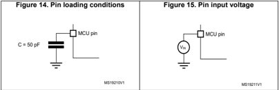


## 5.1.6 Power supply scheme

Figure 16. Power supply scheme

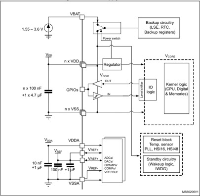

Each power supply pair (V DD /V SS , V DDA /V SSA etc.) must be decoupled with filtering ceramic capacitors as shown above. These capacitors must be placed as close as possible to, or below, the appropriate pins on the underside of the PCB to ensure the good functionality of the device.

Caution:


199

## 5.1.7 Current consumption measurement

Figure 17. Current consumption measurement

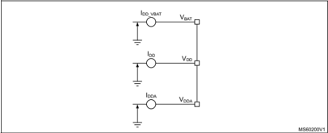

The I DD\_ALL  parameters given in Table 21 to Table 25 represent the total MCU consumption including the current supplying V DD , V DDA  and V BAT .

## 5.2 Absolute maximum ratings

Stresses above the absolute maximum ratings listed in Table 14: Voltage characteristics , Table 15: Current characteristics and Table 16: Thermal characteristics may cause permanent damage to the device. These are stress ratings only and functional operation of the device at these conditions is not implied. Exposure to maximum rating conditions for extended periods may affect device reliability. Exposure to maximum rating conditions for extended periods may affect device reliability. Device mission profile (application conditions) is compliant with JEDEC JESD47 qualification standard, extended mission profiles are available on demand.

Table 14. Voltage characteristics (1)

| Symbol                   | Ratings                                                                   | Min       | Max                              | Unit   |
|--------------------------|---------------------------------------------------------------------------|-----------|----------------------------------|--------|
| V DD - V SS              | External main supply voltage (including V DD , V DDA , V BAT and V REF+ ) | -0.3      | 4.0                              | V      |
| V IN (2)                 | Input voltage on FT_xxx pins except FT_c pins                             | V SS -0.3 | min (V DD , V DDA ) + 4.0 (3)(4) | V      |
| V IN (2)                 | Input voltage on FT_c pins                                                | V SS -0.3 | 5.5                              | V      |
| V IN (2)                 | Input voltage on TT_xx pins                                               | V SS -0.3 | 4.0                              | V      |
| V IN (2)                 | Input voltage on any other pins                                           | V SS -0.3 | 4.0                              | V      |
| &#124; ∆ V DDx &#124;    | Variations between different V DDX power pins of the same domain          | -         | 50                               | mV     |
| &#124;V SSx -V SS &#124; | Variations between all the different ground pins (5)                      | -         | 50                               | mV     |
| V REF+ -V DDA            | Allowed voltage difference for V REF+ > V DDA                             | -         | 0.4                              | V      |


2. VIN  maximum must always be respected. Refer to Table 15: Current characteristics for the maximum allowed injected current values.
3. This formula has to be applied only on the power supplies related to the IO structure described in the pin definition table.
4. To sustain a voltage higher than 4 V the internal pull-up/pull-down resistors must be disabled.
5. Include VREF- pin.
2. This current consumption must be correctly distributed over all I/Os and control pins. The total output current must not be sunk/sourced between two consecutive power supply pins referring to high pin count LQFP packages.
3. Positive injection (when V IN &gt; V DD ) is not possible on these I/Os and does not occur for input voltages lower than the specified maximum value.
4. A negative injection is induced by VIN &lt; VSS. IINJ(PIN) must never be exceeded. Refer also to Table 14: Voltage characteristics for the minimum allowed input voltage values.
5. When several inputs are submitted to a current injection, the maximum ∑ |I INJ(PIN) | is the absolute sum of the negative injected currents (instantaneous values).

Table 15. Current characteristics

| Symbol                    | Ratings                                                              | Max      | Unit   |
|---------------------------|----------------------------------------------------------------------|----------|--------|
| ∑ IV DD                   | Total current into sum of all V DD power lines (source) (1)          | 150      | mA     |
| ∑ IV SS                   | Total current out of sum of all V SS ground lines (sink) (1)         | 150      | mA     |
| IV DD(PIN)                | Maximum current into each V DD power pin (source) (1)                | 100      | mA     |
| IV SS(PIN)                | Maximum current out of each V SS ground pin (sink) (1)               | 100      | mA     |
| I IO(PIN)                 | Output current sunk by any I/O and control pin except FT_f           | 20       | mA     |
| I IO(PIN)                 | Output current sunk by any FT_f pin                                  | 20       | mA     |
| I IO(PIN)                 | Output current sourced by any I/O and control pin                    | 20       | mA     |
| ∑ I IO(PIN)               | Total output current sunk by sum of all I/Os and control pins (2)    | 100      | mA     |
| ∑ I IO(PIN)               | Total output current sourced by sum of all I/Os and control pins (2) | 100      | mA     |
| I INJ(PIN) (3)            | Injected current on FT_xxx, TT_xx, NRST pins                         | -5/0 (4) | mA     |
| ∑ &#124;I INJ(PIN) &#124; | Total injected current (sum of all I/Os and control pins) (5)        | ±25      | mA     |

Table 16. Thermal characteristics

| Symbol   | Ratings                      | Value       | Unit   |
|----------|------------------------------|-------------|--------|
| T STG    | Storage temperature range    | -65 to +150 | °C     |
| T J      | Maximum junction temperature | 150         | °C     |

199

## 5.3 Operating conditions

## 5.3.1 General operating conditions

Table 17. General operating conditions

| Symbol   | Parameter                                    | Conditions                                                                                                                                                                                                                                               | Min                                                                                                                                                                                                                                                      | Max                                                                                                                                                                                                                                                      | Unit   |
|----------|----------------------------------------------|----------------------------------------------------------------------------------------------------------------------------------------------------------------------------------------------------------------------------------------------------------|----------------------------------------------------------------------------------------------------------------------------------------------------------------------------------------------------------------------------------------------------------|----------------------------------------------------------------------------------------------------------------------------------------------------------------------------------------------------------------------------------------------------------|--------|
| f HCLK   | Internal AHB clock frequency                 | -                                                                                                                                                                                                                                                        | 0                                                                                                                                                                                                                                                        | 170                                                                                                                                                                                                                                                      | MHz    |
| f PCLK1  | Internal APB1 clock frequency                | -                                                                                                                                                                                                                                                        | 0                                                                                                                                                                                                                                                        | 170                                                                                                                                                                                                                                                      | MHz    |
| f PCLK2  | Internal APB2 clock frequency                | -                                                                                                                                                                                                                                                        | 0                                                                                                                                                                                                                                                        | 170                                                                                                                                                                                                                                                      | MHz    |
| V DD     | Standard operating voltage                   | -                                                                                                                                                                                                                                                        | 1.71 (1)                                                                                                                                                                                                                                                 | 3.6                                                                                                                                                                                                                                                      | V      |
| V DDA    | Analog supply voltage                        | ADC or COMP used                                                                                                                                                                                                                                         | 1.62                                                                                                                                                                                                                                                     | 3.6                                                                                                                                                                                                                                                      | V      |
| V DDA    | Analog supply voltage                        | DAC 1 MSPS or DAC 15 MSPS                                                                                                                                                                                                                                | 1.71                                                                                                                                                                                                                                                     |                                                                                                                                                                                                                                                          | V      |
| V DDA    | Analog supply voltage                        | OPAMP used                                                                                                                                                                                                                                               | 2.0                                                                                                                                                                                                                                                      | 3.6                                                                                                                                                                                                                                                      | V      |
| V DDA    | Analog supply voltage                        | VREFBUF used                                                                                                                                                                                                                                             | 2.4                                                                                                                                                                                                                                                      | 3.6                                                                                                                                                                                                                                                      | V      |
| V DDA    | Analog supply voltage                        | ADC, DAC, OPAMP, COMP, VREFBUF not used                                                                                                                                                                                                                  | 0                                                                                                                                                                                                                                                        | 3.6                                                                                                                                                                                                                                                      | V      |
| V BAT    | Backup operating voltage                     | -                                                                                                                                                                                                                                                        | 1.55                                                                                                                                                                                                                                                     | 3.6                                                                                                                                                                                                                                                      | V      |
| V IN     | I/O input voltage                            | TT_xx                                                                                                                                                                                                                                                    | -0.3                                                                                                                                                                                                                                                     | V DD +0.3                                                                                                                                                                                                                                                | V      |
| V IN     | I/O input voltage                            | FT_c                                                                                                                                                                                                                                                     | -0.3                                                                                                                                                                                                                                                     | 5                                                                                                                                                                                                                                                        | V      |
| V IN     | I/O input voltage                            | All I/O except TT_xx and FT_c                                                                                                                                                                                                                            | -0.3                                                                                                                                                                                                                                                     | MIN(MIN(V DD , V DDA )+3.6 V, 5.5 V) (2)(3)                                                                                                                                                                                                              | V      |
| P D      | Power dissipation                            | See Section 6.10: Thermal characteristics for application appropriate thermal resistance and package. Power dissipation is then calculated according ambient temperature (T A ) and maximum junction temperature (T J ) and selected thermal resistance. | See Section 6.10: Thermal characteristics for application appropriate thermal resistance and package. Power dissipation is then calculated according ambient temperature (T A ) and maximum junction temperature (T J ) and selected thermal resistance. | See Section 6.10: Thermal characteristics for application appropriate thermal resistance and package. Power dissipation is then calculated according ambient temperature (T A ) and maximum junction temperature (T J ) and selected thermal resistance. | mW     |
| T A      | Ambient temperature for the suffix 6 version | Maximum power dissipation                                                                                                                                                                                                                                | -40                                                                                                                                                                                                                                                      | 85                                                                                                                                                                                                                                                       | °C     |
| T A      | Ambient temperature for the suffix 6 version | Low-power dissipation (4)                                                                                                                                                                                                                                | -40                                                                                                                                                                                                                                                      | 105                                                                                                                                                                                                                                                      | °C     |
| T A      | Ambient temperature for the suffix 3 version | Maximum power dissipation                                                                                                                                                                                                                                | -40                                                                                                                                                                                                                                                      | 125                                                                                                                                                                                                                                                      | °C     |
| T A      | Ambient temperature for the suffix 3 version | Low-power dissipation (4)                                                                                                                                                                                                                                | -40                                                                                                                                                                                                                                                      | 130                                                                                                                                                                                                                                                      | °C     |
| T J      | Junction temperature range                   | Suffix 6 version                                                                                                                                                                                                                                         | -40                                                                                                                                                                                                                                                      | 105                                                                                                                                                                                                                                                      | °C     |
| T J      | Junction temperature range                   | Suffix 3 version                                                                                                                                                                                                                                         | -40                                                                                                                                                                                                                                                      | 130                                                                                                                                                                                                                                                      | °C     |


## 5.3.2 Operating conditions at power-up / power-down

The parameters given in Table 18 are derived from tests performed under the ambient temperature condition summarized in Table 17 .

Table 18. Operating conditions at power-up / power-down

| Symbol   | Parameter            | Conditions   |   Min | Max   | Unit   |
|----------|----------------------|--------------|-------|-------|--------|
| t VDD    | V DD rise time rate  | -            |     0 | ∞     | µs/V   |
| t VDD    | V DD fall time rate  | -            |    10 | ∞     | µs/V   |
| t VDDA   | V DDA rise time rate | -            |     0 | ∞     | µs/V   |
| t VDDA   | V DDA fall time rate | -            |    10 | ∞     | µs/V   |

## 5.3.3 Embedded reset and power control block characteristics

The parameters given in Table 19 are derived from tests performed under the ambient temperature conditions summarized in Table 17: General operating conditions .

Table 19. Embedded reset and power control block characteristics

| Symbol         | Parameter                                  | Conditions (1)   | Min   |   Typ |   Max | Unit   |
|----------------|--------------------------------------------|------------------|-------|-------|-------|--------|
| t RSTTEMPO (2) | Reset temporization after BOR0 is detected | V DD rising      | -     |   250 |   400 | μ s    |
| V BOR0 (2)     | Brown-out reset threshold 0                | Rising edge      | 1.62  |  1.66 |   1.7 | V      |
| V BOR0 (2)     | Brown-out reset threshold 0                | Falling edge     | 1.6   |  1.64 |  1.69 | V      |
| V BOR1         | Brown-out reset threshold 1                | Rising edge      | 2.06  |   2.1 |  2.14 | V      |
| V BOR1         | Brown-out reset threshold 1                | Falling edge     | 1.96  |     2 |  2.04 | V      |
| V BOR2         | Brown-out reset threshold 2                | Rising edge      | 2.26  |  2.31 |  2.35 | V      |
| V BOR2         | Brown-out reset threshold 2                | Falling edge     | 2.16  |  2.20 |  2.24 | V      |
| V BOR3         | Brown-out reset threshold 3                | Rising edge      | 2.56  |  2.61 |  2.66 | V      |
| V BOR3         | Brown-out reset threshold 3                | Falling edge     | 2.47  |  2.52 |  2.57 | V      |
| V BOR4         | Brown-out reset threshold 4                | Rising edge      | 2.85  |  2.90 |  2.95 | V      |
| V BOR4         | Brown-out reset threshold 4                | Falling edge     | 2.76  |  2.81 |  2.86 | V      |
| V PVD0         | Programmable voltage detector threshold 0  | Rising edge      | 2.1   |  2.15 |  2.19 | V      |
| V PVD0         | Programmable voltage detector threshold 0  | Falling edge     | 2     |  2.05 |   2.1 | V      |
| V PVD1         | PVD threshold 1                            | Rising edge      | 2.26  |  2.31 |  2.36 | V      |
| V PVD1         | PVD threshold 1                            | Falling edge     | 2.15  |  2.20 |  2.25 | V      |
| V PVD2         | PVD threshold 2                            | Rising edge      | 2.41  |  2.46 |  2.51 | V      |
| V PVD2         | PVD threshold 2                            | Falling edge     | 2.31  |  2.36 |  2.41 | V      |
| V PVD3         | PVD threshold 3                            | Rising edge      | 2.56  |  2.61 |  2.66 | V      |
| V PVD3         | PVD threshold 3                            | Falling edge     | 2.47  |  2.52 |  2.57 | V      |


199

Table 19. Embedded reset and power control block characteristics (continued)

| Symbol               | Parameter                                           | Conditions (1)                | Min   |   Typ | Max   | Unit   |
|----------------------|-----------------------------------------------------|-------------------------------|-------|-------|-------|--------|
| V PVD4               | PVD threshold 4                                     | Rising edge                   | 2.69  |  2.74 | 2.79  | V      |
| V PVD4               |                                                     | Falling edge                  | 2.59  |  2.64 | 2.69  | V      |
| V PVD5               | PVD threshold 5                                     | Rising edge                   | 2.85  |  2.91 | 2.96  | V      |
| V PVD5               |                                                     | Falling edge                  | 2.75  |  2.81 | 2.86  | V      |
| V PVD6               | PVD threshold 6                                     | Rising edge                   | 2.92  |  2.98 | 3.04  | V      |
| V PVD6               | PVD threshold 6                                     | Falling edge                  | 2.84  |  2.90 | 2.96  | V      |
| V hyst_BORH0         | Hysteresis voltage of BORH0                         | Hysteresis in continuous mode | -     |    20 | -     | mV     |
| V hyst_BORH0         | Hysteresis voltage of BORH0                         | Hysteresis in other mode      | -     |    30 | -     | mV     |
| V hyst_BOR_PVD       | Hysteresis voltage of BORH (except BORH0) and PVD   | -                             | -     |   100 | -     | mV     |
| I DD (BOR_PVD) (2)   | BOR (3) (except BOR0) and PVD consumption from V DD | -                             | -     |   1.1 | 1.6   | µA     |
| V PVM1               | V DDA peripheral voltage monitoring (COMP/ADC)      | Rising edge                   | 1.61  |  1.65 | 1.69  | V      |
|                      |                                                     | Falling edge                  | 1.6   |  1.64 | 1.68  | V      |
| V                    | V DDA peripheral voltage                            | Rising edge                   | 1.78  |  1.82 | 1.86  | V      |
| PVM2                 | monitoring (OPAMP/DAC)                              | Falling edge                  | 1.77  |  1.81 | 1.85  |        |
| V hyst_PVM1          | PVM1 hysteresis                                     | -                             | -     |    10 | -     |        |
| V hyst_PVM2          | PVM2 hysteresis                                     | -                             | -     |    10 | -     | mV mV  |
| I DD (PVM1/PVM2) (2) | PVM1 and PVM2 consumption from V DD                 | -                             | -     |     2 | -     | µA     |


## 5.3.4 Embedded voltage reference

The parameters given in Table 20 are derived from tests performed under the ambient temperature and supply voltage conditions summarized in Table 17: General operating conditions .

Table 20. Embedded internal voltage reference

| Symbol              | Parameter                                                     | Conditions             | Min   | Typ   | Max      | Unit       |
|---------------------|---------------------------------------------------------------|------------------------|-------|-------|----------|------------|
| V REFINT            | Internal reference voltage                                    | -40 °C < T A < +130 °C | 1.182 | 1.212 | 1.232    | V          |
| t S_vrefint (1)     | ADC sampling time when reading the internal reference voltage | -                      | 4 (2) | -     | -        | µs         |
| t start_vrefint     | Start time of reference voltage buffer when ADC is enable     | -                      | -     | 8     | 12 (2)   | µs         |
| I DD (V REFINTBUF ) | V REFINT buffer consumption from V DD when converted by ADC   | -                      | -     | 12.5  | 20 (2)   | µA         |
| ∆ V REFINT          | Internal reference voltage spread over the temperature range  | V DD = 3 V             | -     | 5     | 7.5 (2)  | mV         |
| T Coeff             | Average temperature coefficient                               | -40°C < T A < +130°C   | -     | 30    | 50 (2)   | ppm/°C     |
| A Coeff             | Long term stability                                           | 1000 hours, T = 25°C   | -     | 300   | 1000 (2) | ppm        |
| V DDCoeff           | Average voltage coefficient                                   | 3.0 V < V DD < 3.6 V   | -     | 250   | 1200 (2) | ppm/V      |
| V REFINT_DIV1       | 1/4 reference voltage                                         | -                      | 24    | 25    | 26       | % V REFINT |
| V REFINT_DIV2       | 1/2 reference voltage                                         | -                      | 49    | 50    | 51       | % V REFINT |
| V REFINT_DIV3       | 3/4 reference voltage                                         | -                      | 74    | 75    | 76       | % V REFINT |


199

Figure 18. V REFINT  versus temperature

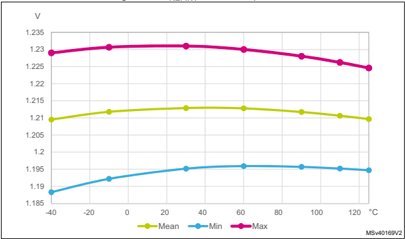

## 5.3.5 Supply current characteristics

The current consumption is a function of several parameters and factors such as the operating voltage, ambient temperature, I/O pin loading, device software configuration, operating frequencies, I/O pin switching rate, program location in memory and executed binary code

The current consumption is measured as described in Figure 17: Current consumption measurement .

## Typical and maximum current consumption

The MCU is placed under the following conditions:

- All I/O pins are in analog input mode
- All peripherals are disabled except when explicitly mentioned
- The Flash memory access time is adjusted with the minimum wait states number, depending on the f HCLK  frequency (refer to the table 'number of wait states according to CPU clock (HCLK) frequency' available in the reference manual RM0440 "STM32G4 Series advanced Arm ® -based 32-bit MCUs").
- When the peripherals are enabled f PCLK  = f HCLK
- The voltage scaling Range 1 is adjusted to f HCLK  frequency as follows:
- -Voltage Range 1 Boost mode for 150 MHz &lt; f HCLK ≤ 170 MHz
- -Voltage Range 1 Normal mode for 26 MHz &lt; f HCLK ≤ 150 MHz

The parameters given in Table 21 to Table 25 are derived from tests performed under ambient temperature and supply voltage conditions summarized in Table 17: General operating conditions .


Table 21. Current consumption in Run and Low-power run modes, code with data processing running from Flash in single Bank, ART enable (Cache ON Prefetch OFF)

| Symbol    | Parameter                  | Condition                                                                | Condition          | f       | Typ   | Typ   | Typ   | Typ   | Typ   | Max   | Max   | Max   | Max   | Max   |
|-----------|----------------------------|--------------------------------------------------------------------------|--------------------|---------|-------|-------|-------|-------|-------|-------|-------|-------|-------|-------|
| Symbol    | Parameter                  | -                                                                        | Voltage scaling    | HCLK    | 25°C  | 55°C  | 85°C  | 105°C | 125°C | 25°C  | 55°C  | 85°C  | 105°C | 125°C |
| IDD (Run) | Supply current in Run mode | 48 MHz included, bypass mode PLL ON above 48 MHz all peripherals disable | Range 2            | 26 MHz  | 3.65  | 3.85  | 4.45  | 5.1   | 6.45  | 4.40  | 6.60  | 11.0  | 16.0  | 22.0  |
| IDD (Run) | Supply current in Run mode | 48 MHz included, bypass mode PLL ON above 48 MHz all peripherals disable | Range 2            | 16 MHz  | 2.30  | 2.55  | 3.1   | 3.8   | 5.15  | 3.00  | 5.00  | 9.00  | 14.9  | 21.0  |
| IDD (Run) | Supply current in Run mode | 48 MHz included, bypass mode PLL ON above 48 MHz all peripherals disable | Range 2            | 8 MHz   | 1.25  | 1.50  | 2.05  | 2.8   | 4.1   | 2.00  | 3.6   | 7.70  | 13.0  | 19.0  |
| IDD (Run) | Supply current in Run mode | 48 MHz included, bypass mode PLL ON above 48 MHz all peripherals disable | Range 2            | 4 MHz   | 0.75  | 0.955 | 1.5   | 2.3   | 3.6   | 1.40  | 3.00  | 7.00  | 12.0  | 19.0  |
| IDD (Run) | Supply current in Run mode | 48 MHz included, bypass mode PLL ON above 48 MHz all peripherals disable | Range 2            | 2 MHz   | 0.47  | 0.69  | 1.25  | 2     | 3.35  | 0.990 | 2.60  | 6.70  | 12.0  | 19.0  |
| IDD (Run) | Supply current in Run mode | 48 MHz included, bypass mode PLL ON above 48 MHz all peripherals disable | Range 2            | 1 MHz   | 0.34  | 0.55  | 1.1   | 1.9   | 3.2   | 0.830 | 2.50  | 6.50  | 12.0  | 18.0  |
| IDD (Run) | Supply current in Run mode | 48 MHz included, bypass mode PLL ON above 48 MHz all peripherals disable | Range 2            | 100 KHz | 0.22  | 0.43  | 0.98  | 1.75  | 3.1   | 0.690 | 2.30  | 6.30  | 11.0  | 18.0  |
| IDD (Run) | Supply current in Run mode | 48 MHz included, bypass mode PLL ON above 48 MHz all peripherals disable | Range 1 Boost mode | 170 MHz | 29.50 | 29.5  | 31    | 32    | 34.5  | 31.0  | 35.0  | 42.0  | 48.0  | 56.0  |
| IDD (Run) | Supply current in Run mode | 48 MHz included, bypass mode PLL ON above 48 MHz all peripherals disable | Range 1            | 150 MHz | 24.50 | 26    | 27    | 28    | 30    | 26.0  | 28.0  | 34.0  | 44.0  | 47.0  |
| IDD (Run) | Supply current in Run mode | 48 MHz included, bypass mode PLL ON above 48 MHz all peripherals disable | Range 1            | 120 MHz | 19.50 | 20    | 20.5  | 21.5  | 23.5  | 21.0  | 23.0  | 32.0  | 38.0  | 43.0  |
| IDD (Run) | Supply current in Run mode | 48 MHz included, bypass mode PLL ON above 48 MHz all peripherals disable | Range 1            | 80 MHz  | 13.00 | 13.5  | 14    | 15.5  | 17    | 15.0  | 17.0  | 25.0  | 30.0  | 37.0  |
| IDD (Run) | Supply current in Run mode | 48 MHz included, bypass mode PLL ON above 48 MHz all peripherals disable | Range 1            | 72 MHz  | 12.00 | 12    | 13    | 14    | 15.5  | 13.0  | 16.0  | 23.0  | 29.0  | 36.0  |
| IDD (Run) | Supply current in Run mode | 48 MHz included, bypass mode PLL ON above 48 MHz all peripherals disable | Range 1            | 64 MHz  | 10.50 | 11    | 11.5  | 12.5  | 14.5  | 12.0  | 14.0  | 21.0  | 27.0  | 34.0  |
| IDD (Run) | Supply current in Run mode | 48 MHz included, bypass mode PLL ON above 48 MHz all peripherals disable | Range 1            | 48 MHz  | 7.90  | 8.2   | 9     | 9.7   | 11.5  | 9.10  | 13.0  | 19.0  | 25.0  | 32.0  |
| IDD (Run) | Supply current in Run mode | 48 MHz included, bypass mode PLL ON above 48 MHz all peripherals disable | Range 1            | 32 MHz  | 5.40  | 5.65  | 6.4   | 7.2   | 8.85  | 6.50  | 9.60  | 15.0  | 21.0  | 29.0  |
| IDD (Run) | Supply current in Run mode | 48 MHz included, bypass mode PLL ON above 48 MHz all peripherals disable | Range 1            | 24 MHz  | 4.10  | 4.35  | 5.1   | 5.95  | 7.6   | 5.20  | 8.00  | 14.0  | 20.0  | 28.0  |
| IDD (Run) | Supply current in Run mode | 48 MHz included, bypass mode PLL ON above 48 MHz all peripherals disable | Range 1            | 16 MHz  | 2.80  | 3.1   | 3.8   | 4.7   | 6.3   | 4.30  | 6.40  | 12.0  | 18.0  | 26.0  |

Table 21. Current consumption in Run and Low-power run modes, code with data


processing running from Flash in single Bank, ART enable (Cache ON Prefetch OFF) (continued)

|             |                                      | Condition - -                          | Condition - Voltage scaling            | f HCLK   |   Typ - 25°C |   Typ - 55°C |   Typ - 85°C |   Typ - 105°C |   Typ - 125°C |   Max - 25°C |   Max - 55°C |   Max - 85°C |   Max - 105°C |   Max - 125°C |    |
|-------------|--------------------------------------|----------------------------------------|----------------------------------------|----------|--------------|--------------|--------------|---------------|---------------|--------------|--------------|--------------|---------------|---------------|----|
| IDD (LPRun) | Supply current in Low-power run mode |                                        |                                        | 2 MHz    |          455 |          725 |         1350 |          2250 |          3800 |         1200 |         3200 |         8100 |         14000 |         22000 | µA |
| IDD (LPRun) | Supply current in Low-power run mode | SYSCLK source is HSE 1                 | SYSCLK source is HSE 1                 | MHz      |          280 |          545 |         1200 |          2100 |          3600 |         1100 |         3000 |         7900 |         14000 |         22000 | µA |
| IDD (LPRun) | Supply current in Low-power run mode | in bypass mode all peripherals disable | in bypass mode all peripherals disable | 250 KHz  |          160 |          435 |         1100 |          2000 |          3500 |          840 |         2800 |         7700 |         14000 |         22000 | µA |
| IDD (LPRun) | Supply current in Low-power run mode |                                        |                                        | 62.5 KHz |          130 |          405 |         1050 |          1950 |          3500 |          810 |         2700 |         7600 |         14000 |         22000 | µA |
| IDD (LPRun) | Supply current in Low-power run mode |                                        |                                        | 2 MHz    |          920 |         1200 |         1850 |          2750 |          4250 |         1900 |         3800 |         8700 |         15000 |         22000 | µA |
| IDD (LPRun) | Supply current in Low-power run mode | SYSCLK source is HSI16                 | SYSCLK source is HSI16                 | 1 MHz    |          780 |         1100 |         1700 |          2650 |          4150 |         1700 |         3700 |         8600 |         14000 |         22000 | µA |
| IDD (LPRun) | Supply current in Low-power run mode | all peripherals disable 250            | all peripherals disable 250            | KHz      |          725 |          980 |         1600 |          2500 |          4050 |         1600 |         3600 |         8400 |         14000 |         22000 | µA |
| IDD (LPRun) | Supply current in Low-power run mode | 62.5                                   | 62.5                                   | KHz      |          720 |          955 |         1600 |          2500 |          4000 |         1500 |         3500 |         8400 |         14000 |         22000 | µA |


Table 22. Current consumption in Run and Low-power run modes, code with data processing running from Flash in dual bank, ART enable (Cache ON Prefetch OFF)

| Symbol    | Parameter                  | Conditions - -                                                    | Conditions - Voltage scaling   | f HCLK   |   25°C |   55°C |   85°C |   105°C |   125°C |   Max (1) - 25°C |   Max (1) - 55°C |   Max (1) - 85°C |   Max (1) - 105°C |   Max (1) - Unit 125°C |    |
|-----------|----------------------------|-------------------------------------------------------------------|--------------------------------|----------|--------|--------|--------|---------|---------|------------------|------------------|------------------|-------------------|------------------------|----|
| IDD (Run) | Supply current in Run mode | included, bypass mode PLL ON above 48 MHz all peripherals disable | Range 2                        | 26 MHz   |   3.70 |    3.9 |   4.45 |    5.15 |    6.45 |             4.40 |             6.60 |             11.0 |              16.0 |                   22.0 |    |
| IDD (Run) | Supply current in Run mode | included, bypass mode PLL ON above 48 MHz all peripherals disable | Range 2                        | 16 MHz   |   2.35 |   2.55 |    3.1 |    3.85 |    5.15 |             3.00 |             5.00 |             9.00 |              14.0 |                   21.0 |    |
| IDD (Run) | Supply current in Run mode | included, bypass mode PLL ON above 48 MHz all peripherals disable | Range 2                        | 8 MHz    |   1.25 |    1.5 |   2.05 |     2.8 |    4.15 |             2.00 |             3.60 |             7.70 |              13.0 |                   19.0 |    |
| IDD (Run) | Supply current in Run mode | included, bypass mode PLL ON above 48 MHz all peripherals disable | Range 2                        | 4 MHz    |   0.75 |   0.97 |    1.5 |     2.3 |     3.6 |             1.40 |             3.00 |             7.00 |              12.0 |                   19.0 |    |
| IDD (Run) | Supply current in Run mode | included, bypass mode PLL ON above 48 MHz all peripherals disable | Range 2                        | 2 MHz    |   0.47 |    0.7 |   1.25 |    2.05 |    3.35 |            0.990 |             2.60 |             6.70 |              12.0 |                   19.0 |    |
| IDD (Run) | Supply current in Run mode | included, bypass mode PLL ON above 48 MHz all peripherals disable | Range 2                        | 1 MHz    |   0.34 |   0.56 |    1.1 |     1.9 |     3.2 |            0.830 |             2.50 |             6.50 |              12.0 |                   18.0 |    |
| IDD (Run) | Supply current in Run mode | included, bypass mode PLL ON above 48 MHz all peripherals disable | Range 2                        | 100 KHz  |   0.22 |   0.44 |  0.975 |     1.8 |     3.1 |            0.690 |             2.30 |             6.30 |              11.0 |                   18.0 |    |
| IDD (Run) | Supply current in Run mode | included, bypass mode PLL ON above 48 MHz all peripherals disable | Range 1 Boost mode             | 170 MHz  |  29.50 |     30 |     31 |      32 |    34.5 |             31.0 |             35.0 |             42.0 |              48.0 |                   56.0 |    |
| IDD (Run) | Supply current in Run mode | included, bypass mode PLL ON above 48 MHz all peripherals disable | Range 1                        | 150 MHz  |  24.50 |   24.5 |   25.5 |    26.5 |    28.5 |             26.0 |             28.0 |             34.0 |              44.0 |                   47.0 | mA |
| IDD (Run) | Supply current in Run mode | included, bypass mode PLL ON above 48 MHz all peripherals disable | Range 1                        | 120 MHz  |  19.50 |     20 |   20.5 |      22 |    23.5 |             21.0 |             23.0 |             32.0 |              38.0 |                   43.0 |    |
| IDD (Run) | Supply current in Run mode | included, bypass mode PLL ON above 48 MHz all peripherals disable | Range 1                        | 80 MHz   |  13.00 |   13.5 |   14.5 |    15.5 |      17 |             15.0 |             17.0 |             25.0 |              30.0 |                   37.0 |    |
| IDD (Run) | Supply current in Run mode | included, bypass mode PLL ON above 48 MHz all peripherals disable | Range 1                        | 72 MHz   |  12.00 |   12.5 |     13 |      14 |    15.5 |             13.0 |             16.0 |             23.0 |              29.0 |                   36.0 |    |
| IDD (Run) | Supply current in Run mode | included, bypass mode PLL ON above 48 MHz all peripherals disable | Range 1                        | 64 MHz   |  10.50 |     11 |   11.5 |      13 |    14.5 |             12.0 |             14.0 |             21.0 |              27.0 |                   34.0 |    |
| IDD (Run) | Supply current in Run mode | included, bypass mode PLL ON above 48 MHz all peripherals disable | Range 1                        | 48 MHz   |   7.95 |    8.3 |      9 |      10 |    11.5 |             9.10 |             13.0 |             19.0 |              25.0 |                   32.0 |    |
| IDD (Run) | Supply current in Run mode | included, bypass mode PLL ON above 48 MHz all peripherals disable | Range 1                        | 32 MHz   |   5.40 |    5.7 |   6.45 |    7.25 |     8.9 |             6.50 |             9.60 |             15.0 |              21.0 |                   29.0 |    |
| IDD (Run) | Supply current in Run mode | included, bypass mode PLL ON above 48 MHz all peripherals disable | Range 1                        | 24 MHz   |   4.10 |    4.4 |    5.1 |       6 |    7.65 |             5.20 |             8.00 |             14.0 |              20.0 |                   28.0 |    |
| IDD (Run) | Supply current in Run mode | included, bypass mode PLL ON above 48 MHz all peripherals disable | Range 1                        | 16 MHz   |   2.85 |   3.15 |    3.8 |    4.75 |    6.35 |             4.30 |             6.40 |             12.0 |              18.0 |                   26.0 |    |

Table 22. Current consumption in Run and Low-power run modes, code with data


processing running from Flash in dual bank, ART enable (Cache ON Prefetch OFF) (continued)

| Symbol      |                                      | Conditions - -                         | Conditions - Voltage scaling           | f HCLK   |   Typ - 25°C |   Typ - 55°C |   Typ - 85°C |   Typ - 105°C |   Typ - 125°C |   Max (1) - 25°C |   Max (1) - 55°C |   Max (1) - 85°C |   Max (1) - 105°C |   Max (1) - 125°C |
|-------------|--------------------------------------|----------------------------------------|----------------------------------------|----------|--------------|--------------|--------------|---------------|---------------|------------------|------------------|------------------|-------------------|-------------------|
| IDD (LPRun) | Supply current in Low-power run mode |                                        |                                        | 2 MHz    |          450 |          725 |         1350 |          2250 |          3800 |             1200 |             3200 |             8100 |             14000 |             22000 |
| IDD (LPRun) | Supply current in Low-power run mode | SYSCLK source is HSE 1                 | SYSCLK source is HSE 1                 | MHz      |          270 |          575 |         1200 |          2150 |          3650 |             1100 |             3000 |             7900 |             14000 |             22000 |
| IDD (LPRun) | Supply current in Low-power run mode | in bypass mode all peripherals disable | in bypass mode all peripherals disable | 250 KHz  |          185 |          460 |         1050 |          2000 |          3550 |              840 |             2800 |             7700 |             14000 |             22000 |
| IDD (LPRun) | Supply current in Low-power run mode | 62.5                                   | 62.5                                   | KHz      |          130 |          430 |         1050 |          2000 |          3500 |              810 |             2700 |             7600 |             14000 |             22000 |
| IDD (LPRun) |                                      |                                        |                                        | 2 MHz    |          970 |         1200 |         1850 |          2750 |          4300 |             1900 |             3800 |             8700 |             15000 |             22000 |
| IDD (LPRun) |                                      | SYSCLK source is HSI16                 | SYSCLK source is HSI16                 | 1 MHz    |          800 |         1100 |         1700 |          2650 |          4150 |             1700 |             3700 |             8600 |             14000 |             22000 |
| IDD (LPRun) |                                      | all peripherals disable                | all peripherals disable                | 250 KHz  |          680 |          990 |         1600 |          2550 |          4050 |             1600 |             3600 |             8400 |             14000 |             22000 |
| IDD (LPRun) |                                      |                                        |                                        | 62.5 KHz |          695 |          965 |         1600 |          2500 |          4050 |             1500 |             3500 |             8400 |             14000 |             22000 |


Table 23. Current consumption in Run and Low-power run modes, code with data processing running from SRAM1

| Symbol   | Parameter                  | Conditions                                                        | Conditions         |         | Typ   | Typ   | Typ   | Typ   | Typ   | Max (1)   | Max (1)   | Max (1)   | Max (1)   | Max (1)   |      |
|----------|----------------------------|-------------------------------------------------------------------|--------------------|---------|-------|-------|-------|-------|-------|-----------|-----------|-----------|-----------|-----------|------|
| Symbol   | Parameter                  | -                                                                 | Voltage scaling    | f HCLK  | 25°C  | 55°C  | 85°C  | 105°C | 125°C | 25°C      | 55°C      | 85°C      | 105°C     | 125°C     | Unit |
| IDD(Run) | Supply current in Run mode | included, bypass mode PLL ON above 48 MHz all peripherals disable | Range 2            | 26 MHz  | 3.35  | 3.55  | 4.1   | 4.95  | 6.45  | 4.00      | 6.20      | 11.0      | 15.0      | 22.0      |      |
| IDD(Run) | Supply current in Run mode | included, bypass mode PLL ON above 48 MHz all peripherals disable | Range 2            | 16 MHz  | 2.15  | 2.35  | 2.9   | 3.7   | 5.25  | 3.10      | 4.70      | 8.70      | 14.0      | 20.0      |      |
| IDD(Run) | Supply current in Run mode | included, bypass mode PLL ON above 48 MHz all peripherals disable | Range 2            | 8 MHz   | 1.15  | 1.35  | 1.9   | 2.7   | 4.2   | 1.90      | 3.50      | 7.50      | 13.0      | 19.0      |      |
| IDD(Run) | Supply current in Run mode | included, bypass mode PLL ON above 48 MHz all peripherals disable | Range 2            | 4 MHz   | 0.69  | 0.855 | 1.4   | 2.2   | 3.7   | 1.30      | 2.90      | 6.90      | 12.0      | 19.0      |      |
| IDD(Run) | Supply current in Run mode | included, bypass mode PLL ON above 48 MHz all peripherals disable | Range 2            | 2 MHz   | 0.43  | 0.595 | 1.15  | 1.95  | 3.45  | 0.960     | 2.60      | 6.60      | 12.0      | 18.0      |      |
| IDD(Run) | Supply current in Run mode | included, bypass mode PLL ON above 48 MHz all peripherals disable | Range 2            | 1 MHz   | 0.30  | 0.47  | 1     | 1.8   | 3.3   | 0.810     | 2.40      | 6.40      | 12.0      | 18.0      |      |
| IDD(Run) | Supply current in Run mode | included, bypass mode PLL ON above 48 MHz all peripherals disable | Range 2            | 100 KHz | 0.19  | 0.355 | 0.89  | 1.7   | 3.2   | 0.680     | 2.30      | 6.30      | 11.0      | 18.0      |      |
| IDD(Run) | Supply current in Run mode | included, bypass mode PLL ON above 48 MHz all peripherals disable | Range 1 Boost mode | 170 MHz | 26.00 | 26.5  | 27.5  | 28.5  | 30.5  | 28.0      | 32.0      | 39.0      | 45.0      | 53.0 (2)  |      |
| IDD(Run) | Supply current in Run mode | included, bypass mode PLL ON above 48 MHz all peripherals disable | Range 1            | 150 MHz | 21.50 | 22    | 22.5  | 23.5  | 25.5  | 23.0      | 25.0      | 31.0      | 41.0      | 46.0 (2)  | mA   |
| IDD(Run) | Supply current in Run mode | included, bypass mode PLL ON above 48 MHz all peripherals disable | Range 1            | 120 MHz | 17.50 | 17.5  | 18.5  | 19.5  | 21.5  | 19.0      | 21.0      | 30.0      | 36.0      | 41.0      |      |
| IDD(Run) | Supply current in Run mode | included, bypass mode PLL ON above 48 MHz all peripherals disable | Range 1            | 80 MHz  | 11.50 | 12    | 12.5  | 13.5  | 15.5  | 13.0      | 15.0      | 23.0      | 29.0      | 35.0      |      |
| IDD(Run) | Supply current in Run mode | included, bypass mode PLL ON above 48 MHz all peripherals disable | Range 1            | 72 MHz  | 10.50 | 11    | 11.5  | 12.5  | 14.5  | 12.0      | 14.0      | 21.0      | 27.0      | 34.0      |      |
| IDD(Run) | Supply current in Run mode | included, bypass mode PLL ON above 48 MHz all peripherals disable | Range 1            | 64 MHz  | 9.45  | 9.7   | 10.5  | 11.5  | 13.5  | 11.0      | 13.0      | 20.0      | 26.0      | 33.0      |      |
| IDD(Run) | Supply current in Run mode | included, bypass mode PLL ON above 48 MHz all peripherals disable | Range 1            | 48 MHz  | 7.25  | 7.5   | 8.2   | 9.25  | 11    | 8.10      | 12.0      | 17.0      | 23.0      | 31.0      |      |
| IDD(Run) | Supply current in Run mode | included, bypass mode PLL ON above 48 MHz all peripherals disable | Range 1            | 32 MHz  | 4.90  | 5.15  | 5.85  | 6.9   | 8.7   | 6.00      | 8.90      | 15.0      | 21.0      | 29.0      |      |
| IDD(Run) | Supply current in Run mode | included, bypass mode PLL ON above 48 MHz all peripherals disable | Range 1            | 24 MHz  | 3.75  | 4     | 4.7   | 5.7   | 7.5   | 4.80      | 7.50      | 13.0      | 19.0      | 27.0      |      |
| IDD(Run) | Supply current in Run mode | included, bypass mode PLL ON above 48 MHz all peripherals disable | Range 1            | 16 MHz  | 2.60  | 2.85  | 3.5   | 4.5   | 6.3   | 4.00      | 6.10      | 12.0      | 18.0      | 26.0      |      |


Table 23. Current consumption in Run and Low-power run modes, code with data processing running from SRAM1 (continued)

| Symbol      | Parameter                            | Conditions - -                         | Conditions - Voltage scaling           | f HCLK   |   Typ - 25°C |   Typ - 55°C |   Typ - 85°C |   Typ - 105°C |   Typ - 125°C |   Max (1) - 25°C |   Max (1) - 55°C |   Max (1) - 85°C |   Max (1) - 105°C |   Max (1) - 125°C |
|-------------|--------------------------------------|----------------------------------------|----------------------------------------|----------|--------------|--------------|--------------|---------------|---------------|------------------|------------------|------------------|-------------------|-------------------|
| IDD (LPRun) | Supply current in Low-power run mode |                                        |                                        | 2 MHz    |          365 |          570 |         1200 |          2150 |          3850 |             1200 |             3100 |             7900 |             14000 |             22000 |
| IDD (LPRun) | Supply current in Low-power run mode | SYSCLK source is HSE                   | SYSCLK source is HSE                   | 1 MHz    |          240 |          425 |         1050 |          2000 |          3650 |              960 |             2900 |             7700 |             14000 |             22000 |
| IDD (LPRun) | Supply current in Low-power run mode | in bypass mode all peripherals disable | in bypass mode all peripherals disable | 250 KHz  |          135 |          315 |          945 |          1850 |          3550 |              840 |             2800 |             7600 |             13000 |             22000 |
| IDD (LPRun) | Supply current in Low-power run mode |                                        |                                        | 62.5 KHz |          105 |          285 |          915 |          1850 |          3550 |              780 |             2700 |             7600 |             13000 |             22000 |
| IDD (LPRun) | Supply current in Low-power run mode |                                        |                                        | 2 MHz    |          835 |         1050 |         1650 |          2600 |          4300 |             1800 |             3700 |             8600 |             14000 |             22000 |
| IDD (LPRun) | Supply current in Low-power run mode | SYSCLK source is HSI16 1               | SYSCLK source is HSI16 1               | MHz      |          775 |          940 |         1550 |          2500 |          4150 |             1700 |             3600 |             8500 |             14000 |             22000 |
| IDD (LPRun) | Supply current in Low-power run mode | peripherals disable                    | peripherals disable                    | 250 KHz  |          640 |          860 |         1450 |          2400 |          4100 |             1500 |             3500 |             8400 |             14000 |             22000 |
| IDD (LPRun) | Supply current in Low-power run mode |                                        |                                        | 62.5 KHz |          640 |          830 |         1450 |          2350 |          4050 |             1600 |             3500 |             8400 |             14000 |             22000 |

2. Guaranteed by test in production.


DS12288 Rev 6

Table 24. Typical current consumption in Run and Low-power run modes, with different codes running from Flash, ART enable (Cache ON Prefetch OFF)

| Symbol    | Parameter                  | Conditions - -                                                                 | Conditions - Voltage scaling        | Code             |   Typ Single Bank Mode - 25°C |   Typ Dual Bank Mode - 25°C | Unit   |   Typ Single Bank Mode - 25°C |   Typ Dual Bank Mode - 25°C | Unit   |
|-----------|----------------------------|--------------------------------------------------------------------------------|-------------------------------------|------------------|-------------------------------|-----------------------------|--------|-------------------------------|-----------------------------|--------|
| IDD (Run) | Supply current in Run mode | up to 48 MHZ included, bypass mode PLL ON above 48 MHz all peripherals disable | Range2 f HCLK =26MHz                | Reduced code (1) |                          3.65 |                         3.7 | mA     |                           140 |                         142 | µA/MHz |
| IDD (Run) | Supply current in Run mode | up to 48 MHZ included, bypass mode PLL ON above 48 MHz all peripherals disable | Range2 f HCLK =26MHz                | Coremark         |                          3.65 |                         3.7 | mA     |                           140 |                         142 | µA/MHz |
| IDD (Run) | Supply current in Run mode | up to 48 MHZ included, bypass mode PLL ON above 48 MHz all peripherals disable | Range2 f HCLK =26MHz                | Dhrystone2.1     |                          3.65 |                         3.7 | mA     |                           140 |                         142 | µA/MHz |
| IDD (Run) | Supply current in Run mode | up to 48 MHZ included, bypass mode PLL ON above 48 MHz all peripherals disable | Range2 f HCLK =26MHz                | Fibonacci        |                          4.55 |                         4.2 | mA     |                           175 |                         162 | µA/MHz |
| IDD (Run) | Supply current in Run mode | up to 48 MHZ included, bypass mode PLL ON above 48 MHz all peripherals disable | Range2 f HCLK =26MHz                | While(1)         |                          2.90 |                           3 | mA     |                           112 |                         115 | µA/MHz |
| IDD (Run) | Supply current in Run mode | up to 48 MHZ included, bypass mode PLL ON above 48 MHz all peripherals disable | Range 1 f HCLK = 150 MHz            | Reduced code (1) |                          24.5 |                        24.5 | mA     |                           163 |                         163 | µA/MHz |
| IDD (Run) | Supply current in Run mode | up to 48 MHZ included, bypass mode PLL ON above 48 MHz all peripherals disable | Range 1 f HCLK = 150 MHz            | Coremark         |                            24 |                          24 | mA     |                           160 |                         160 | µA/MHz |
| IDD (Run) | Supply current in Run mode | up to 48 MHZ included, bypass mode PLL ON above 48 MHz all peripherals disable | Range 1 f HCLK = 150 MHz            | Dhrystone2.1     |                          24.5 |                        24.5 | mA     |                           163 |                         163 | µA/MHz |
| IDD (Run) | Supply current in Run mode | up to 48 MHZ included, bypass mode PLL ON above 48 MHz all peripherals disable | Range 1 f HCLK = 150 MHz            | Fibonacci        |                          22.5 |                          28 | mA     |                           150 |                         187 | µA/MHz |
| IDD (Run) | Supply current in Run mode | up to 48 MHZ included, bypass mode PLL ON above 48 MHz all peripherals disable | Range 1 f HCLK = 150 MHz            | While(1)         |                          19.5 |                          20 | mA     |                           130 |                         133 | µA/MHz |
| IDD (Run) | Supply current in Run mode | up to 48 MHZ included, bypass mode PLL ON above 48 MHz all peripherals disable | Range 1 Boost mode f HCLK = 170 MHz | Reduced code (1) |                          29.5 |                        29.5 | mA     |                           174 |                         174 | µA/MHz |
| IDD (Run) | Supply current in Run mode | up to 48 MHZ included, bypass mode PLL ON above 48 MHz all peripherals disable | Range 1 Boost mode f HCLK = 170 MHz | Coremark         |                            29 |                          29 | mA     |                           171 |                         171 | µA/MHz |
| IDD (Run) | Supply current in Run mode | up to 48 MHZ included, bypass mode PLL ON above 48 MHz all peripherals disable | Range 1 Boost mode f HCLK = 170 MHz | Dhrystone2.1     |                          29.5 |                        29.5 | mA     |                           174 |                         174 | µA/MHz |
| IDD (Run) | Supply current in Run mode | up to 48 MHZ included, bypass mode PLL ON above 48 MHz all peripherals disable | Range 1 Boost mode f HCLK = 170 MHz | Fibonacci        |                            38 |                          35 | mA     |                           224 |                         206 | µA/MHz |
| IDD (Run) | Supply current in Run mode | up to 48 MHZ included, bypass mode PLL ON above 48 MHz all peripherals disable | Range 1 Boost mode f HCLK = 170 MHz | While(1)         |                          23.5 |                          24 | mA     |                           138 |                         141 | µA/MHz |

| Symbol       | Parameter                       | Conditions - -                         | Conditions - Voltage scaling           | Code             |   Typ Single Bank Mode - 25°C |   Typ Dual Bank Mode - 25°C | Unit   |   Typ Single Bank Mode - 25°C |   Typ Dual Bank Mode - 25°C | Unit   |
|--------------|---------------------------------|----------------------------------------|----------------------------------------|------------------|-------------------------------|-----------------------------|--------|-------------------------------|-----------------------------|--------|
| I DD (LPRun) | Supply current in Low-power run |                                        |                                        | Reduced code (1) |                           920 |                         970 | µA     |                           460 |                         485 | µA/MHz |
| I DD (LPRun) | Supply current in Low-power run | SYSCLK source is HSI16                 | SYSCLK source is HSI16                 | Coremark         |                           905 |                         985 | µA     |                           453 |                         493 | µA/MHz |
| I DD (LPRun) | Supply current in Low-power run | f HCLK = 2 MHz all peripherals disable | f HCLK = 2 MHz all peripherals disable | Dhrystone2.1     |                           915 |                         915 | µA     |                           458 |                         458 | µA/MHz |
| I DD (LPRun) | Supply current in Low-power run |                                        |                                        | Fibonacci        |                         1,050 |                         950 | µA     |                           525 |                         475 | µA/MHz |
| I DD (LPRun) | Supply current in Low-power run |                                        |                                        | While(1)         |                           930 |                         875 | µA     |                           465 |                         438 | µA/MHz |

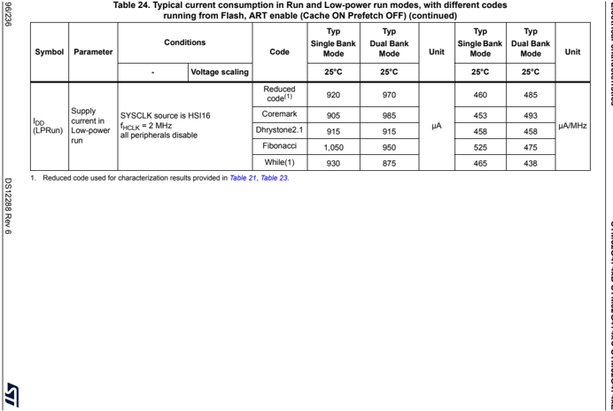


| Symbol      | Table 25. Typical current consumption in Run and Low-power run modes, with different codes running from SRAM1 - Parameter   | Conditions - -                                                                                | Voltage scaling                     | Code             |   Typ - 25°C | Unit   |   Typ - 25°C | Unit   |
|-------------|-----------------------------------------------------------------------------------------------------------------------------|-----------------------------------------------------------------------------------------------|-------------------------------------|------------------|--------------|--------|--------------|--------|
| IDD (Run)   | Supply current in Run mode                                                                                                  | f HCLK = f HSE up to 48 MHZ included, bypass mode PLL ON above 48 MHz all peripherals disable | Range2 f HCLK =26 M Hz              | Reduced code (1) |         3.25 | mA     |          125 | µA/MHz |
|             |                                                                                                                             |                                                                                               |                                     | Coremark         |         3.35 |        |          129 |        |
|             |                                                                                                                             |                                                                                               |                                     | Dhrystone2.1     |         3.30 |        |          127 |        |
|             |                                                                                                                             |                                                                                               |                                     | Fibonacci        |         3.30 |        |          127 |        |
|             |                                                                                                                             |                                                                                               |                                     | While(1)         |         3.40 |        |          131 |        |
|             |                                                                                                                             |                                                                                               | Range 1 f HCLK = 150 MHz            | Reduced code (1) |        21.50 |        |          143 | µA/MHz |
|             |                                                                                                                             |                                                                                               |                                     | Coremark         |        22.50 |        |          150 |        |
|             |                                                                                                                             |                                                                                               |                                     | Dhrystone2.1     |        21.50 | mA     |          143 |        |
|             |                                                                                                                             |                                                                                               |                                     | Fibonacci        |        22.50 |        |          150 |        |
|             |                                                                                                                             |                                                                                               |                                     | While(1)         |        20.00 |        |          133 |        |
|             |                                                                                                                             |                                                                                               | Range 1 Boost mode f HCLK = 170 MHz | Reduced code (1) |        26.00 |        |          153 | µA/MHz |
|             |                                                                                                                             |                                                                                               |                                     | Coremark         |        27.00 |        |          159 |        |
|             |                                                                                                                             |                                                                                               |                                     | Dhrystone2.1     |        26.00 | mA     |          153 |        |
|             |                                                                                                                             |                                                                                               |                                     | Fibonacci        |        27.50 |        |          162 |        |
|             |                                                                                                                             |                                                                                               |                                     | While(1)         |        24.50 |        |          144 |        |
| IDD (LPRun) | Supply current in Low-power run                                                                                             |                                                                                               |                                     | Reduced code (1) |          955 | µA     |          478 | µA/MHz |
|             |                                                                                                                             |                                                                                               |                                     | Coremark         |          890 |        |          445 |        |
|             |                                                                                                                             | f HCLK = f HSE = 2 MHz all peripherals disable                                                |                                     | Dhrystone2.1     |          915 |        |          458 |        |
|             |                                                                                                                             |                                                                                               |                                     | Fibonacci        |          880 |        |          440 |        |
|             |                                                                                                                             |                                                                                               |                                     | While(1)         |          905 |        |          453 |        |


Table 26. Typical current consumption in Run and Low-power run modes, with different codes running from SRAM2

|             |                                 | Conditions - -                                                                                | Conditions - Voltage scaling        | f HCLK           |   Typ - Single bank mode | Unit   |   Typ - Single bank mode |        |
|-------------|---------------------------------|-----------------------------------------------------------------------------------------------|-------------------------------------|------------------|--------------------------|--------|--------------------------|--------|
| IDD (Run)   | Supply current in Run mode      | f HCLK = f HSE up to 48 MHZ included, bypass mode PLL ON above 48 MHz all peripherals disable | Range2 f HCLK =26 M Hz              | Reduced code (1) |                     2.65 | mA     |                      102 | µA/MHz |
| IDD (Run)   | Supply current in Run mode      | f HCLK = f HSE up to 48 MHZ included, bypass mode PLL ON above 48 MHz all peripherals disable | Range2 f HCLK =26 M Hz              | Coremark         |                     2.80 | mA     |                      108 | µA/MHz |
| IDD (Run)   | Supply current in Run mode      | f HCLK = f HSE up to 48 MHZ included, bypass mode PLL ON above 48 MHz all peripherals disable | Range2 f HCLK =26 M Hz              | Dhrystone2.1     |                     2.65 | mA     |                      102 | µA/MHz |
| IDD (Run)   | Supply current in Run mode      | f HCLK = f HSE up to 48 MHZ included, bypass mode PLL ON above 48 MHz all peripherals disable | Range2 f HCLK =26 M Hz              | Fibonacci        |                     2.60 | mA     |                      100 | µA/MHz |
| IDD (Run)   | Supply current in Run mode      | f HCLK = f HSE up to 48 MHZ included, bypass mode PLL ON above 48 MHz all peripherals disable | Range2 f HCLK =26 M Hz              | While(1)         |                     2.45 | mA     |                       94 | µA/MHz |
| IDD (Run)   | Supply current in Run mode      | f HCLK = f HSE up to 48 MHZ included, bypass mode PLL ON above 48 MHz all peripherals disable | Range 1 f HCLK = 150 MHz            | Reduced code (1) |                    17.50 | mA     |                      117 | µA/MHz |
| IDD (Run)   | Supply current in Run mode      | f HCLK = f HSE up to 48 MHZ included, bypass mode PLL ON above 48 MHz all peripherals disable | Range 1 f HCLK = 150 MHz            | Coremark         |                    18.00 | mA     |                      120 | µA/MHz |
| IDD (Run)   | Supply current in Run mode      | f HCLK = f HSE up to 48 MHZ included, bypass mode PLL ON above 48 MHz all peripherals disable | Range 1 f HCLK = 150 MHz            | Dhrystone2.1     |                    17.50 | mA     |                      117 | µA/MHz |
| IDD (Run)   | Supply current in Run mode      | f HCLK = f HSE up to 48 MHZ included, bypass mode PLL ON above 48 MHz all peripherals disable | Range 1 f HCLK = 150 MHz            | Fibonacci        |                    17.00 | mA     |                      113 | µA/MHz |
| IDD (Run)   | Supply current in Run mode      | f HCLK = f HSE up to 48 MHZ included, bypass mode PLL ON above 48 MHz all peripherals disable | Range 1 f HCLK = 150 MHz            | While(1)         |                       16 | mA     |                      107 | µA/MHz |
| IDD (Run)   | Supply current in Run mode      | f HCLK = f HSE up to 48 MHZ included, bypass mode PLL ON above 48 MHz all peripherals disable | Range 1 Boost mode f HCLK = 170 MHz | Reduced code (1) |                    21.00 | mA     |                      124 | µA/MHz |
| IDD (Run)   | Supply current in Run mode      | f HCLK = f HSE up to 48 MHZ included, bypass mode PLL ON above 48 MHz all peripherals disable | Range 1 Boost mode f HCLK = 170 MHz | Coremark         |                    22.00 | mA     |                      129 | µA/MHz |
| IDD (Run)   | Supply current in Run mode      | f HCLK = f HSE up to 48 MHZ included, bypass mode PLL ON above 48 MHz all peripherals disable | Range 1 Boost mode f HCLK = 170 MHz | Dhrystone2.1     |                    21.00 | mA     |                      124 | µA/MHz |
| IDD (Run)   | Supply current in Run mode      | f HCLK = f HSE up to 48 MHZ included, bypass mode PLL ON above 48 MHz all peripherals disable | Range 1 Boost mode f HCLK = 170 MHz | Fibonacci        |                    20.50 | mA     |                      121 | µA/MHz |
| IDD (Run)   | Supply current in Run mode      | f HCLK = f HSE up to 48 MHZ included, bypass mode PLL ON above 48 MHz all peripherals disable | Range 1 Boost mode f HCLK = 170 MHz | While(1)         |                    19.50 | mA     |                      115 | µA/MHz |
| IDD (LPRun) | Supply current in Low-power run |                                                                                               |                                     | Reduced code (1) |                      890 | µA     |                      445 | µA/MHz |
| IDD (LPRun) | Supply current in Low-power run | SYSCLK source is HSI16                                                                        | SYSCLK source is HSI16              | Coremark         |                      830 | µA     |                      415 | µA/MHz |
| IDD (LPRun) | Supply current in Low-power run | F HCLK = 2MHz                                                                                 | F HCLK = 2MHz                       | Dhrystone2.1     |                      825 | µA     |                      413 | µA/MHz |
| IDD (LPRun) | Supply current in Low-power run | all peripherals disable                                                                       | all peripherals disable             | Fibonacci        |                      830 | µA     |                      415 | µA/MHz |
| IDD (LPRun) | Supply current in Low-power run |                                                                                               |                                     | While(1)         |                      815 | µA     |                      408 | µA/MHz |


Table 27. Typical current consumption in Run and Low-power run modes, with different codes running from CCMSRAM

| Symbol      | Parameter                       | Conditions - -                                                                                | Voltage scaling                     | f HCLK           |   Typ - Single bank mode | Unit   |   Typ - Single bank mode | Unit   |
|-------------|---------------------------------|-----------------------------------------------------------------------------------------------|-------------------------------------|------------------|--------------------------|--------|--------------------------|--------|
| IDD (Run)   | Supply current in Run mode      | f HCLK = f HSE up to 48 MHZ included, bypass mode PLL ON above 48 MHz all peripherals disable | Range2 f HCLK =26 M Hz              | Reduced code (1) |                     2.75 | mA     |                      106 | µA/MHz |
|             |                                 |                                                                                               |                                     | Coremark         |                     2.85 |        |                      110 |        |
|             |                                 |                                                                                               |                                     | Dhrystone2.1     |                     2.75 |        |                      106 |        |
|             |                                 |                                                                                               |                                     | Fibonacci        |                     2.95 |        |                      113 |        |
|             |                                 |                                                                                               |                                     | While(1)         |                     2.60 |        |                      100 |        |
|             |                                 |                                                                                               | Range 1 f HCLK = 150 MHz            | Reduced code (1) |                    18.00 | mA     |                      120 | µA/MHz |
|             |                                 |                                                                                               |                                     | Coremark         |                    18.50 |        |                      123 |        |
|             |                                 |                                                                                               |                                     | Dhrystone2.1     |                    18.00 |        |                      120 |        |
|             |                                 |                                                                                               |                                     | Fibonacci        |                    19.00 |        |                      127 |        |
|             |                                 |                                                                                               |                                     | While(1)         |                    17.00 |        |                      113 |        |
|             |                                 |                                                                                               | Range 1 Boost mode f HCLK = 170 MHz | Reduced code (1) |                    22.00 | mA     |                      129 | µA/MHz |
|             |                                 |                                                                                               |                                     | Coremark         |                    22.50 |        |                      132 |        |
|             |                                 |                                                                                               |                                     | Dhrystone2.1     |                    22.00 |        |                      129 |        |
|             |                                 |                                                                                               |                                     | Fibonacci        |                    23.50 |        |                      138 |        |
|             |                                 |                                                                                               |                                     | While(1)         |                    20.50 |        |                      121 |        |
| IDD (LPRun) | Supply current in Low-power run | SYSCLK source is HSI16                                                                        |                                     | Reduced code (1) |                      900 | µA     |                      450 | µA/MHz |
|             |                                 |                                                                                               |                                     | Coremark         |                      850 |        |                      425 |        |
|             |                                 | F HCLK = 2MHz                                                                                 |                                     | Dhrystone2.1     |                      870 |        |                      435 |        |
|             |                                 | all peripherals disable                                                                       |                                     | Fibonacci        |                      850 |        |                      425 |        |
|             |                                 |                                                                                               |                                     | While(1)         |                      810 |        |                      405 |        |


Table 28. Current consumption in Sleep and Low-power sleep mode Flash ON

| Symbol      | Parameter                    | Condition                                                                      | Condition          |         | Typ   | Typ   | Typ   | Typ   | Typ   | Max   | Max   | Max   | Max   | Max   |
|-------------|------------------------------|--------------------------------------------------------------------------------|--------------------|---------|-------|-------|-------|-------|-------|-------|-------|-------|-------|-------|
| Symbol      | Parameter                    | -                                                                              | Voltage scaling    | f HCLK  | 25°C  | 55°C  | 85°C  | 105°C | 125°C | 25°C  | 55°C  | 85°C  | 105°C | 125°C |
| IDD (Sleep) | Supply current in sleep mode | up to 48 MHz included, bypass mode PLL ON above 48 MHz all peripherals disable | Range 2            | 26 MHz  | 0.98  | 1.1   | 1.75  | 2.4   | 3.75  | 1.90  | 3.50  | 7.60  | 13.0  | 19.0  |
| IDD (Sleep) | Supply current in sleep mode | up to 48 MHz included, bypass mode PLL ON above 48 MHz all peripherals disable | Range 2            | 16 MHz  | 0.67  | 0.835 | 1.45  | 2.15  | 3.5   | 1.50  | 3.00  | 7.10  | 12.0  | 19.0  |
| IDD (Sleep) | Supply current in sleep mode | up to 48 MHz included, bypass mode PLL ON above 48 MHz all peripherals disable | Range 2            | 8 MHz   | 0.44  | 0.605 | 1.25  | 2     | 3.35  | 1.10  | 2.70  | 6.70  | 12.0  | 19.0  |
| IDD (Sleep) | Supply current in sleep mode | up to 48 MHz included, bypass mode PLL ON above 48 MHz all peripherals disable | Range 2            | 4 MHz   | 0.33  | 0.5   | 1.1   | 1.9   | 3.25  | 0.860 | 2.50  | 6.50  | 12.0  | 18.0  |
| IDD (Sleep) | Supply current in sleep mode | up to 48 MHz included, bypass mode PLL ON above 48 MHz all peripherals disable | Range 2            | 2 MHz   | 0.27  | 0.445 | 1.05  | 1.85  | 3.2   | 0.760 | 2.40  | 6.40  | 11.0  | 18.0  |
| IDD (Sleep) | Supply current in sleep mode | up to 48 MHz included, bypass mode PLL ON above 48 MHz all peripherals disable | Range 2            | 1 MHz   | 0.24  | 0.415 | 1.05  | 1.8   | 3.15  | 0.720 | 2.30  | 6.40  | 11.0  | 18.0  |
| IDD (Sleep) | Supply current in sleep mode | up to 48 MHz included, bypass mode PLL ON above 48 MHz all peripherals disable | Range 2            | 100 KHz | 0.21  | 0.385 | 0.995 | 1.8   | 3.1   | 0.670 | 2.30  | 6.30  | 11.0  | 18.0  |
| IDD (Sleep) | Supply current in sleep mode | up to 48 MHz included, bypass mode PLL ON above 48 MHz all peripherals disable | Range 1 Boost mode | 170 MHz | 6.60  | 6.95  | 7.8   | 8.9   | 10.5  | 8.00  | 12.0  | 18.0  | 24.0  | 33.0  |
| IDD (Sleep) | Supply current in sleep mode | up to 48 MHz included, bypass mode PLL ON above 48 MHz all peripherals disable | Range 1            | 150 MHz | 5.50  | 5.8   | 6.55  | 7.55  | 9.25  | 6.40  | 9.50  | 15.0  | 21.0  | 29.0  |
| IDD (Sleep) | Supply current in sleep mode | up to 48 MHz included, bypass mode PLL ON above 48 MHz all peripherals disable | Range 1            | 120 MHz | 4.50  | 4.75  | 5.5   | 6.55  | 8.2   | 5.40  | 8.20  | 14.0  | 20.0  | 28.0  |
| IDD (Sleep) | Supply current in sleep mode | up to 48 MHz included, bypass mode PLL ON above 48 MHz all peripherals disable | Range 1            | 80 MHz  | 3.15  | 3.45  | 4.2   | 5.15  | 6.8   | 4.50  | 6.60  | 12.0  | 18.0  | 26.0  |
| IDD (Sleep) | Supply current in sleep mode | up to 48 MHz included, bypass mode PLL ON above 48 MHz all peripherals disable | Range 1            | 72 MHz  | 2.85  | 3.15  | 3.9   | 4.9   | 6.55  | 4.20  | 6.30  | 12.0  | 18.0  | 26.0  |
| IDD (Sleep) | Supply current in sleep mode | up to 48 MHz included, bypass mode PLL ON above 48 MHz all peripherals disable | Range 1            | 64 MHz  | 2.60  | 2.9   | 3.65  | 4.6   | 6.3   | 3.50  | 6.00  | 12.0  | 18.0  | 26.0  |
| IDD (Sleep) | Supply current in sleep mode | up to 48 MHz included, bypass mode PLL ON above 48 MHz all peripherals disable | Range 1            | 48 MHz  | 1.90  | 2.2   | 3     | 3.65  | 5.3   | 3.20  | 5.30  | 11.0  | 17.0  | 25.0  |
| IDD (Sleep) | Supply current in sleep mode | up to 48 MHz included, bypass mode PLL ON above 48 MHz all peripherals disable | Range 1            | 32 MHz  | 1.40  | 1.65  | 2.4   | 3.2   | 4.85  | 2.70  | 4.80  | 11.0  | 17.0  | 25.0  |
| IDD (Sleep) | Supply current in sleep mode | up to 48 MHz included, bypass mode PLL ON above 48 MHz all peripherals disable | Range 1            | 24 MHz  | 1.10  | 1.35  | 2.1   | 3     | 4.65  | 2.30  | 4.50  | 9.80  | 16.0  | 25.0  |
| IDD (Sleep) | Supply current in sleep mode | up to 48 MHz included, bypass mode PLL ON above 48 MHz all peripherals disable | Range 1            | 16 MHz  | 0.83  | 1.1   | 1.85  | 2.75  | 4.35  | 1.90  | 4.10  | 9.40  | 16.0  | 24.0  |


Table 28. Current consumption in Sleep and Low-power sleep mode Flash ON (continued)

|               | Parameter                              | Condition - -                         | Condition - Voltage scaling           | f HCLK   |   Typ - 25°C |   Typ - 55°C |   Typ - 85°C |   Typ - 105°C |   Typ - 125°C |   Max - 25°C |   Max - 55°C |   Max - 85°C |   Max - 105°C |   Max - 125°C |     |
|---------------|----------------------------------------|---------------------------------------|---------------------------------------|----------|--------------|--------------|--------------|---------------|---------------|--------------|--------------|--------------|---------------|---------------|-----|
| IDD (LPSleep) | Supply current in Low-power sleep mode |                                       |                                       | 2 MHz    |          205 |          430 |         1150 |          2050 |          3600 |         1600 |         2900 |         7800 |         14000 |         22000 | μ A |
| IDD (LPSleep) | Supply current in Low-power sleep mode | SYSCLK source is HSE in bypass mode 1 | SYSCLK source is HSE in bypass mode 1 | MHz      |          165 |          400 |         1100 |          2000 |          3550 |         1100 |         2900 |         7700 |         14000 |         22000 | μ A |
| IDD (LPSleep) | Supply current in Low-power sleep mode | all peripherals disable               | all peripherals disable               | 250 KHz  |          145 |          370 |         1100 |          2000 |          3550 |          820 |         2800 |         7700 |         13000 |         22000 | μ A |
| IDD (LPSleep) | Supply current in Low-power sleep mode | 62.5                                  | 62.5                                  | KHz      |          140 |          365 |         1050 |          2000 |          3550 |          810 |         2800 |         7700 |         13000 |         22000 | μ A |
| IDD (LPSleep) |                                        |                                       |                                       | 2 MHz    |          700 |          925 |         1650 |          2550 |          4100 |         1600 |         3600 |         8400 |         14000 |         22000 | μ A |
| IDD (LPSleep) |                                        | SYSCLK source is HSI16                | SYSCLK source is HSI16                | 1 MHz    |          710 |          925 |         1600 |          2550 |          4100 |         1600 |         3600 |         8400 |         14000 |         22000 | μ A |
| IDD (LPSleep) |                                        | all peripherals disable 250           | all peripherals disable 250           | KHz      |          670 |          910 |         1600 |          2500 |          4050 |         1600 |         3600 |         8400 |         14000 |         22000 | μ A |
| IDD (LPSleep) |                                        | 62.5                                  | 62.5                                  | KHz      |          685 |          910 |         1600 |          2500 |          4050 |         1600 |         3600 |         8400 |         14000 |         22000 | μ A |

Table 29. Current consumption in low-power sleep modes, Flash in power-down

| Symbol        | Parameter                              | Condition - -                       | Condition - Voltage scaling         | f HCLK   |   Typ - 25°C |   Typ - 55°C |   Typ - 85°C |   Typ - 105°C |   Typ - 125°C |   Max - 25°C |   Max - 55°C |   Max - 85°C |   Max - 105°C |   Max - 125°C |    |
|---------------|----------------------------------------|-------------------------------------|-------------------------------------|----------|--------------|--------------|--------------|---------------|---------------|--------------|--------------|--------------|---------------|---------------|----|
| IDD (LPSleep) | Supply current in low-power sleep mode |                                     |                                     | 2 MHz    |          210 |          385 |         1150 |          2050 |          3550 |          910 |         2900 |         7800 |         14000 |         22000 | μ  |
| IDD (LPSleep) | Supply current in low-power sleep mode | SYSCLK source is HSE in bypass mode | SYSCLK source is HSE in bypass mode | 1 MHz    |          150 |          360 |         1100 |          2000 |          3550 |          860 |         2900 |         7700 |         14000 |         22000 | μ  |
| IDD (LPSleep) | Supply current in low-power sleep mode | all peripherals disable             | all peripherals disable             | 250 KHz  |          120 |          330 |         1050 |          2000 |          3500 |          820 |         2700 |         7600 |         13000 |         21000 | μ  |
| IDD (LPSleep) | Supply current in low-power sleep mode |                                     |                                     | 62.5 KHz |          110 |          330 |         1050 |          1950 |          3500 |          810 |         2700 |         7600 |         13000 |         21000 | μ  |
| IDD (LPSleep) | Supply current in low-power sleep mode |                                     |                                     | 2 MHz    |          675 |          900 |         1600 |          2500 |          4050 |         1600 |         3600 |         8500 |         14000 |         22000 | μ  |
| IDD (LPSleep) | Supply current in low-power sleep mode | SYSCLK source is HSI16              | SYSCLK source is HSI16              | 1 MHz    |          695 |          890 |         1600 |          2500 |          4050 |         1600 |         3600 |         8400 |         14000 |         22000 | μ  |
| IDD (LPSleep) | Supply current in low-power sleep mode | all peripherals disable             | all peripherals disable             | 250 KHz  |          640 |          885 |         1600 |          2500 |          4050 |         1600 |         3600 |         8500 |         14000 |         22000 | μ  |
| IDD (LPSleep) | Supply current in low-power sleep mode |                                     |                                     | 62.5 KHz |          690 |          880 |         1600 |          2500 |          4050 |         1400 |         3000 |         7000 |         12000 |         19000 | μ  |


Table 30. Current consumption in Stop 1 mode

| Symbol                   | Parameter                                   | Conditions - -                                            | Conditions - V DD   |   Typ - 25°C | Typ - 55°C   | Typ - 85°C   | Typ - 105°C   | Typ - 125°C   | Max (1) - 25°C   | Max (1) - 55°C   | Max (1) - 85°C   | Max (1) - 105°C   | Max (1) - 125°C   | Unit   |
|--------------------------|---------------------------------------------|-----------------------------------------------------------|---------------------|--------------|--------------|--------------|---------------|---------------|------------------|------------------|------------------|-------------------|-------------------|--------|
|                          | Supply current in Stop 1 mode, RTC disabled | RTC disabled                                              | 1.8 V               |           80 | 250          | 830          | 1550          | 2850          | 630              | 2100             | 5900             | 11000             | 18000             |        |
|                          |                                             | RTC disabled                                              | 2.4 V               |           80 | 250          | 835          | 1600          | 2850          | 640              | 2100             | 5900             | 11000             | 18000             |        |
|                          |                                             | RTC disabled                                              | 3.0 V               |         80.5 | 255          | 840          | 1600          | 2900          | 640              | 2200             | 6000             | 11000             | 18000             |        |
|                          |                                             |                                                           | 3.6 V               |         81.5 | 255          | 845          | 1600          | 2900          | 640              | 2200             | 6000             | 11000             | 18000             |        |
|                          | Supply current                              | RTC clocked by LSI                                        | 1.8 V               |         80.5 | 255          | 830          | 1550          | 2850          | 640              | 2100             | 5900             | 11000             | 18000             |        |
|                          |                                             |                                                           | 2.4 V               |           81 | 255          | 835          | 1600          | 2850          | 640              | 2200             | 5900             | 11000             | 18000             |        |
|                          |                                             |                                                           | 3.0 V               |         81.5 | 255          | 835          | 1600          | 2850          | 640              | 2200             | 6000             | 11000             | 18000             |        |
|                          |                                             |                                                           | 3.6 V               |           82 | 255          | 845          | 1600          | 2900          | 650              | 2200             | 6000             | 11000             | 18000             | µA     |
|                          | in Stop 1 mode, RTC enabled                 | clocked by LSE bypassed at 32768 Hz                       | 1.8 V               |           80 | 255          | 830          | 1550          | 2850          | -                | -                | -                | -                 | -                 |        |
|                          | in Stop 1 mode, RTC enabled                 | RTC                                                       | 2.4 V               |         80.5 | 255          | 830          | 1600          | 2850          | -                | -                | -                | -                 | -                 |        |
|                          | in Stop 1 mode, RTC enabled                 | RTC                                                       | 3.0 V               |         81.5 | 255          | 835          | 1600          | 2900          | -                | -                | -                | -                 | -                 |        |
|                          | in Stop 1 mode, RTC enabled                 | RTC                                                       | 3.6 V               |           83 | 260          | 845          | 1600          | 2900          | -                | -                | -                | -                 | -                 |        |
|                          |                                             | RTC clocked by LSE quartz in low drive mode at 32768 Hz   | 1.8 V               |         83.5 | 220          | 655          | 1300          | -             | -                | -                | -                | -                 | -                 |        |
|                          |                                             | RTC clocked by LSE quartz in low drive mode at 32768 Hz   | 2.4 V               |           84 | 220          | 660          | 1300          | -             | -                | -                | -                | -                 | -                 |        |
|                          |                                             | RTC clocked by LSE quartz in low drive mode at 32768 Hz   | 3.0 V               |         84.5 | 220          | 660          | 1300          | -             | -                | -                | -                | -                 | -                 |        |
|                          |                                             | RTC clocked by LSE quartz in low drive mode at 32768 Hz   | 3.6 V               |           87 | 220          | 660          | 1300          | -             | -                | -                | -                | -                 | -                 |        |
| IDD (wakeu p from Stop 1 | Supply current during wakeup from           | Wakeup clock is HSI6, voltage Range 1                     | 3.0 V               |         1.73 | -            | -            | -             | -             | -                | -                | -                | -                 | -                 | mA     |
| IDD (wakeu p from Stop 1 | Stop 1 mode                                 | Wakeup clock is HSI6 = 4 MHz, (HPRE = 4), voltage Range 2 | 3.0 V               |         1.29 | -            | -            | -             | -             | -                | -                | -                | -                 | -                 |        |


Table 31. Current consumption in Stop 0 mode

| Symbol      | Parameter                                   | Conditions - -   | Conditions - V DD   |   Typ - 25°C |   Typ - 55°C |   Typ - 85°C |   Typ - 105°C |   Typ - 125°C |   Max (1) - 25°C |   Max (1) - 55°C |   Max (1) - 85°C |   Max (1) - 105°C |   Max (1) - 125°C | Unit   |
|-------------|---------------------------------------------|------------------|---------------------|--------------|--------------|--------------|---------------|---------------|------------------|------------------|------------------|-------------------|-------------------|--------|
| IDD(Stop 0) | Supply current in Stop 0 mode, RTC disabled | -                | 1.8 V               |          190 |          380 |          980 |          1750 |          3100 |              790 |             2400 |             6500 |             11000 |             19000 | µA     |
| IDD(Stop 0) | Supply current in Stop 0 mode, RTC disabled | 2.4              | V 190               |              |          380 |          985 |          1750 |          3100 |              790 |             2400 |             6400 |             11000 |             19000 | µA     |
| IDD(Stop 0) | Supply current in Stop 0 mode, RTC disabled | 3 V              | 190                 |              |          380 |          985 |          1750 |          3100 |              800 |             2400 |             6500 |             12000 |             19000 | µA     |
| IDD(Stop 0) | Supply current in Stop 0 mode, RTC disabled | 3.6 V            | 190                 |          380 |              |          985 |          1750 |          3100 |              800 |             2500 |             6500 |             12000 |             19000 | µA     |

Table 32. Current consumption in Standby mode

| Symbol        | Parameter                                                                | Conditions - -            | Conditions - V DD   |   Typ - 25°C | Typ - 55°C   | Typ - 85°C   | Typ - 105°C   | Typ - 125°C   | Max (1) - 25°C   | Max (1) - 55°C   | Max (1) - 85°C   | Max (1) - 105°C   | Max (1) - 125°C   |
|---------------|--------------------------------------------------------------------------|---------------------------|---------------------|--------------|--------------|--------------|---------------|---------------|------------------|------------------|------------------|-------------------|-------------------|
| IDD (Standby) | Supply current in Standby mode (backup registers retained), RTC disabled | No independent watchdog   | 1.8 V               |          100 | 275          | 1350         | 3450          | 8450          | 200              | 1100             | 4100             | 9700              | 27000             |
| IDD (Standby) | Supply current in Standby mode (backup registers retained), RTC disabled | No independent watchdog   | 2.4 V               |          110 | 325          | 1600         | 4100          | 10000         | 220              | 1200             | 4800             | 12000             | 31000             |
| IDD (Standby) | Supply current in Standby mode (backup registers retained), RTC disabled | No independent watchdog   | 3 V                 |          130 | 385          | 1900         | 4850          | 12000         | 240              | 1400             | 5500             | 13000             | 35000             |
| IDD (Standby) | Supply current in Standby mode (backup registers retained), RTC disabled | No independent watchdog   | 3.6 V               |          180 | 530          | 2400         | 6050          | 14500         | 360              | 1700             | 6300             | 15000             | 40000             |
| IDD (Standby) | Supply current in Standby mode (backup registers retained), RTC disabled | With independent watchdog | 1.8 V               |          300 | -            | -            | -             | -             | -                | -                | -                | -                 | -                 |
| IDD (Standby) | Supply current in Standby mode (backup registers retained), RTC disabled | With independent watchdog | 2.4 V               |          365 | -            | -            | -             | -             | -                | -                | -                | -                 | -                 |
| IDD (Standby) | Supply current in Standby mode (backup registers retained), RTC disabled | With independent watchdog | 3 V                 |          435 | -            | -            | -             | -             | -                | -                | -                | -                 | -                 |
| IDD (Standby) | Supply current in Standby mode (backup registers retained), RTC disabled | With independent watchdog | 3.6 V               |          545 | -            | -            | -             | -             | -                | -                | -                | -                 | -                 |


Table 32. Current consumption in Standby mode (continued)

| Symbol          | Parameter   | Conditions - -                                 | Conditions - V DD   |   Typ - 25°C | Typ - 55°C   | Typ - 85°C   | Typ - 105°C   | Typ - 125°C   | Max (1) - 25°C   | Max (1) - 55°C   | Max (1) - 85°C   | Max (1) - 105°C   | Max (1) - 125°C   |
|-----------------|-------------|------------------------------------------------|---------------------|--------------|--------------|--------------|---------------|---------------|------------------|------------------|------------------|-------------------|-------------------|
|                 |             | clocked LSI, no independent watchdog 2.4 3     | 1.8 V               |          540 | 725          | 1800         | 3850          | 8850          | 660              | 1500             | 4600             | 11000             | 27000             |
|                 |             | clocked LSI, no independent watchdog 2.4 3     | V                   |          700 | 920          | 2150         | 4650          | 10500         | 860              | 1900             | 5300             | 12000             | 31000             |
|                 |             | clocked LSI, no independent watchdog 2.4 3     | V                   |          885 | 1150         | 2650         | 5550          | 12500         | 1100             | 2200             | 6300             | 14000             | 36000             |
|                 |             | clocked LSI, no independent watchdog 2.4 3     | 3.6 V               |         1100 | 1450         | 3350         | 7000          | 15500         | 1400             | 2700             | 7400             | 16000             | 41000             |
|                 |             | clocked LSI, with independent watchdog 2.4 3   | 1.8 V               |          580 | -            | -            | -             | -             | -                | -                | -                | -                 | -                 |
|                 |             | clocked LSI, with independent watchdog 2.4 3   | V                   |          760 | -            | -            | -             | -             | -                | -                | -                | -                 | -                 |
|                 |             | clocked LSI, with independent watchdog 2.4 3   | V                   |          960 | -            | -            | -             | -             | -                | -                | -                | -                 | -                 |
|                 |             | clocked LSI, with independent watchdog 2.4 3   | 3.6 V               |         1200 | -            | -            | -             | -             | -                | -                | -                | -                 | -                 |
|                 |             | clocked LSE bypassed at 32768 Hz 2.4 3         | 1.8 V               |          410 | 580          | 1600         | 3650          | 8600          | -                | -                | -                | -                 | -                 |
|                 |             | clocked LSE bypassed at 32768 Hz 2.4 3         | V                   |          545 | 750          | 1950         | 4450          | 10500         | -                | -                | -                | -                 | -                 |
|                 |             | clocked LSE bypassed at 32768 Hz 2.4 3         | V                   |          830 | 1150         | 2750         | 5800          | 13000         | -                | -                | -                | -                 | -                 |
|                 |             | clocked LSE bypassed at 32768 Hz 2.4 3         | 3.6 V               |         2200 | 3050         | 5550         | 9550          | 18000         | -                | -                | -                | -                 | -                 |
|                 |             | clocked LSE quartz (2) in drive mode 1.8 2.4 3 | V                   |          370 | 570          | 1350         | 3150          | 7100          | -                | -                | -                | -                 | -                 |
|                 |             | clocked LSE quartz (2) in drive mode 1.8 2.4 3 | V                   |          495 | 715          | 1650         | 3800          | 8350          | -                | -                | -                | -                 | -                 |
|                 |             | clocked LSE quartz (2) in drive mode 1.8 2.4 3 | V                   |          655 | 915          | 2100         | 4550          | 9850          | -                | -                | -                | -                 | -                 |
|                 |             | clocked LSE quartz (2) in drive mode 1.8 2.4 3 | 3.6 V               |          875 | 1350         | 2800         | 5750          | 12000         | -                | -                | -                | -                 | -                 |
| IDD (SRAM2) (3) |             | 2.4 3                                          | 1.8 V               |          300 | 825          | 2950         | 6300          | 12550         | -                | -                | -                | -                 | -                 |
| IDD (SRAM2) (3) |             | 2.4 3                                          | V                   |          305 | 875          | 2900         | 6400          | 12500         | -                | -                | -                | -                 | -                 |
| IDD (SRAM2) (3) |             | 2.4 3                                          | V                   |          305 | 865          | 2950         | 6150          | 12500         | -                | -                | -                | -                 | -                 |
| IDD (SRAM2) (3) |             | 2.4 3                                          | 3.6 V               |          310 | 870          | 3000         | 6450          | 13000         | -                | -                | -                | -                 | -                 |


Table 32. Current consumption in Standby mode (continued)

| Symbol                      | Parameter                                      | Conditions - -                     | Conditions - V DD   |   Typ - 25°C | Typ - 55°C   | Typ - 85°C   | Typ - 105°C   | Typ - 125°C   | Max (1) - 25°C   | Max (1) - 55°C   | Max (1) - 85°C   | Max (1) - 105°C   | Max (1) - 125°C   | Unit   |
|-----------------------------|------------------------------------------------|------------------------------------|---------------------|--------------|--------------|--------------|---------------|---------------|------------------|------------------|------------------|-------------------|-------------------|--------|
| I DD ( wakeup from Standby) | Supply current during wakeup from Standby mode | Wakeup clock is HSI16 = 16 MHz (4) | 3 V                 |         2.46 | -            | -            | -             | -             | -                | -                | -                | -                 | -                 | mA     |

1. Guaranteed by characterization results, unless otherwise specified.
2. Based on characterization done with a 32.768 kHz crystal (MC306-G-06Q-32.768, manufacturer JFVNY) with two 6.8 pF loading capacitors.
3. The supply current in Standby with SRAM2 mode is: IDD\_ALL(Standby) + IDD\_ALL(SRAM2). The supply current in Standby with RTC with SRAM2 mode is: IIDD\_ALL(Standby + RTC) + IDD\_ALL(SRAM2).
4. Wakeup with code execution from Flash. Average value given for a typical wakeup time as specified in Table 36: Low-power mode wakeup timings .

Table 33. Current consumption in Shutdown mode

| Symbol         | Parameter                                                                | Conditions - -   | Conditions - V DD   |   Typ - 25°C |   Typ - 55°C |   Typ - 85°C |   Typ - 105°C |   Typ - 125°C |   Max (1) - 25°C |   Max (1) - 55°C |   Max (1) - 85°C |   Max (1) - 105°C |   Max (1) - 125°C |    |
|----------------|--------------------------------------------------------------------------|------------------|---------------------|--------------|--------------|--------------|---------------|---------------|------------------|------------------|------------------|-------------------|-------------------|----|
| IDD (Shutdown) | Supply current in Shutdown mode (backup registers retained) RTC disabled | -                | 1.8 V               |           19 |          140 |          885 |          2500 |          6600 |             78.0 |              490 |             3100 |              8100 |             24000 | nA |
| IDD (Shutdown) | Supply current in Shutdown mode (backup registers retained) RTC disabled | -                | 2.4 V               |           28 |          180 |         1050 |          2950 |          7800 |             94.0 |              570 |             3600 |              9300 |             27000 | nA |
| IDD (Shutdown) | Supply current in Shutdown mode (backup registers retained) RTC disabled | -                | 3 V                 |           43 |          230 |         1300 |          3600 |          9300 |              130 |              680 |             4100 |             11000 |             31000 | nA |
| IDD (Shutdown) | Supply current in Shutdown mode (backup registers retained) RTC disabled | -                | 3.6 V               |           87 |          360 |         1750 |          4700 |         12000 |              190 |              870 |             4900 |             13000 |             35000 | nA |


Table 33. Current consumption in Shutdown mode (continued)

| Symbol                    | Parameter                                                               | Conditions - -                                  | Conditions - V DD   |   Typ - 25°C | Typ - 55°C   | Typ - 85°C   | Typ - 105°C   | Typ - 125°C   | Max (1) - 25°C   | Max (1) - 55°C   | Max (1) - 85°C   | Max (1) - 105°C   | Max (1) - 125°C   | Unit   |
|---------------------------|-------------------------------------------------------------------------|-------------------------------------------------|---------------------|--------------|--------------|--------------|---------------|---------------|------------------|------------------|------------------|-------------------|-------------------|--------|
| IDD (Shutdown with RTC)   | Supply current in Shutdown mode (backup registers retained) RTC enabled | RTC clocked by LSE bypassed at 32768 Hz         | 1.8 V               |          330 | 445          | 1150         | 2700          | 6800          | -                | -                | -                | -                 | -                 | nA     |
| IDD (Shutdown with RTC)   | Supply current in Shutdown mode (backup registers retained) RTC enabled | RTC clocked by LSE bypassed at 32768 Hz         | 2.4 V               |          460 | 605          | 1450         | 3350          | 8150          | -                | -                | -                | -                 | -                 | nA     |
| IDD (Shutdown with RTC)   | Supply current in Shutdown mode (backup registers retained) RTC enabled | RTC clocked by LSE bypassed at 32768 Hz         | 3 V                 |          745 | 1000         | 2200         | 4550          | 10500         | -                | -                | -                | -                 | -                 | nA     |
| IDD (Shutdown with RTC)   | Supply current in Shutdown mode (backup registers retained) RTC enabled | RTC clocked by LSE bypassed at 32768 Hz         | 3.6 V               |         2100 | 2850         | 4900         | 8150          | 15500         | -                | -                | -                | -                 | -                 |        |
| IDD (Shutdown with RTC)   | Supply current in Shutdown mode (backup registers retained) RTC enabled | RTC clocked by LSE quartz (2) in low drive mode | 1.8 V               |          285 | 450          | 1050         | 2500          | -             | -                | -                | -                | -                 | -                 |        |
| IDD (Shutdown with RTC)   | Supply current in Shutdown mode (backup registers retained) RTC enabled | RTC clocked by LSE quartz (2) in low drive mode | 2.4 V               |          410 | 585          | 1300         | 3050          | -             | -                | -                | -                | -                 | -                 |        |
| IDD (Shutdown with RTC)   | Supply current in Shutdown mode (backup registers retained) RTC enabled | RTC clocked by LSE quartz (2) in low drive mode | 3 V                 |          565 | 770          | 1750         | 3750          | -             | -                | -                | -                | -                 | -                 |        |
| IDD (Shutdown with RTC)   | Supply current in Shutdown mode (backup registers retained) RTC enabled | RTC clocked by LSE quartz (2) in low drive mode | 3.6 V               |          780 | 1200         | 2400         | 4850          | -             | -                | -                | -                | -                 | -                 |        |
| IDD(wakeup from Shutdown) | Supply current during wakeup from Shutdown mode                         | Wakeup clock is HSI16 = 16 MHz (3)              | 3 V                 |          1.6 | -            | -            | -             | -             | -                | -                | -                | -                 | -                 | mA     |


Table 34. Current consumption in VBAT mode

| Symbol      | Parameter                    | Conditions - -                                      | Conditions - V BAT   |   Typ - 25°C |   Typ - 55°C |   Typ - 85°C |   Typ - 105°C | Typ - 125°C   | Max (1) - 25°C   | Max (1) - 55°C   | Max (1) - 85°C   | Max (1) - 105°C   | Max (1) - 125°C   |    |
|-------------|------------------------------|-----------------------------------------------------|----------------------|--------------|--------------|--------------|---------------|---------------|------------------|------------------|------------------|-------------------|-------------------|----|
| IDD(V BAT ) | Backup domain supply current | RTC disabled                                        | 1.8 V                |            4 |           17 |           92 |           245 | 600           | -                | -                | -                | -                 | -                 |    |
| IDD(V BAT ) | Backup domain supply current | RTC disabled                                        | 2.4 V                |            5 |           20 |          105 |           280 | 690           | -                | -                | -                | -                 | -                 |    |
| IDD(V BAT ) | Backup domain supply current | RTC disabled                                        | 3 V                  |            6 |           24 |          125 |           330 | 805           | -                | -                | -                | -                 | -                 |    |
| IDD(V BAT ) | Backup domain supply current | RTC disabled                                        | 3.6 V                |           16 |           54 |          260 |           675 | 1650          | -                | -                | -                | -                 | -                 |    |
| IDD(V BAT ) | Backup domain supply current | RTC enabled and clocked by LSE bypassed at 32768 Hz | 1.8 V                |          310 |          315 |          350 |           470 | -             | -                | -                | -                | -                 | -                 |    |
| IDD(V BAT ) | Backup domain supply current | RTC enabled and clocked by LSE bypassed at 32768 Hz | 2.4 V                |          435 |          440 |          500 |           665 | -             | -                | -                | -                | -                 | -                 | nA |
| IDD(V BAT ) | Backup domain supply current | RTC enabled and clocked by LSE bypassed at 32768 Hz | 3 V                  |          720 |          815 |         1050 |          1350 | -             | -                | -                | -                | -                 | -                 | nA |
| IDD(V BAT ) | Backup domain supply current | RTC enabled and clocked by LSE bypassed at 32768 Hz | 3.6 V                |         2150 |         2600 |         3400 |          4050 | -             | -                | -                | -                | -                 | -                 | nA |
| IDD(V BAT ) | Backup domain supply current | RTC enabled and clocked by LSE quartz (2)           | 1.8 V                |          270 |          345 |          455 |           715 | 835           | -                | -                | -                | -                 | -                 |    |
| IDD(V BAT ) | Backup domain supply current | RTC enabled and clocked by LSE quartz (2)           | 2.4 V                |          385 |          455 |          650 |           910 | 910           | -                | -                | -                | -                 | -                 |    |
| IDD(V BAT ) | Backup domain supply current | RTC enabled and clocked by LSE quartz (2)           | 3 V                  |          525 |          600 |          910 |          1150 | 1000          | -                | -                | -                | -                 | -                 |    |
| IDD(V BAT ) | Backup domain supply current | RTC enabled and clocked by LSE quartz (2)           | 3.6 V                |          710 |          995 |         1250 |          1700 | 1900          | -                | -                | -                | -                 | -                 |    |

Caution:

## IO system current consumption

The current consumption of the I/O system has two components: static and dynamic.

## I/O static current consumption

All the I/Os used as inputs with pull-up generate current consumption when the pin is externally held low. The value of this current consumption can be simply computed by using the pull-up/pull-down resistors values given in Table 54: I/O static characteristics .

For the output pins, any external pull-down or external load must also be considered to estimate the current consumption.

Additional I/O current consumption is due to I/Os configured as inputs if an intermediate voltage level is externally applied. This current consumption is caused by the input Schmitt trigger circuits used to discriminate the input value. Unless this specific configuration is required by the application, this supply current consumption can be avoided by configuring these I/Os in analog mode. This is notably the case of ADC, OPAMP, COMP input pins which should be configured as analog inputs.

Any floating input pin can also settle to an intermediate voltage level or switch inadvertently, as a result of external electromagnetic noise. To avoid current consumption related to floating pins, they must either be configured in analog mode, or forced internally to a definite digital value. This is done either by using pull-up/down resistors or by configuring the pins in output mode.

I/O dynamic current consumption

In addition to the internal peripheral current consumption measured previously (see Table 36: Low-power mode wakeup timings ), the I/Os used by an application also contribute to the current consumption. When an I/O pin switches, it uses the current from the I/O supply voltage to supply the I/O pin circuitry and to charge/discharge the capacitive load (internal or external) connected to the pin:

$$I_{SW}\,=\,V_{DDIOx}\times f_{SW}\times C$$

where

$I_{SW}$ is the current sunk by a switching I/O to charge/discharge the capacitive load

VDD  is the I/O supply voltage

$f_{SW}$ is the I/O switching frequency

C is the total capacitance seen by the I/O pin: C = C INT + C EXT +  CS

CS  is the PCB board capacitance including the pad pin.

The test pin is configured in push-pull output mode and is toggled by software at a fixed frequency.


## On-chip peripheral current consumption

The current consumption of the on-chip peripherals is given in Table 35 . The MCU is placed under the following conditions:

- All I/O pins are in Analog mode
- The given value is calculated by measuring the difference of the current consumptions:
- -when the peripheral is clocked on
- -when the peripheral is clocked off
- Ambient operating temperature and supply voltage conditions summarized in Table 14: Voltage characteristics
- The power consumption of the digital part of the on-chip peripherals is given in Table 35 . The power consumption of the analog part of the peripherals (where applicable) is indicated in each related section of the datasheet.

Table 35. Peripheral current consumption

| Bus   | Peripheral          |   Range 1 Boost mode |   Range 1 Normal mode |   Range 2 |   Low-power run and sleep | Unit   |
|-------|---------------------|----------------------|-----------------------|-----------|---------------------------|--------|
| -     | Bus Matrix          |                 6.12 |                  5.69 |      4.70 |                      6.11 | µA/MHz |
| -     | AHB1 to APB1 bridge |                 0.26 |                  0.25 |      0.22 |                      0.03 | µA/MHz |
| -     | AHB1 to APB2 bridge |                 0.39 |                  0.37 |      0.32 |                      0.03 | µA/MHz |
| -     | FSMC                |                10.21 |                  9.52 |      7.87 |                     10.28 | µA/MHz |
| -     | QUADSPI             |                 3.51 |                  3.27 |      2.69 |                      3.51 | µA/MHz |
| AHB1  | CORDIC              |                 1.28 |                  1.19 |      0.98 |                      0.78 | µA/MHz |
| AHB1  | CRC                 |                 0.74 |                  0.68 |      0.57 |                      0.63 | µA/MHz |
| AHB1  | DMA 1               |                 2.83 |                  2.64 |      2.17 |                      2.75 | µA/MHz |
| AHB1  | DMA 2               |                 3.11 |                  2.90 |      2.39 |                      2.43 | µA/MHz |
| AHB1  | DMAMUX              |                 6.71 |                  6.26 |      5.17 |                      6.68 | µA/MHz |
| AHB1  | SRAM1               |                 0.58 |                  0.54 |      0.44 |                      0.54 | µA/MHz |
| AHB1  | FLASH               |                 6.46 |                  6.01 |      4.95 |                      6.15 | µA/MHz |
| AHB1  | FMAC                |                 4.59 |                  4.29 |      3.57 |                      3.83 | µA/MHz |


199

Table 35. Peripheral current consumption (continued)

| Bus   | Peripheral     |   Range 1 Boost mode |   Range 1 Normal mode | Range 2   | Low-power run and sleep   | Unit   |
|-------|----------------|----------------------|-----------------------|-----------|---------------------------|--------|
| AHB2  | ADC1/ADC2      |                 6.24 |                  5.80 | 4.77      | 5.88                      | µA/MHz |
| AHB2  | ADC3/ADC4/ADC5 |                 8.21 |                  7.64 | 6.29      | 8.14                      | µA/MHz |
| AHB2  | DAC1           |                 4.70 |                  4.38 | 3.63      | 4.40                      | µA/MHz |
| AHB2  | DAC2           |                 2.51 |                  2.34 | 1.93      | 2.14                      | µA/MHz |
| AHB2  | DAC3           |                 4.62 |                  4.31 | 3.57      | 4.15                      | µA/MHz |
| AHB2  | DAC4           |                 4.31 |                  4.01 | 3.32      | 3.90                      | µA/MHz |
| AHB2  | GPIOA          |                 0.09 |                  0.08 | 0.07      | 0.14                      | µA/MHz |
| AHB2  | GPIOB          |                 0.10 |                  0.09 | 0.07      | 0.03                      | µA/MHz |
| AHB2  | GPIOC          |                 0.10 |                  0.09 | 0.08      | 0.03                      | µA/MHz |
| AHB2  | GPIOD          |                 0.06 |                  0.06 | 0.03      | 0.05                      | µA/MHz |
| AHB2  | GPIOE          |                 0.23 |                  0.22 | 0.18      | 0.10                      | µA/MHz |
| AHB2  | GPIOF          |                 0.07 |                  0.07 | 0.05      | 0.02                      | µA/MHz |
| AHB2  | GPIOG          |                 0.25 |                  0.24 | 0.20      | 0.24                      | µA/MHz |
| AHB2  | SRAM2          |                 0.39 |                  0.37 | 0.29      | 0.28                      | µA/MHz |
| AHB2  | CCM SRAM       |                 0.29 |                  0.27 | 0.23      | 0.22                      | µA/MHz |
| AHB2  | RNG            |                 2.09 |                  1.95 | NA        | NA                        | µA/MHz |


Table 35. Peripheral current consumption (continued)

| Bus   | Peripheral           |   Range 1 Boost mode |   Range 1 Normal mode | Range 2   | Low-power run and sleep   | Unit   |
|-------|----------------------|----------------------|-----------------------|-----------|---------------------------|--------|
| APB1  | CRS                  |                 0.74 |                  0.68 | 0.57      | 0.51 8.29                 | µA/MHz |
|       | FDCAN1/FDCAN2/FDCAN3 |                22.20 |                 20.68 | 17.10     | 21.15                     |        |
|       | I2C1                 |                 1.29 |                  1.20 | 0.99      | 1.28                      |        |
|       | I2C2                 |                 1.29 |                  1.20 | 0.99      | 1.28                      |        |
|       | I2C3                 |                 1.25 |                  1.17 | 0.96      | 1.56                      |        |
|       | I2C4                 |                 1.25 |                  1.16 | 0.96      | 1.97                      |        |
|       | LPTIM1               |                 1.11 |                  1.03 | 0.85      | 1.42                      |        |
|       | LPUART1              |                 1.91 |                  1.78 | 1.47      | 2.03                      |        |
|       | PWR                  |                 0.71 |                  0.65 | 0.53      | 0.53                      |        |
|       | RTC                  |                 2.64 |                  2.46 | 2.07      | 3.26                      |        |
|       | SPI2/I2S2            |                 4.05 |                  3.77 | 3.11      | 4.16                      |        |
|       | SPI3/I2S3            |                 4.08 |                  3.81 | 3.13      | 4.49                      |        |
|       | TIM2                 |                 7.97 |                  7.42 | 6.16      |                           |        |
|       | TIM3                 |                 6.37 |                  5.93 | 4.92      | 6.81                      |        |
|       | TIM4                 |                 6.43 |                  5.98 | 4.97      | 6.50                      |        |
|       | TIM5                 |                 8.28 |                  7.71 | 6.38      | 8.11                      |        |
|       | TIM6                 |                 1.22 |                  1.13 | 0.94      | 1.45                      |        |
|       | TIM7                 |                 1.28 |                  1.18 | 0.98      | 1.56                      |        |
|       | UART4                |                 2.51 |                  2.33 | 1.92      | 3.14                      |        |
|       | UART5                |                 2.79 |                  2.60 | 2.14      | 3.34                      |        |
|       | USART2               |                 2.75 |                  2.56 | 2.12      | 3.11                      |        |
|       | USART3               |                 2.71 |                  2.52 | 2.08      | 2.47                      |        |
|       | USB                  |                 0.46 |                  0.43 | NA        | NA                        |        |
|       | UCPD                 |                 2.46 |                  2.28 | 1.89      | NA                        |        |
|       | WWDG                 |                 0.42 |                  0.39 | 0.31      | 0.42                      |        |


199

Table 35. Peripheral current consumption (continued)

| Bus   | Peripheral                |   Range 1 Boost mode |   Range 1 Normal mode |   Range 2 |   Low-power run and sleep | Unit   |
|-------|---------------------------|----------------------|-----------------------|-----------|---------------------------|--------|
| APB2  | HRTIM                     |                69.98 |                 65.11 |     53.68 |                     60.95 | µA/MHz |
| APB2  | SAI1                      |                 2.67 |                  2.48 |      2.05 |                      2.64 | µA/MHz |
| APB2  | SPI1                      |                 1.99 |                  1.86 |      1.54 |                      2.02 | µA/MHz |
| APB2  | SPI4                      |                 1.99 |                  1.86 |      1.54 |                      2.02 | µA/MHz |
| APB2  | TIM1                      |                10.85 |                 10.13 |      8.40 |                      9.93 | µA/MHz |
| APB2  | TIM8                      |                10.67 |                  9.96 |      8.25 |                      9.82 | µA/MHz |
| APB2  | TIM15                     |                 4.81 |                  4.48 |      3.71 |                      4.57 | µA/MHz |
| APB2  | TIM16                     |                 3.71 |                  3.45 |      2.88 |                      3.45 | µA/MHz |
| APB2  | TIM17                     |                 3.66 |                  3.41 |      2.83 |                      3.81 | µA/MHz |
| APB2  | TIM20                     |                10.71 |                  9.99 |      8.29 |                     10.00 | µA/MHz |
| APB2  | USART1                    |                 2.49 |                  2.31 |      1.91 |                      2.49 | µA/MHz |
| APB2  | SYSCFG/COMP/OPAMP/VREFBUF |                 1.63 |                  1.52 |      1.25 |                      0.91 | µA/MHz |


Table 35. Peripheral current consumption (continued)

| Bus                      | Peripheral             | Peripheral               |   Range 1 Boost mode |   Range 1 Normal mode | Range 2   | Low-power run and sleep   | Unit   |
|--------------------------|------------------------|--------------------------|----------------------|-----------------------|-----------|---------------------------|--------|
| Independent clock domain | ADC1/ ADC2             | independent clock domain |                 0.72 |                  0.67 | 0.53      | 0.63                      | µA/MHz |
| Independent clock domain | ADC3/ ADC4/ ADC5       | independent clock domain |                 0.67 |                  0.62 | 0.50      | 0.22                      | µA/MHz |
| Independent clock domain | FDCAN1/ FDCAN2/ FDCAN3 | independent clock domain |                11.62 |                 10.84 | 8.95      | 10.24                     | µA/MHz |
| Independent clock domain | I2C1                   | independent clock domain |                 4.03 |                  3.76 | 3.12      | 4.15                      | µA/MHz |
| Independent clock domain | I2C2                   | independent clock domain |                 3.78 |                  3.52 | 2.93      | 3.23                      | µA/MHz |
| Independent clock domain | I2C3                   | independent clock domain |                 2.72 |                  2.55 | 2.11      | 2.65                      | µA/MHz |
| Independent clock domain | I2C4                   | independent clock domain |                 3.95 |                  3.67 | 3.04      | 2.81                      | µA/MHz |
| Independent clock domain | I2S2                   | independent clock domain |                 1.49 |                  1.40 | 1.15      | 1.63                      | µA/MHz |
| Independent clock domain | I2S3                   | independent clock domain |                 1.52 |                  1.43 | 1.16      | 2.15                      | µA/MHz |
| Independent clock domain | LPTIM1                 | independent clock domain |                 4.00 |                  3.71 | 3.08      | 3.57                      | µA/MHz |
| Independent clock domain | LPUART1                | independent clock domain |                 4.43 |                  4.13 | 3.45      | 4.02                      | µA/MHz |
| Independent clock domain | QUADSPI                | independent clock domain |                 0.54 |                  0.51 | 0.44      | 0.75                      | µA/MHz |
| Independent clock domain | RNG                    | independent clock domain |                 0.83 |                  0.87 | NA        | NA                        | µA/MHz |
| Independent clock domain | USB                    | independent clock domain |                 1.10 |                  1.17 | NA        | NA                        | µA/MHz |
| Independent clock domain | SAI1                   | independent clock domain |                 3.36 |                  3.14 | 2.58      | 3.25                      | µA/MHz |
| Independent clock domain | UART4                  | independent clock domain |                 6.60 |                  6.17 | 5.14      | 6.02                      | µA/MHz |
| Independent clock domain | UART5                  | independent clock domain |                 6.60 |                  6.16 | 5.12      | 6.12                      | µA/MHz |
| Independent clock domain | USART1                 | independent clock domain |                 7.62 |                  7.12 | 5.89      | 6.90                      | µA/MHz |
| Independent clock domain | USART2                 | independent clock domain |                 7.37 |                  6.86 | 5.70      | 6.72                      | µA/MHz |
| Independent clock domain | USART3                 | independent clock domain |                 7.98 |                  7.44 | 6.17      | 8.21                      | µA/MHz |
| All                      | -                      | -                        |               369.00 |                316.04 | 266.18    | 325.00                    | µA/MHz |


199

## 5.3.6 Wakeup time from low-power modes and voltage scaling transition times

The wakeup times given in Table 36 are the latency between the event and the execution of the first user instruction.

The device goes in low-power mode after the WFE (Wait For Event) instruction.

Table 36. Low-power mode wakeup timings (1)

| Symbol         | Parameter                                                     |                                                | Conditions                                 |   Typ | Max       | Unit             |
|----------------|---------------------------------------------------------------|------------------------------------------------|--------------------------------------------|-------|-----------|------------------|
| t WUSLEEP      | Wakeup time from Sleep mode to Run mode                       | -                                              | -                                          |    11 | 12        | Nb of CPU cycles |
| t WULPSLEEP    | Wakeup time from Low- power sleep mode to Low- power run mode | -                                              | -                                          |    10 | 11        | Nb of CPU cycles |
| t WUSTOP0      | Wake up time from Stop 0 mode to Run mode in Flash            | Range 1                                        | Wakeup clock HSI16 = 16 MHz                |   5.8 | 6         | µs               |
| t WUSTOP0      | Wake up time from Stop 0 mode to Run mode in Flash            | Range 2                                        | Wakeup clock HSI16 = 16 MHz                |  18.4 | 19.1      | µs               |
| t WUSTOP0      | Wake up time from Stop 0 mode to Run mode in SRAM1            | Range 1                                        | Wakeup clock HSI16 = 16 MHz                |   2.8 | 3         | µs               |
| t WUSTOP0      | Wake up time from Stop 0 mode to Run mode in SRAM1            | Range 2                                        | Wakeup clock HSI16 = 16 MHz                |   2.9 | 3         | µs               |
| t WUSTOP1      | Wake up time from Stop 1 mode to Run in Flash                 | Range 1                                        | Wakeup clock HSI16 = 16 MHz                |   9.5 | 9.8       | µs               |
| t WUSTOP1      | Wake up time from Stop 1 mode to Run in Flash                 | Range 2                                        | Wakeup clock HSI16 = 16 MHz                |  21.9 | 22.7      | µs               |
| t WUSTOP1      | Wake up time from Stop 1 mode to Run mode in SRAM1            | Range 1                                        | Wakeup clock HSI16 = 16 MHz                |   6.6 | 6.9       | µs               |
| t WUSTOP1      | Wake up time from Stop 1 mode to Run mode in SRAM1            | Range 2                                        | Wakeup clock HSI16 = 16 MHz                |   6.4 | 6.6       | µs               |
| t WUSTOP1      | Wake up time from Stop 1 mode to Low-power run mode in Flash  | Regulator in low-power mode (LPR=1 in PWR_CR1) | Wakeup clock HSI16 = 16 MHz, with HPRE = 8 |  26.1 | 27.1 (2)  | µs               |
| t WUSTOP1      | Wake up time from Stop 1 mode to Low-power run mode in SRAM1  | Regulator in low-power mode (LPR=1 in PWR_CR1) | Wakeup clock HSI16 = 16 MHz, with HPRE = 8 |  14.4 | 15 (2)    | µs               |
| t WUSTBY       | Wakeup time from Standby mode to Run mode                     | Range 1                                        | Wakeup clock HSI16 = 16 MHz                |  29.7 | 33.8      | µs               |
| t WUSTBY SRAM2 | Wakeup time from Standby with SRAM2 to Run mode               | Range 1                                        | Wakeup clock HSI16 = 16 MHz                |  29.7 | 33.5      | µs               |
| t WUSHDN       | Wakeup time from Shutdown mode to Run mode                    | Range 1                                        | Wakeup clock HSI16 = 16 MHz                | 267.9 | 274.6 (2) | µs               |
| t WULPRUN      | Wakeup time from Low- power run mode to Run mode (3)          | Wakeup clock HSI16 = 16 MHz with HPRE = 8      | Wakeup clock HSI16 = 16 MHz with HPRE = 8  |     5 | 7         | µs               |


Table 37. Regulator modes transition times (1)

| Symbol   | Parameter                                                                   | Conditions                                |   Typ |   Max | Unit   |
|----------|-----------------------------------------------------------------------------|-------------------------------------------|-------|-------|--------|
| t VOST   | Regulator transition time from Range 2 to Range 1 or Range 1 to Range 2 (2) | Wakeup clock HSI16 = 16 MHz with HPRE = 8 |    20 |    40 | μ s    |

Table 38. Wakeup time using USART/LPUART (1)

| Symbol               | Parameter                                                                    | Conditions   | Typ   |   Max | Unit   |
|----------------------|------------------------------------------------------------------------------|--------------|-------|-------|--------|
| t WUUSART t WULPUART | Wakeup time needed to calculate the maximum USART/LPUART baudrate            | Stop 0 mode  | -     |   1.7 |        |
| t WUUSART t WULPUART | allowing to wakeup up from stop mode when USART/LPUART clock source is HSI16 | Stop 1 mode  | -     |   8.5 | μ s    |

## 5.3.7 External clock source characteristics

## High-speed external user clock generated from an external source

In bypass mode the HSE oscillator is switched off and the input pin is a standard GPIO.

The external clock signal has to respect the I/O characteristics in Section 5.3.14 . However, the recommended clock input waveform is shown in Figure 19: High-speed external clock source AC timing diagram .

Table 39. High-speed external user clock characteristics (1)

| Symbol              | Parameter                            | Conditions              | Min      | Typ   | Max      | Unit   |
|---------------------|--------------------------------------|-------------------------|----------|-------|----------|--------|
| f HSE_ext           | User external clock source frequency | Voltage scaling Range 1 | -        | 8     | 48       | MHz    |
| f HSE_ext           | User external clock source frequency | Voltage scaling Range 2 | -        | 8     | 26       | MHz    |
| V HSEH              | OSC_IN input pin high level voltage  | -                       | 0.7 V DD | -     | V DD     | V      |
| V HSEL              | OSC_IN input pin low level voltage   | -                       | V SS     | -     | 0.3 V DD | V      |
| t w(HSEH) t w(HSEL) | OSC_IN high or low time              | Voltage scaling Range 1 | 7        | -     | -        | ns     |
| t w(HSEH) t w(HSEL) | OSC_IN high or low time              | Voltage scaling Range 2 | 18       | -     | -        | ns     |

199

Figure 19. High-speed external clock source AC timing diagram

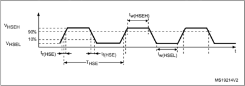

## Low-speed external user clock generated from an external source

In bypass mode the LSE oscillator is switched off and the input pin is a standard GPIO.

The external clock signal has to respect the I/O characteristics in Section 5.3.14 . However, the recommended clock input waveform is shown in Figure 20 .

Table 40. Low-speed external user clock characteristics (1)

| Symbol              | Parameter                             | Conditions   | Min      | Typ    | Max      | Unit   |
|---------------------|---------------------------------------|--------------|----------|--------|----------|--------|
| f LSE_ext           | User external clock source frequency  | -            | -        | 32.768 | 1000     | kHz    |
| V LSEH              | OSC32_IN input pin high level voltage | -            | 0.7 V DD | -      | V DD     | V      |
| V LSEL              | OSC32_IN input pin low level voltage  | -            | V SS     | -      | 0.3 V DD | V      |
| t w(LSEH) t w(LSEL) | OSC32_IN high or low time             | -            | 250      | -      | -        | ns     |

Figure 20. Low-speed external clock source AC timing diagram

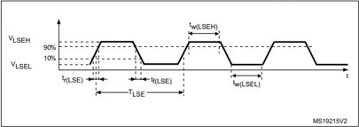


## High-speed external clock generated from a crystal/ceramic resonator

The high-speed external (HSE) clock can be supplied with a 4 to 48 MHz crystal/ceramic resonator oscillator. All the information given in this paragraph are based on design simulation results obtained with typical external components specified in Table 41 . In the application, the resonator and the load capacitors have to be placed as close as possible to the oscillator pins in order to minimize output distortion and startup stabilization time. Refer to the crystal resonator manufacturer for more details on the resonator characteristics (frequency, package, accuracy).

Table 41. HSE oscillator characteristics (1)

| Symbol        | Parameter                                 | Conditions (2)                            | Min   | Typ   | Max   | Unit   |
|---------------|-------------------------------------------|-------------------------------------------|-------|-------|-------|--------|
| f OSC_IN      | Oscillator frequency                      | -                                         | 4     | 8     | 48    | MHz    |
| R F           | Feedback resistor                         | -                                         | -     | 200   | -     | k Ω    |
| I DD(HSE)     |                                           | During startup (3)                        | -     | -     | 5.5   |        |
| I DD(HSE)     |                                           | V DD = 3 V, Rm = 30 Ω , CL = 10 pF@8 MHz  | -     | 0.44  | -     |        |
| I DD(HSE)     |                                           | V DD = 3 V, Rm = 45 Ω , CL = 10 pF@8 MHz  | -     | 0.45  | -     |        |
| I DD(HSE)     | HSE current consumption                   | V DD = 3 V, Rm = 30 Ω , CL = 5 pF@48 MHz  | -     | 0.68  | -     | mA     |
| I DD(HSE)     |                                           | V DD = 3 V, Rm = 30 Ω , CL = 10 pF@48 MHz | -     | 0.94  | -     |        |
| I DD(HSE)     |                                           | V DD = 3 V, Rm = 30 Ω , CL = 20 pF@48 MHz | -     | 1.77  | -     |        |
| G m           | Maximum critical crystal transconductance | Startup                                   | -     | -     | 1.5   | mA/V   |
| t SU(HSE) (4) | Startup time                              | V DD is stabilized                        | -     | 2     | -     | ms     |

2. Resonator characteristics given by the crystal/ceramic resonator manufacturer.
3. This consumption level occurs during the first 2/3 of the t SU(HSE)  startup time
4. t SU(HSE)  is the startup time measured from the moment it is enabled (by software) to a stabilized 8 MHz oscillation is reached. This value is measured for a standard crystal resonator and it can vary significantly with the crystal manufacturer

For C L1  and C L2 , it is recommended to use high-quality external ceramic capacitors in the 5 pF to 20 pF range (typ.), designed for high-frequency applications, and selected to match the requirements of the crystal or resonator (see Figure 21 ). C L1  and C L2 are usually the same size. The crystal manufacturer typically specifies a load capacitance which is the series combination of C L1  and C L2 . PCB and MCU pin capacitance must be included (10 pF can be used as a rough estimate of the combined pin and board capacitance) when sizing CL1  and C L2 .

199

Note:

For information on selecting the crystal, refer to the application note AN2867 'Oscillator design guide for ST microcontrollers' available from the ST website www.st.com.

Figure 21. Typical application with an 8 MHz crystal

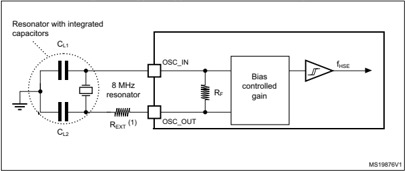

## Low-speed external clock generated from a crystal resonator

The low-speed external (LSE) clock can be supplied with a 32.768 kHz crystal resonator oscillator. All the information given in this paragraph are based on design simulation results obtained with typical external components specified in Table 42 . In the application, the resonator and the load capacitors have to be placed as close as possible to the oscillator pins in order to minimize output distortion and startup stabilization time. Refer to the crystal resonator manufacturer for more details on the resonator characteristics (frequency, package, accuracy).


Table 42. LSE oscillator characteristics (f LSE = 32.768 kHz) (1)

| Symbol        | Parameter                   | Conditions (2)                                | Min   | Typ   | Max   | Unit   |
|---------------|-----------------------------|-----------------------------------------------|-------|-------|-------|--------|
| I DD(LSE)     | LSE current consumption     | LSEDRV[1:0] = 00 Low drive capability         | -     | 250   | -     | nA     |
| I DD(LSE)     | LSE current consumption     | LSEDRV[1:0] = 01 Medium low drive capability  | -     | 315   | -     | nA     |
| I DD(LSE)     | LSE current consumption     | LSEDRV[1:0] = 10 Medium high drive capability | -     | 500   | -     | nA     |
| I DD(LSE)     | LSE current consumption     | LSEDRV[1:0] = 11 High drive capability        | -     | 630   | -     | nA     |
| Gm critmax    | Maximum critical crystal gm | LSEDRV[1:0] = 00 Low drive capability         | -     | -     | 0.5   | µA/V   |
| Gm critmax    | Maximum critical crystal gm | LSEDRV[1:0] = 01 Medium low drive capability  | -     | -     | 0.75  | µA/V   |
| Gm critmax    | Maximum critical crystal gm | LSEDRV[1:0] = 10 Medium high drive capability | -     | -     | 1.7   | µA/V   |
| Gm critmax    | Maximum critical crystal gm | LSEDRV[1:0] = 11 High drive capability        | -     | -     | 2.7   | µA/V   |
| t SU(LSE) (3) | Startup time                | V DD is stabilized                            | -     | 2     | -     | s      |

Note: For information on selecting the crystal, refer to the application note AN2867 'Oscillator design guide for ST microcontrollers' available from the ST website www.st.com.

Figure 22. Typical application with a 32.768 kHz crystal

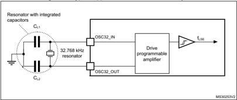

Note: An external resistor is not required between OSC32\_IN and OSC32\_OUT and it is forbidden to add one.


199

## 5.3.8 Internal clock source characteristics

The parameters given in Table 43 are derived from tests performed under ambient temperature and supply voltage conditions summarized in Table 17: General operating conditions . The provided curves are characterization results, not tested in production.

## High-speed internal (HSI16) RC oscillator

Table 43. HSI16 oscillator characteristics (1)

| Symbol             | Parameter                                         | Conditions                            | Min   | Typ   |   Max | Unit   |
|--------------------|---------------------------------------------------|---------------------------------------|-------|-------|-------|--------|
| f HSI16            | HSI16 Frequency                                   | V DD =3.0 V, T A =30 °C               | 15.88 | -     | 16.08 | MHz    |
| TRIM               | HSI16 user trimming step                          | Trimming code is not a multiple of 64 | 0.2   | 0.3   |   0.4 | %      |
| TRIM               | HSI16 user trimming step                          | Trimming code is a multiple of 64     | -4    | -6    |    -8 | %      |
| DuCy(HSI16) (2)    | Duty Cycle                                        | -                                     | 45    | -     |    55 | %      |
| ∆ Temp (HSI16)     | HSI16 oscillator frequency drift over temperature | T A = 0 to 85 °C                      | -1    | -     |     1 | %      |
| ∆ Temp (HSI16)     | HSI16 oscillator frequency drift over temperature | T A = -40 to 125 °C                   | -2    | -     |   1.5 | %      |
| ∆ VDD (HSI16)      | HSI16 oscillator frequency drift over V DD        | V DD =1.62 V to 3.6 V                 | -0.1  | -     |  0.05 | %      |
| t su (HSI16) (2)   | HSI16 oscillator start-up time                    | -                                     | -     | 0.8   |   1.2 | μ s    |
| t stab (HSI16) (2) | HSI16 oscillator stabilization time               | -                                     | -     | 3     |     5 | μ s    |
| I DD (HSI16) (2)   | HSI16 oscillator power consumption                | -                                     | -     | 155   |   190 | μ A    |


Figure 23. HSI16 frequency versus temperature

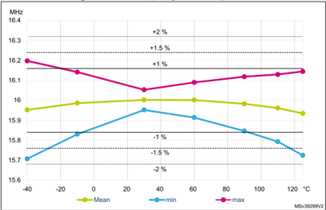

## High-speed internal 48 MHz (HSI48) RC oscillator

Table 44. HSI48 oscillator characteristics (1)

| Symbol             | Parameter                                                              | Conditions                                  | Min    | Typ       | Max      | Unit   |
|--------------------|------------------------------------------------------------------------|---------------------------------------------|--------|-----------|----------|--------|
| f HSI48            | HSI48 Frequency                                                        | V DD =3.0V, T A =30°C                       | -      | 48        | -        | MHz    |
| TRIM               | HSI48 user trimming step                                               | -                                           | -      | 0.11 (2)  | 0.18 (2) | %      |
| USER TRIM COVERAGE | HSI48 user trimming coverage                                           | ±32 steps                                   | ±3 (3) | ±3.5 (3)  | -        | %      |
| DuCy(HSI48)        | Duty Cycle                                                             | -                                           | 45 (2) | -         | 55 (2)   | %      |
| ACC HSI48_REL      | Accuracy of the HSI48 oscillator over temperature (factory calibrated) | V DD = 3.0 V to 3.6 V, T A = -15 to 85 °C   | -      | -         | ±3 (3)   | %      |
| ACC HSI48_REL      | Accuracy of the HSI48 oscillator over temperature (factory calibrated) | V DD = 1.65 V to 3.6 V, T A = -40 to 125 °C | -      | -         | ±4.5 (3) | %      |
| D VDD (HSI48)      | HSI48 oscillator frequency drift with V DD                             | V DD = 3 V to 3.6 V                         | -      | 0.025 (3) | 0.05 (3) | %      |
| D VDD (HSI48)      | HSI48 oscillator frequency drift with V DD                             | V DD = 1.65 V to 3.6 V                      | -      | 0.05 (3)  | 0.1 (3)  | %      |
| t su (HSI48)       | HSI48 oscillator start-up time                                         | -                                           | -      | 2.5 (2)   | 6 (2)    | μ s    |
| I DD (HSI48)       | HSI48 oscillator power consumption                                     | -                                           | -      | 340 (2)   | 380 (2)  | μ A    |

199

Table 44. HSI48 oscillator characteristics (1)  (continued)

| Symbol     | Parameter                                                    | Conditions   | Min   | Typ         | Max   | Unit   |
|------------|--------------------------------------------------------------|--------------|-------|-------------|-------|--------|
| N T jitter | Next transition jitter Accumulated jitter on 28 cycles (4)   | -            | -     | +/-0.15 (2) | -     | ns     |
| P T jitter | Paired transition jitter Accumulated jitter on 56 cycles (4) | -            | -     | +/-0.25 (2) | -     | ns     |

1. VDD  = 3 V, T A  = -40 to 125°C unless otherwise specified.
2. Guaranteed by design.
3. Guaranteed by characterization results.
4. Jitter measurement are performed without clock source activated in parallel.

Figure 24. HSI48 frequency versus temperature

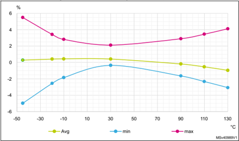

## Low-speed internal (LSI) RC oscillator

Table 45. LSI oscillator characteristics (1)

| Symbol         | Parameter                    | Conditions                                | Min   | Typ   |   Max | Unit   |
|----------------|------------------------------|-------------------------------------------|-------|-------|-------|--------|
| f LSI          | LSI Frequency                | V DD = 3.0 V, T A = 30 °C                 | 31.04 | -     | 32.96 | kHz    |
| f LSI          | LSI Frequency                | V DD = 1.62 to 3.6 V, T A = -40 to 125 °C | 29.5  | -     |    34 | kHz    |
| t SU (LSI) (2) | LSI oscillator start-up time | -                                         | -     | 80    |   130 | μ s    |


Table 45. LSI oscillator characteristics (1)  (continued)

| Symbol           | Parameter                         | Conditions            | Min   |   Typ |   Max | Unit   |
|------------------|-----------------------------------|-----------------------|-------|-------|-------|--------|
| t STAB (LSI) (2) | LSI oscillator stabilization time | 5% of final frequency | -     |   125 |   180 | μ s    |
| I DD (LSI) (2)   | LSI oscillator power consumption  | -                     | -     |   110 |   180 | nA     |

## 5.3.9 PLL characteristics

The parameters given in Table 46 are derived from tests performed under temperature and VDD  supply voltage conditions summarized in Table 17: General operating conditions .

Table 46. PLL characteristics (1)

| Symbol      | Parameter                         | Conditions                         | Min    | Typ   | Max   | Unit   |
|-------------|-----------------------------------|------------------------------------|--------|-------|-------|--------|
| f PLL_IN    | PLL input clock (2)               | -                                  | 2.66   | -     | 16    | MHz    |
| f PLL_IN    | PLL input clock duty cycle        | -                                  | 45     | -     | 55    | %      |
| f PLL_P_OUT | PLL multiplier output clock P     | Voltage scaling Range 1 Boost mode | 2.0645 | -     | 170   | MHz    |
| f PLL_P_OUT | PLL multiplier output clock P     | Voltage scaling Range 1            | 2.0645 | -     | 150   | MHz    |
| f PLL_P_OUT | PLL multiplier output clock P     | Voltage scaling Range 2            | 2.0645 | -     | 26    | MHz    |
| f PLL_Q_OUT | PLL multiplier output clock Q     | Voltage scaling Range 1 Boost mode | 8      | -     | 170   | MHz    |
| f PLL_Q_OUT | PLL multiplier output clock Q     | Voltage scaling Range 1            | 8      | -     | 150   | MHz    |
| f PLL_Q_OUT | PLL multiplier output clock Q     | Voltage scaling Range 2            | 8      | -     | 26    | MHz    |
| f PLL_R_OUT | PLL multiplier output clock R     | Voltage scaling Range 1 Boost mode | 8      | -     | 170   | MHz    |
| f PLL_R_OUT | PLL multiplier output clock R     | Voltage scaling Range 1            | 8      | -     | 150   | MHz    |
| f PLL_R_OUT | PLL multiplier output clock R     | Voltage scaling Range 2            | 8      | -     | 26    | MHz    |
| f VCO_OUT   | PLL VCO output                    | Voltage scaling Range 1            | 96     | -     | 344   | MHz    |
| f VCO_OUT   | PLL VCO output                    | Voltage scaling Range 2            | 96     | -     | 128   | MHz    |
| t LOCK      | PLL lock time                     | -                                  | -      | 15    | 40    | μ s    |
| Jitter      | RMS cycle-to-cycle jitter         | System clock 150 MHz               | -      | 28.6  | -     | ±ps    |
| Jitter      | RMS period jitter                 | System clock 150 MHz               | -      | 21.4  | -     | ±ps    |
| I DD (PLL)  | PLL power consumption on V DD (1) | VCO freq = 96 MHz                  | -      | 200   | 260   | μ A    |
| I DD (PLL)  | PLL power consumption on V DD (1) | VCO freq = 192 MHz                 | -      | 300   | 380   | μ A    |
| I DD (PLL)  | PLL power consumption on V DD (1) | VCO freq = 344 MHz                 | -      | 520   | 650   | μ A    |

199

## 5.3.10 Flash memory characteristics

Table 47. Flash memory characteristics (1)

| Symbol      | Parameter                                 | Conditions         | Typ           | Max   | Unit   |
|-------------|-------------------------------------------|--------------------|---------------|-------|--------|
| t prog      | 64-bit programming time                   | -                  | 81.7          | 83.35 | µs     |
| t prog_row  | One row (32 double word) programming time | Normal programming | 2.61          | 2.7   | ms     |
| t prog_row  | One row (32 double word) programming time | Fast programming   | 1.91          | 1.95  | ms     |
| t prog_page | One page (2 Kbytes) programming time      | Normal programming | 20.91         | 21.34 | ms     |
| t prog_page | One page (2 Kbytes) programming time      | Fast programming   | 15.29         | 15.6  | ms     |
| t ERASE     | Page (2 Kbytes) erase time                | -                  | 22.02         | 24.47 | ms     |
| t prog_bank | One bank (256 Kbyte) programming time     | Normal programming | 2.68          | 2.73  | s      |
| t prog_bank | One bank (256 Kbyte) programming time     | Fast programming   | 1.96          | 2     | s      |
| t ME        | Mass erase time (one or two banks)        | -                  | 22.13         | 24.6  | ms     |
| I DD        | Average consumption from V DD             | Write mode         | 3.5           | -     | mA     |
| I DD        | Average consumption from V DD             | Erase mode         | 3.5           | -     | mA     |
| I DD        | Maximum current (peak)                    | Write mode         | 7 (for 6 µs)  | -     | mA     |
| I DD        | Maximum current (peak)                    | Erase mode         | 7 (for 67 µs) | -     | mA     |

Table 48. Flash memory endurance and data retention

| Symbol   | Parameter      | Conditions                     |   Min (1) | Unit    |
|----------|----------------|--------------------------------|-----------|---------|
| N END    | Endurance      | T A = -40 to +105 °C           |        10 | kcycles |
| t RET    | Data retention | 1 kcycle (2) at T A = 85 °C    |        30 | Years   |
| t RET    | Data retention | 1 kcycle (2) at T A = 105 °C   |        15 | Years   |
| t RET    | Data retention | 1 kcycle (2) at T A = 125 °C   |         7 | Years   |
| t RET    | Data retention | 10 kcycles (2) at T A = 55 °C  |        30 | Years   |
| t RET    | Data retention | 10 kcycles (2) at T A = 85 °C  |        15 | Years   |
| t RET    | Data retention | 10 kcycles (2) at T A = 105 °C |        10 | Years   |


## 5.3.11 EMC characteristics

Susceptibility tests are performed on a sample basis during device characterization.

## Functional EMS (electromagnetic susceptibility)

While a simple application is executed on the device (toggling 2 LEDs through I/O ports). the device is stressed by two electromagnetic events until a failure occurs. The failure is indicated by the LEDs:

- Electrostatic discharge (ESD) (positive and negative) is applied to all device pins until a functional disturbance occurs. This test is compliant with the IEC 61000-4-2 standard.
- FTB : A Burst of Fast Transient voltage (positive and negative) is applied to V DD  and VSS  through a 100 pF capacitor, until a functional disturbance occurs. This test is compliant with the IEC 61000-4-4 standard.

A device reset allows normal operations to be resumed.

The test results are given in Table 49 . They are based on the EMS levels and classes defined in application note AN1709.

Table 49. EMS characteristics

| Symbol   | Parameter                                                                                                                 | Conditions                                                                | Level/ Class   |
|----------|---------------------------------------------------------------------------------------------------------------------------|---------------------------------------------------------------------------|----------------|
| V FESD   | Voltage limits to be applied on any I/O pin to induce a functional disturbance                                            | V DD = 3.3 V, T A = +25 °C, f HCLK = 170 MHz, conforming to IEC 61000-4-2 | 3B             |
| V EFTB   | Fast transient voltage burst limits to be applied through 100 pF on V DD and V SS pins to induce a functional disturbance | V DD = 3.3 V, T A = +25 °C, f HCLK = 170 MHz, conforming to IEC 61000-4-4 | 5A             |

## Designing hardened software to avoid noise problems

EMC characterization and optimization are performed at component level with a typical application environment and simplified MCU software. It should be noted that good EMC performance is highly dependent on the user application and the software in particular.

Therefore it is recommended that the user applies EMC software optimization and prequalification tests in relation with the EMC level requested for his application.

Software recommendations

The software flowchart must include the management of runaway conditions such as:

- Corrupted program counter
- Unexpected reset
- Critical Data corruption (control registers...)

Prequalification trials

Most of the common failures (unexpected reset and program counter corruption) can be reproduced by manually forcing a low state on the NRST pin or the Oscillator pins for 1 second.


199

To complete these trials, ESD stress can be applied directly on the device, over the range of specification values. When unexpected behavior is detected, the software can be hardened to prevent unrecoverable errors occurring (see application note AN1015).

## Electromagnetic Interference (EMI)

The electromagnetic field emitted by the device are monitored while a simple application is executed (toggling 2 LEDs through the I/O ports). This emission test is compliant with IEC 61967-2 standard which specifies the test board and the pin loading.

Table 50. EMI characteristics

| Symbol   | Parameter   | Conditions                                                            | Monitored frequency band   |   Max vs. [f HSE /f HCLK ] 8 MHz / 170 MHz | Unit   |
|----------|-------------|-----------------------------------------------------------------------|----------------------------|--------------------------------------------|--------|
| S EMI    | Peak level  | V DD = 3.6 V, T A = 25 °C, LQFP128 package compliant with IEC 61967-2 | 0.1 MHz to 30 MHz          |                                          4 | dBµV   |
| S EMI    | Peak level  | V DD = 3.6 V, T A = 25 °C, LQFP128 package compliant with IEC 61967-2 | 30 MHz to 130 MHz          |                                          0 | dBµV   |
| S EMI    | Peak level  | V DD = 3.6 V, T A = 25 °C, LQFP128 package compliant with IEC 61967-2 | 130 MHz to 1 GHz           |                                         16 | dBµV   |
| S EMI    | Peak level  | V DD = 3.6 V, T A = 25 °C, LQFP128 package compliant with IEC 61967-2 | 1 GHz to 2 GHz             |                                         11 | dBµV   |
| S EMI    | Peak level  | V DD = 3.6 V, T A = 25 °C, LQFP128 package compliant with IEC 61967-2 | EMI Level                  |                                        3.5 | -      |

## 5.3.12 Electrical sensitivity characteristics

Based on three different tests (ESD, LU) using specific measurement methods, the device is stressed in order to determine its performance in terms of electrical sensitivity.

## Electrostatic discharge (ESD)

Electrostatic discharges (a positive then a negative pulse separated by 1 second) are applied to the pins of each sample according to each pin combination. The sample size depends on the number of supply pins in the device (3 parts × (n+1) supply pins). This test conforms to the ANSI/JEDEC standard.

Table 51. ESD absolute maximum ratings

| Symbol     | Ratings                                               | Conditions                                          | Conditions                                         | Class   |   Maximum value (1) | Unit   |
|------------|-------------------------------------------------------|-----------------------------------------------------|----------------------------------------------------|---------|---------------------|--------|
| V ESD(HBM) | Electrostatic discharge voltage (human body model)    | T A = +25 °C, conforming to ANSI/ESDA/JEDEC JS-001  | T A = +25 °C, conforming to ANSI/ESDA/JEDEC JS-001 | 2       |                2000 | V      |
| V ESD(CDM) | Electrostatic discharge voltage (charge device model) | T A = +25 °C, conforming to ANSI/ESDA/JEDEC JS- 002 | LQFP100 and LQFP128                                | C1      |                 250 | V      |
| V ESD(CDM) | Electrostatic discharge voltage (charge device model) | T A = +25 °C, conforming to ANSI/ESDA/JEDEC JS- 002 | Other packages                                     | C2a     |                 500 | V      |


## Static latch-up

Two complementary static tests are required on three parts to assess the latch-up performance:

- A supply overvoltage is applied to each power supply pin.
- A current injection is applied to each input, output and configurable I/O pin.

These tests are compliant with EIA/JESD 78E IC latch-up standard.

Table 52. Electrical sensitivities

| Symbol   | Parameter             | Conditions                         | Class            |
|----------|-----------------------|------------------------------------|------------------|
| LU       | Static latch-up class | TA = +125 °C conforming to JESD78E | Class II level A |

## 5.3.13 I/O current injection characteristics

As a general rule, current injection to the I/O pins, due to external voltage below V SS  or above V DD  (for standard, 3.3 V-capable I/O pins) should be avoided during normal product operation. However, in order to give an indication of the robustness of the microcontroller in cases when abnormal injection accidentally happens, susceptibility tests are performed on a sample basis during device characterization.

## Functional susceptibility to I/O current injection

While a simple application is executed on the device, the device is stressed by injecting current into the I/O pins programmed in floating input mode. While current is injected into the I/O pin, one at a time, the device is checked for functional failures.

The failure is indicated by an out of range parameter: ADC error above a certain limit (higher than 5 LSB TUE), out of conventional limits of induced leakage current on adjacent pins (out of the -5 µA/+0 µA range) or other functional failure (for example reset occurrence or oscillator frequency deviation).

The characterization results are given in Table 53 .

Negative induced leakage current is caused by negative injection and positive induced leakage current is caused by positive injection.

Table 53. I/O current injection susceptibility

| Symbol    |                         | Description                            |   Functional susceptibility - Negative injection | Functional susceptibility - Positive injection   |    |
|-----------|-------------------------|----------------------------------------|--------------------------------------------------|--------------------------------------------------|----|
| I INJ (1) | Injected current on pin | All except TT_a, PF10, PB8-BOOT0, PC10 |                                               -5 | NA                                               | mA |
| I INJ (1) | Injected current on pin | PF10, PB8-BOOT0, PC10                  |                                               -0 | NA                                               | mA |
| I INJ (1) | Injected current on pin | TT_a pins                              |                                               -5 | 0                                                | mA |


199

## 5.3.14 I/O port characteristics

## General input/output characteristics

Unless otherwise specified, the parameters given in Table 54 are derived from tests performed under the conditions summarized in Table 17: General operating conditions . All I/Os are designed as CMOS- and TTL-compliant.

Table 54. I/O static characteristics

| Symbol      | Parameter                               | Conditions          | Conditions               | Min                 | Typ   | Max             | Unit   |
|-------------|-----------------------------------------|---------------------|--------------------------|---------------------|-------|-----------------|--------|
| V IL (1)(2) | I/O input low level voltage             | All except FT_c     | 1.62 V<V DD <3.6 V       | -                   | -     | 0.3xV DD (3)    | V      |
| V IL (1)(2) | I/O input low level voltage             | All except FT_c     | 1.62 V<V DD <3.6 V       | -                   | -     | 0.39xV DD -0.06 | V      |
| V IL (1)(2) | I/O input low level voltage             | FT_c                | 1.62 V<V DD <3.6 V       | -                   | -     | 0.3xV DD        | V      |
| V IL (1)(2) | I/O input low level voltage             | FT_c                | 1.62 V<V DD <3.6 V       | -                   | -     | 0.25xV DD       | V      |
| V IH (1)(2) | I/O input high level voltage            | All except FT_c     | 1.62 V<V DD <3.6 V       | 0.7xV DD            | -     | -               | V      |
| V IH (1)(2) | I/O input high level voltage            | All except FT_c     | 1.62 V<V DD <3.6 V       | 0.49xV DD +0.26 (3) | -     | -               | V      |
| V IH (1)(2) | I/O input high level voltage            | FT_c                | 1.62 V<V DD <3.6 V       | 0.7xV DD            | -     | -               | V      |
| V HYS (3)   | Input hysteresis                        | TT_xx, FT_xxx, NRST | 1.62 V<V DD <3.6 V       | -                   | 200   | -               | mV     |
| I leak      | Input leakage                           | FT_xx except FT_c   | 0 < V IN ≤ V DD          | -                   | -     | ±100            | nA     |
| I leak      | Input leakage                           | FT_xx except FT_c   | V DD ≤ V IN ≤ V DD +1 V  | -                   | -     | 650 (4)         | nA     |
| I leak      | Input leakage                           | FT_xx except FT_c   | V DD +1 V < V IN ≤ 5.5 V | -                   | -     | 200 (4)         | nA     |
| I leak      | Input leakage                           | FT_c                | 0 ≤ V IN ≤ V DDMAX       | -                   | -     | 2000            | nA     |
| I leak      | Input leakage                           | FT_c                | V DD ≤ V IN <0.5 V       | -                   | -     | 3000            | nA     |
| I leak      | Input leakage                           | FT_u, PC3           | 0 ≤ V IN ≤ V DD          | -                   | -     | ±150            | nA     |
| I leak      | current (3)                             | FT_u, PC3           | V DD ≤ V IN ≤ V DD + 1 V | -                   | -     | ±2500           | nA     |
| I leak      | Input leakage                           | FT_u, PC3           | V DD ≤ V IN ≤ 5.5 V      | -                   | -     | ±250            | nA     |
| I leak      | Input leakage                           | FT_d                | 0 ≤ V IN ≤ V DD          | -                   | -     | ±4500           | nA     |
| I leak      | Input leakage                           | FT_d                | V DD + 1V ≤ V IN ≤ 5.5 V | -                   | -     | ±9000           | nA     |
| I leak      | Input leakage                           | TT_xx               | 0 ≤ V IN ≤ V DD          | -                   | -     | ±150            | nA     |
| I leak      | Input leakage                           | TT_xx               | V DD ≤ V IN ≤ 3.6 V      | -                   | -     | 2000            | nA     |
| R PU        | Weak pull- up equivalent resistor (5)   | V IN = V SS         | V IN = V SS              | 25                  | 40    | 55              | k Ω    |
| R PD        | Weak pull- down equivalent resistor (5) | V IN = V DD         | V IN = V DD              | 25                  | 40    | 55              | k Ω    |
| C IO        | I/O pin capacitance                     | I/O pin capacitance | -                        | -                   | 5     | -               | pF     |

1. Refer to Figure 25: I/O input characteristics


2. Data based on characterization results, not tested in production
3. Guaranteed by design.
4. This value represents the pad leakage of the I/O itself. The total product pad leakage is provided by this formula: I Total\_Ileak\_max = 10 μ A + [number of I/Os where VIN is applied on the pad] ₓ I lkg (Max).
5. Pull-up and pull-down resistors are designed with a true resistance in series with a switchable PMOS/NMOS. This PMOS/NMOS contribution to the series resistance is minimal (~10% order).

All I/Os are CMOS- and TTL-compliant (no software configuration required). Their characteristics cover more than the strict CMOS-technology or TTL parameters. The coverage of these requirements is shown in Figure 25 for standard I/Os, and 5 V tolerant I/Os (except FT\_c).

Figure 25. I/O input characteristics

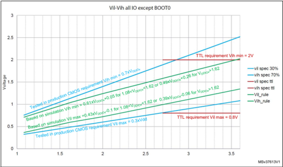

## Output driving current

The GPIOs (general purpose input/outputs) can sink or source up to ±8 mA, and sink or source up to ± 20 mA (with a relaxed $V_{OL}$ /$V_{OH}$ ).

In the user application, the number of I/O pins which can drive current must be limited to respect the absolute maximum rating specified in Section 5.2 :

- The sum of the currents sourced by all the I/Os on V DD,  plus the maximum consumption of the MCU sourced on V DD,  cannot exceed the absolute maximum rating Σ I VDD  (see Table 14: Voltage characteristics ).
- The sum of the currents sunk by all the I/Os on V SS , plus the maximum consumption of the MCU sunk on V SS , cannot exceed the absolute maximum rating Σ I VSS  (see Table 14: Voltage characteristics ).


199

## Output voltage levels

Unless otherwise specified, the parameters given in the table below are derived from tests performed under the ambient temperature and supply voltage conditions summarized in Table 17: General operating conditions . All I/Os are CMOS- and TTL-compliant (FT OR TT unless otherwise specified).

Table 55. Output voltage characteristics (1)(2)

| Symbol      | Parameter                                                                       | Conditions                                                                          | Min        | Max   | Unit   |
|-------------|---------------------------------------------------------------------------------|-------------------------------------------------------------------------------------|------------|-------|--------|
| $V_{OL}$ (3)    | Output low level voltage for an I/O pin                                         | CMOS port &#124;I IO &#124; = 2 mA for FT_c I/Os = 8 mA for other I/Os V DD ≥ 2.7 V | -          | 0.4   | V      |
| $V_{OH}$ (3)    | Output high level voltage for an I/O pin                                        | CMOS port &#124;I IO &#124; = 2 mA for FT_c I/Os = 8 mA for other I/Os V DD ≥ 2.7 V | V DD -0.4  | -     | V      |
| $V_{OL}$ (3)    | Output low level voltage for an I/O pin                                         | TTL port &#124;I IO &#124; = 2 mA for FT_c I/Os = 8 mA for other I/Os V DD ≥ 2.7 V  | -          | 0.4   | V      |
| $V_{OH}$ (3)    | Output high level voltage for an I/O pin                                        | TTL port &#124;I IO &#124; = 2 mA for FT_c I/Os = 8 mA for other I/Os V DD ≥ 2.7 V  | 2.4        | -     | V      |
| $V_{OL}$ (3)    | Output low level voltage for an I/O pin                                         | All I/Os except FT_c &#124;I IO &#124; = 20 mA V DD ≥ 2.7 V                         | -          | 1.3   | V      |
| $V_{OH}$ (3)    | Output high level voltage for an I/O pin                                        | All I/Os except FT_c &#124;I IO &#124; = 20 mA V DD ≥ 2.7 V                         | V DD -1.3  | -     | V      |
| $V_{OL}$ (3)    | Output low level voltage for an I/O pin                                         | &#124;I IO &#124; = 1 mA for FT_c I/Os = 4 mA for other I/Os V DD ≥ 1.62 V          | -          | 0.4   | V      |
| $V_{OH}$ (3)    | Output high level voltage for an I/O pin                                        | &#124;I IO &#124; = 1 mA for FT_c I/Os = 4 mA for other I/Os V DD ≥ 1.62 V          | V DD -0.45 | -     | V      |
| V OLFM+ (3) | Output low level voltage for an FT I/O pin in FM+ mode (FT I/O with 'f' option) | &#124;I IO &#124; = 20 mA V DD ≥ 2.7 V                                              | -          | 0.4   | V      |
| V OLFM+ (3) | Output low level voltage for an FT I/O pin in FM+ mode (FT I/O with 'f' option) | &#124;I IO &#124; = 10 mA V DD ≥ 1.62 V                                             | -          | 0.4   | V      |

2. TTL and CMOS outputs are compatible with JEDEC standards JESD36 and JESD52.
3. Guaranteed by design.

## Input/output AC characteristics

The definition and values of input/output AC characteristics are given in Figure 26 and Table 56 , respectively.

Unless otherwise specified, the parameters given are derived from tests performed under the ambient temperature and supply voltage conditions summarized in Table 17: General operating conditions .


Table 56. I/O (except FT\_c) AC characteristics (1) (2)

|   Speed | Symbol   | Parameter                 | Conditions                     | Min   | Max     | Unit   |
|---------|----------|---------------------------|--------------------------------|-------|---------|--------|
|      00 | Fmax     | Maximum frequency         | C=50 pF, 2.7 V ≤ V DD ≤ 3.6 V  | -     | 5       | MHz    |
|      00 | Fmax     | Maximum frequency         | C=50 pF, 1.62 V ≤ V DD ≤ 2.7 V | -     | 1       | MHz    |
|      00 | Fmax     | Maximum frequency         | C=10 pF, 2.7 V ≤ V DD ≤ 3.6 V  | -     | 10      | MHz    |
|      00 | Fmax     | Maximum frequency         | C=10 pF, 1.62 V ≤ V DD ≤ 2.7 V | -     | 1.5     | MHz    |
|      00 | Tr/Tf    | Output rise and fall time | C=50 pF, 2.7 V ≤ V DD ≤ 3.6 V  | -     | 25      | ns     |
|      00 | Tr/Tf    | Output rise and fall time | C=50 pF, 1.62 V ≤ V DD ≤ 2.7 V | -     | 52      | ns     |
|      00 | Tr/Tf    | Output rise and fall time | C=10 pF, 2.7 V ≤ V DD ≤ 3.6 V  | -     | 17      | ns     |
|      00 | Tr/Tf    | Output rise and fall time | C=10 pF, 1.62 V ≤ V DD ≤ 2.7 V | -     | 37      | ns     |
|      01 | Fmax     | Maximum frequency         | C=50 pF, 2.7 V ≤ V DD ≤ 3.6 V  | -     | 25      | MHz    |
|      01 | Fmax     | Maximum frequency         | C=50 pF, 1.62 V ≤ V DD ≤ 2.7 V | -     | 10      | MHz    |
|      01 | Fmax     | Maximum frequency         | C=10 pF, 2.7 V ≤ V DD ≤ 3.6 V  | -     | 50      | MHz    |
|      01 | Fmax     | Maximum frequency         | C=10 pF, 1.62 V ≤ V DD ≤ 2.7 V | -     | 15      | MHz    |
|         | Tr/Tf    | Output rise and fall time | C=50 pF, 2.7 V ≤ V DD ≤ 3.6 V  | -     | 9       | ns     |
|         | Tr/Tf    | Output rise and fall time | C=50 pF, 1.62 V ≤ V DD ≤ 2.7 V | -     | 16      | ns     |
|         | Tr/Tf    | Output rise and fall time | C=10 pF, 2.7 V ≤ V DD ≤ 3.6 V  | -     | 4.5     | ns     |
|         | Tr/Tf    | Output rise and fall time | C=10 pF, 1.62 V ≤ V DD ≤ 2.7 V | -     | 9       | ns     |
|      10 | Fmax     | Maximum frequency         | C=50 pF, 2.7 V ≤ V DD ≤ 3.6 V  | -     | 50      | MHz    |
|      10 | Fmax     | Maximum frequency         | C=50 pF, 1.62 V ≤ V DD ≤ 2.7 V | -     | 25      | MHz    |
|      10 | Fmax     | Maximum frequency         | C=10 pF, 2.7 V ≤ V DD ≤ 3.6 V  | -     | 100 (3) | MHz    |
|      10 | Fmax     | Maximum frequency         | C=10 pF, 1.62 V ≤ V DD ≤ 2.7 V | -     | 37.5    | MHz    |
|      10 | Tr/Tf    | Output rise and fall time | C=50 pF, 2.7 V ≤ V DD ≤ 3.6 V  | -     | 5.8     | ns     |
|      10 | Tr/Tf    | Output rise and fall time | C=50 pF, 1.62 V ≤ V DD ≤ 2.7 V | -     | 11      | ns     |
|      10 | Tr/Tf    | Output rise and fall time | C=10 pF, 2.7 V ≤ V DD ≤ 3.6 V  | -     | 2.5     | ns     |
|      10 | Tr/Tf    |                           | C=10 pF, 1.62 V ≤ V DD ≤ 2.7 V | -     | 5       |        |
|      11 | Fmax     | Maximum frequency         | C=30 pF, 2.7 V ≤ V DD ≤ 3.6 V  | -     | 120 (3) | MHz    |
|      11 | Fmax     | Maximum frequency         | C=30 pF, 1.62 V ≤ V DD ≤ 2.7 V | -     | 50      | MHz    |
|      11 | Fmax     | Maximum frequency         | C=10 pF, 2.7 V ≤ V DD ≤ 3.6 V  | -     | 180 (3) | MHz    |
|      11 | Fmax     |                           | C=10 pF, 1.62 V ≤ V DD ≤ 2.7 V | -     | 75      |        |
|      11 | Tr/Tf    | Output rise and           | C=30 pF, 2.7 V ≤ V DD ≤ 3.6 V  | -     | 3.3     | ns     |
|      11 | Tr/Tf    | Output rise and           | C=30 pF, 1.62 V ≤ V DD ≤ 2.7 V | -     | 6       | ns     |
|      11 | Tr/Tf    | fall time (4)             | C=10 pF, 2.7 V ≤ V DD ≤ 3.6 V  | -     | 1.7     | ns     |
|      11 | Tr/Tf    |                           | C=10 pF, 1.62 V ≤ V DD ≤ 2.7 V | -     | 3.3     | ns     |

199

Table 56. I/O (except FT\_c) AC characteristics (1)   (2)  (continued)

| Speed   | Symbol    | Parameter                          | Conditions                    | Min   |   Max | Unit   |
|---------|-----------|------------------------------------|-------------------------------|-------|-------|--------|
| FM+     | Fmax (5)  | Maximum frequency                  | C=50 pF, 1.6 V ≤ V DD ≤ 3.6 V | -     |     1 | MHz    |
| FM+     | Tr/TF (4) | Output high to low level fall time | C=50 pF, 1.6 V ≤ V DD ≤ 3.6 V | -     |     5 | ns     |

1. The I/O speed is configured using the OSPEEDRy[1:0] bits. The Fm+ mode is configured in the SYSCFG\_CFGR1 register. Refer to the reference manual RM0440 "STM32G4 Series advanced Arm ® based 32-bit MCUs" for a description of GPIO Port configuration register.
2. Guaranteed by design.
3. This value represented the I/O capability but maximum system frequency is 170 MHz.
4. The fall time is defined between 70% and 30% of the output waveform accordingly to I2C specification.
5. The maximum frequency is defined with the following conditions:
- 45%&lt;Duty cycle&lt;55%

- (Tr+ Tf)

≤

2/3 T.

Table 57. I/O FT\_c AC characteristics (1) (2)

|   Speed | Symbol   | Parameter                         | Conditions                    | Min   |   Max | Unit   |
|---------|----------|-----------------------------------|-------------------------------|-------|-------|--------|
|       0 | Fmax     | Maximum frequency                 | C=50 pF, 2.7 V ≤ V DD ≤ 3.6 V | -     |     2 | MHz    |
|       0 | Fmax     | Maximum frequency                 | C=50 pF, 1.6 V ≤ V DD ≤ 2.7 V | -     |     1 | MHz    |
|       0 | Tr/Tf    | Output H/L to L/H level fall time | C=50 pF, 2.7 V ≤ V DD ≤ 3.6 V | -     |   170 | ns     |
|       0 | Tr/Tf    | Output H/L to L/H level fall time | C=50 pF, 1.6 V ≤ V DD ≤ 2.7 V | -     |   330 | ns     |
|       1 | Fmax     | Maximum frequency                 | C=50 pF, 2.7 V ≤ V DD ≤ 3.6 V | -     |    10 | MHz    |
|       1 | Fmax     | Maximum frequency                 | C=50 pF, 1.6 V ≤ V DD ≤ 2.7 V | -     |     5 | MHz    |
|       1 | Tr/Tf    | Output H/L to L/H level fall time | C=50 pF, 2.7 V ≤ V DD ≤ 3.6 V | -     |    35 | ns     |
|       1 | Tr/Tf    | Output H/L to L/H level fall time | C=50 pF, 1.6 V ≤ V DD ≤ 2.7 V | -     |    65 | ns     |

1. The I/O speed is configured using the OSPEEDRy[1:0] bits. The Fm+ mode is configured in the SYSCFG\_CFGR1 register. Refer to the reference manual RM0440 "STM32G4 Series advanced Arm ® based 32-bit MCUs" for a description of GPIO Port configuration register.
2. Guaranteed by design.


Figure 26. I/O AC characteristics definition (1)

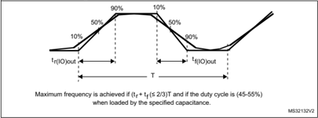

1. Refer to Table 56: I/O (except FT\_c) AC characteristics .

## 5.3.15 NRST pin characteristics

The NRST pin input driver uses the CMOS technology. It is connected to a permanent pullup resistor, R PU .

Unless otherwise specified, the parameters given in the table below are derived from tests performed under the ambient temperature and supply voltage conditions summarized in Table 17: General operating conditions .

Table 58. NRST pin characteristics (1)

| Symbol      | Parameter                               | Conditions            | Min        | Typ   | Max        | Unit   |
|-------------|-----------------------------------------|-----------------------|------------|-------|------------|--------|
| V IL(NRST)  | NRST input low level voltage            | -                     | -          | -     | 0.3 ₓ V DD | V      |
| V IH(NRST)  | NRST input high level voltage           | -                     | 0.7 ₓ V DD | -     | -          | V      |
| V hys(NRST) | NRST Schmitt trigger voltage hysteresis | -                     | -          | 200   | -          | mV     |
| R PU        | Weak pull-up equivalent resistor (2)    | V IN = V SS           | 25         | 40    | 55         | k Ω    |
| V F(NRST)   | NRST input filtered pulse               | -                     | -          | -     | 70         | ns     |
| V NF(NRST)  | NRST input not filtered pulse           | 1.71 V ≤ V DD ≤ 3.6 V | 350        | -     | -          | ns     |

199

Figure 27. Recommended NRST pin protection

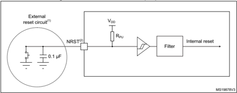

1. The reset network protects the device against parasitic resets.
2. The user must ensure that the level on the NRST pin can go below the V IL(NRST)  max level specified in Table 58: NRST pin characteristics . Otherwise the reset is not taken into account by the device.
3. The external capacitor on NRST must be placed as close as possible to the device.

## 5.3.16 High-resolution timer (HRTIM)

The parameters given in Table 59 are derived from tests performed under ambient temperature and supply voltage conditions summarized in Table 17 .

Table 59. HRTIM characteristics (1)

| Symbol                                     | Parameter                             | Conditions                              | Min.   | Typ.   | Max.   | Unit    |
|--------------------------------------------|---------------------------------------|-----------------------------------------|--------|--------|--------|---------|
| T A                                        | Timer ambient temperature range       | f HRTIM =170 MHz                        | -40    | -      | 125    | °C      |
| f HRTIM                                    | HRTIM input clock for DLL calibration | As per T A conditions                   | -      | -      | 170    | MHz     |
| t HRTIM                                    | HRTIM input clock for DLL calibration | As per T A conditions                   | 5.88   | -      | -      | ns      |
| t RES(HRTIM)                               | high-resolution step size             | f HRTIM =170 MHz, T A from -40 to 105°C | -      | 184    | -      | ps      |
| Res HRTIM                                  | Timer resolution                      | -                                       | -      | -      | 16     | bit     |
| t DTG                                      | Dead time generator clock period      | -                                       | 0.125  | -      | 16     | t HRTIM |
| t DTG                                      | Dead time generator clock period      | f HRTIM =170 MHz                        | 0.735  | -      | 94.1   | ns      |
| &#124;t DTR&#124; / &#124; t DTF&#124; max | Dead time range (absolute value)      | -                                       | -      | -      | 511    | t DTG   |
| &#124;t DTR&#124; / &#124; t DTF&#124; max | Dead time range (absolute value)      | f HRTIM =170 MHz                        | -      | -      | 48.09  | µs      |
| f CHPFRQ                                   | Chopper stage clock frequency         | -                                       | 1/256  | -      | 1/16   | f HRTIM |
| f CHPFRQ                                   | Chopper stage clock frequency         | f HRTIM =170 MHz                        | 0.664  | -      | 10.625 | MHz     |
| t 1STPW                                    | Chopper first pulse length            | -                                       | 16     | -      | 256    | t HRTIM |
| t 1STPW                                    | Chopper first pulse length            | f HRTIM =170 MHz                        | 0.094  | -      | 1.506  | µs      |

1. Data based on characterization results, not tested in production.


Table 60. HRTIM output response to fault protection (1)

| Symbol    | Parameter                      | Conditions                                                                     | Min.   | Typ.   | Max. (2)   | Unit   |
|-----------|--------------------------------|--------------------------------------------------------------------------------|--------|--------|------------|--------|
| t LAT(DF) | Digital fault response latency | Propagation delay from HRTIM1_FLTx digital input to HRTIM_CHxy output pin      | -      | 9      | 20         |        |
| t W(FLT)  | Minimum Fault pulse width      | -                                                                              | 7      | -      | -          | ns     |
| t LAT(AF) | Analog fault response latency  | Propagation delay from comparator COMPx_INP input pin to HRTIM_CHxy output pin | -      | 16     | 31         |        |

Table 61. HRTIM output response to external events 1 to 5 (Low-Latency mode (1) )

| Symbol      | Parameter                               | Conditions                                                                                 | Min   | Typ (2)   | Max (2)   | Unit   |
|-------------|-----------------------------------------|--------------------------------------------------------------------------------------------|-------|-----------|-----------|--------|
| t LAT(DEEV) | Digital external event response latency | Propagation delay from HRTIM1_EEVx digital input to HRTIM_CHxy output pin (30pF load)      | -     | 12        | 23        | ns     |
| t W(EEV)    | Minimum external event pulse width      | -                                                                                          | 7     | -         | -         | ns     |
| t LAT(AEEV) | Analog external event response latency  | Propagation delay from comparator COMPx_INP input pin to HRTIM_CHxy output pin (30pF load) | -     | 19        | 31        | ns     |

199

Table 62. HRTIM output response to external events 1 to 10 (Synchronous mode  (1) )

| Symbol      | Parameter                               | Conditions                                                                                | Min.   | Typ.   | Max. (2)   | Unit        |
|-------------|-----------------------------------------|-------------------------------------------------------------------------------------------|--------|--------|------------|-------------|
| t LAT(DEEV) | Digital external event response latency | Propagation delay from HRTIM1_EEVx digital input to HRTIM_CHxy output pin (30pF load) (3) | -      | 56     | 66         | ns          |
| t LAT(AEEV) | Analog external event response latency  | Propagation delay from COMPx_INP input pin to HRTIM_CHxy output pin (30pF load) (3)       | -      | 62     | 76         | ns          |
| t W(EEV)    | Minimum external event pulse width      | -                                                                                         | 7      | -      | -          | ns          |
| T JIT(EEV)  | External event response jitter          | Jitter of the delay from HRTIM1_EEVx digital input or COMPx_INP to HRTIM_CHxy output pin  | -      | -      | 1          | t HRTIM (4) |

1. EExFAST bit in HRTIM\_EECR1 or HRTIM\_EECR2 register is cleared (synchronous mode). External event filtering is disabled, i.e. EExF[3:0]=0000 in HRTIM\_EECR2 register. Refer to Latency to external events paragraph in HRTIM section of RM0440.
2. Data based on characterization results, not tested in production.
3. This parameter is given for f HRTIM  = 170 MHz.
4. T HRTIM  = 1 / f HRTIM  with f HRTIM = 170 MHz.
1. Guaranteed by design, not tested in production.

Table 63. HRTIM synchronization input / output (1)

| Symbol       | Parameter                                                  | Conditions       | Min.   | Typ.   | Max.   | Unit    |
|--------------|------------------------------------------------------------|------------------|--------|--------|--------|---------|
| t W(SYNCIN)  | Minimum pulse width on SYNCIN inputs, including HRTIM_SCIN | -                | 2      | -      | -      | t HRTIM |
| t RES(ESR)   | Response time to external synchronization request          | -                | -      | -      | 3      | t HRTIM |
| t W(SYNCOUT) | Pulse width on HRTIM_SCOUT output                          | -                | -      | 16     | -      | t HRTIM |
| t W(SYNCOUT) | Pulse width on HRTIM_SCOUT output                          | f HRTIM =170 MHz | -      | 94.1   | -      | ns      |

## 5.3.17 Extended interrupt and event controller input (EXTI) characteristics

The pulse on the interrupt input must have a minimal length in order to guarantee that it is detected by the event controller.

Table 64. EXTI input characteristics (1)

| Symbol   | Parameter                        | Conditions   |   Min | Typ   | Max   | Unit   |
|----------|----------------------------------|--------------|-------|-------|-------|--------|
| PLEC     | Pulse length to event controller | -            |    20 | -     | -     | ns     |


## 5.3.18 Analog switches booster

Table 65. Analog switches booster characteristics (1)

| Symbol      | Parameter                                     | Min   | Typ   |   Max | Unit   |
|-------------|-----------------------------------------------|-------|-------|-------|--------|
| V DD        | Supply voltage                                | 1.62  | -     |   3.6 | V      |
| t SU(BOOST) | Booster startup time                          | -     | -     |   240 | µs     |
| I DD(BOOST) | Booster consumption for 1.62 V ≤ V DD ≤ 2.0 V | -     | -     |   250 | µA     |
| I DD(BOOST) | Booster consumption for 2.0 V ≤ V DD ≤ 2.7 V  | -     | -     |   500 | µA     |
| I DD(BOOST) | Booster consumption for 2.7 V ≤ V DD ≤ 3.6 V  | -     | -     |   900 | µA     |


199

## 5.3.19 Analog-to-digital converter characteristics

Unless otherwise specified, the parameters given in Table 66 are preliminary values derived from tests performed under ambient temperature, f PCLK  frequency and V DDA  supply voltage conditions summarized in Table 17: General operating conditions .

Note:

It is recommended to perform a calibration after each power-up.

Table 66. ADC characteristics (1) (2)

| Symbol    | Parameter                      | Conditions                                                         | Min                            | Typ                                                        | Max                                                        | Unit   |
|-----------|--------------------------------|--------------------------------------------------------------------|--------------------------------|------------------------------------------------------------|------------------------------------------------------------|--------|
| V DDA     | Analog supply voltage          | -                                                                  | 1.62                           | -                                                          | 3.6                                                        | V      |
| V REF+    | Positive reference voltage     | V DDA ≥ 2 V                                                        | 2                              | -                                                          | V DDA                                                      | V      |
| V REF+    | Positive reference voltage     | V DDA < 2 V                                                        |                                | V DDA                                                      |                                                            | V      |
| V REF-    | Negative reference voltage     | -                                                                  |                                | V SSA                                                      |                                                            | V      |
| V CMIN    | Input common mode              | Differential                                                       | (V REF+ +V REF- )/2 - 0.18     | (V REF+ + V REF- )/2                                       | (V REF+ + V REF- )/2 + 0.18                                | V      |
| f ADC     | ADC clock frequency            | Range 1, single ADC operation                                      | 0.14                           | -                                                          | 60                                                         | MHz    |
| f ADC     | ADC clock frequency            | Range 2                                                            | -                              | -                                                          | 26                                                         | MHz    |
| f ADC     | ADC clock frequency            | Range 1, all ADCs operation, single ended mode V DDA ≥ 2.7 V       | 0.14                           | -                                                          | 52                                                         | MHz    |
| f ADC     | ADC clock frequency            | Range 1, all ADCs operation, single ended mode V DDA ≥ 1.62 V      | 0.14                           | -                                                          | 42                                                         | MHz    |
| f ADC     | ADC clock frequency            | Range 1, all ADCs operation, differential mode V DDA ≥ 1.62 V      | 0.14                           | -                                                          | 56                                                         | MHz    |
| f s       | Sampling rate, continuous mode | For given resolution and sampling time cycles (t s )               | 0.001                          | f ADC / (sampling time [cycles] + resolution [bits] + 0.5) | f ADC / (sampling time [cycles] + resolution [bits] + 0.5) | Msps   |
| T TRIG    | External trigger period        | Considering trigger conversion latency time (t LATR or t LATRINJ ) | -                              | -                                                          | 1ms                                                        | -      |
| T TRIG    | External trigger period        | Resolution = 12 bits, f ADC=60 MHz                                 | tconv + [t LATR or t LATRINJ ] | -                                                          | 1ms                                                        | -      |
| V AIN (3) | Conversion voltage range       | -                                                                  | 0                              | -                                                          | V REF+                                                     | V      |


Table 66. ADC characteristics (1) (2)  (continued)

| Symbol         | Parameter                                                                         | Conditions                          | Min                                               | Typ                                               | Max                                               | Unit             |
|----------------|-----------------------------------------------------------------------------------|-------------------------------------|---------------------------------------------------|---------------------------------------------------|---------------------------------------------------|------------------|
| R AIN (4)      | External input impedance                                                          | -                                   | -                                                 | -                                                 | 50                                                | k Ω              |
| C ADC          | Internal sample and hold capacitor                                                | -                                   | -                                                 | 5                                                 | -                                                 | pF               |
| t STAB         | Power-up time                                                                     | -                                   | 1                                                 | 1                                                 | 1                                                 | conversion cycle |
| t CAL          | Calibration time                                                                  | f ADC = 60 MHz                      | 1.93                                              | 1.93                                              | 1.93                                              | µs               |
| t CAL          | Calibration time                                                                  | -                                   | 116                                               | 116                                               | 116                                               | 1/f ADC          |
| t LATR         | Trigger conversion latency Regular and injected channels without conversion abort | CKMODE = 00                         | 1.5                                               | 2                                                 | 2.5                                               | 1/f ADC          |
| t LATR         | Trigger conversion latency Regular and injected channels without conversion abort | CKMODE = 01                         | -                                                 | -                                                 | 2.0                                               | 1/f ADC          |
| t LATR         | Trigger conversion latency Regular and injected channels without conversion abort | CKMODE = 10                         | -                                                 | -                                                 | 2.25                                              | 1/f ADC          |
| t LATR         | Trigger conversion latency Regular and injected channels without conversion abort | CKMODE = 11                         | -                                                 | -                                                 | 2.125                                             | 1/f ADC          |
| t LATRINJ      | Trigger conversion latency Injected channels aborting a regular conversion        | CKMODE = 00                         | 2.5                                               | 3                                                 | 3.5                                               | 1/f ADC          |
| t LATRINJ      | Trigger conversion latency Injected channels aborting a regular conversion        | CKMODE = 01                         | -                                                 | -                                                 | 3.0                                               | 1/f ADC          |
| t LATRINJ      | Trigger conversion latency Injected channels aborting a regular conversion        | CKMODE = 10                         | -                                                 | -                                                 | 3.25                                              | 1/f ADC          |
| t LATRINJ      | Trigger conversion latency Injected channels aborting a regular conversion        | CKMODE = 11                         | -                                                 | -                                                 | 3.125                                             | 1/f ADC          |
| t s            | Sampling time                                                                     | f ADC = 60 MHz                      | 0.0416                                            | -                                                 | 10.675                                            | µs               |
| t s            | Sampling time                                                                     | -                                   | 2.5                                               | -                                                 | 640.5                                             | 1/f ADC          |
| t ADCVREG_STUP | ADC voltage regulator start-up time                                               | -                                   | -                                                 | -                                                 | 20                                                | µs               |
| t CONV         | Total conversion time (including sampling time)                                   | f ADC = 60 MHz Resolution = 12 bits | 0.25                                              | -                                                 | 10.883                                            | µs               |
| t CONV         | Total conversion time (including sampling time)                                   | -                                   | t s [cycles] + resolution [bits] +0.5 = 15 to 653 | t s [cycles] + resolution [bits] +0.5 = 15 to 653 | t s [cycles] + resolution [bits] +0.5 = 15 to 653 | 1/f ADC          |
| I DDA (ADC)    | ADC consumption from the V DDA supply                                             | fs = 4 Msps                         | -                                                 | 590                                               | 730                                               | µA               |
| I DDA (ADC)    | ADC consumption from the V DDA supply                                             | fs = 1 Msps                         | -                                                 | 160                                               | 220                                               | µA               |
| I DDA (ADC)    | ADC consumption from the V DDA supply                                             | fs = 10 ksps                        | -                                                 | 16                                                | 50                                                | µA               |
| I DDV_S (ADC)  | ADC consumption from the V REF+ single ended mode                                 | fs = 4 Msps                         | -                                                 | 110                                               | 140                                               | µA               |
| I DDV_S (ADC)  | ADC consumption from the V REF+ single ended mode                                 | fs = 1 Msps                         | -                                                 | 30                                                | 40                                                | µA               |
| I DDV_S (ADC)  | ADC consumption from the V REF+ single ended mode                                 | fs = 10 ksps                        | -                                                 | 0.6                                               | 2                                                 | µA               |
| I DDV_D (ADC)  | ADC consumption from the V REF+ differential mode                                 | fs = 4 Msps                         | -                                                 | 220                                               | 270                                               | µA               |
| I DDV_D (ADC)  | ADC consumption from the V REF+ differential mode                                 | fs = 1 Msps                         | -                                                 | 60                                                | 70                                                | µA               |
| I DDV_D (ADC)  | ADC consumption from the V REF+ differential mode                                 | fs = 10 ksps                        | -                                                 | 1.3                                               | 3                                                 | µA               |


199

2. The I/O analog switch voltage booster is enabled when V DDA  &lt; 2.4 V (BOOSTEN = 1 in the SYSCFG\_CFGR1 when VDDA  &lt; 2.4V). It is disabled when V DDA ≥ 2.4 V.
3. VREF+  can be internally connected to V DDA , depending on the package. Refer to Section 4: Pinouts and pin description for further details.
4. The maximum value of RAIN can be found in Table 67: Maximum ADC RAIN .


The maximum value of R AIN  can be found in Table 67: Maximum ADC RAIN .

Table 67. Maximum ADC R AIN (1)(2)

| Resolution   |   Sampling cycle @60 MHz |   Sampling time [ns] |   R AIN max ( Ω ) - Fast channels (3) | R AIN max ( Ω ) - Slow channels (4)   |
|--------------|--------------------------|----------------------|---------------------------------------|---------------------------------------|
|              |                      2.5 |                41.67 |                                   100 | N/A                                   |
|              |                      6.5 |               108.33 |                                   330 | 100                                   |
|              |                     12.5 |               208.33 |                                   680 | 470                                   |
|              |                     24.5 |               408.33 |                                  1500 | 1200                                  |
|              |                     47.5 |               791.67 |                                  2200 | 1800                                  |
|              |                     92.5 |              1541.67 |                                  4700 | 3900                                  |
|              |                    247.5 |                 4125 |                                 12000 | 10000                                 |
|              |                    640.5 |                10675 |                                 39000 | 33000                                 |
|              |                      2.5 |                41.67 |                                   120 | N/A                                   |
|              |                      6.5 |               108.33 |                                   390 | 180                                   |
|              |                     12.5 |               208.33 |                                   820 | 560                                   |
|              |                     24.5 |               408.33 |                                  1500 | 1200                                  |
|              |                     47.5 |               791.67 |                                  2200 | 1800                                  |
|              |                     92.5 |              1541.67 |                                  5600 | 4700                                  |
|              |                    247.5 |                 4125 |                                 12000 | 10000                                 |
|              |                    640.5 |                10675 |                                 47000 | 39000                                 |
|              |                      2.5 |                41.67 |                                   180 | N/A                                   |
|              |                      6.5 |               108.33 |                                   470 | 270                                   |
|              |                     12.5 |               208.33 |                                  1000 | 680                                   |
|              |                     24.5 |               408.33 |                                  1800 | 1500                                  |
|              |                     47.5 |               791.67 |                                  2700 | 2200                                  |
|              |                     92.5 |              1541.67 |                                  6800 | 5600                                  |
|              |                    247.5 |                 4125 |                                 15000 | 12000                                 |
|              |                    640.5 |                10675 |                                 50000 | 50000                                 |
|              |                      2.5 |                41.67 |                                   220 | N/A                                   |
|              |                      6.5 |               108.33 |                                   560 | 330                                   |
|              |                     12.5 |               208.33 |                                  1200 | 1000                                  |
|              |                     24.5 |               408.33 |                                  2700 | 2200                                  |
|              |                     47.5 |               791.67 |                                  3900 | 3300                                  |
|              |                     92.5 |              1541.67 |                                  8200 | 6800                                  |
|              |                    247.5 |                 4125 |                                 18000 | 15000                                 |
|              |                    640.5 |                10675 |                                 50000 | 50000                                 |

199

1. Guaranteed by design.
2. The I/O analog switch voltage booster is enabled when V DDA  &lt; 2.4 V (BOOSTEN = 1 in the SYSCFG\_CFGR1 when V DDA  &lt; 2.4V). It is disabled when V DDA ≥ 2.4 V.
3. Fast channels are: ADCx\_IN1 to ADCx\_IN5.
4. Slow channels are: all ADC inputs except the fast channels.


Table 68. ADC accuracy - limited test conditions 1 (1)(2)(3)

| Symbol   | Parameter                             | Conditions (4)                  | Conditions (4)    | Conditions (4)           | Min   |   Typ | Max   | Unit   |
|----------|---------------------------------------|---------------------------------|-------------------|--------------------------|-------|-------|-------|--------|
| ET       | Total unadjusted error                | Single ADC operation ADC clock  | Single ended      | Fast channel (max speed) | -     |   5.9 | 6.9   |        |
| ET       | Total unadjusted error                |                                 | Single ended      | Slow channel (max speed) | -     |   5.5 | 6.9   |        |
| ET       | Total unadjusted error                |                                 | Differential      | Fast channel (max speed) | -     |   4.6 | 5.6   |        |
| ET       | Total unadjusted error                |                                 | Differential      | Slow channel (max speed) | -     |     4 | 5.6   |        |
| EO       | Offset error                          |                                 | Single ended      | Fast channel (max speed) | -     |   2.5 | 4     |        |
| EO       | Offset error                          |                                 | Single ended      | Slow channel (max speed) | -     |   1.9 | 4     |        |
| EO       | Offset error                          |                                 |                   | Fast channel (max speed) | -     |   1.8 | 2.8   |        |
| EO       | Offset error                          |                                 |                   | Slow channel (max speed) | -     |   1.1 | 2.8   |        |
| EG       | Gain error                            |                                 | Single ended      | Fast channel (max speed) | -     |   4.6 | 6.6   | LSB    |
| EG       | Gain error                            |                                 | Single ended      | Slow channel (max speed) | -     |   4.5 | 6.6   | LSB    |
| EG       | Gain error                            |                                 | Differential Fast | channel (max speed)      | -     |   3.6 | 4.6   | LSB    |
| EG       | Gain error                            |                                 | Differential Fast | Slow channel (max speed) | -     |   3.3 | 4.6   | LSB    |
| ED       | Differential linearity error          |                                 | Single ended      | Fast channel (max speed) | -     |   1.1 | 1.9   |        |
| ED       | Differential linearity error          |                                 | Single ended      | Slow channel (max speed) | -     |   1.3 | 1.9   |        |
| ED       | Differential linearity error          | frequency ≤ 60 MHz,             | Differential      | Fast channel (max speed) | -     |   1.3 | 1.6   |        |
| ED       | Differential linearity error          | V DDA = VREF+ = 3 V, TA = 25 °C | Differential      | Slow channel (max speed) | -     |   1.4 | 1.6   |        |
| EL       | Integral linearity error              | Continuous mode, sampling       | Single ended      | Fast channel (max speed) | -     |   2.3 | 3.4   |        |
| EL       | Integral linearity error              | rate: Fast channels@4Msps       | Single ended      | Slow channel (max speed) | -     |   2.4 | 3.4   |        |
| EL       | Integral linearity error              | Slow channels@2Msps             | Differential      | Fast channel (max speed) | -     |   2.1 | 3.2   |        |
| EL       | Integral linearity error              |                                 | Differential      | Slow channel (max speed) | -     |   2.2 | 3.2   |        |
| ENOB     | Effective number of bits              |                                 | Single ended      | Fast channel (max speed) | 10.4  |  10.6 | -     | bits   |
| ENOB     | Effective number of bits              |                                 | Single ended      | Slow channel (max speed) | 10.4  |  10.6 | -     | bits   |
| ENOB     | Effective number of bits              |                                 | Differential      | Fast channel (max speed) | 10.8  |  10.9 | -     | bits   |
| ENOB     | Effective number of bits              |                                 | Differential      | Slow channel (max speed) | 10.8  |  10.9 | -     | bits   |
| SINAD    | Signal-to- noise and distortion ratio |                                 | Single ended      | Fast channel (max speed) | 64.4  |  65.6 | -     | dB     |
| SINAD    | Signal-to- noise and distortion ratio |                                 | Single ended      | Slow channel (max speed) | 64.4  |  65.6 | -     | dB     |
| SINAD    | Signal-to- noise and distortion ratio |                                 | Differential      | Fast channel (max speed) | 66.8  |  67.5 | -     | dB     |
| SINAD    | Signal-to- noise and distortion ratio |                                 | Differential      | Slow channel (max speed) | 66.8  |  67.5 | -     | dB     |
| SNR      | Signal-to- noise ratio                |                                 | Single ended      | Fast channel (max speed) | 65    |  66.9 | -     |        |
| SNR      | Signal-to- noise ratio                |                                 | Single ended      | Slow channel (max speed) | 65    |  66.9 | -     |        |
| SNR      | Signal-to- noise ratio                |                                 |                   | Fast channel (max speed) | 67    |    69 | -     |        |
| SNR      | Signal-to- noise ratio                |                                 |                   | Slow channel (max speed) | 67    |    69 | -     |        |


199

Table 68. ADC accuracy - limited test conditions 1 (1)(2)(3)  (continued)

| Symbol   | Parameter                 | Conditions (4)                                                                                               | Conditions (4)   | Conditions (4)           | Min   |   Typ |   Max | Unit   |
|----------|---------------------------|--------------------------------------------------------------------------------------------------------------|------------------|--------------------------|-------|-------|-------|--------|
| THD      | Total harmonic distortion | Single ADC operation ADC clock frequency ≤ 60 MHz, V DDA = VREF+ = 3 V, TA = 25 °C Continuous mode, sampling | Single ended     | Fast channel (max speed) | -     |   -73 |   -72 |        |
| THD      | Total harmonic distortion | Single ADC operation ADC clock frequency ≤ 60 MHz, V DDA = VREF+ = 3 V, TA = 25 °C Continuous mode, sampling | Single ended     | Slow channel (max speed) | -     |   -73 |   -72 |        |
| THD      | Total harmonic distortion | Single ADC operation ADC clock frequency ≤ 60 MHz, V DDA = VREF+ = 3 V, TA = 25 °C Continuous mode, sampling | Single ended     | Fast channel (max speed) | -     |   -73 |   -72 | dB     |
| THD      | Total harmonic distortion | Single ADC operation ADC clock frequency ≤ 60 MHz, V DDA = VREF+ = 3 V, TA = 25 °C Continuous mode, sampling | Single ended     | Slow channel (max speed) | -     |   -73 |   -72 |        |

2. ADC DC accuracy values are measured after internal calibration.
3. ADC accuracy vs. negative Injection Current: Injecting negative current on any analog input pins should be avoided as this significantly reduces the accuracy of the conversion being performed on another analog input. It is recommended to add a Schottky diode (pin to ground) to analog pins which may potentially inject negative current.
4. The I/O analog switch voltage booster is enabled when V DDA  &lt; 2.4 V (BOOSTEN = 1 in the SYSCFG\_CFGR1 when VDDA  &lt; 2.4 V). It is disabled when V DDA ≥ 2.4 V. No oversampling.


Table 69. ADC accuracy - limited test conditions 2 (1)(2)(3)

| Sym- bol   | Parameter                             | Conditions (4)                                                                                                     | Conditions (4)   | Conditions (4)           | Min   |   Typ | Max   | Unit   |
|------------|---------------------------------------|--------------------------------------------------------------------------------------------------------------------|------------------|--------------------------|-------|-------|-------|--------|
| ET         | Total unadjusted error                | Single ADC operation ADC clock frequency ≤ 60 MHz, 2 V ≤ V DDA Continuous mode, sampling rate: Fast channels@4Msps | Single ended     | Fast channel (max speed) | -     |   5.9 | 8.4   |        |
| ET         | Total unadjusted error                |                                                                                                                    | Single ended     | Slow channel (max speed) | -     |   5.5 | 8     |        |
| ET         | Total unadjusted error                |                                                                                                                    | Differential     | Fast channel (max speed) | -     |   4.6 | 6.6   |        |
| ET         | Total unadjusted error                |                                                                                                                    | Differential     | Slow channel (max speed) | -     |     4 | 6     |        |
| EO         | Offset error                          |                                                                                                                    | Single ended     | Fast channel (max speed) | -     |   2.5 | 6     |        |
| EO         | Offset error                          |                                                                                                                    | Single ended     | Slow channel (max speed) | -     |   1.9 | 6.9   |        |
| EO         | Offset error                          |                                                                                                                    | Differential     | Fast channel (max speed) | -     |   1.8 | 3.3   |        |
| EO         | Offset error                          |                                                                                                                    | Differential     | Slow channel (max speed) | -     |   1.1 | 3.3   |        |
| EG         | Gain error                            |                                                                                                                    | Single ended     | Fast channel (max speed) | -     |   4.6 | 8.1   |        |
| EG         | Gain error                            |                                                                                                                    | Single ended     | Slow channel (max speed) | -     |   4.5 | 8.1   |        |
| EG         | Gain error                            |                                                                                                                    | Differential     | Fast channel (max speed) | -     |   3.6 | 4.6   | LSB    |
| EG         | Gain error                            |                                                                                                                    | Differential     | Slow channel (max speed) | -     |   3.3 | 4.6   |        |
| ED         | Differential linearity error          |                                                                                                                    | Single ended     | Fast channel (max speed) | -     |   1.1 | 1.8   |        |
| ED         | Differential linearity error          |                                                                                                                    | Single ended     | Slow channel (max speed) | -     |   1.3 | 1.8   |        |
| ED         | Differential linearity error          |                                                                                                                    | Differential     | Fast channel (max speed) | -     |   1.3 | 1.6   |        |
| ED         | Differential linearity error          |                                                                                                                    | Differential     | Slow channel (max speed) | -     |   1.4 | 1.6   |        |
| EL         | Integral linearity error              |                                                                                                                    | Single ended     | Fast channel (max speed) | -     |   2.3 | 4.4   |        |
| EL         | Integral linearity error              |                                                                                                                    | Single ended     | Slow channel (max speed) | -     |   2.4 | 4.4   |        |
| EL         | Integral linearity error              | Slow channels@2Msps                                                                                                | Differential     | Fast channel (max speed) | -     |   2.1 | 4.1   |        |
| EL         | Integral linearity error              |                                                                                                                    | Differential     | Slow channel (max speed) | -     |   2.2 | 3.7   |        |
| ENOB       | Effective number of bits              |                                                                                                                    | Single ended     | Fast channel (max speed) | 10    |  10.6 | -     | bits   |
| ENOB       | Effective number of bits              |                                                                                                                    | Single ended     | Slow channel (max speed) | 10    |  10.6 | -     | bits   |
| ENOB       | Effective number of bits              |                                                                                                                    | Differential     | Fast channel (max speed) | 10.7  |  10.9 | -     | bits   |
| ENOB       | Effective number of bits              |                                                                                                                    | Differential     | Slow channel (max speed) | 10.7  |  10.9 | -     | bits   |
| SINAD      | Signal-to- noise and distortion ratio |                                                                                                                    | Single ended     | Fast channel (max speed) | 62    |  65.6 | -     |        |
| SINAD      | Signal-to- noise and distortion ratio |                                                                                                                    | Single ended     | Slow channel (max speed) | 62    |  65.6 | -     |        |
| SINAD      | Signal-to- noise and distortion ratio |                                                                                                                    | Differential     | Fast channel (max speed) | 65    |  67.5 | -     |        |
| SINAD      | Signal-to- noise and distortion ratio |                                                                                                                    | Differential     | Slow channel (max speed) | 65    |  67.5 | -     | dB     |
| SNR        | Signal-to- noise ratio                |                                                                                                                    | Single ended     | Fast channel (max speed) | 64    |  66.9 | -     |        |
| SNR        | Signal-to- noise ratio                |                                                                                                                    | Single ended     | Slow channel (max speed) | 64    |  66.9 | -     |        |
| SNR        | Signal-to- noise ratio                |                                                                                                                    | Differential     | Fast channel (max speed) | 66.5  |    69 | -     |        |
| SNR        | Signal-to- noise ratio                |                                                                                                                    |                  | Slow channel (max speed) | 66.5  |    69 | -     |        |


199

Table 69. ADC accuracy - limited test conditions 2 (1)(2)(3)  (continued)

| Sym- bol   | Parameter                 | Conditions (4)                                                                                                     | Conditions (4)   | Conditions (4)           | Min   |   Typ |   Max | Unit   |
|------------|---------------------------|--------------------------------------------------------------------------------------------------------------------|------------------|--------------------------|-------|-------|-------|--------|
| THD        | Total harmonic distortion | Single ADC operation ADC clock frequency ≤ 60 MHz, 2 V ≤ V DDA Continuous mode, sampling rate: Fast channels@4Msps | Single ended     | Fast channel (max speed) | -     |   -73 |   -65 | dB     |
| THD        | Total harmonic distortion | Single ADC operation ADC clock frequency ≤ 60 MHz, 2 V ≤ V DDA Continuous mode, sampling rate: Fast channels@4Msps | Single ended     | Slow channel (max speed) | -     |   -73 |   -67 | dB     |
| THD        | Total harmonic distortion | Single ADC operation ADC clock frequency ≤ 60 MHz, 2 V ≤ V DDA Continuous mode, sampling rate: Fast channels@4Msps | Differential     | Fast channel (max speed) | -     |   -73 |   -70 | dB     |
| THD        | Total harmonic distortion | Single ADC operation ADC clock frequency ≤ 60 MHz, 2 V ≤ V DDA Continuous mode, sampling rate: Fast channels@4Msps | Differential     | Slow channel (max speed) | -     |   -73 |   -71 | dB     |

4. The I/O analog switch voltage booster is enabled when V DDA  &lt; 2.4 V (BOOSTEN = 1 in the SYSCFG\_CFGR1 when VDDA  &lt; 2.4 V). It is disabled when V DDA ≥ 2.4 V. No oversampling.


Table 70. ADC accuracy - limited test conditions 3 (1)(2)(3)

| Sym- bol   | Parameter                             | Conditions (4)                                                                                       | Conditions (4)            | Conditions (4)           | Min   |   Typ | Max   | Unit   |
|------------|---------------------------------------|------------------------------------------------------------------------------------------------------|---------------------------|--------------------------|-------|-------|-------|--------|
| ET         | Total unadjusted error                | Single ADC operation ADC clock frequency ≤ 60 MHz, 1.62 V ≤ V DDA = V REF+ ≤ 3.6 V, Continuous mode, | Single ended              | Fast channel (max speed) | -     |   5.9 | 7.9   |        |
| ET         | Total unadjusted error                |                                                                                                      | Single ended              | Slow channel (max speed) | -     |   5.5 | 7.5   |        |
| ET         | Total unadjusted error                |                                                                                                      | Differential              | Fast channel (max speed) | -     |   4.6 | 7.6   |        |
| ET         | Total unadjusted error                |                                                                                                      | Differential              | Slow channel (max speed) | -     |     4 | 5.5   |        |
| EO         | Offset error                          |                                                                                                      | Single ended              | Fast channel (max speed) | -     |   2.5 | 5.5   |        |
| EO         | Offset error                          |                                                                                                      | Single ended              | Slow channel (max speed) | -     |   1.9 | 5.5   |        |
| EO         | Offset error                          |                                                                                                      | Differential              | Fast channel (max speed) | -     |   1.8 | 3.5   |        |
| EO         | Offset error                          |                                                                                                      | Differential              | Slow channel (max speed) | -     |   1.1 | 3     |        |
| EG         | Gain error                            |                                                                                                      | Single ended              | Fast channel (max speed) | -     |   4.6 | 7.1   |        |
| EG         | Gain error                            |                                                                                                      | Single ended              | Slow channel (max speed) | -     |   4.5 | 7     | LSB    |
| EG         | Gain error                            |                                                                                                      | Differential              | Fast channel (max speed) | -     |   3.6 | 4.1   |        |
| EG         | Gain error                            |                                                                                                      | Differential              | Slow channel (max speed) | -     |   3.3 | 4.8   |        |
| ED         | Differential linearity error          |                                                                                                      | Single ended Differential | Fast channel (max speed) | -     |   1.1 | 1.9   |        |
| ED         | Differential linearity error          |                                                                                                      | Single ended Differential | Slow channel (max speed) | -     |   1.3 | 1.9   |        |
| ED         | Differential linearity error          |                                                                                                      | Single ended Differential | Fast channel (max speed) | -     |   1.3 | 1.6   |        |
| ED         | Differential linearity error          |                                                                                                      | Single ended Differential | Slow channel (max speed) | -     |   1.4 | 1.6   |        |
| EL         | Integral linearity error              |                                                                                                      | Single ended              | Fast channel (max speed) | -     |   2.3 | 4.4   |        |
| EL         | Integral linearity error              | sampling rate:                                                                                       | Single ended              | Slow channel (max speed) | -     |   2.4 | 4.4   |        |
| EL         | Integral linearity error              | Fast channels@4Msps Slow channels@2Msps                                                              | Differential              | Fast channel (max speed) | -     |   2.1 | 3.7   |        |
| EL         | Integral linearity error              |                                                                                                      | Differential              | Slow channel (max speed) | -     |   2.2 | 3.7   |        |
| ENOB       | Effective number of bits              |                                                                                                      | Single ended              | Fast channel (max speed) | 10    |  10.6 | -     | bits   |
| ENOB       | Effective number of bits              |                                                                                                      | Single ended              | Slow channel (max speed) | 10    |  10.6 | -     | bits   |
| ENOB       | Effective number of bits              |                                                                                                      | Differential              | Fast channel (max speed) | 10.6  |  10.9 | -     | bits   |
| ENOB       | Effective number of bits              |                                                                                                      | Differential              | Slow channel (max speed) | 10.6  |  10.9 | -     | bits   |
| SINAD      | Signal-to- noise and distortion ratio |                                                                                                      | Single ended              | Fast channel (max speed) | 62    |  65.6 | -     |        |
| SINAD      | Signal-to- noise and distortion ratio |                                                                                                      | Single ended              | Slow channel (max speed) | 62    |  65.6 | -     |        |
| SINAD      | Signal-to- noise and distortion ratio |                                                                                                      | Single ended              | Fast channel (max speed) | 65    |  67.5 | -     |        |
| SINAD      | Signal-to- noise and distortion ratio |                                                                                                      | Single ended              | Slow channel (max speed) | 65    |  67.5 | -     |        |
| SNR        | Signal-to- noise ratio                |                                                                                                      | Single ended              | Fast channel (max speed) | 63    |  66.9 | -     | dB     |
| SNR        | Signal-to- noise ratio                |                                                                                                      | Single ended              | Slow channel (max speed) | 63    |  66.9 | -     |        |
| SNR        | Signal-to- noise ratio                |                                                                                                      | Differential              | Fast channel (max speed) | 66    |    69 | -     |        |
| SNR        | Signal-to- noise ratio                |                                                                                                      | Differential              | Slow channel (max speed) | 66    |    69 | -     |        |


199

Table 70. ADC accuracy - limited test conditions 3 (1)(2)(3)  (continued)

| Sym- bol   | Parameter                 | Conditions (4)                                                                   | Conditions (4)   | Conditions (4)           | Min   |   Typ |   Max | Unit   |
|------------|---------------------------|----------------------------------------------------------------------------------|------------------|--------------------------|-------|-------|-------|--------|
| THD        | Total harmonic distortion | Single ADC operation ADC clock frequency ≤ 60 MHz,                               | Single ended     | Fast channel (max speed) | -     |   -73 |   -67 | dB     |
| THD        | Total harmonic distortion | Single ADC operation ADC clock frequency ≤ 60 MHz,                               | Single ended     | Slow channel (max speed) | -     |   -73 |   -67 | dB     |
| THD        | Total harmonic distortion | 1.62 V ≤ V DDA = V REF+                                                          | Differential     | Fast channel (max speed) | -     |   -73 |   -71 | dB     |
| THD        | Total harmonic distortion | ≤ 3.6 V, Continuous mode, sampling rate: Fast channels@4Msps Slow channels@2Msps | Differential     | Slow channel (max speed) | -     |   -73 |   -71 | dB     |

4. The I/O analog switch voltage booster is enabled when V DDA  &lt; 2.4 V (BOOSTEN = 1 in the SYSCFG\_CFGR1 when VDDA  &lt; 2.4 V). It is disabled when V DDA ≥ 2.4 V. No oversampling.


Table 71. ADC accuracy (Multiple ADCs operation) - limited test conditions 1 (1)(2)(3)

| Symbol   | Parameter                            | Conditions (4)                                                                                                                                                                                             | Conditions (4)   | Min   |   Typ | Max   | Unit   |
|----------|--------------------------------------|------------------------------------------------------------------------------------------------------------------------------------------------------------------------------------------------------------|------------------|-------|-------|-------|--------|
| ET       | Total unadjusted error               | Multiple ADC operation ADC clock frequency: single ended ≤ 52 MHz, differential ≤ 56 MHz, V DDA = V REF = 3.3 V, 25°C, Continuous mode, sampling time: Fast channels: 2.5 cycles Slow channels: 6.5 cycles | Single ended     | -     |   4.5 | -     | LSB    |
| ET       | Total unadjusted error               | Multiple ADC operation ADC clock frequency: single ended ≤ 52 MHz, differential ≤ 56 MHz, V DDA = V REF = 3.3 V, 25°C, Continuous mode, sampling time: Fast channels: 2.5 cycles Slow channels: 6.5 cycles | Differential     | -     |   4.1 | -     | LSB    |
| EO       | Offset error                         | Multiple ADC operation ADC clock frequency: single ended ≤ 52 MHz, differential ≤ 56 MHz, V DDA = V REF = 3.3 V, 25°C, Continuous mode, sampling time: Fast channels: 2.5 cycles Slow channels: 6.5 cycles | Single ended     | -     |   1.3 | -     | LSB    |
| EO       | Offset error                         | Multiple ADC operation ADC clock frequency: single ended ≤ 52 MHz, differential ≤ 56 MHz, V DDA = V REF = 3.3 V, 25°C, Continuous mode, sampling time: Fast channels: 2.5 cycles Slow channels: 6.5 cycles | Differential     | -     |   0.4 | -     | LSB    |
| EG       | Gain error                           | Multiple ADC operation ADC clock frequency: single ended ≤ 52 MHz, differential ≤ 56 MHz, V DDA = V REF = 3.3 V, 25°C, Continuous mode, sampling time: Fast channels: 2.5 cycles Slow channels: 6.5 cycles | Single ended     | -     |   3.9 | -     | LSB    |
| EG       | Gain error                           | Multiple ADC operation ADC clock frequency: single ended ≤ 52 MHz, differential ≤ 56 MHz, V DDA = V REF = 3.3 V, 25°C, Continuous mode, sampling time: Fast channels: 2.5 cycles Slow channels: 6.5 cycles | Differential     | -     |   3.4 | -     | LSB    |
| ED       | Differential linearity error         | Multiple ADC operation ADC clock frequency: single ended ≤ 52 MHz, differential ≤ 56 MHz, V DDA = V REF = 3.3 V, 25°C, Continuous mode, sampling time: Fast channels: 2.5 cycles Slow channels: 6.5 cycles | Single ended     | -     |   1.5 | -     | LSB    |
| ED       | Differential linearity error         | Multiple ADC operation ADC clock frequency: single ended ≤ 52 MHz, differential ≤ 56 MHz, V DDA = V REF = 3.3 V, 25°C, Continuous mode, sampling time: Fast channels: 2.5 cycles Slow channels: 6.5 cycles | Differential     | -     |   1.2 | -     | LSB    |
| EL       | Integral linearity error             | Multiple ADC operation ADC clock frequency: single ended ≤ 52 MHz, differential ≤ 56 MHz, V DDA = V REF = 3.3 V, 25°C, Continuous mode, sampling time: Fast channels: 2.5 cycles Slow channels: 6.5 cycles | Single ended     | -     |   1.7 | -     | LSB    |
| EL       | Integral linearity error             | Multiple ADC operation ADC clock frequency: single ended ≤ 52 MHz, differential ≤ 56 MHz, V DDA = V REF = 3.3 V, 25°C, Continuous mode, sampling time: Fast channels: 2.5 cycles Slow channels: 6.5 cycles | Differential     | -     |   2.1 | -     | LSB    |
| ENOB     | Effective number of bits             | Multiple ADC operation ADC clock frequency: single ended ≤ 52 MHz, differential ≤ 56 MHz, V DDA = V REF = 3.3 V, 25°C, Continuous mode, sampling time: Fast channels: 2.5 cycles Slow channels: 6.5 cycles | Single ended     | -     |  10.7 | -     | bits   |
| ENOB     | Effective number of bits             | Multiple ADC operation ADC clock frequency: single ended ≤ 52 MHz, differential ≤ 56 MHz, V DDA = V REF = 3.3 V, 25°C, Continuous mode, sampling time: Fast channels: 2.5 cycles Slow channels: 6.5 cycles | Differential     | -     |  10.9 | -     | bits   |
| SINAD    | Signal-to-noise and distortion ratio | Multiple ADC operation ADC clock frequency: single ended ≤ 52 MHz, differential ≤ 56 MHz, V DDA = V REF = 3.3 V, 25°C, Continuous mode, sampling time: Fast channels: 2.5 cycles Slow channels: 6.5 cycles | Single ended     | -     |  66.3 | -     | dB     |
| SINAD    | Signal-to-noise and distortion ratio | Multiple ADC operation ADC clock frequency: single ended ≤ 52 MHz, differential ≤ 56 MHz, V DDA = V REF = 3.3 V, 25°C, Continuous mode, sampling time: Fast channels: 2.5 cycles Slow channels: 6.5 cycles | Differential     | -     |  67.2 | -     | dB     |
| SNR      | Signal-to-noise ratio                | Multiple ADC operation ADC clock frequency: single ended ≤ 52 MHz, differential ≤ 56 MHz, V DDA = V REF = 3.3 V, 25°C, Continuous mode, sampling time: Fast channels: 2.5 cycles Slow channels: 6.5 cycles | Single ended     | -     |  67.3 | -     | dB     |
| SNR      | Signal-to-noise ratio                | Multiple ADC operation ADC clock frequency: single ended ≤ 52 MHz, differential ≤ 56 MHz, V DDA = V REF = 3.3 V, 25°C, Continuous mode, sampling time: Fast channels: 2.5 cycles Slow channels: 6.5 cycles | Differential     | -     |  68.6 | -     | dB     |
| THD      | Total harmonic distortion            | Multiple ADC operation ADC clock frequency: single ended ≤ 52 MHz, differential ≤ 56 MHz, V DDA = V REF = 3.3 V, 25°C, Continuous mode, sampling time: Fast channels: 2.5 cycles Slow channels: 6.5 cycles | Single ended     | -     | -73.5 | -     | dB     |
| THD      | Total harmonic distortion            | Multiple ADC operation ADC clock frequency: single ended ≤ 52 MHz, differential ≤ 56 MHz, V DDA = V REF = 3.3 V, 25°C, Continuous mode, sampling time: Fast channels: 2.5 cycles Slow channels: 6.5 cycles | Differential     | -     |   -73 | -     | dB     |

2. ADC DC accuracy values are measured after internal calibration.
3. ADC accuracy vs. negative Injection Current: Injecting negative current on any analog input pins should be avoided as this significantly reduces the accuracy of the conversion being performed on another analog input. It is recommended to add a Schottky diode (pin to ground) to analog pins which may potentially inject negative current.
4. The I/O analog switch voltage booster is enabled when V DDA  &lt; 2.4 V (BOOSTEN = 1 in the SYSCFG\_CFGR1 when VDDA  &lt; 2.4 V). It is disabled when V DDA ≥ 2.4 V. No oversampling.


199

Table 72. ADC accuracy (Multiple ADCs operation) - limited test conditions 2 (1)(2)(3)

| Symbol   | Parameter                            | Conditions (4)                                                                                                                                                                                                                             | Conditions (4)   | Min   |   Typ | Max   | Unit   |
|----------|--------------------------------------|--------------------------------------------------------------------------------------------------------------------------------------------------------------------------------------------------------------------------------------------|------------------|-------|-------|-------|--------|
| ET       | Total unadjusted error               | Multiple ADC operation ADC clock frequency: single ended ≤ 52 MHz, differential ≤ 56 MHz, V DDA ≥ 2.7 V, V REF ≥ 1.62 V, -40 to 125°C, Continuous mode, sampling time: Fast channels: 2.5 cycles Slow channels: 6.5 cycles LQFP100 package | Single ended     | -     |   7.1 | -     | LSB    |
| ET       | Total unadjusted error               | Multiple ADC operation ADC clock frequency: single ended ≤ 52 MHz, differential ≤ 56 MHz, V DDA ≥ 2.7 V, V REF ≥ 1.62 V, -40 to 125°C, Continuous mode, sampling time: Fast channels: 2.5 cycles Slow channels: 6.5 cycles LQFP100 package | Differential     | -     |   4.6 | -     | LSB    |
| EO       | Offset error                         | Multiple ADC operation ADC clock frequency: single ended ≤ 52 MHz, differential ≤ 56 MHz, V DDA ≥ 2.7 V, V REF ≥ 1.62 V, -40 to 125°C, Continuous mode, sampling time: Fast channels: 2.5 cycles Slow channels: 6.5 cycles LQFP100 package | Single ended     | -     |   4.2 | -     | LSB    |
| EO       | Offset error                         | Multiple ADC operation ADC clock frequency: single ended ≤ 52 MHz, differential ≤ 56 MHz, V DDA ≥ 2.7 V, V REF ≥ 1.62 V, -40 to 125°C, Continuous mode, sampling time: Fast channels: 2.5 cycles Slow channels: 6.5 cycles LQFP100 package | Differential     | -     |   2.8 | -     | LSB    |
| EG       | Gain error                           | Multiple ADC operation ADC clock frequency: single ended ≤ 52 MHz, differential ≤ 56 MHz, V DDA ≥ 2.7 V, V REF ≥ 1.62 V, -40 to 125°C, Continuous mode, sampling time: Fast channels: 2.5 cycles Slow channels: 6.5 cycles LQFP100 package | Single ended     | -     |   6.8 | -     | LSB    |
| EG       | Gain error                           | Multiple ADC operation ADC clock frequency: single ended ≤ 52 MHz, differential ≤ 56 MHz, V DDA ≥ 2.7 V, V REF ≥ 1.62 V, -40 to 125°C, Continuous mode, sampling time: Fast channels: 2.5 cycles Slow channels: 6.5 cycles LQFP100 package | Differential     | -     |   4.3 | -     | LSB    |
| ED       | Differential linearity error         | Multiple ADC operation ADC clock frequency: single ended ≤ 52 MHz, differential ≤ 56 MHz, V DDA ≥ 2.7 V, V REF ≥ 1.62 V, -40 to 125°C, Continuous mode, sampling time: Fast channels: 2.5 cycles Slow channels: 6.5 cycles LQFP100 package | Single ended     | -     |   1.5 | -     | LSB    |
| ED       | Differential linearity error         | Multiple ADC operation ADC clock frequency: single ended ≤ 52 MHz, differential ≤ 56 MHz, V DDA ≥ 2.7 V, V REF ≥ 1.62 V, -40 to 125°C, Continuous mode, sampling time: Fast channels: 2.5 cycles Slow channels: 6.5 cycles LQFP100 package | Differential     | -     |   1.7 | -     | LSB    |
| EL       | Integral linearity error             | Multiple ADC operation ADC clock frequency: single ended ≤ 52 MHz, differential ≤ 56 MHz, V DDA ≥ 2.7 V, V REF ≥ 1.62 V, -40 to 125°C, Continuous mode, sampling time: Fast channels: 2.5 cycles Slow channels: 6.5 cycles LQFP100 package | Single ended     | -     |   3.1 | -     | LSB    |
| EL       | Integral linearity error             | Multiple ADC operation ADC clock frequency: single ended ≤ 52 MHz, differential ≤ 56 MHz, V DDA ≥ 2.7 V, V REF ≥ 1.62 V, -40 to 125°C, Continuous mode, sampling time: Fast channels: 2.5 cycles Slow channels: 6.5 cycles LQFP100 package | Differential     | -     |   2.4 | -     | LSB    |
| ENOB     | Effective number of bits             | Multiple ADC operation ADC clock frequency: single ended ≤ 52 MHz, differential ≤ 56 MHz, V DDA ≥ 2.7 V, V REF ≥ 1.62 V, -40 to 125°C, Continuous mode, sampling time: Fast channels: 2.5 cycles Slow channels: 6.5 cycles LQFP100 package | Single ended     | -     |  10.2 | -     | bits   |
| ENOB     | Effective number of bits             | Multiple ADC operation ADC clock frequency: single ended ≤ 52 MHz, differential ≤ 56 MHz, V DDA ≥ 2.7 V, V REF ≥ 1.62 V, -40 to 125°C, Continuous mode, sampling time: Fast channels: 2.5 cycles Slow channels: 6.5 cycles LQFP100 package | Differential     | -     |  10.6 | -     | bits   |
| SINAD    | Signal-to-noise and distortion ratio | Multiple ADC operation ADC clock frequency: single ended ≤ 52 MHz, differential ≤ 56 MHz, V DDA ≥ 2.7 V, V REF ≥ 1.62 V, -40 to 125°C, Continuous mode, sampling time: Fast channels: 2.5 cycles Slow channels: 6.5 cycles LQFP100 package | Single ended     | -     |  62.9 | -     | dB     |
| SINAD    | Signal-to-noise and distortion ratio | Multiple ADC operation ADC clock frequency: single ended ≤ 52 MHz, differential ≤ 56 MHz, V DDA ≥ 2.7 V, V REF ≥ 1.62 V, -40 to 125°C, Continuous mode, sampling time: Fast channels: 2.5 cycles Slow channels: 6.5 cycles LQFP100 package | Differential     | -     |  65.3 | -     | dB     |
| SNR      | Signal-to-noise ratio                | Multiple ADC operation ADC clock frequency: single ended ≤ 52 MHz, differential ≤ 56 MHz, V DDA ≥ 2.7 V, V REF ≥ 1.62 V, -40 to 125°C, Continuous mode, sampling time: Fast channels: 2.5 cycles Slow channels: 6.5 cycles LQFP100 package | Single ended     | -     |  63.6 | -     | dB     |
| SNR      | Signal-to-noise ratio                | Multiple ADC operation ADC clock frequency: single ended ≤ 52 MHz, differential ≤ 56 MHz, V DDA ≥ 2.7 V, V REF ≥ 1.62 V, -40 to 125°C, Continuous mode, sampling time: Fast channels: 2.5 cycles Slow channels: 6.5 cycles LQFP100 package | Differential     | -     |  66.3 | -     | dB     |
| THD      | Total harmonic distortion            | Multiple ADC operation ADC clock frequency: single ended ≤ 52 MHz, differential ≤ 56 MHz, V DDA ≥ 2.7 V, V REF ≥ 1.62 V, -40 to 125°C, Continuous mode, sampling time: Fast channels: 2.5 cycles Slow channels: 6.5 cycles LQFP100 package | Single ended     | -     | -70.9 | -     | dB     |
| THD      | Total harmonic distortion            | Multiple ADC operation ADC clock frequency: single ended ≤ 52 MHz, differential ≤ 56 MHz, V DDA ≥ 2.7 V, V REF ≥ 1.62 V, -40 to 125°C, Continuous mode, sampling time: Fast channels: 2.5 cycles Slow channels: 6.5 cycles LQFP100 package | Differential     | -     | -71.8 | -     | dB     |

2. ADC DC accuracy values are measured after internal calibration.
3. ADC accuracy vs. negative Injection Current: Injecting negative current on any analog input pins should be avoided as this significantly reduces the accuracy of the conversion being performed on another analog input. It is recommended to add a Schottky diode (pin to ground) to analog pins which may potentially inject negative current.
4. The I/O analog switch voltage booster is enabled when V DDA  &lt; 2.4 V (BOOSTEN = 1 in the SYSCFG\_CFGR1 when VDDA  &lt; 2.4 V). It is disabled when V DDA ≥ 2.4 V. No oversampling.


Table 73. ADC accuracy (Multiple ADCs operation) - limited test conditions 3 (1)(2)(3)

| Symbol   | Parameter                            | Conditions (4)                                                                                                                                                                                                                      | Conditions (4)   | Min   |   Typ | Max   | Unit   |
|----------|--------------------------------------|-------------------------------------------------------------------------------------------------------------------------------------------------------------------------------------------------------------------------------------|------------------|-------|-------|-------|--------|
| ET       | Total unadjusted error               | Multiple ADC operation ADC clock frequency: single ended ≤ 42 MHz, differential ≤ 56 MHz, V DDA = V REF ≥ 1.62 V, -40 to 125°C, Continuous mode, sampling time: Fast channels: 2.5 cycles Slow channels: 6.5 cycles LQFP100 package | Single ended     | -     |   7.4 | -     | LSB    |
| ET       | Total unadjusted error               | Multiple ADC operation ADC clock frequency: single ended ≤ 42 MHz, differential ≤ 56 MHz, V DDA = V REF ≥ 1.62 V, -40 to 125°C, Continuous mode, sampling time: Fast channels: 2.5 cycles Slow channels: 6.5 cycles LQFP100 package | Differential     | -     |   4.6 | -     | LSB    |
| EO       | Offset error                         | Multiple ADC operation ADC clock frequency: single ended ≤ 42 MHz, differential ≤ 56 MHz, V DDA = V REF ≥ 1.62 V, -40 to 125°C, Continuous mode, sampling time: Fast channels: 2.5 cycles Slow channels: 6.5 cycles LQFP100 package | Single ended     | -     |     4 | -     | LSB    |
| EO       | Offset error                         | Multiple ADC operation ADC clock frequency: single ended ≤ 42 MHz, differential ≤ 56 MHz, V DDA = V REF ≥ 1.62 V, -40 to 125°C, Continuous mode, sampling time: Fast channels: 2.5 cycles Slow channels: 6.5 cycles LQFP100 package | Differential     | -     |   2.8 | -     | LSB    |
| EG       | Gain error                           | Multiple ADC operation ADC clock frequency: single ended ≤ 42 MHz, differential ≤ 56 MHz, V DDA = V REF ≥ 1.62 V, -40 to 125°C, Continuous mode, sampling time: Fast channels: 2.5 cycles Slow channels: 6.5 cycles LQFP100 package | Single ended     | -     |   7.2 | -     | LSB    |
| EG       | Gain error                           | Multiple ADC operation ADC clock frequency: single ended ≤ 42 MHz, differential ≤ 56 MHz, V DDA = V REF ≥ 1.62 V, -40 to 125°C, Continuous mode, sampling time: Fast channels: 2.5 cycles Slow channels: 6.5 cycles LQFP100 package | Differential     | -     |   4.3 | -     | LSB    |
| ED       | Differential linearity error         | Multiple ADC operation ADC clock frequency: single ended ≤ 42 MHz, differential ≤ 56 MHz, V DDA = V REF ≥ 1.62 V, -40 to 125°C, Continuous mode, sampling time: Fast channels: 2.5 cycles Slow channels: 6.5 cycles LQFP100 package | Single ended     | -     |   1.8 | -     | LSB    |
| ED       | Differential linearity error         | Multiple ADC operation ADC clock frequency: single ended ≤ 42 MHz, differential ≤ 56 MHz, V DDA = V REF ≥ 1.62 V, -40 to 125°C, Continuous mode, sampling time: Fast channels: 2.5 cycles Slow channels: 6.5 cycles LQFP100 package | Differential     | -     |   1.7 | -     | LSB    |
| EL       | Integral linearity error             | Multiple ADC operation ADC clock frequency: single ended ≤ 42 MHz, differential ≤ 56 MHz, V DDA = V REF ≥ 1.62 V, -40 to 125°C, Continuous mode, sampling time: Fast channels: 2.5 cycles Slow channels: 6.5 cycles LQFP100 package | Single ended     | -     |   3.1 | -     | LSB    |
| EL       | Integral linearity error             | Multiple ADC operation ADC clock frequency: single ended ≤ 42 MHz, differential ≤ 56 MHz, V DDA = V REF ≥ 1.62 V, -40 to 125°C, Continuous mode, sampling time: Fast channels: 2.5 cycles Slow channels: 6.5 cycles LQFP100 package | Differential     | -     |   2.4 | -     | LSB    |
| ENOB     | Effective number of bits             | Multiple ADC operation ADC clock frequency: single ended ≤ 42 MHz, differential ≤ 56 MHz, V DDA = V REF ≥ 1.62 V, -40 to 125°C, Continuous mode, sampling time: Fast channels: 2.5 cycles Slow channels: 6.5 cycles LQFP100 package | Single ended     | -     |  10.1 | -     | bits   |
| ENOB     | Effective number of bits             | Multiple ADC operation ADC clock frequency: single ended ≤ 42 MHz, differential ≤ 56 MHz, V DDA = V REF ≥ 1.62 V, -40 to 125°C, Continuous mode, sampling time: Fast channels: 2.5 cycles Slow channels: 6.5 cycles LQFP100 package | Differential     | -     |  10.6 | -     | bits   |
| SINAD    | Signal-to-noise and distortion ratio | Multiple ADC operation ADC clock frequency: single ended ≤ 42 MHz, differential ≤ 56 MHz, V DDA = V REF ≥ 1.62 V, -40 to 125°C, Continuous mode, sampling time: Fast channels: 2.5 cycles Slow channels: 6.5 cycles LQFP100 package | Single ended     | -     |  62.6 | -     | dB     |
| SINAD    | Signal-to-noise and distortion ratio | Multiple ADC operation ADC clock frequency: single ended ≤ 42 MHz, differential ≤ 56 MHz, V DDA = V REF ≥ 1.62 V, -40 to 125°C, Continuous mode, sampling time: Fast channels: 2.5 cycles Slow channels: 6.5 cycles LQFP100 package | Differential     | -     |  65.3 | -     | dB     |
| SNR      | Signal-to-noise ratio                | Multiple ADC operation ADC clock frequency: single ended ≤ 42 MHz, differential ≤ 56 MHz, V DDA = V REF ≥ 1.62 V, -40 to 125°C, Continuous mode, sampling time: Fast channels: 2.5 cycles Slow channels: 6.5 cycles LQFP100 package | Single ended     | -     |  63.2 | -     | dB     |
| SNR      | Signal-to-noise ratio                | Multiple ADC operation ADC clock frequency: single ended ≤ 42 MHz, differential ≤ 56 MHz, V DDA = V REF ≥ 1.62 V, -40 to 125°C, Continuous mode, sampling time: Fast channels: 2.5 cycles Slow channels: 6.5 cycles LQFP100 package | Differential     | -     |  66.3 | -     | dB     |
| THD      | Total harmonic distortion            | Multiple ADC operation ADC clock frequency: single ended ≤ 42 MHz, differential ≤ 56 MHz, V DDA = V REF ≥ 1.62 V, -40 to 125°C, Continuous mode, sampling time: Fast channels: 2.5 cycles Slow channels: 6.5 cycles LQFP100 package | Single ended     | -     | -70.6 | -     | dB     |
| THD      | Total harmonic distortion            | Multiple ADC operation ADC clock frequency: single ended ≤ 42 MHz, differential ≤ 56 MHz, V DDA = V REF ≥ 1.62 V, -40 to 125°C, Continuous mode, sampling time: Fast channels: 2.5 cycles Slow channels: 6.5 cycles LQFP100 package | Differential     | -     | -71.8 | -     | dB     |

2. ADC DC accuracy values are measured after internal calibration.
3. ADC accuracy vs. negative Injection Current: Injecting negative current on any analog input pins should be avoided as this significantly reduces the accuracy of the conversion being performed on another analog input. It is recommended to add a Schottky diode (pin to ground) to analog pins which may potentially inject negative current.
4. The I/O analog switch voltage booster is enabled when V DDA  &lt; 2.4 V (BOOSTEN = 1 in the SYSCFG\_CFGR1 when VDDA  &lt; 2.4 V). It is disabled when V DDA ≥ 2.4 V. No oversampling.


199

Figure 28. ADC accuracy characteristics

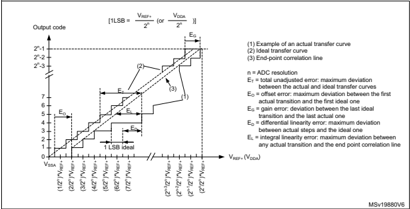

Figure 29. Typical connection diagram when using the ADC with FT/TT pins featuring analog switch function

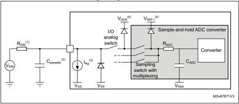

1. Refer to Table 66: ADC characteristics for the values of R AIN  and C ADC .
2. Cparasitic  represents the capacitance of the PCB (dependent on soldering and PCB layout quality) plus the pad capacitance (refer to Table 54: I/O static characteristics for the value of the pad capacitance). A high Cparasitic  value downgrades conversion accuracy. To remedy this, f ADC  should be reduced.
3. Refer to Table 54: I/O static characteristics for the values of I lkg .
4. Refer to Figure 16: Power supply scheme .

## General PCB design guidelines

Power supply decoupling must be performed as shown in Figure 16: Power supply scheme . The decoupling capacitor on V DDA  must be ceramic (good quality) and it must be placed as close as possible to the chip.


## 5.3.20 Digital-to-Analog converter characteristics

Table 74. DAC 1MSPS characteristics (1)

| Symbol       | Parameter                                                                                                                                | Conditions                                                                  | Conditions                                                                  | Min   | Typ   | Max          | Unit   |
|--------------|------------------------------------------------------------------------------------------------------------------------------------------|-----------------------------------------------------------------------------|-----------------------------------------------------------------------------|-------|-------|--------------|--------|
| V DDA        | Analog supply voltage for DAC ON                                                                                                         | DAC output buffer OFF, DAC_OUT pin not connected (internal connection only) | DAC output buffer OFF, DAC_OUT pin not connected (internal connection only) | 1.71  | -     | 3.6          |        |
| V DDA        | Analog supply voltage for DAC ON                                                                                                         | Other modes                                                                 | Other modes                                                                 | 1.80  | -     | 3.6          |        |
| V REF+       | Positive reference voltage                                                                                                               | DAC output buffer OFF, DAC_OUT pin not connected (internal connection only) | DAC output buffer OFF, DAC_OUT pin not connected (internal connection only) | 1.71  | -     | V DDA        | V      |
| V REF+       | Positive reference voltage                                                                                                               | Other modes                                                                 | Other modes                                                                 | 1.80  | -     | V DDA        | V      |
| V REF-       | Negative reference voltage                                                                                                               |                                                                             | -                                                                           | V     | SSA   | V            |        |
| R L          | Resistive load                                                                                                                           | DAC output buffer ON                                                        | connected to V SSA                                                          | 5     | -     | -            | k Ω    |
| R L          | Resistive load                                                                                                                           | DAC output buffer ON                                                        | connected to V DDA                                                          | 25    | -     | -            | k Ω    |
| R O          | Output Impedance                                                                                                                         | DAC output buffer OFF                                                       | DAC output buffer OFF                                                       | 9.6   | 11.7  | 13.8         | k Ω    |
| R BON        | Output impedance sample and hold mode, output                                                                                            | V DD = 2.7 V                                                                | V DD = 2.7 V                                                                | -     | -     | 2            | k Ω    |
| R BON        | buffer ON                                                                                                                                | V DD = 2.0 V                                                                | V DD = 2.0 V                                                                | -     | -     | 3.5          | k Ω    |
| R BOFF       | Output impedance sample and hold mode, output buffer OFF                                                                                 | V DD = 2.7 V                                                                | V DD = 2.7 V                                                                | -     | -     | 16.5         | k Ω    |
| R BOFF       | Output impedance sample and hold mode, output buffer OFF                                                                                 | V DD = 2.0 V                                                                | V DD = 2.0 V                                                                | -     | -     | 18.0         | k Ω    |
| C L          | Capacitive load                                                                                                                          | DAC output buffer ON                                                        | DAC output buffer ON                                                        | -     | -     | 50           | pF     |
| C SH         | Capacitive load                                                                                                                          | Sample and hold mode                                                        | Sample and hold mode                                                        | -     | 0.1   | 1            | µF     |
| V DAC_OUT    | Voltage on DAC_OUT output                                                                                                                | DAC output buffer ON                                                        | DAC output buffer ON                                                        | 0.2   | -     | V REF+ - 0.2 | V      |
| V DAC_OUT    | Voltage on DAC_OUT output                                                                                                                | DAC output buffer OFF                                                       | DAC output buffer OFF                                                       | 0     | -     | V REF+       | V      |
| t SETTLING   | Settling time (full scale: for a 12-bit code transition between the lowest and the highest input codes when DAC_OUT reaches final value) | Normal mode DAC output buffer ON CL ≤ 50 pF, RL ≥ 5 k Ω                     | ±0.5 LSB                                                                    | -     | 1.7   | 3            | µs     |
| t SETTLING   | Settling time (full scale: for a 12-bit code transition between the lowest and the highest input codes when DAC_OUT reaches final value) | Normal mode DAC output buffer ON CL ≤ 50 pF, RL ≥ 5 k Ω                     | ±1 LSB                                                                      | -     | 1.6   | 2.9          | µs     |
| t SETTLING   | Settling time (full scale: for a 12-bit code transition between the lowest and the highest input codes when DAC_OUT reaches final value) | Normal mode DAC output buffer ON CL ≤ 50 pF, RL ≥ 5 k Ω                     | ±2 LSB                                                                      | -     | 1.55  | 2.85         | µs     |
| t SETTLING   | Settling time (full scale: for a 12-bit code transition between the lowest and the highest input codes when DAC_OUT reaches final value) | Normal mode DAC output buffer ON CL ≤ 50 pF, RL ≥ 5 k Ω                     | ±4 LSB                                                                      | -     | 1.48  | 2.8          | µs     |
| t SETTLING   | Settling time (full scale: for a 12-bit code transition between the lowest and the highest input codes when DAC_OUT reaches final value) | Normal mode DAC output buffer ON CL ≤ 50 pF, RL ≥ 5 k Ω                     | ±8 LSB                                                                      | -     | 1.4   | 2.75         | µs     |
| t SETTLING   | Settling time (full scale: for a 12-bit code transition between the lowest and the highest input codes when DAC_OUT reaches final value) | Normal mode DAC output buffer OFF, ±1LSB, CL = 10 pF                        | Normal mode DAC output buffer OFF, ±1LSB, CL = 10 pF                        | -     | 2     | 2.5          | µs     |
| t WAKEUP (2) | Wakeup time from off state (setting the ENx bit in the DAC Control register) until final value ±1 LSB                                    | Normal mode DAC output buffer ON CL ≤ 50 pF, RL ≥ 5 k Ω                     | Normal mode DAC output buffer ON CL ≤ 50 pF, RL ≥ 5 k Ω                     | -     | 4.2   | 7.5          | µs     |
| t WAKEUP (2) | Wakeup time from off state (setting the ENx bit in the DAC Control register) until final value ±1 LSB                                    | Normal mode DAC output buffer OFF, CL ≤ 10 pF                               | Normal mode DAC output buffer OFF, CL ≤ 10 pF                               | -     | 2     | 5            | µs     |
| PSRR         | V DDA supply rejection ratio                                                                                                             | Normal mode DAC output buffer ON CL ≤ 50 pF, RL = 5 k Ω , DC                | Normal mode DAC output buffer ON CL ≤ 50 pF, RL = 5 k Ω , DC                | -     | -80   | -28          | dB     |


199

Table 74. DAC 1MSPS characteristics (1)  (continued)

| Symbol      | Parameter                                                                                                                                                                                                             | Conditions                                           | Conditions                                  | Min   | Typ                       | Max                       | Unit   |
|-------------|-----------------------------------------------------------------------------------------------------------------------------------------------------------------------------------------------------------------------|------------------------------------------------------|---------------------------------------------|-------|---------------------------|---------------------------|--------|
| T W_to_W    | Minimal time between two consecutive writes into the DAC_DORx register to guarantee a correct DAC_OUT for a small variation of the input code (1 LSB) DAC_MCR:MODEx[2:0] = 000 or 001 DAC_MCR:MODEx[2:0] = 010 or 011 | CL ≤ 50 pF, CL ≤ 10 pF                               | ≥ 5 k Ω                                     | 1 1.4 | -                         | -                         | µs     |
| t SAMP      | Sampling time in sample and hold mode (code transition between the lowest input code and the highest input code when DACOUT reaches final value ±1LSB)                                                                | DAC_OUT pin connected                                | DAC output buffer ON, C SH = 100 nF         | -     | 0.7                       | 3.5                       | ms     |
| t SAMP      | Sampling time in sample and hold mode (code transition between the lowest input code and the highest input code when DACOUT reaches final value ±1LSB)                                                                | DAC_OUT pin connected                                | DAC output buffer OFF, C SH = 100 nF        | -     | 10.5                      | 18                        | ms     |
| t SAMP      | Sampling time in sample and hold mode (code transition between the lowest input code and the highest input code when DACOUT reaches final value ±1LSB)                                                                | DAC_OUT pin not connected (internal connection only) | DAC output buffer OFF                       | -     | 2                         | 3.5                       | µs     |
| I leak      | Output leakage current                                                                                                                                                                                                | Sample and hold mode, DAC_OUT pin connected          | Sample and hold mode, DAC_OUT pin connected | -     | -                         | - (3)                     | nA     |
| CI int      | Internal sample and hold capacitor                                                                                                                                                                                    | -                                                    | -                                           | 5.2   | 7                         | 8.8                       | pF     |
| t TRIM      | Middle code offset trim time                                                                                                                                                                                          | DAC output buffer ON                                 | DAC output buffer ON                        | 50    | -                         | -                         | µs     |
| V offset    | Middle code offset for 1 trim code step                                                                                                                                                                               | V REF+ = 3.6 V                                       | V REF+ = 3.6 V                              | -     | 1500                      | -                         | µV     |
| V offset    | Middle code offset for 1 trim code step                                                                                                                                                                               | V REF+ = 1.8 V                                       | V REF+ = 1.8 V                              | -     | 750                       | -                         | µV     |
| I DDA (DAC) | DAC consumption from V DDA                                                                                                                                                                                            | DAC output buffer ON                                 | No load, middle code (0x800)                | -     | 315                       | 500                       | µA     |
| I DDA (DAC) | DAC consumption from V DDA                                                                                                                                                                                            | DAC output buffer ON                                 | No load, worst code (0xF1C)                 | -     | 450                       | 670                       | µA     |
| I DDA (DAC) | DAC consumption from V DDA                                                                                                                                                                                            | DAC output buffer OFF                                | No load, middle code (0x800)                | -     | -                         | 0.2                       | µA     |
| I DDA (DAC) | DAC consumption from V DDA                                                                                                                                                                                            | Sample and hold mode, C SH = 100 nF                  | Sample and hold mode, C SH = 100 nF         | -     | 315 ₓ Ton/(Ton +Toff) (4) | 670 ₓ Ton/(Ton +Toff) (4) | µA     |


Table 74. DAC 1MSPS characteristics (1)  (continued)

| Symbol      | Parameter                   | Conditions                                                  | Conditions                                                  | Min   | Typ                       | Max                       | Unit   |
|-------------|-----------------------------|-------------------------------------------------------------|-------------------------------------------------------------|-------|---------------------------|---------------------------|--------|
| I DDV (DAC) | DAC consumption from V REF+ | DAC output buffer ON                                        | No load, middle code (0x800)                                | -     | 185                       | 240                       | µA     |
| I DDV (DAC) | DAC consumption from V REF+ | DAC output buffer ON                                        | No load, worst code (0xF1C)                                 | -     | 340                       | 400                       | µA     |
| I DDV (DAC) | DAC consumption from V REF+ | DAC output buffer OFF                                       | No load, middle code (0x800)                                | -     | 155                       | 205                       | µA     |
| I DDV (DAC) | DAC consumption from V REF+ | Sample and hold mode, buffer ON, C SH = 100 nF, worst case  | Sample and hold mode, buffer ON, C SH = 100 nF, worst case  | -     | 185 ₓ Ton/(Ton +Toff) (4) | 400 ₓ Ton/(Ton +Toff) (4) | µA     |
| I DDV (DAC) | DAC consumption from V REF+ | Sample and hold mode, buffer OFF, C SH = 100 nF, worst case | Sample and hold mode, buffer OFF, C SH = 100 nF, worst case | -     | 155 ₓ Ton/(Ton +Toff) (4) | 205 ₓ Ton/(Ton +Toff) (4) | µA     |

1. Guaranteed by design.
2. In buffered mode, the output can overshoot above the final value for low input code (starting from min value).
3. Refer to Table 54: I/O static characteristics .
4. Ton is the Refresh phase duration. Toff is the Hold phase duration. Refer to the reference manual RM0440 "STM32G4 Series advanced Arm ® -based 32-bit MCUs" for more details.
1. The DAC integrates an output buffer to reduce the output impedance and to drive external loads directly without the use of an external operational amplifier. The buffer can be bypassed by configuring the BOFFx bit in the DAC\_CR register.

Figure 30. 12-bit buffered / non-buffered DAC

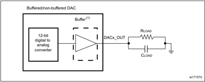

199

.

Table 75. DAC 1MSPS accuracy (1)

| Symbol    | Parameter                                    | Conditions                                                    |                                                               | Min        | Typ        | Max        | Unit   |
|-----------|----------------------------------------------|---------------------------------------------------------------|---------------------------------------------------------------|------------|------------|------------|--------|
| DNL       | Differential non linearity (2)               | DAC output buffer ON                                          | DAC output buffer ON                                          | -          | -          | ±2         | LSB    |
| DNL       | Differential non linearity (2)               | DAC output buffer OFF                                         | DAC output buffer OFF                                         | -          | -          | ±2         | LSB    |
| -         | monotonicity                                 | 10 bits                                                       | 10 bits                                                       | Guaranteed | Guaranteed | Guaranteed | LSB    |
| INL       | Integral non linearity (3)                   | DAC output buffer ON CL ≤ 50 pF, RL ≥ 5 k Ω                   | DAC output buffer ON CL ≤ 50 pF, RL ≥ 5 k Ω                   | -          | -          | ±4         | LSB    |
| INL       | Integral non linearity (3)                   | DAC output buffer OFF CL ≤ 50 pF, no RL                       | DAC output buffer OFF CL ≤ 50 pF, no RL                       | -          | -          | ±4         | LSB    |
| Offset    | Offset error at code 0x800 (3)               | DAC output buffer ON CL ≤ 50 pF, RL ≥ 5 k Ω                   | V REF+ = 3.6 V                                                | -          | -          | ±12        | LSB    |
| Offset    | Offset error at code 0x800 (3)               | DAC output buffer ON CL ≤ 50 pF, RL ≥ 5 k Ω                   | V REF+ = 1.8 V                                                | -          | -          | ±25        | LSB    |
| Offset    | Offset error at code 0x800 (3)               | DAC output buffer OFF CL ≤ 50 pF, no RL                       | DAC output buffer OFF CL ≤ 50 pF, no RL                       | -          | -          | ±8         | LSB    |
| Offset1   | Offset error at code 0x001 (4)               | DAC output buffer OFF CL ≤ 50 pF, no RL                       | DAC output buffer OFF CL ≤ 50 pF, no RL                       | -          | -          | ±5         | LSB    |
| OffsetCal | Offset Error at code 0x800 after calibration | DAC output buffer ON CL ≤ 50 pF, RL ≥ 5 k Ω                   | V REF+ = 3.6 V                                                | -          | -          | ±5         | LSB    |
| OffsetCal | Offset Error at code 0x800 after calibration | DAC output buffer ON CL ≤ 50 pF, RL ≥ 5 k Ω                   | V REF+ = 1.8 V                                                | -          | -          | ±7         | LSB    |
| Gain      | Gain error (5)                               | DAC output buffer ON CL ≤ 50 pF, RL ≥ 5 k Ω                   | DAC output buffer ON CL ≤ 50 pF, RL ≥ 5 k Ω                   | -          | -          | ±0.5       | %      |
| Gain      | Gain error (5)                               | DAC output buffer OFF CL ≤ 50 pF, no RL                       | DAC output buffer OFF CL ≤ 50 pF, no RL                       | -          | -          | ±0.5       | %      |
| TUE       | Total unadjusted error                       | DAC output buffer ON CL ≤ 50 pF, RL ≥ 5 k Ω                   | DAC output buffer ON CL ≤ 50 pF, RL ≥ 5 k Ω                   | -          | -          | ±30        | LSB    |
| TUE       | Total unadjusted error                       | DAC output buffer OFF CL ≤ 50 pF, no RL                       | DAC output buffer OFF CL ≤ 50 pF, no RL                       | -          | -          | ±12        | LSB    |
| TUECal    | Total unadjusted error after calibration     | DAC output buffer ON CL ≤ 50 pF, RL ≥ 5 k Ω                   | DAC output buffer ON CL ≤ 50 pF, RL ≥ 5 k Ω                   | -          | -          | ±23        | LSB    |
| SNR       | Signal-to-noise ratio                        | DAC output buffer ON CL ≤ 50 pF, RL ≥ 5 k Ω 1 kHz, BW 500 kHz | DAC output buffer ON CL ≤ 50 pF, RL ≥ 5 k Ω 1 kHz, BW 500 kHz | -          | 71.2       | -          | dB     |
| SNR       | Signal-to-noise ratio                        | DAC output buffer OFF CL ≤ 50 pF, no RL, 1 kHz BW 500 kHz     | DAC output buffer OFF CL ≤ 50 pF, no RL, 1 kHz BW 500 kHz     | -          | 71.6       | -          | dB     |
| THD       | Total harmonic distortion                    | DAC output buffer ON CL ≤ 50 pF, RL ≥ 5 k Ω , 1 kHz           | DAC output buffer ON CL ≤ 50 pF, RL ≥ 5 k Ω , 1 kHz           | -          | -78        | -          | dB     |
| THD       | Total harmonic distortion                    | DAC output buffer OFF CL ≤ 50 pF, no RL, 1 kHz                | DAC output buffer OFF CL ≤ 50 pF, no RL, 1 kHz                | -          | -79        | -          | dB     |


Table 75. DAC 1MSPS accuracy (1)  (continued)

| Symbol   | Parameter                            | Conditions                                          | Min   |   Typ | Max   | Unit   |
|----------|--------------------------------------|-----------------------------------------------------|-------|-------|-------|--------|
| SINAD    | Signal-to-noise and distortion ratio | DAC output buffer ON CL ≤ 50 pF, RL ≥ 5 k Ω , 1 kHz | -     |  70.4 | -     | dB     |
| SINAD    | Signal-to-noise and distortion ratio | DAC output buffer OFF CL ≤ 50 pF, no RL, 1 kHz      | -     |    71 | -     | dB     |
| ENOB     | Effective number of bits             | DAC output buffer ON CL ≤ 50 pF, RL ≥ 5 k Ω , 1 kHz | -     |  11.4 | -     | bits   |
| ENOB     | Effective number of bits             | DAC output buffer OFF CL ≤ 50 pF, no RL, 1 kHz      | -     |  11.5 | -     | bits   |

3. Difference between measured value at Code i and the value at Code i on a line drawn between Code 0 and last Code 4095.
4. Difference between the value measured at Code (0x001) and the ideal value.
5. Difference between ideal slope of the transfer function and measured slope computed from code 0x000 and 0xFFF when buffer is OFF, and from code giving 0.2 V and (V REF+  - 0.2) V when buffer is ON.

Table 76. DAC 15MSPS characteristics (1)

| Symbol     | Parameter                                                                                                 | Conditions                                              | Conditions   | Min   | Typ   | Max    | Unit   |
|------------|-----------------------------------------------------------------------------------------------------------|---------------------------------------------------------|--------------|-------|-------|--------|--------|
| V DDA      | Analog supply voltage for DAC ON                                                                          | -                                                       | -            | 1.71  | -     | 3.6    | V      |
| V REF+     | Positive reference voltage                                                                                | -                                                       | -            | 1.71  | -     | V DDA  | V      |
| V REF-     | Negative reference voltage                                                                                | -                                                       | -            | V SSA | V SSA | V SSA  | V      |
| V DAC_OUT  | Voltage on DAC_OUT output                                                                                 | -                                                       | -            | 0     | -     | V REF+ | V      |
| t SETTLING | a 12-bit code transition between the lowest and the highest input codes when DAC_OUT reaches final value) | V DDA >2,7V With One comparator on DAC output           | 10%-90%      | -     | 16    | 22     | ns     |
| t SETTLING | a 12-bit code transition between the lowest and the highest input codes when DAC_OUT reaches final value) | V DDA >2,7V With One comparator on DAC output           | 5%-95%       | -     | 21    | 29     | ns     |
| t SETTLING | a 12-bit code transition between the lowest and the highest input codes when DAC_OUT reaches final value) | V DDA >2,7V With One comparator on DAC output           | 1%-99%       | -     | 33    | 46     | ns     |
| t SETTLING | a 12-bit code transition between the lowest and the highest input codes when DAC_OUT reaches final value) | V DDA >2,7V With One comparator on DAC output           | 32lsb        | -     | 40    | 53     | ns     |
| t SETTLING | a 12-bit code transition between the lowest and the highest input codes when DAC_OUT reaches final value) | V DDA >2,7V With One comparator on DAC output           | 1lsb         | -     | 64    | 87     | ns     |
| t SETTLING | a 12-bit code transition between the lowest and the highest input codes when DAC_OUT reaches final value) | V DDA >2,7V With One comparator and OPAMP on DAC output | 10%-90%      | -     | 24    | 32     | ns     |
| t SETTLING | a 12-bit code transition between the lowest and the highest input codes when DAC_OUT reaches final value) | V DDA >2,7V With One comparator and OPAMP on DAC output | 5%-95%       | -     | 32    | 43     | ns     |
| t SETTLING | a 12-bit code transition between the lowest and the highest input codes when DAC_OUT reaches final value) | V DDA >2,7V With One comparator and OPAMP on DAC output | 1%-99%       | -     | 49    | 67     | ns     |
| t SETTLING | a 12-bit code transition between the lowest and the highest input codes when DAC_OUT reaches final value) | V DDA >2,7V With One comparator and OPAMP on DAC output | 32lsb        | -     | 57    | 75     | ns     |
| t SETTLING | a 12-bit code transition between the lowest and the highest input codes when DAC_OUT reaches final value) | V DDA >2,7V With One comparator and OPAMP on DAC output | 1lsb         | -     | 93    | 125    | ns     |


199

Table 76. DAC 15MSPS characteristics (1)  (continued)

| Symbol             | Parameter                                                                                                                                              | Conditions                       | Conditions                       | Min   | Typ   | Max   | Unit   |
|--------------------|--------------------------------------------------------------------------------------------------------------------------------------------------------|----------------------------------|----------------------------------|-------|-------|-------|--------|
| t SETTLING         |                                                                                                                                                        |                                  | 10%-90%                          | -     | 16    | 88    | ns     |
| t SETTLING         |                                                                                                                                                        |                                  | 5%-95%                           | -     | 21    | 116   | ns     |
| t SETTLING         |                                                                                                                                                        |                                  | 1%-99%                           | -     | 33    | 181   | ns     |
| t SETTLING         | Settling time (full scale: for                                                                                                                         |                                  | 32lsb                            | -     | 40    | 196   | ns     |
| t SETTLING         | a 12-bit code transition between the lowest and the                                                                                                    |                                  | 1lsb                             | -     | 64    | 332   | ns     |
| t SETTLING         | highest input codes when DAC_OUT reaches final                                                                                                         |                                  | 10%-90%                          | -     | 24    | 128   | ns     |
| t SETTLING         | value)                                                                                                                                                 |                                  | 5%-95%                           | -     | 32    | 170   | ns     |
| t SETTLING         |                                                                                                                                                        |                                  | 1%-99%                           | -     | 49    | 265   | ns     |
| t SETTLING         |                                                                                                                                                        |                                  | 32lsb                            | -     | 57    | 284   | ns     |
| t SETTLING         |                                                                                                                                                        |                                  | 1lsb                             | -     | 93    | 483   | ns     |
| t WAKEUP (2)       | Wakeup time from off state (setting the ENx bit in the DAC Control register) until final value ±1 LSB                                                  | Normal mode CL ≤ 10 pF           | Normal mode CL ≤ 10 pF           | -     | 1.4   | 3.5   | µs     |
| PSRR               | V DDA supply rejection ratio                                                                                                                           |                                  |                                  | 65    | 85    | -     | dB     |
| PSRR               | V DDA supply rejection ratio                                                                                                                           | V DD <2.7 V                      | V DD <2.7 V                      | 40    | 85    | -     | dB     |
| t SAMP             | Sampling time in sample and hold mode (code transition between the lowest input code and the highest input code when DACOUT reaches final value ±1LSB) | -                                | -                                | -     | 0.7   | -     | µs     |
| CI int             | Internal sample and hold capacitor                                                                                                                     | -                                | -                                | -     | 4     | 5     | pF     |
| dV/dt (hold phase) | Voltage decay rate in Sample and hold mode, during hold phase                                                                                          | CSH = 4 pF T = 55°C              | CSH = 4 pF T = 55°C              | -     | 50    | -     | mV/ms  |
| I DDA (DAC)        | DAC consumption from V DDA                                                                                                                             | No load, middle code (0x800)     | No load, middle code (0x800)     | -     | -     | 0.2   | µA     |
| I DDV (DAC)        | DAC consumption from V REF+                                                                                                                            | No load, middle code (0x800) (3) | No load, middle code (0x800) (3) | -     | 720   | 955   |        |


Table 77. DAC 15MSPS accuracy (1)

| Symbol   | Parameter                      | Conditions                                                         | Min   | Typ   |   Max | Unit   |
|----------|--------------------------------|--------------------------------------------------------------------|-------|-------|-------|--------|
| DNL      | Differential non linearity (2) | -                                                                  | -2    | -     |     2 |        |
| INL      | Integral non linearity (3)     | CL ≤ 50 pF, no RL                                                  | -5    | -     |     5 |        |
| TUE      | Total unadjusted error         | CL ≤ 50 pF, no RL                                                  | -5    | -     |     5 | LSB    |
| DCS      | Dynamic code spike             | Spike amplitude on DAC voltage when DAC output value is decreasing | -     | 0     |     4 |        |


199

## 5.3.21 Voltage reference buffer characteristics

Table 78. VREFBUF characteristics (1)

| Symbol             | Parameter                                                  | Conditions                          | Conditions                          | Min           | Typ   | Max                                   | Unit    |
|--------------------|------------------------------------------------------------|-------------------------------------|-------------------------------------|---------------|-------|---------------------------------------|---------|
| V DDA              | Analog supply                                              |                                     | VRS = 00                            | 2.4           | -     | 3.6                                   |         |
| V DDA              | Analog supply                                              |                                     | VRS = 01                            | 2.8           | -     | 3.6                                   |         |
| V DDA              | Analog supply                                              |                                     | VRS = 10                            | 3.135         | -     | 3.6                                   |         |
| V DDA              | voltage                                                    |                                     | VRS= 00                             | 1.65          | -     | 2.4                                   |         |
| V DDA              | Analog supply                                              |                                     | VRS = 01                            | 1.65          | -     | 2.8                                   |         |
| V DDA              | Analog supply                                              |                                     | VRS= 10                             | 1.65          | -     | 3.135                                 |         |
| V REFBUF_ OUT      | Voltage reference output                                   |                                     | VRS= 00                             | 2.044         | 2.048 | 2.052                                 | V       |
| V REFBUF_ OUT      | Voltage reference output                                   |                                     | VRS= 01                             | 2.496         | 2.5   | 2.504                                 | V       |
| V REFBUF_ OUT      | Voltage reference output                                   |                                     | VRS = 10                            | 2.896         | 2.9   | 2.904                                 | V       |
| V REFBUF_ OUT      | Voltage reference output                                   |                                     | VRS= 00                             | V DDA -250 mV | -     | V DDA                                 |         |
| V REFBUF_ OUT      | Voltage reference output                                   |                                     | VRS = 01                            | V DDA -250 mV | -     | V DDA                                 |         |
| V REFBUF_ OUT      | Voltage reference output                                   |                                     | VRS = 10                            | V DDA -250 mV | -     | V DDA                                 |         |
| V REFOUT_ TEMP (3) | Voltage reference output spread over the temperature range | V DDA = 3V                          | V DDA = 3V                          | -             | -     | See Figure 31 , Figure 32 , Figure 33 | mV      |
| TRIM               | Trim step resolution                                       | -                                   | -                                   | -             | ±0.05 | ±0.1                                  | %       |
| CL                 | Load capacitor                                             | -                                   | -                                   | 0.5           | 1     | 1.5                                   | µF      |
| esr                | Equivalent Serial Resistor of Cload                        | -                                   | -                                   | -             | -     | 2                                     | Ω       |
| I load             | Static load current                                        | -                                   | -                                   | -             | -     | 6.5                                   | mA      |
| I line_reg (4)     | Line regulation                                            | -                                   | -                                   | -             | 1000  | 2000                                  | ppm/V   |
| I load_reg         | Load regulation                                            | 500 μ A ≤ I load ≤ 4 mA Normal mode | 500 μ A ≤ I load ≤ 4 mA Normal mode | -             | 50    | 500                                   | ppm/m A |
| T Coeff            | Temperature coefficient                                    | -40 °C < TJ < +125 °C               | -40 °C < TJ < +125 °C               | -             | -     | Tcoeff_vr                             | ppm/ °C |
| T Coeff            | Temperature coefficient                                    | 0 °C < TJ < +50 °C                  | 0 °C < TJ < +50 °C                  | -             | -     | efint + 50 (5)                        | ppm/ °C |
| PSRR               | Power supply rejection                                     | DC                                  | DC                                  | 40            | 55    | -                                     | dB      |
| PSRR               | Power supply rejection                                     | 100 kHz                             | 100 kHz                             | 25            | 40    | -                                     | dB      |
| t START            |                                                            | CL = 0.5 µF (6)                     | CL = 0.5 µF (6)                     | -             | 300   | 350                                   | µs      |
| t START            | Start-up time                                              | CL = 1.1 µF (6)                     | CL = 1.1 µF (6)                     | -             | 500   | 650                                   | µs      |
| t START            |                                                            | CL = 1.5 µF (6)                     | CL = 1.5 µF (6)                     | -             | 650   | 800                                   | µs      |


Table 78. VREFBUF characteristics (1)  (continued)

| Symbol           | Parameter                                                                      | Conditions      | Min   |   Typ | Max   | Unit   |
|------------------|--------------------------------------------------------------------------------|-----------------|-------|-------|-------|--------|
| I INRUSH         | Control of maximum DC current drive on VREFBUF_ OUT during start- up phase (7) | -               | -     |     8 | -     | mA     |
| I DDA (VREF BUF) | VREFBUF consumption from V DDA                                                 | I load = 0 µA   | -     |    16 | 25    | µA     |
| I DDA (VREF BUF) | VREFBUF consumption from V DDA                                                 | I load = 500 µA | -     |    18 | 30    | µA     |
| I DDA (VREF BUF) | VREFBUF consumption from V DDA                                                 | I load = 4 mA   | -     |    35 | 50    | µA     |
| I DDA (VREF BUF) | VREFBUF consumption from V DDA                                                 | I load = 6.5 mA | -     |    45 | 80    | µA     |

2. In degraded mode, the voltage reference buffer can not maintain accurately the output voltage which follows (V DDA  - drop voltage).
3. Guaranteed by characterization results.
4. Line regulation is given for overall supply variation, in normal mode.
5. Tcoeff\_vrefint refer to Tcoeff parameter in the embedded voltage reference section.
6. The capacitive load must include a 100 nF low ESR capacitor in order to cut-off the high frequency noise.
7. To correctly control the VREFBUF inrush current during start-up phase and scaling change, the V DDA  voltage should be in the range [2.4 V to 3.6 V], [2.8 V to 3.6 V] and [3.135 V to 3.6 V] respectively for VRS=0,1 and 2.

Figure 31. V REFOUT\_TEMP  in case VRS = 00

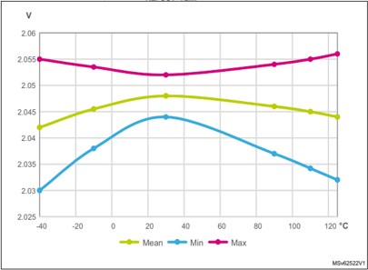


199

Figure 32. V REFOUT\_TEMP  in case VRS = 01

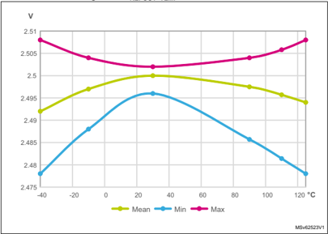

Figure 33. V REFOUT\_TEMP  in case VRS = 10

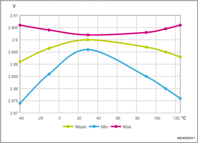


## 5.3.22 Comparator characteristics

Table 79. COMP characteristics (1)

| Symbol         | Parameter                                                                                        | Conditions                                       | Typ     | Min     |         | Max     | Unit   |
|----------------|--------------------------------------------------------------------------------------------------|--------------------------------------------------|---------|---------|---------|---------|--------|
| V DDA          | Analog supply voltage                                                                            | -                                                |         | 1.62    | -       | 3.6     |        |
| V IN           | Comparator input voltage range                                                                   | -                                                | 0       |         | -       | V DDA   | V      |
| V BG (2)       | Scaler input voltage                                                                             | -                                                | VREFINT | VREFINT | VREFINT | VREFINT |        |
| V SC (3)       | Scaler offset voltage                                                                            | -                                                | -       | ±5      | ±10     | mV      |        |
| I DDA (SCALER) | Scaler static consumption from V DDA                                                             | BRG_EN=0 (bridge disable)                        | -       | 200     | 300     | nA      |        |
| I DDA (SCALER) | Scaler static consumption from V DDA                                                             | BRG_EN=1 (bridge enable)                         | -       | 0.8     | 1       | µA      |        |
| t START_SCALER | Scaler startup time                                                                              | -                                                | -       | 100     | 200     | µs      |        |
| t START        | Comparator startup time to reach propagation delay specification                                 | -                                                | -       | -       | 5       | µs      |        |
| t D (4)        | Propagation delay (From COMP input pin to COMP output pin) for 200 mV step with 100 mV overdrive | 50pF load on output V DDA < 2.7 V V DDA ≥        | -       | -       | 35      | ns      |        |
| t D (4)        | Propagation delay (From COMP input pin to COMP output pin) for 200 mV step with 100 mV overdrive | 2.7 V                                            | -       | 16.7    | 31      | ns      |        |
| V offset (3)   | Comparator offset error                                                                          | Full V DDA voltage range, full temperature range | -9      | -6/+2   | 3       | mV      |        |
| V hys          | Comparator hysteresis                                                                            | HYST[2:0] = 0                                    | -       | 0       | -       |         |        |
| V hys          | Comparator hysteresis                                                                            | HYST[2:0] =1                                     | 4       | 9       | 16      |         |        |
| V hys          | Comparator hysteresis                                                                            | HYST[2:0] = 2                                    | 7       | 18      | 32      |         |        |
| V hys          | Comparator hysteresis                                                                            | HYST[2:0] = 3                                    | 11      | 27      | 47      |         |        |
| V hys          | Comparator hysteresis                                                                            | HYST[2:0] = 4                                    | 15      | 36      | 63      | mV      |        |
| V hys          | Comparator hysteresis                                                                            | HYST[2:0] = 5                                    | 19      | 45      | 79      |         |        |
| V hys          | Comparator hysteresis                                                                            | HYST[2:0] = 6                                    | 23      | 54      | 95      |         |        |
| V hys          | Comparator hysteresis                                                                            | HYST[2:0] = 7                                    | 26      | 63      | 110     |         |        |
| I DDA (COMP)   | Comparator consumption from V DDA                                                                | Static                                           | -       | 450     | 720     |         |        |
| I DDA (COMP)   | Comparator consumption from V DDA                                                                | With 50 kHz ±100 mV overdrive square signal      | -       | 450     | -       | µA      |        |


199

## 5.3.23 Operational amplifiers characteristics

Table 80. OPAMP characteristics (1)   (2)

| Symbol        | Parameter                                                    | Conditions                                                  | Min         | Typ   | Max   | Unit   |
|---------------|--------------------------------------------------------------|-------------------------------------------------------------|-------------|-------|-------|--------|
| V DDA         | Analog supply voltage                                        | -                                                           | 2           | 3.3   | 3.6   | V      |
| CMIR          | Common mode input range                                      | -                                                           | 0           | -     | V DDA | V      |
| VI OFFSET (3) | Input offset voltage                                         | 25 °C, No Load on output.                                   | -           | -     | ±1.5  | mV     |
| VI OFFSET (3) | Input offset voltage                                         | All voltage/temperature.                                    | -           | -     | ±3    | mV     |
| ∆ VI OFFSET   | Input offset voltage drift                                   | -                                                           | -           | ±10   | -     | μ V/°C |
| TRIMOFFSE TP  | Offset trim step at low common input voltage (0.1 ₓ V DDA )  | -                                                           | -           | 1.1   | 1.2   | mV     |
| TRIMOFFSE TN  | Offset trim step at high common input voltage (0.9 ₓ V DDA ) | -                                                           | -           | 1.3   | 1.65  | mV     |
| I LOAD        | Drive current                                                | -                                                           | -           | -     | 500   | µA     |
| I LOAD_PGA    | Drive current in PGA mode                                    | -                                                           | -           | -     | 270   | µA     |
| C LOAD        | Capacitive load                                              | -                                                           | -           | -     | 50    | pF     |
| CMRR          | Common mode rejection ratio                                  | -                                                           | -           | 60    | -     | dB     |
| PSRR          | Power supply rejection ratio                                 | C LOAD ≤ 50 pf, R LOAD ≥ 4 k Ω DC Vcom=V DDA /2             | -           | 80    | -     | dB     |
| GBW           | Gain Bandwidth Product                                       | 100mV ≤ Output dynamic range ≤ V DDA - 100mV                | 7           | 13    | -     | MHz    |
| SR (3)        | Slew rate (from 10 and 90% of output voltage)                | Normal mode                                                 | 2.5         | 6.5   | -     | V/µs   |
| SR (3)        | Slew rate (from 10 and 90% of output voltage)                | High-speed mode                                             | 18          | 45    | -     | V/µs   |
| AO            | Open loop gain                                               | 100mV ≤ Output dynamic range ≤ V DDA - 100mV                | 65          | 95    | -     | dB     |
| AO            | Open loop gain                                               | 200mV ≤ Output dynamic range ≤ V DDA - 200mV                | 75          | 95    | -     | dB     |
| V OHSAT (3)   | High saturation voltage                                      | I load = max or R load = min Input at V DDA . Follower mode | V DDA - 100 | -     | -     | mV     |
| V OLSAT (3)   | Low saturation voltage                                       | I load = max or R load = min Input at 0. Follower mode      | -           | -     | 100   | mV     |
| φ m           | Phase margin                                                 | Follower mode, Vcom=V DDA /2                                | -           | 65    | -     | °      |
| GM            | Gain margin                                                  | Follower mode, Vcom=V DDA /2                                | -           | 10    | -     | dB     |


Table 80. OPAMP characteristics (1)   (2)  (continued)

| Symbol       | Parameter                    | Conditions                                                                  | Conditions                                                                  | Min                                                                         | Typ                                                                         | Max                                                                         | Unit                                                                        |
|--------------|------------------------------|-----------------------------------------------------------------------------|-----------------------------------------------------------------------------|-----------------------------------------------------------------------------|-----------------------------------------------------------------------------|-----------------------------------------------------------------------------|-----------------------------------------------------------------------------|
| t WAKEUP (3) | Wake up time from OFF state. | Normal mode                                                                 | C LOAD ≤ 50 pf, R LOAD ≥ 4 k Ω follower configuration                       | -                                                                           | 3                                                                           | 6                                                                           | µs                                                                          |
| t WAKEUP (3) | Wake up time from OFF state. | High-speed mode                                                             | C LOAD ≤ 50 pf, R LOAD ≥ 20 k Ω follower configuration                      | -                                                                           | 3                                                                           | 6                                                                           | µs                                                                          |
| I bias       | OPAMP input bias current     | See l leak parameter in Table 54: I/O static characteristics for given pin. | See l leak parameter in Table 54: I/O static characteristics for given pin. | See l leak parameter in Table 54: I/O static characteristics for given pin. | See l leak parameter in Table 54: I/O static characteristics for given pin. | See l leak parameter in Table 54: I/O static characteristics for given pin. | See l leak parameter in Table 54: I/O static characteristics for given pin. |
| PGA gain     | Non inverting gain value (4) | PGA Gain = 2 0.1 ≤ Out dynamic range ≤ V DDA - 0.1                          | V DDA < 2.2                                                                 | -2                                                                          | -                                                                           | 2                                                                           | %                                                                           |
| PGA gain     | Non inverting gain value (4) | PGA Gain = 2 0.1 ≤ Out dynamic range ≤ V DDA - 0.1                          | V DDA ≥ 2.2                                                                 | -1                                                                          | -                                                                           | 1                                                                           | %                                                                           |
| PGA gain     | Non inverting gain value (4) | PGA Gain=4, 100mV ≤ Output dynamic range ≤ V DDA - 100mV                    | PGA Gain=4, 100mV ≤ Output dynamic range ≤ V DDA - 100mV                    | -1                                                                          | -                                                                           | 1                                                                           | %                                                                           |
| PGA gain     | Non inverting gain value (4) | PGA Gain=8 100mV ≤ Output dynamic range ≤ V DDA - 100mV                     | PGA Gain=8 100mV ≤ Output dynamic range ≤ V DDA - 100mV                     | -1                                                                          | -                                                                           | 1                                                                           | %                                                                           |
| PGA gain     | Non inverting gain value (4) | PGA Gain=16, 100mV ≤ Output dynamic range ≤ V DDA - 100mV                   | PGA Gain=16, 100mV ≤ Output dynamic range ≤ V DDA - 100mV                   | -1                                                                          | -                                                                           | 1                                                                           | %                                                                           |
| PGA gain     | Non inverting gain value (4) | PGA Gain=32 200mV ≤ Output ≤ V DDA - 200mV                                  | PGA Gain=32 200mV ≤ Output ≤ V DDA - 200mV                                  | -2                                                                          | -                                                                           | 2                                                                           | %                                                                           |
| PGA gain     | Non inverting gain value (4) | PGA Gain=64 200mV ≤ Output dynamic range ≤ V DDA - 200mV                    | PGA Gain=64 200mV ≤ Output dynamic range ≤ V DDA - 200mV                    | -2                                                                          | -                                                                           | 2                                                                           | %                                                                           |
| PGA gain     | Inverting gain value         | PGA Gain = -1 100mV ≤ Output dynamic                                        | V DDA < 2.2                                                                 | -2                                                                          | -                                                                           | 2                                                                           | %                                                                           |
| PGA gain     | Inverting gain value         | range ≤ V DDA - 100mV                                                       | V DDA ≥ 2.2                                                                 | -1                                                                          | -                                                                           | 1                                                                           | %                                                                           |
| PGA gain     | Inverting gain value         | PGA Gain=-3, 100mV ≤ Output dynamic range ≤ V DDA - 100mV                   | PGA Gain=-3, 100mV ≤ Output dynamic range ≤ V DDA - 100mV                   | -1                                                                          | -                                                                           | 1                                                                           | %                                                                           |
| PGA gain     | Inverting gain value         | PGA Gain=-7 100mV ≤ Output dynamic range ≤ V DDA - 100mV                    | PGA Gain=-7 100mV ≤ Output dynamic range ≤ V DDA - 100mV                    | -1                                                                          | -                                                                           | 1                                                                           | %                                                                           |
| PGA gain     | Inverting gain value         | PGA Gain=-15, 100mV ≤ Output dynamic range ≤ V DDA - 100mV                  | PGA Gain=-15, 100mV ≤ Output dynamic range ≤ V DDA - 100mV                  | -1                                                                          | -                                                                           | 1                                                                           | %                                                                           |
| PGA gain     | Inverting gain value         | PGA Gain=-31 200mV ≤ Output ≤ V DDA - 200mV                                 | PGA Gain=-31 200mV ≤ Output ≤ V DDA - 200mV                                 | -2                                                                          | -                                                                           | 2                                                                           | %                                                                           |
| PGA gain     | Inverting gain value         | PGA Gain=-63 200mV ≤ Output dynamic range ≤ V DDA - 200mV                   | PGA Gain=-63 200mV ≤ Output dynamic range ≤ V DDA - 200mV                   | -5                                                                          | -                                                                           | 2                                                                           | %                                                                           |


199

Table 80. OPAMP characteristics (1)   (2)  (continued)

| Symbol            | Parameter                                                      | Conditions                          | Conditions                          | Min   | Typ    | Max   | Unit     |
|-------------------|----------------------------------------------------------------|-------------------------------------|-------------------------------------|-------|--------|-------|----------|
| R network         | R2/R1 internal resistance values in non-inverting PGA mode (5) | PGA Gain = 2                        | PGA Gain = 2                        | -     | 10/10  | -     | k Ω /k Ω |
| R network         | R2/R1 internal resistance values in non-inverting PGA mode (5) | PGA Gain = 4                        | PGA Gain = 4                        | -     | 30/10  | -     | k Ω /k Ω |
| R network         | R2/R1 internal resistance values in non-inverting PGA mode (5) | PGA Gain = 8                        | PGA Gain = 8                        | -     | 70/10  | -     | k Ω /k Ω |
| R network         | R2/R1 internal resistance values in non-inverting PGA mode (5) | PGA Gain = 16                       | PGA Gain = 16                       | -     | 150/10 | -     | k Ω /k Ω |
| R network         | R2/R1 internal resistance values in non-inverting PGA mode (5) | PGA Gain = 32                       | PGA Gain = 32                       | -     | 310/10 | -     | k Ω /k Ω |
| R network         | R2/R1 internal resistance values in non-inverting PGA mode (5) | PGA Gain = 64                       | PGA Gain = 64                       | -     | 630/10 | -     | k Ω /k Ω |
| R network         | R2/R1 internal resistance values in inverting PGA mode (5)     | PGA Gain = -1                       | PGA Gain = -1                       | -     | 10/10  | -     | k Ω /k Ω |
| R network         | R2/R1 internal resistance values in inverting PGA mode (5)     | PGA Gain = -3                       | PGA Gain = -3                       | -     | 30/10  | -     | k Ω /k Ω |
| R network         | R2/R1 internal resistance values in inverting PGA mode (5)     | PGA Gain = -7                       | PGA Gain = -7                       | -     | 70/10  | -     | k Ω /k Ω |
| R network         | R2/R1 internal resistance values in inverting PGA mode (5)     | PGA Gain = -15                      | PGA Gain = -15                      | -     | 150/10 | -     | k Ω /k Ω |
| R network         | R2/R1 internal resistance values in inverting PGA mode (5)     | PGA Gain = -31                      | PGA Gain = -31                      | -     | 310/10 | -     | k Ω /k Ω |
| R network         | R2/R1 internal resistance values in inverting PGA mode (5)     | PGA Gain = -63                      | PGA Gain = -63                      | -     | 630/10 | -     | k Ω /k Ω |
| Delta R           | Resistance variation (R1 or R2)                                | -                                   | -                                   | -15   | -      | +15   | %        |
| PGA BW            | PGA bandwidth for different non inverting gain                 | Gain = 2                            | Gain = 2                            | -     | GBW/2  | -     | MHz      |
| PGA BW            | PGA bandwidth for different non inverting gain                 | Gain = 4                            | Gain = 4                            | -     | GBW/4  | -     | MHz      |
| PGA BW            | PGA bandwidth for different non inverting gain                 | Gain = 8                            | Gain = 8                            | -     | GBW/8  | -     | MHz      |
| PGA BW            | PGA bandwidth for different non inverting gain                 | Gain = 16                           | Gain = 16                           | -     | GBW/16 | -     | MHz      |
| PGA BW            | PGA bandwidth for different non inverting gain                 | Gain = 32                           | Gain = 32                           | -     | GBW/32 | -     | MHz      |
| PGA BW            | PGA bandwidth for different non inverting gain                 | Gain = 64                           | Gain = 64                           | -     | GBW/64 | -     | MHz      |
| PGA BW            | PGA bandwidth for different inverting gain                     | Gain = -1                           | Gain = -1                           | -     | GBW/2  | -     | MHz      |
| PGA BW            | PGA bandwidth for different inverting gain                     | Gain = -3                           | Gain = -3                           | -     | GBW/4  | -     | MHz      |
| PGA BW            | PGA bandwidth for different inverting gain                     | Gain = -7                           | Gain = -7                           | -     | GBW/8  | -     | MHz      |
| PGA BW            | PGA bandwidth for different inverting gain                     | Gain = -15                          | Gain = -15                          | -     | GBW/16 | -     | MHz      |
| PGA BW            | PGA bandwidth for different inverting gain                     | Gain = -31                          | Gain = -31                          | -     | GBW/32 | -     | MHz      |
| PGA BW            | PGA bandwidth for different inverting gain                     | Gain = -63                          | Gain = -63                          | -     | GBW/64 | -     | MHz      |
| eN                | Voltage noise density                                          | at 1 kHz, Output loaded with 4 k Ω  | at 1 kHz, Output loaded with 4 k Ω  | -     | 250    | -     | nV/ √ Hz |
| eN                | Voltage noise density                                          | at 10 kHz, Output loaded with 4 k Ω | at 10 kHz, Output loaded with 4 k Ω | -     | 90     | -     | nV/ √ Hz |
| I DDA (OPAMP)     | OPAMP consumption from V DDA                                   | Normal mode                         | No load, follower mode              | -     | 1.3    | 2.2   | mA       |
| I DDA (OPAMP)     | OPAMP consumption from V DDA                                   | High-speed mode                     | No load, follower mode              | -     | 1.4    | 2.6   | mA       |
| T S_OPAMP_VO UT   | ADC sampling time when reading the OPAMP output. OPAINTOEN=1   | V DDA < 2V                          | V DDA < 2V                          | 300   | -      | -     | ns       |
| T S_OPAMP_VO UT   | ADC sampling time when reading the OPAMP output. OPAINTOEN=1   | V DDA ≥ 2V                          | V DDA ≥ 2V                          | 200   | -      | -     | ns       |
| I DDA (OPAMPI NT) | OPAMP consumption from V DDA .                                 | Normal mode                         | no load, follower mode              | -     | 0.45   | 0.7   | mA       |
| I DDA (OPAMPI NT) | OPAINTOEN=1                                                    | High-speed mode                     | no load, follower mode              | -     | 0.5    | 0.8   | mA       |


1. Guaranteed by design, unless otherwise specified.
2. Data guaranteed on normal and high speed mode unless otherwise specified.
3. Guaranteed by characterization results.
4. Valid also for inverting gain configuration with external bias.
5. R2 is the internal resistance between OPAMP output and OPAMP inverting input. R1 is the internal resistance between OPAMP inverting input and ground. The PGA gain =1+R2/R1

Figure 34. OPAMP noise density @ 25°C

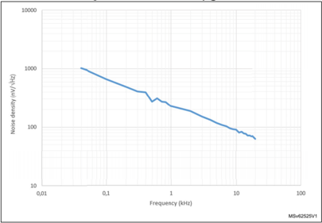


199

## 5.3.24 Temperature sensor characteristics

Table 81. TS characteristics

| Symbol           | Parameter                                                      | Min   | Typ   | Max   | Unit   |
|------------------|----------------------------------------------------------------|-------|-------|-------|--------|
| T L (1)          | V TS linearity with temperature                                | -     | ±1    | ±2    | °C     |
| Avg_Slope (1)    | Average slope                                                  | 2.3   | 2.5   | 2.7   | mV/°C  |
| V 30             | Voltage at 30°C (±5 °C) (2)                                    | 0.742 | 0.76  | 0.785 | V      |
| t START-RUN (1)  | Start-up time in Run mode (start-up of buffer)                 | -     | 8     | 15    | µs     |
| t START_CONT (3) | Start-up time when entering in continuous mode                 | -     | 70    | 120   | µs     |
| t S_temp (1)     | ADC sampling time when reading the temperature                 | 5     | -     | -     | µs     |
| I DD (TS) (1)    | Temperature sensor consumption from VDD , when selected by ADC | -     | 4.7   | 7     | µA     |

3. Continuous mode means RUN mode or Temperature Sensor ON.

## 5.3.25 VBAT  monitoring characteristics

Table 82. V BAT  monitoring characteristics (1)

| Symbol       | Parameter                                | Min   | Typ   | Max   | Unit   |
|--------------|------------------------------------------|-------|-------|-------|--------|
| R            | Resistor bridge for V BAT                | -     | 3x39  | -     | k Ω    |
| Q            | Ratio on V BAT measurement               | -     | 3     | -     | -      |
| Er (2)       | Error on Q                               | -10   | -     | 10    | %      |
| t S_vbat (2) | ADC sampling time when reading the V BAT | 12    | -     | -     | µs     |

Table 83. V BAT  charging characteristics

| Symbol   | Parameter                 | Conditions   | Min   |   Typ | Max   | Unit   |
|----------|---------------------------|--------------|-------|-------|-------|--------|
| R BC     | Battery charging resistor | VBRS = 0     | -     |     5 | -     | k Ω    |
| R BC     |                           | VBRS = 1     | -     |   1.5 | -     | k Ω    |


## 5.3.26 Timer characteristics

The parameters given in the following tables are guaranteed by design.

Refer to Section 5.3.14: I/O port characteristics for details on the input/output alternate function characteristics (output compare, input capture, external clock, PWM output).

Table 84. TIMx (1) characteristics (2)

| Symbol        | Parameter                                                                             | Conditions                  | Min     | Max           | Unit      |
|---------------|---------------------------------------------------------------------------------------|-----------------------------|---------|---------------|-----------|
| t res(TIM)    | Timer resolution time                                                                 | -                           | 1       | -             | t TIMxCLK |
| t res(TIM)    | Timer resolution time                                                                 | f TIMxCLK = 170 MHz         | 5.88    | -             | ns        |
| f EXT         | Timer external clock frequency on CH1 to CH4                                          | -                           | 0       | f TIMxCLK /2  | MHz       |
| f EXT         | Timer external clock frequency on CH1 to CH4                                          | f TIMxCLK = 170 MHz         | 0       | 85            | MHz       |
| Res TIM       | Timer resolution                                                                      | TIMx (except TIM2 and TIM5) | -       | 16            | bit       |
| Res TIM       | Timer resolution                                                                      | TIM2 and TIM5               | -       | 32            | bit       |
| t COUNTER     | 16-bit counter clock period                                                           | -                           | 1       | 65536         | t TIMxCLK |
| t COUNTER     | 16-bit counter clock period                                                           | f TIMxCLK = 170 MHz         | 0.00588 | 385.5         | µs        |
| t MAX_COUNT   | Maximum possible count with 32-bit counter                                            | -                           | -       | 65536 × 65536 | t TIMxCLK |
| t MAX_COUNT   | Maximum possible count with 32-bit counter                                            | f TIMxCLK = 170 MHz         | -       | 25.26         | s         |
| f ENC         | Encoder frequency on TI1 and TI2 input pins                                           | -                           | 0       | f TIMxCLK /4  | MHz       |
| f ENC         | Encoder frequency on TI1 and TI2 input pins                                           | f TIMxCLK = 170MHz          | 0       | 42.5          | MHz       |
| t W(INDEX)    | Index pulsewidth on ETR input                                                         | -                           | 2       | -             | Tck       |
| t W(TI1, TI2) | Min pulsewidth on TI1 and TI2 inputs in all encoder modes except directional clock x1 | -                           | 2       | -             | Tck       |
| t W(TI1, TI2) | Min pulsewidth on TI1 and TI2 inputs in directional clock x1                          | -                           | 3       | -             | Tck       |


199

Table 85. IWDG min/max timeout period at 32 kHz (LSI) (1)(2)

| Prescaler divider   | PR[2:0] bits   |   Min timeout RL[11:0]= 0x000 |   Max timeout RL[11:0]= 0xFFF | Unit   |
|---------------------|----------------|-------------------------------|-------------------------------|--------|
| /4                  | 0              |                         0.125 |                           512 | ms     |
| /8                  | 1              |                         0.250 |                          1024 | ms     |
| /16                 | 2              |                         0.500 |                          2048 | ms     |
| /32                 | 3              |                           1.0 |                          4096 | ms     |
| /64                 | 4              |                           2.0 |                          8192 | ms     |
| /128                | 5              |                           4.0 |                         16384 | ms     |
| /256                | 6 or 7         |                           8.0 |                         32768 | ms     |

Table 86. WWDG min/max timeout value at 170 MHz (PCLK) (1)

|   Prescaler |   WDGTB |   Min timeout value |   Max timeout value | Unit   |
|-------------|---------|---------------------|---------------------|--------|
|           1 |       0 |              0.0241 |               1.542 | ms     |
|           2 |       1 |              0.0482 |               3.084 | ms     |
|           4 |       2 |              0.0964 |               6.168 | ms     |
|           8 |       3 |              0.1928 |              12.336 | ms     |

## 5.3.27 Communication interfaces characteristics

## I 2 C interface characteristics

The I2C interface meets the timings requirements of the I 2 C-bus specification and user manual rev. 03 for:

- Standard-mode (Sm): with a bit rate up to 100 kbit/s
- Fast-mode (Fm): with a bit rate up to 400 kbit/s
- Fast-mode Plus (Fm+): with a bit rate up to 1 Mbit/s.

The I2C timings requirements are guaranteed by design when the I2C peripheral is properly configured (refer to reference manual RM0440 "STM32G4 Series advanced Arm ® -based 32-bit MCUs") and when the I2CCLK frequency is greater than the minimum shown in the table below.


Table 87. Minimum I2CCLK frequency in all I2C modes

| Symbol    | Parameter        | Condition      | Condition               |   Min | Unit   |
|-----------|------------------|----------------|-------------------------|-------|--------|
| f(I2CCLK) | I2CCLK frequency | Standard mode  | Standard mode           |     2 | MHz    |
| f(I2CCLK) | I2CCLK frequency | Fast-mode      | Analog Filtre ON DNF=0  |     8 | MHz    |
| f(I2CCLK) | I2CCLK frequency | Fast-mode      | Analog Filtre OFF DNF=1 |     9 | MHz    |
| f(I2CCLK) | I2CCLK frequency | Fast-mode Plus | Analog Filtre ON DNF=0  |    17 | MHz    |
| f(I2CCLK) | I2CCLK frequency | Fast-mode Plus | Analog Filtre OFF DNF=1 |    16 | MHz    |

The SDA and SCL I/O requirements are met with the following restrictions:

- The SDA and SCL I/O pins are not 'true' open-drain. When configured as open-drain, the PMOS connected between the I/O pin and $V_{DDIOx}$  is disabled, but is still present.
- The 20mA output drive requirement in Fast-mode Plus is supported partially. This limits the maximum load Cload supported in Fm+, which is given by these formulas:
- -t r (SDA/SCL)=0.8473 x R p  x C load
- -Rp (min)= (V DD - $V_{OL}$ (max)) / $I_{OL}$ (max)

Where Rp is the I2C lines pull-up. Refer to Section 5.3.14: I/O port characteristics for the I2C I/Os characteristics.

All I2C SDA and SCL I/Os embed an analog filter. Refer to Table 88 below for the analog filter characteristics:

Table 88. I2C analog filter characteristics (1)

| Symbol   | Parameter                                                              | Min    | Max    | Unit   |
|----------|------------------------------------------------------------------------|--------|--------|--------|
| t AF     | Maximum pulse width of spikes that are suppressed by the analog filter | 50 (2) | 90 (3) | ns     |

## SPI characteristics

Unless otherwise specified, the parameters given in Table 89 for SPI are derived from tests performed under the ambient temperature, f PCLKx  frequency and supply voltage conditions summarized in Table 17: General operating conditions .

- Output speed is set to OSPEEDRy[1:0] = 11
- Capacitive load C = 30 pF
- Measurement points are done at CMOS levels: 0.5 x V DD

Refer to Section 5.3.14: I/O port characteristics for more details on the input/output alternate function characteristics (NSS, SCK, MOSI, MISO for SPI).

199

Table 89. SPI characteristics (1)

| Symbol              | Parameter                | Conditions                                                                | Min       | Typ    | Max (2)   | Unit   |
|---------------------|--------------------------|---------------------------------------------------------------------------|-----------|--------|-----------|--------|
| f SCK 1/t c(SCK)    | SPI clock frequency      | Master mode 2.7 V < V DD < 3.6 V Voltage Range V1                         | -         | -      | 75        | MHz    |
| f SCK 1/t c(SCK)    | SPI clock frequency      | Master mode 1.71 V < V DD < 3.6 V Voltage Range V1                        | -         | -      | 50        | MHz    |
| f SCK 1/t c(SCK)    | SPI clock frequency      | Master transmitter mode 1.71 V < V DD < 3.6 V Voltage Range V1            | -         | -      | 50        | MHz    |
| f SCK 1/t c(SCK)    | SPI clock frequency      | Slave receiver mode 1.71 V < V DD < 3.6 V Voltage Range V1                | -         | -      | 50        | MHz    |
| f SCK 1/t c(SCK)    | SPI clock frequency      | Slave mode transmitter/full duplex 2.7 V < V DD < 3.6 V Voltage Range V1  | -         | -      | 41        | MHz    |
| f SCK 1/t c(SCK)    | SPI clock frequency      | Slave mode transmitter/full duplex 1.71 V < V DD < 3.6 V Voltage Range V1 | -         | -      | 27        | MHz    |
| f SCK 1/t c(SCK)    | SPI clock frequency      | 1.71 V < V DD < 3.6 V Voltage Range V2                                    | -         | -      | 13        | MHz    |
| t su(NSS)           | NSS setup time           | Slave mode                                                                | 4*T pclk  | -      | -         | -      |
| t h(NSS)            | NSS hold time            | Slave mode                                                                | 2*T pclk  | -      | -         | -      |
| t w(SCKH) t w(SCKL) | SCK high and low time    | Master mode, SPI prescaler = 2                                            | T pclk -1 | T pclk | T pclk +1 | ns     |
| t su(MI)            | Data input setup time    | Master mode                                                               | 4         | -      | -         | ns     |
| t su(SI)            |                          | Slave mode                                                                | 3         | -      | -         | ns     |
| t h(MI)             | Data input hold time     | Master mode                                                               | 4         | -      | -         | ns     |
| t h(SI)             |                          | Slave mode                                                                | 1         | -      | -         | ns     |
| t a(SO)             | Data output access time  | Slave mode                                                                | 9         | -      | 34        | ns     |
| t dis(SO)           | Data output disable time | Slave mode                                                                | 9         | -      | 16        | ns     |


Table 89. SPI characteristics (1)  (continued)

| Symbol   | Parameter              | Conditions                                        | Min   | Typ   | Max (2)   | Unit   |
|----------|------------------------|---------------------------------------------------|-------|-------|-----------|--------|
| t v(SO)  | Data output valid time | Slave mode 2.7 V < V DD < 3.6 V Voltage Range V1  | -     | 9     | 12        | ns     |
| t v(SO)  | Data output valid time | Slave mode 1.71 V < V DD < 3.6 V Voltage Range V1 | -     | 9     | 18        | ns     |
| t v(SO)  | Data output valid time | Slave mode 1.71 V < V DD < 3.6 V Voltage Range V2 | -     | 13    | 22        | ns     |
| t v(MO)  | Data output valid time | Master mode                                       | -     | 3.5   | 4.5       |        |
| t h(SO)  | Data output hold time  | Slave mode 1.71 V < V DD < 3.6 V                  | 6     | -     | -         |        |
| t h(SO)  | Data output hold time  | Slave mode Range V2                               | 9     | -     | -         |        |
| t h(MO)  | Data output hold time  | Master mode                                       | 2     | -     | -         |        |

Figure 35. SPI timing diagram - slave mode and CPHA = 0

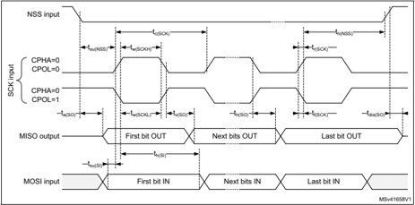


199

Figure 36. SPI timing diagram - slave mode and CPHA = 1

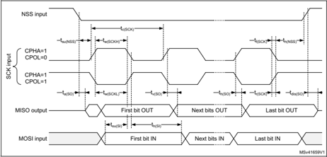

1. Measurement points are done at CMOS levels: 0.3 V DD  and 0.7 V DD.
1. Measurement points are done at CMOS levels: 0.3 V DD  and 0.7 V DD.

Figure 37. SPI timing diagram - master mode

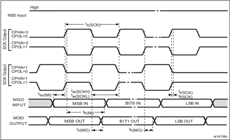


## I2S characteristics

Unless otherwise specified, the parameters given in Table 90 for I2S are derived from tests performed under the ambient temperature, f PCLKx  frequency and V DD  supply voltage conditions summarized in Table 17: General operating conditions , with the following configuration:

- Output speed is set to OSPEEDRy[1:0] = 10
- Capacitive load C=30pF
- Measurement points are done at CMOS levels: 0.5 V DD

Refer to Section 5.3.14: I/O port characteristics for more details on the input/output alternate function characteristics (CK,SD,WS).

Table 90. I2S characteristics (1)

| Symbol      | Parameter                      | Conditions                             | Conditions                             | Min     | Max         | Unit   |
|-------------|--------------------------------|----------------------------------------|----------------------------------------|---------|-------------|--------|
| f MCLK      | I2S Main clock output          | -                                      | -                                      | 256x8 K | 256 *Fs (2) | MHz    |
| f CK        | I2S clock frequency            | Master data                            | Master data                            | -       | 64xFs       | MHz    |
| f CK        | I2S clock frequency            | Slave data                             | Slave data                             | -       | 64xFs       | MHz    |
| D CK        | I2S clock frequency duty cycle | Slave receiver                         | Slave receiver                         | 30      | 70          | %      |
| t v(WS)     | WS valid time                  | Master mode                            | Master mode                            | -       | 6           |        |
| t h(WS)     | WS hold time                   | Master mode                            | Master mode                            | 3       | -           |        |
| t h(WS)     | WS hold time                   | Slave mode                             | Slave mode                             | 2       | -           |        |
| t su(WS)    | WS setup time                  | Slave mode                             | Slave mode                             | 4       | -           |        |
| t su(SD_MR) | Data input setup time          | Master receiver                        | Master receiver                        | 3       | -           |        |
| t su(SD_SR) | Data input setup time          | Slave receiver                         | Slave receiver                         | 4       | -           |        |
| t h(SD_MR)  | Data input hold time           | Master receiver                        | Master receiver                        | 4       | -           | ns     |
| t h(SD_SR)  | Data input hold time           | Slave receiver                         | Slave receiver                         | 2       | -           | ns     |
| t v(SD_ST)  | Data output valid time         | Slave transmitter (after enable edge)  | 2.7 V ≤ V DD ≤ 3.6 V                   | -       | 15          |        |
| t v(SD_ST)  | Data output valid time         | Slave transmitter (after enable edge)  | 1.65 V ≤ V DD ≤ 3.6 V                  | -       | 22          |        |
| t v(SD_MT)  | Data output valid time         | Master transmitter (after enable edge) | Master transmitter (after enable edge) | -       | 3           |        |
| t h(SD_ST)  | Data output hold time          | Slave transmitter (after enable edge)  | Slave transmitter (after enable edge)  | 7       | -           |        |
| t h(SD_MT)  | Data output hold time          | Master transmitter (after enable edge) | Master transmitter (after enable edge) | 1       | -           |        |

## Note:

Refer to the reference manual RM0440 "STM32G4 Series advanced Arm ® -based 32-bit MCUs" I2S section for more details about the sampling frequency (Fs), f MCK , f CK , D CK values reflect only the digital peripheral behavior, source clock precision might slightly change the values D CK  depends mainly on ODD bit value. Digital contribution leads to a min of (I2SDIV/(2*I2SDIV+ODD) and a max (I2SDIV+ODD)/(2*I2SDIV+ODD) and Fs max supported for each mode/condition.


199

## SAI characteristics

Unless otherwise specified, the parameters given in Table 91 for SAI are derived from tests performed under the ambient temperature, f PCLKx  frequency and V DD  supply voltage conditions summarized in Table 17: General operating conditions , with the following configuration:

- Output speed is set to OSPEEDRy[1:0] = 10
- Capacitive load C = 30 pF
- Measurement points are done at CMOS levels: 0.5 x V DD

Refer to Section 5.3.14: I/O port characteristics for more details on the input/output alternate function characteristics (CK,SD,FS).


Table 91. SAI characteristics (1)

| Symbol        | Parameter              | Conditions                                                  | Min   | Max   | Unit   |
|---------------|------------------------|-------------------------------------------------------------|-------|-------|--------|
| f MCLK        | SAI Main clock output  | -                                                           | -     | 50    | MHz    |
| f CK          | (2)                    | Master transmitter 2.7 V ≤ V DD ≤ 3.6 V Voltage Range 1     | -     | 33    |        |
| f CK          | (2)                    | Master transmitter 1.71 V ≤ V DD ≤ 3.6 V Voltage Range 1    | -     | 22    |        |
| f CK          | (2)                    | Master receiver Voltage Range 1                             | -     | 22    |        |
| f CK          | (2)                    | Slave transmitter 2.7 V ≤ V DD ≤ 3.6 V Voltage Range 1      | -     | 45    | MHz    |
| f CK          | (2)                    | Slave transmitter 1.71 V ≤ V DD ≤ 3.6 V Voltage Range 1     | -     | 29    |        |
| f CK          | (2)                    | Slave receiver Voltage Range 1                              | -     | 50    |        |
| f CK          | (2)                    | Slave transmitter Voltage Range 2                           | -     | 13    |        |
| t v(FS)       | FS valid time          | Master mode 2.7 V ≤ V DD ≤ 3.6 V                            | -     | 15    | ns     |
| t v(FS)       | FS valid time          | Master mode 1.71 V ≤ V DD ≤ 3.6 V                           | -     | 22    | ns     |
| t h(FS)       | FS hold time           | Master mode                                                 | 10    | -     | ns     |
| t su(FS)      | FS setup time          | Slave mode                                                  | 2     | -     | ns     |
| t h(FS)       | FS hold time           | Slave mode                                                  | 1     | -     | ns     |
| t su(SD_A_MR) | Data input setup time  | Master receiver                                             | 2.5   | -     | ns     |
| t su(SD_B_SR) | Data input setup time  | Slave receiver                                              | 1     | -     | ns     |
| t h(SD_A_MR)  | Data input hold time   | Master receiver                                             | 5     | -     | ns     |
| t h(SD_B_SR)  | Data input hold time   | Slave receiver                                              | 1     | -     | ns     |
| t v(SD_B_ST)  | Data output valid time | Slave transmitter (after enable edge) 2.7 V ≤ V DD ≤ 3.6 V  | -     | 11    | ns     |
| t v(SD_B_ST)  | Data output valid time | Slave transmitter (after enable edge) 1.71 V ≤ V DD ≤ 3.6 V | -     | 17    | ns     |
| t v(SD_B_ST)  | Data output valid time | Slave transmitter (after enable edge) voltage range V2      | -     | 20    | ns     |
| t h(SD_B_ST)  | Data output hold time  | Slave transmitter (after enable edge)                       | 10    | -     | ns     |

199

Table 91. SAI characteristics (1)  (continued)

| Symbol       | Parameter              | Conditions                                                   | Min   | Max   | Unit   |
|--------------|------------------------|--------------------------------------------------------------|-------|-------|--------|
| t v(SD_A_MT) | Data output valid time | Master transmitter (after enable edge) 2.7 V ≤ V DD ≤ 3.6 V  | -     | 14    | ns     |
| t v(SD_A_MT) | Data output valid time | Master transmitter (after enable edge) 1.71 V ≤ V DD ≤ 3.6 V | -     | 21    | ns     |
| t h(SD_A_MT) | Data output hold time  | Master transmitter (after enable edge)                       | 10    | -     | ns     |

1. Guaranteed by characterization results.
2. APB clock frequency must be at least twice SAI clock frequency.

Figure 38. SAI master timing waveforms

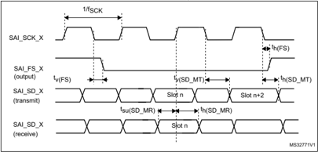

Figure 39. SAI slave timing waveforms

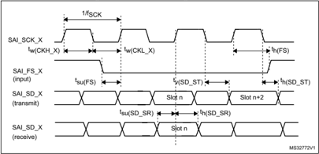

## CAN (controller area network) interface

Refer to Section 5.3.14: I/O port characteristics for more details on the input/output alternate function characteristics (FDCANx\_TX and FDCANx\_RX).


## USB characteristics

The device USB interface is fully compliant with the USB specification version 2.0 and is USB-IF certified (for Full-speed device operation).

Table 92. USB electrical characteristics (1)

| Symbol         | Parameter                                      | Conditions                                     | Min     | Typ   |   Max | Unit   |
|----------------|------------------------------------------------|------------------------------------------------|---------|-------|-------|--------|
| V DD           | USB transceiver operating voltage              | USB transceiver operating voltage              | 3.0 (2) | -     |   3.6 | V      |
| t Crystal_less | USB crystal less operation temperature         | USB crystal less operation temperature         | -15     | -     |    85 | °C     |
| R PUI          | Embedded USB_DP pull-up value during idle      | Embedded USB_DP pull-up value during idle      | 900     | 1250  |  1500 | Ω      |
| R PUR          | Embedded USB_PD pull-up value during reception | Embedded USB_PD pull-up value during reception | 1400    | 2300  |  3200 | Ω      |
| Z sDRV (3)     | Output driver impedance (4)                    | Driving high and low                           | 28      | 36    |    44 | Ω      |

4. No external termination series resistors are required on USB\_PD (D+) and USB\_DM (D-); the matching impedance is already included in the embedded driver.

## USART interface characteristics

Unless otherwise specified, the parameters given in Table 93 for USART are derived from tests performed under the ambient temperature, f PCLKx  frequency and V DD  supply voltage conditions summarized in Table 93 , with the following configuration:

- Output speed is set to OSPEEDRy[1:0] = 10
- Capacitive load C=30 pF
- Measurement points are done at CMOS levels: 0.5 V DD

Refer to Section 5.3.14: I/O port characteristics for more details on the input/output alternate function characteristics (NSS, CK, TX, RX for USART).

Table 93. USART electrical characteristics (1)

| Symbol              | Parameter             | Conditions   | Min         | Typ       | Max         | Unit   |
|---------------------|-----------------------|--------------|-------------|-----------|-------------|--------|
| f CK                | USART clock frequency | Master mode  | -           | -         | 21          | MHz    |
| f CK                | USART clock frequency | Slave mode   | -           | -         | 22          | MHz    |
| t su (NSS)          | NSS setup time        | Slave mode   | t ker + 2   | -         | -           | ns     |
| t h (NSS)           | NSS hold time         | Slave mode   | 2           | -         | -           | ns     |
| t w (CKH) t w (CKL) | CK high and low time  | Master mode  | 1/f ck /2-1 | 1/f ck /2 | 1/f ck /2+1 | ns     |
| t su (RX)           | Data input setup time | Master mode  | t ker + 2   | -         | -           | ns     |
| t su (RX)           | Data input setup time | Slave mode   | 2           | -         | -           | ns     |
| t h (RX)            | Data input hold time  | Master mode  | 1           | -         | -           | ns     |
| t h (RX)            | Data input hold time  | Slave mode   | 0.5         | -         | -           | ns     |


199

Table 93. USART electrical characteristics (1)  (continued)

| Symbol   | Parameter              | Conditions   | Min   | Typ   | Max   | Unit   |
|----------|------------------------|--------------|-------|-------|-------|--------|
| t v (TX) | Data output valid time | Master mode  | -     | 0.5   | 1.5   | ns     |
| t v (TX) | Data output valid time | Slave mode   | -     | 10    | 22    | ns     |
| t h (RX) | Data output hold time  | Master mode  | 0     | -     | -     | ns     |
| t h (RX) | Data output hold time  | Slave mode   | 7     | -     | -     | ns     |

## 5.3.28 FSMC characteristics

Unless otherwise specified, the parameters given in Table 94 to Table 107 for the FMC interface are derived from tests performed under the ambient temperature, f HCLK  frequency and V DD  supply voltage conditions summarized in Table 17 , with the following configuration:

- Output speed is set to OSPEEDRy[1:0] = 11
- Capacitive load C = 30 pF
- Measurement points are done at CMOS levels: 0.5 x V DD

Refer to Section 5.3.14: I/O port characteristics for more details on the input/output characteristics.

## Asynchronous waveforms and timings

Figure 40 through Figure 43 represent asynchronous waveforms and Table 94 through Table 101 provide the corresponding timings. The results shown in these tables are obtained with the following FMC configuration:

- AddressSetupTime = 0x1
- AddressHoldTime = 0x1
- DataHoldTime = 0x1
- ByteLaneSetup = 0x1
- DataSetupTime = 0x1 (except for asynchronous NWAIT mode, DataSetupTime = 0x5)
- BusTurnAroundDuration = 0x0

In all timing tables, the THCLK is the HCLK clock period.


Figure 40. Asynchronous non-multiplexed SRAM/PSRAM/NOR read waveforms

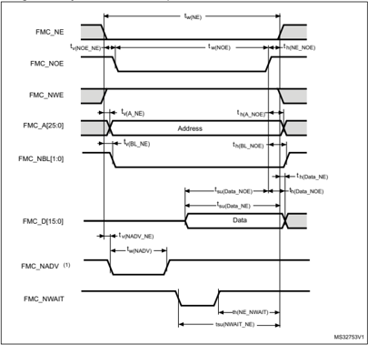

199

Table 94. Asynchronous non-multiplexed SRAM/PSRAM/NOR read timings (1)(2)

| Symbol         | Parameter                             | Min            | Max          | Unit   |
|----------------|---------------------------------------|----------------|--------------|--------|
| t w(NE)        | FMC_NE low time                       | 3 T HCLK - 0.5 | 3T HCLK + 1  | ns     |
| t v(NOE_NE)    | FMC_NEx low to FMC_NOE low            | 0              | 1            | ns     |
| t w(NOE)       | FMC_NOE low time                      | 2 T HCLK - 0.5 | 2 T HCLK + 1 | ns     |
| t h(NE_NOE)    | FMC_NOE high to FMC_NE high hold time | T HCLK         | -            | ns     |
| t v(A_NE)      | FMC_NEx low to FMC_A valid            | -              | 2            | ns     |
| t h(A_NOE)     | Address hold time after FMC_NOE high  | 2 T HCLK - 1   | -            | ns     |
| t su(Data_NE)  | Data to FMC_NEx high setup time       | T HCLK + 20    | -            | ns     |
| t su(Data_NOE) | Data to FMC_NOEx high setup time      | 20             | -            | ns     |
| t h(Data_NOE)  | Data hold time after FMC_NOE high     | 0              | -            | ns     |
| t h(Data_NE)   | Data hold time after FMC_NEx high     | 0              | -            | ns     |
| t v(NADV_NE)   | FMC_NEx low to FMC_NADV low           | -              | 1.5          | ns     |
| t w(NADV)      | FMC_NADV low time                     | -              | T HCLK + 8   | ns     |

Table 95. Asynchronous non-multiplexed SRAM/PSRAM/NOR read-NWAIT timings (1)(2)

| Symbol         | Parameter                                 | Min           | Max            | Unit   |
|----------------|-------------------------------------------|---------------|----------------|--------|
| t w(NE)        | FMC_NE low time                           | -             | 8 T HCLK + 1   |        |
| t w(NOE)       | FMC_NWE low time                          | 7 T HCLK - 1  | 7 T HCLK + 0.5 |        |
| t w(NWAIT)     | FMC_NWAIT low time                        | T HCLK        | -              | ns     |
| t su(NWAIT_NE) | FMC_NWAIT valid before FMC_NEx high       | 5 T HCLK + 17 | -              |        |
| t h(NE_NWAIT)  | FMC_NEx hold time after FMC_NWAIT invalid | 4 T HCLK + 17 | -              |        |


Figure 41. Asynchronous non-multiplexed SRAM/PSRAM/NOR write waveforms

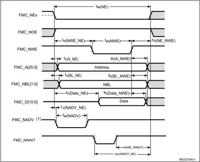

Table 96. Asynchronous non-multiplexed SRAM/PSRAM/NOR write timings (1)(2)

| Symbol        | Parameter                             | Min            | Max          | Unit   |
|---------------|---------------------------------------|----------------|--------------|--------|
| t w(NE)       | FMC_NE low time                       | 3 T HCLK - 0.5 | 3 T HCLK + 1 | ns     |
| t v(NWE_NE)   | FMC_NEx low to FMC_NWE low            | T HCLK - 0.5   | T HCLK + 1   | ns     |
| t w(NWE)      | FMC_NWE low time                      | T HCLK -2      | T HCLK + 1   | ns     |
| t h(NE_NWE)   | FMC_NWE high to FMC_NE high hold time | T HCLK - 0.5   | -            | ns     |
| t v(A_NE)     | FMC_NEx low to FMC_A valid            | -              | 0            | ns     |
| t h(A_NWE)    | Address hold time after FMC_NWE high  | T HCLK - 1     | -            | ns     |
| t v(BL_NE)    | FMC_NEx low to FMC_BL valid           | -              | 0            | ns     |
| t h(BL_NWE)   | FMC_BL hold time after FMC_NWE high   | T HCLK + 0.5   | -            | ns     |
| t v(Data_NE)  | Data to FMC_NEx low to Data valid     | -              | T HCLK + 2   | ns     |
| t h(Data_NWE) | Data hold time after FMC_NWE high     | T HCLK + 6     | -            | ns     |
| t v(NADV_NE)  | FMC_NEx low to FMC_NADV low           | -              | 1.5          | ns     |
| t w(NADV)     | FMC_NADV low time                     | -              | T HCLK + 0.5 | ns     |

199

Table 97. Asynchronous non-multiplexed SRAM/PSRAM/NOR write-NWAIT timings (1)(2)

| Symbol         | Parameter                                 | Min           | Max          | Unit   |
|----------------|-------------------------------------------|---------------|--------------|--------|
| t w(NE)        | FMC_NE low time                           | 9 T HCLK - 1  | 9 T HCLK + 1 | ns     |
| t w(NWE)       | FMC_NWE low time                          | 6 T HCLK - 1  | 6 T HCLK + 1 | ns     |
| t su(NWAIT_NE) | FMC_NWAIT valid before FMC_NEx high       | 7 T HCLK + 17 | -            | ns     |
| t h(NE_NWAIT)  | FMC_NEx hold time after FMC_NWAIT invalid | 7 T HCLK + 17 | -            | ns     |

1. CL = 30  pF.
2. Guaranteed by characterization results.

Figure 42. Asynchronous multiplexed PSRAM/NOR read waveforms

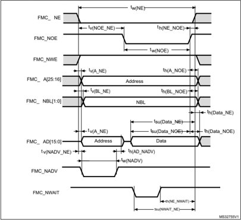


Table 98. Asynchronous multiplexed PSRAM/NOR read timings (1)(2)

| Symbol         | Parameter                                           | Min                                    | Max            | Unit   |
|----------------|-----------------------------------------------------|----------------------------------------|----------------|--------|
| t w(NE)        | FMC_NE low time                                     | 3 T HCLK - 0.5                         | 3 T HCLK + 1   |        |
| t v(NOE_NE)    | FMC_NEx low to FMC_NOE low                          | 0                                      | 1              |        |
| t w(NOE)       | FMC_NOE low time                                    | 2 T HCLK - 0.5                         | 2 T HCLK + 0.5 |        |
| t h(NE_NOE)    | FMC_NOE high to FMC_NE high hold time               | T HCLK                                 | -              |        |
| t v(A_NE)      | FMC_NEx low to FMC_A valid                          | -                                      | 2              |        |
| t v(NADV_NE)   | FMC_NEx low to FMC_NADV low                         | 0.5                                    | 1.5            |        |
| t w(NADV)      | FMC_NADV low time                                   | T HCLK                                 | T HCLK + 1.5   |        |
| t h(AD_NADV)   | FMC_AD(address) valid hold time after FMC_NADV high | T HCLK - 0.3                           | -              | ns     |
| t h(A_NOE)     | Address hold time after FMC_NOE high                | Address hold until next read operation | -              |        |
| t su(Data_NE)  | Data to FMC_NEx high setup time                     | T HCLK + 20                            | -              |        |
| t su(Data_NOE) | Data to FMC_NOE high setup time                     | 20                                     | -              |        |
| t h(Data_NE)   | Data hold time after FMC_NEx high                   | 0                                      | -              |        |
| t h(Data_NOE)  | Data hold time after FMC_NOE high                   | 0                                      | -              |        |

Table 99. Asynchronous multiplexed PSRAM/NOR read-NWAIT timings (1)(2)

| Symbol         | Parameter                                 | Min           | Max            | Unit   |
|----------------|-------------------------------------------|---------------|----------------|--------|
| t w(NE)        | FMC_NE low time                           | 8 T HCLK - 1  | 8 T HCLK + 1   |        |
| t w(NOE)       | FMC_NWE low time                          | 7 T HCLK - 1  | 7 T HCLK + 0.5 | ns     |
| t su(NWAIT_NE) | FMC_NWAIT valid before FMC_NEx high       | 5 T HCLK + 17 | -              |        |
| t h(NE_NWAIT)  | FMC_NEx hold time after FMC_NWAIT invalid | 4 T HCLK + 17 | -              |        |

199

Figure 43. Asynchronous multiplexed PSRAM/NOR write waveforms

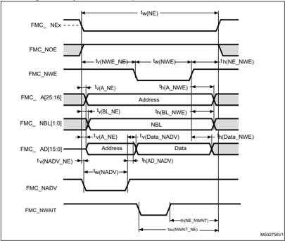


Table 100. Asynchronous multiplexed PSRAM/NOR write timings (1)(2)

| Symbol         | Parameter                                           | Min                                     | Max          | Unit   |
|----------------|-----------------------------------------------------|-----------------------------------------|--------------|--------|
| t w(NE)        | FMC_NE low time                                     | 3 T HCLK - 0.5                          | 3 T HCLK + 1 |        |
| t v(NWE_NE)    | FMC_NEx low to FMC_NWE low                          | T HCLK - 0.5                            | T HCLK + 1   |        |
| t w(NWE)       | FMC_NWE low time                                    | T HCLK - 2                              | T HCLK + 1   |        |
| t h(NE_NWE)    | FMC_NWE high to FMC_NE high hold time               | T HCLK - 0.5                            | -            |        |
| t v(A_NE)      | FMC_NEx low to FMC_A valid                          | -                                       | 0            |        |
| t v(NADV_NE)   | FMC_NEx low to FMC_NADV low                         | 0                                       | 1.5          |        |
| t w(NADV)      | FMC_NADV low time                                   | T HCLK + 0.5                            | T HCLK + 1.5 |        |
| t h(AD_NADV)   | FMC_AD(address) valid hold time after FMC_NADV high | T HCLK - 3                              | -            | ns     |
| t h(A_NWE)     | Address hold time after FMC_NWE high                | Address hold until next write operation | -            |        |
| t h(BL_NWE)    | FMC_BL hold time after FMC_NWE high                 | T HCLK - 0.5                            | -            |        |
| t v(BL_NE)     | FMC_NEx low to FMC_BL valid                         | -                                       | 0            |        |
| t v(Data_NADV) | FMC_NADV high to Data valid                         | -                                       | T HCLK + 2   |        |
| t h(Data_NWE)  | Data hold time after FMC_NWE high                   | T HCLK + 6                              | -            |        |

Table 101. Asynchronous multiplexed PSRAM/NOR write-NWAIT timings (1)(2)

| Symbol         | Parameter                                 | Min           | Max            | Unit   |
|----------------|-------------------------------------------|---------------|----------------|--------|
| t w(NE)        | FMC_NE low time                           | 9 T HCLK - 1  | 9 T HCLK + 1   |        |
| t w(NWE)       | FMC_NWE low time                          | 6 T HCLK - 1  | 6 T HCLK + 0.5 | ns     |
| t su(NWAIT_NE) | FMC_NWAIT valid before FMC_NEx high       | 7 T HCLK + 17 | -              |        |
| t h(NE_NWAIT)  | FMC_NEx hold time after FMC_NWAIT invalid | 5 T HCLK + 17 | -              |        |

199

## Synchronous waveforms and timings

Figure 44 through Figure 47 represent synchronous waveforms and Table 102 through Table 105 provide the corresponding timings. The results shown in these tables are obtained with the following FMC configuration:

- BurstAccessMode = FMC\_BurstAccessMode\_Enable
- MemoryType = FMC\_MemoryType\_CRAM
- WriteBurst = FMC\_WriteBurst\_Enable
- CLKDivision = 1
- DataLatency = 1 for NOR Flash; DataLatency = 0 for PSRAM

In all timing tables, the T HCLK  is the HCLK clock period.

- For 2.7 V ≤ V DD ≤ 3.6 V, maximum FMC\_CLK = 60 MHz for CLKDIV = 0x1 and 54 MHz for CLKDIV = 0x0 at CL = 30 pF (on FMC\_CLK).
- For 1.71 V ≤ V DD ≤ 2.7 V, maximum FMC\_CLK = 60 MHz for CLKDIV = 0x1 and 32 MHz for CLKDIV = 0x0 at CL= 20 pF (on FMC\_CLK).

Figure 44. Synchronous multiplexed NOR/PSRAM read timings

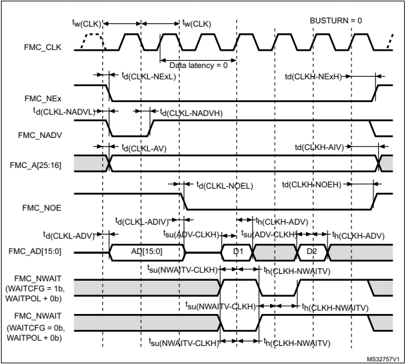


Table 102. Synchronous multiplexed NOR/PSRAM read timings (1)(2)(3)

| Symbol           | Parameter                                    | Min             | Max   | Unit   |
|------------------|----------------------------------------------|-----------------|-------|--------|
| t w(CLK)         | FMC_CLK period                               | R*T HCLK - 0.5  | -     |        |
| t d(CLKL-NExL)   | FMC_CLK low to FMC_NEx low (x=0..2)          | -               | 1.5   |        |
| t d(CLKH_NExH)   | FMC_CLK high to FMC_NEx high (x= 0…2)        | R*T HCLK /2 + 1 | -     |        |
| t d(CLKL-NADVL)  | FMC_CLK low to FMC_NADV low                  | -               | 2.5   |        |
| t d(CLKL-NADVH)  | FMC_CLK low to FMC_NADV high                 | 3.5             | -     |        |
| t d(CLKL-AV)     | FMC_CLK low to FMC_Ax valid (x=16…25)        | -               | 4     |        |
| t d(CLKH-AIV)    | FMC_CLK high to FMC_Ax invalid (x=16…25)     | R*T HCLK /2 + 1 | -     |        |
| t d(CLKL-NOEL)   | FMC_CLK low to FMC_NOE low                   | -               | 2     | ns     |
| t d(CLKH-NOEH)   | FMC_CLK high to FMC_NOE high                 | R*T HCLK /2 + 1 | -     |        |
| t d(CLKL-ADV)    | FMC_CLK low to FMC_AD[15:0] valid            | -               | 3     |        |
| t d(CLKL-ADIV)   | FMC_CLK low to FMC_AD[15:0] invalid          | 0               | -     |        |
| t su(ADV-CLKH)   | FMC_A/D[15:0] valid data before FMC_CLK high | 2               | -     |        |
| t h(CLKH-ADV)    | FMC_A/D[15:0] valid data after FMC_CLK high  | 4               | -     |        |
| t su(NWAIT-CLKH) | FMC_NWAIT valid before FMC_CLK high          | 1.5             | -     |        |
| t h(CLKH-NWAIT)  | FMC_NWAIT valid after FMC_CLK high           | 4               | -     |        |

199

Figure 45. Synchronous multiplexed PSRAM write timings

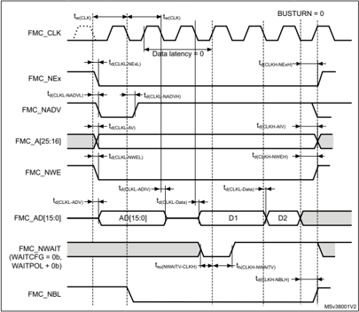


Table 103. Synchronous multiplexed PSRAM write timings (1)(2)(3)

| Symbol           | Parameter                                  | Min               | Max   | Unit   |
|------------------|--------------------------------------------|-------------------|-------|--------|
| t w(CLK)         | FMC_CLK period                             | R*T HCLK - 0.5    | -     | ns     |
| t d(CLKL-NExL)   | FMC_CLK low to FMC_NEx low (x=0..2)        | -                 | 1.5   | ns     |
| t d(CLKH-NExH)   | FMC_CLK high to FMC_NEx high (x= 0…2)      | R*T HCLK /2 + 1   | -     | ns     |
| t d(CLKL-NADVL)  | FMC_CLK low to FMC_NADV low                | -                 | 2.5   | ns     |
| t d(CLKL-NADVH)  | FMC_CLK low to FMC_NADV high               | 3.5               | -     | ns     |
| t d(CLKL-AV)     | FMC_CLK low to FMC_Ax valid (x=16…25)      | -                 | 4     | ns     |
| t d(CLKH-AIV)    | FMC_CLK high to FMC_Ax invalid (x=16…25)   | R*T HCLK /2 + 1   | -     | ns     |
| t d(CLKL-NWEL)   | FMC_CLK low to FMC_NWE low                 | -                 | 2     | ns     |
| t d(CLKH-NWEH)   | FMC_CLK high to FMC_NWE high               | R*T HCLK /2 + 1   | -     | ns     |
| t d(CLKL-ADV)    | FMC_CLK low to FMC_AD[15:0] valid          | -                 | 3     | ns     |
| t d(CLKL-ADIV)   | FMC_CLK low to FMC_AD[15:0] invalid        | 0                 | -     | ns     |
| t d(CLKL-DATA)   | FMC_A/D[15:0] valid data after FMC_CLK low | -                 | 3     | ns     |
| t d(CLKL-NBLL)   | FMC_CLK low to FMC_NBL low                 | 1                 | -     | ns     |
| t d(CLKH-NBLH)   | FMC_CLK high to FMC_NBL high               | R*T HCLK /2 + 1.5 | -     | ns     |
| t su(NWAIT-CLKH) | FMC_NWAIT valid before FMC_CLK high        | 1.5               | -     | ns     |
| t h(CLKH-NWAIT)  | FMC_NWAIT valid after FMC_CLK high         | 4                 | -     | ns     |

199

Figure 46. Synchronous non-multiplexed NOR/PSRAM read timings

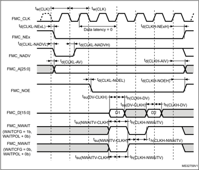

Table 104. Synchronous non-multiplexed NOR/PSRAM read timings (1)(2)(3)

| Symbol           | Parameter                                  | Min             | Max   | Unit   |
|------------------|--------------------------------------------|-----------------|-------|--------|
| t w(CLK)         | FMC_CLK period                             | R*T HCLK - 0.5  | -     | ns     |
| t d(CLKL-NExL)   | FMC_CLK low to FMC_NEx low (x=0..2)        | -               | 1.5   | ns     |
| t d(CLKH-NExH)   | FMC_CLK high to FMC_NEx high (x= 0…2)      | R*T HCLK /2 + 1 | -     | ns     |
| t d(CLKL-NADVL)  | FMC_CLK low to FMC_NADV low                | -               | 2.5   | ns     |
| t d(CLKL-NADVH)  | FMC_CLK low to FMC_NADV high               | 3.5             | -     | ns     |
| t d(CLKL-AV)     | FMC_CLK low to FMC_Ax valid (x=16…25)      | -               | 4     | ns     |
| t d(CLKH-AIV)    | FMC_CLK high to FMC_Ax invalid (x=16…25)   | R*T HCLK /2+- 1 | -     | ns     |
| t d(CLKL-NOEL)   | FMC_CLK low to FMC_NOE low                 | -               | 2     | ns     |
| t d(CLKH-NOEH)   | FMC_CLK high to FMC_NOE high               | R*T HCLK /2 + 1 | -     | ns     |
| t su(DV-CLKH)    | FMC_D[15:0] valid data before FMC_CLK high | 2               | -     | ns     |
| t h(CLKH-DV)     | FMC_D[15:0] valid data after FMC_CLK high  | 4               | -     | ns     |
| t su(NWAIT-CLKH) | FMC_NWAIT valid before FMC_CLK high        | 1.5             | -     | ns     |
| t h(CLKH-NWAIT)  | FMC_NWAIT valid after FMC_CLK high         | 4               | -     | ns     |


1. CL = 30  pF.
2. Guaranteed by characterization results.
3. Clock ratio R = (HCLK period /FMC\_CLK period).

Figure 47. Synchronous non-multiplexed PSRAM write timings

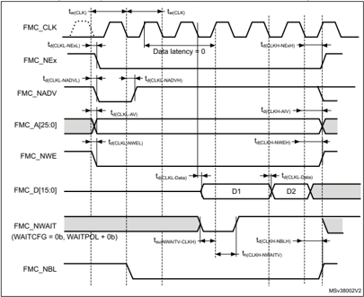

199

Table 105. Synchronous non-multiplexed PSRAM write timings (1)(2)(3)

| Symbol           | Parameter                                | Min               | Max   | Unit   |
|------------------|------------------------------------------|-------------------|-------|--------|
| t w(CLK)         | FMC_CLK period                           | R*T HCLK - 0.5    | -     | ns     |
| t d(CLKL-NExL)   | FMC_CLK low to FMC_NEx low (x=0..2)      | -                 | 1.5   | ns     |
| t d(CLKH-NExH)   | FMC_CLK high to FMC_NEx high (x= 0…2)    | R*T HCLK /2 + 1   | -     | ns     |
| t d(CLKL-NADVL)  | FMC_CLK low to FMC_NADV low              | -                 | 2.5   | ns     |
| t d(CLKL-NADVH)  | FMC_CLK low to FMC_NADV high             | 3.5               | -     | ns     |
| t d(CLKL-AV)     | FMC_CLK low to FMC_Ax valid (x=16…25)    | -                 | 4     | ns     |
| t d(CLKH-AIV)    | FMC_CLK high to FMC_Ax invalid (x=16…25) | R*T HCLK /2 + 1   | -     | ns     |
| t d(CLKL-NWEL)   | FMC_CLK low to FMC_NWE low               | -                 | 2     | ns     |
| t d(CLKH-NWEH)   | FMC_CLK high to FMC_NWE high             | R*T HCLK /2 + 1   | -     | ns     |
| t d(CLKL-Data)   | FMC_D[15:0] valid data after FMC_CLK low | -                 | 3     | ns     |
| t d(CLKL-NBLL)   | FMC_CLK low to FMC_NBL low               | 1                 | -     | ns     |
| t d(CLKH-NBLH)   | FMC_CLK high to FMC_NBL high             | R*T HCLK /2 + 1.5 | -     | ns     |
| t su(NWAIT-CLKH) | FMC_NWAIT valid before FMC_CLK high      | 1.5               | -     | ns     |
| t h(CLKH-NWAIT)  | FMC_NWAIT valid after FMC_CLK high       | 4                 | -     | ns     |

## NAND controller waveforms and timings

Figure 48 through Figure 51 represent synchronous waveforms, and Table 106 and Table 107 provide the corresponding timings. The results shown in these tables are obtained with the following FMC configuration:

- COM.FMC\_SetupTime = 0x01
- COM.FMC\_WaitSetupTime = 0x03
- COM.FMC\_HoldSetupTime = 0x02
- COM.FMC\_HiZSetupTime = 0x01
- ATT.FMC\_SetupTime = 0x01
- ATT.FMC\_WaitSetupTime = 0x03
- ATT.FMC\_HoldSetupTime = 0x02
- ATT.FMC\_HiZSetupTime = 0x01
- Bank = FMC\_Bank\_NAND
- MemoryDataWidth = FMC\_MemoryDataWidth\_16b
- ECC = FMC\_ECC\_Enable
- ECCPageSize = FMC\_ECCPageSize\_512Bytes
- TCLRSetupTime = 0
- TARSetupTime = 0

In all timing tables, the T HCLK  is the HCLK clock period.


Figure 48. NAND controller waveforms for read access

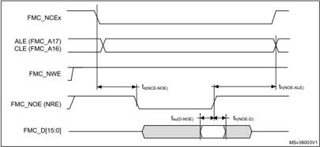

Figure 49. NAND controller waveforms for write access

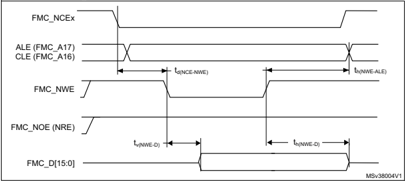

Figure 50. NAND controller waveforms for common memory read access


199

Figure 51. NAND controller waveforms for common memory write access


Table 106. Switching characteristics for NAND Flash read cycles (1)(2)

| Symbol       | Parameter                                  | Min          | Max      | Unit   |
|--------------|--------------------------------------------|--------------|----------|--------|
| T w(N0E)     | FMC_NOE low width                          | 4 T HCLK - 1 | 4 T HCLK |        |
| T su(D-NOE)  | FMC_D[15-0] valid data before FMC_NOE high | 19           | -        |        |
| T h(NOE-D)   | FMC_D[15-0] valid data after FMC_NOE high  | 0            | -        | ns     |
| T d(NCE-NOE) | FMC_NCE valid before FMC_NOE low           | -            | 3 T HCLK |        |
| T h(NOE-ALE) | FMC_NOE high to FMC_ALE invalid            | 3 T HCLK     | -        |        |

Table 107. Switching characteristics for NAND Flash write cycles (1)(2)

| Symbol       | Parameter                             | Min          | Max      | Unit   |
|--------------|---------------------------------------|--------------|----------|--------|
| T w(NWE)     | FMC_NWE low width                     | 4 T HCLK -1  | 4 T HCLK | ns     |
| T v(NWE-D)   | FMC_NWE low to FMC_D[15-0] valid      | 0            | -        | ns     |
| T h(NWE-D)   | FMC_NWE high to FMC_D[15-0] invalid   | 3 T HCLK - 1 | -        | ns     |
| T d(D-NWE)   | FMC_D[15-0] valid before FMC_NWE high | 5 T HCLK     | -        | ns     |
| T d(NCE_NWE) | FMC_NCE valid before FMC_NWE low      | -            | 3 T HCLK | ns     |
| T h(NWE-ALE) | FMC_NWE high to FMC_ALE invalid       | 3 T HCLK     | -        | ns     |


## 5.3.29 QUADSPI characteristics

Unless otherwise specified, the parameters given in Table 108 and Table 109 for Quad SPI are derived from tests performed under the ambient temperature, f AHB  frequency and V DD supply voltage conditions summarized in Table 17: General operating conditions , with the following configuration:

- Output speed is set to OSPEEDRy[1:0] = 11
- Capacitive load C = 15 or 20 pF
- Measurement points are done at CMOS levels: 0.5 ₓ V DD

Refer to Section 5.3.14: I/O port characteristics for more details on the input/output alternate function characteristics.

Table 108. Quad SPI characteristics in SDR mode (1)

| Symbol   | Parameter                                      | Conditions                                          | Min                       | Typ   | Max                        | Unit   |
|----------|------------------------------------------------|-----------------------------------------------------|---------------------------|-------|----------------------------|--------|
| F(QCK)   | Quad SPI clock frequency                       | 1.71 < V DD < 3.6 V, C LOAD = 15 pF Voltage Range 1 | -                         | -     | 50                         | MHz    |
| F(QCK)   | Quad SPI clock frequency                       | 1.71 < V DD < 3.6 V, C LOAD = 20 pF Voltage Range 2 | -                         | -     | 110                        | MHz    |
| t w(CKH) | Quad SPI clock high and low time Even division | PRESCALER [7:0] n =0,1, 3, 5...                     | t (CK) /2-0.5             | -     | t (CK) /2+1                | ns     |
| t w(CKL) | Quad SPI clock high and low time Even division | PRESCALER [7:0] n =0,1, 3, 5...                     | t (CK) /2-1               | -     | t (CK) /2+0.5              | ns     |
| t w(CKH) | Quad SPI clock high and low time Odd division  | PRESCALER [7:0] n =2,4, 6, 8...                     | (n/2)*t (CK) /(n+1) - 0.5 | -     | (n/2)*t (CK) /(n+1) + 1    | ns     |
| t w(CKL) | Quad SPI clock high and low time Odd division  | PRESCALER [7:0] n =2,4, 6, 8...                     | (n/2+1)*t (CK) /(n+1) - 1 | -     | (n/2+1)*t( CK) /(n+1) +0.5 | ns     |
| t s(IN)  | Data input setup time                          | 1.71 < V DD < 3.6 V                                 | 1                         | -     | -                          | ns     |
| t h(IN)  | Data input hold time                           | 1.71 < V DD < 3.6 V                                 | 5                         | -     | -                          | ns     |
| t v(OUT) | Data output valid time                         | 1.71 < V DD < 3.6 V                                 | -                         | 1     | 1.5                        | ns     |
| t h(OUT) | Data output hold time                          | 1.71 < V DD < 3.6 V                                 | 0.5                       | -     | -                          | ns     |

Table 109. QUADSPI characteristics in DDR mode (1)

| Symbol   | Parameter                | Conditions                                          | Min   | Typ   |   Max | Unit   |
|----------|--------------------------|-----------------------------------------------------|-------|-------|-------|--------|
| F(QCK)   | Quad SPI clock frequency | 1.71 < V DD < 3.6 V, C LOAD = 15 pF Voltage Range 1 | -     | -     |    50 | MHz    |
| F(QCK)   | Quad SPI clock frequency | 1.71 < V DD < 3.6 V, C LOAD = 20 pF Voltage Range 2 | -     | -     |    70 | MHz    |


199

Table 109. QUADSPI characteristics in DDR mode (1)  (continued)

| Symbol    | Parameter                                      | Conditions                       | Min                       | Typ        | Max                     | Unit   |
|-----------|------------------------------------------------|----------------------------------|---------------------------|------------|-------------------------|--------|
| t w(CKH)  | Quad SPI clock high and low time Even division | PRESCALER [7:0] n =0,1, 3, 5 ... | t (CK) /2                 | -          | t (CK) /2+1 CK)         | ns     |
| t w(CKL)  | Quad SPI clock high and low time Even division | PRESCALER [7:0] n =0,1, 3, 5 ... | t (CK) /2-1               | -          | t (CK) /2               | ns     |
| t w(CKH)  | Quad SPI clock high and low time Odd division  | PRESCALER [7:0] n =2,4, 6, 8...  | (n/2)*t (CK) /(n+1)       | -          | (n/2)*t (CK) /(n+1) + 1 | ns     |
| t w(CKL)  | Quad SPI clock high and low time Odd division  | PRESCALER [7:0] n =2,4, 6, 8...  | (n/2+1)*t (CK) /(n+1) - 1 | -          | (n/2+1)*t( /(n+1)       | ns     |
| t sr(IN)  | Data input setup time on rising edge           | 1.71 < V DD < 3.6 V              | 1                         | -          | -                       | ns     |
| t sf(IN)  | Data input setup time on falling edge          | 1.71 < V DD < 3.6 V              | 1                         | -          | -                       | ns     |
| t hr(IN)  | Data input hold time on rising edge            | 1.71 < V DD < 3.6 V              | 6                         | -          | -                       | ns     |
| t hf(IN)  | Data input hold time on falling edge           | 1.71 < V DD < 3.6 V              | 5                         | -          | -                       | ns     |
| t vr(OUT) | Data output valid time on rising edge          | 1.71 < V DD < 3.6 V DHHC = 0     | -                         | 7.5        | 8                       | ns     |
| t vr(OUT) | Data output valid time on rising edge          | 1.71 < V DD < 3.6 V DHHC = 1     | -                         | Thclk/2 +1 | Thclk/2+1.5             | ns     |
| t vf(OUT) | Data output valid time                         | 1.71 < V DD < 3.6 V DHHC = 0     | -                         | 7          | 10                      | ns     |
| t vf(OUT) | Data output valid time                         | 1.71 < V DD < 3.6 V DHHC = 1     | -                         | Thclk/2 +1 | Thclk/2+2               | ns     |
| t hr(OUT) | Data output hold time on rising edge           | 1.71 < V DD < 3.6 V DHHC = 0     | 2                         | -          | -                       | ns     |
| t hr(OUT) | Data output hold time on rising edge           | 1.71 < V DD < 3.6 V DHHC = 1     | Thclk/2+ 0.5              | -          | -                       | ns     |
| t hf(OUT) | Data output hold time on falling edge          | 1.71 < V DD < 3.6 V DHHC = 0     | 3                         | -          | -                       | ns     |
| t hf(OUT) | Data output hold time on falling edge          | 1.71 < V DD < 3.6 V DHHC = 1     | Thclk/2+0.5               | -          | -                       | ns     |

1. Guaranteed by characterization results.

Figure 52. Quad SPI timing diagram - SDR mode


Figure 53. Quad SPI timing diagram - DDR mode


## 5.3.30 UCPD characteristics

UCPD1 controller complies with USB Type-C Rev.1.2 and USB Power Delivery Rev. 3.0 specifications.

Table 110. UCPD characteristics

| Symbol   | Parameter                     | Conditions           |   Min |   Typ |   Max | Unit   |
|----------|-------------------------------|----------------------|-------|-------|-------|--------|
| V DD     | UCPD operating supply voltage | Sink mode only       |   3.0 |   3.3 |   3.6 | V      |
| V DD     | UCPD operating supply voltage | Sink and source mode | 3.135 |   3.3 | 3.465 | V      |

199

## 6 Package information

In order to meet environmental requirements, ST offers these devices in different grades of ECOPACK packages, depending on their level of environmental compliance. ECOPACK specifications, grade definitions and product status are available at: www.st.com . ECOPACK is an ST trademark.

## 6.1 WLCSP81 package information

This WLCSP is a 81-ball, 4.02 x 4.27 mm, 0.4 mm pitch wafer level chip scale package.

Figure 54. WLCSP81 - Outline


1. Drawing is not to scale.
2. Dimension is measured at the maximum bump diameter parallel to primary datum Z.
3. Primary datum Z and seating plane are defined by the spherical crowns of the bump.
4. Bump position designation per JESD 95-1, SPP-010.


Table 111. WLCSP81 - Mechanical data

| Symbol   | millimeters - Min   | millimeters - Typ   | millimeters - Max   | inches (1) - Min   | inches (1) - Typ   | inches (1) - Max   |
|----------|---------------------|---------------------|---------------------|--------------------|--------------------|--------------------|
| A (2)    | -                   | -                   | 0.59                | -                  | -                  | 0.023              |
| A1       | -                   | 0.18                | -                   | -                  | 0.007              | -                  |
| A2       | -                   | 0.38                | -                   | -                  | 0.015              | -                  |
| A3       | -                   | 0.025               | -                   | -                  | 0.001              | -                  |
| b        | 0.22                | 0.25                | 0.28                | 0.009              | 0.010              | 0.011              |
| D        | 4.00                | 4.02                | 4.04                | 0.157              | 0.158              | 0.159              |
| E        | 4.25                | 4.27                | 4.29                | 0.167              | 0.168              | 0.169              |
| e        | -                   | 0.40                | -                   | -                  | 0.016              | -                  |
| e1       | -                   | 3.20                | -                   | -                  | 0.126              | -                  |
| e2       | -                   | 3.20                | -                   | -                  | 0.126              | -                  |
| F (3)    | -                   | 0.410               | -                   | -                  | 0.016              | -                  |
| G (3)    | -                   | 0.535               | -                   | -                  | 0.021              | -                  |
| aaa      | -                   | -                   | 0.10                | -                  | -                  | 0.004              |
| bbb      | -                   | -                   | 0.10                | -                  | -                  | 0.004              |
| ccc      | -                   | -                   | 0.10                | -                  | -                  | 0.004              |
| ddd      | -                   | -                   | 0.05                | -                  | -                  | 0.002              |
| eee      | -                   | -                   | 0.05                | -                  | -                  | 0.002              |

3. Calculated dimensions are rounded to the 3rd decimal place

Figure 55. WLCSP81 - Recommended footprint


231

Table 112. WLCSP81 - Recommended PCB design rules

| Dimension         | Recommended values                                           |
|-------------------|--------------------------------------------------------------|
| Pitch             | 0.4 mm                                                       |
| Dpad              | 0,225 mm                                                     |
| Dsm               | 0.290 mm typ. (depends on soldermask registration tolerance) |
| Stencil opening   | 0.250 mm                                                     |
| Stencil thickness | 0.100 mm                                                     |


## 6.2 UFQFPN48 package information

This UFQFPN is a 48-lead, 7x7 mm, 0.5 mm pitch, ultra thin fine pitch quad flat package.

Figure 56. UFQFPN48 - Outline


1. Drawing is not to scale.
2. All leads/pads should also be soldered to the PCB to improve the lead/pad solder joint life.
3. There is an exposed die pad on the underside of the UFQFPN48 package. It is recommended to connect and solder this back-side pad to PCB ground.


231

Table 113. UFQFPN48 - Mechanical data

| Symbol   | millimeters - Min   | millimeters - Typ   | millimeters - Max   | inches (1) - Min   | inches (1) - Typ   | inches (1) - Max   |
|----------|---------------------|---------------------|---------------------|--------------------|--------------------|--------------------|
| A        | 0.500               | 0.550               | 0.600               | 0.0197             | 0.0217             | 0.0236             |
| A1       | 0.000               | 0.020               | 0.050               | 0.0000             | 0.0008             | 0.0020             |
| D        | 6.900               | 7.000               | 7.100               | 0.2717             | 0.2756             | 0.2795             |
| E        | 6.900               | 7.000               | 7.100               | 0.2717             | 0.2756             | 0.2795             |
| D2       | 5.500               | 5.600               | 5.700               | 0.2165             | 0.2205             | 0.2244             |
| E2       | 5.500               | 5.600               | 5.700               | 0.2165             | 0.2205             | 0.2244             |
| L        | 0.300               | 0.400               | 0.500               | 0.0118             | 0.0157             | 0.0197             |
| T        | -                   | 0.152               | -                   | -                  | 0.0060             | -                  |
| b        | 0.200               | 0.250               | 0.300               | 0.0079             | 0.0098             | 0.0118             |
| e        | -                   | 0.500               | -                   | -                  | 0.0197             | -                  |
| ddd      | -                   | -                   | 0.080               | -                  | -                  | 0.0031             |

1. Values in inches are converted from mm and rounded to 4 decimal digits.
1. Dimensions are expressed in millimeters.

Figure 57. UFQFPN48 - Recommended footprint


## UFQFPN48 device marking

The following figure gives an example of topside marking orientation versus pin 1 identifier location.

The printed markings may differ depending on the supply chain.

Other optional marking or inset/upset marks, which identify the parts throughout supply chain operations, are not indicated below.

Figure 58. UFQFPN48 top view example


1. Parts marked as ES or E or accompanied by an engineering sample notification letter are not yet qualified and therefore not approved for use in production. ST is not responsible for any consequences resulting from such use. In no event will ST be liable for the customer using any of these engineering samples in production. ST's Quality department must be contacted prior to any decision to use these engineering samples to run a qualification activity.

231

## 6.3 LQFP48 package information

This LQFP is a 48-pin, 7 x 7 mm low-profile quad flat package.

Figure 59. LQFP48 - Outline


1. Drawing is not to scale.


Table 114. LQFP48 - Mechanical data

| Symbol   | millimeters - Min   | millimeters - Typ   | millimeters - Max   | inches (1) - Min   | inches (1) - Typ   | inches (1) - Max   |
|----------|---------------------|---------------------|---------------------|--------------------|--------------------|--------------------|
| A        | -                   | -                   | 1.600               | -                  | -                  | 0.0630             |
| A1       | 0.050               | -                   | 0.150               | 0.0020             | -                  | 0.0059             |
| A2       | 1.350               | 1.400               | 1.450               | 0.0531             | 0.0551             | 0.0571             |
| b        | 0.170               | 0.220               | 0.270               | 0.0067             | 0.0087             | 0.0106             |
| c        | 0.090               | -                   | 0.200               | 0.0035             | -                  | 0.0079             |
| D        | 8.800               | 9.000               | 9.200               | 0.3465             | 0.3543             | 0.3622             |
| D1       | 6.800               | 7.000               | 7.200               | 0.2677             | 0.2756             | 0.2835             |
| D3       | -                   | 5.500               | -                   | -                  | 0.2165             | -                  |
| E        | 8.800               | 9.000               | 9.200               | 0.3465             | 0.3543             | 0.3622             |
| E1       | 6.800               | 7.000               | 7.200               | 0.2677             | 0.2756             | 0.2835             |
| E3       | -                   | 5.500               | -                   | -                  | 0.2165             | -                  |
| e        | -                   | 0.500               | -                   | -                  | 0.0197             | -                  |
| L        | 0.450               | 0.600               | 0.750               | 0.0177             | 0.0236             | 0.0295             |
| L1       | -                   | 1.000               | -                   | -                  | 0.0394             | -                  |
| k        | 0°                  | 3.5°                | 7°                  | 0°                 | 3.5°               | 7°                 |
| ccc      | -                   | -                   | 0.080               | -                  | -                  | 0.0031             |

231

Figure 60. LQFP48 - Recommended footprint


1. Dimensions are expressed in millimeters.


## LQFP48 device marking

The following figure gives an example of topside marking orientation versus pin 1 identifier location.

The printed markings may differ depending on the supply chain.

Other optional marking or inset/upset marks, which identify the parts throughout supply chain operations, are not indicated below.

Figure 61. LQFP48 top view example


1. Parts marked as ES or E or accompanied by an engineering sample notification letter are not yet qualified and therefore not approved for use in production. ST is not responsible for any consequences resulting from such use. In no event will ST be liable for the customer using any of these engineering samples in production. ST's Quality department must be contacted prior to any decision to use these engineering samples to run a qualification activity.

231

## 6.4 LQFP64 package information

This LQFP is a 64-pin, 10 x 10 mm low-profile quad flat package.

Figure 62. LQFP64 - Outline

Table 115. LQFP64 - Mechanical data

| Symbol   | millimeters - Min   | millimeters - Typ   | millimeters - Max   | inches (1) - Min   | inches (1) - Typ   | inches (1) - Max   |
|----------|---------------------|---------------------|---------------------|--------------------|--------------------|--------------------|
| A        | -                   | -                   | 1.600               | -                  | -                  | 0.0630             |
| A1       | 0.050               | -                   | 0.150               | 0.0020             | -                  | 0.0059             |
| A2       | 1.350               | 1.400               | 1.450               | 0.0531             | 0.0551             | 0.0571             |
| b        | 0.170               | 0.220               | 0.270               | 0.0067             | 0.0087             | 0.0106             |
| c        | 0.090               | -                   | 0.200               | 0.0035             | -                  | 0.0079             |
| D        | -                   | 12.000              | -                   | -                  | 0.4724             | -                  |
| D1       | -                   | 10.000              | -                   | -                  | 0.3937             | -                  |
| D3       | -                   | 7.500               | -                   | -                  | 0.2953             | -                  |
| E        | -                   | 12.000              | -                   | -                  | 0.4724             | -                  |
| E1       | -                   | 10.000              | -                   | -                  | 0.3937             | -                  |


1. Drawing is not to scale.


Table 115. LQFP64 - Mechanical data (continued)

| Symbol   | millimeters - Min   | millimeters - Typ   | millimeters - Max   | inches (1) - Min   | inches (1) - Typ   | inches (1) - Max   |
|----------|---------------------|---------------------|---------------------|--------------------|--------------------|--------------------|
| E3       | -                   | 7.500               | -                   | -                  | 0.2953             | -                  |
| e        | -                   | 0.500               | -                   | -                  | 0.0197             | -                  |
| K        | 0°                  | 3.5°                | 7°                  | 0°                 | 3.5°               | 7°                 |
| L        | 0.450               | 0.600               | 0.750               | 0.0177             | 0.0236             | 0.0295             |
| L1       | -                   | 1.000               | -                   | -                  | 0.0394             | -                  |
| ccc      | -                   | -                   | 0.080               | -                  | -                  | 0.0031             |

1. Values in inches are converted from mm and rounded to 4 decimal digits.
1. Dimensions are expressed in millimeters.

Figure 63. LQFP64 - Recommended footprint


231

## LQFP64 device marking

The following figure gives an example of topside marking orientation versus pin 1 identifier location.

The printed markings may differ depending on the supply chain.

Other optional marking or inset/upset marks, which identify the parts throughout supply chain operations, are not indicated below.

Figure 64. LQFP64 top view example


1. Parts marked as ES or E or accompanied by an engineering sample notification letter are not yet qualified and therefore not approved for use in production. ST is not responsible for any consequences resulting from such use. In no event will ST be liable for the customer using any of these engineering samples in production. ST's Quality department must be contacted prior to any decision to use these engineering samples to run a qualification activity.


## 6.5 LQFP80 package information

This LQFP is a 80-pin, 12 x 12 mm low-profile quad flat package.

Figure 65. LQFP80 - Outline


1. Drawing is not to scale.


Table 116. LQFP80 - Mechanical data

| Symbol   | Millimeters - Min   | Millimeters - Typ   | Millimeters - Max   | inches (1) - Min   | inches (1) - Typ   | inches (1) - Max   |
|----------|---------------------|---------------------|---------------------|--------------------|--------------------|--------------------|
| A        | -                   | -                   | 1.600               | -                  | -                  | 0.0630             |
| A1       | 0.050               | -                   | 0.150               | 0.0020             | -                  | 0.0059             |
| A2       | 1.350               | 1.400               | 1.450               | 0.0531             | 0.0551             | 0.0571             |
| b        | 0.170               | 0.220               | 0.270               | 0.0067             | 0.0087             | 0.0106             |
| c        | 0.090               | -                   | 0.200               | 0.0035             | -                  | 0.0079             |
| D        | -                   | 14.000              | -                   | -                  | 0.5512             | -                  |
| D1       | -                   | 12.000              | -                   | -                  | 0.4724             | -                  |

231

Table 116. LQFP80 - Mechanical data (continued)

| Symbol   | Millimeters - Min   | Millimeters - Typ   | Millimeters - Max   | inches (1) - Min   | inches (1) - Typ   | inches (1) - Max   |
|----------|---------------------|---------------------|---------------------|--------------------|--------------------|--------------------|
| D2       | -                   | 9.500               | -                   | -                  | 0.3740             | -                  |
| E        | -                   | 14.000              | -                   | -                  | 0.5512             | -                  |
| E1       | -                   | 12.000              | -                   | -                  | 0.4724             | -                  |
| E3       | -                   | 9.500               | -                   | -                  | 0.3740             | -                  |
| e        | -                   | 0.500               | -                   | -                  | 0.0197             | -                  |
| L        | 0.450               | 0.600               | 0.750               | 0.0177             | 0.0236             | 0.0295             |
| L1       | -                   | 1.000               | -                   | -                  | 0.0394             | -                  |
| ccc      | -                   | -                   | 0.080               | -                  | -                  | 0.0031             |
| k        | 0.0°                | -                   | 7.0°                | 0.0°               | -                  | 7.0°               |

1. Values in inches are converted from mm and rounded to 4 decimal digits.
1. Dimensions are expressed in millimeters.

Figure 66. LQFP80 - Recommended footprint


## LQFP80 device marking

The following figure gives an example of topside marking orientation versus pin 1 identifier location.

The printed markings may differ depending on the supply chain.

Other optional marking or inset/upset marks, which identify the parts throughout supply chain operations, are not indicated below.

Figure 67. LQFP80 top view example


1. Parts marked as ES or E or accompanied by an engineering sample notification letter are not yet qualified and therefore not approved for use in production. ST is not responsible for any consequences resulting from such use. In no event will ST be liable for the customer using any of these engineering samples in production. ST's Quality department must be contacted prior to any decision to use these engineering samples to run a qualification activity.

231

## 6.6 TFBGA100 package information

This TFBGA is a 100-ball, 8 x 8 mm, 0.8 mm pitch fine pitch ball grid array package.

Figure 68. TFBGA100 - Outline


Table 117. TFBGA100 - Mechanical data

| Symbol   | millimeters - Min   | millimeters - Typ   | millimeters - Max   | inches (1) - Min   | inches (1) - Typ   | inches (1) - Max   |
|----------|---------------------|---------------------|---------------------|--------------------|--------------------|--------------------|
| A        | -                   | -                   | 1.100               | -                  | -                  | 0.0433             |
| A1       | 0.150               | -                   | -                   | 0.0059             | -                  | -                  |
| A2       | -                   | 0.760               | -                   | -                  | 0.0299             | -                  |
| b        | 0.350               | 0.400               | 0.450               | 0.0138             | 0.0157             | 0.0177             |
| D        | 7.850               | 8.000               | 8.150               | 0.3091             | 0.3150             | 0.3209             |
| D1       | -                   | 7.200               | -                   | -                  | 0.2835             | -                  |
| E        | 7.850               | 8.000               | 8.150               | 0.3091             | 0.3150             | 0.3209             |
| E1       | -                   | 7.200               | -                   | -                  | 0.2835             | -                  |
| e        | -                   | 0.800               | -                   | -                  | 0.0315             | -                  |
| F        | -                   | 0.400               | -                   | -                  | 0.0157             | -                  |
| G        | -                   | 0.400               | -                   | -                  | 0.0157             | -                  |
| ddd      | -                   | -                   | 0.100               | -                  | -                  | 0.0039             |
| eee      | -                   | -                   | 0.150               | -                  | -                  | 0.0059             |
| fff      | -                   | -                   | 0.080               | -                  | -                  | 0.0031             |

Figure 69. TFBGA100 - recommended footprint


Table 118. TFBGA100 - Recommended PCB design rules

| Dimension   | Recommended values                                               |
|-------------|------------------------------------------------------------------|
| Pitch       | 0.8                                                              |
| Dpad        | 0.400 mm                                                         |
| Dsm         | 0.470 mm typ. (depends on the soldermask registration tolerance) |

231

Table 118. TFBGA100 - Recommended PCB design rules  (continued)

| Dimension         | Recommended values            |
|-------------------|-------------------------------|
| Stencil opening   | 0.400 mm                      |
| Stencil thickness | Between 0.100 mm and 0.125 mm |
| Pad trace width   | 0.120 mm                      |

## TFBGA100 device marking

The following figure gives an example of topside marking orientation versus pin 1 identifier location.

The printed markings may differ depending on the supply chain.

Other optional marking or inset/upset marks, which identify the parts throughout supply chain operations, are not indicated below.

Figure 70. TFBGA100 - Top view example


1. Parts marked as ES or E or accompanied by an engineering sample notification letter are not yet qualified and therefore not approved for use in production. ST is not responsible for any consequences resulting from such use. In no event will ST be liable for the customer using any of these engineering samples in production. ST's Quality department must be contacted prior to any decision to use these engineering samples to run a qualification activity.


## 6.7 LQFP100 package information

This LQFP is a 100-pin, 14 x 14 mm low-profile quad flat package.

Figure 71. LQFP100 - Outline


1. Drawing is not to scale.


Table 119. LQPF100 - Mechanical data

| Symbol   | millimeters - Min   | millimeters - Typ   | millimeters - Max   | inches (1) - Min   | inches (1) - Typ   | inches (1) - Max   |
|----------|---------------------|---------------------|---------------------|--------------------|--------------------|--------------------|
| A        | -                   | -                   | 1.600               | -                  | -                  | 0.0630             |
| A1       | 0.050               | -                   | 0.150               | 0.0020             | -                  | 0.0059             |
| A2       | 1.350               | 1.400               | 1.450               | 0.0531             | 0.0551             | 0.0571             |
| b        | 0.170               | 0.220               | 0.270               | 0.0067             | 0.0087             | 0.0106             |
| c        | 0.090               | -                   | 0.200               | 0.0035             | -                  | 0.0079             |
| D        | 15.800              | 16.000              | 16.200              | 0.6220             | 0.6299             | 0.6378             |
| D1       | 13.800              | 14.000              | 14.200              | 0.5433             | 0.5512             | 0.5591             |
| D3       | -                   | 12.000              | -                   | -                  | 0.4724             | -                  |
| E        | 15.800              | 16.000              | 16.200              | 0.6220             | 0.6299             | 0.6378             |
| E1       | 13.800              | 14.000              | 14.200              | 0.5433             | 0.5512             | 0.5591             |
| E3       | -                   | 12.000              | -                   | -                  | 0.4724             | -                  |
| e        | -                   | 0.500               | -                   | -                  | 0.0197             | -                  |
| L        | 0.450               | 0.600               | 0.750               | 0.0177             | 0.0236             | 0.0295             |
| L1       | -                   | 1.000               | -                   | -                  | 0.0394             | -                  |

231

Table 119. LQPF100 - Mechanical data (continued)

| Symbol   | millimeters - Min   | millimeters - Typ   | millimeters - Max   | inches (1) - Min   | inches (1) - Typ   | inches (1) - Max   |
|----------|---------------------|---------------------|---------------------|--------------------|--------------------|--------------------|
| k        | 0.0°                | 3.5°                | 7.0°                | 0.0°               | 3.5°               | 7.0°               |
| ccc      | -                   | -                   | 0.080               | -                  | -                  | 0.0031             |

1. Values in inches are converted from mm and rounded to 4 decimal digits.
1. Dimensions are expressed in millimeters.

Figure 72. LQFP100 - Recommended footprint


## LQFP100 device marking

The following figure gives an example of topside marking orientation versus pin 1 identifier location.

The printed markings may differ depending on the supply chain.

Other optional marking or inset/upset marks, which identify the parts throughout supply chain operations, are not indicated below.

Figure 73. LQFP100 top view example


1. Parts marked as ES or E or accompanied by an engineering sample notification letter are not yet qualified and therefore not approved for use in production. ST is not responsible for any consequences resulting from such use. In no event will ST be liable for the customer using any of these engineering samples in production. ST's Quality department must be contacted prior to any decision to use these engineering samples to run a qualification activity.

231

## 6.8 LQFP128 package information

This LQFP is a 128-pin, 14 x 14 mm low-profile quad flat package.

Figure 74. LQFP128 - Outline

Table 120. LQFP128 - Mechanical data

| Symbol   | Millimeters - Min.   | Millimeters - Typ.   |   Millimeters - Max. | Inches (1) - Min.   | Inches (1) - Typ.   |   Inches (1) - Max. |
|----------|----------------------|----------------------|----------------------|---------------------|---------------------|---------------------|
| A        | -                    | -                    |                1.600 | -                   | -                   |              0.0630 |
| A1       | 0.050                | -                    |                0.150 | 0.0020              | -                   |              0.0059 |
| A2       | 1.350                | 1.400                |                1.450 | 0.0531              | 0.0551              |              0.0571 |
| b        | 0.130                | 0.180                |                0.230 | 0.0051              | 0.0071              |              0.0091 |


1. Drawing is not to scale.


Table 120. LQFP128 - Mechanical data (continued)

| Symbol   | Millimeters - Min.   | Millimeters - Typ.   | Millimeters - Max.   | Inches (1) - Min.   | Inches (1) - Typ.   | Inches (1) - Max.   |
|----------|----------------------|----------------------|----------------------|---------------------|---------------------|---------------------|
| c        | 0.090                | -                    | 0.200                | 0.0035              | -                   | 0.0079              |
| D        | 15.800               | 16.000               | 16.200               | 0.6220              | 0.6299              | 0.6378              |
| D1       | 13.800               | 14.000               | 14.200               | 0.5433              | 0.5512              | 0.5591              |
| D3       | -                    | 12.400               | -                    | -                   | 0.4882              | -                   |
| E        | 15.800               | 16.000               | 16.200               | 0.6220              | 0.6299              | 0.6378              |
| E1       | 13.800               | 14.000               | 14.200               | 0.5433              | 0.5512              | 0.5591              |
| E3       | -                    | 12.400               | -                    | -                   | 0.4882              | -                   |
| e        | -                    | 0.400                | -                    | -                   | 0.0157              | -                   |
| L        | 0.450                | 0.600                | 0.750                | 0.0177              | 0.0236              | 0.0295              |
| L1       | -                    | 1.000                | -                    | -                   | 0.0394              | -                   |
| k        | 0°                   | 3.5°                 | 7°                   | 0°                  | 3.5°                | 7°                  |
| ccc      | -                    | -                    | 0.080                | -                   | -                   | 0.0031              |

1. Values in inches are converted from mm and rounded to 4 decimal digits.
1. Dimensions are expressed in millimeters.

Figure 75. LQFP128 - Recommended footprint


231

## LQFP128 device marking

The following figure gives an example of topside marking orientation versus pin 1 identifier location.

The printed markings may differ depending on the supply chain.

Other optional marking or inset/upset marks, which identify the parts throughout supply chain operations, are not indicated below.

Figure 76. LQFP128 top view example


1. Parts marked as ES or E or accompanied by an engineering sample notification letter are not yet qualified and therefore not approved for use in production. ST is not responsible for any consequences resulting from such use. In no event will ST be liable for the customer using any of these engineering samples in production. ST's Quality department must be contacted prior to any decision to use these engineering samples to run a qualification activity.


## 6.9 UFBGA121 package information

This UFBGA is a 121 balls, 6 x 6 mm, 0.5 mm pitch, fine pitch, square ball grid array package.

Figure 77. UFBGA121 - Outline


1. Drawing is not to scale.
2. The terminal A1 corner must be identified on the top surface by using a corner chamfer, ink or metalized markings, or other feature of package body or integral heat slug. A distinguishing feature is allowable on the bottom surface of the package to identify the terminal A1 corner. Exact shape of each corner is optional.


231

Table 121. UFBGA121 - Mechanical data

| Symbol   | millimeters - Min   | millimeters - Typ   | millimeters - Max   | inches (1) - Min   | inches (1) - Typ   | inches (1) - Max   |
|----------|---------------------|---------------------|---------------------|--------------------|--------------------|--------------------|
| A (2)    | -                   | -                   | 0.60                | -                  | -                  | 0.0236             |
| A1       | -                   | -                   | 0.11                | -                  | -                  | 0.0043             |
| A2       | -                   | 0.13                | -                   | -                  | 0.0051             | -                  |
| A4       | -                   | 0.32                | -                   | -                  | 0.0126             | -                  |
| b (3)    | 0.24                | 0.29                | 0.34                | 0.0094             | 0.0114             | 0.0134             |
| D        | 5.85                | 6.00                | 6.15                | 0.2303             | 0.2362             | 0.2421             |
| D1       | -                   | 5.00                | -                   | -                  | 0.1969             | -                  |
| E        | 5.85                | 6.00                | 6.15                | 0.2303             | 0.2362             | 0.2421             |
| E1       | -                   | 5.00                | -                   | -                  | 0.1969             | -                  |
| e        | -                   | 0.50                | -                   | -                  | 0.0197             | -                  |
| F        | -                   | 0.50                | -                   | -                  | 0.0197             | -                  |
| ddd      | -                   | -                   | 0.08                | -                  | -                  | 0.0031             |
| eee (4)  | -                   | -                   | 0.15                | -                  | -                  | 0.0059             |
| fff (5)  | -                   | -                   | 0.05                | -                  | -                  | 0.0020             |

1. Values in inches are converted from mm and rounded to 4 decimal digits.
2. - UFBGA stands for Ultra-Thin Profile Fine Pitch Ball Grid Array.
- The total profile height (Dim A) is measured from the seating plane to the top of the component
- Ultra Thin profile: 0.50 &lt; A ≤ 0.65mm / Fine pitch: e &lt; 1.00mm pitch.
- The maximum total package height is calculated by the following methodology:

A Max = A1 Typ + A2 Typ + A4 Typ + √ (A1²+A2²+A4² tolerance values)

3. The typical balls diameters before mounting is 0.20 mm
4. The tolerance of position that controls the location of the pattern of balls with respect to datum A and B. For each ball there is a cylindrical tolerance zone eee perpendicular to datum C and located on true position with respect
3. to datum A and B as defined by e. The axis perpendicular to datum C of each ball must lie within this tolerance zone.
5. The tolerance of position that controls the location of the balls within the matrix with respect to each other. For each ball there is a cylindrical tolerance zone fff perpendicular to datum C and located on true position as defined by e. The axis perpendicular to datumC of each ball must lie within this tolerance zone. Each tolerance zone fff in the array is contained entirely in the respective zone eee above. The axis of each ball must lie simultaneously in both tolerance zones.


Figure 78. UFBGA121 - Recommended footprint


Table 122. UFBGA121 - Recommended PCB design rules


BGA WLCSP FT V1

| Dimension         | Recommended values                                           |
|-------------------|--------------------------------------------------------------|
| Pitch             | 0.5 mm                                                       |
| Dpad              | 0,225 mm                                                     |
| Dsm               | 0.290 mm typ. (depends on soldermask registration tolerance) |
| Stencil opening   | 0.250 mm                                                     |
| Stencil thickness | 0.100 mm                                                     |

231

## 6.10 Thermal characteristics

The maximum chip-junction temperature, T J  max, in degrees Celsius, may be calculated using the following equation:

T J max = T A  max + (P D  max x Θ JA )

## Where:

- T A  max is the maximum ambient temperature in °C,
- Θ JA  is the package junction-to-ambient thermal resistance, in °C/W,
- PD  max is the sum of P INT max and P I/O max (P D  max = P INT max + P I/O max),
- PINT  max is the product of I DD  and   VDD , expressed in Watts. This is the maximum chip internal power.

PI/O  max represents the maximum power dissipation on output pins where:

$$P_{1/O}\,max=\Sigma\,(V_{OL}\times I_{OL})+\Sigma\,((V_{DD\mid Ox}-V_{OH})\times I_{OH}),$$

taking into account the actual $V_{OL}$ / $I_{OL}$  and $V_{OH}$ / $I_{OH}$  of the I/Os at low and high level in the application.

Table 123. Package thermal characteristics

| Symbol   | Parameter                                                    | Value   | Unit   |
|----------|--------------------------------------------------------------|---------|--------|
| Θ JA     | Thermal resistance junction-ambient LQFP128 - 14 × 14 mm     | 43.0    | °C/W   |
| Θ JA     | Thermal resistance junction-ambient LQFP100 - 14 × 14 mm     | 46.2    | °C/W   |
| Θ JA     | Thermal resistance junction-ambient LQFP80 - 12 × 12 mm      | 46.8    | °C/W   |
| Θ JA     | Thermal resistance junction-ambient LQFP64 - 10 × 10 mm      | 47.9    | °C/W   |
| Θ JA     | Thermal resistance junction-ambient LQFP48 - 7 × 7 mm        | 55.2    | °C/W   |
| Θ JA     | Thermal resistance junction-ambient TFBGA100 - 8 × 8 mm      | 30.8    | °C/W   |
| Θ JA     | Thermal resistance junction-ambient UFBGA121 - 6 × 6 mm      | TBD     | °C/W   |
| Θ JA     | Thermal resistance junction-ambient UFQFPN48 - 7 × 7 mm      | 26.8    | °C/W   |
| Θ JA     | Thermal resistance junction-ambient WLCSP81 - 4.02 X 4.27 mm | 45      | °C/W   |


Table 123. Package thermal characteristics (continued)

| Symbol   | Parameter                                                  | Value     | Unit   |
|----------|------------------------------------------------------------|-----------|--------|
| Θ JC     | Thermal resistance junction-case LQFP128 - 14 × 14 mm      | 7.0       | °C/W   |
| Θ JC     | Thermal resistance junction-case LQFP100 - 14 × 14 mm      | 8.3       | °C/W   |
| Θ JC     | Thermal resistance junction-case LQFP80 - 12 × 12 mm       | 8.2       | °C/W   |
| Θ JC     | Thermal resistance junction-case LQFP64 - 10 × 10 mm       | 8.0       | °C/W   |
| Θ JC     | Thermal resistance junction-case LQFP48 - 7 × 7 mm         | 9.6       | °C/W   |
| Θ JC     | Thermal resistance junction-case TFBGA100 - 8 × 8 mm       | 13        | °C/W   |
| Θ JC     | Thermal resistance junction-ambient UFBGA121 - 6 × 6 mm    | TBD       | °C/W   |
| Θ JC     | Thermal resistance junction-case UFQFPN48 - 7 × 7 mm       | 2 (1) 7.5 | °C/W   |
| Θ JC     | Thermal resistance junction-case WLCSP81 - 4.02 X 4.27 mm  | 1.46      | °C/W   |
| Θ JB     | Thermal resistance junction-board LQFP128 - 14 × 14 mm     | 19.9      | °C/W   |
| Θ JB     | Thermal resistance junction-board LQFP100 - 14 × 14 mm     | 22.9      | °C/W   |
| Θ JB     | Thermal resistance junction-board LQFP80 - 12 × 12 mm      | 22.3      | °C/W   |
| Θ JB     | Thermal resistance junction-board LQFP64 - 10 × 10 mm      | 21.8      | °C/W   |
| Θ JB     | Thermal resistance junction-board LQFP48 - 7 × 7 mm        | 24.3      | °C/W   |
| Θ JB     | Thermal resistance junction-board TFBGA100 - 8 × 8 mm      | 13.42     | °C/W   |
| Θ JB     | Thermal resistance junction-ambient UFBGA121 - 6 × 6 mm    | TBD       | °C/W   |
| Θ JB     | Thermal resistance junction-board UFQFPN48 - 7 × 7 mm      | 11        | °C/W   |
| Θ JB     | Thermal resistance junction-board WLCSP81 - 4.02 X 4.27 mm | 27.45     | °C/W   |

## 6.10.1 Reference document

JESD51-2 Integrated Circuits Thermal Test Method Environment Conditions - Natural Convection (Still Air). Available from www.jedec.org


231

## 6.10.2 Selecting the product temperature range

When ordering the microcontroller, the temperature range is specified in the ordering information scheme shown in Section 7: Ordering information .

Each temperature range suffix corresponds to a specific guaranteed ambient temperature at maximum dissipation and, to a specific maximum junction temperature.

As applications do not commonly use the STM32G474xE at maximum dissipation, it is useful to calculate the exact power consumption and junction temperature to determine which temperature range is best suited to the application.

The following examples show how to calculate the temperature range needed for a given application.

## Example 1: High-performance application

Assuming the following application conditions:

Maximum ambient temperature T Amax  = 82 °C (measured according to JESD51-2),

I DDmax  = 50 mA, V DD  = 3.5 V, maximum 20 I/Os used at the same time in output at low level with $I_{OL}$  = 8 mA, $V_{OL}$ = 0.4 V and maximum 8 I/Os used at the same time in output at low level with $I_{OL}$  = 20 mA, $V_{OL}$ = 1.3 V

PINTmax =  50 mA × 3.5 V= 175 mW

PIOmax =  20 × 8 mA × 0.4 V + 8 × 20 mA × 1.3 V = 272 mW

This gives: P INTmax  = 175 mW and P IOmax  = 272 mW:

$P_{Dmax}$ =  175  +  272 = 447 mW

Using the values obtained in  T Jmax  is calculated as follows:

```
-For LQFP100, 42 °C/W T Jmax  = 82 °C + (42 °C/W × 447 mW) = 82 °C + 18.774 °C = 100.774 °C
```

This is within the range of the suffix 6 version parts (-40 &lt; T J  &lt; 105 °C) see Section 7: Ordering information .

In this case, parts must be ordered at least with the temperature range suffix 6 (see Section 7: Ordering information ).

Note: With this given $P_{Dmax}$  we can find the TAmax allowed for a given device temperature range (order code suffix 6 or 7).

Suffix 6: T Amax  = T Jmax  - ( 42 °C/W × 447 mW) = 10518.774 = 86.226 °C

Suffix 3: T Amax  = T Jmax  - (42°C/W × 447 mW) = 130-18.774 = 111.226 °C

## Example 2: High-temperature application

Using the same rules, it is possible to address applications that run at high ambient temperatures with a low dissipation, as long as junction temperature T J  remains within the specified range.


Assuming the following application conditions:

Maximum ambient temperature T Amax  = 100 °C (measured according to JESD51-2), I DDmax  = 20 mA, V DD  = 3.5 V, maximum 20 I/Os used at the same time in output at low level with $I_{OL}$  = 8 mA, $V_{OL}$ = 0.4 V

PINTmax =  20 mA × 3.5 V= 70 mW

PIOmax = 20  × 8 mA × 0.4 V = 64 mW

This gives: P INTmax  = 70 mW and P IOmax  = 64 mW:

$$P_{Dmax}=70~_{+}\,64=134~mW$$

Thus: $P_{Dmax}$  = 134 mW

Using the values obtained in T Jmax  is calculated as follows:

- -For LQFP100, 42 °C/W

$${T}_{Jmax}=100\ {^{\circ}C}+(42\ {^{\circ}C}/{W}\times\,134\ {mW})=100\ {^{\circ}C}+5.628\ {^{\circ}C}=105.628\ {^{\circ}C}$$

This is above the range of the suffix 6 version parts (-40 &lt; T J  &lt; 105 °C).

In this case, parts must be ordered at least with the temperature range suffix 3 (see Section 7: Ordering information ) unless we reduce the power dissipation in order to be able to use suffix 6 parts.

231

## 7 Ordering information

Table 124. Ordering information


xxx = programmed parts

TR = tape and reel

For a list of available options (memory, package, and so on) or for further information on any aspect of this device, contact the nearest ST sales office.


## 8 Revision history

Table 125. Document revision history

| Date        |   Revision | Changes                                                                                                                                                                                                                                                                                                                                                                                                                                                                                                                                                                                                                                        |
|-------------|------------|------------------------------------------------------------------------------------------------------------------------------------------------------------------------------------------------------------------------------------------------------------------------------------------------------------------------------------------------------------------------------------------------------------------------------------------------------------------------------------------------------------------------------------------------------------------------------------------------------------------------------------------------|
| 15-May-2019 |          1 | Initial release.                                                                                                                                                                                                                                                                                                                                                                                                                                                                                                                                                                                                                               |
| 01-Oct-2019 |          2 | Updated: - Section 2: Description , Section 3.5: Embedded SRAM , - Table 2: STM32G474xB/xC/xE features and peripheral counts , Table 17: General operating conditions , Table 35: Peripheral current consumption , Table 66: ADC characteristics , Table 67: Maximum ADC RAIN , Table 89: SPI characteristics , Table 123: Package thermal characteristics , Table 124: Ordering information Added: Table 71: ADC accuracy (Multiple ADCs operation) - limited test conditions 1 , Table 73: ADC accuracy (Multiple ADCs operation) - limited test conditions 3 , Table 73: ADC accuracy (Multiple ADCs operation) - limited test conditions 3 |
| 24-Apr-2020 |          3 | Updated: - Section 2: Description , - Table 2: STM32G474xB/xC/xE features and peripheral counts , - Table 12: STM32G474xB/xC/xE pin definition - Table 124: Ordering information - Added: - Section 4.9: UFBGA121 pinout description , - Section 6.9: UFBGA121 package information :                                                                                                                                                                                                                                                                                                                                                           |
| 03-Jun-2020 |          4 | Updated: - Table 2: STM32G474xB/xC/xE features and peripheral counts , - Table 36: Low-power mode wakeup timings - Section 3.5: Embedded SRAM Deleted: - Table 23: Current consumption in Run and Low-power run modes, code with data processing running from Flash in single bank, ART disable - Table 24: Current consumption in Run and Low-power run modes, code with data processing running from Flash in dual bank, ART disable - Table 27: Typical current consumption in Run and Low-power run modes, with different codes running from Flash, ART disable                                                                            |


235

Table 125. Document revision history (continued)

| Date        |   Revision | Changes                                                                                                                                                                                                                                                                                                                                                                                                                                                                                                                                                                                                                                                                                                                                                                                                                                                                                                                                                                                                                                                                                                                                                                                                                                                                                                                                                                                                                                                                                                               |
|-------------|------------|-----------------------------------------------------------------------------------------------------------------------------------------------------------------------------------------------------------------------------------------------------------------------------------------------------------------------------------------------------------------------------------------------------------------------------------------------------------------------------------------------------------------------------------------------------------------------------------------------------------------------------------------------------------------------------------------------------------------------------------------------------------------------------------------------------------------------------------------------------------------------------------------------------------------------------------------------------------------------------------------------------------------------------------------------------------------------------------------------------------------------------------------------------------------------------------------------------------------------------------------------------------------------------------------------------------------------------------------------------------------------------------------------------------------------------------------------------------------------------------------------------------------------|
| 23-Oct-2020 |          5 | Updated: - Table 1: Device summary - Section 3.18: Analog-to-digital converter (ADC) - Table 2: STM32G474xB/xC/xE features and peripheral counts - Table 21: Current consumption in Run and Low-power run modes, code with data processing running from Flash in single Bank, ART enable (Cache ON Prefetch OFF) - Table 22: Current consumption in Run and Low-power run modes, code with data processing running from Flash in dual bank, ART enable (Cache ON Prefetch OFF) - Table 23: Current consumption in Run and Low-power run modes, code with data processing running from SRAM1 - Table 28: Current consumption in Sleep and Low-power sleep mode Flash ON - Table 29: Current consumption in low-power sleep modes, Flash in power-down - Table 30: Current consumption in Stop 1 mode - Table 31: Current consumption in Stop 0 mode - Table 32: Current consumption in Standby mode - Table 51: ESD absolute maximum ratings - Table 76: DAC 15MSPS characteristics - Table 79: COMP characteristics - Table 80: OPAMP characteristics - Table 84: TIMx characteristics - Table 89: SPI characteristics - Table 90: I2S characteristics - Table 109: QUADSPI characteristics in DDR mode - Table 121: UFBGA121 - Mechanical data - Table 122: UFBGA121 - Recommended PCB design rules - Table 123: Package thermal characteristics - Table 124: Ordering information - Figure 77: UFBGA121 - Outline - Figure 78: UFBGA121 - Recommended footprint Added: - Figure 75: LQFP128 - Recommended footprint |


Table 125. Document revision history (continued)

| Date        |   Revision | Changes                                                                                                                                                                                                                                                                                                                                                                                                                                                                                                                                                                                                                                                                                                                                                                                                                    |
|-------------|------------|----------------------------------------------------------------------------------------------------------------------------------------------------------------------------------------------------------------------------------------------------------------------------------------------------------------------------------------------------------------------------------------------------------------------------------------------------------------------------------------------------------------------------------------------------------------------------------------------------------------------------------------------------------------------------------------------------------------------------------------------------------------------------------------------------------------------------|
| 16-Nov-2021 |          6 | Updated: - Features - Section 2: Description - Section 3.4: Embedded Flash memory - Section 3.11.1: Power supply schemes - Table 5: Temperature sensor calibration values - Table 12: STM32G474xB/xC/xE pin definition - Figure 28: ADC accuracy characteristics - Figure 29: Typical connection diagram when using the ADC with FT/TT pins featuring analog switch function - Table 17: General operating conditions - Table 30: Current consumption in Stop 1 mode - Table 31: Current consumption in Stop 0 mode - Table 32: Current consumption in Standby mode - Section 5.3.14: I/O port characteristics - Table 68: ADC accuracy - limited test conditions 1 - Table 69: ADC accuracy - limited test conditions 2 - Table 70: ADC accuracy - limited test conditions 3 - Figure 75: LQFP128 - Recommended footprint |


235

## IMPORTANT NOTICE - PLEASE READ CAREFULLY

STMicroelectronics NV and its subsidiaries ('ST') reserve the right to make changes, corrections, enhancements, modifications, and improvements to ST products and/or to this document at any time without notice. Purchasers should obtain the latest relevant information on ST products before placing orders. ST products are sold pursuant to ST's terms and conditions of sale in place at the time of order acknowledgement.

Purchasers are solely responsible for the choice, selection, and use of ST products and ST assumes no liability for application assistance or the design of Purchasers' products.

No license, express or implied, to any intellectual property right is granted by ST herein.

Resale of ST products with provisions different from the information set forth herein shall void any warranty granted by ST for such product.

ST and the ST logo are trademarks of ST. For additional information about ST trademarks, please refer to www.st.com/trademarks . All other product or service names are the property of their respective owners.

Information in this document supersedes and replaces information previously supplied in any prior versions of this document.

© 2021 STMicroelectronics - All rights reserved

