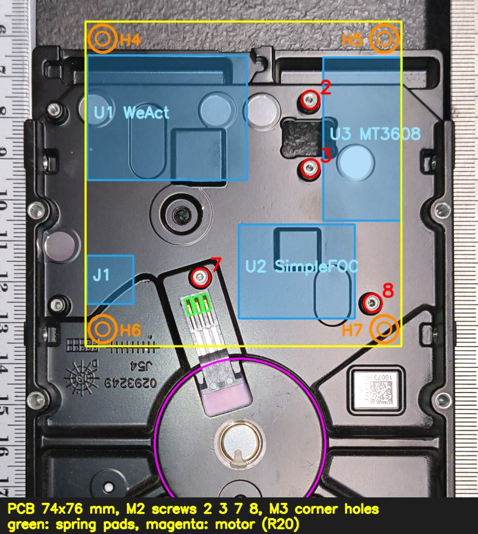

# HDD spindle driver board

A carrier PCB that screws to the underside of the gutted 3.5" hard drive. It
drives the spindle motor through the drive's own **spring contacts**, so the
magnet disc in `../disk/` can spin at 3000 rpm.

- **MCU:** WeAct Studio STM32G474CEU6 **Core Board** (the square 36 × 28 mm
  board), on sockets.
- **Motor driver:** SimpleFOC Mini v1.0 (TI DRV8313), on sockets, driven in
  3-PWM mode from TIM1.
- **Motor supply:** external 12 V on a screw terminal, or USB through an
  MT3608 boost module (5 V → 12 V). Jumper JP1 selects between them.
- **Supply monitor:** VM ÷ 11 into an ADC pin.

KiCad 10 project: `hdd-driver.kicad_pro`. The schematic passes ERC with 0
violations. The PCB is placed but **not routed**: DRC reports only the 45
unrouted connections.



## Files

| Path | Content |
|------|---------|
| `hdd-driver.kicad_sch`, `.kicad_pcb`, `.kicad_pro` | Schematic and PCB. They were generated once by script and are now the source: edit them in KiCad. |
| `sym-lib-table`, `fp-lib-table` | Project libraries `hdd-driver` (paths use `${KIPRJMOD}`) |
| `lib/hdd-driver.kicad_sym` | Symbols: `WeAct_STM32G474_CoreBoard`, `SimpleFOC_Mini_v1.0`, `MT3608_Boost_Module`, `HDD_Motor_SpringContacts` |
| `lib/hdd-driver.pretty/` | Footprints for those parts, plus `MountingHole_2.4mm_M2_Pad` and `MountingHole_3.2mm_M3_Pad` |
| `lib/3d/*.step` | Module models (WeAct, SimpleFOC Mini, MT3608) with pins-down headers |
| `lib/3d/src/` | WeAct's original STEP, the same STEP with its headers stripped, and the KiCad source boards the module models are exported from |
| `scripts/export-test-model` | Fit-test 3D models; see [Checking the fit](#checking-the-fit) |
| `scripts/module-models/` | Regenerates `lib/3d/*.step` (`make-module-models`) |
| `scripts/library/` | Generators that made the symbols and footprints, plus a small S-expression helper. Rerunning them overwrites edits made in KiCad. |
| `scripts/photo/rectify_underside.py` | The photo measurement behind the board geometry |
| `doc/` | Images: candidate holes, outline options, final layout on the photo |

## Mechanics

### Drive frame

All drive positions are in a **drive frame**: a bottom view as photographed,
with the connector end at the top.

- **X** runs to the right from the drive's centre line.
- **Y** runs down from the connector end.
- The PCB's aux and grid origins sit at the drive-frame origin, which is
  KiCad position (150, 40) mm. Set the KiCad coordinate display to the grid
  origin and positions read directly in this frame.

The positions come from `../disk/hdd-photos/07-hdd-underside-width-ruler.jpg`.
That photo is taken at an angle, and its rulers lie about 26 mm below the
underside of the drive, so ruler scale is no use here (on the rectified image
the rulers read about 2 % short). Instead, the photo was rectified with a
homography fitted to the four **SFF-8301 bottom mounting holes**. Those holes
are 95.25 mm apart across the drive, 41.28 mm from the connector end, with
the second pair 44.45 mm further down. Expect about ±0.5 mm on the features
below. `scripts/photo/rectify_underside.py` has the method and the pixel
data.

| Feature | X | Y | Notes |
|---|---|---|---|
| Screw hole 2 | 16.69 | 15.29 | M2, holds the PCB |
| Screw hole 3 | 16.73 | 31.27 | M2, holds the PCB |
| Screw hole 7 | −9.05 | 56.92 | M2, holds the PCB **and** the spring-contact block |
| Screw hole 8 | 31.29 | 62.90 | M2, holds the PCB |
| Screw holes 1, 6 | −43.37 / −42.58 | 17.63 / 63.39 | Not used: a plain rectangle cannot reach them without a notch around SFF hole 4 |
| SFF holes 4, 5, 9, 10 | ±47.625 | 41.28 / 85.73 | Drive mounting holes (6-32) on the side rails; outside the PCB |
| Spring contacts 1–3 (tips) | −11.83 / −9.83 / −7.87 | 63.67 / 63.17 / 62.60 | 2.0 mm pitch, about 6.0 mm from screw 7, strip turned 13.5° |
| Spindle axis | 0.2 | 95.9 | The large circle (R ≈ 20) |

`doc/hdd-underside-candidate-holes.jpg` shows the hole numbering.

### PCB

- **Outline:** a plain rectangle, X −36…38 and Y 0…73 (74 × 73 mm), 1.6 mm
  thick. It started as option B in `doc/outline-options.jpg` (Y 12…88). The
  first test print showed that the bottom edge sat on the motor, so the
  outline moved 15 mm towards the connector end. It now ends about 3 mm short
  of the motor circle. The top edge used to reach 3 mm past the drive's
  connector end; it was cut back to sit flush with it. The sides still clear
  the rail bulges around SFF holes 4 and 5.
- **Edge keepout:** component courtyards stay 1 mm clear of the board edge.
  The rule area `EdgeKeepout` (a 1 mm frame inside the outline) and the
  custom rule in `hdd-driver.kicad_dru` enforce this in DRC. Footprints
  excluded from the BOM (the mounting holes and other copper-only parts) are
  exempt.
- **GND pours:** `GND_TOP` on F.Cu and `GND_BOTTOM` on B.Cu cover the whole
  board (0.3 mm clearance, thermal reliefs). The rule area
  `J2_SpringKeepout` (J2's B.CrtYd) keeps the bottom pour and vias away from
  the spring pads. 0.6/0.3 mm GND stitching vias run about every 5 mm round
  the edge and on a 10 mm grid inside, only where both pours have copper.
- **Mounting:** four M2 screws in holes 2, 3, 7 and 8. Holes are 2.4 mm
  (ISO 273 medium fit), plated with a 4.2 mm pad, and tied to GND.
- **Corner holes H4–H7:** M3 (3.2 mm, plated, 6.4 mm pad, on GND), 4 mm in
  from each edge, at X −32 / 34 and Y 4 / 69. They are optional: for rubber
  feet, or for spacers to a housing. H6/H7 courtyards are kept free of parts
  on both sides. Since the top edge was cut back, H4 and H5 overlap the
  courtyards of U1 (WeAct) and U3 (MT3608); DRC reports this, and it is
  still open.
- **Spring contacts:** footprint `HDD_SpringContacts_3P_P2.0mm`, placed on
  screw 7 and rotated 13.5°. Three 1.4 × 4.0 mm pads on **B.Cu**, the side
  facing the drive. The pad centres lie within 0.2 mm of the measured spring
  tips. Order the board with ENIG (gold) finish for these pads.
- **Modules** on top, away from the drive:
  - WeAct board at the top left, with its USB-C facing the left edge.
  - MT3608 upright at the right, between holes 2/3 and the edge.
  - SimpleFOC Mini in the lower middle, between the MT3608 and hole 8,
    turned 180°.
  - JP1 between the WeAct board and holes 2/3; C1 and C2 next to the
    SimpleFOC `+` pad.
  - The 12 V screw terminal J1 at the lower left, wire entry facing out,
    with D1 beside it.
- **Stacking heights:**
  - 2×12, 2×5, 1×3 and 1×1 female sockets: 8.5 mm.
  - Male header plastic on the modules: 2.54 mm.
  - So each module PCB sits 11.04 mm above the carrier.
  - The MT3608 sits on its pins, 2.54 mm above the carrier.
  - The highest point is the WeAct board, about 16 mm above the carrier's
    top surface; the MT3608 trimmer reaches about 15 mm.
  - The drive needs feet at least that high when it stands on its underside.

## Electronics

```
J1 12V IN ─ D1 SS54 ─┬─ +12V ── JP1.1 ┐
 (reverse polarity)  │                ├─ JP1.2 = VM ─┬─ SimpleFOC "+" ── DRV8313 VM
                     │   VBOOST ─ JP1.3 ┘            ├─ C1 470 µF + C2 100 nF
                     │      ▲                         └─ R1 100k / R2 10k ─ VM_SENSE ─ PA0
                     │   U3 MT3608 (set to 12 V)
                     │      ▲
                     └─ D2 B5819W ─ VCC_MCU ─ WeAct VCC (LDO input, 3.3–20 V)
                                    ▲
                     USB VBUS ─ WeAct's own B5819W ┘
```

- **JP1 1-2:** the motor runs from the external 12 V. D2 also feeds the WeAct
  `VCC`, so the MCU runs without USB. WeAct's own VBUS diode keeps the 12 V
  away from the USB host.
- **JP1 2-3:** the motor runs from USB. WeAct `VCC` (VBUS minus a Schottky
  drop, about 4.6 V) feeds the MT3608, and its 12 V output becomes VM. **Set
  the trimmer to 12 V before fitting the jumper.** The DRV8313 needs
  VM ≥ 8 V (UVLO), so USB 5 V can't drive it directly. USB current (and the
  1 A WeAct diode) limit the motor power in this mode.

| Signal | MCU pin (WeAct header) | SimpleFOC Mini | Notes |
|---|---|---|---|
| DRV_IN1 | PA8, TIM1_CH1 AF6 (P1.10) | IN1 (H1 pin 3) | |
| DRV_IN2 | PA9, TIM1_CH2 AF6 (P1.11) | IN2 (5) | |
| DRV_IN3 | PA10, TIM1_CH3 AF6 (P1.12) | IN3 (7) | |
| DRV_EN | PB12 (P1.5) | EN (9) | 10 kΩ into EN1–3, 100 kΩ pull-downs: the driver is off at reset |
| DRV_nFAULT | PB13 (P1.6) | nFT (10) | Open drain, 10 kΩ pull-up on the module |
| DRV_nSLEEP | PB14 (P1.7) | nSP (8) | |
| DRV_nRESET | PB15 (P1.8) | nRT (6) | |
| VM_SENSE | PA0, ADC1_IN1 (P2.20) | — | VM / 11; 35 V gives 3.18 V |
| PH_A/B/C | — | M1/M2/M3 | To the spring pads. Phase order only sets the direction of rotation. |

- **SimpleFOC:** `BLDCDriver3PWM driver(PA8, PA9, PA10, PB12);`. The HDD
  motor has no sensors, so start with open-loop velocity control. The VR
  pickup on the disc (60 pulses/rev) can provide speed feedback later.
- **Phase current:** an HDD spindle motor has only a few ohms per phase.
  Keep `voltage_limit` low, or the DRV8313 overcurrent protection
  (3 A min / 5 A typ) will trip.
- **Module 3V3:** the SimpleFOC Mini's `3V3` is the DRV8313's 10 mA
  regulator output. It is left unconnected.
- **More pin facts:** `../datasheets/weact_stm32G474/README.md` (WeAct board)
  and `../datasheets/drv8313/README.md` (SimpleFOC Mini).

## Checking the fit

```sh
scripts/export-test-model                  # -> build/test-model/
scripts/export-test-model --thickness 2.4  # stiffer print, same hole positions
```

This makes a copy of the PCB with the three spring pads replaced by
through-slots of the same size and angle, and exports:

- `test-board.stl` / `test-board.step`: the bare board with every hole, in
  drive-frame coordinates.
- `test-assembly.step`: the board with the module models.

To check:

1. Print `test-board.stl`.
2. Screw it on with the M2 screws in holes 2, 3, 7 and 8.
3. Look through the slots: each spring tip should sit in the middle of its
   slot, and the print should lie flat.

If something is off, move the parts in the PCB rather than in the scripts.
The spring pads belong to footprint J2; move or rotate J2 around screw 7.
The holes are H1, H2 and H3.

The first print (2026-10-25) confirmed the four M2 holes and the three
spring slots. The outline was then moved 15 mm away from the motor; see
[PCB](#pcb).

## Before ordering

- [x] Test print: M2 holes and spring slots fit (first print).
- [ ] Reprint after the outline move: the bottom edge clears the motor, and
      the top edge past the connector end touches nothing.
- [ ] **Bottom side faces the metal base.** Socket and terminal leads stick
      out about 1.5 mm, and the board sits flat against the bosses. Either
      cut the leads flush and insulate the bottom (Kapton), or check on the
      test print where the base is recessed. Raising the board on spacers
      would also lift it off the springs.
- [ ] MT3608 pad positions: modules differ between vendors. Measure yours
      against footprint `MT3608_Boost_Module` (VIN−/VIN+ 7.87 mm apart,
      31.2 mm between input and output pads).
- [ ] Route the board. Use wide traces (≥ 0.8 mm) for VM, GND and PH_A/B/C,
      and GND pours on both layers, kept clear of the spring pads.
- [ ] Confirm that the J1 screw terminal's wire entry faces the board edge in
      the 3D view.

## Regenerating generated files

| What | Command | Needs |
|---|---|---|
| Fit-test models | `scripts/export-test-model` | KiCad 10 (`kicad-cli` and its bundled Python) |
| Module STEP models | `scripts/module-models/make-module-models` | KiCad 10. Add `--strip` with `OCP_PYTHON=<python with cadquery-ocp>` to redo the WeAct header stripping. |
| Symbols / footprints | `python3 scripts/library/gen_symbols.py`, KiCad Python `scripts/library/gen_footprints.py` | Overwrites lib edits |
| Photo measurement | `python3 scripts/photo/rectify_underside.py PHOTO [OUT.png]` | opencv-python, numpy |

The schematic and PCB were made by one-off scripts that are not kept here.
Edit them in KiCad.

## Sources

- **SFF-8301 Rev 1.9** (3.5" form factor):
  https://members.snia.org/document/dl/25862
- **WeAct STM32G474 Core Board:**
  https://github.com/WeActStudio/WeActStudio.STM32G474CoreBoard, via
  `../datasheets/weact_stm32G474/`
- **SimpleFOC Mini v1.0:** https://github.com/simplefoc/SimpleFOCMini (tag
  `v1.0`), via `../datasheets/drv8313/`
- **MT3608 module drawing:**
  https://components101.com/modules/mt3608-2a-dc-dc-step-up-power-module
